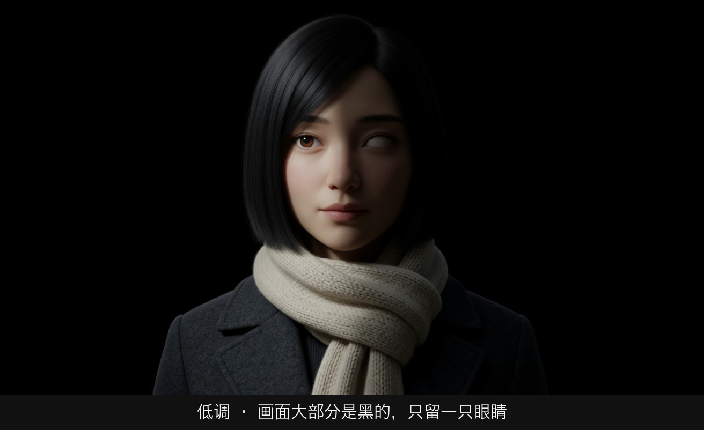
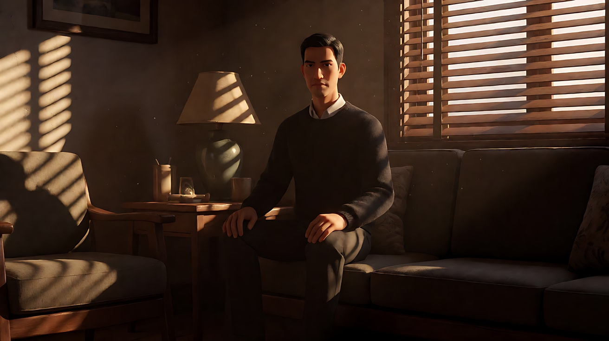
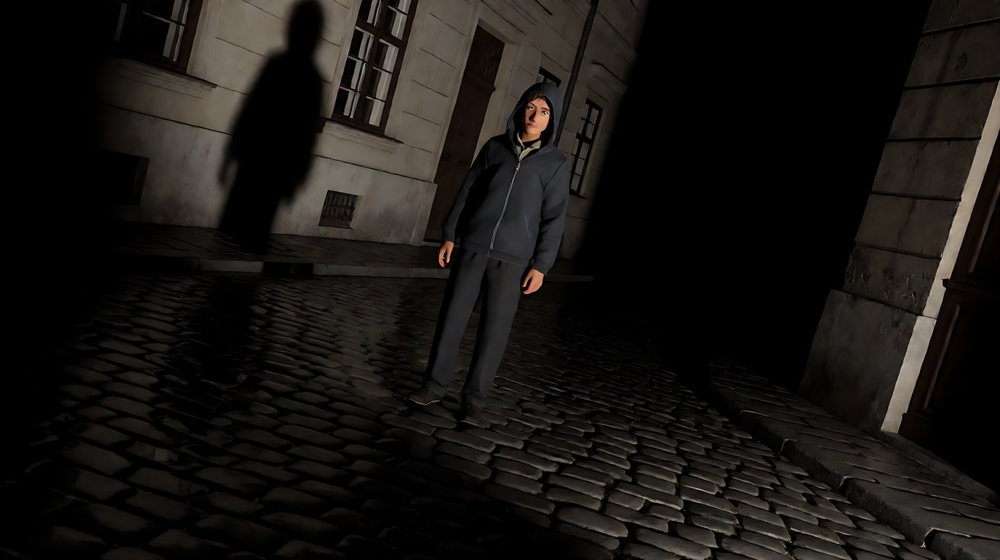
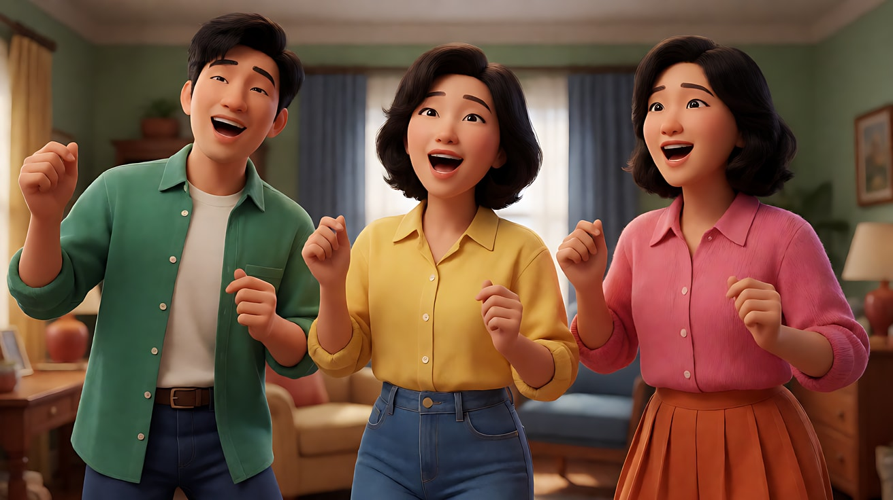
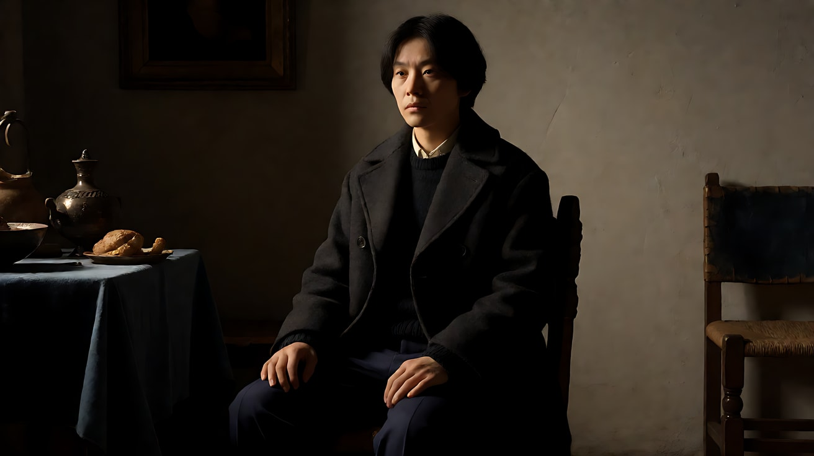

# L04-05 高调、低调与明暗对照

> 段位：进阶 ｜ 建议用时：55 分钟 ｜ 配套提示词：[L04-05-高调低调与明暗对照-提示词](../提示词/L04-05-高调低调与明暗对照-提示词.md)

## 学习目标

- 能分辨高调（High-key）与低调（Low-key）画面，并说出它们背后的明暗比与暗部比例
- 理解明暗对照法（Chiaroscuro）的来源与作用：用黑暗"藏"信息
- 能设计百叶窗条纹光、门缝光等"图形化阴影"，并说出它们的叙事含义
- 能根据类型片（喜剧、广告、黑色电影、惊悚）选择画面调性

## 一、概念讲解

### 1. "调"是整个画面的亮度分布

"高调""低调"不是说画面亮或暗，而是**画面里大部分面积落在哪个亮度区间**，以及**明暗比**有多大。

```
  高调 High-key                         低调 Low-key

  亮度分布（左暗右亮）                     亮度分布（左暗右亮）
  │                       ▇▇              │▇▇
  │                    ▇▇▇▇▇              │▇▇▇▇
  │                ▇▇▇▇▇▇▇▇▇              │▇▇▇▇▇▇
  │          ▂▂▇▇▇▇▇▇▇▇▇▇▇▇              │▇▇▇▇▇▇▇▇▂▂
  └─────────────────────────→           └─────────────────────────→
   暗              中             亮        暗              中             亮

  ● 大面积亮、白、浅色                     ● 大面积暗、黑
  ● 明暗比低（约 2:1 以内）                ● 明暗比高（8:1 以上）
  ● 阴影浅、少、软                         ● 阴影深、多、常常是硬边
  ● 辅光充足，背景也被照亮                  ● 少辅光甚至无辅光，背景沉黑
```

注意：一个夜景不一定是低调（可以是霓虹灯下的明亮街道），一个白天也不一定是高调（可以是只有一束窗光的暗室）。决定调性的是**布光选择**，不是时间。

### 2. 高调：没有秘密的世界

- **怎么做**：大面积柔光、充足的辅光、浅色背景、浅色服装、低明暗比。
- **常用于**：喜剧、歌舞片、广告、儿童片、医院与实验室（冷高调）、天堂与梦境。
- **观众感受**：安全、轻松、开放、诚实，什么都摊在阳光下。
- **变体**：冷色高调（白墙、冷光、无影）会变成"无菌、监控、空虚"——同样是高调，冷暖不同，意义相反。

### 3. 低调：黑暗是主角

- **怎么做**：一个强主光，几乎不补光，背景沉入黑暗，用硬光切出形状。
- **常用于**：黑色电影、犯罪片、惊悚、恐怖、心理戏、权力人物。
- **观众感受**：私密、危险、压抑、有东西被藏起来。
- **关键**：低调不是"曝光不足"。画面里一定有**明确的亮部**（一张脸、一只手、一个物件），黑暗是为了让这块亮更重要。

### 4. 明暗对照法 Chiaroscuro

意大利语 chiaro（明）+ scuro（暗）。源自文艺复兴到巴洛克时期的绘画，卡拉瓦乔把它推到极致：一束强烈的侧上方光从黑暗里"挖"出人物，其余全部是黑。

```
   ┌──────────────────────────────────┐
   │██████████████████████████████████│
   │████████████  ╱ 一束光 ███████████│
   │██████████  ╱                ██████│
   │████████  ╱    ░░░▒▒▓        █████│
   │██████  ●    ░▒▓[脸]▓▒░      █████│   亮部只占画面一小块
   │████████     ░▒▓[手]▓▒░      █████│   其余全部沉入黑暗
   │██████████     ░▒▒▒░       ███████│   观众只能看光让他看的
   │██████████████████████████████████│
   └──────────────────────────────────┘
```

电影里的 chiaroscuro 用来**控制信息**：导演决定观众看见什么、看不见什么。看不见的部分，观众会自己用恐惧或想象填满。

### 5. 图形化阴影：百叶窗、门缝、栏杆

阴影本身可以成为画面里的"道具"。

```
   百叶窗条纹光（侧视）

     窗外强光                  墙面 / 人物
       ☀  ═══════════════════>  ▓▓▓▓▓▓▓▓
          ═══ 百叶片 ═══         ░░░░░░░░
       ☀  ═══════════════════>  ▓▓▓▓▓▓▓▓
          ═══ 百叶片 ═══         ░░░░░░░░
       ☀  ═══════════════════>  ▓▓▓▓▓▓▓▓

   结果：明暗相间的横条纹落在脸上和墙上
   → 像牢笼的栏杆，像被切碎的人格，像谎言里的真话
```

| 图形阴影 | 制造方式 | 叙事含义 |
|---|---|---|
| 百叶窗条纹 | 强硬光穿过百叶窗 | 囚禁、分裂、欺骗、黑色电影的标志 |
| 门缝光 | 门开一条缝，一道窄光切进暗房 | 窥视、闯入、真相开始泄露 |
| 栏杆 / 楼梯扶手影 | 硬光斜照扶手 | 困住、被监视 |
| 窗格十字影 | 阳光穿过窗格 | 宗教感、审判、家的框架 |
| 树叶斑驳光 | 阳光穿过树叶 | 温柔、怀旧（软化版的图形阴影） |

图形阴影必须用**硬光**（小而远的光源），软光做不出清晰的条纹。

## 图解

> 这些示意图由多种生图模型分别生成（包括 Nano Banana、GPT Image 等），只用来说明镜头概念；不同模型的画面不能互相比较效果，也不能当作视频成片。


亮部占满画面，影子很少，空气是开的。



画面大部分是黑的，只留一只眼睛和一小块脸。观众的注意力没有别的地方可去。

## 二、情绪与叙事功能

| 技法 | 观众的感受 | 常用场景 |
|---|---|---|
| 暖色高调 | 轻松、安全、什么都不用担心 | 喜剧、家庭片、食品与日用品广告 |
| 冷色高调 | 干净但空洞、被观察 | 医院、实验室、科幻、未来公司 |
| 低调 | 秘密、危险、诱惑 | 黑色电影、犯罪、惊悚 |
| 明暗对照 | 只看光让你看的，其他自己想象 | 揭示、审问、宗教、权力 |
| 百叶窗条纹 | 被困、被切割、不可信 | 侦探办公室、诱惑场景、审讯 |
| 门缝光 | 窥视、闯入 | 悬疑、恐怖、秘密被发现 |
| 从高调转到低调 | 世界开始变坏 | 剧情转折（L04-07 展开） |

## 三、经典影片案例

### 《双重赔偿》（1944，比利·怀尔德；摄影：约翰·F·塞茨）
- 场景：保险推销员沃尔特第一次走进迪特里克森家的客厅，以及之后两人密谋的室内戏。
- 怎么拍的：午后的阳光穿过百叶窗，在幽暗的室内切出一条条明暗相间的光带，空气里能看见浮动的灰尘；人物在条纹光和阴影之间进出。
- 为什么这样拍：百叶窗的条纹像栏杆，提前告诉观众"这两个人正在走进一个出不去的笼子"。这部电影是美国黑色电影的奠基作之一，条纹光也成了这个类型最容易辨认的视觉符号。



### 《第三人》（1949，卡罗尔·里德；摄影：罗伯特·克拉斯克）
- 场景：战后维也纳的夜晚街道，湿漉漉的石板路，巨大的人影投在墙上。
- 怎么拍的：极强的硬光从低处或侧面打出，街道大面积沉在黑暗里，湿地反光，建筑墙面上投出被拉长的巨大影子；大量倾斜构图。
- 为什么这样拍：一个被战争撕碎、道德模糊的城市，不能用"明亮"去拍。低调和长影让每个角落都可能藏着人。克拉斯克凭此片获得奥斯卡最佳黑白摄影。



### 《雨中曲》（1952，吉恩·凯利、斯坦利·多南）——高调对照
- 场景：歌舞段落，例如三位主角在屋子里边唱边跳的段落。
- 怎么拍的：明亮、均匀的彩色片厂布光，饱满的颜色，几乎没有深阴影，演员的脸和动作始终清楚可见。
- 为什么这样拍：歌舞片要观众放松地看清每一个舞步，高调光就是"这里没有危险，只有快乐"的承诺。把它和《第三人》放在一起看，你会立刻明白"调"是一种情绪契约。



### 补充：卡拉瓦乔的绘画
去看《圣马太蒙召》：一束斜光从画面右上方射入暗室，照亮桌边的人群，其余全是黑暗。明暗对照的"光就是叙事"在这幅画里一目了然。



## 四、在 AI 中怎么实现

- **生图阶段**：
  - 高调：`high-key lighting, bright soft even light, light pastel background, minimal shadows, low contrast`。
  - 低调：`low-key lighting, a single hard key light from frame left, no fill, the background falls into deep black, only her face and hands are lit`。
  - 百叶窗：`hard late-afternoon sunlight through venetian blinds casting sharp parallel stripes of light and shadow across his face and the wall`。
  - 低调一定写"哪里是亮的"，否则模型会生成一张整体发灰的暗图。
- **视频阶段**：
  - 百叶窗条纹会随人物移动而在脸上"滑动"，这是很好的动态效果，写出来："他向前探身，条纹光从额头滑到嘴唇。"
  - 门缝光可以动态打开："门缝慢慢变宽，一道窄光在地板上展开。"
  - 低调画面里人物动作要更少、更慢，太多动作会被黑暗吃掉。
- **模型擅长**：百叶窗条纹、门缝光、单侧硬光、白底高调产品与人像。
- **要避开**：
  - 低调写得太暗、不写亮部——生成一团灰黑噪点。
  - 高调写"过曝"——容易丢失脸部细节。写"明亮柔和、细节清楚"。
  - 百叶窗条纹同时写"软光"——条纹会糊掉。
  - 黑色电影题材里写危险道具的触发词——改为中性描述（见写作规范 3.6）。

## 五、练习作业

1. **调性分类**：找五张电影海报或剧照，按"暖高调 / 冷高调 / 低调 / 明暗对照"分类，写出你判断的依据。
2. **百叶窗实验**：晴天下午拉下家里的百叶窗或用一把梳子挡住手电，观察条纹光落在墙上和手上的样子，拍照记录。
3. **同一个剧本，两种调**：把"一个女人在办公室里打开一封信"分别写成喜剧高调版和黑色电影低调版，各写一句光的描述和一个动作。
4. 完成配套提示词练习 1–5。

## 六、自检清单

- [ ] 我能根据亮度分布和明暗比判断高调和低调
- [ ] 我知道低调画面一定要有明确的亮部
- [ ] 我能说出 chiaroscuro 的来源和作用
- [ ] 我写百叶窗和门缝光时用的是硬光
- [ ] 我知道冷色高调和暖色高调意义不同
- [ ] 提示词里没有危险触发词

## 七、配套提示词

→ [L04-05-高调低调与明暗对照-提示词](../提示词/L04-05-高调低调与明暗对照-提示词.md)

---

上一课：[L04-04 自然光与时间](L04-04-自然光与时间.md) ｜ 下一课：[L04-06 色彩心理与调色风格](L04-06-色彩心理与调色风格.md) ｜ [返回总目录](../../README.md)
