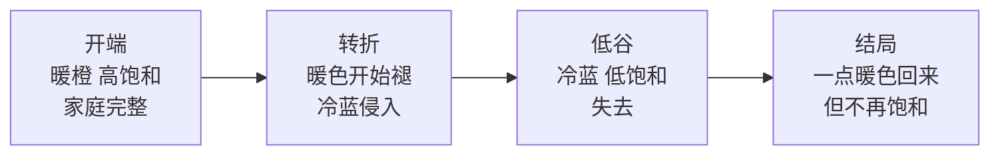
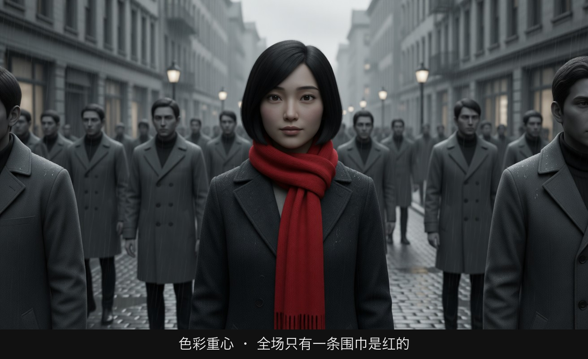
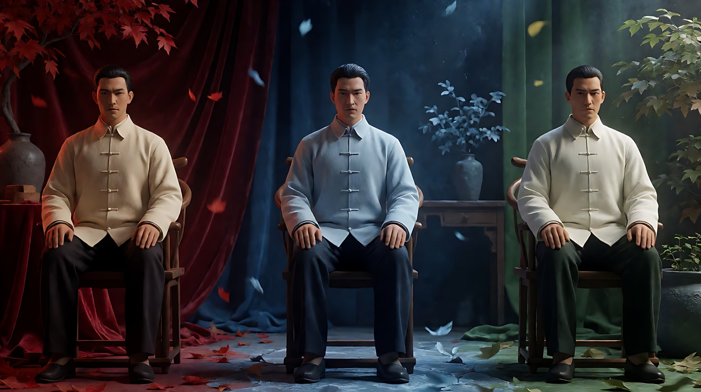
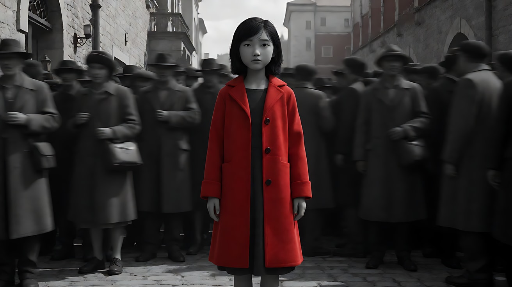
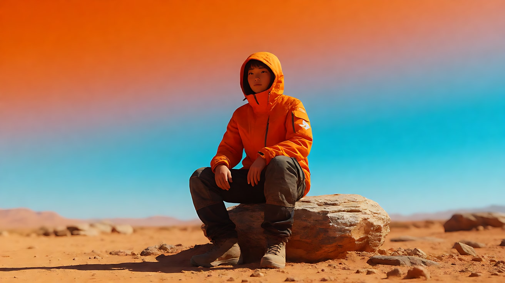
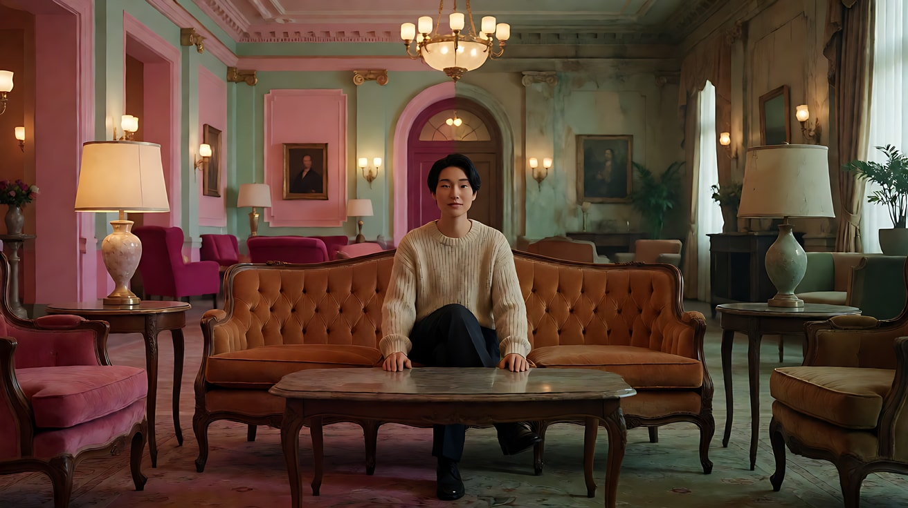

# L04-06 色彩心理与调色风格

> 段位：进阶 ｜ 建议用时：60 分钟 ｜ 配套提示词：[L04-06-色彩心理与调色风格-提示词](../提示词/L04-06-色彩心理与调色风格-提示词.md)

## 学习目标

- 能说出主要色相的常见情绪联想，并知道这些联想会随文化和语境改变
- 能用色环解释互补色、类比色，并设计一个画面的"主色 + 强调色"
- 理解青橙调（Teal & Orange）为什么流行、什么时候会变成套路
- 能区分低饱和与高饱和、单色调与多色调各自的叙事用途
- 能为一段多镜头叙事设计"色彩弧线"：色彩随剧情变化

## 一、概念讲解

### 1. 色彩的三个参数

```
  色相 Hue          饱和度 Saturation         明度 Value
  是什么颜色          颜色有多"纯"               有多亮

  红 橙 黄 绿 青 蓝 紫   灰 ░▒▓█ 纯色            黑 ░▒▓█ 白
```

调色师调的从来不是"感觉"，而是这三个数：画面里有哪几种色相、它们多纯、多亮。

### 2. 色相与情绪（常见联想，不是定律）

| 色相 | 常见正面联想 | 常见负面联想 | 电影里常承载 |
|---|---|---|---|
| 红 | 热情、爱、喜庆（在中国文化中尤其如此） | 危险、愤怒、警告 | 欲望、暴力的预告、关键物件 |
| 橙 | 温暖、活力、夕阳 | 廉价、燥热 | 家、回忆、沙漠 |
| 黄 | 明亮、童真、希望 | 病态、焦虑（偏绿的黄） | 快乐的过去、疯狂 |
| 绿 | 自然、生机、安宁 | 腐坏、毒、不安（荧光绿） | 生命 / 异化、科技监控 |
| 青 / 蓝 | 冷静、理性、忧郁、夜 | 冷漠、孤独 | 距离、科技、悲伤、梦 |
| 紫 | 神秘、高贵、浪漫 | 病态、哀悼 | 魔幻、超自然 |
| 白 | 纯净、天堂、新生 | 空虚、无菌、在东亚语境中也是丧事 | 真相、死亡、医院 |
| 黑 | 庄重、权力、优雅 | 死亡、未知 | 秘密、恐惧 |

**关键提醒**：色彩情绪高度依赖语境。同样是红，春节灯笼是喜庆，警示灯是危险。**颜色的意义要由故事建立**，而不是靠观众背诵色彩心理学。

### 3. 色环：互补色与类比色

```
                    黄
              黄绿        橙黄
          绿                    橙
        青绿          ●           红橙
          青                    红
              青蓝        红紫
                    蓝    紫

  互补色：色环上正对面的两色（橙 ↔ 青蓝、红 ↔ 青绿、黄 ↔ 紫）
          → 对比强烈，彼此"推开"，适合冲突、分裂、主体突出

  类比色：色环上相邻的 2–3 色（黄 + 橙 + 红、青 + 蓝 + 紫）
          → 和谐统一，适合一种情绪的沉浸

  主色 + 强调色：大面积类比色铺底 + 一小块互补色做焦点
          → 观众的眼睛会被那一小块直接抓走
```

| 配色结构 | 观感 | 例子 |
|---|---|---|
| 互补色 | 冲突、张力、主体跳出 | 冷蓝夜景里一件橙色外套 |
| 类比色 | 统一、沉浸、温柔或压抑 | 全片黄绿色调的回忆段落 |
| 单色调 | 极度统一，近乎情绪本身 | 整个场景只有深浅不同的蓝 |
| 主色 + 强调色 | 视线引导 | 灰色人群中一把红伞 |

### 4. 青橙调：为什么到处都是

人的皮肤是橙色系。把阴影和背景推向它的互补色青色，皮肤就会"跳"出来，同时画面有了冷暖对比。这就是商业大片中青橙调泛滥的原因。

```
   阴影 / 背景  → 推向青蓝 ■■■
   中间调 / 皮肤 → 保持或推向橙 ■■■
   结果：人物从背景里"弹出来"，冷暖分离
```

- **适合**：动作片、都市夜景、科幻，冷环境里的温暖人物。
- **变成套路的时候**：每个镜头都青橙，不管剧情是什么。这时色彩不再有意义，只是"看起来贵"。
- **原则**：如果你用青橙，要能回答"为什么这场戏需要冷暖分离"。

### 5. 饱和度：情绪的音量

| | 低饱和 | 高饱和 |
|---|---|---|
| 观感 | 克制、真实、冷、旧、疲惫 | 浓烈、梦幻、狂热、童话、人工 |
| 常用于 | 战争、现实主义、回忆褪色、压抑的日常 | 歌舞、奇幻、喜剧、霓虹都市、梦境、高潮 |
| 风险 | 过度会显得脏、闷 | 过度会显得廉价、像滤镜 |

**单色调与去色**：把整个画面压成一种色相（全蓝、全琥珀），或干脆黑白，可以让观众进入一种"情绪本身"的状态。此时**唯一保留的颜色**会变得极其重要。

### 6. 色彩叙事：颜色是一条弧线

色彩最强的用法不是"这一场是什么颜色"，而是**颜色随剧情变化**：



设计色彩弧线的三步：

1. **给颜色一个意义**：在故事早期，让某种颜色和某个人、某件事绑在一起（她的黄雨衣 = 她）。
2. **让颜色随关系变化**：她离开后，画面里黄色越来越少。
3. **用颜色完成结局**：最后一个镜头里，一点黄色重新出现——观众不需要台词就懂了。

### 7. 色彩的"载体"

在 AI 提示词里，颜色必须挂在具体的东西上：

| 载体 | 例子 |
|---|---|
| 光的颜色 | 暖黄台灯、冷蓝月光、粉色霓虹 |
| 服装 | 一件红色毛衣 |
| 美术陈设 | 薄荷绿墙面、橙色沙发 |
| 环境 | 金色麦田、灰蓝色海 |
| 整体调色 | 低饱和、阴影偏青、高光偏暖 |

## 图解

> 这些示意图由多种生图模型分别生成（包括 Nano Banana、GPT Image 等），只用来说明镜头概念；不同模型的画面不能互相比较效果，也不能当作视频成片。




周围的人都是灰的，只有她的围巾是饱和的红。一个画面里只放一个强色块，眼睛就会落在那里。

## 二、情绪与叙事功能

| 技法 | 观众的感受 | 常用场景 |
|---|---|---|
| 暖色类比 | 温暖、回忆、包裹 | 家、童年、爱情开端 |
| 冷色类比 | 疏离、理性、悲伤 | 城市孤独、科幻、失去 |
| 互补色同框 | 冲突、对立、分裂 | 两个人物或两种力量对抗 |
| 主色 + 强调色 | 视线被抓住，"这个很重要" | 线索、关键人物、象征物 |
| 青橙调 | 人物突出、动作感 | 动作片、都市夜戏 |
| 单色调 | 沉浸在一种情绪里 | 梦境、记忆、极端心境 |
| 去色 + 一点颜色 | 那一点颜色成为符号 | 象征、命运、纯真 |
| 低饱和 | 真实、疲惫、克制 | 战争、现实题材、冬天 |
| 高饱和 | 狂热、童话、人工 | 歌舞、奇幻、霓虹 |
| 色彩随剧情变化 | 不需要台词就感到关系变了 | 爱情弧线、成长、失去 |

## 三、经典影片案例

### 《英雄》（2002，张艺谋；摄影：杜可风）
- 场景：无名向秦王讲述的几个不同版本的刺秦故事。
- 怎么拍的：每个版本用一种主色统治整个段落——红色段落里服装、布幔、落叶都是红；蓝色段落是蓝；还有绿色与白色的段落。服装、美术、光、环境全部服从同一种色相。
- 为什么这样拍：颜色成了"这是哪一个版本的真相"的标签。观众不需要字幕，看颜色就知道故事换了说法。色彩在这里直接承担叙事结构。



### 《辛德勒的名单》（1993，史蒂文·斯皮尔伯格；摄影：雅努什·卡明斯基）
- 场景：克拉科夫犹太区被清洗时，人群中一个穿红外套的小女孩。
- 怎么拍的：全片几乎是黑白，只有这个小女孩的外套是红色。后来，那件红外套在另一个场景中再次出现。
- 为什么这样拍：在黑白的历史影像感里，一点红色把"成千上万"变成"一个具体的孩子"，也让辛德勒（和观众）无法再视而不见。这是"去色 + 一点颜色"的教科书。



### 《疯狂的麦克斯：狂暴之路》（2015，乔治·米勒；摄影：约翰·西尔）
- 场景：白天的沙漠追逐与夜晚的沼泽 / 荒原段落。
- 怎么拍的：白天被推向极度饱和的橙色与青蓝天空，夜景被处理成浓重的深蓝色。整部片的色彩比现实强烈得多。
- 为什么这样拍：一个疯狂的世界，用极端的互补色和高饱和度来呈现，观众的眼睛也处在持续的"过热"中；深蓝夜景则让短暂的喘息有了明显的温度差。



### 《布达佩斯大饭店》（2014，韦斯·安德森；摄影：罗伯特·约曼）
- 场景：不同年代的大饭店。
- 怎么拍的：1930 年代的饭店是粉色、紫红、薄荷绿等高饱和粉彩；1960 年代的饭店变成褪色的橙棕与绿色，显得陈旧冷清；不同年代还配合了不同画幅。
- 为什么这样拍：同一个空间，颜色变了，就是时代变了、繁华不在了。这是"色彩随剧情（时间）变化"的直观案例。



## 四、在 AI 中怎么实现

- **生图阶段**：
  - 写配色结构，而不是写"好看的颜色"：`a muted palette of grey-blue and slate, with a single mustard-yellow raincoat as the only warm accent`。
  - 写调色方向：`low saturation, shadows pushed toward teal, skin tones kept warm`。
  - 单色调：`monochromatic deep blue palette, every object in shades of blue`。
  - 把颜色挂在载体上：服装、墙、光、道具。
- **视频阶段**：
  - 在【画风】里写整体色调，例如"低饱和，阴影偏青，肤色保持暖色"。
  - 多镜头色彩弧线：在每个镜头块写这个镜头的主色，在【锁定】里写"强调色物件（黄雨衣）在所有镜头中颜色不变"。
  - 去色 + 一点颜色：写"画面近乎黑白，只有她的红围巾保持鲜红"。模型基本能做到，但可能"漏色"，需要在约束里强调。
- **模型擅长**：整体色调、单色调、强调色物件、霓虹高饱和。
- **要避开**：
  - "电影调色""高级色调"——空泛，模型会默认套青橙。
  - 写某部电影或某位导演的配色名——违反规范，也不稳定。改写成具体的色相、饱和度和载体。
  - 写太多颜色（"红黄蓝绿紫"）——画面会花。一个画面最多一个主色系 + 一个强调色。
  - 黑白画面里保留颜色时，同时写多个彩色物件——颜色会漏到其他地方。只保留一件。

## 五、练习作业

1. **拆色**：暂停一部你喜欢的电影的任意三帧，用取色工具各提取五个颜色，判断它是互补、类比还是单色调。
2. **主色 + 强调色**：为"雨天的车站，一个人在等另一个人"设计配色：写出主色系、强调色和它挂在什么载体上。
3. **色彩弧线**：为一个三幕的小故事（相遇 → 争吵 → 和好）各写一种主色和饱和度，并说明为什么。
4. 完成配套提示词练习 1–5。

## 六、自检清单

- [ ] 我知道色彩情绪依赖语境，需要由故事建立
- [ ] 我能说出互补色和类比色的区别与用途
- [ ] 我用青橙调时能回答"为什么需要冷暖分离"
- [ ] 我的颜色都挂在具体载体上（光、服装、陈设、环境）
- [ ] 一个画面只有一个主色系 + 一个强调色
- [ ] 我能为多镜头设计一条色彩弧线
- [ ] 提示词里没有片名和导演名

## 七、配套提示词

→ [L04-06-色彩心理与调色风格-提示词](../提示词/L04-06-色彩心理与调色风格-提示词.md)

---

上一课：[L04-05 高调低调与明暗对照](L04-05-高调低调与明暗对照.md) ｜ 下一课：[L04-07 光随剧情变化](L04-07-光随剧情变化.md) ｜ [返回总目录](../../README.md)
