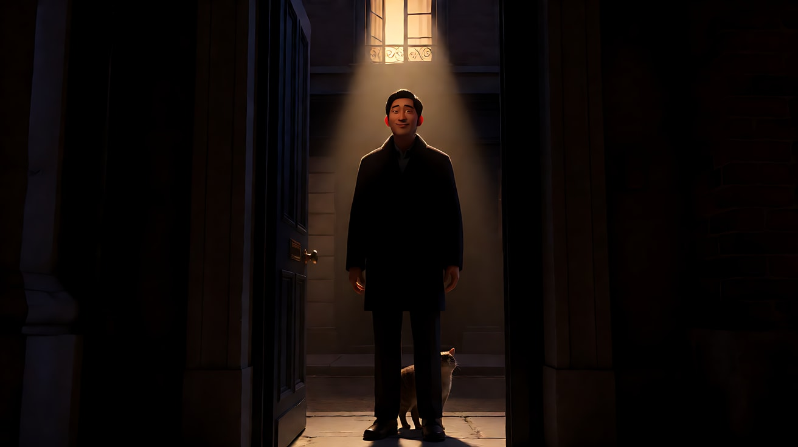
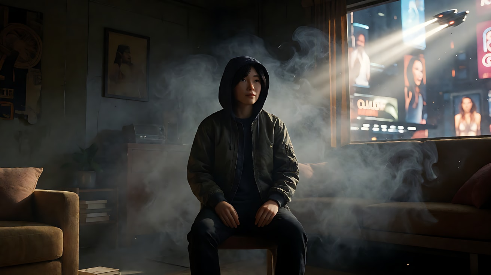

# L04-07 光随剧情变化：光变即情绪变

> 段位：进阶 ｜ 建议用时：60 分钟 ｜ 配套提示词：[L04-07-光随剧情变化-提示词](../提示词/L04-07-光随剧情变化-提示词.md)

## 学习目标

- 理解"光的变化就是情绪变化被看见"，能把剧情转折点和光的变化对齐
- 掌握六种常用的光变手段：开门放光、云遮日 / 云开日出、开灯 / 关灯、闪电、光束扫过、时间流逝
- 理解体积光与丁达尔效应的成因（光 + 空气中的颗粒），能写出可执行的提示词
- 能在 Seedance 里用"一个片段一次光变"的原则稳定地生成光的变化

## 一、概念讲解

### 1. 为什么光要变

前六课讲的都是"一个画面里的光"。但电影是时间的艺术：**当剧情翻转时，如果光不动，观众只能从台词里知道发生了什么；如果光跟着变，观众会在身体上感觉到。**

```
 情绪 / 光的亮度
   ▲
   │  ████████████                         ░░░░
   │  ████████████                      ░░░░░░░
   │  ████████████ ← 转折点            ░░░░░░░░░
   │              ╲                  ░░░░
   │               ╲   云遮住太阳   ░░  ← 一点光回来了
   │                ╲            ░░
   │                 ▁▁▁▁▁▁▁▁▁▁▁▁
   └──────────────────────────────────────────────→ 时间
       安全、明亮      坏消息       低谷        转机
```

一句话原则：**光的变化必须对准剧情的转折点，而且必须有一个看得见的原因。**

### 2. 六种光变手段

| 手段 | 物理原因 | 光怎么变 | 典型情绪转折 |
|---|---|---|---|
| 开门放光 | 门、窗帘、卷帘被打开 | 一道窄光变宽，切进暗处 | 被发现、闯入、救赎、真相曝光 |
| 云遮日 / 云开日出 | 云移动 | 整个场景由亮转暗或由暗转亮，云影掠过地面 | 不祥预感 / 希望到来 |
| 开灯 / 关灯 | 人物的动作 | 瞬间突变 | 关灯 = 结束、放弃、死亡的暗示；开灯 = 发现、开始、面对 |
| 闪电 | 雷雨 | 一瞬间极亮，随后回到黑暗 | 揭示、惊吓、命运 |
| 光束扫过 | 车灯、探照灯、灯塔 | 光在画面里移动 | 外界入侵、被搜寻、时间流动 |
| 时间流逝 | 太阳移动、日落 | 色温和方向缓慢变化 | 等待、衰老、一天结束 |

### 3. 开门放光：最经典的一次光变

```
   门关着                     门打开一条缝                    门全开

  ┌──────────────┐          ┌──────────────┐            ┌──────────────┐
  │██████████████│          │██████│███████│            │███╱      ╲███│
  │██████████████│          │█████╱ ╲██████│            │██╱        ╲██│
  │██████[人]████│   →      │████╱[人]╲████│     →      │█╱   [人]   ╲█│
  │██████████████│          │███╱  窄  ╲███│            │╱    宽光     ╲│
  │██████████████│          │██╱   光   ╲██│            │  人物被完全照亮 │
  └──────────────┘          └──────────────┘            └──────────────┘
   人物藏在黑暗里            一道光切进来，                 无处可藏
                             正好落在他身上                 / 或者：被救出来了
```

同一个动作，意义取决于**谁在门外**：门外是威胁，就是"被发现"；门外是亲人，就是"得救"。

### 4. 体积光与丁达尔效应

光本身在空气里是看不见的。我们能看到"一束光柱"，是因为空气里有颗粒把光散射到我们眼睛里，这就是**丁达尔效应**。

```
          ☀ / 窗 / 天窗 / 车灯
           ╲
            ╲  ← 光穿过有颗粒的空气
             ╲    ·  ·  ·
              ╲  · ·  ·  ·     颗粒：灰尘、雾、烟、水汽、雨、雪、花粉
               ╲ ·  ·  ·  ·
                ╲  ·  ·  ·
                 ▼
            光柱的形状 = 遮挡物的形状（窗格、树叶、门缝、百叶窗）
```

写出体积光的四个条件：

1. **一个强的、方向明确的光源**（太阳、天窗、车灯、舞台灯）。
2. **暗的背景**（光柱只有在暗背景前才看得清）。
3. **空气里的颗粒**（灰尘、薄雾、烟、水汽）——不写颗粒，光柱就不存在。
4. **遮挡物**（窗格、树叶、门缝）——决定光柱的形状。

体积光的情绪：神圣、启示、时间静止、回忆、希望。它让"光"从照明变成画面里一个**有形的物体**——人物可以走进去、伸手去碰、被它包裹。

### 5. 光变的节奏

- **突变**（开关灯、闪电）：表示一个决定、一次惊吓、一个不可逆的事件。
- **渐变**（云移动、日落、门慢慢打开）：表示一个过程、一种领悟、情绪慢慢涌上来。
- **先稳后变再稳**：光变之前要有一段稳定的光，让观众建立"原来的世界"；光变之后也要稳住，让观众看清"新的世界"。不要一直变。

## 二、情绪与叙事功能

| 技法 | 观众的感受 | 常用场景 |
|---|---|---|
| 开门放光（窄 → 宽） | 被发现 / 被拯救 | 悬疑、救援、重逢 |
| 关门切光（宽 → 窄 → 无） | 被关在外面、关系断开 | 拒绝、离别、权力关上大门 |
| 云遮日 | 不祥的预感 | 野餐、婚礼、平静中的转折 |
| 云开日出 | 希望、命运转机 | 绝境之后、和解 |
| 关灯 | 结束、放弃、告别 | 店铺最后一天、离开家 |
| 开灯 | 面对、发现、开始 | 进入一个久违的房间 |
| 闪电 | 一瞬间看到不该看的 | 惊悚、揭示 |
| 体积光 | 神圣、启示、时间停止 | 宗教、回忆、重大领悟 |
| 光束扫过 | 外界在搜寻、在逼近 | 越狱、追逐、等待 |

## 三、经典影片案例

### 《第三人》（1949，卡罗尔·里德；摄影：罗伯特·克拉斯克）
- 场景：被认为已经死去的哈里·莱姆第一次露面。
- 怎么拍的：夜里，霍利在街上，一个门洞里站着一个看不清的人影，一只猫蹭着他的鞋。楼上一位住户被吵到，打开了窗户里的灯，灯光正好落进门洞，照亮了哈里·莱姆的脸——他带着一丝狡黠的微笑。片刻后，光又消失了。
- 为什么这样拍：这个登场完全由一次"开灯"完成。光有完全合理的来源（楼上住户），时机却精确地对准了全片最大的揭示。光变 = 真相曝光。



### 《教父》（1972，弗朗西斯·福特·科波拉；摄影：戈登·威利斯）
- 场景：影片结尾，凯在外屋看着书房里的迈克尔接受手下致敬。
- 怎么拍的：迈克尔在书房里，手下围着他；凯站在外面的房间注视着这一切。一名手下走过来，关上了书房的门，门板挡住了画面，凯被关在了门外。
- 为什么这样拍：门关上的那一刻，凯和观众同时被隔绝在迈克尔的世界之外。这是"关门切光"的叙事版：空间和光同时关闭，一段婚姻和一个人的善良都在这一刻结束了。


### 《银翼杀手》（1982，雷德利·斯科特；摄影：乔丹·克罗嫩韦斯）
- 场景：未来洛杉矶的室内戏，例如泰瑞尔公司和德卡德的公寓。
- 怎么拍的：大量烟雾让空气中充满颗粒，窗外飞行器的探照灯、广告光不断扫过室内，形成移动的体积光束；室内常常是暗的，只有这些光柱在空间里划过。
- 为什么这样拍：移动的光柱提醒观众：外面的城市从不睡觉，一直在窥视、一直在侵入私人空间。体积光在这里不是神圣，而是压迫和监控。



## 四、在 AI 中怎么实现

- **生图阶段**：
  - 首尾帧是做光变最稳的方式：首帧画"变之前"的光，尾帧画"变之后"的光，两帧的构图和人物保持一致，只改光。
  - 体积光写全四个条件：`strong morning sunlight through a tall arched window, visible volumetric light shafts in the dusty air, dark interior`。
- **视频阶段**：
  - **一个片段只写一次光变**。云遮日就只写云遮日，不要同时写闪电和开灯。
  - 光变写出原因和过程："一片云从画左飘过来遮住太阳，草地上的阳光从远处一路暗到他脚下。"
  - 光变前后写稳定："之前阳光稳定明亮……之后保持阴天的平光。"
  - 闪电写"一次"或"两次"，写清楚闪电之后回到什么光，避免整段频闪。
  - 丁达尔效应写颗粒："灰尘在光柱里缓慢旋转"。
- **模型擅长**：云影掠过地面、开门光变宽、开关灯突变、闪电、体积光柱、日落渐变。
- **要避开**：
  - 光变没有原因（"画面突然变暗"）——模型会当成曝光错误，或者乱闪。
  - 一个片段多次光变——频闪、跳变。
  - 用"意外"引起光变（"灯泡突然爆了"）——容易被演得很假，也可能触发审核。改成人物主动的动作或自然现象。
  - 闪电写太多次——整段变成频闪。
  - 光变和人物情绪变化不同步——光变了，人物没反应，或者反过来。光变那一刻，人物要有一个**对应的可见动作**（抬头、眯眼、停住、转身）。

## 五、练习作业

1. **找转折点**：选一部电影，找出三个剧情转折点，记录每个转折点时光有没有变化、怎么变的、原因是什么。
2. **改写**：把"他得知了真相"写成三个不同的光变版本：开门放光、云遮日、关灯。每个版本写一句光的变化和一个人物动作。
3. **体积光观察**：清晨或傍晚在有灰尘的房间里拉开窗帘一条缝，拍下光柱。再用喷雾器在光里喷一点水雾，对比光柱变化。
4. 完成配套提示词练习 1–5。

## 六、自检清单

- [ ] 我的光变对准了剧情转折点
- [ ] 每次光变都有看得见的原因
- [ ] 一个片段只有一次光变
- [ ] 光变前后都有一段稳定的光
- [ ] 光变的那一刻人物有对应的动作
- [ ] 体积光写了光源、暗背景、颗粒和遮挡物
- [ ] 闪电写了次数和之后回到什么光

## 七、配套提示词

→ [L04-07-光随剧情变化-提示词](../提示词/L04-07-光随剧情变化-提示词.md)

---

上一课：[L04-06 色彩心理与调色风格](L04-06-色彩心理与调色风格.md) ｜ 下一课：[L05-01 固定镜头](../../05-运镜/教学/L05-01-固定镜头.md) ｜ [返回总目录](../../README.md)
