# L05-01 固定镜头 · 提示词

> 本组练习：锁住机位、角度、焦段，把全部生命力交给画内的人、物、光，练出"不动也有戏"的固定镜头。｜ 配套教学：[L05-01-固定镜头](../教学/L05-01-固定镜头.md) ｜ 规范：[写作规范](../../模板/写作规范.md)
>
> 画风默认使用开关 A（风格化写实 CG）。如改用 2D 动画，删掉所有焦段、光圈、景深词。
>
> 本模块每组练习都先填一张**运镜合同**（起始构图 / 运动方式 / 速度 / 终点画面 / 运动动机），再写提示词。

---

### 练习1：固定中近景对白——让口型稳下来（难度 ★）

**目标**：用单张关键帧生成一段带一句台词的固定镜头。先体会"只写镜头固定"和"固定 + 画内动作"的区别，再确认口型在固定机位下最稳。意图：让观众专注地听这位老人说出一句交代。

**运镜合同**

| 要素 | 本练习 |
|---|---|
| 起始构图 | 中近景，老钟表匠位于画面右三分之一，面朝画左，工作台台灯在画左 |
| 运动方式 | 无：机位锁定，不推进、不摇移、不变焦 |
| 速度 | 零 |
| 终点画面 | 同一构图，他说完话，摘下放大镜放在台面上，目光落向画左 |
| 运动动机 | 对白口型是脆弱锚点，任何运镜都会让嘴型和手部变形；固定让观众只听他说话 |

**【生图 · Nano Banana】**

图1 关键帧：

```
A medium close-up of an original elderly watchmaker in his late sixties, thin grey hair combed back,
a brown leather apron over a white shirt with rolled sleeves, a jeweler's loupe pushed up on his forehead,
sitting at a cluttered wooden workbench, holding a small open pocket watch in both hands.
He is placed on the right third of the frame, facing frame left, a brass desk lamp on the left edge.
Camera at seated eye level, 50mm lens, shallow depth of field, shelves of clocks blurred in the background.
Lighting: warm desk lamp as key light from frame left, faint cool window light from behind as a rim on his hair,
tiny dust particles in the lamp beam.
Stylized semi-realistic 3D CG rendering, feature-film animation quality. Aspect ratio 16:9.
```

中文释义：中近景，老钟表匠坐在右三分之一，面朝画左；50mm、浅景深，背景钟表架虚化；画左暖色台灯为主光，背后冷色窗光勾出发丝轮廓，台灯光束里有灰尘。

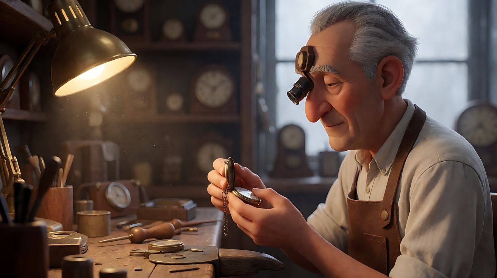

**【图生视频 · Seedance】**

先跑一遍"反面版"，只写一句：

```
【素材分工】@图片1 为首帧，锁定人物身份、服装与工作台布局。
【画风】风格化写实三维CG质感，电影级布光。
镜头固定。
【声音】环境声。
【约束】不要字幕、水印、Logo。
时长：6秒
```

再跑"完整版"：

```
【素材分工】@图片1 为首帧，锁定人物身份、服装、工作台布局与台灯位置。
【画风】风格化写实三维CG质感，电影级布光。
镜头固定，机位锁定在坐姿视线高度，不推进、不摇移、不变焦，始终保持中近景构图。老钟表匠低头看着手中打开的怀表，用拇指轻轻合上表盖，抬眼看向画左，开口说话，嘴型清楚。说完后他把额头上的放大镜摘下，放在工作台上。画左台灯的暖光稳定照在他脸的左侧，光束里的灰尘缓慢飘动，背景虚化处的钟摆轻轻摆动。结尾停在他放下放大镜、目光仍看向画左的中近景。
【声音】老钟表匠（合上表盖，抬眼）："它没坏，只是太久没人上弦了。"背景里几只钟表交错的滴答声，表盖合上的一声轻响，放大镜放在木台面上的闷响，无配乐。
【约束】保持人物脸型、发型、服装不变；镜头始终不动；不要字幕、水印、Logo。
时长：6秒
```

**参数**：时长 6 秒 ｜ 画幅 16:9

**【检查点】**
- 反面版是否几乎静止，或被模型偷偷加了慢推
- 完整版的画框四边在整段里是否完全不动
- 嘴型是否与台词节奏对得上
- 灰尘和钟摆这类"次要画内运动"是否让画面有了呼吸

**【常见问题与修复】**
| 现象 | 修复 |
|---|---|
| 画面慢慢推近 | 补上"不推进、不变焦，始终保持中近景构图"，并删掉任何"聚焦""靠近"之类的词 |
| 人物像被冻住 | 写清动作链："合上表盖 → 抬眼 → 说话 → 摘放大镜"，并加"保持呼吸起伏、自然眨眼" |
| 口型糊成一片 | 台词缩短到一句十几个字以内；确认首帧是正侧或三分之二侧脸，嘴部不被遮挡 |
| 放大镜变形或变多 | 删掉"摘放大镜"，只保留"说话后把手放回台面" |

---

### 练习2：固定全景里的进出画——让空间比人更久（难度 ★★）

**目标**：用定妆图 + 场景图，生成一个"画框先空 → 人进来 → 做事 → 离开 → 画框又空"的固定全景。意图：让观众感到深夜的自助洗衣房比这个人更持久，她只是路过自己的生活。

**运镜合同**

| 要素 | 本练习 |
|---|---|
| 起始构图 | 固定全景，空无一人的洗衣房，一排洗衣机在画面中段横贯，入口门在画右 |
| 运动方式 | 无：机位锁定在门对面的墙角，略高于视线 |
| 速度 | 零；画内节奏由她的脚步决定，慢 |
| 终点画面 | 同一构图，她已从画右离开，只剩一台滚筒在转、长椅上留着她忘下的一只手套 |
| 运动动机 | 不跟着她走，观众才会注意到她离开后空间仍在继续 |

**【生图 · Nano Banana】**

图1 角色定妆：

```
Character turnaround sheet of an original young woman in her mid-twenties: short wavy dark hair,
an oversized mustard-yellow knitted cardigan over a white T-shirt, loose grey sweatpants, white canvas shoes,
a plastic laundry basket as her prop.
Front view, three-quarter view, side view and back view, full body, plain light-grey background.
Camera at eye level, 50mm lens, deep focus, even soft studio light from the front, no shadows on the backdrop.
Stylized semi-realistic 3D CG rendering, feature-film animation quality. Aspect ratio 16:9.
```

中文释义：原创角色定妆图，二十多岁女性，短卷发，芥末黄宽松开衫、白T、灰色运动裤、白帆布鞋，道具是塑料洗衣篮；四视图全身，平视、50mm、深景深，正面柔光。

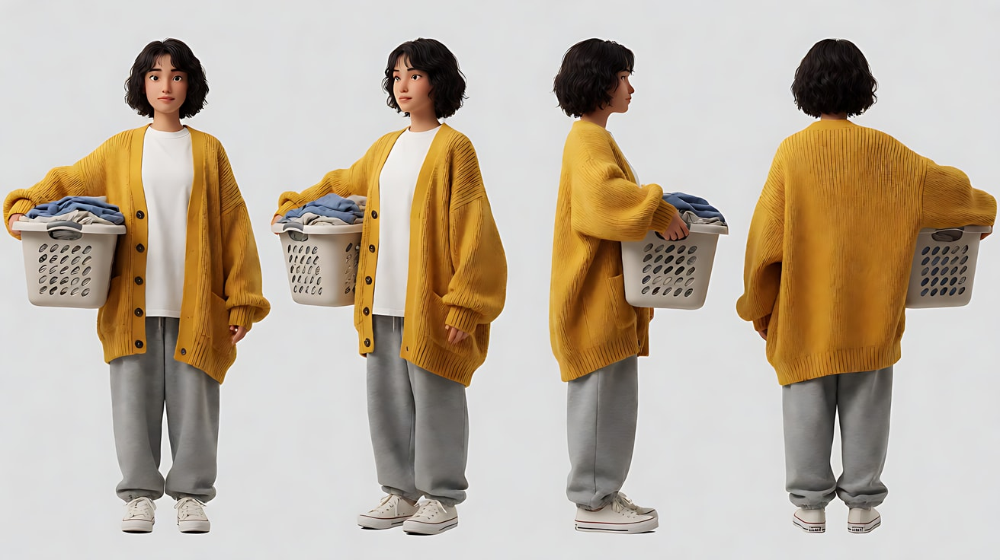

图2 场景（空洗衣房）：

```
Empty self-service laundromat late at night, a single row of front-loading washing machines across the middle of the frame,
one machine on the far left still spinning with its drum light on, a long wooden bench in the foreground,
a glass entrance door on the right edge with the dark rainy street outside, no people.
Wide shot from the opposite corner, camera slightly above eye level, 28mm lens, deep focus.
Lighting: cool white fluorescent tubes overhead, a warm vending machine glow from frame left, wet street reflections through the door.
Stylized semi-realistic 3D CG rendering, feature-film animation quality. Aspect ratio 16:9.
```

中文释义：深夜自助洗衣房，一排滚筒洗衣机横贯画面中段，最左一台仍在转且亮着筒灯；前景是长木椅；画右是玻璃门，门外雨夜街道；略高于视线的墙角全景、28mm、深景深；头顶冷白日光灯，画左自动售货机暖光。

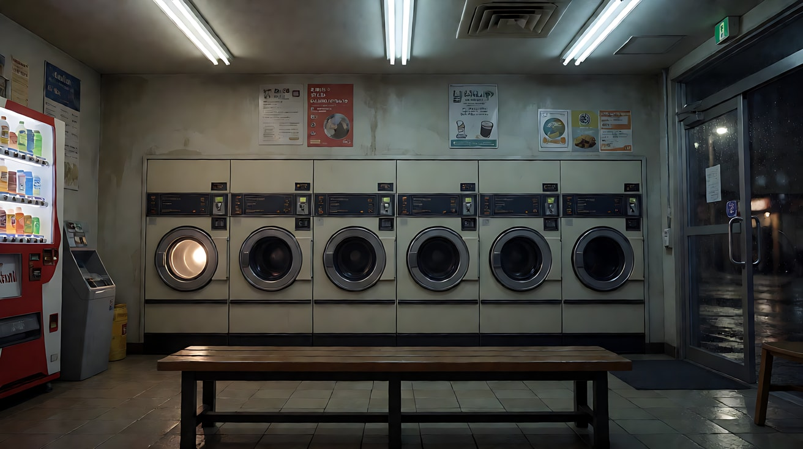

**【多图生视频 · Seedance】**

```
【素材分工】@图片1 锁定人物身份、服装与洗衣篮，不参考其中的灰色背景；@图片2 为首帧，锁定洗衣房构图、陈设与光线，画面开始时没有人。
【画风】风格化写实三维CG质感，电影级布光。
镜头固定在门对面的墙角，略高于视线，不推进、不摇移、不变焦，全程保持全景构图。起初画面空无一人，只有最左那台洗衣机的滚筒在转。随后女子抱着洗衣篮从画右的玻璃门走进来，走到画面中段，打开一台洗衣机，把篮子里的衣服塞进去，关门，按下按钮。她在前景长椅上坐了一下，脱下一只手套放在椅子上，起身抱着空篮子从画右的门走出去。最后画面又空了，两台滚筒都在转，长椅上留着那只手套。头顶冷白日光灯稳定，售货机暖光照在画左地面，门外湿漉漉的街面反光。结尾停在空洗衣房和长椅上的手套。
【声音】滚筒转动的低沉嗡声，玻璃门开合时的门铃一响，衣物塞进滚筒的布料摩擦声，按钮一声"嘀"，门外雨声在门开时变大、门关后变小，无配乐。
【约束】保持人物脸型、发型、服装不变；镜头始终不动；画面中只有一个人；不要字幕、水印、Logo。
时长：12秒
```

**参数**：时长 12 秒 ｜ 画幅 16:9

**【检查点】**
- 开头和结尾画面里是否都没有人
- 她是否从同一扇门进、同一扇门出（画面方向一致）
- 机位是否全程未动，洗衣机排列和长椅位置是否不变
- 门铃、雨声开合变化是否与开门动作对得上

**【常见问题与修复】**
| 现象 | 修复 |
|---|---|
| 一开始人就在画面里 | 素材分工写明"@图片2 为首帧，画面开始时没有人"，首帧图本身也必须无人 |
| 镜头跟着她横移 | 正文加"镜头不跟随人物，人物自己走进走出画框" |
| 动作太多，后半段被截掉 | 删掉"坐下、脱手套"，只保留"进门 → 放衣服 → 出门"；或把时长加到 15 秒 |
| 出现第二个人 | 约束写"画面中只有一个人"，并检查场景图里是否有人影 |

---

### 练习3：固定产品镜头里的光变化——首尾帧版（难度 ★★★）

**目标**：用首帧和尾帧锁定"光从无到有"，产品形状、文字、位置全程不动，只让光在画面里走。意图：让观众感到一个清晨在一只茶杯上慢慢到来。

**运镜合同**

| 要素 | 本练习 |
|---|---|
| 起始构图 | 固定中近景，木桌上一只手工陶瓷茶杯居中偏右，画左是百叶窗，室内昏暗，只有冷蓝色天光 |
| 运动方式 | 无：机位锁定，略高于桌面 |
| 速度 | 零；画内的光带从画左缓慢扫到茶杯上 |
| 终点画面 | 同一构图，百叶窗的暖色光带横跨桌面，正好落在茶杯釉面上，热气在光里清晰可见 |
| 运动动机 | 产品形状和釉面纹理是脆弱锚点；固定让光成为唯一的"演员" |

**【生图 · Nano Banana】**

图1 首帧：

```
A medium close-up product shot of a handmade ceramic tea cup with a speckled pale-green glaze and an uneven rim,
standing on a dark walnut table, placed slightly right of center, a thin wisp of steam rising.
Venetian blinds on a window at frame left, the room still dim before sunrise.
Camera slightly above table height, angled down about fifteen degrees, 85mm lens, shallow depth of field,
the background wall softly blurred.
Lighting: only faint cool blue pre-dawn light from the window at frame left, low contrast, the glaze barely readable.
No text, no logo. Stylized semi-realistic 3D CG rendering, feature-film animation quality. Aspect ratio 16:9.
```

中文释义：中近景产品镜头，淡绿色斑点釉手工茶杯立在胡桃木桌上，略偏右，冒一缕热气；画左百叶窗；略高于桌面、向下约15度、85mm浅景深；只有画左窗外的冷蓝色黎明前天光，釉面几乎看不清。

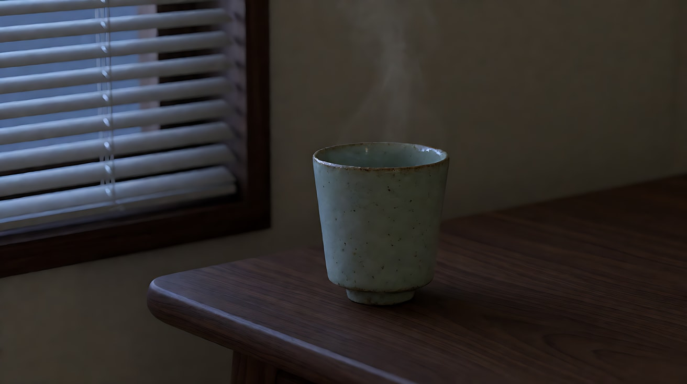

图2 尾帧：

```
The exact same framing, camera position, table and ceramic tea cup as image 1:
now warm golden sunrise light comes through the venetian blinds from frame left,
casting parallel stripes of light across the table, one bright stripe falling exactly across the cup,
the speckled glaze and uneven rim clearly readable, the steam glowing in the light beam.
The cup has not moved. No text, no logo.
Stylized semi-realistic 3D CG rendering, feature-film animation quality. Aspect ratio 16:9.
```

中文释义：与图1完全相同的构图和茶杯位置；日出暖金色光穿过百叶窗，在桌面投出平行光带，其中一条正好横过茶杯，釉面斑点与杯沿清楚可见，热气在光束中发亮；茶杯没有移动。

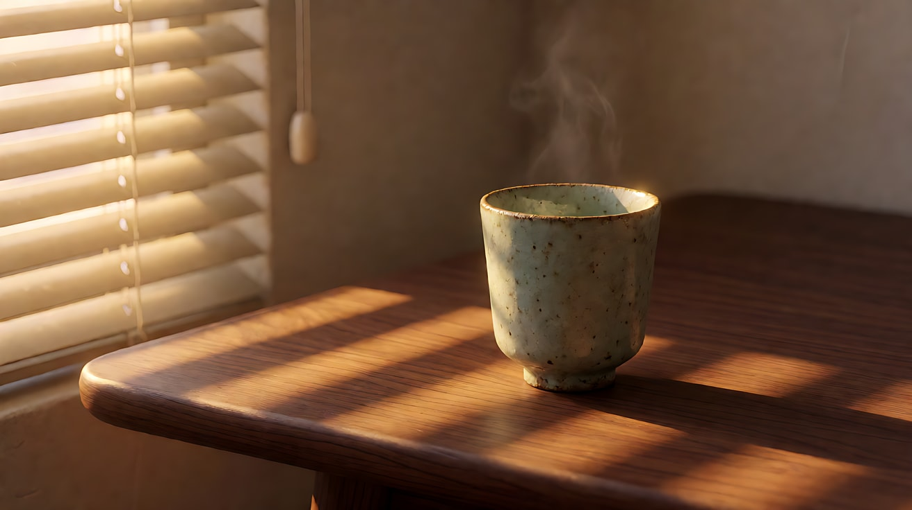

**【首尾帧生视频 · Seedance】**

```
【素材分工】@图片1 为首帧；@图片2 为尾帧，是最终画面目标，只参考其光线与构图，茶杯形状与位置以 @图片1 为准。只生成两帧之间的连续变化。
【画风】风格化写实三维CG质感，电影级布光。
镜头固定，机位锁定在略高于桌面的位置，不推进、不摇移、不变焦，茶杯始终在画面中央偏右，形状、釉色、位置全程不变。窗外天色由冷蓝逐渐转暖，百叶窗投下的平行光带从画左桌沿出现，缓慢向右爬过桌面，最后一条亮带落在茶杯上，釉面上的斑点逐渐被照亮。杯口热气在变亮的光里越来越清楚，缓慢上升、打卷。结尾停在光带横过茶杯、热气发亮的画面。
【声音】清晨极轻的鸟鸣由少变多，远处一声自行车铃，室内安静，热气无声，无配乐。
【约束】茶杯不变形、不移动、不增减；画面中不出现手和人物；不要字幕、水印、Logo。
时长：8秒
```

**参数**：时长 8 秒 ｜ 画幅 16:9

**【检查点】**
- 茶杯的杯沿不规则感和斑点釉是否首尾一致
- 光带是否"从左往右爬"，而不是一下子亮起来
- 画框是否全程不动（看桌沿和百叶窗边是否抖动）

**【常见问题与修复】**
| 现象 | 修复 |
|---|---|
| 光瞬间亮起，没有爬行过程 | 写"光带从画左桌沿出现，缓慢向右爬过桌面"，并把时长加到 10 秒 |
| 茶杯形状漂移 | 素材分工写"茶杯形状与位置以 @图片1 为准"；首尾帧生图时上传同一张茶杯图作参考 |
| 模型加了慢推 | 正文第一句就写"不推进、不变焦"；删掉"聚焦到茶杯"之类说法 |
| 冒出一只手端杯 | 约束写"画面中不出现手和人物" |

---

### 练习4：三个固定镜头的饭桌——口型与反应（难度 ★★★★，多镜头）

**目标**：一次生成三个固定镜头：固定全景交代关系 → 固定中近景说台词 → 固定特写看反应。三个镜头都不动，靠切镜改变距离。意图：让观众感到女儿说出一个决定时，父亲没有说话，只有手在回答。

**运镜合同**

| 镜头 | 起始构图 | 运动方式 | 速度 | 终点画面 | 运动动机 |
|---|---|---|---|---|---|
| 镜头1 | 固定全景，父女隔着方桌对坐，女儿在画左面朝右，父亲在画右面朝左 | 无 | 零 | 同一构图，两人各自低头吃饭 | 先让观众看清两人之间的距离 |
| 镜头2 | 固定中近景，女儿过肩外的单人，位于画左三分之一 | 无 | 零 | 她说完话，抬眼看向画右 | 口型必须稳，观众要听清这句话 |
| 镜头3 | 固定特写，父亲的手握着筷子 | 无 | 零 | 筷子轻轻放下，手掌平放在桌面 | 反应交给手，固定才能让这个小动作被看见 |

**【生图 · Nano Banana】**

图1 角色定妆（两位原创角色）：

```
Character turnaround sheet of two original characters:
a father in his late fifties with a short grey crew cut, a dark navy work shirt with the sleeves rolled up, calloused hands;
his daughter in her mid-twenties with a low ponytail, a light-grey hoodie, small round earrings.
Front view, three-quarter view and side view of each, full body, plain light-grey background.
Camera at eye level, 50mm lens, deep focus, even soft studio light from the front.
Stylized semi-realistic 3D CG rendering, feature-film animation quality. Aspect ratio 16:9.
```

中文释义：父女两位原创角色定妆，父亲五十多岁、灰色短寸、藏青工装衬衫挽袖、手上有茧；女儿二十多岁、低马尾、浅灰卫衣、小圆耳环；三视图全身，平视、50mm、深景深、正面柔光。

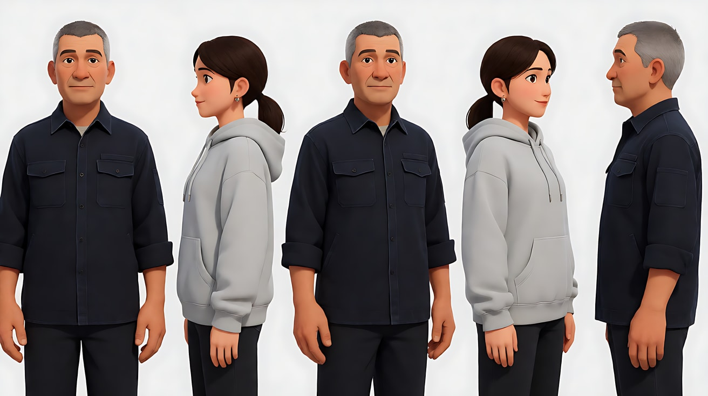

图2 场景（夜晚小饭厅）：

```
Empty small dining room at night, a square wooden table with two chairs facing each other across it,
three simple dishes and two bowls of rice on the table, a single warm pendant lamp hanging low above the table,
a dark window behind, a refrigerator humming in the corner, no people.
Wide shot from the side of the table, camera at seated eye level, 35mm lens, deep focus.
Lighting: warm pendant lamp from directly above as the only key light, cool faint street light through the window behind.
Stylized semi-realistic 3D CG rendering, feature-film animation quality. Aspect ratio 16:9.
```

中文释义：夜晚小饭厅，方桌两椅对放，桌上三个家常菜两碗饭；低垂的暖色吊灯是唯一主光，背后窗外有微弱冷色路灯；桌侧坐姿视线高度、35mm、深景深。

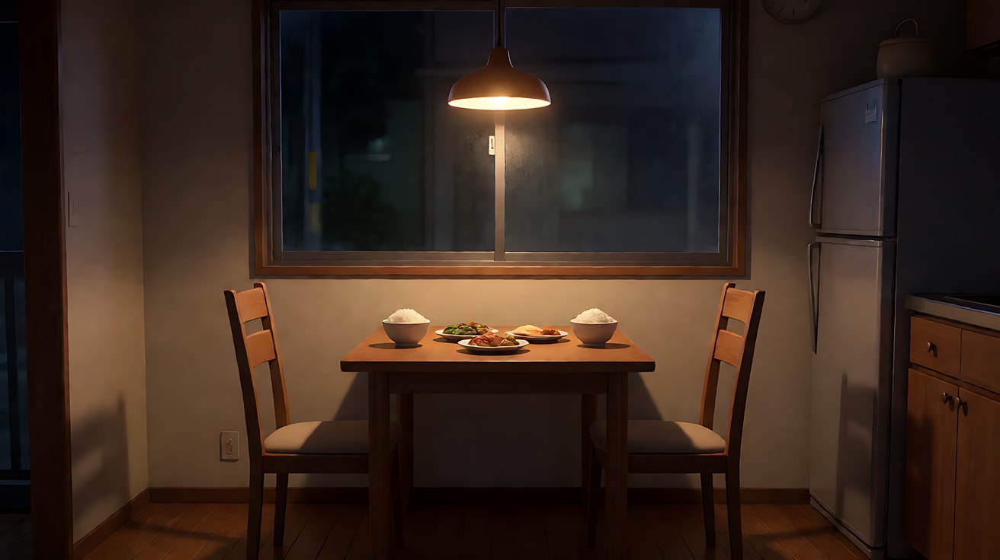

图3 镜头1首帧：

```
Using the characters from image 1 and the dining room from image 2:
a wide shot of the father and daughter sitting across the square table from each other,
the daughter on the left facing right, the father on the right facing left, both looking down at their bowls,
the hanging lamp centered above the table between them.
Camera at seated eye level from the side of the table, 35mm lens, deep focus.
Lighting: warm pendant lamp from above, soft shadows under their eyes, cool street light through the window behind.
Keep the face, hairstyle and outfit exactly as in image 1.
Stylized semi-realistic 3D CG rendering, feature-film animation quality. Aspect ratio 16:9.
```

中文释义：父女隔桌对坐全景，女儿在画左面朝右，父亲在画右面朝左，都低头看碗；吊灯居中在两人之间。

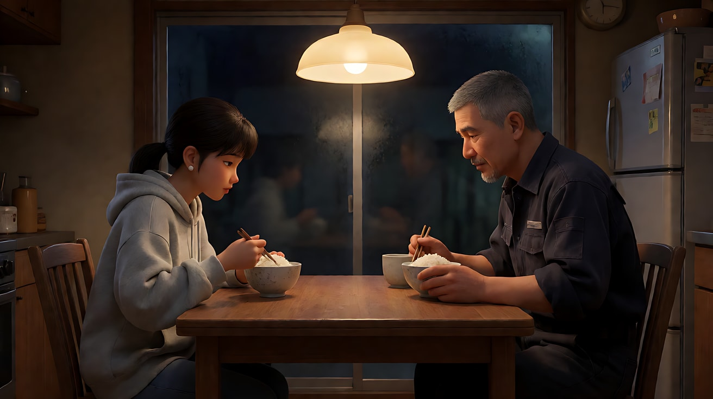

**【多图生视频 · Seedance】**

```
【素材分工】@图片1 锁定父亲与女儿的身份和服装，不参考其中背景；@图片2 仅参考饭厅布局、陈设与吊灯光线，不复制其中构图；@图片3 为镜头1首帧，锁定两人的座位与朝向。
【画风】风格化写实三维CG质感，电影级布光。
镜头1：固定全景，机位在桌侧坐姿视线高度，不推不摇。父女隔着方桌对坐，女儿在画左，父亲在画右，两人各自低头夹菜吃饭，偶尔筷子碰碗。头顶暖色吊灯是唯一主光。冰箱低鸣，筷子碰碗声。
镜头2：镜头切至固定中近景，机位越过父亲肩外，女儿位于画左三分之一，面朝画右。她放下碗，双手搭在桌沿，抬眼看向画右，开口说话，嘴型清楚。吊灯从上方照亮她的额头和鼻梁。
镜头3：镜头切至固定特写，画面里只有父亲握着筷子的手和半只饭碗，手停在半空，停住一拍，然后把筷子轻轻横放在碗沿上，手掌平放到桌面，手指慢慢张开。吊灯的暖光照在手背的纹路上。结尾停在平放在桌上的手。
【锁定】光线：暖色吊灯始终在桌子正上方，窗外冷光在背景；女儿始终在画左面朝右，父亲始终在画右面朝左；机位始终在两人连线的同一侧；三个镜头机位全部固定。
【声音】镜头1冰箱低鸣与筷子碰碗声；镜头2女儿（放下碗，抬眼）："爸，我下个月搬去南方。"；镜头3只剩冰箱低鸣，筷子放在碗沿上的一声轻响，无配乐。
【约束】保持两人脸型、发型、服装不变；镜头3里父亲不说话；不要字幕、水印、Logo。
时长：12秒
```

**参数**：时长 12 秒 ｜ 画幅 16:9 ｜ 负载：3 个镜头、1 句对白，属于"稳妥"偏"有挑战"档

**【检查点】**
- 三个镜头是否都"切"出来了，而不是一个镜头里慢慢推近
- 镜头2的女儿是否仍面朝画右（没有越轴）
- 镜头3的手是不是父亲的（袖子颜色是藏青色）
- 镜头3里有没有人说话——应该没有

**【常见问题与修复】**
| 现象 | 修复 |
|---|---|
| 三个镜头连成一个推镜 | 每个镜头块开头都写"镜头切至……"，并在【锁定】写"三个镜头机位全部固定" |
| 镜头2里女儿朝向反了 | 【锁定】重复"女儿始终在画左面朝右"；镜头2写明"机位越过父亲肩外" |
| 镜头3出现了女儿的手 | 写"画面里只有父亲握着筷子的手"，并补"藏青色挽起的衬衫袖口" |
| 父亲也开口说话 | 约束写"镜头3里父亲不说话"，并在声音里写清只有女儿一句台词 |

---

### 练习5：固定机位下的精细特效——掌心发芽（难度 ★★★★★，多镜头 + 特效）

**目标**：精细特效（粒子、生长、变形）最怕画框移动。用多张参考图，生成三个全部固定的镜头，把特效稳稳地放在画内。意图：让观众感到一个小学徒第一次真正成功时的屏息。

**运镜合同**

| 镜头 | 起始构图 | 运动方式 | 速度 | 终点画面 | 运动动机 |
|---|---|---|---|---|---|
| 镜头1 | 固定全景，阁楼工作室，学徒坐在画面中央的长桌后，窗在画右 | 无 | 零 | 她把一粒种子放到掌心，双手捧起 | 先交代空间和动作起点 |
| 镜头2 | 固定中景，她捧着种子的双手在画面下半，脸在上半 | 无 | 零 | 掌心冒出绿色光点，种子裂开 | 特效形状是脆弱锚点，画框必须钉住 |
| 镜头3 | 固定微距特写，掌心与种子 | 无 | 零 | 一株嫩芽展开两片叶子，光点停在叶尖 | 观众要看清"长出来"这个结果 |

**【生图 · Nano Banana】**

图1 角色定妆：

```
Character turnaround sheet of an original girl about fourteen years old, an apprentice herbalist:
two short braids, freckles, oversized round glasses, a moss-green linen apron over a cream long-sleeved blouse,
a small leather pouch of seeds on her belt.
Front view, three-quarter view, side view and back view, full body, plain light-grey background.
Camera at eye level, 50mm lens, deep focus, even soft studio light from the front.
Stylized semi-realistic 3D CG rendering, feature-film animation quality. Aspect ratio 16:9.
```

中文释义：原创角色，约十四岁草药学徒，两条短辫、雀斑、大圆眼镜、苔绿亚麻围裙配米色长袖衬衫、腰间小皮质种子袋；四视图全身。

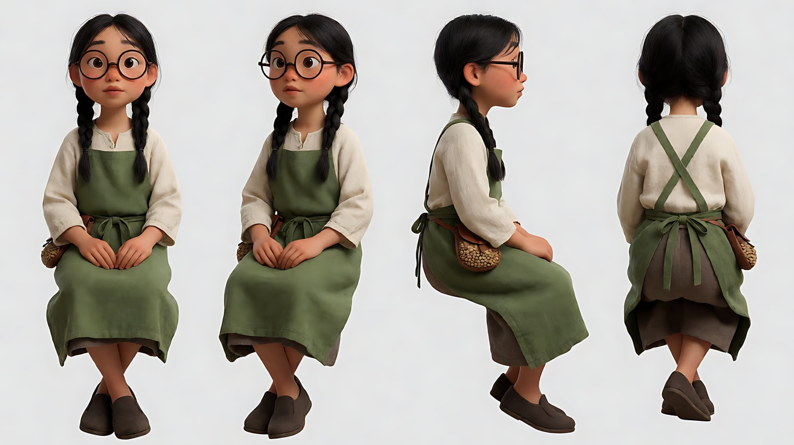

图2 场景（阁楼工作室）：

```
Empty attic workshop in late afternoon, a long wooden table in the center covered with clay pots, dried herbs and glass jars,
a slanted ceiling with exposed beams, a small round window on the right wall, no people.
Wide shot facing the table, camera at seated eye level, 28mm lens, deep focus.
Lighting: warm low afternoon sunlight through the round window from frame right, dust floating in the beam,
cool shadow in the left corner.
Stylized semi-realistic 3D CG rendering, feature-film animation quality. Aspect ratio 16:9.
```

中文释义：午后阁楼工作室，中央长木桌摆满陶盆、干草药、玻璃罐；斜屋顶露梁，右墙小圆窗；画右窗外暖色低角度阳光，光柱里有灰尘，左侧角落偏冷。

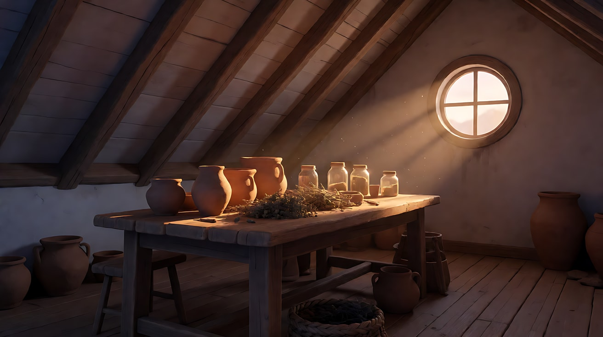

图3 镜头1首帧：

```
Using the character from image 1 and the workshop from image 2:
a wide shot of the girl sitting behind the long table in the center of the frame, facing the camera,
holding a single seed between two fingers above her open left palm, looking down at it.
Camera at seated eye level facing the table, 28mm lens, deep focus.
Lighting: warm sunlight from the round window at frame right, falling across the table and her right shoulder.
Keep the face, hairstyle and outfit exactly as in image 1.
Stylized semi-realistic 3D CG rendering, feature-film animation quality. Aspect ratio 16:9.
```

中文释义：她坐在长桌后居中，面向镜头，两指捏一粒种子悬在摊开的左掌上方，低头看；画右窗光照在桌面和她右肩。

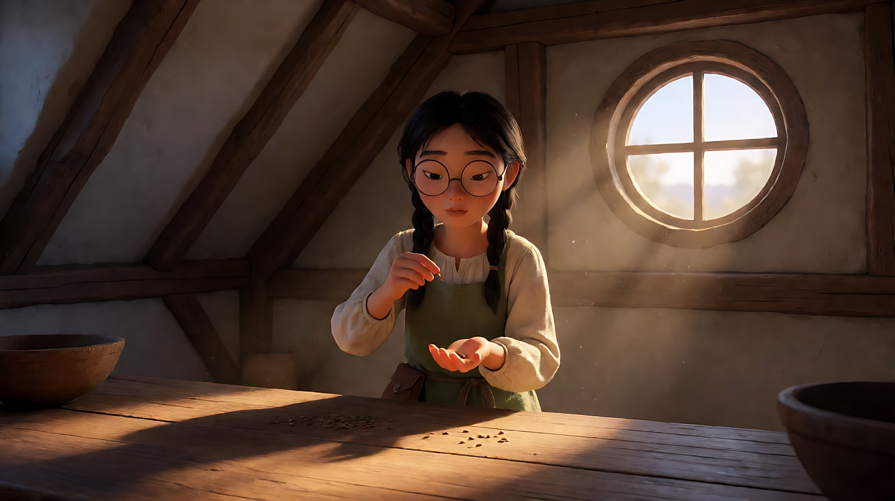

图4 镜头3关键帧（微距）：

```
Using the character from image 1: a macro close-up of the girl's cupped hands holding a tiny green sprout
that has just broken out of a seed, two small round leaves unfolding, a few faint green glowing particles
hovering at the leaf tips. The edge of her moss-green apron is visible at the bottom of the frame.
Camera directly in front at hand height, 100mm macro lens, very shallow depth of field, background a warm blur.
Lighting: warm window light from frame right, a soft green glow from the sprout lighting her palm from below.
Keep the outfit exactly as in image 1.
Stylized semi-realistic 3D CG rendering, feature-film animation quality. Aspect ratio 16:9.
```

中文释义：微距特写，她捧着的双手里一株刚破壳的嫩芽，两片小圆叶展开，叶尖悬着几颗淡绿光点；画面下沿露出苔绿围裙；100mm微距、极浅景深；画右暖色窗光，嫩芽的绿光从下方照亮掌心。

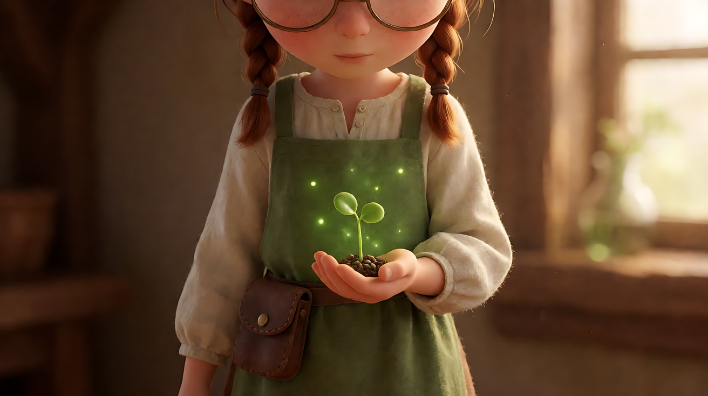

**【多图生视频 · Seedance】**

```
【素材分工】@图片1 锁定学徒的身份、眼镜、发辫与围裙，不参考其背景；@图片2 仅参考阁楼的布局、陈设与窗光方向，不复制其中构图；@图片3 为镜头1首帧；@图片4 仅作为镜头3的画面目标，参考嫩芽形状与光点位置。
【画风】风格化写实三维CG质感，电影级布光。
镜头1：固定全景，机位正对长桌，不推不摇不变焦。学徒坐在画面中央，把种子轻轻放进左掌心，右手覆上，双手合拢捧到胸前，闭眼深吸一口气。画右圆窗的暖色阳光照在桌面，光柱里灰尘缓慢飘动。阁楼木梁轻微的吱呀声。
镜头2：镜头切至固定中景，她的双手在画面下半，脸在上半。她张开双手，掌心中央浮起几颗淡绿色光点，绕着种子缓慢旋转，种子表面裂开一道细缝，绿光从缝里透出来，照亮她的下巴和眼镜片。她睁大眼睛，屏住呼吸，嘴唇微张。
镜头3：镜头切至固定微距特写，画面只有她捧着的掌心和种子。一株嫩芽从裂缝里慢慢顶出来，弯着腰抬起，两片小圆叶一点点展开，光点依次落在叶尖上，停住。结尾停在两片叶子完全展开、光点停在叶尖的画面。
【锁定】光线：暖色窗光始终来自画右，特效绿光只来自种子和嫩芽；学徒始终戴圆眼镜、穿苔绿围裙；三个镜头机位全部固定，不推、不摇、不变焦。
【声音】镜头1木梁吱呀与一次深呼吸；镜头2光点出现时一声极轻的风铃般高音，种子裂开的细微"咔"声；镜头3嫩芽展开时极轻的叶片舒展声，她屏住的气终于呼出来，无配乐。
【约束】保持人物脸型、发型、眼镜、服装不变；嫩芽只有一株、两片叶子；光点数量少而清楚，不要满屏光效；不要字幕、水印、Logo。
时长：13秒
```

**参数**：时长 13 秒 ｜ 画幅 16:9 ｜ 负载：3 个镜头、1 段特效，无对白，"稳妥"偏"有挑战"

**【检查点】**
- 特效是否只发生在掌心，没有扩散成满屏光效
- 三个镜头机位是否都钉住，特效形状有没有因画框移动而抖动
- 镜头3的嫩芽是否和 @图片4 一致（一株、两片叶）
- 光的逻辑是否清楚：暖光来自窗，绿光来自嫩芽

**【常见问题与修复】**
| 现象 | 修复 |
|---|---|
| 光效爆满整个画面 | 约束写"光点数量少而清楚"，正文写"几颗淡绿色光点"，不要用"魔法能量""光芒四射" |
| 镜头2开始慢慢推近手 | 镜头2开头重复"固定中景，不推不变焦"；推近的需求交给镜头3的切镜 |
| 嫩芽长成一整棵树 | 写"一株嫩芽、两片小圆叶"，并用 @图片4 作为画面目标 |
| 手指变形 | 镜头3只写"捧着的掌心"，不写手指动作；或把镜头3改成手部完全静止，只有嫩芽在动 |
