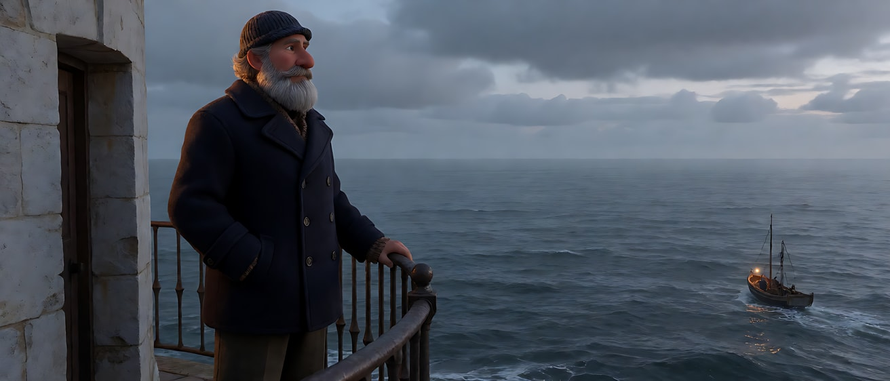
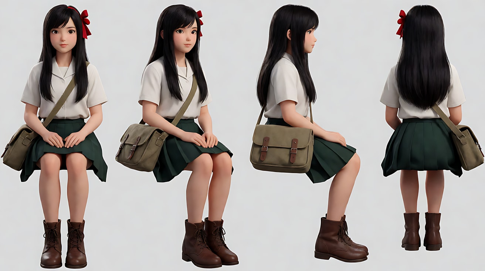
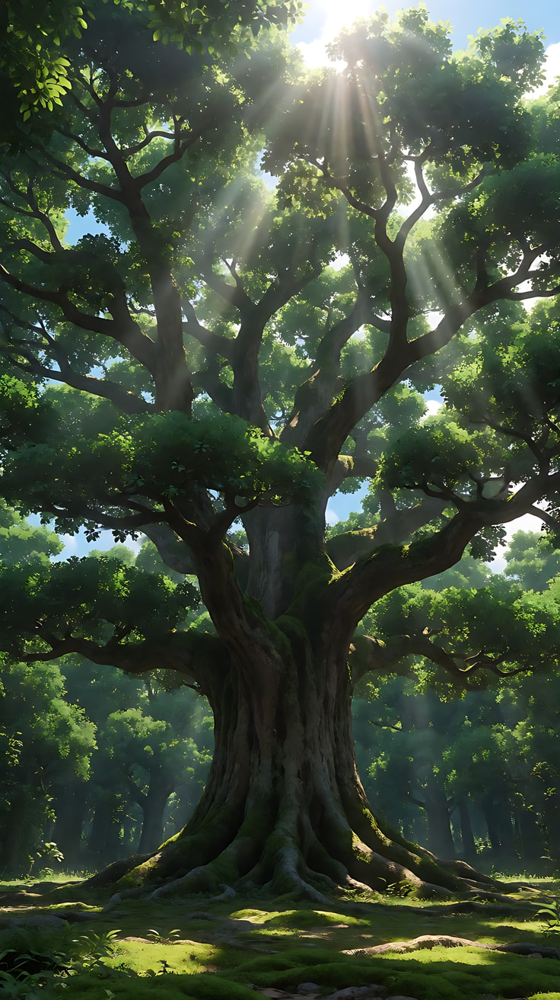
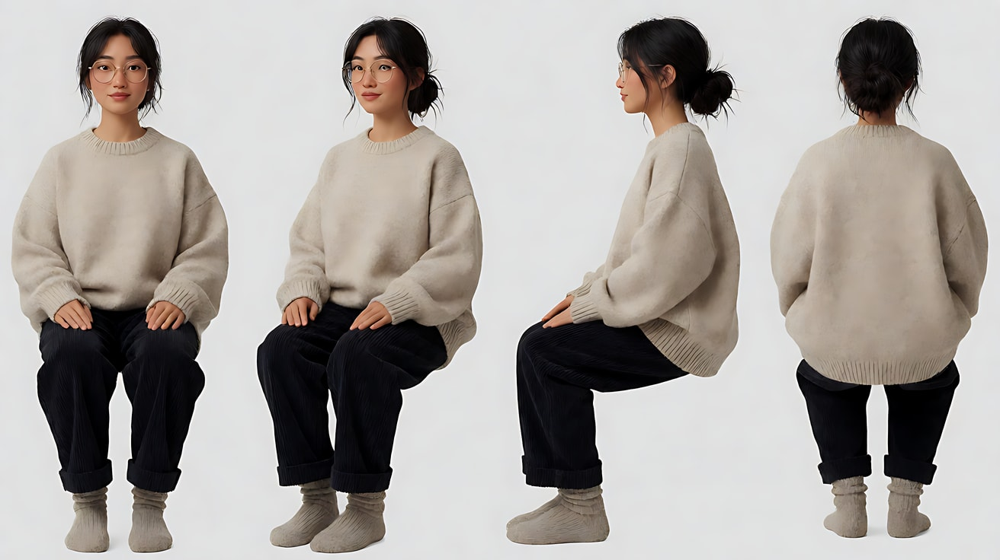
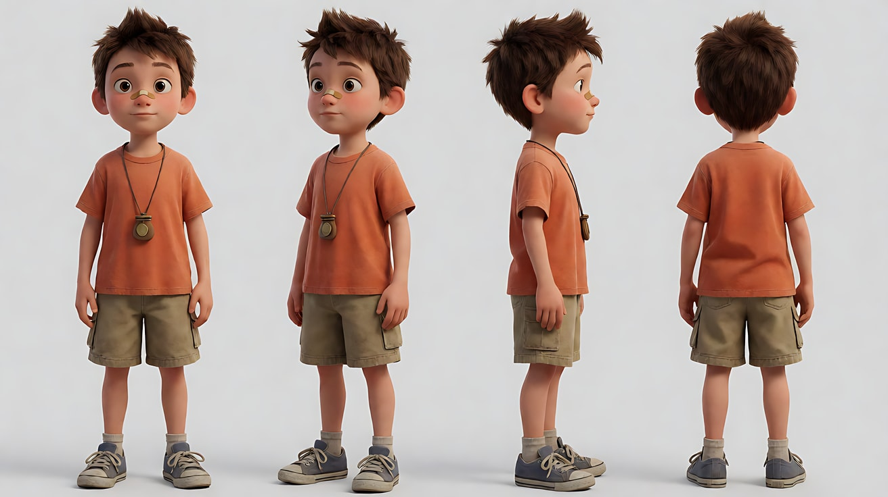
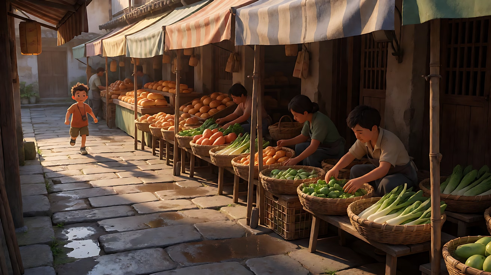
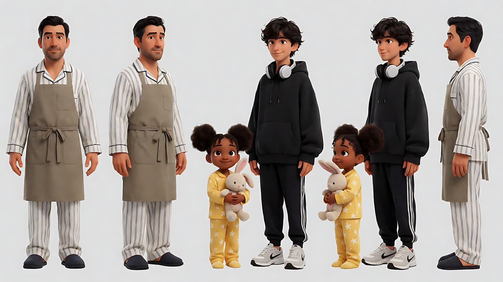
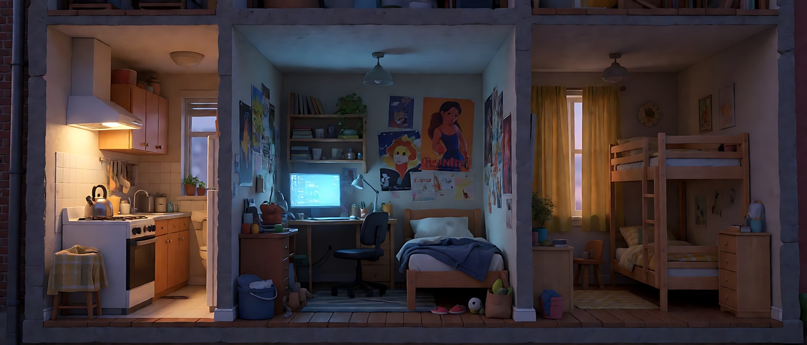
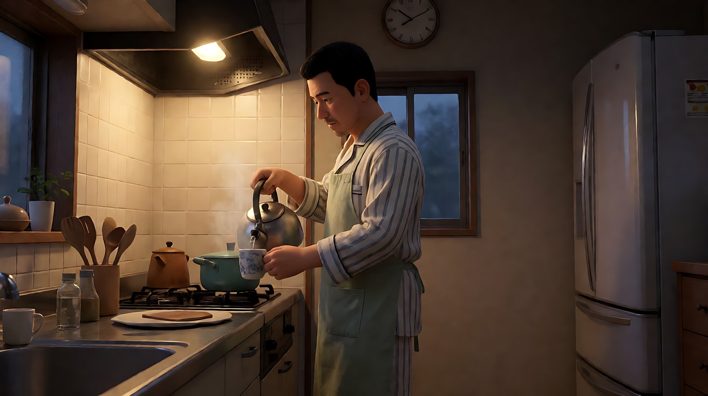
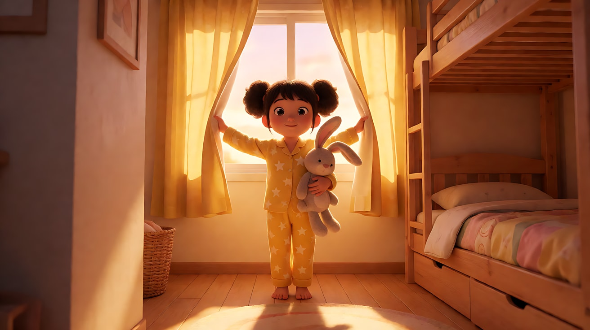

# L05-02 摇镜与移镜 · 提示词

> 本组练习：分别练水平摇、垂直摇、横移和横移经过前景，亲眼看到"机位不动的转头"和"机位移动的视差"有什么不同。｜ 配套教学：[L05-02-摇镜与移镜](../教学/L05-02-摇镜与移镜.md) ｜ 规范：[写作规范](../../模板/写作规范.md)
>
> 画风默认使用开关 A（风格化写实 CG）。如改用 2D 动画，删掉所有焦段、光圈、景深词。

---

### 练习1：摇随视线——灯塔看守人望向海面（难度 ★）

**目标**：单张关键帧生成一个水平摇镜。机位不动，镜头跟随人物的视线向右摇，停在他看见的东西上。意图：让观众和他一起发现那艘迟归的小船。

**运镜合同**

| 要素 | 本练习 |
|---|---|
| 起始构图 | 中景，看守人站在画左三分之一，侧身面朝画右，扶着栏杆；画右是大面积灰蓝色海面 |
| 运动方式 | 水平右摇，机位固定在平台上不移动 |
| 速度 | 缓慢、匀速，摇到位后停稳 |
| 终点画面 | 远景海面，一艘亮着暖灯的小渔船位于画面右三分之一，看守人已出画 |
| 运动动机 | 他的视线指向画右，镜头替观众"转头" |

**【生图 · Nano Banana】**

图1 关键帧（画幅放宽，给摇镜留出终点空间）：

```
A wide panoramic composition on a lighthouse balcony at dusk: an original lighthouse keeper in his fifties,
a thick grey beard, a navy wool peacoat and a knitted cap, standing at the iron railing on the left third of the frame,
body turned toward frame right, eyes narrowed looking far out to sea.
To the right, a vast grey-blue sea under low clouds, and near the right edge on the horizon a tiny fishing boat with one warm light.
Camera at standing eye level on the balcony, 35mm lens, deep focus.
Lighting: last cool dusk light from the overcast sky, the lighthouse lamp behind him casting a faint warm rim on his shoulders.
Stylized semi-realistic 3D CG rendering, feature-film animation quality. Aspect ratio 21:9.
```

中文释义：21:9 宽幅，灯塔阳台黄昏；看守人五十多岁、灰色络腮胡、藏青呢大衣、毛线帽，在画左三分之一扶栏杆，身体朝画右眯眼远望；画右是广阔灰蓝海面，地平线靠右处有一艘亮暖灯的小渔船；站姿视线高度、35mm、深景深；阴天冷色余光，背后灯塔灯给他肩膀一道暖色轮廓光。



> 视频时可以裁成 16:9 首帧（只保留看守人和左半边海面），宽幅原图作为场景参考，让模型知道"摇过去之后有什么"。

**【图生视频 · Seedance】**

```
【素材分工】@图片1 为首帧与场景参考，锁定看守人身份、服装和灯塔阳台、海面、小船的位置关系。
【画风】风格化写实三维CG质感，电影级布光。
起始画面为中景，看守人站在画左扶着铁栏杆，望向画右的海面，海风吹动他大衣的下摆。他眯起眼睛，身体微微前倾。镜头机位固定在阳台上不移动，随着他的视线缓慢匀速向右水平摇，看守人逐渐出画，画面掠过灰蓝色起伏的海面，最后停稳在远处地平线上那艘亮着一盏暖灯的小渔船上，小船位于画面右三分之一。低云缓慢移动，海面有细碎的浪。结尾停在小船和海面的远景，镜头不再移动。
【声音】海风持续呼啸，下方海浪拍打礁石，铁栏杆被风吹出一声轻响，远处传来一声低沉的船笛，无配乐。
【约束】保持人物脸型、发型、服装不变；镜头只摇不移、不推近；摇到小船后停住，不要回摇；不要字幕、水印、Logo。
时长：7秒
```

**参数**：时长 7 秒 ｜ 画幅 16:9

**【检查点】**
- 摇镜过程中阳台栏杆和海面是否一起平移（几乎没有视差），说明机位真的没动
- 是否停在小船上，而不是一直摇下去或回摇
- 看守人出画的方向是否在画左

**【常见问题与修复】**
| 现象 | 修复 |
|---|---|
| 镜头一路摇过头 | 终点写具体："停稳在小船上，小船位于画面右三分之一，镜头不再移动" |
| 镜头变成往前推向海面 | 写"机位固定不移动，只水平右摇，不推近" |
| 小船没出现或出现了很多船 | 首帧宽幅图里一定画出那艘船；约束写"海面上只有一艘小船" |
| 摇镜有抖动 | 速度写"缓慢匀速"，删掉"风很大镜头晃动"之类描述 |

---

### 练习2：上摇揭示尺度——树下的少女（难度 ★★）

**目标**：用定妆图 + 场景图生成一个垂直上摇镜头。机位不动，镜头从人物向上摇到巨大的树冠。意图：让观众跟她一起仰望，感到自己很小。

**运镜合同**

| 要素 | 本练习 |
|---|---|
| 起始构图 | 全景，少女背影位于画面下方中央，站在古树粗壮的树根前，树干占满画面上半 |
| 运动方式 | 垂直上摇，机位固定在她身后约一人高 |
| 速度 | 缓慢、匀速，后段略减速停稳 |
| 终点画面 | 仰视的树冠，枝叶层层叠叠，阳光从叶缝透下来，少女已在画面下沿外 |
| 运动动机 | 她抬头仰望，镜头替观众抬头 |

**【生图 · Nano Banana】**

图1 角色定妆：

```
Character turnaround sheet of an original girl about sixteen years old: long straight black hair tied with a red ribbon,
a white short-sleeved shirt, a dark-green pleated skirt, a canvas satchel across her body, brown leather boots.
Front view, three-quarter view, side view and back view, full body, plain light-grey background.
Camera at eye level, 50mm lens, deep focus, even soft studio light from the front.
Stylized semi-realistic 3D CG rendering, feature-film animation quality. Aspect ratio 16:9.
```

中文释义：原创角色，约十六岁少女，黑长直发系红丝带，白色短袖衬衫、深绿百褶裙、斜挎帆布包、棕色皮靴；四视图全身，平视、50mm、深景深、正面柔光。



图2 场景（古树全貌，竖向构图）：

```
An enormous ancient camphor tree in a quiet forest clearing at midsummer noon, its trunk wider than a house,
thick roots spreading over mossy ground, branches spreading high into a dense layered canopy,
sunbeams breaking through gaps in the leaves, no people.
Low-angle full view from the base looking up the entire tree, camera at ground level, 24mm lens, deep focus.
Lighting: strong sunlight from directly above filtered through the leaves, dappled light on the trunk, green bounce light on the moss.
Stylized semi-realistic 3D CG rendering, feature-film animation quality. Vertical 9:16 frame.
```

中文释义：盛夏正午林中空地的巨大古樟，树干比房子还宽，树根爬满苔地，树冠层层叠叠，阳光从叶缝透下；从树根仰视整棵树、24mm、深景深；正上方阳光穿过树叶形成斑驳光，苔藓反射绿光。竖幅用来交代"上面还有多高"。



**【多图生视频 · Seedance】**

```
【素材分工】@图片1 锁定少女身份、发带与服装，不参考其灰色背景；@图片2 仅参考古樟的形态、树冠层次与光线，不复制其竖幅构图。
【画风】风格化写实三维CG质感，电影级布光。
起始画面为全景，少女的背影站在画面下方中央，面前是古樟粗壮的树根和树干，树干占满画面上半部。她停下脚步，把帆布包带往肩上拉了拉，慢慢抬起头。镜头机位固定在她身后约一人高的位置不移动，随着她抬头的动作缓慢匀速向上摇，少女从画面下沿出画，画面沿着布满苔藓与斑驳光影的树干一路向上，越过第一道粗枝，最后减速停稳在仰视的树冠上，枝叶层层叠叠，阳光从叶缝中透下几道光柱。树叶在风里轻轻摇动。结尾停在仰视树冠、光柱透下的画面。
【声音】林间蝉鸣持续，风吹过树冠的沙沙声由远及近，一只鸟扑翅飞离树枝，无配乐。
【约束】保持人物脸型、发型、服装不变；镜头只上摇，不升高、不推近；不要字幕、水印、Logo。
时长：8秒
```

**参数**：时长 8 秒 ｜ 画幅 16:9

**【检查点】**
- 上摇时树干是否越来越呈仰视透视（摇镜特征），而不是平视地往上升（升降特征）
- 少女是否从画面下沿出画，而不是突然消失
- 终点是否停在树冠，没有继续摇向天空

**【常见问题与修复】**
| 现象 | 修复 |
|---|---|
| 镜头变成往上升（像电梯） | 写"机位固定不移动，只向上摇，不升高"；升降镜头留到 L05-05 |
| 树的尺度不够大 | 正文写"树干比房子还宽，少女只到树根一半高"，并在首帧里画出这种比例 |
| 少女在摇镜过程中转身 | 写"她始终背对镜头仰望" |
| 停不下来摇到天空 | 终点写"减速停稳在树冠上，画面上沿仍是枝叶" |

---

### 练习3：横移经过前景——书架后的发现（难度 ★★★，首尾帧）

**目标**：首帧被前景书架挡住大半，尾帧露出读书的人；中间是一个向右的横移，前景书架快速划过，产生明显视差。意图：让观众像在书架后面偷看一样，慢慢找到她。

**运镜合同**

| 要素 | 本练习 |
|---|---|
| 起始构图 | 前景深色书架侧板占据画左一半并虚化，书架缝隙里隐约露出远处窗边的暖光 |
| 运动方式 | 向右横移，机位沿书架平行移动，镜头朝向不变 |
| 速度 | 缓慢匀速 |
| 终点画面 | 中景，读书的女子坐在窗边地板上，位于画面右三分之一，前景书架边缘只剩画左一窄条 |
| 运动动机 | 窥视：观众像一个在书架间寻找她的人 |

**【生图 · Nano Banana】**

图1 角色定妆：

```
Character turnaround sheet of an original woman in her late twenties: a messy low bun with loose strands,
thin gold-rimmed glasses, an oversized oatmeal-colored sweater, dark corduroy trousers, woolen socks, no shoes.
Front view, three-quarter view, side view and back view, full body, plain light-grey background.
Camera at eye level, 50mm lens, deep focus, even soft studio light from the front.
Stylized semi-realistic 3D CG rendering, feature-film animation quality. Aspect ratio 16:9.
```

中文释义：原创角色，近三十岁女性，凌乱低发髻、细金边眼镜、燕麦色宽松毛衣、深色灯芯绒裤、毛袜不穿鞋；四视图全身。



图2 首帧：

```
Inside an old library aisle in late afternoon: the dark wooden side panel of a tall bookshelf fills the left half of the frame
in the extreme foreground, heavily blurred. Through the gap on the right, rows of books lead toward a distant tall window
glowing with warm light. The reading woman is not yet visible.
Camera at sitting-eye level, 50mm lens, shallow depth of field focused on the far window area.
Lighting: warm low sunlight through the tall window at the end of the aisle, dust in the air, the foreground shelf in shadow.
Stylized semi-realistic 3D CG rendering, feature-film animation quality. Aspect ratio 16:9.
```

中文释义：老图书馆书架间，前景深色书架侧板占画左一半、强烈虚化；右侧缝隙里一排排书通向远处发着暖光的高窗；读书的女子还看不到；坐姿视线高度、50mm、浅景深对焦远处窗边；窗外低角度暖阳，空气中有灰尘，前景书架处在阴影里。


图3 尾帧：

```
Using the character from image 1, in the same library and light as image 2, after the camera has moved to the right:
a medium shot of the woman sitting on the wooden floor beneath the tall window, back against the shelf,
knees up, an open hardcover book on her knees, head lowered reading, placed on the right third of the frame.
Only a thin blurred strip of the foreground shelf remains on the far left edge.
Camera at sitting-eye level, 50mm lens, shallow depth of field focused on her.
Lighting: warm low sunlight from the window behind her at frame right creating a golden rim on her hair and sweater,
soft bounce on her face from the open pages.
Keep the face, hairstyle and outfit exactly as in image 1.
Stylized semi-realistic 3D CG rendering, feature-film animation quality. Aspect ratio 16:9.
```

中文释义：向右移动之后，中景，女子坐在高窗下地板上，背靠书架、屈膝、膝上摊一本精装书低头阅读，位于右三分之一；画左只剩一窄条虚化的前景书架；窗光从她身后画右打来，在头发和毛衣上形成金色轮廓，书页把柔光反到她脸上。


**【首尾帧生视频 · Seedance】**

```
【素材分工】@图片2 为首帧；@图片3 为尾帧，是最终画面目标；@图片1 锁定女子的身份、眼镜与服装。只生成两帧之间的连续横移。
【画风】风格化写实三维CG质感，电影级布光。
镜头机位沿书架方向缓慢匀速向右横移，镜头朝向保持不变，不摇、不推近。前景深色书架侧板从画左快速划过、强烈虚化，中景的一排排书脊以中等速度向左移动，远处高窗几乎不动，形成清楚的前后视差。随着书架移开，坐在窗下地板上读书的女子逐渐露出，焦点从远处窗边自然落到她身上。她低着头，翻过一页书，手指压住书页，没有抬头。窗外暖色低角度阳光从她身后照来，在头发和毛衣边缘形成金色轮廓，光里的灰尘缓慢飘浮。结尾停在她位于画面右三分之一的中景，画左只剩一窄条虚化的书架边缘。
【声音】图书馆的安静底噪，远处一台老挂钟的滴答声，木地板轻微吱呀，翻书页的纸张声清楚，无配乐。
【约束】保持人物脸型、发型、眼镜、服装不变；只横移，不摇镜；不跳切；不要字幕、水印、Logo。
时长：8秒
```

**参数**：时长 8 秒 ｜ 画幅 16:9

**【检查点】**
- 前景书架、中景书脊、远处窗户的移动速度是否明显不同（视差）
- 镜头朝向是否保持不变，而不是变成向右摇
- 女子是否"被逐渐露出"，而不是突然出现

**【常见问题与修复】**
| 现象 | 修复 |
|---|---|
| 没有视差，像在摇 | 写"机位沿书架方向向右横移，镜头朝向保持不变"，并分层写前景快、中景中、远景几乎不动 |
| 前景书架消失得太突然 | 首帧让书架占画左一半，并写"前景书架从画左快速划过" |
| 女子抬头看镜头 | 写"她低着头，没有抬头"；窥视镜头里被看的人不知道镜头存在 |
| 焦点一直在书架上 | 写"焦点从远处窗边自然落到她身上"，首帧对焦远处 |

---

### 练习4：摇与移的对照——市场里奔跑的孩子（难度 ★★★★，多镜头）

**目标**：同一段奔跑，用三个镜头分别体验"摇跟随"、"平行横移"和"下摇落到细节"。每个镜头只有一个主运镜，靠切镜换运动方式。意图：让观众先远远看见他，再陪他一起跑，最后看清他手里攥着的东西。

**运镜合同**

| 镜头 | 起始构图 | 运动方式 | 速度 | 终点画面 | 运动动机 |
|---|---|---|---|---|---|
| 镜头1 | 全景，市场街口，男孩从画左远处跑进画面 | 机位固定，水平右摇跟随 | 匀速 | 男孩跑到画右三分之一，前方是一排摊位 | 远远地看，站定观察他的方向 |
| 镜头2 | 中景侧面，男孩在画面中央向右奔跑，前景是摊位的竹筐与布篷 | 平行向右横移 | 与男孩同速 | 男孩仍在画面中央，前景一根木柱划过后露出他的笑脸 | 陪他跑，视差让市场变得立体 |
| 镜头3 | 中近景，男孩停在一个面包摊前喘气，抬头看摊主 | 机位固定，缓慢下摇 | 缓慢 | 特写，他摊开的手心里一枚被攥得发亮的硬币 | 注意力从脸落到他准备了很久的东西 |

**【生图 · Nano Banana】**

图1 角色定妆：

```
Character turnaround sheet of an original boy about nine years old: short spiky brown hair, a band-aid on his nose,
a faded orange T-shirt, khaki shorts, worn blue sneakers, a small coin pouch on a string around his neck.
Front view, three-quarter view, side view and back view, full body, plain light-grey background.
Camera at eye level, 50mm lens, deep focus, even soft studio light from the front.
Stylized semi-realistic 3D CG rendering, feature-film animation quality. Aspect ratio 16:9.
```

中文释义：原创角色，约九岁男孩，棕色刺短发、鼻梁贴创可贴、褪色橙T、卡其短裤、旧蓝色运动鞋、脖子上挂小零钱袋；四视图全身。



图2 场景（早晨市场街）：

```
A narrow open-air morning market street, a long row of stalls along the right side with bamboo baskets of vegetables,
striped canvas awnings and wooden support poles, a bakery stall with golden bread loaves further down,
a few vendors arranging goods, wet stone pavement.
Wide shot from the street entrance, camera at standing eye level, 28mm lens, deep focus.
Lighting: low warm morning sun from frame left down the street, long shadows, steam rising from a food stall.
Stylized semi-realistic 3D CG rendering, feature-film animation quality. Aspect ratio 16:9.
```

中文释义：狭窄的露天早市街，右侧一排摊位，竹筐蔬菜、条纹帆布篷、木支柱，更远处有面包摊；几位摊主在整理货物；湿石板路；街口全景、站姿视线高度、28mm、深景深；画左低角度暖色晨光沿街照来，长影子，熟食摊冒热气。


图3 镜头1首帧：

```
Using the character from image 1 and the market street from image 2:
a wide shot of the market street entrance, the boy small in the distance on the left side of the frame,
running toward frame right, his coin pouch bouncing on his chest.
Camera at standing eye level from the street corner, 28mm lens, deep focus.
Lighting: low warm morning sun from frame left, long shadows on the wet stone pavement.
Keep the face, hairstyle and outfit exactly as in image 1.
Stylized semi-realistic 3D CG rendering, feature-film animation quality. Aspect ratio 16:9.
```

中文释义：街口全景，男孩在画左远处朝画右跑，胸前零钱袋跳动；画左低角度晨光，湿石板上长影子。



**【多图生视频 · Seedance】**

```
【素材分工】@图片1 锁定男孩身份、创可贴、服装与零钱袋，不参考其背景；@图片2 仅参考市场街的布局、摊位陈设与晨光方向，不复制其中摊主外貌；@图片3 为镜头1首帧。
【画风】风格化写实三维CG质感，电影级布光。
镜头1：全景，机位固定在街口不移动，镜头匀速向右水平摇，跟随男孩从画左远处跑来，他绕过一个推车的摊主，胸前的零钱袋上下跳动。镜头停在他跑到画面右三分之一、前方是一排摊位的位置。市场的吆喝声和远处的自行车铃。
镜头2：镜头切至侧面中景，机位与男孩保持同速向右平行横移，镜头朝向不变。男孩在画面中央奔跑，前景的竹筐、条纹布篷和木支柱快速从画面划过并虚化，背景的楼房缓慢移动。一根木柱划过画面后，露出他咧嘴笑的侧脸。他的脚步声与呼吸声清楚。
镜头3：镜头切至中近景，机位固定。男孩在面包摊前停下，弯腰喘气，抬头看向摊主，然后伸出攥紧的右手。镜头缓慢向下摇，从他的脸落到他慢慢摊开的手心，手心里一枚被攥得发亮的硬币。晨光从画左照在硬币上。结尾停在手心硬币的特写。
【锁定】光线：低角度暖色晨光始终来自画左；男孩始终向画右方向移动；服装、创可贴、零钱袋三个镜头一致；镜头1和镜头3机位不移动，只有镜头2是横移。
【声音】镜头1市场吆喝与自行车铃；镜头2脚步踩在湿石板上的啪嗒声和急促呼吸；镜头3喘气渐缓，面包摊烤炉的轻微噼啪声，男孩（摊开手）："一个……就要一个。"无配乐。
【约束】保持男孩脸型、发型、服装不变；手心只有一枚硬币；不要字幕、水印、Logo。
时长：13秒
```

**参数**：时长 13 秒 ｜ 画幅 16:9 ｜ 负载：3 个镜头、1 句短对白，"有挑战"档

**【检查点】**
- 镜头1和镜头3背景是否几乎没有视差（摇），镜头2前景与背景速度差是否明显（移）
- 男孩在三个镜头里是否都朝画右运动（画面方向一致）
- 镜头3是否从脸摇到手心，而不是切成两个画面

**【常见问题与修复】**
| 现象 | 修复 |
|---|---|
| 镜头2也变成了摇 | 写"机位与男孩保持同速向右平行横移，镜头朝向不变"，并写出前景快速划过 |
| 镜头1男孩跑出画 | 写"镜头停在他跑到画面右三分之一的位置"；摇镜的终点要写构图 |
| 镜头3硬币变成多枚或纸币 | 约束写"手心只有一枚硬币"；对白里也写"一个" |
| 男孩跑步方向在镜头2反了 | 【锁定】写"男孩始终向画右方向移动"，镜头2写"向右奔跑" |

---

### 练习5：横移穿过一栋楼的剖面——一个家庭的清晨（难度 ★★★★★，连续横移多阶段）

**目标**：一个连续的长横移，镜头沿着"剖面式"公寓的外侧横向经过三个房间，墙体作为前景遮挡划过画面，每个房间里一个人在做一件事。不切镜头，用"起初 / 随后 / 最后"分阶段写。意图：让观众感到这个家的三个人在同一个清晨各自醒来，彼此还没有见面。

**运镜合同**

| 要素 | 本练习 |
|---|---|
| 起始构图 | 中全景正面平视，左侧房间（父亲的厨房）完整在画内，右侧墙体边缘露在画右 |
| 运动方式 | 向右连续横移，机位平行于剖面，镜头朝向始终正对房间 |
| 速度 | 缓慢匀速；每经过一面墙，墙体前景划过时略微保持同速，不加速 |
| 终点画面 | 最右侧房间（小女儿的卧室），她拉开窗帘，晨光照满房间，画面停稳 |
| 运动动机 | 横移像翻开一本立体书，一个房间一个人物；墙体划过画面的瞬间是天然的"翻页" |

**【生图 · Nano Banana】**

图1 角色定妆（三位原创家庭成员）：

```
Character turnaround sheet of three original family members:
a father in his forties with short black hair and stubble, a striped pajama shirt and an apron;
a teenage son about fifteen with headphones around his neck, a loose black hoodie and track pants;
a little daughter about six with two puffy pigtails, yellow pajamas with a star pattern, holding a plush rabbit.
Front view, three-quarter view and side view of each, full body, plain light-grey background.
Camera at eye level, 50mm lens, deep focus, even soft studio light from the front.
Stylized semi-realistic 3D CG rendering, feature-film animation quality. Aspect ratio 16:9.
```

中文释义：三位原创家庭成员：四十多岁父亲（黑短发、胡茬、条纹睡衣加围裙）；十五岁儿子（颈挂耳机、宽松黑卫衣、运动裤）；六岁小女儿（两个蓬松小辫、星星图案黄色睡衣、抱毛绒兔）；三视图全身。



图2 场景（公寓剖面全景）：

```
A cutaway cross-section of a small apartment seen from the front like a dollhouse, three rooms side by side separated by thick walls:
on the left a narrow kitchen with a stove and a kettle, in the middle a messy teenager's bedroom with posters and a desk,
on the right a small child's bedroom with a bunk bed and closed yellow curtains. Early morning, no people.
Straight-on frontal view, camera at eye level, 35mm lens, deep focus, perfectly horizontal lines.
Lighting: each room lit by its own source — a warm stove-hood lamp in the kitchen, a cool blue monitor glow in the middle room,
dim pre-dawn light behind the yellow curtains on the right.
Stylized semi-realistic 3D CG rendering, feature-film animation quality. Aspect ratio 21:9.
```

中文释义：小公寓正面剖面（像玩具屋），三个房间并排，中间隔着厚墙：左边狭长厨房，中间凌乱的少年卧室，右边带上下铺和黄窗帘的儿童房；清晨无人；正面平视、35mm、深景深、横平竖直；每个房间各有光源：厨房油烟机暖灯，中间房间电脑屏幕冷蓝光，右边黄窗帘后微弱的黎明光。



图3 首帧（厨房）：

```
Using the father from image 1 and the cutaway apartment from image 2:
a medium-wide frontal shot of only the left kitchen room, the father standing at the stove pouring hot water from a kettle into a cup,
steam rising, the thick dividing wall visible at the right edge of the frame.
Camera at eye level, perfectly frontal, 35mm lens, deep focus.
Lighting: warm stove-hood lamp from above the stove at frame left, faint cool dawn through a small kitchen window.
Keep the face, hairstyle and outfit exactly as in image 1.
Stylized semi-realistic 3D CG rendering, feature-film animation quality. Aspect ratio 16:9.
```

中文释义：只拍左边厨房的中全景正面，父亲在灶前把热水倒进杯子，冒热气；画右边缘露出厚隔墙；油烟机暖灯从画左上方照下，小窗外微弱冷色晨光。



图4 尾帧（儿童房）：

```
Using the little daughter from image 1 and the cutaway apartment from image 2:
a medium-wide frontal shot of only the right child's bedroom, the little girl standing on tiptoe pulling the yellow curtains wide open,
plush rabbit tucked under one arm, warm sunrise light flooding into the room across the bunk bed and floor.
The thick dividing wall visible at the left edge of the frame.
Camera at eye level, perfectly frontal, 35mm lens, deep focus.
Lighting: warm golden sunrise from the window at the back of the room, long soft shadows toward the camera.
Keep the face, hairstyle and outfit exactly as in image 1.
Stylized semi-realistic 3D CG rendering, feature-film animation quality. Aspect ratio 16:9.
```

中文释义：只拍右边儿童房，小女儿踮脚把黄窗帘大大拉开，胳膊下夹着毛绒兔，日出暖光涌进房间，铺满上下铺和地板；画左边缘露出厚隔墙。



**【多图生视频 · Seedance】**

```
【素材分工】@图片1 锁定父亲、儿子、小女儿三人的身份与服装，不参考其背景；@图片2 仅参考三个房间的排列顺序、陈设与各自的光源，不复制其宽幅构图；@图片3 为首帧；@图片4 为尾帧，是最终画面目标。
【画风】风格化写实三维CG质感，电影级布光，严格正面平视，横平竖直。
全程一镜到底，不切镜头。镜头机位与公寓剖面保持平行，缓慢匀速向右连续横移，镜头始终正对房间，不摇、不推、不升降。
起初，画面是左边的厨房，父亲在油烟机暖灯下把热水倒进杯子，热气升起，他打了个哈欠。
随后，厚厚的隔墙作为前景从画右进入，横穿画面，墙体划过后露出中间的少年卧室：电脑屏幕的冷蓝光照着他的脸，儿子趴在桌上刚醒，抬手摘下头上的耳机，揉了揉眼睛。
最后，第二面隔墙划过画面，镜头来到右边的儿童房，小女儿踮起脚，抱着毛绒兔，用力把黄窗帘向两边拉开，暖金色的日出光一下涌进房间，铺过上下铺和地板。镜头减速停稳在儿童房的中全景，墙体边缘在画左。
【锁定】三个房间从左到右依次为厨房、少年卧室、儿童房；每个房间只出现一个人；光源各自独立：厨房暖灯、卧室冷蓝屏幕光、儿童房日出暖光；机位高度与朝向全程不变。
【声音】起初水壶倒水声和父亲的哈欠；随后墙体划过时声音被闷住一拍，接着是耳机里漏出的细小电子音乐和他揉眼睛的布料声；最后窗帘挂环滑过横杆的哗啦声，窗外鸟鸣涌进来，无配乐。
【约束】保持三人脸型、发型、服装不变；不切镜头；三人不见面、不走出各自房间；不要字幕、水印、Logo。
时长：15秒
```

**参数**：时长 15 秒 ｜ 画幅 16:9 ｜ 负载：一个连续横移、三个阶段、三个人物各一个动作，属于"冒险"边缘；失败时拆成两段（厨房到卧室 / 卧室到儿童房），用第一段的尾帧做第二段的首帧

**【检查点】**
- 镜头是否始终正对房间横移，墙体作为前景划过画面
- 三个房间顺序和各自光源是否保持
- 每个阶段是否只有一个人在做主动作
- 结尾是否停稳在儿童房，日出光是否清楚地"涌进来"

**【常见问题与修复】**
| 现象 | 修复 |
|---|---|
| 镜头穿墙进入房间内部 | 写"镜头始终在剖面外侧，与剖面平行，不推进"；墙体只作为前景划过 |
| 中途出现切镜 | 正文开头写"全程一镜到底，不切镜头"，约束重复"不切镜头" |
| 三个人出现在同一个房间 | 【锁定】写"每个房间只出现一个人；三人不见面" |
| 后半段动作被截掉 | 减少前两个阶段的动作，只保留"倒水""摘耳机"；或拆成两次生成 |
| 横移中途变成摇镜，房间透视歪斜 | 画风行写"严格正面平视，横平竖直"，正文写"镜头始终正对房间" |
