# L05-03 推拉镜头 · 提示词

> 本组练习：用推镜表达领悟、用拉镜完成揭示，控制推拉的速度与终点，并亲手对比"变焦推"和"物理推轨"的画面差别。｜ 配套教学：[L05-03-推拉镜头](../教学/L05-03-推拉镜头.md) ｜ 规范：[写作规范](../../模板/写作规范.md)
>
> 画风默认使用开关 A（风格化写实 CG）。如改用 2D 动画，删掉所有焦段、光圈、景深词。

---

### 练习1：缓慢推近——读到那一行字（难度 ★）

**目标**：单张关键帧生成一个缓慢推镜，只推一个景别（中近景 → 特写），推镜的动机是他读到信里的一句话。意图：让观众和他一起意识到写信的人不会回来了。

**运镜合同**

| 要素 | 本练习 |
|---|---|
| 起始构图 | 中近景，年轻男子坐在火车窗边，位于画面左三分之一，低头看手里的信，窗外景色在画右流动 |
| 运动方式 | 物理推轨向前推近，机位靠近他 |
| 速度 | 缓慢、匀速，最后一段减速停住 |
| 终点画面 | 特写，他的眼睛到下巴，目光停在信纸上，眼眶微微发红，仍在画面左三分之一 |
| 运动动机 | 他读到关键一句时停止了翻页，镜头替观众靠近他 |

**【生图 · Nano Banana】**

图1 关键帧：

```
A medium close-up of an original young man in his mid-twenties sitting by a train window,
short neat black hair, a dark-brown corduroy jacket over a cream turtleneck, holding a handwritten letter in both hands,
eyes lowered reading it. He is placed on the left third of the frame, the window on the right showing blurred passing fields.
Camera at seated eye level across the table, 50mm lens, shallow depth of field, the opposite seats softly blurred.
Lighting: soft overcast daylight through the train window from frame right as the key, a faint warm reading lamp above as fill.
Stylized semi-realistic 3D CG rendering, feature-film animation quality. Aspect ratio 16:9.
```

中文释义：中近景，二十多岁男子坐在火车窗边，黑色短发、深棕灯芯绒外套配米色高领毛衣，双手拿手写信低头读；位于左三分之一，画右车窗外是模糊流动的田野；隔桌坐姿视线高度、50mm、浅景深；画右阴天窗光为主光，头顶阅读灯微暖补光。

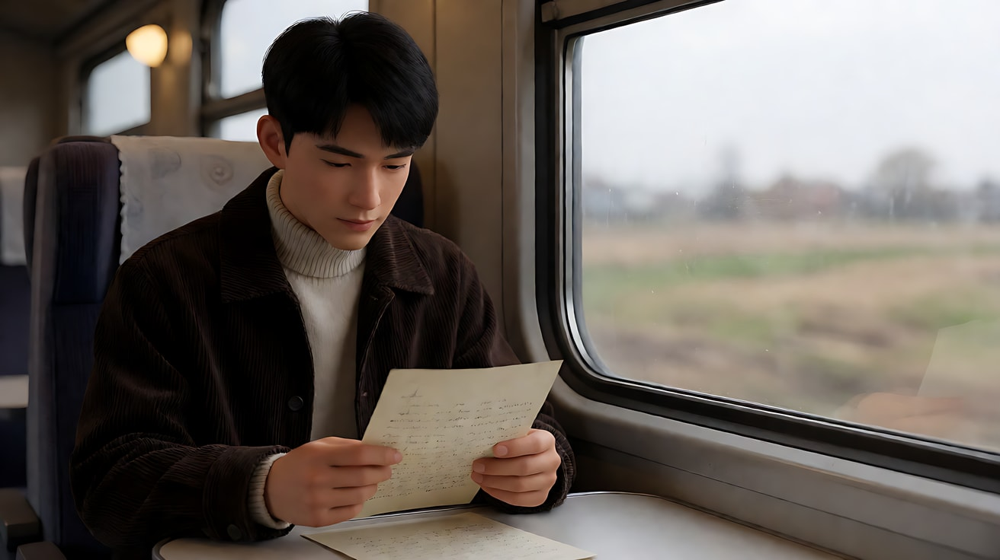

**【图生视频 · Seedance】**

```
【素材分工】@图片1 为首帧，锁定人物身份、服装、信纸与车厢布局。
【画风】风格化写实三维CG质感，电影级布光。
起始画面为中近景，年轻男子坐在火车窗边，低头读着手里的信，拇指捏着信纸边缘，窗外的田野在画右缓慢流过。他读到某一行时，拇指停住，不再往下看，呼吸停了一拍，喉结动了一下。在他停住的同时，镜头缓慢匀速地向前推近，机位靠近他，从中近景推到眼睛到下巴的特写，最后减速停住。他的眼眶慢慢泛红，但没有流泪，目光仍停在信纸上那一行。画右的阴天窗光照在他的脸侧，窗外的光影在他脸上有节奏地掠过。结尾停在他低垂目光的特写，人物仍在画面左三分之一。
【声音】火车车轮压过铁轨接缝的规律哐当声，车厢轻微的晃动声，信纸被捏紧时的一声细响，无配乐。
【约束】保持人物脸型、发型、服装不变；只推近一次，停在特写，不推到只剩眼睛；不要字幕、水印、Logo。
时长：7秒
```

**参数**：时长 7 秒 ｜ 画幅 16:9

**【检查点】**
- 推镜是否在"拇指停住"之后开始，有清楚的动机
- 是否停在特写，而不是推到眼睛大特写或脸部变形
- 推近时背景车厢是否自然虚化、略有透视变化（推轨特征）

**【常见问题与修复】**
| 现象 | 修复 |
|---|---|
| 推过头，脸部变形 | 终点写"眼睛到下巴的特写"，并加"不推到只剩眼睛" |
| 推镜从第一帧就开始，没有动机 | 写"在他停住的同时，镜头开始推近"，把动作放在运镜之前 |
| 人物哭得很夸张 | 写"眼眶慢慢泛红，但没有流泪"；情绪要克制成一个小动作 |
| 人物被推到画面中央 | 终点写"人物仍在画面左三分之一" |

---

### 练习2：拉镜揭示——空剧场里的谢幕（难度 ★★）

**目标**：用定妆图 + 场景图生成一个缓慢拉镜。开场是舞者谢幕的近景，拉开后揭示观众席一个人都没有。意图：让观众感到她的认真和这份孤独同样巨大。

**运镜合同**

| 要素 | 本练习 |
|---|---|
| 起始构图 | 近景，舞者面朝镜头微笑鞠躬，顶上追光照亮她，背景全黑 |
| 运动方式 | 物理后拉，机位沿剧场中轴线向后退，并随距离略微升高 |
| 速度 | 缓慢、匀速，越到后面越显得慢 |
| 终点画面 | 大远景，舞台上一束追光里的小小人影，前景是一排排空座椅 |
| 运动动机 | 揭示：观众以为有人在看，拉开后才知道没有 |

**【生图 · Nano Banana】**

图1 角色定妆：

```
Character turnaround sheet of an original ballet dancer in her early twenties: hair in a tight high bun with a thin silver hairpin,
a simple pale-blue chiffon practice dress, skin-colored tights, worn pink pointe shoes.
Front view, three-quarter view, side view and back view, full body, plain light-grey background.
Camera at eye level, 50mm lens, deep focus, even soft studio light from the front.
Stylized semi-realistic 3D CG rendering, feature-film animation quality. Aspect ratio 16:9.
```

中文释义：原创芭蕾舞者，二十出头，高发髻别细银发卡，淡蓝色雪纺练功裙、肉色袜、旧粉色足尖鞋；四视图全身。

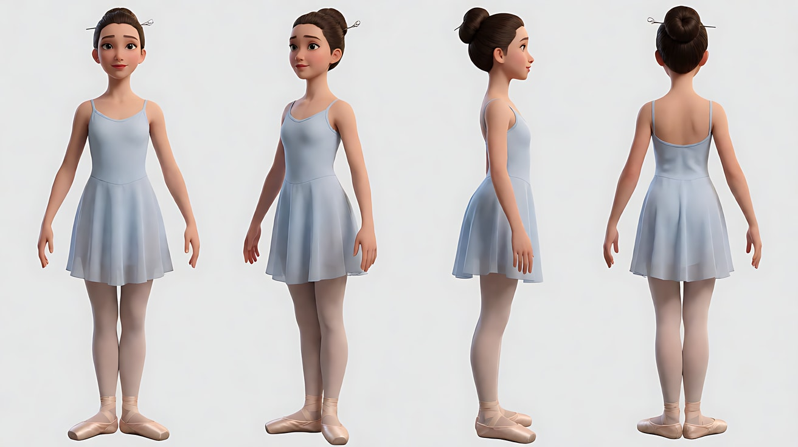

图2 场景（空剧场全景）：

```
An empty old theater seen from the back rows, hundreds of red velvet seats all empty, a gilded proscenium arch,
the stage dark except for a single hard white spotlight circle at center stage, dust visible in the light beam.
Extreme wide shot from the rear balcony level along the center aisle, camera slightly high, 24mm lens, deep focus.
Lighting: one cold white follow spot from the lighting booth behind the camera, faint green exit signs on the side walls, everything else dark.
Stylized semi-realistic 3D CG rendering, feature-film animation quality. Aspect ratio 16:9.
```

中文释义：从后排看空荡老剧场，数百张红丝绒座椅全空，镀金台口，舞台只有中央一圈冷白追光，光束里有灰尘；后排楼座高度沿中轴线的大远景、略高、24mm、深景深；唯一光源是镜头后方控制室的冷白追光，侧墙有微弱绿色安全出口灯。

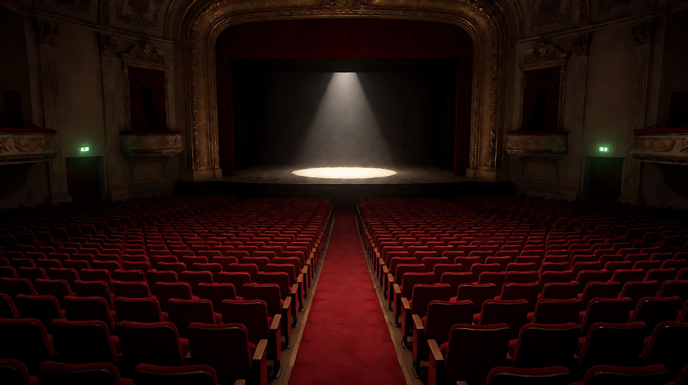

图3 首帧：

```
Using the character from image 1 on the stage of image 2:
a close-up of the dancer taking a deep bow, then lifting her head with a small tired smile, facing the camera,
a few strands of hair loose from her bun, sweat on her forehead, the background completely black.
Camera at stage height in front of her, 85mm lens, shallow depth of field.
Lighting: hard cold white spotlight from above and slightly in front, sharp shadows under her chin, deep black surroundings.
Keep the face, hairstyle and outfit exactly as in image 1.
Stylized semi-realistic 3D CG rendering, feature-film animation quality. Aspect ratio 16:9.
```

中文释义：舞者近景，深鞠躬后抬头，带一点疲惫的微笑面向镜头，几缕碎发、额头有汗，背景全黑；舞台高度正面、85mm、浅景深；冷白硬质追光从上方偏前打下，下巴下有清晰阴影。

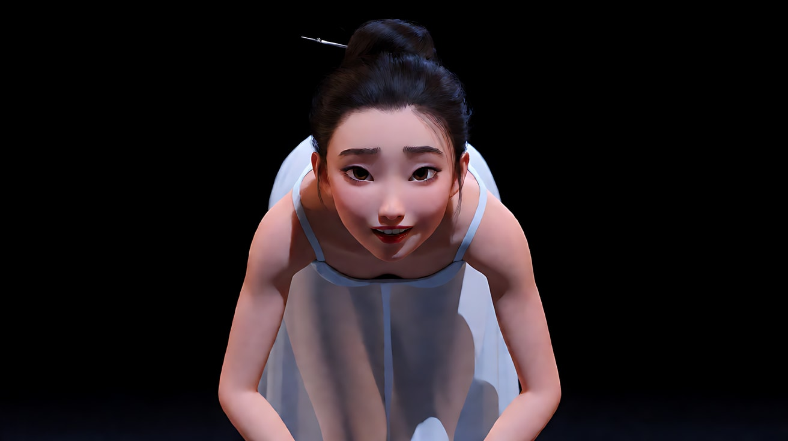

**【多图生视频 · Seedance】**

```
【素材分工】@图片1 锁定舞者身份、发型与服装，不参考其灰色背景；@图片2 仅参考剧场的空间结构、空座椅与追光位置，作为拉镜终点要揭示的环境，不复制其中构图；@图片3 为首帧。
【画风】风格化写实三维CG质感，电影级布光。
起始画面为近景，舞者刚完成深鞠躬，抬起头，带着疲惫的微笑看向前方，胸口随喘气起伏，额头的汗在追光下发亮。她把双手轻轻交叠放在胸前，再次微微点头致意。随后镜头缓慢匀速地后拉，机位沿剧场中轴线向后退并略微升高：她从近景变成全身，舞台的木地板和追光的圆形边界露出来，接着台口的镀金边框进入画面，前景开始出现一排排红色空座椅，座椅越来越多。她在追光里仍保持着致意的姿势，一动不动地等待。结尾停在大远景：舞台中央一束冷白追光里小小的人影，前景是成片的空座椅，侧墙的绿色安全出口灯微微发亮。
【声音】起初是她急促的喘气声；后拉过程中喘气声渐远，剧场空旷的低频回响越来越明显，追光灯的轻微电流嗡声，没有掌声，无配乐。
【约束】保持人物脸型、发型、服装不变；观众席所有座位都是空的；只后拉一次，不切镜头；不要字幕、水印、Logo。
时长：10秒
```

**参数**：时长 10 秒 ｜ 画幅 16:9

**【检查点】**
- 揭示的顺序是否正确：人物 → 舞台 → 台口 → 空座椅
- 是否所有座椅都空着（揭示的"答案"不能出错）
- 声音是否随距离变远，并且没有掌声

**【常见问题与修复】**
| 现象 | 修复 |
|---|---|
| 拉开后座椅上有观众 | 约束写"观众席所有座位都是空的"；场景图必须是空座 |
| 拉镜太快，揭示没有重量 | 速度写"缓慢匀速"，时长加到 12 秒；正文按顺序写出逐层露出的内容 |
| 镜头拉到一半转向别处 | 写"沿剧场中轴线向后退"，终点写清"舞台居中、前景是空座椅" |
| 自动加了掌声或配乐 | 声音写明"没有掌声，无配乐" |

---

### 练习3：变焦推 vs 物理推轨——同一个起点，两种终点（难度 ★★★，首尾帧）

**目标**：用同一张首帧和两张不同的尾帧，分别生成"变焦推"和"物理推轨"。对比两段视频的背景变化，真正看懂两者差别。意图：版本 A 让观众感到"远远地盯着她"，版本 B 让观众感到"走到她身边"。

**运镜合同**

| 要素 | 版本 A：变焦推 | 版本 B：物理推轨 |
|---|---|---|
| 起始构图 | 全景，女子站在长堤尽头，身后是远处的灯塔，位于画面中央 | 同左 |
| 运动方式 | 机位不动，镜头变焦推近 | 机位沿长堤向前推进 |
| 速度 | 缓慢、匀速 | 缓慢、匀速 |
| 终点画面 | 中近景，灯塔被同比例放大，挤在她头侧，空间被压扁 | 中近景，灯塔在背景里相对变小，长堤两侧的栏杆从画面两边划过 |
| 运动动机 | 监视、远观，观众不敢靠近 | 陪伴，观众走到她身边 |

**【生图 · Nano Banana】**

图1 角色定妆：

```
Character turnaround sheet of an original woman in her early thirties: shoulder-length chestnut hair blowing loose,
a long charcoal wool coat, a thick burgundy knitted scarf, black ankle boots, hands in her coat pockets.
Front view, three-quarter view, side view and back view, full body, plain light-grey background.
Camera at eye level, 50mm lens, deep focus, even soft studio light from the front.
Stylized semi-realistic 3D CG rendering, feature-film animation quality. Aspect ratio 16:9.
```

中文释义：原创角色，三十出头女性，及肩栗色头发被风吹散，炭灰色长呢大衣、酒红色粗针围巾、黑色短靴，双手插兜；四视图全身。

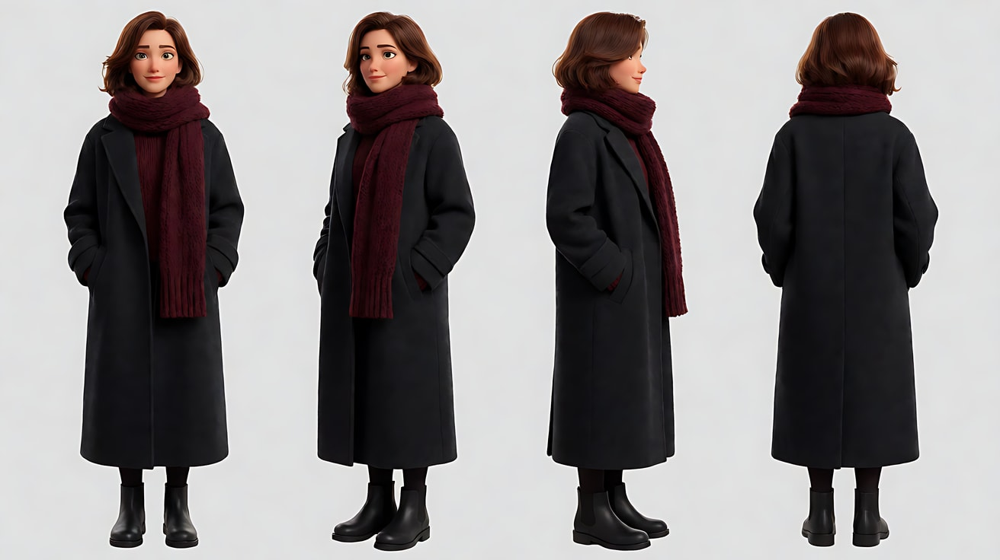

图2 首帧（全景）：

```
Using the character from image 1: a full shot of the woman standing at the far end of a long stone breakwater,
facing the camera, hands in her pockets, scarf blowing to frame left, placed at the center of the frame.
Low iron railings run along both sides of the breakwater toward her, a small white lighthouse far behind her on the horizon,
grey sea and overcast sky.
Camera at standing eye level on the breakwater about thirty meters away, 50mm lens, deep focus.
Lighting: flat cool overcast daylight from above, a slightly brighter sky behind her.
Keep the face, hairstyle and outfit exactly as in image 1.
Stylized semi-realistic 3D CG rendering, feature-film animation quality. Aspect ratio 16:9.
```

中文释义：全景，女子站在长石堤尽头面向镜头，双手插兜，围巾向画左飘；位于画面中央；两侧低矮铁栏杆一路延伸到她身边，她身后远处地平线上有一座小白灯塔；灰色海面与阴天；约三十米外站姿视线高度、50mm、深景深；阴天顶光，她身后的天空稍亮。

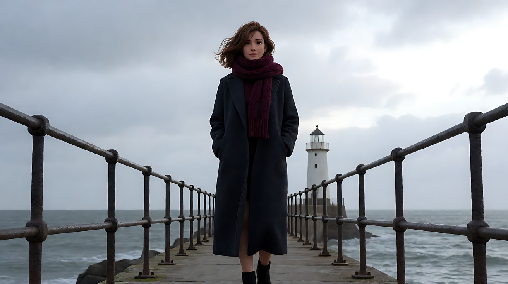

图3 版本 A 尾帧（变焦效果）：

```
Using the character from image 1, the same camera position as image 2 but with a much longer telephoto lens:
a medium close-up of the woman facing the camera at the center of the frame, the white lighthouse behind her
now appears large and very close to her head, the background flattened and compressed,
the railings are no longer visible at the frame edges.
Camera at the same distant eye-level position, 200mm telephoto lens, shallow depth of field, the lighthouse softly blurred but large.
Lighting: flat cool overcast daylight.
Keep the face, hairstyle and outfit exactly as in image 1.
Stylized semi-realistic 3D CG rendering, feature-film animation quality. Aspect ratio 16:9.
```

中文释义：同一机位改用200mm长焦：中近景，她居中面向镜头，身后的灯塔变得很大、紧贴在她头侧，空间被压扁；画面边缘不再有栏杆；浅景深，灯塔虚化但巨大。

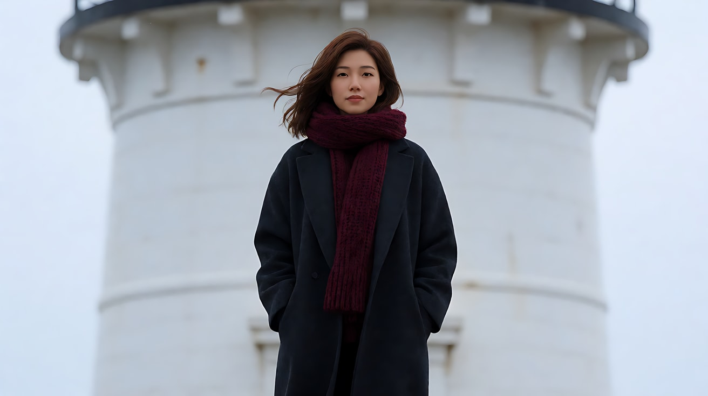

图4 版本 B 尾帧（推轨效果）：

```
Using the character from image 1: the camera has physically walked up the breakwater to stand close to her.
A medium close-up of the woman facing the camera at the center of the frame, the white lighthouse behind her
now appears small and distant on the horizon, the iron railings on both sides sweep out toward the frame edges in strong perspective.
Camera at standing eye level about two meters from her, 50mm lens, moderate depth of field.
Lighting: flat cool overcast daylight.
Keep the face, hairstyle and outfit exactly as in image 1.
Stylized semi-realistic 3D CG rendering, feature-film animation quality. Aspect ratio 16:9.
```

中文释义：机位真的沿长堤走到她面前约两米：中近景，她居中面向镜头，灯塔在背景里显得又小又远，两侧铁栏杆以强烈透视伸向画面边缘；50mm、中等景深。

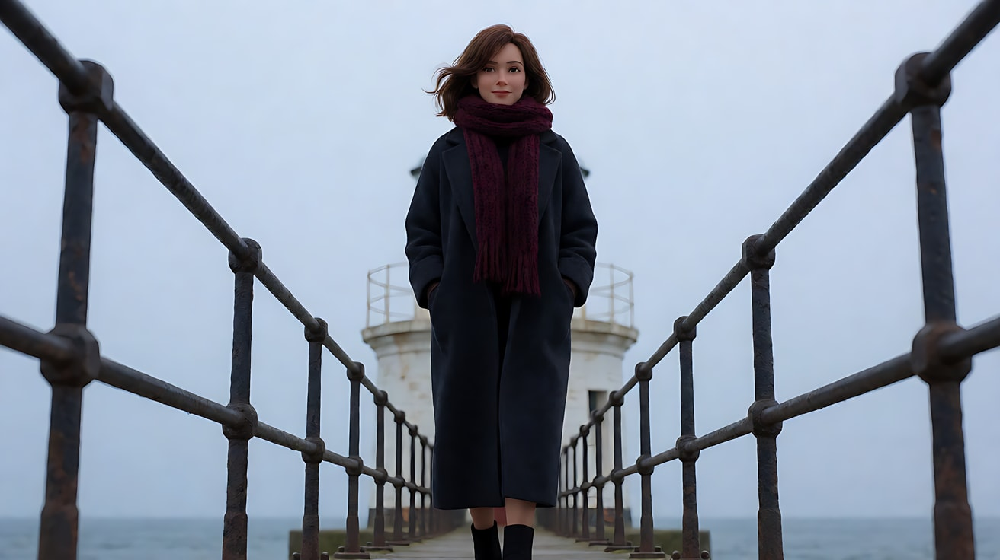

**【首尾帧生视频 · Seedance】**

版本 A：变焦推

> 版本 A 上传图1、图2、图3 三张。

```
【素材分工】@图片2 为首帧；@图片3 为尾帧，是最终画面目标；@图片1 锁定人物身份与服装。只生成两帧之间的连续变化。
【画风】风格化写实三维CG质感，电影级布光。
机位固定在长堤远端不动，镜头缓慢匀速地变焦推近，透视不变，女子和她身后的灯塔按同一比例被放大，两侧栏杆逐渐被推出画面，背景越来越压缩，灯塔越来越贴近她的头侧。女子始终站着面对镜头，双手插在大衣兜里，围巾被海风吹向画左，她只在中途眨了一下眼，下巴微微收紧。阴天的平光不变。结尾停在她的中近景，巨大的灯塔贴在她头侧。
【声音】持续的海风，远处海浪拍打堤岸，一只海鸥叫了一声，无配乐。
【约束】保持人物脸型、发型、服装不变；机位不移动；人物不走动；不要字幕、水印、Logo。
时长：7秒
```

版本 B：物理推轨

> 版本 B 是一次新的生成，只上传图1、图2、图4 三张，平台按上传顺序编号为 @图片1、@图片2、@图片3。

```
【素材分工】@图片2 为首帧；@图片3 为尾帧，是最终画面目标，即推轨后灯塔变小的画面；@图片1 锁定人物身份与服装。只生成两帧之间的连续变化。
【画风】风格化写实三维CG质感，电影级布光。
镜头机位沿着长堤缓慢匀速地向前推进，一路走到女子面前。两侧的铁栏杆从画面左右两边持续划过，透视越来越强，背景里的灯塔相对越来越小、越来越远。女子始终站着面对镜头，双手插在大衣兜里，围巾被海风吹向画左，镜头靠近时她的目光从远处收回来，落到镜头的方向。阴天的平光不变。结尾停在她的中近景，灯塔在背景地平线上显得很小。
【声音】持续的海风，脚下石堤上的风声越来越近，远处海浪拍打堤岸，一只海鸥叫了一声，无配乐。
【约束】保持人物脸型、发型、服装不变；人物不走动；不要字幕、水印、Logo。
时长：7秒
```

**参数**：时长 7 秒 ×2 ｜ 画幅 16:9 ｜ 生成后两段并排播放对比

**【检查点】**
- 版本 A 里灯塔是否和人物一起被放大（透视不变）
- 版本 B 里栏杆是否从两侧划过，灯塔是否相对变小（透视改变）
- 两个版本的终点景别是否一样（都是中近景），只有背景不同

**【常见问题与修复】**
| 现象 | 修复 |
|---|---|
| 两个版本看起来一样 | 检查尾帧：A 的灯塔必须很大，B 的灯塔必须很小；尾帧本身就要体现差别 |
| 版本 A 机位也在前进 | 正文第一句写"机位固定在长堤远端不动"，并在约束重复"机位不移动" |
| 版本 B 人物向镜头走来 | 约束写"人物不走动"，正文写"镜头一路走到她面前" |
| 变焦过程画面抖动 | 长焦变焦对抖动敏感，写"缓慢匀速"，删除风吹镜头之类描述 |

---

### 练习4：推、急推、拉——画廊里的那幅画（难度 ★★★★，多镜头）

**目标**：三个镜头分别使用缓慢推、急推和缓慢拉，速度与方向随情绪改变。意图：让观众感到老人在一幅画里认出了年轻时的爱人，然后发现身边已经没有人可以说。

**运镜合同**

| 镜头 | 起始构图 | 运动方式 | 速度 | 终点画面 | 运动动机 |
|---|---|---|---|---|---|
| 镜头1 | 中景，老人背影走向墙上一幅画，位于画面中央 | 推轨向前推 | 缓慢 | 中近景，老人侧脸，画的边框在画右 | 跟随他的脚步靠近这幅画 |
| 镜头2 | 中景，画作正面，画里一位戴黄色发带的年轻女子 | 急推（变焦） | 快速 | 特写，画中女子的眼睛和黄色发带 | 他认出她的一瞬间，冲击 |
| 镜头3 | 近景，老人正面，眼睛湿润 | 推轨后拉 | 缓慢 | 大远景，空荡的展厅，他独自站在画前，展厅的灯一排排熄灭 | 抽离：他的世界里只剩他自己 |

**【生图 · Nano Banana】**

图1 角色定妆：

```
Character turnaround sheet of an original elderly man in his late seventies: thin white hair, a neatly trimmed white mustache,
a beige wool overcoat over a brown knitted vest and a white shirt, a wooden walking cane with a brass handle.
Front view, three-quarter view, side view and back view, full body, plain light-grey background.
Camera at eye level, 50mm lens, deep focus, even soft studio light from the front.
Stylized semi-realistic 3D CG rendering, feature-film animation quality. Aspect ratio 16:9.
```

中文释义：原创角色，七十多岁老人，稀疏白发、修剪整齐的白胡子，米色呢大衣、棕色针织背心、白衬衫，铜柄木手杖；四视图全身。

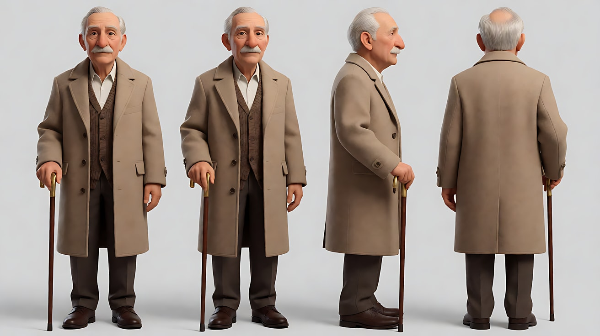

图2 画作（画中人物也是原创）：

```
An original oil painting hanging on a gallery wall in a simple gold frame: a portrait of a young woman in her early twenties
sitting in a sunlit summer field, a bright yellow ribbon tied in her dark hair, laughing and looking slightly off to the side,
thick visible brushstrokes, warm impressionist colors.
Frontal medium shot of the painting on the wall, camera at eye level, 50mm lens, deep focus.
Lighting: a warm gallery spotlight from above angled down onto the painting, the wall around it in soft shadow.
Stylized semi-realistic 3D CG rendering, feature-film animation quality. Aspect ratio 16:9.
```

中文释义：画廊墙上一幅原创油画，金色简框；画中是一位二十出头的年轻女子坐在夏日阳光田野里，黑发上系亮黄色发带，笑着看向一侧，笔触厚重、色彩温暖；正面中景、平视、50mm；画廊射灯从上方斜照画面，四周墙面在柔和阴影里。

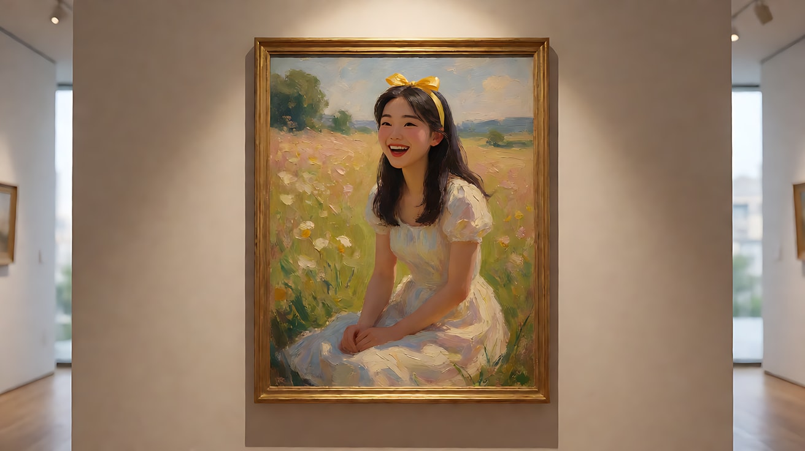

图3 场景（展厅大远景）：

```
A long empty art gallery hall at closing time, polished wooden floor, white walls with framed paintings evenly spaced,
a single wooden bench in the middle, rows of ceiling track spotlights, no people.
Extreme wide shot from one end of the hall, camera slightly high, 24mm lens, deep focus.
Lighting: warm track spotlights on each painting, the rest of the hall in dim cool ambient light from tall windows showing a dark-blue evening sky.
Stylized semi-realistic 3D CG rendering, feature-film animation quality. Aspect ratio 16:9.
```

中文释义：闭馆时空荡的长展厅，抛光木地板，白墙上等距挂着画，中间一张木长椅，天花板一排排轨道射灯；从展厅一端略高的大远景、24mm、深景深；每幅画有暖色射灯，其余空间是高窗外深蓝夜色带来的冷暗光。

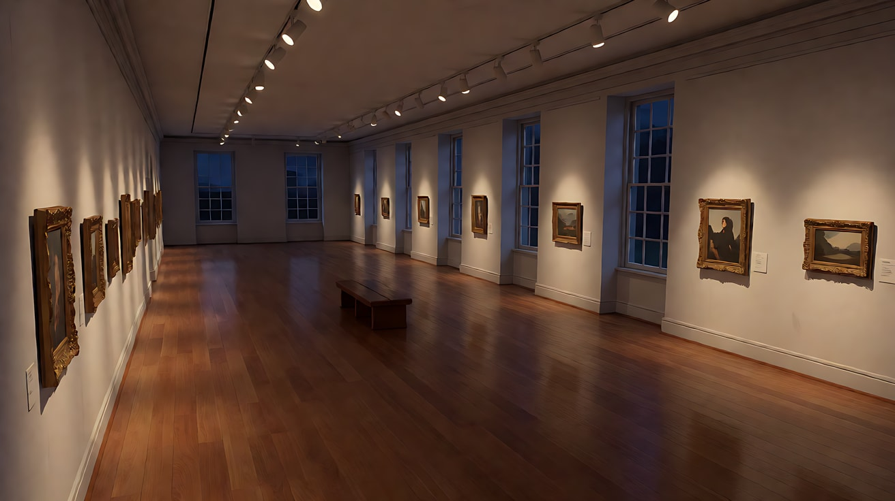

图4 镜头1首帧：

```
Using the character from image 1 in the gallery of image 3:
a medium shot from behind of the old man walking slowly with his cane toward a painting in a gold frame on the far wall,
placed at the center of the frame, the warm spotlight on the painting ahead of him.
Camera at standing eye level behind him, 35mm lens, moderate depth of field.
Lighting: warm gallery spotlight on the painting ahead, cool dim ambient light in the hall.
Keep the face, hairstyle and outfit exactly as in image 1.
Stylized semi-realistic 3D CG rendering, feature-film animation quality. Aspect ratio 16:9.
```

中文释义：中景背影，老人拄着手杖慢慢走向远处墙上的金框画，位于画面中央，前方画作被暖色射灯照亮；身后站姿视线高度、35mm、中等景深。

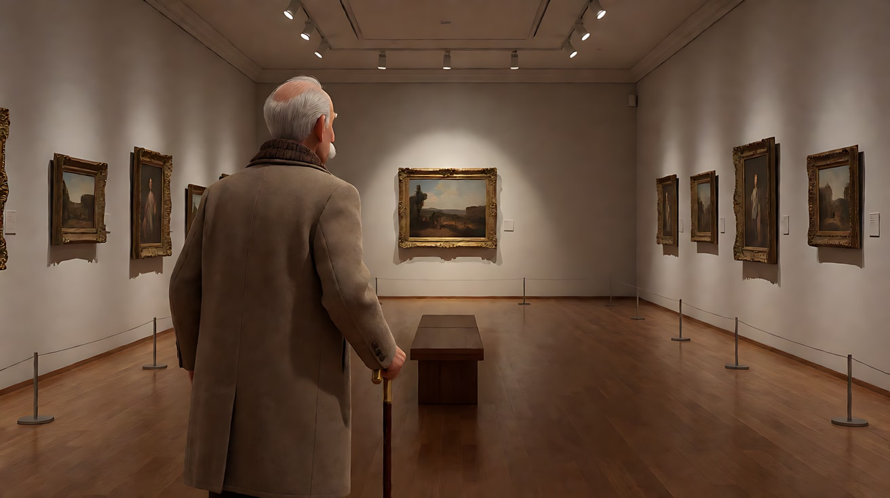

**【多图生视频 · Seedance】**

```
【素材分工】@图片1 锁定老人的身份、服装与手杖，不参考其背景；@图片2 锁定画作的内容、黄色发带与金色画框，画中女子不会动；@图片3 仅参考展厅空间、长椅与射灯布局，作为镜头3拉镜终点要揭示的环境；@图片4 为镜头1首帧。
【画风】风格化写实三维CG质感，电影级布光。
镜头1：中景背影，镜头跟在老人身后缓慢向前推近，老人拄着手杖一步一步走向墙上那幅画，手杖点地。他在画前停住，镜头也停在他的中近景侧脸，金色画框在画右。射灯的暖光照在画上，也照亮他半边脸。手杖点地声和空旷展厅的脚步回声。
镜头2：镜头切至画作正面中景，画中女子坐在夏日田野里笑着。镜头快速急推，变焦冲向画中女子的脸，停在她的眼睛和黄色发带的特写，油画笔触清楚可见。画中女子保持不动。一声短促低沉的弦乐重音。
镜头3：镜头切至老人的正面近景，他的眼睛湿润，嘴唇动了一下，没有发出声音，握着手杖的手慢慢收紧。随后镜头缓慢后拉，机位沿展厅中轴线向后退：他从近景变成全身，身旁的长椅、两侧一幅幅画依次进入画面，展厅越来越空旷。远处的射灯一排接一排熄灭，最后只剩他面前那幅画上的一盏灯。结尾停在大远景，他独自站在唯一亮着的画前，在画面中很小。
【锁定】光线：画作上方的暖色射灯是主光，展厅其余部分是冷暗的窗光；老人始终穿米色呢大衣、拄铜柄木手杖；画作内容与黄色发带三个镜头一致；老人面朝画作，画作在他前方。
【声音】镜头1手杖点地与脚步回声；镜头2一声短促低沉的弦乐重音，随后归于寂静；镜头3极轻的呼吸声，射灯熄灭时一下接一下的"咔哒"开关声，越来越远，最后只剩空旷的寂静。
【约束】保持老人脸型、发型、服装不变；画中人物不动、不走出画框；展厅里只有老人一个人；不要字幕、水印、Logo。
时长：14秒
```

**参数**：时长 14 秒 ｜ 画幅 16:9 ｜ 负载：3 个镜头、三种速度、无对白，"有挑战"档

**【检查点】**
- 三个镜头的速度是否明显不同：缓慢推 → 快速急推 → 缓慢拉
- 镜头2的急推是否落在画中女子的眼睛和发带上
- 镜头3的拉镜是否按"近景 → 全身 → 展厅"顺序揭示，射灯是否逐排熄灭

**【常见问题与修复】**
| 现象 | 修复 |
|---|---|
| 画中女子活了过来 | 素材分工写"画中女子不会动"，约束写"画中人物不动、不走出画框" |
| 镜头2急推不够快 | 写"快速急推，变焦冲向"，并配一声弦乐重音作为节奏提示 |
| 镜头3灯一下全灭 | 写"一排接一排熄灭"，并在声音里写"一下接一下的开关声" |
| 镜头3老人哭得太外放 | 写"眼睛湿润，嘴唇动了一下，没有发出声音"，情绪交给手收紧的动作 |

---

### 练习5：推拉的节奏——棋局最后一步（难度 ★★★★★，四镜头 + 速度设计）

**目标**：四个镜头组成一场对峙，推拉的速度一镜比一镜变化：极慢推积累压力 → 反打极慢推 → 急推落到关键细节 → 缓慢拉完成退场。意图：让观众感到年迈的棋手在对方落下一子的瞬间知道自己输了，并且体面地接受。

**运镜合同**

| 镜头 | 起始构图 | 运动方式 | 速度 | 终点画面 | 运动动机 |
|---|---|---|---|---|---|
| 镜头1 | 中近景，年轻女棋手位于画左，面朝画右，低头看棋盘 | 推轨向前推 | 极慢，几乎察觉不到 | 近景，她抬眼，手指捏起一枚白子 | 压力在她身上积累 |
| 镜头2 | 中近景反打，老棋手位于画右，面朝画左 | 推轨向前推 | 极慢 | 近景，他的眉头微微收紧 | 压力传到他身上，两人推镜节奏相同 |
| 镜头3 | 近景，棋盘上空，老棋手的手悬在棋盒上方 | 急推 | 快速 | 特写，他的手指停在半空，慢慢松开棋子 | 他看懂了，冲击落在手上 |
| 镜头4 | 中景，老棋手低头向对面鞠躬 | 推轨后拉 | 缓慢 | 全景，整个对局室，两人隔着棋盘，窗外雪落 | 抽离，一场对局结束 |

**【生图 · Nano Banana】**

图1 角色定妆（两位原创棋手）：

```
Character turnaround sheet of two original board-game players:
a young woman about twenty with a sharp straight bob haircut, a dark-navy high-collared jacket, a calm focused expression;
an elderly man in his seventies with short white hair and thick white eyebrows, a dark-grey traditional robe with a light-grey sash.
Front view, three-quarter view and side view of each, full body, plain light-grey background.
Camera at eye level, 50mm lens, deep focus, even soft studio light from the front.
Stylized semi-realistic 3D CG rendering, feature-film animation quality. Aspect ratio 16:9.
```

中文释义：两位原创棋手：约二十岁年轻女子（利落齐耳短发、深藏青立领外套、冷静专注）；七十多岁老人（白色短发、浓白眉、深灰传统长袍配浅灰腰带）；三视图全身。

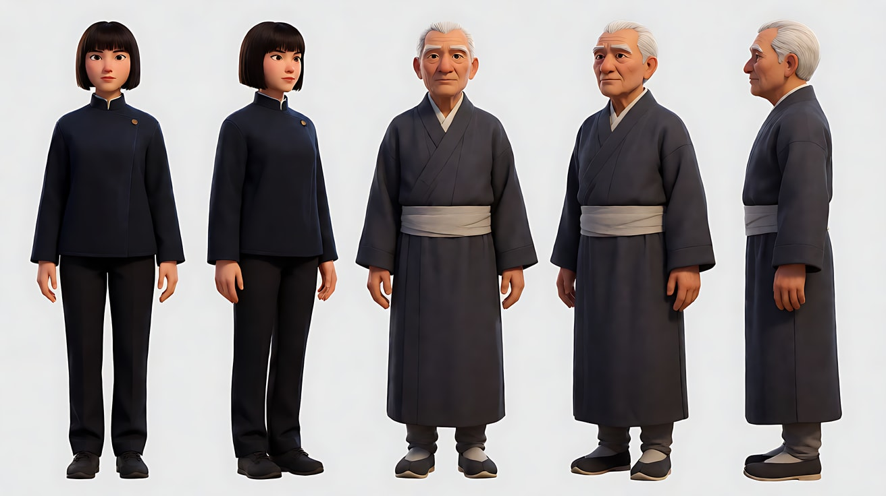

图2 场景（对局室）：

```
An empty quiet traditional game room in winter, a low wooden game board with a grid of black and white stones mid-game
placed on tatami mats at the center, two thin floor cushions facing each other across the board, two wooden stone bowls,
a large paper sliding window on the right side with snow falling outside, no people.
Wide shot from the side of the board, camera at seated eye level, 35mm lens, deep focus.
Lighting: soft cool diffused daylight through the paper window from frame right, a warm low paper lamp in the far left corner.
Stylized semi-realistic 3D CG rendering, feature-film animation quality. Aspect ratio 16:9.
```

中文释义：冬日安静的传统对局室，榻榻米中央一张矮木棋盘，黑白棋子下到中盘，两侧对放薄坐垫和两只木棋盒；右侧大面纸拉窗外在下雪；棋盘侧面坐姿视线高度、35mm、深景深；画右纸窗透进柔和冷色漫射光，左后角一盏暖色低矮纸灯。

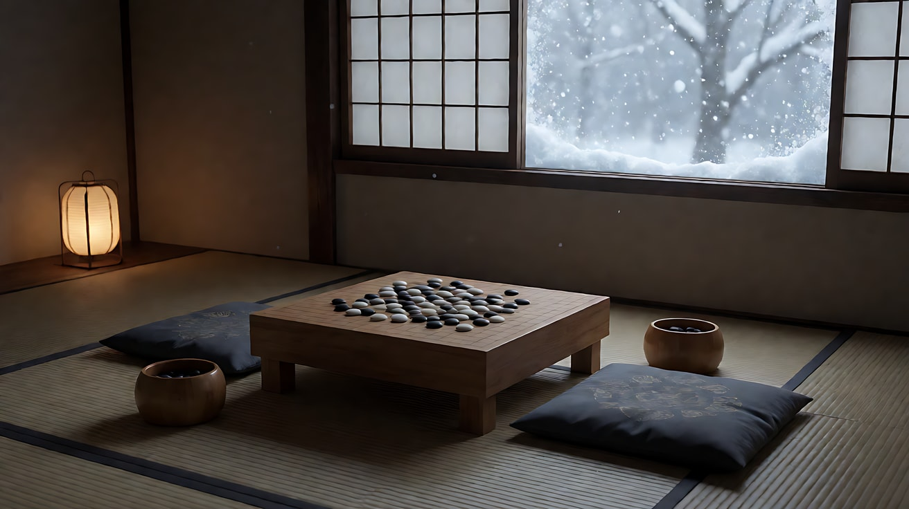

图3 镜头1首帧：

```
Using the young woman from image 1 in the game room of image 2:
a medium close-up of the young woman kneeling at the board on the left side of the frame, facing right, eyes lowered on the stones,
one hand resting on the lid of her stone bowl.
Camera at seated eye level from her opposite side slightly off-axis, 85mm lens, shallow depth of field, the paper window softly glowing behind.
Lighting: soft cool daylight from the paper window at frame right as key on her face, warm faint lamp glow far behind.
Keep the face, hairstyle and outfit exactly as in image 1.
Stylized semi-realistic 3D CG rendering, feature-film animation quality. Aspect ratio 16:9.
```

中文释义：年轻女棋手中近景，跪坐在棋盘前位于画左、面朝画右，低头看棋子，一只手搭在棋盒盖上；坐姿视线高度、85mm、浅景深；画右纸窗冷光照亮她的脸，后方远处有微弱暖灯。

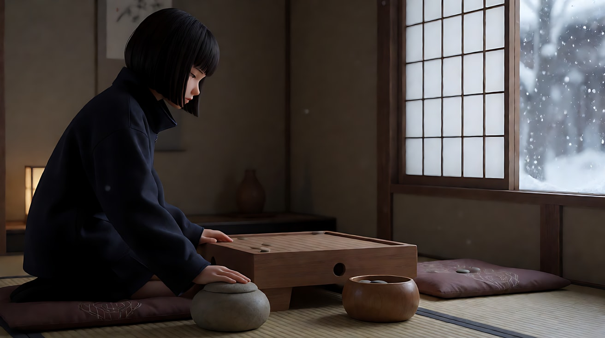

图4 镜头2首帧（反打）：

```
Using the elderly man from image 1 in the game room of image 2:
a medium close-up reverse shot of the elderly man kneeling at the board on the right side of the frame, facing left,
eyes on the board, his hands resting on his knees.
Camera at seated eye level from the young woman's side, 85mm lens, shallow depth of field.
Lighting: soft cool daylight from the paper window now at frame left behind the camera side, warm faint lamp glow behind him.
Keep the face, hairstyle and outfit exactly as in image 1.
Stylized semi-realistic 3D CG rendering, feature-film animation quality. Aspect ratio 16:9.
```

中文释义：老棋手中近景反打，跪坐在棋盘前位于画右、面朝画左，看着棋盘，双手放在膝上；85mm浅景深；纸窗冷光照在他脸上，身后远处暖灯微亮。

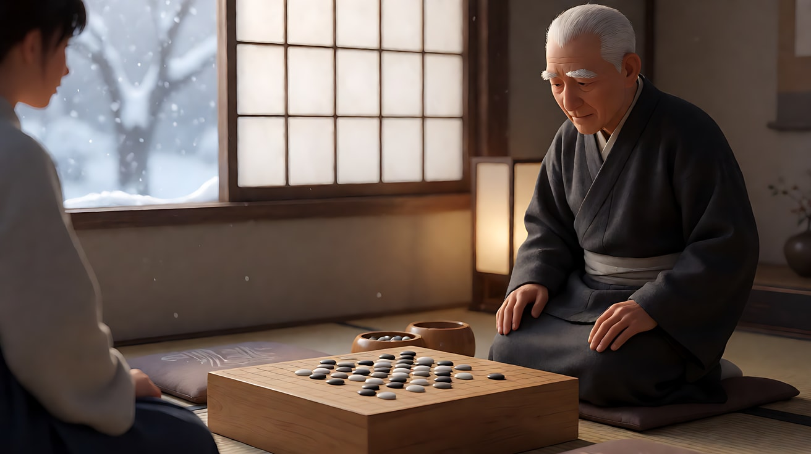

**【多图生视频 · Seedance】**

```
【素材分工】@图片1 锁定两位棋手的身份与服装，不参考其背景；@图片2 仅参考对局室布局、棋盘与纸窗光线，作为镜头4拉镜终点的空间；@图片3 为镜头1首帧；@图片4 为镜头2的构图参考。
【画风】风格化写实三维CG质感，电影级布光。
镜头1：中近景，镜头极慢地向前推近，几乎难以察觉。年轻女棋手跪坐在画左，面朝画右，盯着棋盘，指尖在棋盒盖上停了很久，然后抬眼，从棋盒里捏起一枚白子。纸窗的冷光照亮她的脸。窗外落雪无声，屋里只有墙上挂钟的滴答声。镜头停在她抬眼的近景。
镜头2：镜头切至老棋手的中近景反打，他位于画右，面朝画左，镜头以同样极慢的速度向前推近。他看着棋盘，双手放在膝上，听见棋子落盘的一声"嗒"后，眉头微微收紧，眼皮垂下又抬起。镜头停在他的近景。
镜头3：镜头切至棋盘上空的近景，老棋手的手正伸向自己的棋盒，指间捏着一枚黑子。镜头快速急推到他的手指特写，手停在半空，停了一拍，然后手指慢慢松开，黑子落回棋盒里。纸窗冷光照在他手背的皱纹上。
镜头4：镜头切至老棋手的中景，他把双手放回膝上，向对面深深低头鞠躬。随后镜头缓慢后拉，机位沿棋盘侧面向后退：年轻女棋手从画左进入画面，她也低头回礼，两人隔着棋盘，整间对局室露出来，纸窗外的雪不停地落。结尾停在全景，两人低头相对，棋盘在正中。
【锁定】光线：冷色漫射光来自纸窗，暖色纸灯在远处角落；年轻女棋手始终在画左面朝右，老棋手始终在画右面朝左；机位始终在两人连线的同一侧；镜头1和镜头2推镜速度相同。
【声音】镜头1挂钟滴答，指尖摩擦棋盒盖的细响；镜头2一声清脆的落子声，随后挂钟滴答变得格外清楚；镜头3黑子落回棋盒的一声轻响；镜头4老棋手（低头）："我输了。"之后只剩挂钟声和窗外极轻的风雪声，无配乐。
【约束】保持两人脸型、发型、服装不变；棋盘上棋子位置不乱动；全片只有一句台词；不要字幕、水印、Logo。
时长：15秒
```

**参数**：时长 15 秒 ｜ 画幅 16:9 ｜ 负载：4 个镜头、1 句台词，"有挑战"档；如果第四个镜头被截短，拆成两次生成，第二次以镜头3的尾帧做首帧

**【检查点】**
- 镜头1和镜头2的推镜速度是否一致、都足够慢
- 镜头3的急推是否明显快于前两个镜头，落在手指上
- 镜头4后拉时女棋手是否从画左进入，没有越轴
- 全片是否只有一句台词，且在镜头4

**【常见问题与修复】**
| 现象 | 修复 |
|---|---|
| 极慢推看起来像固定镜头 | 每个镜头只推一个景别（中近景到近景），并写"镜头停在她抬眼的近景"作为可见终点 |
| 镜头3的手指变形 | 只写"手停在半空，手指慢慢松开"；删掉"捏起""转动"等精细动作 |
| 镜头4女棋手出现在画右 | 【锁定】重复"年轻女棋手始终在画左面朝右"，并写"从画左进入画面" |
| 棋盘上的棋子乱跳 | 约束写"棋盘上棋子位置不乱动"，并减少镜头里对棋盘的大幅运镜 |
