# L05-04 跟拍与前导 · 提示词

> 本组练习：分别练背后跟、侧跟、前导倒退拍，学会"镜头与主体同速、景别不变、背景流动"，最后把三种跟随位置组合成一段追逐。｜ 配套教学：[L05-04-跟拍与前导](../教学/L05-04-跟拍与前导.md) ｜ 规范：[写作规范](../../模板/写作规范.md)
>
> 画风默认使用开关 A（风格化写实 CG）。如改用 2D 动画，删掉所有焦段、光圈、景深词。

---

### 练习1：背后跟——夜巷尽头的那扇门（难度 ★）

**目标**：单张关键帧生成一个背后跟拍。镜头跟在人物身后同速前进，始终保持中景背影，观众只能看到她看到的路。意图：让观众跟着她走向一扇不知道里面有什么的门。

**运镜合同**

| 要素 | 本练习 |
|---|---|
| 起始构图 | 中景背影，送餐女孩位于画面中央，前方是一条窄巷，尽头有一扇透出暖光的门 |
| 运动方式 | 背后跟拍，镜头在她身后约两米，同速前进 |
| 速度 | 慢走速度，匀速；她停下时镜头同时停下 |
| 终点画面 | 中景背影，她停在门前，抬手准备敲门，门缝的暖光落在她身上 |
| 运动动机 | 观众和她一样不知道门后有什么，背后跟让观众代入她的视线 |

**【生图 · Nano Banana】**

图1 关键帧：

```
A medium shot from behind of an original young delivery girl in her early twenties walking down a narrow alley at night,
a short black bob under a yellow cap, a yellow rain jacket, a square insulated delivery bag on her back,
placed at the center of the frame. The alley is lined with old brick walls, hanging air-conditioner units and dripping pipes,
wet ground reflecting light. At the far end of the alley a wooden door is slightly open, warm orange light spilling out.
Camera at standing eye level about two meters behind her, 35mm lens, moderate depth of field, the far door slightly soft.
Lighting: the warm light from the door ahead as the main source creating a rim around her silhouette,
a cold blue streetlight behind the camera, light rain.
Stylized semi-realistic 3D CG rendering, feature-film animation quality. Aspect ratio 16:9.
```

中文释义：中景背影，二十出头送餐女孩走在夜晚窄巷里，黄帽下黑色短发、黄色雨衣、背方形保温箱，位于画面中央；巷子两侧旧砖墙、挂着空调外机和滴水管道，湿地面反光；巷子尽头一扇木门半开，透出橙色暖光；身后约两米站姿视线高度、35mm、中等景深；前方门缝暖光是主光并勾出她的轮廓，镜头后方有冷蓝路灯，小雨。

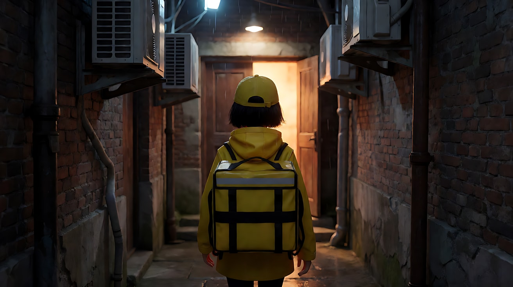

**【图生视频 · Seedance】**

```
【素材分工】@图片1 为首帧，锁定人物身份、服装、保温箱与巷子布局。
【画风】风格化写实三维CG质感，电影级布光。
送餐女孩沿着窄巷向尽头那扇透出暖光的门走去，步子不快，雨衣兜帽上的雨滴往下落。镜头在她身后约两米，与她同速向前跟随，始终保持中景背影，她始终位于画面中央。两侧的砖墙、空调外机和滴水的管道依次向后退去，地面积水映着门缝的暖光。走到一半，她放慢脚步，回头看了一眼身后，又转回去继续走。她在门前停下，镜头同时停下。结尾停在她站在门前、抬起右手准备敲门的中景背影，门缝的暖光落在她的雨衣上。
【声音】细雨落在雨衣和铁皮上的声音，她的脚步踩过积水，管道滴水声，门后隐约传来低低的说话声，无配乐。
【约束】保持人物服装、保温箱不变；镜头始终在她身后，不绕到侧面或正面；不要字幕、水印、Logo。
时长：8秒
```

**参数**：时长 8 秒 ｜ 画幅 16:9

**【检查点】**
- 她在画框里的大小是否全程基本不变（景别锁定）
- 两侧环境是否在向后流动，证明她真的在前进
- 回头时是否只露出侧脸一瞬，镜头仍在背后

**【常见问题与修复】**
| 现象 | 修复 |
|---|---|
| 人物原地踏步 | 写"两侧的砖墙、空调外机和滴水的管道依次向后退去"，让背景流动可见 |
| 镜头追不上，人物越来越小 | 写"与她同速向前跟随，始终保持中景背影" |
| 镜头绕到她正面 | 约束写"镜头始终在她身后，不绕到侧面或正面" |
| 门自己打开、有人出来 | 结尾写"抬起右手准备敲门"；不写开门，留给下一个镜头 |

---

### 练习2：侧跟——海边公路上的单车少年（难度 ★★）

**目标**：用定妆图 + 场景图生成一个侧面同速跟拍。镜头与骑车的少年平行前进，前景护栏立柱快速划过，背景海面缓慢移动。意图：让观众感到风迎面吹来、和他一起骑行的自由。

**运镜合同**

| 要素 | 本练习 |
|---|---|
| 起始构图 | 中景侧面，少年骑车从画左向画右，位于画面中央偏左，背景是海和远山 |
| 运动方式 | 侧跟，镜头在他左侧，与他平行同速移动（车载） |
| 速度 | 与自行车同速，中等偏快 |
| 终点画面 | 中景侧面不变，他松开一只手，向海面张开手臂，阳光在他身后形成轮廓光 |
| 运动动机 | 陪伴：镜头像骑在他旁边的朋友 |

**【生图 · Nano Banana】**

图1 角色定妆：

```
Character turnaround sheet of an original teenage boy about seventeen: tousled sandy-brown hair, a sun-faded light-blue
short-sleeved shirt worn open over a white tank top, rolled-up khaki shorts, canvas sneakers,
riding an old red steel-frame bicycle with a front basket.
Front view, three-quarter view, side view and back view, full body with the bicycle, plain light-grey background.
Camera at eye level, 50mm lens, deep focus, even soft studio light from the front.
Stylized semi-realistic 3D CG rendering, feature-film animation quality. Aspect ratio 16:9.
```

中文释义：原创角色，约十七岁少年，蓬乱沙棕色头发、褪色浅蓝短袖衬衫敞开罩白背心、挽起的卡其短裤、帆布鞋，骑一辆带前车筐的旧红色钢架自行车；连车四视图全身。

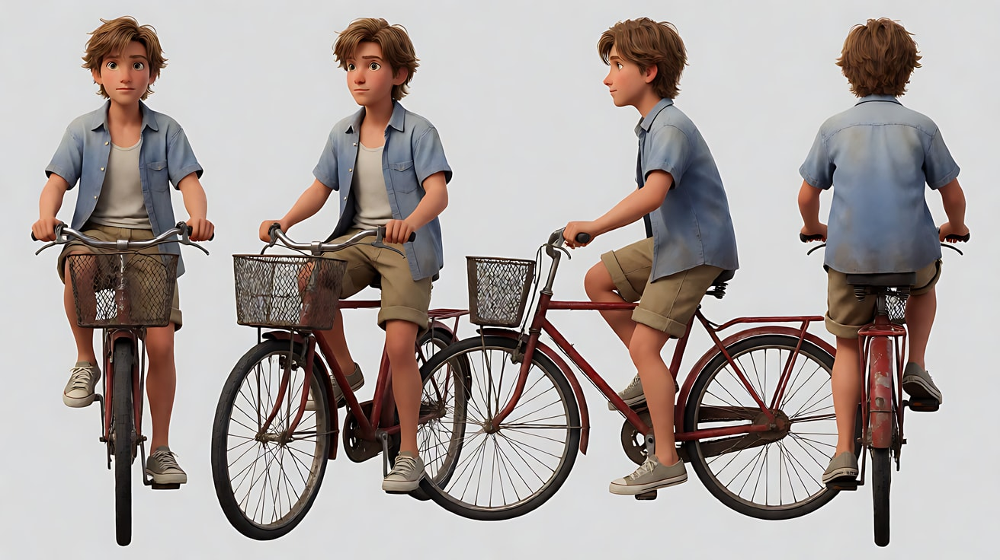

图2 场景（海边公路）：

```
A coastal road in late afternoon running left to right along a cliff edge, white-painted metal guardrail posts close to the camera
along the road edge, the sparkling sea below on the right side of the road, distant green headlands and a small white village on the horizon, no people.
Medium-wide side view from the landward side of the road, camera at seated eye level, 35mm lens, moderate depth of field.
Lighting: warm low sun from frame right ahead of the travel direction, long glittering reflections on the sea, slight haze.
Stylized semi-realistic 3D CG rendering, feature-film animation quality. Aspect ratio 16:9.
```

中文释义：午后海边悬崖公路，从左到右延伸，路边白色金属护栏立柱靠近镜头，路外是闪着光的海面，远处有绿色岬角和白色小村；从靠山一侧的中全景侧视、坐姿视线高度、35mm、中等景深；暖色低角度阳光来自画右行进方向，海面长长的反光，略带薄雾。

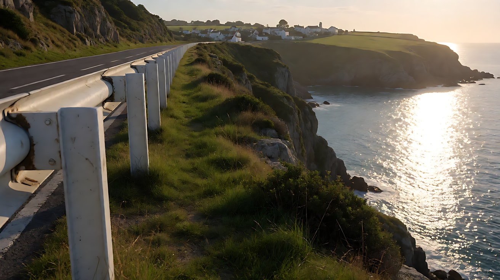

**【多图生视频 · Seedance】**

```
【素材分工】@图片1 锁定少年身份、服装与红色自行车，不参考其灰色背景；@图片2 仅参考海边公路的方向、护栏、海面与阳光方向，不复制其中构图。
【画风】风格化写实三维CG质感，电影级布光。
起始画面为中景侧面，少年骑着红色旧自行车沿海边公路从画左向画右前进，位于画面中央偏左，衬衫下摆被风吹得鼓起来。镜头在他左侧，与他平行同速移动，始终保持中景侧面，他在画面里的大小和位置不变。前景的白色护栏立柱一根接一根快速从画面划过并虚化，背景的海面和远处岬角缓慢移动，海面上的阳光碎片不断闪烁。他抬起头迎着风，然后松开左手，向海面方向张开手臂，脸上露出笑容。画右前方的低角度阳光在他头发和衬衫边缘勾出金色轮廓。结尾停在他张开手臂骑行的中景侧面，镜头仍在同速跟随。
【声音】迎面的风声，车链转动的咔嗒声，车轮压过路面的沙沙声，远处海浪和海鸥，无配乐。
【约束】保持人物脸型、发型、服装和自行车颜色不变；镜头始终在他左侧，不绕到前方或后方；不要字幕、水印、Logo。
时长：8秒
```

**参数**：时长 8 秒 ｜ 画幅 16:9

**【检查点】**
- 前景护栏立柱与背景海面的速度差是否明显
- 少年在画面里的位置是否稳定在中央偏左
- 自行车车轮与脚踏是否在转动，而不是"滑行"

**【常见问题与修复】**
| 现象 | 修复 |
|---|---|
| 车轮不转像在滑行 | 写"车链转动、他用力蹬着脚踏"，声音里加车链咔嗒声 |
| 少年逐渐跑出画面 | 写"镜头与他平行同速移动，他在画面里的大小和位置不变" |
| 张开手臂时车把歪了、人摔倒 | 只松开一只手，写"右手仍握着车把"；不写"放开双手" |
| 前景护栏挡住人物 | 写"护栏立柱在前景下半部分划过"，并让首帧镜头略高于护栏 |

---

### 练习3：前导倒退拍——走向场馆的女拳手（难度 ★★★，首尾帧）

**目标**：首帧是她在昏暗通道深处迎面走来，尾帧是她走到通道口、场馆的光打在脸上。中间镜头一直在她前方倒退，保持景别。意图：让观众正面看着她的决心，而她看见的场馆，观众要等到最后一刻才感到它的光。

**运镜合同**

| 要素 | 本练习 |
|---|---|
| 起始构图 | 中近景正面，女拳手位于画面中央迎面走来，身后是长长的昏暗通道 |
| 运动方式 | 前导倒退拍，镜头在她前方约一米半，面朝她倒退 |
| 速度 | 与她坚定的步速相同，匀速；她停下时镜头同时停 |
| 终点画面 | 中近景正面不变，她停在通道口，场馆的白光从镜头方向照亮她的脸 |
| 运动动机 | 观众要看清她的表情；她看见前方，观众看不见，制造期待 |

**【生图 · Nano Banana】**

图1 角色定妆：

```
Character turnaround sheet of an original female boxer in her late twenties: tightly braided cornrows pulled back,
a small scar on her left eyebrow, a black satin hooded robe with a thin gold trim worn open over a red sports top,
red hand wraps on both hands, black boxing shorts, black boots.
Front view, three-quarter view, side view and back view, full body, plain light-grey background.
Camera at eye level, 50mm lens, deep focus, even soft studio light from the front.
Stylized semi-realistic 3D CG rendering, feature-film animation quality. Aspect ratio 16:9.
```

中文释义：原创角色，近三十岁女拳手，紧贴头皮的脏辫向后束、左眉有小疤，敞开的黑色缎面连帽长袍带细金边、内穿红色运动上衣，双手缠红色绷带，黑色拳击短裤、黑靴；四视图全身。

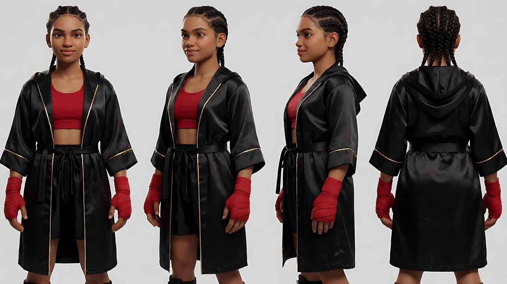

图2 首帧：

```
Using the character from image 1: a medium close-up from the front of the boxer walking toward the camera down a long dim concrete tunnel,
hood up, eyes fixed straight ahead, jaw set, placed at the center of the frame.
Behind her the tunnel stretches into darkness with a few flickering wall lamps and a team member far behind carrying a towel.
Camera at standing eye level about one and a half meters in front of her, 50mm lens, shallow depth of field, the tunnel behind softly blurred.
Lighting: dim cool fluorescent wall lamps passing overhead, faint white glow on her face coming from ahead of her, deep shadows under the hood.
Keep the face, hairstyle and outfit exactly as in image 1.
Stylized semi-realistic 3D CG rendering, feature-film animation quality. Aspect ratio 16:9.
```

中文释义：女拳手中近景正面，戴着兜帽在长长的昏暗水泥通道里朝镜头走来，目光直视前方，下颌咬紧，位于画面中央；身后通道延伸进黑暗，有几盏闪烁的壁灯，远处一位队员拿着毛巾跟着；前方约一米半站姿视线高度、50mm、浅景深；头顶冷色日光壁灯，前方来的微弱白光照在她脸上，兜帽下阴影很深。

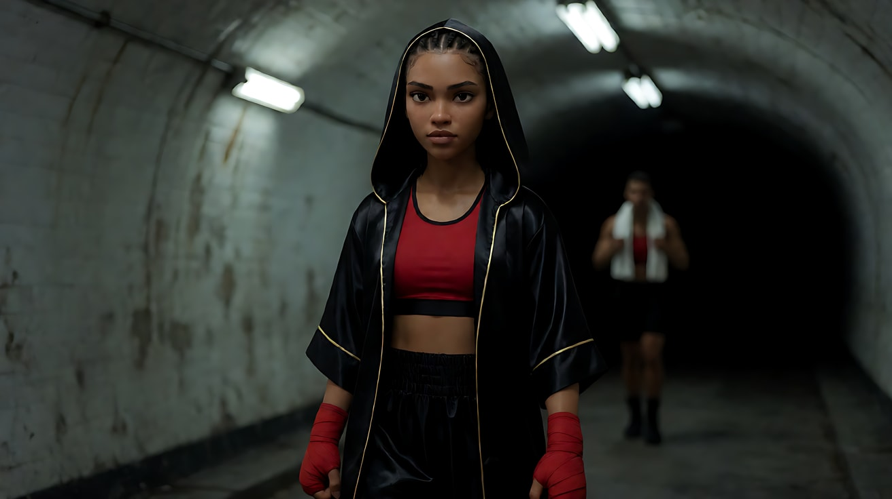

图3 尾帧：

```
Using the character from image 1 at the end of the same concrete tunnel as image 2:
a medium close-up from the front of the boxer standing still at the tunnel exit, she has just pushed her hood back,
her face fully lit by bright white arena light coming from in front of her, eyes narrowed against the light, a slow breath out.
The dim tunnel and the team member are behind her, now darker by contrast.
Camera at standing eye level about one and a half meters in front of her, 50mm lens, shallow depth of field.
Lighting: strong cool-white arena light from the camera direction as the key, the tunnel behind her falling into darkness.
Keep the face, hairstyle and outfit exactly as in image 1.
Stylized semi-realistic 3D CG rendering, feature-film animation quality. Aspect ratio 16:9.
```

中文释义：同一通道尽头，女拳手中近景正面停在通道口，刚把兜帽推到脑后，脸被前方场馆的强白光完全照亮，眯着眼，缓缓吐气；身后昏暗的通道和队员因对比显得更暗；构图和距离与首帧一致。

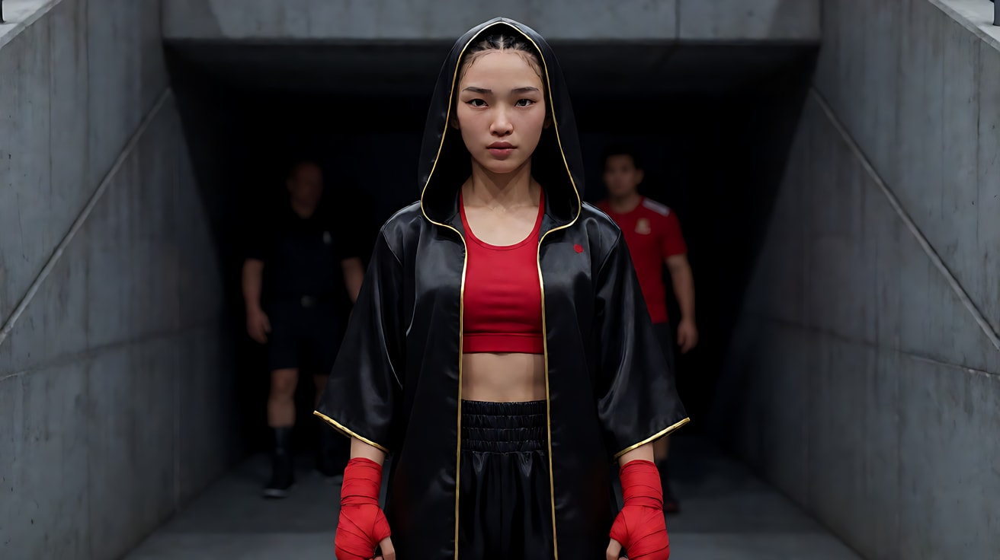

**【首尾帧生视频 · Seedance】**

```
【素材分工】@图片2 为首帧；@图片3 为尾帧，是最终画面目标；@图片1 锁定女拳手的身份、眉疤、长袍与红色绷带。只生成两帧之间的连续动作。
【画风】风格化写实三维CG质感，电影级布光。
女拳手戴着兜帽，沿昏暗的水泥通道迎面朝镜头走来，步子稳定而坚决，缠着红色绷带的双手垂在身侧，指节握了一下又松开。镜头在她前方约一米半，面朝她匀速倒退，与她同速，始终保持中近景正面，她始终位于画面中央。头顶的冷色壁灯一盏接一盏从她头顶掠过，光在她脸上一明一暗地扫过；她身后远处的队员拿着毛巾跟着。越接近通道口，前方的白光越强，照亮她的眼睛。她在通道口停下，镜头同时停下，她抬手把兜帽推到脑后，眯起眼睛，缓缓吐出一口气。结尾停在她被场馆白光完全照亮的中近景。
【声音】通道里她靴子踩在水泥地上的沉稳脚步声和回声，壁灯电流的嗡声，前方场馆里人群的低沉喧哗由远及近、越来越响，推下兜帽时布料的摩擦声，无配乐。
【约束】保持人物脸型、发型、眉疤、服装不变；镜头始终在她前方倒退，不转到侧面或背后；不要字幕、水印、Logo。
时长：9秒
```

**参数**：时长 9 秒 ｜ 画幅 16:9

**【检查点】**
- 她在画面中的大小是否全程基本一致
- 壁灯掠过的光是否在她脸上形成节奏，背景通道是否在后退
- 场馆的光与喧哗是否同时变强，形成"接近"的感觉
- 结尾是否停在被照亮的正面，场馆本身没有出现在画面里

**【常见问题与修复】**
| 现象 | 修复 |
|---|---|
| 镜头掉头拍到场馆 | 写"镜头始终在她前方倒退、面朝她"；场馆只用光和声音表现 |
| 她越走越近，变成特写 | 写"与她同速，始终保持中近景正面" |
| 推兜帽动作导致手部变形 | 只写"抬手把兜帽推到脑后"一个动作；绷带的手不写手指细节 |
| 队员抢戏 | 写"身后远处的队员"，并保持在虚化的背景里 |

---

### 练习4：三种跟随位置接力——赶末班车（难度 ★★★★，多镜头）

**目标**：同一段奔跑，用背后跟 → 前导 → 侧跟三个镜头接力。每个镜头一个跟随位置，人物始终朝同一个方向前进。意图：让观众先和她一起冲进人群，再看清她的焦急，最后和她并肩追上即将开动的列车。

**运镜合同**

| 镜头 | 起始构图 | 运动方式 | 速度 | 终点画面 | 运动动机 |
|---|---|---|---|---|---|
| 镜头1 | 中景背影，女孩冲进车站大厅的人群，画面中央 | 背后跟 | 奔跑速度 | 她冲下通往站台的楼梯口 | 和她一样只看得见前方的路和人群 |
| 镜头2 | 中近景正面，她迎面跑来，喘着气，手里攥着一个纸袋 | 前导倒退 | 奔跑速度 | 她抬头看向镜头后方，眼睛一亮 | 看清她的焦急；她看见了列车，观众还没看见 |
| 镜头3 | 中景侧面，她沿站台从画左向画右奔跑，背景是开始缓缓移动的列车车窗 | 侧跟 | 与她同速 | 她跑到一扇车窗边，把纸袋举起贴在车窗上 | 陪她追上列车，车窗与她并行 |

**【生图 · Nano Banana】**

图1 角色定妆：

```
Character turnaround sheet of an original girl about nineteen: a high messy ponytail with a red scrunchie,
a white oversized knit sweater, a short pleated plaid skirt in green and navy, white socks, brown loafers,
holding a small brown paper bag tied with a string.
Front view, three-quarter view, side view and back view, full body, plain light-grey background.
Camera at eye level, 50mm lens, deep focus, even soft studio light from the front.
Stylized semi-realistic 3D CG rendering, feature-film animation quality. Aspect ratio 16:9.
```

中文释义：原创角色，约十九岁女孩，红色发圈扎蓬乱高马尾，白色宽松针织毛衣、绿藏青格纹短百褶裙、白袜、棕色乐福鞋，手拿一个用绳子系着的小牛皮纸袋；四视图全身。

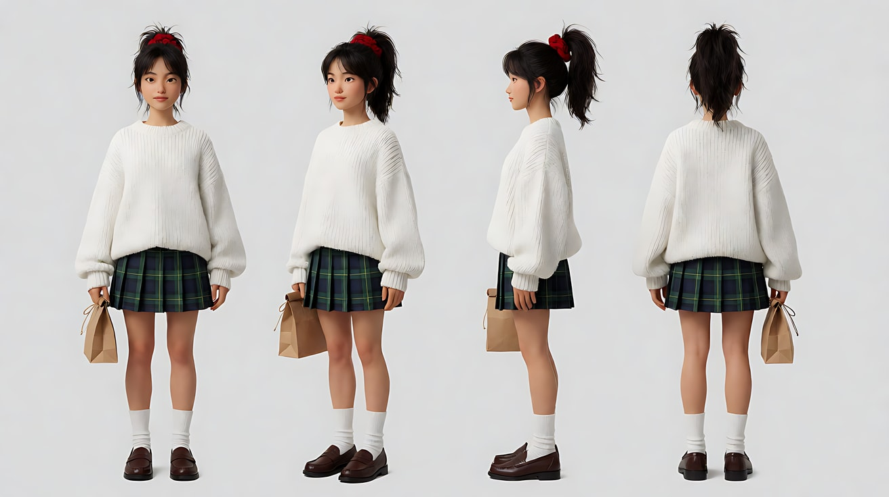

图2 场景（夜晚车站站台）：

```
An evening train station platform, a long passenger train with warm-lit windows stopped along the right side of the platform
pointing toward frame right, a few passengers with luggage, platform lamps hanging overhead, a staircase down from the station hall at the far left, wet tiles.
Wide shot along the platform, camera at standing eye level, 28mm lens, deep focus.
Lighting: warm yellow light from the train windows, cool white platform lamps overhead, deep-blue dusk sky beyond the roof.
Stylized semi-realistic 3D CG rendering, feature-film animation quality. Aspect ratio 16:9.
```

中文释义：傍晚火车站台，一列车窗透着暖光的客车停在站台右侧、车头朝画右，几位拖行李的乘客，头顶悬着站台灯，画左远处是从候车大厅下来的楼梯，湿瓷砖地面；沿站台的全景、站姿视线高度、28mm、深景深；车窗暖黄光、站台冷白灯、屋顶外深蓝暮色。

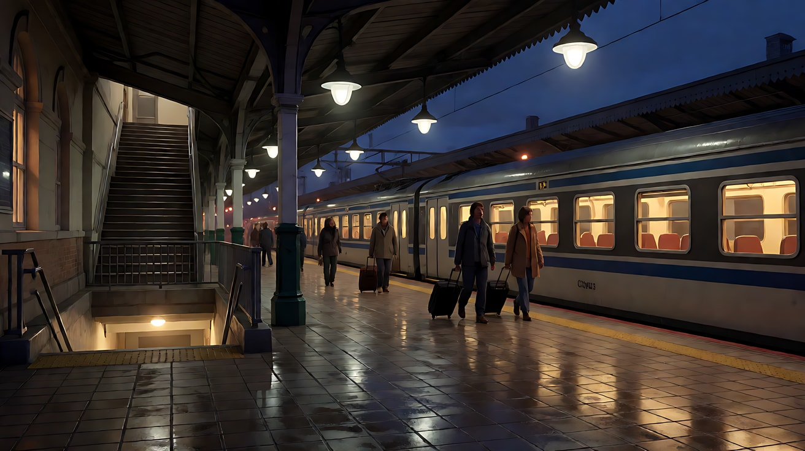

图3 镜头1首帧：

```
Using the character from image 1: a medium shot from behind of the girl running into a crowded station hall at dusk,
placed at the center of the frame, ponytail swinging, paper bag clutched in her right hand,
travelers with suitcases ahead of her, a sign-free archway leading down to the platforms at the far end.
Camera at standing eye level two meters behind her, 35mm lens, moderate depth of field.
Lighting: cool white ceiling lights in the hall, warm glow rising from the platform staircase ahead.
Keep the face, hairstyle and outfit exactly as in image 1.
Stylized semi-realistic 3D CG rendering, feature-film animation quality. Aspect ratio 16:9.
```

中文释义：中景背影，女孩冲进黄昏时人潮拥挤的车站大厅，位于画面中央，马尾甩动，右手攥着纸袋；前方是拖着行李箱的旅客，远处一道没有文字标识的拱门通往站台；身后两米、35mm；大厅冷白顶灯，前方楼梯口泛上暖光。

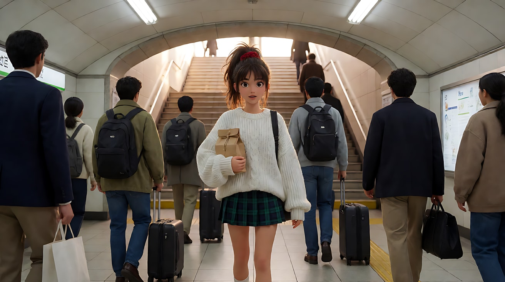

**【多图生视频 · Seedance】**

```
【素材分工】@图片1 锁定女孩身份、红色发圈、服装与纸袋，不参考其背景；@图片2 仅参考站台与列车的布局、车头朝画右的方向和灯光，不复制其中乘客外貌；@图片3 为镜头1首帧。
【画风】风格化写实三维CG质感，电影级布光。
镜头1：中景背影，镜头在女孩身后约两米，与她同速奔跑跟随，始终保持中景背影。她在车站大厅的人群里侧身穿过两个拖行李箱的旅客，马尾左右甩动，冲向远处通往站台的拱门。两侧的旅客和立柱快速向后退去。镜头停在她冲到楼梯口、正要往下跑的背影。广播的回声、行李箱轮子滚动的声音、她急促的脚步声。
镜头2：镜头切至中近景正面，镜头在她前方面朝她倒退，与她同速，始终保持中近景。她迎面跑来，大口喘气，额前碎发贴在脸上，把纸袋紧紧抱在胸前。站台的冷白灯一盏接一盏从她头顶掠过。她抬起头看向镜头后方，眼睛一亮。她的喘气声盖过了周围的嘈杂。
镜头3：镜头切至中景侧面，镜头在她左侧与她平行同速，她沿站台从画左向画右奔跑，背景是刚刚开始缓缓移动的列车，暖色车窗一扇接一扇在她身后滑过。她跑到一扇车窗旁，与车窗并行，把纸袋举起来贴在玻璃上，嘴唇张开喊了一声。结尾停在她举着纸袋与车窗并行奔跑的中景侧面。
【锁定】光线：站台冷白顶灯与车窗暖黄光；女孩始终朝列车车头方向（画右或画面深处）奔跑；服装、红色发圈、纸袋三个镜头一致；列车车头始终朝画右。
【声音】镜头1车站广播回声与行李箱轮子声；镜头2急促的喘气与鞋底拍打地面的声音；镜头3列车启动的低沉轰鸣和车轮压轨声逐渐加快，女孩（举起纸袋，大喊）："奶奶，你的药！"无配乐。
【约束】保持女孩脸型、发型、服装不变；纸袋始终是同一个；不要字幕、水印、Logo；画面中不出现可读文字。
时长：13秒
```

**参数**：时长 13 秒 ｜ 画幅 16:9 ｜ 负载：3 个镜头、1 句台词、持续奔跑，"有挑战"档

**【检查点】**
- 三个镜头的跟随位置是否分别是背后、前方、侧面
- 每个镜头里女孩的景别是否稳定
- 方向是否一致：镜头3里她和列车都朝画右
- 镜头2她"看见了什么"是否保留到镜头3才揭示

**【常见问题与修复】**
| 现象 | 修复 |
|---|---|
| 镜头3她朝画左跑，与列车方向相反 | 【锁定】写"女孩始终朝列车车头方向奔跑，列车车头始终朝画右" |
| 镜头2变成背影 | 写"镜头在她前方面朝她倒退"，并写出能看见的表情：喘气、碎发、眼睛一亮 |
| 车站出现可读文字或站名 | 约束写"画面中不出现可读文字"；场景图里也写 sign-free |
| 镜头3列车先开走了 | 写"刚刚开始缓缓移动的列车"，并让她与"一扇车窗并行" |

---

### 练习5：追逐里的跟随接力——小狗叼走了车票（难度 ★★★★★，四镜头 + 双主体）

**目标**：两个主体的追逐。四个镜头轮流使用低位前导、背后跟、侧跟双主体同框、前导停下，镜头始终把"被追的"和"追的人"放在清楚的前后关系里。意图：让观众在一场轻喜剧追逐里，始终知道谁在前、谁在后、距离在缩短。

**运镜合同**

| 镜头 | 起始构图 | 运动方式 | 速度 | 终点画面 | 运动动机 |
|---|---|---|---|---|---|
| 镜头1 | 低位中景正面，小狗叼着车票迎面跑来，画面中央 | 低位前导倒退 | 小狗奔跑速度 | 小狗冲过镜头旁边出画 | 让观众先看清"罪魁祸首"的得意 |
| 镜头2 | 中景背影，女子在石阶窄巷里追赶 | 背后跟 | 奔跑速度 | 远处小狗拐过街角，她也冲向街角 | 和她一起追，前方只有小狗的尾巴 |
| 镜头3 | 全景侧面，小狗在画右前方，女子在画左后方，沿河堤从画左向画右奔跑 | 侧跟 | 与两者同速 | 两者距离缩短到只差几步 | 双主体同框，观众看清距离在缩短 |
| 镜头4 | 中景正面，女子扑过来抱住小狗 | 前导倒退后停下 | 由快到停 | 她坐在地上抱着小狗，举起被咬皱的车票，镜头停住 | 追逐结束，镜头和她一起停下来 |

**【生图 · Nano Banana】**

图1 角色定妆（女子）：

```
Character turnaround sheet of an original woman about thirty: a long low braid over one shoulder,
a mint-green trench coat, a white blouse, wide cream trousers, white sneakers, a small crossbody leather bag.
Front view, three-quarter view, side view and back view, full body, plain light-grey background.
Camera at eye level, 50mm lens, deep focus, even soft studio light from the front.
Stylized semi-realistic 3D CG rendering, feature-film animation quality. Aspect ratio 16:9.
```

中文释义：原创角色，约三十岁女子，长低辫搭在一侧肩上，薄荷绿风衣、白衬衫、米色阔腿裤、白运动鞋、小皮斜挎包；四视图全身。

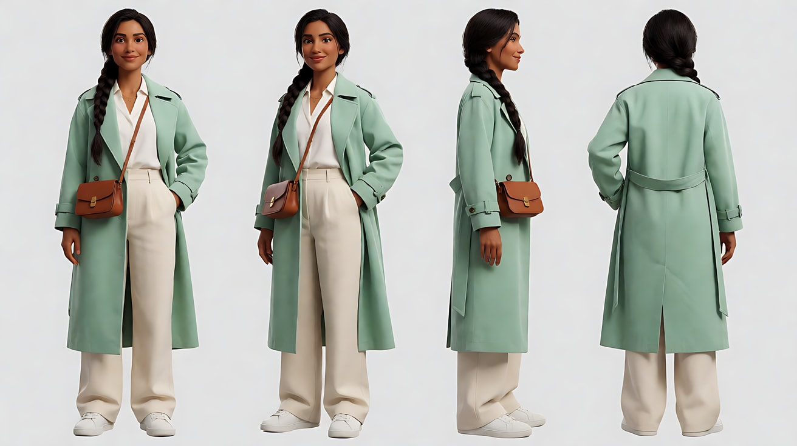

图2 角色定妆（小狗）：

```
Character turnaround sheet of an original small dog: a scruffy medium-sized terrier mix with wiry tan and white fur,
one floppy ear and one upright ear, a red collar with a round brass tag, a mischievous expression.
Front view, three-quarter view, side view and back view, full body, plain light-grey background.
Camera at the dog's eye level, 50mm lens, deep focus, even soft studio light from the front.
Stylized semi-realistic 3D CG rendering, feature-film animation quality. Aspect ratio 16:9.
```

中文释义：原创小狗，中等体型杂毛梗犬，棕白相间的硬毛，一只耳朵耷拉一只竖起，红项圈挂圆形黄铜牌，表情调皮；小狗视线高度四视图全身。

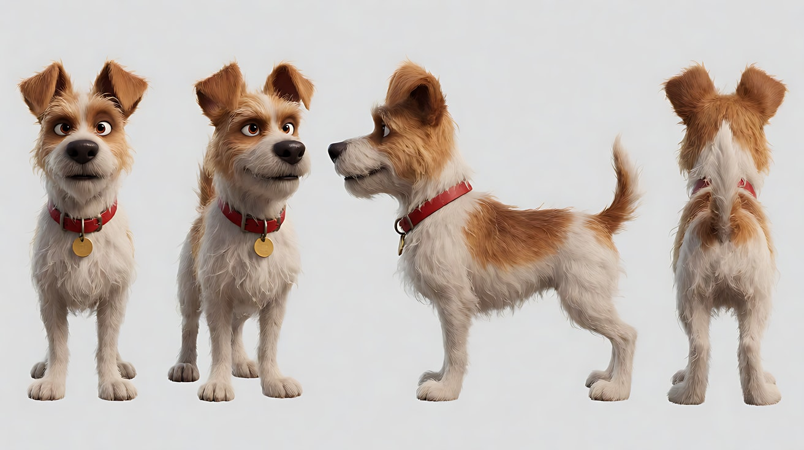

图3 场景（河边老城）：

```
An old riverside town on a sunny morning: a narrow stone-stepped alley with potted plants leading down to a riverside embankment walkway,
a low stone wall along the river, willow trees, old two-story houses with wooden shutters, a corner where the alley turns onto the embankment, no people.
Wide shot from the top of the alley looking down toward the embankment, camera at standing eye level, 28mm lens, deep focus.
Lighting: bright morning sun from frame left, crisp shadows on the stone steps, sparkling light on the river.
Stylized semi-realistic 3D CG rendering, feature-film animation quality. Aspect ratio 16:9.
```

中文释义：晴朗早晨的河边老城：一条摆着盆栽的石阶窄巷通往河堤步道，沿河有矮石墙和柳树，两层老房子带木百叶窗，巷子在街角拐上河堤；巷口高处向下的全景、站姿视线高度、28mm、深景深；画左明亮晨光，石阶上清晰的影子，河面闪光。

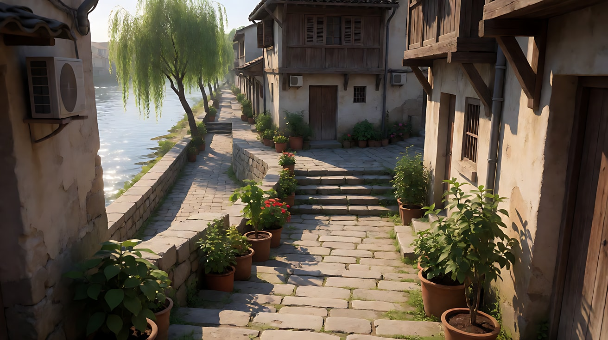

图4 镜头1首帧：

```
Using the dog from image 2 in the alley of image 3: a low-angle medium shot from the front of the terrier running down the stone steps toward the camera,
a small paper train ticket held in its mouth, ears flapping, tongue slightly out, placed at the center of the frame.
In the far background at the top of the steps, the woman from image 1 is just starting to run after it, small and out of focus.
Camera at the dog's height about one meter in front of it, 35mm lens, shallow depth of field.
Lighting: bright morning sun from frame left, crisp shadows on the steps.
Keep the dog's fur pattern and collar exactly as in image 2, and the woman's outfit exactly as in image 1.
Stylized semi-realistic 3D CG rendering, feature-film animation quality. Aspect ratio 16:9.
```

中文释义：低角度中景正面，小狗叼着一张小纸质车票沿石阶朝镜头跑来，耳朵翻飞、舌头微露，位于画面中央；远处台阶顶端，女子刚开始追，很小且虚化；小狗高度、前方约一米、35mm、浅景深；画左晨光。

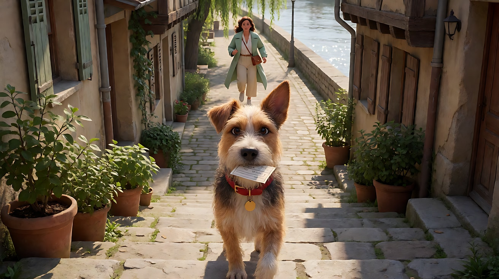

图5 镜头3关键帧：

```
Using the woman from image 1 and the dog from image 2 on the riverside embankment of image 3:
a wide side shot of the chase along the embankment from frame left to frame right, the dog a few meters ahead on the right side of the frame
with the ticket in its mouth, the woman on the left side running after it with one arm reaching forward, her braid flying.
Willow branches in the foreground at the top of the frame, the river and low stone wall behind them.
Camera at waist height on the river side, moving parallel, 35mm lens, moderate depth of field.
Lighting: bright morning sun from frame left, sparkling light on the river behind them.
Keep the woman's face, hairstyle and outfit exactly as in image 1, and the dog exactly as in image 2.
Stylized semi-realistic 3D CG rendering, feature-film animation quality. Aspect ratio 16:9.
```

中文释义：河堤上从画左向画右的追逐全景侧面，小狗叼着车票在画右前方几米，女子在画左伸手追赶，辫子飞起；画面上方前景有柳枝，背后是河和矮石墙；腰部高度、35mm、中等景深；画左晨光，河面闪光。

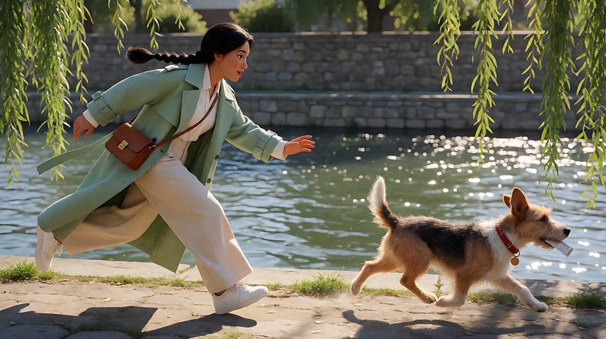

**【多图生视频 · Seedance】**

```
【素材分工】@图片1 锁定女子的身份、长辫与薄荷绿风衣，不参考其背景；@图片2 锁定小狗的毛色、一立一垂的耳朵与红项圈，不参考其背景；@图片3 仅参考石阶窄巷、街角与河堤的空间关系和晨光方向；@图片4 为镜头1首帧；@图片5 为镜头3的构图参考，锁定双主体前后关系。
【画风】风格化写实三维CG质感，电影级布光。
镜头1：低位中景正面，镜头贴近地面在小狗前方约一米，面朝它倒退，与它同速。小狗叼着车票沿石阶一级一级往下蹦，耳朵翻飞，尾巴高高翘着。远处台阶顶端的女子刚开始追，身影很小而虚化。小狗从镜头左侧冲过出画。爪子拍在石阶上的哒哒声。
镜头2：镜头切至中景背影，镜头在女子身后约两米，与她同速奔跑跟随，始终保持中景背影。她沿石阶窄巷往下追，风衣下摆扬起，两侧的盆栽和木百叶窗快速向后退去。前方远处，小狗的尾巴一闪拐过街角，她也冲向街角。她的脚步声和喘气声，一扇百叶窗被她带起的风吹得轻响。
镜头3：镜头切至全景侧面，镜头在河的一侧与两者平行同速移动，两者从画左向画右奔跑：小狗在画右前方叼着车票，女子在画左后方伸手追赶，辫子飞起。前景的柳枝从画面上方划过。两者之间的距离一点点缩短，最后只差两步。河水闪光，晨光从画左照来。
镜头4：镜头切至中景正面，镜头在女子前方面朝她倒退，她向前一扑，抱住小狗，顺势坐倒在河堤的草地上，镜头随之减速并停住。她喘着气，把车票从小狗嘴里抽出来举到眼前，车票被咬得皱巴巴的，她看着车票，又看看小狗，忍不住笑出来。小狗舔了一下她的下巴。结尾停在她坐在草地上抱着小狗、举着车票笑的中景。
【锁定】光线：晨光始终来自画左；追逐方向：镜头3中两者都从画左向画右，小狗在前，女子在后；女子始终穿薄荷绿风衣、梳长辫；小狗始终戴红项圈、一只耳朵耷拉；车票始终是一张小纸票。
【声音】镜头1爪子拍石阶的哒哒声；镜头2女子的脚步、喘气与百叶窗轻响；镜头3河水声、柳枝沙沙声和两种节奏不同的脚步声越来越近；镜头4扑倒在草地上的闷响，女子（喘着气，笑）："你倒是挺会挑。"小狗短促地叫了一声，轻快的木吉他配乐在最后两拍进入。
【约束】保持女子脸型、发型、服装与小狗外形不变；全程只有一只狗、一个人；车票上没有可读文字；不要字幕、水印、Logo。
时长：15秒
```

**参数**：时长 15 秒 ｜ 画幅 16:9 ｜ 负载：4 个镜头、双主体、1 句台词，"有挑战"上限；失败时拆成两次生成（镜头1–2、镜头3–4），第二次以第一次尾帧和 @图片5 作参考

**【检查点】**
- 四个镜头的跟随位置是否分别是：低位前导、背后跟、侧跟双主体、前导停下
- 镜头3里的前后关系与方向是否与 @图片5 一致
- 镜头4镜头是否随她扑倒而减速停住，结尾稳定
- 小狗在四个镜头里耳朵、项圈是否一致

**【常见问题与修复】**
| 现象 | 修复 |
|---|---|
| 镜头3小狗和女子位置互换 | 【锁定】写清"小狗在前，女子在后"，并用 @图片5 锁定构图 |
| 小狗变成了另一种狗 | 素材分工写明小狗的三个特征：毛色、一立一垂的耳朵、红项圈 |
| 镜头4扑倒动作扭曲 | 改成"她蹲下抱住停下来的小狗"，把扑倒改为蹲下，降低肢体难度 |
| 出现第二只狗或路人 | 约束写"全程只有一只狗、一个人" |
| 镜头2看不到小狗 | 写"前方远处小狗的尾巴一闪拐过街角"，只给一个小而清楚的视觉信息 |
