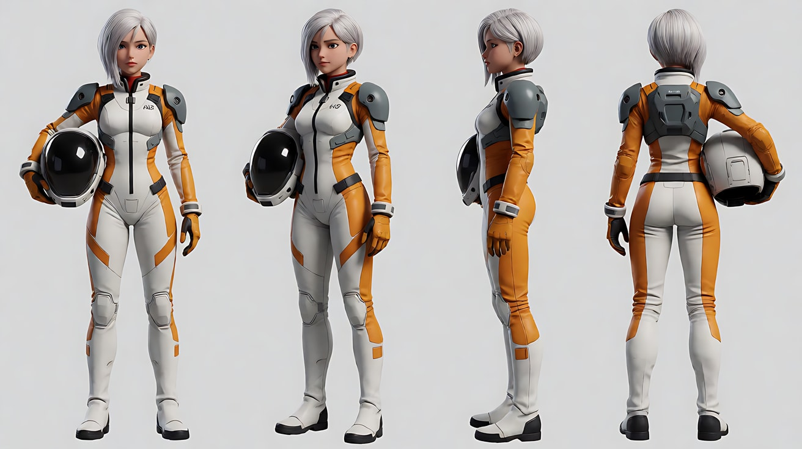
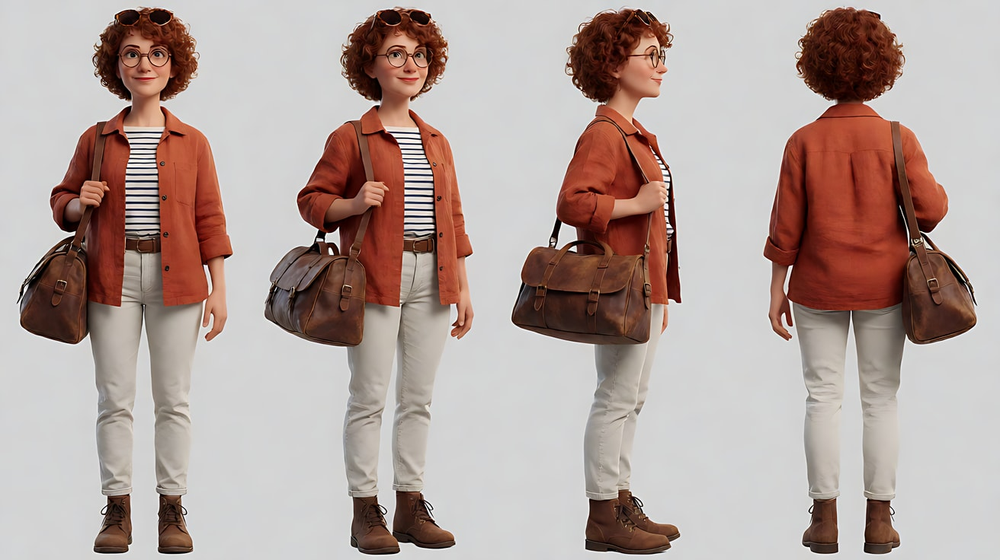
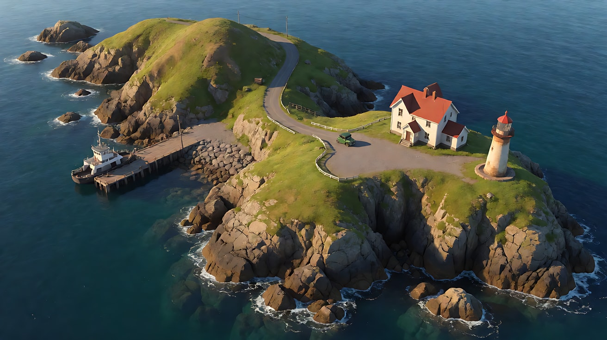
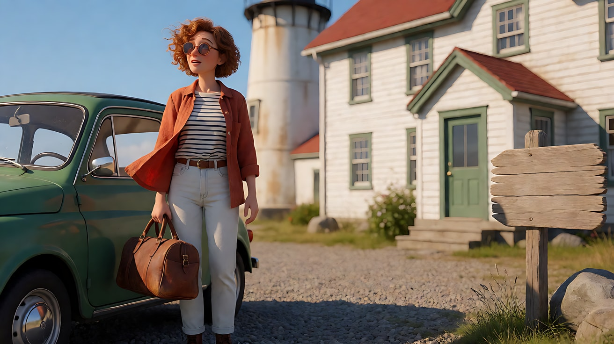
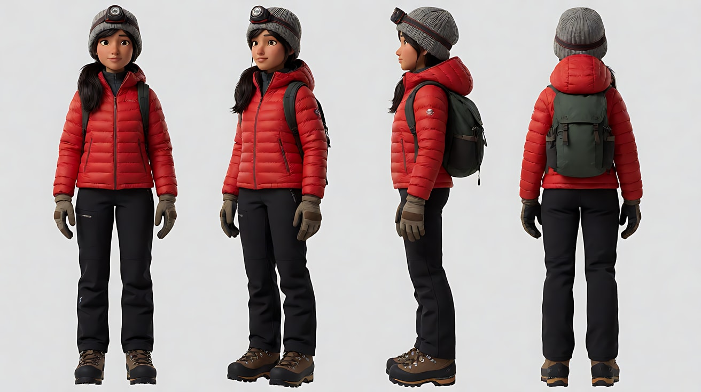
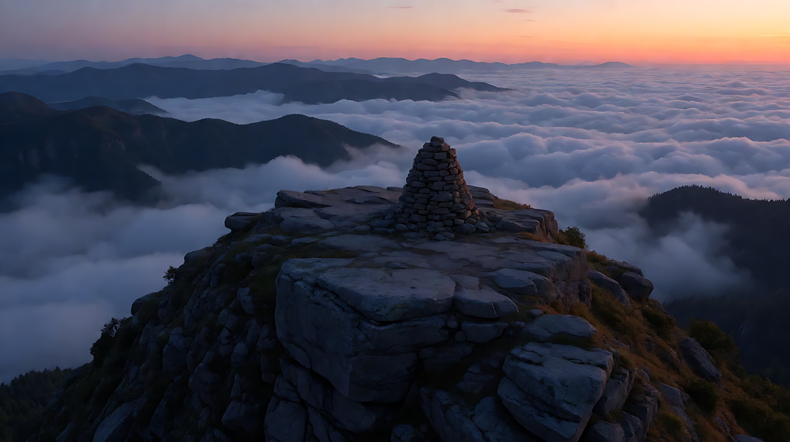
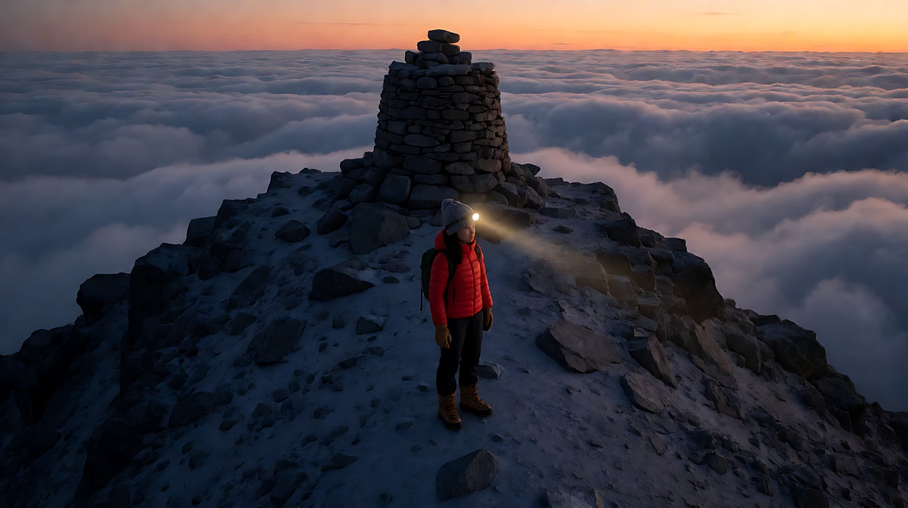
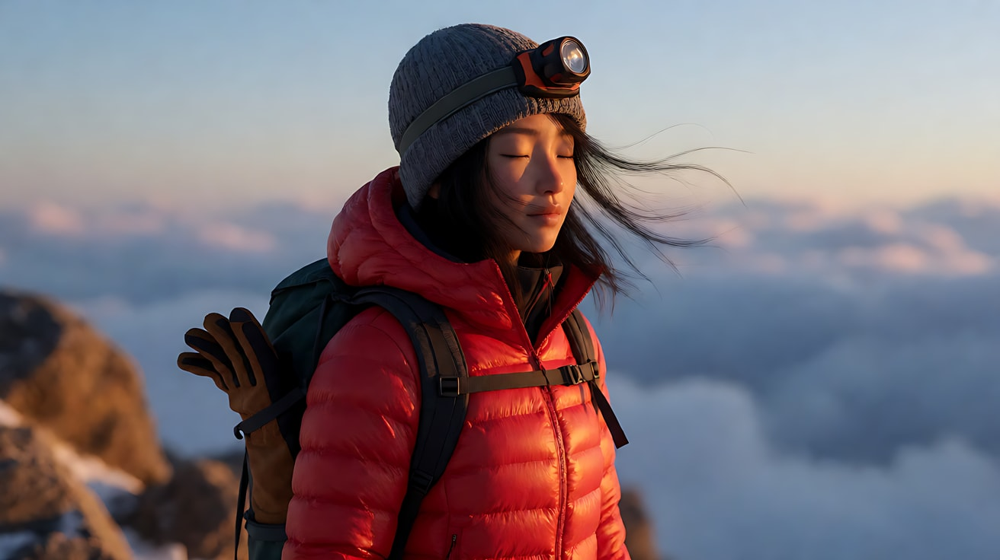

# L05-05 环绕、升降与航拍 · 提示词

> 本组练习：用半环绕做产品与英雄时刻、用升降完成揭示、用航拍建立地理，并练习在大幅运镜下控制身份漂移。｜ 配套教学：[L05-05-环绕升降与航拍](../教学/L05-05-环绕升降与航拍.md) ｜ 规范：[写作规范](../../模板/写作规范.md)
>
> 画风默认使用开关 A（风格化写实 CG）。如改用 2D 动画，删掉所有焦段、光圈、景深词。

---

### 练习1：产品半环绕——黄铜罗盘（难度 ★）

**目标**：单张关键帧生成一个慢速 90 度半环绕产品镜头。产品静止，镜头绕着它转，停在最能看清表盘的角度。意图：让观众感到这只旧罗盘的每一面都有被使用过的痕迹。

**运镜合同**

| 要素 | 本练习 |
|---|---|
| 起始构图 | 近景，黄铜罗盘侧面三分之二角度，摆在一张旧地图上，位于画面中央 |
| 运动方式 | 向右半环绕约 90 度，距离与高度不变 |
| 速度 | 极慢、匀速，结尾减速停稳 |
| 终点画面 | 近景，罗盘正面略俯视，表盘指针与刻度清楚，指针微微颤动后停住 |
| 运动动机 | 产品亮相：先看材质与磨损，再看功能（表盘） |

**【生图 · Nano Banana】**

图1 关键帧：

```
A close-up product shot of an original antique brass pocket compass with an open hinged lid,
the brass worn smooth at the edges with small scratches and a green patina in the engraved grooves,
the dial with simple engraved direction marks and a thin blue steel needle, no brand name, no readable words.
It rests on an old hand-drawn paper map with coffee stains, placed at the center of the frame, seen from a front three-quarter angle.
Camera slightly above table height angled down twenty degrees, 100mm macro lens, shallow depth of field, the map edges softly blurred.
Lighting: warm low key light from frame left like late afternoon window light, a soft white bounce from the right, a small specular highlight on the lid edge.
Stylized semi-realistic 3D CG rendering, feature-film animation quality. Aspect ratio 16:9.
```

中文释义：近景产品，原创古董黄铜怀表式罗盘，翻盖打开，边缘磨得光滑、有细小划痕，刻纹缝里有铜绿；表盘只有简单刻线和一根蓝钢细针，无品牌无可读文字；放在带咖啡渍的手绘旧地图上，居中，正面三分之二角度；略高于桌面向下20度、100mm微距、浅景深；画左低角度暖光如午后窗光，画右柔和白色反光，盖沿有一点高光。


**【图生视频 · Seedance】**

```
【素材分工】@图片1 为首帧，锁定罗盘的形状、黄铜磨损、铜绿与表盘样式，以及地图的纹理。
【画风】风格化写实三维CG质感，电影级布光。
黄铜罗盘静止放在旧地图上。镜头从罗盘正面三分之二侧的角度开始，围绕罗盘向右极慢地匀速环绕约九十度，距离与高度保持不变，罗盘始终位于画面中央。环绕过程中，画左的暖色低光在黄铜表面缓慢滑过，盖沿的高光沿着弧线移动，刻纹里的铜绿和细小划痕依次被照亮。镜头转到罗盘正面略俯视的角度时减速停稳，表盘的蓝钢指针轻轻颤了两下，然后停住指向画面上方。结尾停在罗盘正面的近景，表盘刻度清楚。
【声音】安静的室内底噪，远处窗外一声鸟叫，指针颤动时极轻的金属细响，无配乐。
【约束】罗盘形状、大小、表盘不变形，不出现文字；画面中不出现手；只环绕约九十度，不转到背面；不要字幕、水印、Logo。
时长：7秒
```

**参数**：时长 7 秒 ｜ 画幅 16:9

**【检查点】**
- 罗盘是否始终居中，大小是否不变（距离锁定）
- 黄铜表面的高光是否随角度变化而滑动，说明是镜头在转、不是罗盘在转
- 表盘是否没有出现乱码文字

**【常见问题与修复】**
| 现象 | 修复 |
|---|---|
| 罗盘自己转起来 | 写"罗盘静止放在旧地图上，镜头围绕罗盘环绕"，并写地图纹理随视角变化 |
| 环绕过头转到背面 | 写"只环绕约九十度"，终点写具体角度"正面略俯视" |
| 表盘出现文字或数字乱码 | 生图时写 no readable words，视频约束写"不出现文字" |
| 指针一直乱转 | 写"轻轻颤了两下，然后停住"，给出停止状态 |

---

### 练习2：英雄时刻半环绕——出发前的驾驶员（难度 ★★）

**目标**：用定妆四视图 + 场景图，生成一个从背面到正面的 180 度半环绕。人物站定，镜头绕着她转，在终点露出她的脸。意图：让观众感到出发前的这几秒，整个机库都安静了下来，只剩下她。

**运镜合同**

| 要素 | 本练习 |
|---|---|
| 起始构图 | 中景背面，驾驶员站在机库平台边缘，面前是巨大的机甲，她位于画面中央 |
| 运动方式 | 向左半环绕约 180 度，高度略低于她的视线，距离不变 |
| 速度 | 缓慢、匀速，最后减速停稳 |
| 终点画面 | 中近景正面三分之二侧，她抬起下巴，警示灯的红光扫过她的脸，机甲虚化在她身后 |
| 运动动机 | 先看她面对的是什么（机甲），再看她面对它的表情 |

**【生图 · Nano Banana】**

图1 角色定妆（四视图是环绕的关键）：

```
Character turnaround sheet of an original young mecha pilot in her early twenties: a short asymmetrical silver-white bob
with the left side longer, a thin scar across the bridge of her nose, a fitted white-and-orange pilot suit with grey armored shoulder plates,
a black collar ring, a helmet tucked under her right arm.
Front view, three-quarter view, side view and back view, full body, plain light-grey background, all four views clearly showing the hair shape from every angle.
Camera at eye level, 50mm lens, deep focus, even soft studio light from the front.
Stylized semi-realistic 3D CG rendering, feature-film animation quality. Aspect ratio 16:9.
```

中文释义：原创角色，二十出头机甲驾驶员，左长右短的银白不对称短发、鼻梁上一道细疤，白橙相间紧身驾驶服配灰色护肩甲、黑色颈环，右臂夹着头盔；四视图全身，每个角度都清楚展示发型轮廓。



图2 场景（机库）：

```
A huge dim hangar interior at night, a towering grey-and-orange humanoid mecha standing in a docking frame,
a narrow steel catwalk platform at its chest height in the foreground, cables hanging, a large hangar door far behind slightly open to a night sky, no people.
Wide shot from the catwalk level, camera at standing eye level, 24mm lens, deep focus.
Lighting: rotating red warning beacons on the docking frame sweeping across surfaces, cool white work lights from above, thin steam drifting.
Stylized semi-realistic 3D CG rendering, feature-film animation quality. Aspect ratio 16:9.
```

中文释义：夜晚昏暗的巨大机库，一台灰橙相间的高大人形机甲立在停靠架中，前景是位于机甲胸口高度的狭窄钢制走道平台，垂着线缆，远处大库门微开露出夜空；走道高度站姿视线、24mm、深景深；停靠架上旋转的红色警示灯扫过各处表面，头顶冷白工作灯，薄薄的蒸汽飘过。


图3 首帧：

```
Using the character from image 1 in the hangar of image 2:
a medium shot from behind of the pilot standing at the edge of the steel catwalk, facing the towering mecha ahead,
helmet tucked under her right arm, placed at the center of the frame, her asymmetrical silver-white bob clearly visible from behind.
Camera slightly below her eye level behind her, 35mm lens, moderate depth of field, the mecha softly detailed.
Lighting: red warning beacon light sweeping across her back and the mecha, cool white work light from above.
Keep the face, hairstyle and outfit exactly as in image 1.
Stylized semi-realistic 3D CG rendering, feature-film animation quality. Aspect ratio 16:9.
```

中文释义：驾驶员中景背影，站在钢制走道边缘面对前方巨大的机甲，右臂夹头盔，居中；从背后能清楚看到不对称银白短发；略低于视线、35mm、中等景深；红色警示灯扫过她的背和机甲，头顶冷白工作灯。


**【多图生视频 · Seedance】**

```
【素材分工】@图片1 锁定驾驶员在所有角度下的脸型、不对称银白短发、鼻梁疤痕与驾驶服，不参考其灰色背景；@图片2 仅参考机库、机甲与警示灯的布局和光线；@图片3 为首帧。
【画风】风格化写实三维CG质感，电影级布光。
驾驶员站在钢制走道边缘，背对镜头，面朝巨大的机甲，右臂夹着头盔，一动不动地站着，只有呼吸时肩膀轻微起伏，几缕银白发丝被风扇的气流吹动。镜头从她背后开始，高度略低于她的视线，围绕她向左缓慢匀速环绕约半圈，距离不变，她始终位于画面中央。环绕过程中机甲从她身后的背景逐渐移到画面一侧，再到她身后虚化。镜头转到她正面三分之二侧时减速停稳。她抬起下巴，目光直视前方的机甲，嘴角收紧。旋转的红色警示灯一次次扫过她的脸，头顶冷白工作灯照亮她的额头和鼻梁上的疤。结尾停在她正面三分之二侧的中近景，机甲虚化在她身后。
【声音】机库里低沉的机械运转声，警示灯旋转时极轻的电机嗡声，远处冷却蒸汽的一声嘶响，她的一次深呼吸，无配乐。
【约束】保持人物脸型、发型、疤痕、服装在所有角度下一致；她不走动、不说话；只环绕约半圈；不要字幕、水印、Logo。
时长：8秒
```

**参数**：时长 8 秒 ｜ 画幅 16:9

**【检查点】**
- 环绕到侧面和正面时，不对称短发的长边是否仍在她的左侧
- 鼻梁疤痕在终点是否出现
- 她是否保持站定，只有呼吸和发丝运动

**【常见问题与修复】**
| 现象 | 修复 |
|---|---|
| 转到正面时脸变成另一个人 | 素材分工写"锁定所有角度下的脸型"；角度减到 120 度；或补一张正面尾帧做首尾帧 |
| 发型长短边左右颠倒 | 定妆图四视图必须清楚；正文写"左侧头发更长" |
| 人物跟着镜头转身 | 写"一动不动地站着""她不走动"；环绕时主体必须静止 |
| 环绕速度忽快忽慢 | 写"缓慢匀速"，并删掉"突然""猛地"等词 |

---

### 练习3：摇臂升起揭示——放灯的孩子（难度 ★★★，首尾帧）

**目标**：首帧是孩子在街边放飞一盏天灯，尾帧是从高处俯瞰整条挂满灯笼、飘满天灯的老街。中间是一个连续的摇臂升起。意图：让观众感到一个小小的愿望，汇入了整座城市的愿望里。

**运镜合同**

| 要素 | 本练习 |
|---|---|
| 起始构图 | 中景，小女孩双手托着一盏天灯，位于画面中央偏下，街边灯笼在背景虚化 |
| 运动方式 | 摇臂升起，镜头随天灯一同上升，同时逐渐俯视 |
| 速度 | 缓慢、匀速，越升越慢 |
| 终点画面 | 高空大远景，整条老街挂满红灯笼，几百盏天灯缓缓上升，小女孩是街心的一个小点 |
| 运动动机 | 跟着天灯上升，从一个人的愿望抽离到所有人的愿望 |

**【生图 · Nano Banana】**

图1 首帧：

```
A medium shot of an original little girl about seven years old standing in an old stone-paved street at night during a lantern festival,
two short pigtails with red ribbons, a padded cherry-red jacket with toggle buttons, holding a glowing paper sky lantern in both hands above her head,
looking up at it with her mouth slightly open, placed at the center of the lower frame.
Red paper lanterns hang along the wooden eaves on both sides, softly blurred, a few other families in the deep background.
Camera at child eye level, 35mm lens, shallow depth of field.
Lighting: warm orange glow from the sky lantern on her face from above as the key, red lantern light from both sides, deep-blue night sky.
Stylized semi-realistic 3D CG rendering, feature-film animation quality. Aspect ratio 16:9.
```

中文释义：中景，约七岁原创小女孩在灯会之夜的老石板街上，两个小辫系红丝带，樱桃红盘扣棉袄，双手把发光的纸天灯托过头顶，仰头张嘴看着它，位于画面下半中央；两侧木屋檐挂满红灯笼并虚化，远处背景有几户人家；孩子视线高度、35mm、浅景深；天灯的橙色暖光从上方照亮她的脸，两侧红灯笼光，深蓝夜空。


图2 尾帧：

```
The same old lantern-festival street as image 1 seen from high above at night: an extreme wide high-angle view looking down along the whole street,
both sides lined with wooden houses and strings of red lanterns forming two glowing lines, the river at the end of the street,
hundreds of warm sky lanterns rising slowly toward the camera from the street below, the little girl in the red jacket
a tiny dot at the center of the street, looking up.
Camera high above the rooftops angled down about forty-five degrees, 24mm lens, deep focus.
Lighting: warm glow of red lanterns and sky lanterns, deep-blue night sky with faint stars.
Stylized semi-realistic 3D CG rendering, feature-film animation quality. Aspect ratio 16:9.
```

中文释义：同一条灯会老街的高空夜景：俯角约45度的大远景，沿整条街望去，两侧木房屋和成串红灯笼形成两条发光的线，街尽头是河；几百盏暖色天灯从街上缓缓升向镜头；穿红棉袄的小女孩是街心的一个小点，正仰望；屋顶上方高处、24mm、深景深。


**【首尾帧生视频 · Seedance】**

```
【素材分工】@图片1 为首帧，锁定小女孩的身份与服装和老街的布局；@图片2 为尾帧，是最终画面目标。只生成两帧之间的连续升镜。
【画风】风格化写实三维CG质感，电影级布光。
小女孩双手托着发光的天灯，轻轻松开手，天灯缓缓离开她的掌心向上飘。镜头随着天灯一同由摇臂缓慢匀速升起，同时镜头逐渐向下俯视，始终把小女孩保持在画面中央。她仰着头，踮起脚，目送天灯上升。镜头升过两侧挂满红灯笼的木屋檐，越过屋顶，街道两侧的灯笼连成两条发光的线；街上的人家也陆续放飞天灯，越来越多的天灯从下方升起，从镜头两侧飘过。镜头越升越慢，最后停稳在高空俯瞰整条老街，小女孩成为街心的一个红色小点。结尾停在几百盏天灯缓缓上升的高空大远景。
【声音】起初是近处纸灯被热气鼓起的轻微噗噗声和她小声的"飞呀"；随后街上人们的欢呼与笑声渐渐变远，风声变得明显；最后只剩高空的风声和远处隐约的锣鼓，轻柔的笛声配乐缓缓进入。
【约束】保持小女孩脸型、发型、服装不变；镜头只升起与俯视，不环绕、不前推；不要字幕、水印、Logo。
时长：10秒
```

**参数**：时长 10 秒 ｜ 画幅 16:9

**【检查点】**
- 升镜过程中屋檐、灯笼是否一层层沉到画面下方（升镜的视差）
- 小女孩是否始终在画面中央，越来越小
- 天灯是否从"一盏"逐渐变成"几百盏"

**【常见问题与修复】**
| 现象 | 修复 |
|---|---|
| 一开始就满天天灯 | 写"街上的人家也陆续放飞天灯，越来越多"，起点只有她那一盏 |
| 镜头只是上摇没有升高 | 写"由摇臂缓慢升起，越过屋顶"，并写屋檐沉到画面下方 |
| 小女孩在大远景里消失 | 写"小女孩成为街心的一个红色小点"，红色棉袄就是她的识别锚点 |
| 尾帧街道布局与首帧不一致 | 尾帧生图时上传首帧做参考，写 the same street as image 1 |

---

### 练习4：航拍建立地理——海岛上的旅店（难度 ★★★★，多镜头）

**目标**：三个镜头完成"从世界到人物"：航拍飞越建立海岛地理 → 航拍俯视跟随汽车 → 摇臂降下落到人物。意图：让观众在主角出场前，就知道这个旅店离一切都很远。

**运镜合同**

| 镜头 | 起始构图 | 运动方式 | 速度 | 终点画面 | 运动动机 |
|---|---|---|---|---|---|
| 镜头1 | 高空大远景，海面上远处一座小岛 | 航拍向前飞行，高度不变 | 缓慢匀速 | 小岛占满画面下半，一条公路从码头通向岬角上的白色旅店 | 建立地理：孤岛、一条路、一座旅店 |
| 镜头2 | 正上方俯视，一辆小绿车在公路上 | 航拍俯视，与汽车同速跟随 | 匀速 | 汽车驶入旅店前的碎石空地 | 跟随路线：从码头到旅店，只有这一条路 |
| 镜头3 | 旅店屋顶高度，俯视空地上的汽车 | 摇臂降下，同时镜头逐渐抬平 | 缓慢 | 视线高度的中景，女子下车，抬头看向旅店 | 从世界落到人物身边，主角正式出场 |

**【生图 · Nano Banana】**

图1 角色定妆：

```
Character turnaround sheet of an original woman in her late thirties: short curly auburn hair, round tortoiseshell sunglasses pushed up on her head,
a rust-orange linen jacket over a striped navy-and-white shirt, light jeans, brown boots, a worn leather travel bag.
Front view, three-quarter view, side view and back view, full body, plain light-grey background.
Camera at eye level, 50mm lens, deep focus, even soft studio light from the front.
Stylized semi-realistic 3D CG rendering, feature-film animation quality. Aspect ratio 16:9.
```

中文释义：原创角色，近四十岁女性，赤褐色短卷发，玳瑁圆框墨镜推在头顶，铁锈橙亚麻外套配藏青白条纹衬衫、浅色牛仔裤、棕色靴子、旧皮旅行包；四视图全身。



图2 场景（海岛航拍）：

```
A small rocky island in a deep-blue sea on a clear afternoon, seen from high above: a tiny ferry pier on the left shore,
a single narrow winding road crossing green grassy hills from the pier to a headland on the right,
a lone white two-story inn with a red roof on the headland next to a small lighthouse, a gravel yard in front of the inn,
a small green vintage-style car on the road, no other buildings.
Extreme wide aerial view, camera very high angled down about thirty degrees, 24mm lens, deep focus.
Lighting: bright afternoon sun from frame left, sharp cliff shadows, white foam around the rocks.
Stylized semi-realistic 3D CG rendering, feature-film animation quality. Aspect ratio 16:9.
```

中文释义：晴朗午后深蓝海上的岩石小岛高空视角：左岸小渡轮码头，一条蜿蜒窄路穿过绿色草坡通向右侧岬角，岬角上一座孤零零的红顶白色二层旅店，旁边一座小灯塔，旅店前有碎石空地，路上一辆复古造型的小绿车，没有其他建筑；极高处俯角约30度的大远景、24mm、深景深；画左午后阳光，悬崖影子清晰，礁石边白色浪花。



图3 镜头3终点关键帧：

```
Using the character from image 1 at the inn from image 2:
a medium shot at eye level of the woman standing beside the small green car in the gravel yard, travel bag in hand,
looking up at the white inn with the red roof, her sunglasses pushed up on her head, placed on the left third of the frame,
the inn's front door and a creaking wooden sign without text on the right.
Camera at standing eye level, 35mm lens, moderate depth of field.
Lighting: bright afternoon sun from frame left, sea wind blowing her jacket, the lighthouse soft in the background.
Keep the face, hairstyle and outfit exactly as in image 1.
Stylized semi-realistic 3D CG rendering, feature-film animation quality. Aspect ratio 16:9.
```

中文释义：视线高度中景，女子拎着旅行包站在碎石空地的小绿车旁，抬头看红顶白色旅店，墨镜推在头顶，位于画左三分之一；画右是旅店正门和一块没有文字的木招牌；35mm、中等景深；画左午后阳光，海风吹动外套，灯塔虚化在背景。



**【多图生视频 · Seedance】**

```
【素材分工】@图片1 锁定女子的身份、发型、墨镜与外套，不参考其背景；@图片2 锁定海岛的地理关系：码头在左、唯一的公路、岬角上的红顶白色旅店与灯塔、小绿车；@图片3 为镜头3的终点画面目标。
【画风】风格化写实三维CG质感，电影级布光。
镜头1：高空航拍大远景，镜头从海面上方向前缓慢匀速飞行，高度不变。远处的小岛越来越近，深蓝海面上白色浪花环绕礁石。小岛逐渐占满画面下半，能看清左岸的小码头、一条蜿蜒的公路穿过绿色草坡，通向右侧岬角上孤零零的红顶白色旅店和小灯塔。高空的风声与远处的海浪。
镜头2：镜头切至正上方垂直俯视，航拍与一辆小绿车同速，沿着公路匀速跟随飞行。公路像一条细线穿过草坡，小绿车始终在画面中央，两侧的草地和岩石向后流动。汽车转过最后一个弯，驶入旅店前的碎石空地，停下。汽车引擎声从高处听去很小，风吹过草坡的沙沙声。
镜头3：镜头切至旅店屋顶高度，俯视空地上的小绿车。摇臂缓慢降下，镜头同时逐渐抬平：车门打开，女子拎着旅行包下车，镜头落到她的视线高度，停在中景。她站在车旁，把墨镜推到头顶，抬头看向旅店，海风吹动她的外套。结尾停在她位于画左三分之一、旅店正门在画右的中景。
【锁定】光线：午后阳光始终来自画左；地理：码头在左，旅店在右侧岬角；小绿车只有一辆；女子始终穿铁锈橙外套、头顶墨镜。
【声音】镜头1高空风声与海浪；镜头2小小的引擎声和草坡风声；镜头3碎石被车轮压过的声音，车门开关声，近处海鸥叫声，没有招牌文字的木牌在风里吱呀作响，无配乐。
【约束】保持女子脸型、发型、服装不变；岛上只有一座旅店、一条路；画面中不出现可读文字；不要字幕、水印、Logo。
时长：14秒
```

**参数**：时长 14 秒 ｜ 画幅 16:9 ｜ 负载：3 个镜头、无对白，"稳妥"偏"有挑战"

**【检查点】**
- 看完镜头1，观众能否说出三条地理信息：孤岛、一条路、岬角上的旅店
- 镜头2是否是正上方俯视，汽车是否始终居中
- 镜头3是否从屋顶高度降到视线高度，镜头逐渐抬平
- 三个镜头里旅店、码头的左右方位是否一致

**【常见问题与修复】**
| 现象 | 修复 |
|---|---|
| 岛上出现很多房子 | 约束写"岛上只有一座旅店、一条路"；场景图写 no other buildings |
| 镜头2变成斜侧跟车 | 写"正上方垂直俯视"，并写"公路像一条细线" |
| 镜头3降下时绕着车转 | 写"摇臂缓慢降下，镜头同时逐渐抬平"，不写任何"环绕" |
| 镜头1高度忽高忽低 | 写"向前缓慢匀速飞行，高度不变" |

---

### 练习5：登顶——四种大运镜的接力（难度 ★★★★★，四镜头 + 身份锁定）

**目标**：四个镜头各用一个"大运镜"：航拍越过山脊揭示 → 低位摇臂升起 → 慢速半环绕 → 航拍垂直拉升远离。每个镜头一个主运镜，用切镜连接。重点是在大幅运镜下保持人物身份。意图：让观众感到她用了一整夜爬上来，看见日出的那一刻，她只是群山里的一个点。

**运镜合同**

| 镜头 | 起始构图 | 运动方式 | 速度 | 终点画面 | 运动动机 |
|---|---|---|---|---|---|
| 镜头1 | 航拍，贴着黑暗的山脊线，前方只有天际一线微光 | 航拍向前上升，越过山脊 | 缓慢 | 山脊另一侧露出：她正在最后一段陡坡上攀爬，头灯是一个小光点 | 揭示她在哪里、还剩多远 |
| 镜头2 | 低位近景，她的登山靴踏上山顶岩石 | 摇臂从低位升起到她的视线高度 | 缓慢 | 中景，她站直在山顶，背对镜头面朝东方 | 从"一步"升到"一个人站定" |
| 镜头3 | 中近景侧面，她面朝日出 | 半环绕约 90 度，从侧面到正面三分之二侧 | 极慢 | 中近景正面三分之二侧，日光照亮她的脸，她闭上眼 | 英雄时刻：时间为她停住 |
| 镜头4 | 中景俯视，她在山顶中央 | 航拍垂直拉升远离 | 缓慢、越升越慢 | 大远景，云海和群山中山顶上的一个小点 | 抽离：一个人与群山的比例 |

**【生图 · Nano Banana】**

图1 角色定妆：

```
Character turnaround sheet of an original female mountaineer in her early thirties: a dark low ponytail under a grey knitted beanie,
a headlamp strapped over the beanie, a bright red down jacket, black softshell trousers, heavy brown mountaineering boots,
a small dark-green backpack, trekking gloves.
Front view, three-quarter view, side view and back view, full body, plain light-grey background, the red jacket and beanie clearly shown from every angle.
Camera at eye level, 50mm lens, deep focus, even soft studio light from the front.
Stylized semi-realistic 3D CG rendering, feature-film animation quality. Aspect ratio 16:9.
```

中文释义：原创角色，三十出头女登山者，灰色毛线帽下深色低马尾，帽上绑头灯，鲜红羽绒服、黑色软壳裤、厚重棕色登山靴、深绿小背包、登山手套；四视图全身，每个角度都看清红色外套与帽子。



图2 场景（日出前的山顶与云海）：

```
A rocky mountain summit just before sunrise, a small flat rocky top with a weathered stone cairn,
a steep final slope on the near side, a sea of clouds below filling the valleys, layers of distant dark-blue mountain ridges,
the eastern horizon glowing orange and pink, no people.
Extreme wide aerial view from slightly above the summit level, 24mm lens, deep focus.
Lighting: soft pre-dawn glow from the eastern horizon at frame right, the rocks still in cool blue shadow.
Stylized semi-realistic 3D CG rendering, feature-film animation quality. Aspect ratio 16:9.
```

中文释义：日出前的岩石山顶，小块平坦岩顶上有一个风化石堆，近侧是最后一段陡坡，下方云海填满山谷，远处层层深蓝色山脊，东方天际泛起橙粉色；略高于山顶的航拍大远景、24mm、深景深；画右东方天际的柔和晨光，岩石仍在冷蓝阴影中。



图3 镜头1终点关键帧：

```
Using the character from image 1 on the mountain of image 2:
an aerial wide shot just past a dark ridge line revealing the steep final slope below,
the mountaineer small in the frame climbing near the top, her headlamp a single bright point, her red jacket readable,
the summit cairn just above her, the sea of clouds and glowing eastern horizon beyond.
Camera in the air slightly above the ridge, 24mm lens, deep focus.
Lighting: pre-dawn glow from the east at frame right, cool blue shadows on the slope, the small warm-white beam of her headlamp.
Keep the outfit exactly as in image 1.
Stylized semi-realistic 3D CG rendering, feature-film animation quality. Aspect ratio 16:9.
```

中文释义：航拍刚越过黑暗山脊，露出下方的最后一段陡坡：登山者在画面中很小，正爬到接近山顶处，头灯是一个亮点，红色外套可辨，石堆在她上方，远处是云海与发光的东方天际。



图4 镜头3终点关键帧：

```
Using the character from image 1 at the summit of image 2:
a medium close-up from a front three-quarter angle of the mountaineer standing on the summit facing the sunrise at frame right,
eyes closed, a slow breath visible as mist, the beanie and headlamp on her head, loose strands of hair moving in the wind,
the sea of clouds blurred behind her.
Camera at her eye level, 85mm lens, shallow depth of field.
Lighting: warm golden sunrise from frame right as the key light on her face, cool blue sky fill from the left.
Keep the face, hairstyle and outfit exactly as in image 1.
Stylized semi-realistic 3D CG rendering, feature-film animation quality. Aspect ratio 16:9.
```

中文释义：山顶上正面三分之二侧的中近景，她面朝画右的日出，闭着眼，呼出的气化成白雾，头戴毛线帽和头灯，碎发在风里飘；云海虚化在身后；视线高度、85mm、浅景深；画右金色日出光为主光，画左冷蓝天光补光。



**【多图生视频 · Seedance】**

```
【素材分工】@图片1 锁定登山者在所有角度下的脸型、发型、灰色毛线帽、头灯与红色羽绒服，不参考其灰色背景；@图片2 仅参考山顶、石堆、云海与东方天际的位置；@图片3 为镜头1的终点画面目标；@图片4 为镜头3的终点画面目标。
【画风】风格化写实三维CG质感，电影级布光。
镜头1：航拍，镜头贴着黑暗的山脊线缓慢向前上升，前方只有天际一线橙粉色微光。镜头越过山脊，山脊另一侧的陡坡露出来：登山者在最后一段陡坡上攀爬，在画面中很小，头灯是一个亮点，红色外套清晰可辨，石堆就在她上方不远处。高空的风声。
镜头2：镜头切至低位近景，画面只有她的棕色登山靴和岩石。她的靴子踏上山顶最后一块岩石，碎石滑落。摇臂从地面高度缓慢升起，沿着她的身体向上，升到她的视线高度停住：她站直在山顶，背对镜头，面朝画右东方的天际，喘着白气。靴底踩碎石的声音和沉重的喘息。
镜头3：镜头切至中近景侧面，她面朝画右的日出，太阳刚刚跃出云海。她站定不动，只有呼吸和被风吹动的碎发。镜头围绕她极慢地向左半环绕约九十度，距离不变，从侧面转到正面三分之二侧，金色的日光逐渐照满她的脸。她闭上眼睛，呼出一口长长的白气。风声变轻，只剩她的呼吸。
镜头4：镜头切至她头顶上方的中景俯视，她站在山顶中央，红色外套是画面里最亮的颜色。航拍垂直缓慢拉升远离，越升越慢：山顶变小，石堆变小，云海和一层层山脊铺满画面，她成为群山中山顶上的一个红色小点。结尾停在金色阳光铺过云海的高空大远景。
【锁定】光线：日出始终在画右东方，镜头1和镜头2为日出前的冷蓝光，镜头3和镜头4为金色日光；登山者始终穿红色羽绒服、戴灰色毛线帽和头灯；四个镜头各只有一个主运镜。
【声音】镜头1高空风声；镜头2碎石滑落声与沉重喘息；镜头3风声渐弱，只剩一次长长的呼气；镜头4极轻的高空风声，舒缓的弦乐在最后一个镜头缓缓进入。
【约束】保持人物脸型、发型、服装在所有角度下一致；画面中只有一个人；镜头3只环绕约九十度；不要字幕、水印、Logo。
时长：15秒
```

**参数**：时长 15 秒 ｜ 画幅 16:9 ｜ 负载：4 个镜头、四种大运镜、无对白，"有挑战"上限；失败时拆成两次（镜头1–2、镜头3–4），第二次用镜头2的尾帧作首帧

**【检查点】**
- 四个镜头的主运镜是否分别是：航拍越脊、摇臂升起、半环绕、垂直拉升
- 镜头3环绕时脸、帽子、头灯是否保持一致
- 光的时间顺序是否正确：冷蓝 → 金色
- 镜头4的终点是否用"红色小点"保住了人物的可识别性

**【常见问题与修复】**
| 现象 | 修复 |
|---|---|
| 镜头3环绕后脸变了 | 用 @图片4 作为终点目标；角度减到约六十度；正文写"她站定不动" |
| 镜头1没有"越过山脊"的揭示 | 起点写"贴着黑暗的山脊线"，并用 @图片3 作为终点目标 |
| 镜头2摇臂变成上摇 | 写"摇臂从地面高度缓慢升起，沿着她的身体向上"，强调机位升高 |
| 镜头4人物消失 | 写"她成为群山中山顶上的一个红色小点"；红色外套是远景识别锚点 |
| 四个镜头连成一个长镜头 | 每个镜头块开头写"镜头切至……"，并让起点构图明显不同 |
