# L05-06 手持与斯坦尼康 · 提示词

> 本组练习：用四档晃动幅度精确控制手持镜头的呼吸感、纪实感与紧张感，用稳定器写出平滑的漂浮感，并在一场戏里随情绪切换支撑方式。｜ 配套教学：[L05-06-手持与斯坦尼康](../教学/L05-06-手持与斯坦尼康.md) ｜ 规范：[写作规范](../../模板/写作规范.md)
>
> 画风默认使用开关 A（风格化写实 CG）。如改用 2D 动画，删掉所有焦段、光圈、景深词。
>
> 提示：提示词里一律写"稳定器"，不写任何稳定设备的品牌名。

---

### 练习1：手持呼吸感——楼梯间里的夜班护士（难度 ★）

**目标**：单张关键帧生成一个第 1 档"呼吸"手持镜头。晃动几乎察觉不到，但让画面有"有人在旁边"的温度。意图：让观众像一个坐在她身边的同事，陪她安静地休息几秒。

**运镜合同**

| 要素 | 本练习 |
|---|---|
| 起始构图 | 中近景，护士坐在楼梯台阶上，位于画面右三分之一，面朝画左，双手捧着一杯热水 |
| 运动方式 | 手持，第 1 档呼吸感起伏，机位基本不移动 |
| 速度 | 极慢的起伏，像呼吸的节奏 |
| 终点画面 | 同一景别，她把额头靠在膝盖上，闭眼，杯子的热气在她脸前飘 |
| 运动动机 | 呼吸感让观众像坐在她旁边的人，而不是远处的监视器 |

**【生图 · Nano Banana】**

图1 关键帧：

```
A medium close-up of an original night-shift nurse in her early thirties sitting on the concrete steps of a hospital stairwell,
a messy bun with a pencil stuck in it, light-blue scrubs, a grey cardigan draped over her shoulders, a lanyard with a blank card,
holding a paper cup of hot water with both hands, eyes half closed, placed on the right third of the frame, facing frame left.
Slightly off-center handheld framing, camera at seated eye level beside her on the steps, 50mm lens, shallow depth of field,
the stairwell railing blurred behind her.
Lighting: a cold green-white fluorescent tube above the landing, a faint warm glow from a small window at frame left showing the city at night,
steam rising from the cup catching the light.
Stylized semi-realistic 3D CG rendering, feature-film animation quality. Aspect ratio 16:9.
```

中文释义：中近景，三十出头的原创夜班护士坐在医院楼梯间的水泥台阶上，凌乱发髻插着一支铅笔，浅蓝色护士服，灰色开衫披在肩上，挂着空白工牌，双手捧一杯热水，半闭着眼，位于右三分之一、面朝画左；构图略微不居中，像手持拍摄；坐在她旁边台阶上的视线高度、50mm、浅景深，栏杆在背后虚化；平台上方冷绿白日光灯，画左小窗透进城市夜景的微弱暖光，热气在光里升起。

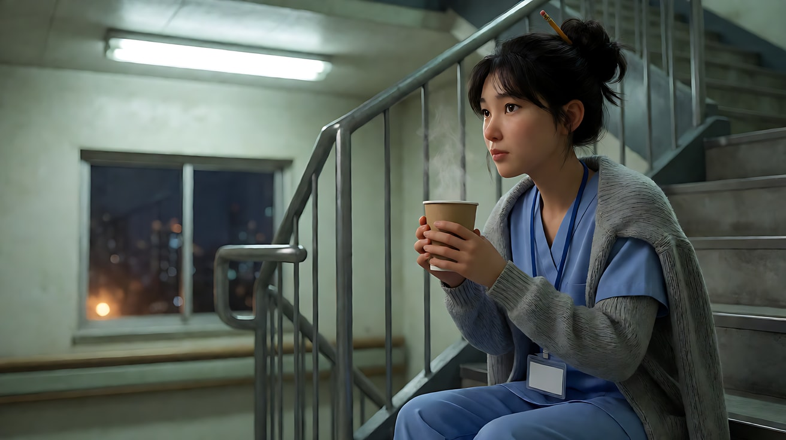

**【图生视频 · Seedance】**

```
【素材分工】@图片1 为首帧，锁定人物身份、发型、服装与楼梯间布局。
【画风】风格化写实三维CG质感，电影级布光。
手持镜头，机位基本不移动，只有极轻微的呼吸感起伏，像有人坐在她旁边的台阶上拿着摄影机，始终保持中近景，她位于画面右三分之一。护士双手捧着纸杯，低头吹了一下热气，喝了一小口，然后把杯子放在膝盖上，长长地呼出一口气，慢慢把额头靠在膝盖上，闭上眼睛。头顶的日光灯偶尔轻微闪一下，杯口的热气在光里缓慢升起，飘过她的脸。结尾停在她额头靠在膝盖上、热气在脸前飘动的中近景。
【声音】楼梯间空旷的低频回响，日光灯的电流嗡声，远处走廊隐约的呼叫铃，她一次长长的呼气，无配乐。
【约束】保持人物脸型、发型、服装不变；晃动幅度极小，不颠簸；不要字幕、水印、Logo。
时长：8秒
```

**参数**：时长 8 秒 ｜ 画幅 16:9

**【检查点】**
- 晃动是否小到"几乎察觉不到"，但和三脚架的绝对静止有区别
- 画框的起伏是否缓慢而有节奏，像呼吸
- 她的脸和手在整段里是否始终清楚

**【常见问题与修复】**
| 现象 | 修复 |
|---|---|
| 晃动太大像在走路 | 写"机位基本不移动，只有极轻微的呼吸感起伏"，约束写"不颠簸" |
| 完全没有晃动 | 加"像有人坐在她旁边拿着摄影机"，给模型一个手持的理由 |
| 镜头自己推近 | 写"始终保持中近景" |
| 杯子变形或液体溢出 | 动作只保留"吹一下、喝一小口、放在膝盖上"三步 |

---

### 练习2：手持纪实跟随——夜市里的炒面摊（难度 ★★）

**目标**：用定妆图 + 场景图生成一个第 2 档"轻微"手持镜头。重点不在晃，而在"反应"：镜头慢半拍跟上他的转身，在他开口时偏向他。意图：让观众感到这是一个真实忙碌的夜晚，而摄影师就挤在摊位旁边。

**运镜合同**

| 要素 | 本练习 |
|---|---|
| 起始构图 | 中景，摊主站在铁锅前颠锅，位于画面中央偏左，火光照亮他的脸 |
| 运动方式 | 手持，第 2 档轻微晃动，镜头随他的动作做小幅摇动和补构图 |
| 速度 | 跟随他的节奏，转身时慢半拍 |
| 终点画面 | 中近景，他把一盒炒面递向画右的顾客，咧嘴笑着说话，镜头已经偏向他 |
| 运动动机 | 纪实：镜头像一个被他吸引、努力跟上他的人 |

**【生图 · Nano Banana】**

图1 角色定妆：

```
Character turnaround sheet of an original street-food cook in his fifties: a round face with a thick black mustache,
a white towel tied around his forehead, a sleeveless grey undershirt, a stained dark-blue apron, black rubber boots, strong forearms.
Front view, three-quarter view, side view and back view, full body, plain light-grey background.
Camera at eye level, 50mm lens, deep focus, even soft studio light from the front.
Stylized semi-realistic 3D CG rendering, feature-film animation quality. Aspect ratio 16:9.
```

中文释义：原创角色，五十多岁街头小吃摊主，圆脸、浓黑胡子，额头系白毛巾，灰色无袖背心，沾着污渍的深蓝围裙，黑色胶靴，小臂粗壮；四视图全身。

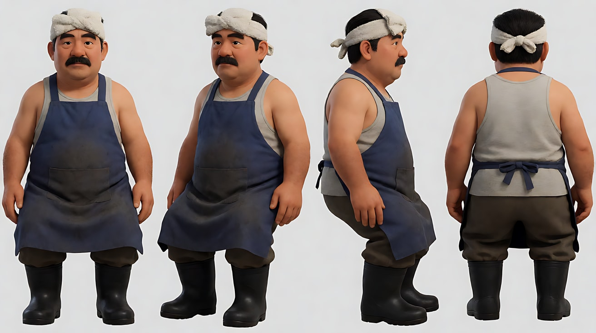

图2 场景（夜市摊位）：

```
A crowded night market at night, a small fried-noodle stall with a large black iron wok over a roaring gas flame,
stacks of takeaway boxes, bowls of chopped vegetables and noodles, a string of bare bulbs above the stall,
a counter facing the street on the right side, blurred crowds and other stalls in the background, no text on any signs.
Medium-wide shot from inside the stall beside the cook's position, camera at standing eye level, 35mm lens, moderate depth of field.
Lighting: orange flame light from the wok below as a strong key, warm bare bulbs above, colorful soft bokeh from other stalls, smoke and steam in the air.
Stylized semi-realistic 3D CG rendering, feature-film animation quality. Aspect ratio 16:9.
```

中文释义：拥挤的夜市，一个炒面小摊，大黑铁锅架在呼呼作响的燃气火上，叠着外卖盒，碗里是切好的蔬菜和面，摊位上方挂着一串裸灯泡，画右是朝向街道的柜台，背景是虚化的人群和其他摊位，招牌上没有文字；从摊位内侧的中全景、站姿视线高度、35mm、中等景深；锅下橙色火光是强烈主光，头顶暖色灯泡，其他摊位的彩色虚化光斑，空气里烟和蒸汽。


**【多图生视频 · Seedance】**

```
【素材分工】@图片1 锁定摊主的身份、额头毛巾与服装，不参考其灰色背景；@图片2 仅参考摊位布局、铁锅位置与火光、灯泡光线，不复制其中人群外貌。
【画风】风格化写实三维CG质感，电影级布光。
手持镜头，轻微晃动，像摄影师挤在摊位旁边拍摄。起始画面为中景，摊主站在铁锅前，位于画面中央偏左，用力颠锅，面条和蔬菜在锅里翻起，火苗一下窜高，照亮他满是汗的脸。镜头随着他颠锅的节奏轻微晃动。他抓起一把葱花撒进锅里，转身去拿外卖盒，镜头慢半拍向右摇过去跟上他，修正构图。他把炒面倒进盒子，转向画右柜台外的顾客，开口说话，镜头在他开口时轻轻向他偏过去，落成中近景。结尾停在他把一盒炒面递向画右、咧嘴笑着的中近景。他的脸始终清楚。
【声音】燃气火的呼呼声，铁铲刮锅的金属声，油爆的噼啪声，夜市人群的嘈杂和远处叫卖，摊主（递出炒面，大声）："多加了葱，趁热！"无配乐。
【约束】保持摊主脸型、服装不变；晃动幅度轻微，不剧烈颠簸；招牌上不出现文字；不要字幕、水印、Logo。
时长：9秒
```

**参数**：时长 9 秒 ｜ 画幅 16:9

**【检查点】**
- 镜头是否有"慢半拍跟上"的反应，而不是机械地同步
- 晃动是否保持在第 2 档，没有变成奔跑式颠簸
- 他开口时镜头是否偏向他，落成中近景

**【常见问题与修复】**
| 现象 | 修复 |
|---|---|
| 镜头像稳定器一样平滑 | 写"像摄影师挤在摊位旁边拍摄"，并写"随着他颠锅的节奏轻微晃动" |
| 晃得太厉害看不清 | 约束写"晃动幅度轻微，不剧烈颠簸"；删掉"混乱""热闹到晃眼" |
| 锅里的食物飞出画面 | 写"面条和蔬菜在锅里翻起"，不写"抛得很高" |
| 背景冒出文字招牌 | 场景图写 no text on any signs，约束写"招牌上不出现文字" |

---

### 练习3：稳定器漂浮——穿过旧宅走进舞厅（难度 ★★★，首尾帧）

**目标**：首帧是旧宅昏暗的走廊，尾帧是灯火辉煌的舞厅。中间是一个低位稳定器跟拍，平滑地漂浮着跟在少女身后穿过走廊、推开的门、进入舞厅。意图：让观众感到自己像一个无形的影子跟着她，走进了一场不太真实的旧日舞会。

**运镜合同**

| 要素 | 本练习 |
|---|---|
| 起始构图 | 中景背影，少女提着裙摆站在长走廊中央，走廊尽头是一扇透出金光的双开门 |
| 运动方式 | 稳定器跟拍，镜头略低于她的腰部，在她身后平滑漂浮 |
| 速度 | 慢走速度，匀速，完全没有颠簸 |
| 终点画面 | 全景，舞厅中央，水晶吊灯下一对对舞者旋转，少女背影站在舞池边缘，画面中央 |
| 运动动机 | 漂浮感去掉"人拿着摄影机"的痕迹，像梦，像幽灵在注视 |

**【生图 · Nano Banana】**

图1 角色定妆：

```
Character turnaround sheet of an original girl about seventeen: very long wavy black hair loose down her back with a thin velvet ribbon,
a pale silver-grey vintage ball gown with puffed short sleeves and a long full skirt, white lace gloves, silver flat shoes.
Front view, three-quarter view, side view and back view, full body, plain light-grey background.
Camera at eye level, 50mm lens, deep focus, even soft studio light from the front.
Stylized semi-realistic 3D CG rendering, feature-film animation quality. Aspect ratio 16:9.
```

中文释义：原创角色，约十七岁少女，及背的黑色长卷发系细丝绒带，银灰色复古泡泡短袖舞会长裙、裙摆蓬大，白色蕾丝手套、银色平底鞋；四视图全身。

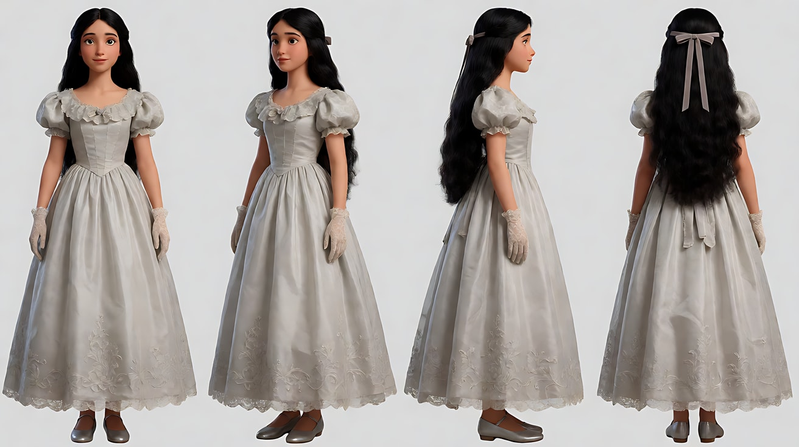

图2 首帧：

```
Using the character from image 1: a medium shot from behind of the girl standing in the middle of a long dim corridor of an old mansion,
lifting the hem of her gown slightly with both hands, facing a tall double door at the far end with warm golden light leaking through the gap.
Faded floral wallpaper, gilded picture frames without faces visible, a long worn carpet runner, candle sconces on the walls.
Low camera height just below her waist behind her, 28mm lens, deep focus.
Lighting: dim flickering candle sconces on both walls, the strong warm golden glow from the door gap ahead outlining her silhouette.
Keep the face, hairstyle and outfit exactly as in image 1.
Stylized semi-realistic 3D CG rendering, feature-film animation quality. Aspect ratio 16:9.
```

中文释义：少女中景背影，站在老宅昏暗长走廊中央，双手微微提起裙摆，面朝尽头的高大双开门，门缝漏出金色暖光；褪色花卉墙纸、看不清画面的镀金画框、磨旧的长地毯、墙上烛台；略低于她腰部的身后低机位、28mm、深景深；两侧墙上摇曳的烛光，前方门缝强烈的金色光勾出她的轮廓。

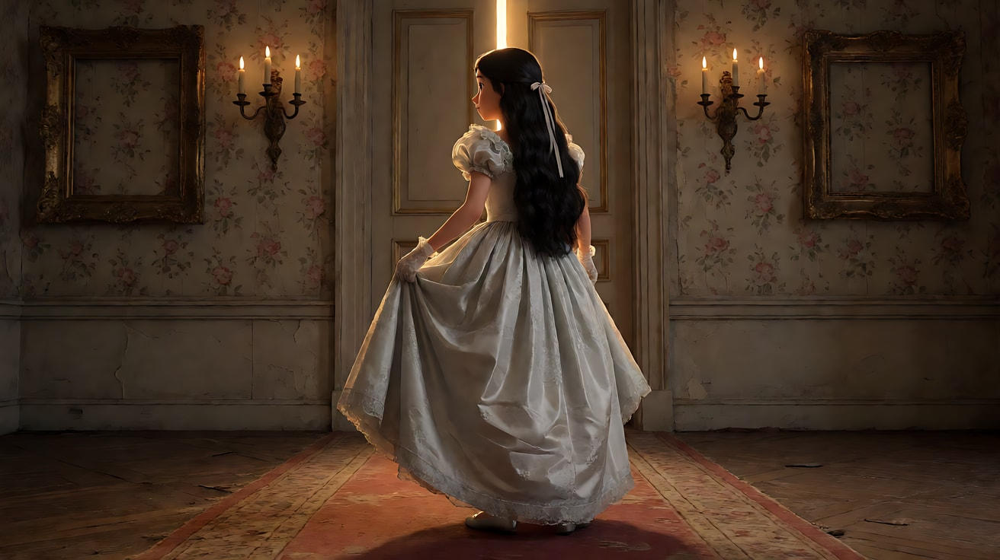

图3 尾帧：

```
Using the character from image 1: a wide shot of a grand old ballroom, a huge crystal chandelier blazing above,
couples in vintage evening clothes waltzing across the polished parquet floor in soft motion blur,
the girl seen from behind standing at the edge of the dance floor at the center of the frame, the double door behind the camera.
Low camera height just below her waist behind her, 24mm lens, deep focus.
Lighting: warm golden chandelier light from above, reflections on the polished floor, a soft haze in the air.
Keep the face, hairstyle and outfit exactly as in image 1.
Stylized semi-realistic 3D CG rendering, feature-film animation quality. Aspect ratio 16:9.
```

中文释义：宏大老舞厅全景，巨大的水晶吊灯通明，穿复古晚礼服的一对对舞者在抛光拼花地板上跳华尔兹，带柔和动态模糊；少女背影站在舞池边缘，画面中央；同样的低机位、24mm、深景深；吊灯金色暖光，地板反光，空气中有薄雾。

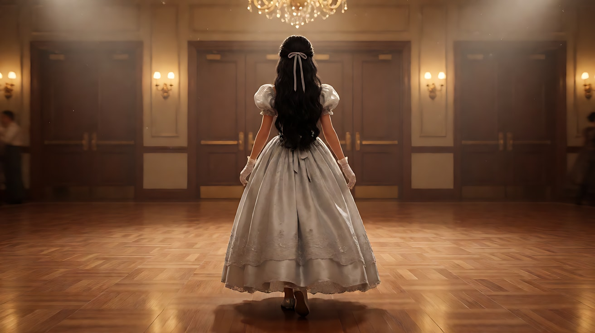

**【首尾帧生视频 · Seedance】**

```
【素材分工】@图片2 为首帧；@图片3 为尾帧，是最终画面目标；@图片1 锁定少女的身份、长卷发与银灰色长裙。只生成两帧之间的连续运动，不切镜头。
【画风】风格化写实三维CG质感，电影级布光。
稳定器跟拍，镜头保持在略低于她腰部的高度，在她身后约两米平滑漂浮，画面完全没有颠簸。少女提着裙摆沿长走廊向尽头的双开门走去，步子很轻，裙摆在地毯上轻轻扫过。镜头与她同速漂浮跟随，两侧的烛台一盏盏向后滑过，烛光在墙纸上摇曳。她走到门前，双手推开双开门，金色的光一下涌出来照亮她的全身。镜头不停，平滑地跟着她穿过门口，进入舞厅：水晶吊灯在上方通明，一对对舞者在拼花地板上旋转。她在舞池边缘停下，镜头随之平滑减速停住。结尾停在她背影站在舞池边缘、舞者在她面前旋转的全景。
【声音】起初是走廊里的寂静、烛火轻微的噼啪声和裙摆擦过地毯的沙沙声；推开门的瞬间，一段老唱片般的华尔兹音乐和人群的低语涌出来，越来越清楚；最后是舞步在木地板上的节奏声。
【约束】保持少女脸型、发型、服装不变；镜头平滑无颠簸，不摇晃；少女始终背对镜头；舞者不与她发生接触；不要字幕、水印、Logo。
时长：10秒
```

**参数**：时长 10 秒 ｜ 画幅 16:9

**【检查点】**
- 画面是否平滑得"不像有人拿着"，与练习1、练习2形成明显对比
- 低机位是否保持，穿过门口时有没有突然升高
- 推开门时光与声音是否同时涌出

**【常见问题与修复】**
| 现象 | 修复 |
|---|---|
| 画面有手持颠簸 | 写"稳定器跟拍，画面完全没有颠簸"，约束写"平滑无颠簸，不摇晃" |
| 穿门时出现切镜 | 素材分工写"不切镜头"，正文写"镜头不停，平滑地跟着她穿过门口" |
| 少女回头看镜头 | 约束写"少女始终背对镜头" |
| 舞者的脸都一模一样或扭曲 | 写舞者"带柔和动态模糊"，并让他们保持在中远景，不给特写 |

---

### 练习4：晃动幅度递增——停电的地下停车场（难度 ★★★★，多镜头）

**目标**：三个镜头的支撑方式与晃动幅度随紧张感递增：稳定器平滑 → 手持轻微 → 手持明显颠簸。每个镜头一个主运镜，靠切镜升级。意图：让观众感到平静一点点被打破，她从镇定变成拔腿就跑。

**运镜合同**

| 镜头 | 起始构图 | 运动方式 | 速度 | 终点画面 | 运动动机 |
|---|---|---|---|---|---|
| 镜头1 | 全景背影，她拿着手电筒走在停车场通道中央 | 稳定器平滑跟随，身后 | 慢走 | 她停下，手电光照向画左一根柱子 | 平静的巡查，还没有危险 |
| 镜头2 | 中近景侧面，她屏住呼吸听声音 | 手持，第 2 档轻微晃动，随她转头慢半拍摇动 | 跟随她的反应 | 她猛地把手电转向画右，光圈里只有一辆空车 | 警觉：有声音，但看不到是什么 |
| 镜头3 | 中景前导，她迎面奔跑 | 手持前导倒退，第 3 档明显颠簸 | 奔跑速度 | 她撞开安全出口的门，门外白光涌进来，镜头稳住 | 紧张到顶点，最后在光里落定 |

**【生图 · Nano Banana】**

图1 角色定妆：

```
Character turnaround sheet of an original woman in her late twenties working as a night security guard:
a short tidy undercut hairstyle, small silver hoop earrings, a navy-blue uniform jacket with reflective stripes on the sleeves and no logos,
dark cargo trousers, black work boots, a large black flashlight in her right hand.
Front view, three-quarter view, side view and back view, full body, plain light-grey background.
Camera at eye level, 50mm lens, deep focus, even soft studio light from the front.
Stylized semi-realistic 3D CG rendering, feature-film animation quality. Aspect ratio 16:9.
```

中文释义：原创角色，近三十岁的夜班安保员，利落的短发两侧剃短，小银圈耳环，藏青色制服外套袖子有反光条、没有任何标志，深色工装裤，黑色工作靴，右手一支大黑手电；四视图全身。

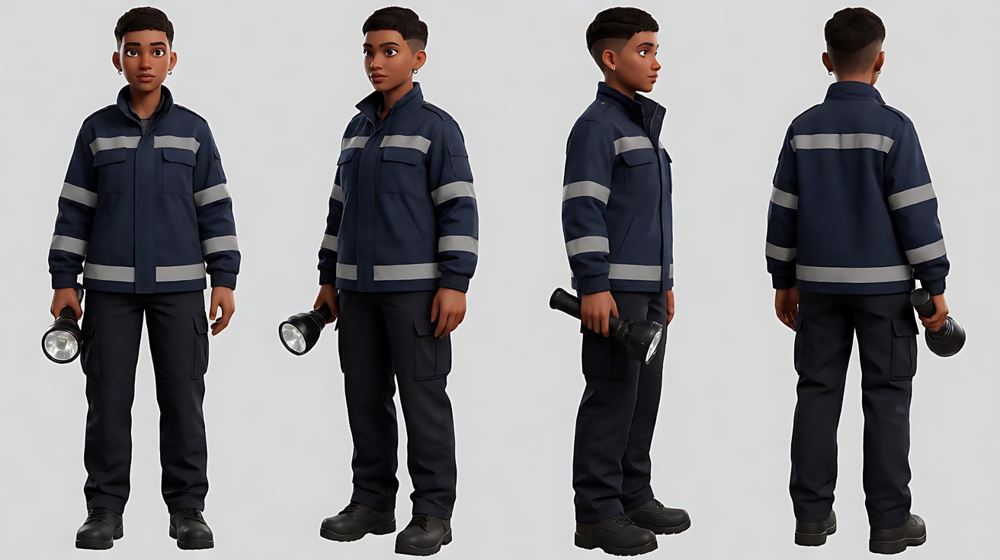

图2 场景（停电的地下停车场）：

```
An underground parking garage during a power outage at night, rows of thick concrete pillars, a few parked cars covered in dust,
only dim red emergency lights along the ceiling and a glowing green-white emergency exit door at the far end of the central aisle,
puddles on the floor, no people, no readable text.
Wide shot down the central aisle, camera at standing eye level, 28mm lens, deep focus.
Lighting: dim red emergency lights from the ceiling, deep shadows between pillars, the cool bright glow from the exit door far ahead.
Stylized semi-realistic 3D CG rendering, feature-film animation quality. Aspect ratio 16:9.
```

中文释义：夜晚停电的地下停车场，一排排粗混凝土柱，几辆落满灰的车，只有天花板沿线昏暗的红色应急灯和中央通道尽头一扇发着绿白光的安全出口门，地面有积水，没有人、没有可读文字；沿中央通道的全景、站姿视线高度、28mm、深景深；红色应急灯，柱子之间深黑阴影，远处出口门的冷白亮光。

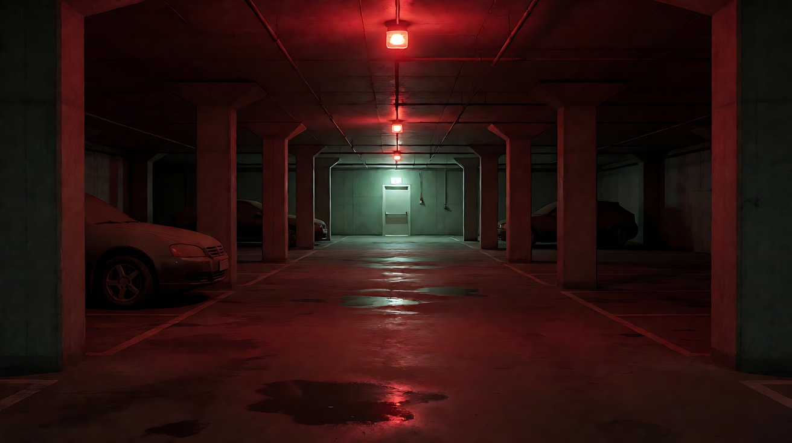

图3 镜头1首帧：

```
Using the character from image 1 in the garage of image 2:
a wide shot from behind of the guard walking slowly down the central aisle, flashlight beam cutting through the darkness ahead,
placed at the center of the frame, rows of pillars on both sides, the glowing exit door far ahead.
Camera at standing eye level behind her, 28mm lens, deep focus.
Lighting: dim red emergency lights, the white cone of her flashlight, the faint exit-door glow far away.
Keep the face, hairstyle and outfit exactly as in image 1.
Stylized semi-realistic 3D CG rendering, feature-film animation quality. Aspect ratio 16:9.
```

中文释义：安保员全景背影，沿中央通道慢慢走，手电光束切开前方黑暗，位于画面中央，两侧是一排排柱子，远处是发光的出口门。

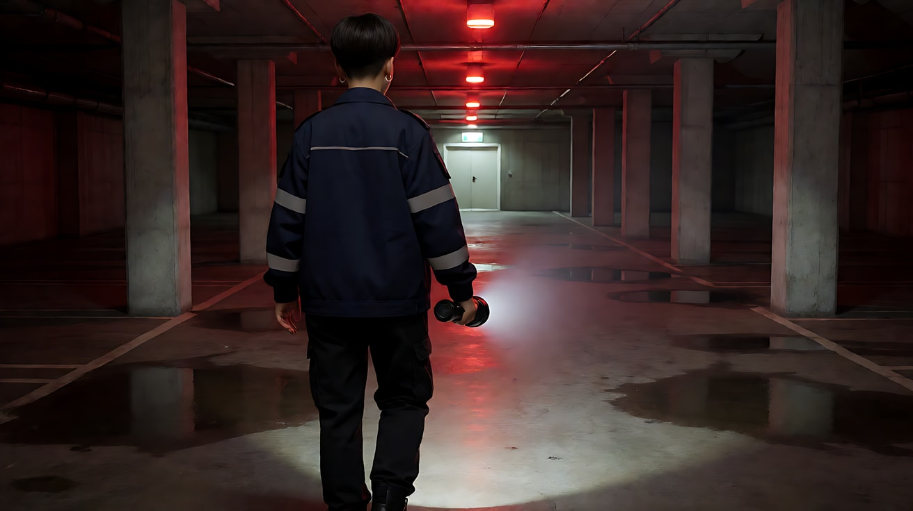

**【多图生视频 · Seedance】**

```
【素材分工】@图片1 锁定安保员的身份、发型、制服与手电，不参考其灰色背景；@图片2 仅参考停车场的柱子排列、应急灯与出口门的位置和光线；@图片3 为镜头1首帧。
【画风】风格化写实三维CG质感，电影级布光。
镜头1：全景背影，稳定器在她身后平滑跟随，画面没有颠簸。她沿中央通道慢慢往前走，手电的白色光束扫过两侧的柱子和落灰的车，天花板的红色应急灯一盏一盏向后滑过。远处传来一声水滴落进积水的回响，她停下脚步，把手电照向画左的一根柱子，柱子后面什么也没有。镜头随她停住。
镜头2：镜头切至中近景侧面，手持镜头，轻微晃动。她屏住呼吸，眼睛睁大，侧耳听着。画右深处传来一声金属轻碰的声响，她猛地把头和手电一起转向画右，镜头慢半拍向右摇过去跟上，手电光圈里只有一辆空车。她的喉咙动了一下。红色应急光照在她半边脸上。
镜头3：镜头切至中景正面，手持镜头在她前方倒退，随奔跑明显颠簸，她始终保持在画面中央，脸部清楚。她迎面朝出口门方向奔跑，手电光在地面和柱子上乱晃，脚步踩进积水溅起水花，身后的柱子快速后退。她冲到出口门前，用肩膀撞开门，门外冷白色的光一下涌进来照满她的脸，镜头在光里稳住。结尾停在她站在敞开的门口、大口喘气、被白光照亮的中景。
【锁定】光线：停车场里是红色应急灯与她的手电光，出口门方向是冷白光；她始终穿藏青制服、拿黑色手电；镜头1稳定器无晃动，镜头2轻微晃动，镜头3明显颠簸后稳住。
【声音】镜头1她平稳的脚步回声和一声水滴落进积水；镜头2她屏住的呼吸，远处一声金属轻碰，心跳般的低频；镜头3急促的脚步踩水声和喘气，撞开门的一声闷响，门外夜风灌进来的声音，无配乐。
【约束】保持人物脸型、发型、服装不变；画面中只有她一个人，不出现其他人影或生物；不出现可读文字；不要字幕、水印、Logo。
时长：13秒
```

**参数**：时长 13 秒 ｜ 画幅 16:9 ｜ 负载：3 个镜头、无对白、奔跑，"有挑战"档

**【检查点】**
- 三个镜头的晃动是否逐级递增：无 → 轻微 → 明显
- 镜头2的"慢半拍跟上"是否出现
- 镜头3颠簸时她的脸是否仍然清楚
- 结尾是否在白光里"稳住"，形成从紧张到落定的终点

**【常见问题与修复】**
| 现象 | 修复 |
|---|---|
| 三个镜头晃动程度一样 | 【锁定】写清三档幅度；每个镜头块第一句都写支撑方式和档位 |
| 镜头3晃得看不清人 | 写"她始终保持在画面中央，脸部清楚"；颠簸改成"明显"而不是"剧烈" |
| 模型自己加了怪物或人影 | 约束写"画面中只有她一个人，不出现其他人影或生物" |
| 结尾仍在剧烈晃动 | 写"镜头在光里稳住"，给出明确的稳定终点 |

---

### 练习5：从乱到静——婚礼开场前的后台（难度 ★★★★★，四镜头 + 支撑方式切换）

**目标**：一场戏里，情绪从慌乱到平静，支撑方式也从手持明显 → 手持呼吸 → 稳定器漂浮 → 固定，逐镜降低"摄影机的存在感"。意图：让观众感到伴娘在一片混乱中找回了丢失的戒指，而当她把戒指交出去的时候，整个世界都安静了。

**运镜合同**

| 镜头 | 起始构图 | 运动方式 | 速度 | 终点画面 | 运动动机 |
|---|---|---|---|---|---|
| 镜头1 | 中景，伴娘在后台化妆间里翻找，人来人往 | 手持，第 3 档明显晃动，跟着她左右转 | 快 | 她跪到地上看向化妆台下面 | 慌乱：镜头和她一样找不到方向 |
| 镜头2 | 近景，她的脸贴近地面，看向化妆台下 | 手持，第 1 档呼吸 | 极慢 | 她伸手从地毯缝里捡起一枚小戒指，眼睛亮起来 | 一切慢下来，观众屏住呼吸 |
| 镜头3 | 中景背影，她攥着戒指走出化妆间进入长走廊 | 稳定器平滑跟随 | 慢走 | 她走到走廊尽头的花拱门前，新娘背影在拱门下 | 混乱结束，平稳地走向终点 |
| 镜头4 | 中近景，两人在花拱门下，新娘在画右，伴娘在画左 | 固定 | 零 | 伴娘把戒指放进新娘掌心，新娘合上手，两人额头相抵 | 世界安静了，镜头也不再动 |

**【生图 · Nano Banana】**

图1 角色定妆（两位原创角色）：

```
Character turnaround sheet of two original characters:
a bridesmaid in her late twenties with a short bob and a small braid on one side, a dusty-rose satin slip dress, a thin pearl bracelet, flat nude shoes;
a bride in her late twenties with long dark hair in a low loose chignon decorated with tiny white flowers, a simple ivory long-sleeved silk gown, a long sheer veil.
Front view, three-quarter view, side view and back view of each, full body, plain light-grey background.
Camera at eye level, 50mm lens, deep focus, even soft studio light from the front.
Stylized semi-realistic 3D CG rendering, feature-film animation quality. Aspect ratio 16:9.
```

中文释义：两位原创角色：近三十岁伴娘（短波波头一侧编小辫，灰玫瑰色缎面吊带裙，细珍珠手链，裸色平底鞋）；近三十岁新娘（深色长发挽成松散低发髻、点缀小白花，简洁象牙白长袖丝质婚纱，长长的薄纱头纱）；四视图全身。

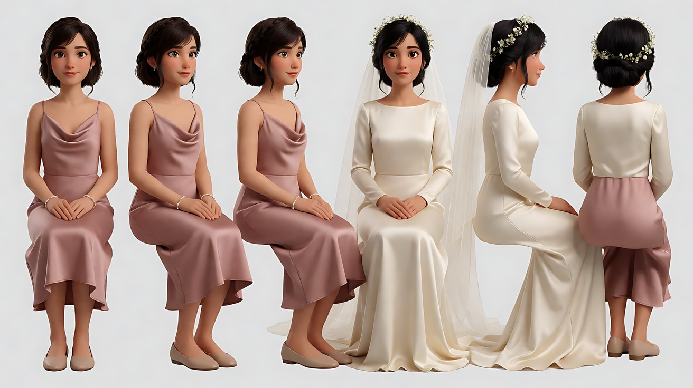

图2 场景（后台化妆间与走廊）：

```
A busy backstage dressing room at a countryside wedding venue in the afternoon: a long makeup table with a large mirror framed by bulbs,
scattered cosmetics, flower boxes, garment racks with dresses, an open door leading to a long white corridor that ends at an arch of white flowers
glowing with daylight, no people, no readable text.
Wide shot from inside the dressing room toward the open door, camera at standing eye level, 28mm lens, deep focus.
Lighting: warm mirror bulbs inside the room, soft bright daylight flooding the far flower arch at the end of the corridor.
Stylized semi-realistic 3D CG rendering, feature-film animation quality. Aspect ratio 16:9.
```

中文释义：午后乡间婚礼场地繁忙的后台化妆间：长化妆台配一圈灯泡的大镜子，散落的化妆品、花盒、挂着礼服的衣架，一扇敞开的门通向长长的白色走廊，走廊尽头是一座被日光照亮的白色花拱门；没有人、没有可读文字；从化妆间里朝门口的全景、站姿视线高度、28mm、深景深；室内镜灯暖光，走廊尽头花拱门处柔和明亮的日光。

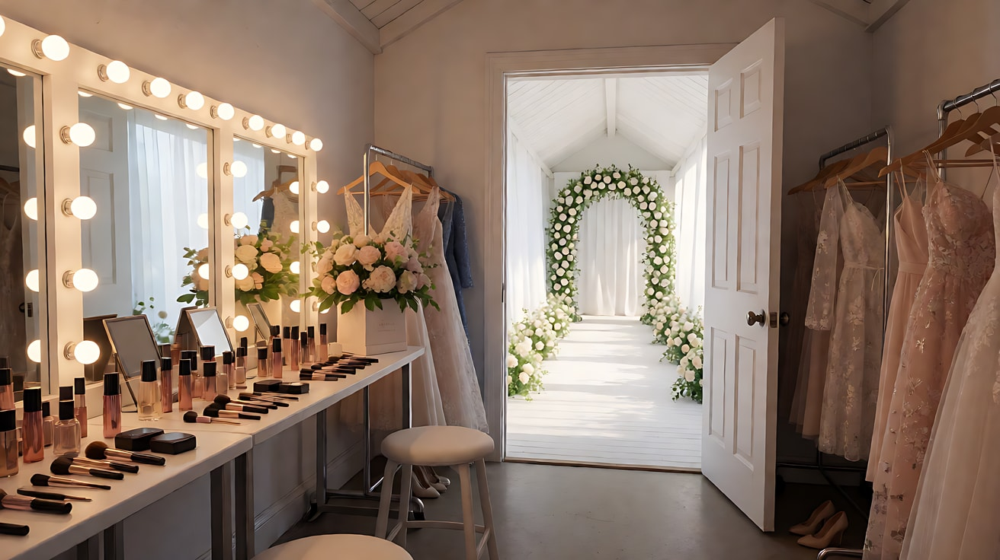

图3 镜头1首帧：

```
Using the bridesmaid from image 1 in the dressing room of image 2:
a medium shot of the bridesmaid frantically searching the makeup table, lifting a flower box with one hand, eyes darting,
a few blurred helpers rushing past in the foreground and background, placed slightly left of center.
Slightly tilted handheld framing, camera at standing eye level, 35mm lens, moderate depth of field.
Lighting: warm mirror bulbs from frame right on her face, daylight from the open door in the background.
Keep the face, hairstyle and outfit exactly as in image 1.
Stylized semi-realistic 3D CG rendering, feature-film animation quality. Aspect ratio 16:9.
```

中文释义：伴娘中景，在化妆台上慌乱翻找，一只手掀起花盒，眼神四处扫，前景和背景有几个虚化的帮手匆匆经过，她位于画面中央偏左；构图略微倾斜，像手持拍摄；画右镜灯暖光照亮她的脸，背景是敞开门外的日光。

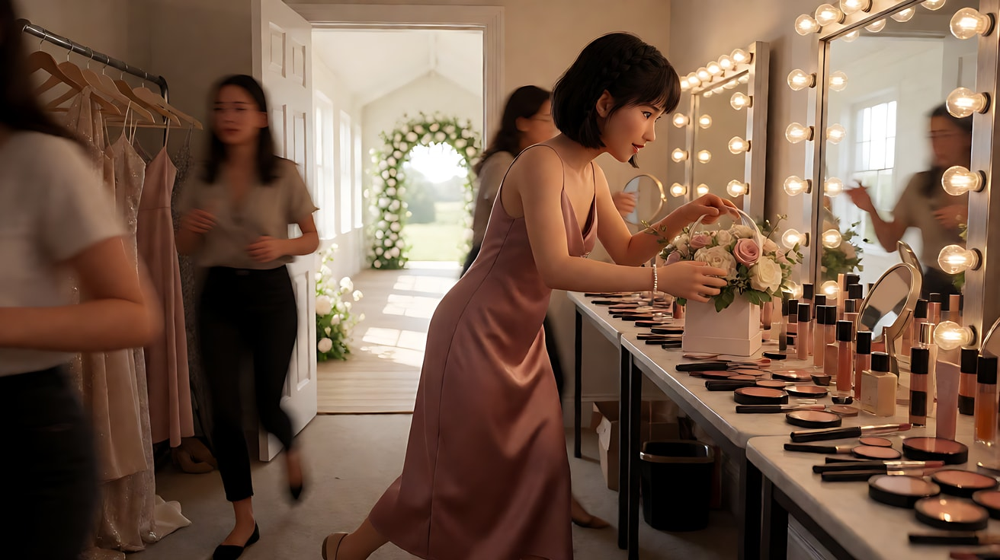

图4 镜头4构图参考：

```
Using the bridesmaid and the bride from image 1 under the flower arch from image 2:
a medium close-up of the two women facing each other under the white flower arch, the bride on the right, the bridesmaid on the left,
the bridesmaid placing a small gold ring into the bride's open palm between them, both looking down at it.
Camera locked off at eye level, 50mm lens, shallow depth of field, white flowers softly blurred around the frame.
Lighting: soft bright daylight from behind the arch creating a gentle rim on their hair and the veil, warm bounce on their faces.
Keep the faces, hairstyles and outfits exactly as in image 1.
Stylized semi-realistic 3D CG rendering, feature-film animation quality. Aspect ratio 16:9.
```

中文释义：两人在白色花拱门下面对面的中近景，新娘在画右、伴娘在画左，伴娘把一枚小金戒指放进两人之间新娘摊开的掌心，两人都低头看着；固定机位、视线高度、50mm、浅景深，四周白花虚化；拱门后方柔和明亮的日光在头发和头纱上形成轮廓，脸上有暖色反光。


**【多图生视频 · Seedance】**

```
【素材分工】@图片1 锁定伴娘与新娘的身份、发型与服装，不参考其背景；@图片2 仅参考化妆间、走廊与花拱门的空间顺序和光线；@图片3 为镜头1首帧；@图片4 为镜头4的构图参考，锁定两人的左右位置。
【画风】风格化写实三维CG质感，电影级布光。
镜头1：中景，手持镜头明显晃动，跟着伴娘左右快速转动。她在化妆台上掀开花盒、翻开化妆包，又转身去摸衣架上礼服的口袋，帮手们从前景和背景匆匆跑过。镜头慢半拍追着她，构图有些歪。她忽然停住，跪到地上，弯腰看向化妆台下面。吹风机声、有人在喊时间、衣架碰撞声混成一片。
镜头2：镜头切至近景，手持镜头只剩极轻微的呼吸感起伏。她的脸贴近地面，看着化妆台下的地毯，周围的嘈杂一下子远了。她伸出手指，从地毯缝里捏起一枚小小的金戒指，举到眼前，眼睛亮起来，长出一口气。镜灯的暖光从上方照在戒指上。
镜头3：镜头切至中景背影，稳定器在她身后平滑跟随，画面没有颠簸。她攥着戒指走出化妆间，沿着长长的白色走廊向尽头走去，步子越来越稳。走廊尽头花拱门的日光越来越亮，新娘的背影站在拱门下。她在新娘身后停下，镜头随之平滑停住。
镜头4：镜头切至中近景，固定镜头，不推不摇。两人在花拱门下面对面，新娘在画右，伴娘在画左。伴娘把戒指轻轻放进新娘摊开的掌心，新娘合上手，两人相视一笑，额头轻轻相抵。拱门后的日光在头纱边缘发亮。结尾停在两人额头相抵的中近景。
【锁定】光线：化妆间是暖色镜灯，走廊与花拱门是柔和日光；伴娘始终穿灰玫瑰色缎面裙，新娘始终穿象牙白婚纱、戴头纱；镜头4中伴娘在画左、新娘在画右；支撑方式依次为手持明显、手持呼吸、稳定器、固定。
【声音】镜头1吹风机、喊话、衣架碰撞的嘈杂；镜头2嘈杂突然变远，只剩她的呼吸和戒指离开地毯时的细响；镜头3走廊里她平稳的脚步声，远处传来轻柔的弦乐四重奏；镜头4弦乐继续，新娘（合上手，轻声）："就知道你会找到。"
【约束】保持两人脸型、发型、服装不变；戒指始终只有一枚、金色；镜头4两人只有额头相抵，没有其他肢体接触；不出现可读文字；不要字幕、水印、Logo。
时长：15秒
```

**参数**：时长 15 秒 ｜ 画幅 16:9 ｜ 负载：4 个镜头、1 句台词，"有挑战"上限；失败时拆成两次生成（镜头1–2、镜头3–4），第二次以第一次的尾帧接续

**【检查点】**
- 四个镜头的"摄影机存在感"是否逐级降低：明显晃 → 呼吸 → 漂浮 → 静止
- 镜头2的嘈杂声是否突然变远，与画面的平静同步
- 镜头4两人的左右位置是否与 @图片4 一致
- 戒指在三个镜头里是否始终是同一枚

**【常见问题与修复】**
| 现象 | 修复 |
|---|---|
| 镜头1晃得完全看不清人 | 写"明显晃动"而不是"剧烈"；补"她的脸始终在画面中可辨认" |
| 镜头3还在手持晃动 | 镜头块第一句写"稳定器在她身后平滑跟随，画面没有颠簸" |
| 镜头4两人拥抱或动作过多 | 约束写"只有额头相抵，没有其他肢体接触" |
| 戒指在镜头4变成钻戒或变大 | 素材分工与约束都写"一枚小金戒指"，并在 @图片4 中画清楚 |
