# L05-07 特殊运镜 · 提示词

> 本组练习：把滑动变焦、主观镜头、甩镜转场、FPV 穿越、子弹时间与慢动作、荷兰角、俯冲逐一写成可执行的物理描述，并学会只在关键时刻用它们。｜ 配套教学：[L05-07-特殊运镜](../教学/L05-07-特殊运镜.md) ｜ 规范：[写作规范](../../模板/写作规范.md)
>
> 画风默认使用开关 A（风格化写实 CG）。如改用 2D 动画，删掉所有焦段、光圈、景深词。
>
> 提示：提示词里不写任何带人名或片名的运镜术语，一律写物理描述（例如"滑动变焦：机位后退，同时焦距推长"）。

---

### 练习1：滑动变焦——走廊尽头的那封信（难度 ★）

**目标**：单张关键帧生成一个滑动变焦。机位后退、焦距推长，人物大小不变，身后的走廊向他压过来。意图：让观众感到他读完调令的那一刻，整栋楼都在向他压下来。

**运镜合同**

| 要素 | 本练习 |
|---|---|
| 起始构图 | 中近景，年轻职员站在长走廊中央，正面对镜头，手里拿着一张纸，身后走廊一点透视延伸到远处窗户 |
| 运动方式 | 滑动变焦：机位缓慢后退，同时焦距推长 |
| 速度 | 缓慢、匀速、持续 |
| 终点画面 | 中近景，人物大小不变，身后的走廊两侧墙面、门和远处窗户被压缩得紧贴在他身后 |
| 运动动机 | 他意识到自己被调走的瞬间，空间替他"变形" |

**【生图 · Nano Banana】**

图1 关键帧（背景必须有强烈纵深线条）：

```
A medium close-up of an original young office worker in his late twenties standing in the exact center of a long empty office corridor,
facing the camera, short neat black hair, thin-framed glasses, a light-blue shirt with a loosened dark tie, holding a single sheet of paper in both hands at chest level,
staring at it. Behind him the corridor recedes in strong one-point perspective: rows of identical doors on both sides,
evenly spaced ceiling lights, a window at the far end showing a grey sky.
Camera at standing eye level, 35mm lens, deep focus so the corridor lines are crisp.
Lighting: cool white overhead fluorescent panels in a regular rhythm down the corridor, flat grey daylight from the far window.
Stylized semi-realistic 3D CG rendering, feature-film animation quality. Aspect ratio 16:9.
```

中文释义：中近景，近三十岁原创职员站在空荡长走廊正中央，面对镜头，黑色短发、细框眼镜、浅蓝衬衫配松开的深色领带，双手在胸前拿着一张纸盯着看；身后走廊呈强烈一点透视延伸：两侧一模一样的门、等距的顶灯、尽头一扇窗外是灰天；站姿视线高度、35mm、深景深让走廊线条清晰；冷白色顶灯沿走廊规律排列，尽头窗户的灰色平光。

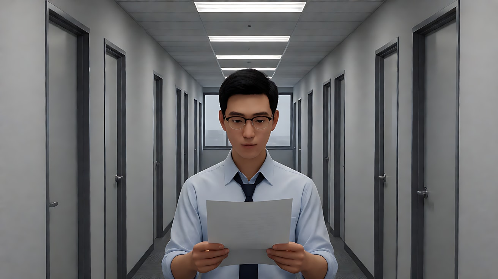

**【图生视频 · Seedance】**

```
【素材分工】@图片1 为首帧，锁定人物身份、服装、手中的纸与走廊的一点透视布局。
【画风】风格化写实三维CG质感，电影级布光。
职员站在走廊中央，盯着手里的那张纸，读到最后一行时手指慢慢收紧，纸的边缘起了皱。他抬起眼，越过纸的上沿看向镜头方向，嘴唇微张，呼吸停了一拍。此时镜头开始滑动变焦：机位沿走廊中轴线缓慢匀速后退，同时镜头焦距持续推长，他在画面中的大小始终保持不变，身后的走廊两侧的门、顶灯和尽头的窗户被一点点压缩，向他身后逼近，走廊看起来越来越短、越来越窄。结尾停在他的中近景，整条走廊紧紧压在他身后。
【声音】顶灯的电流嗡声逐渐变响，远处一台打印机运转的声音被拉远，纸张被攥紧的细响，一个低沉持续的嗡鸣在变焦过程中慢慢升高，无配乐。
【约束】保持人物脸型、发型、眼镜、服装不变；人物不走动；他在画面中的大小保持不变；不要字幕、水印、Logo；纸上不出现可读文字。
时长：7秒
```

**参数**：时长 7 秒 ｜ 画幅 16:9

**【检查点】**
- 他在画面中的大小是否始终基本一致
- 背景的门、顶灯间距是否越来越"挤"（被压缩）
- 变焦是否发生在他抬眼之后，有清楚的动机

**【常见问题与修复】**
| 现象 | 修复 |
|---|---|
| 变成普通的推近或拉远 | 写全"机位后退，同时焦距推长，人物大小保持不变"三句；只写一半，模型会只做一半 |
| 背景几乎看不出变化 | 首帧背景必须有强烈纵深线条（走廊、门、顶灯）；时长加到 8 秒 |
| 人物向镜头走来 | 约束写"人物不走动" |
| 纸上出现乱码文字 | 约束写"纸上不出现可读文字"，镜头不给纸面特写 |

---

### 练习2：主观镜头 POV——第一次戴上眼镜（难度 ★★）

**目标**：用定妆图 + 场景图生成一段第一人称主观镜头。画面就是孩子的眼睛：从模糊到清楚，能看见自己的手，镜头随头部转动。最后用一个反应镜头切回孩子的脸。意图：让观众亲身感到"原来世界是这么清楚的"。

**运镜合同**

| 镜头 | 起始构图 | 运动方式 | 速度 | 终点画面 | 运动动机 |
|---|---|---|---|---|---|
| 镜头1（POV） | 第一人称，孩子视线高度，眼前一片模糊的暖色光斑，画面下沿是自己的小手 | 主观镜头：随头部缓慢转动，从眼镜店柜台转向画右的母亲 | 缓慢 | 清晰的母亲笑脸，她蹲在画右，伸手比了一个"二" | 观众就是他的眼睛 |
| 镜头2（反应） | 近景，孩子正面，戴着新眼镜 | 固定 | 零 | 他张大嘴巴，眼睛睁圆，慢慢笑出来 | 反应镜头：告诉观众"刚才是他在看" |

**【生图 · Nano Banana】**

图1 角色定妆（孩子与母亲）：

```
Character turnaround sheet of two original characters:
a boy about six with a round face, short straight black hair with a cowlick, a yellow raincoat over a striped T-shirt,
wearing new round red-framed glasses;
his mother in her mid-thirties with shoulder-length wavy brown hair, a soft green cardigan, a small silver necklace, a warm smile.
Front view, three-quarter view and side view of each, full body, plain light-grey background.
Camera at eye level, 50mm lens, deep focus, even soft studio light from the front.
Stylized semi-realistic 3D CG rendering, feature-film animation quality. Aspect ratio 16:9.
```

中文释义：两位原创角色：约六岁男孩（圆脸、直黑短发有一撮翘起、黄色雨衣配条纹T恤、戴新的红色圆框眼镜）；三十多岁母亲（及肩棕色卷发、柔绿色开衫、小银项链、温和的笑容）；三视图全身。

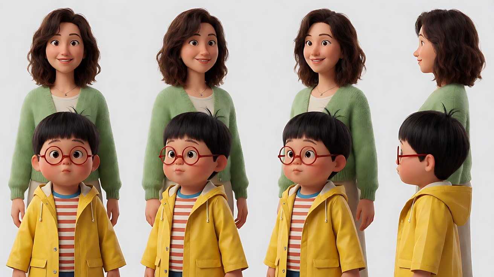

图2 场景（小眼镜店）：

```
A small cozy optician shop on a rainy afternoon, a low wooden counter with a mirror and trays of eyeglass frames,
shelves of frames on the walls, a large front window with rain drops and blurred street lights outside,
a potted plant by the door, no people, no readable text.
Medium-wide shot at a six-year-old child's eye height, 35mm lens, moderate depth of field.
Lighting: warm pendant lamps above the counter, cool grey daylight through the rainy window at frame right.
Stylized semi-realistic 3D CG rendering, feature-film animation quality. Aspect ratio 16:9.
```

中文释义：雨天午后温馨的小眼镜店，低矮木柜台上有镜子和放眼镜架的托盘，墙上一排排镜架，大橱窗上有雨滴、窗外街灯虚化，门边一盆绿植，没有人、没有可读文字；六岁孩子视线高度的中全景、35mm、中等景深；柜台上方暖色吊灯，画右雨窗透进冷灰日光。

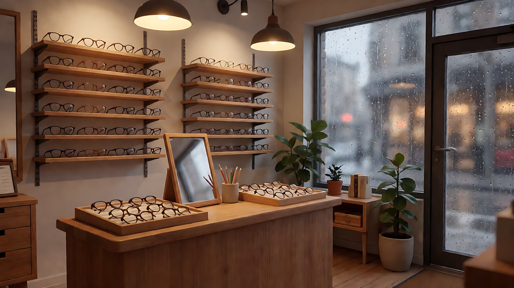

图3 镜头1首帧（POV，模糊）：

```
First-person point of view of a six-year-old boy inside the optician shop of image 2, everything heavily out of focus,
soft warm blobs of light from the pendant lamps, the shape of the wooden counter blurred in front,
his own two small hands visible at the bottom of the frame holding the edges of a pair of red glasses just in front of his eyes,
the yellow raincoat sleeves at the bottom edge.
Camera at a child's eye height, 35mm lens, extremely shallow depth of field, almost everything blurred except the hands.
Lighting: warm pendant lamps, cool window light from frame right.
Keep the raincoat sleeves exactly as in image 1.
Stylized semi-realistic 3D CG rendering, feature-film animation quality. Aspect ratio 16:9.
```

中文释义：六岁男孩在眼镜店里的第一人称视角，一切都严重失焦，吊灯是柔和的暖色光团，前方木柜台轮廓模糊；画面下沿可见他自己的一双小手，正捏着一副红色眼镜的边框举到眼前，黄色雨衣袖口在下沿；孩子视线高度、35mm、极浅景深，除手外几乎都虚化。

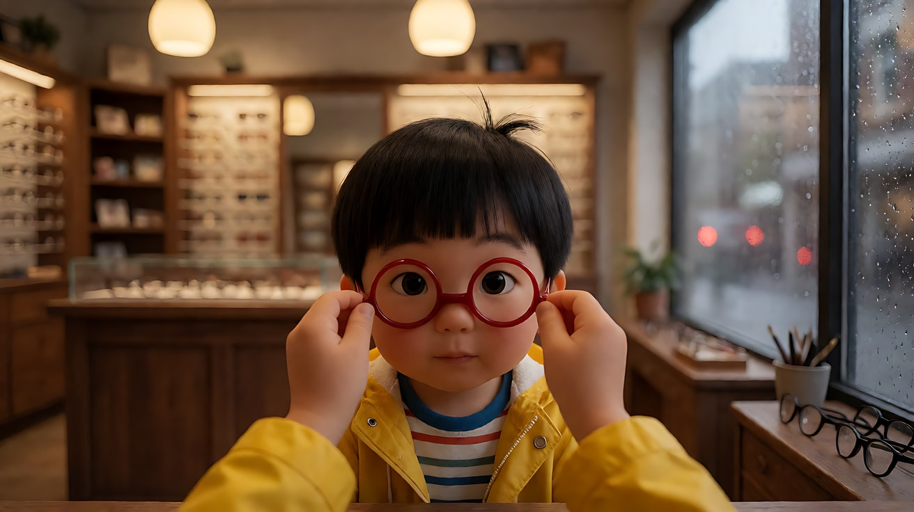

**【多图生视频 · Seedance】**

```
【素材分工】@图片1 锁定男孩与母亲的身份、男孩的红色圆框眼镜与黄色雨衣、母亲的发型和绿色开衫，不参考其背景；@图片2 仅参考眼镜店的布局、柜台、雨窗与灯光；@图片3 为镜头1首帧，是男孩的第一人称视角。
【画风】风格化写实三维CG质感，电影级布光。
镜头1：第一人称主观视角，画面就是男孩的眼睛，镜头高度是六岁孩子的视线。眼前一片模糊的暖色光团，画面下沿是他自己的一双小手，捏着红色眼镜的边框。双手把眼镜往上举，镜框从画面上方滑出，画面在一瞬间由模糊变得清楚：柜台上一格格的镜架、雨窗上一颗颗雨滴、吊灯的灯丝都清晰起来。镜头随着他的头缓慢地左右转动，好奇地看了一圈，然后缓慢转向画右：母亲蹲在那里，和他一样高，笑着看他，伸出两根手指比了一个"二"。镜头停在母亲清晰的笑脸上。雨声、店里的轻音乐。
镜头2：镜头切至男孩的正面近景，固定镜头。他戴着红色圆框眼镜，眼睛在镜片后面睁得圆圆的，嘴巴慢慢张大，然后笑了出来，露出缺了一颗的门牙。暖色吊灯从上方照亮他的脸，镜片上映着一点窗光。结尾停在他笑着的近景。
【锁定】光线：暖色吊灯在上方，冷色窗光来自画右；母亲始终在画右；男孩始终穿黄色雨衣、戴红色圆框眼镜；镜头1全程是第一人称，画面中看不到男孩的脸。
【声音】镜头1雨点打在橱窗上的声音，店里极轻的钢琴曲，戴上眼镜那一刻声音好像也变清楚了；母亲（比出两根手指，轻声）："这是几？"镜头2男孩（笑出来）："二！看得清！"
【约束】保持两人脸型、发型、服装不变；镜头1只能看到男孩自己的手和袖口；不出现可读文字；不要字幕、水印、Logo。
时长：11秒
```

**参数**：时长 11 秒 ｜ 画幅 16:9 ｜ 负载：2 个镜头、2 句短对白，"稳妥"档

**【检查点】**
- 镜头1是否有"身体锚点"：画面下沿的小手和黄色袖口
- 镜头高度是否是孩子的高度（母亲需要蹲下才平视）
- 从模糊到清楚是否发生在眼镜戴上的那一刻
- 镜头2是否让观众明白"刚才是他在看"

**【常见问题与修复】**
| 现象 | 修复 |
|---|---|
| POV 里出现了男孩的脸 | 【锁定】写"镜头1全程是第一人称，画面中看不到男孩的脸" |
| 模糊变清楚太早或太晚 | 写清顺序："双手把眼镜往上举，镜框从画面上方滑出，画面在一瞬间由模糊变得清楚" |
| 镜头高度是成年人视角 | 写"镜头高度是六岁孩子的视线"，并让母亲"蹲在那里，和他一样高" |
| 手指比划变形 | 母亲只比"二"这种简单手势；或改为母亲点头微笑 |

---

### 练习3：甩镜转场——从教室窗边到办公室窗边（难度 ★★★，首尾帧）

**目标**：首帧是她十二岁时坐在教室窗边，尾帧是她三十岁坐在写字楼窗边。中间一个极速甩镜，在模糊里完成十八年的跳跃。两帧中她的位置相呼应。意图：让观众感到她望向窗外的那个习惯，从来没有变过。

**运镜合同**

| 要素 | 本练习 |
|---|---|
| 起始构图 | 中景，十二岁的她坐在教室靠窗座位，位于画左三分之一，托着下巴望向画右窗外 |
| 运动方式 | 先缓慢向右摇一点，随即极速甩摇，画面拉成横向运动模糊，模糊散开后停住 |
| 速度 | 慢 → 极快 → 急停 |
| 终点画面 | 中景，三十岁的她坐在写字楼窗边工位，同样位于画左三分之一，托着下巴望向画右窗外的城市 |
| 运动动机 | 她望向窗外的视线就是甩镜的方向，模糊里藏起时间跳跃 |

**【生图 · Nano Banana】**

图1 角色定妆（同一人两个年龄）：

```
Character sheet of one original woman at two ages, side by side:
on the left at twelve years old with a short straight black bob and a hair clip shaped like a small star, a navy school blazer over a white shirt;
on the right at thirty with a shoulder-length straight black cut, the same small star-shaped hair clip, a charcoal blazer over a white blouse.
The same face shape, the same small mole under the left eye at both ages.
Front view and three-quarter view at each age, full body, plain light-grey background.
Camera at eye level, 50mm lens, deep focus, even soft studio light from the front.
Stylized semi-realistic 3D CG rendering, feature-film animation quality. Aspect ratio 16:9.
```

中文释义：同一位原创女性两个年龄的并排定妆：左边十二岁（齐短黑发、星星形小发夹、藏青校服西装外套配白衬衫）；右边三十岁（及肩黑直发、同样的星星发夹、炭灰西装配白衬衫）；两个年龄同样的脸型、左眼下同样一颗小痣；各有正面与三分之二侧全身。

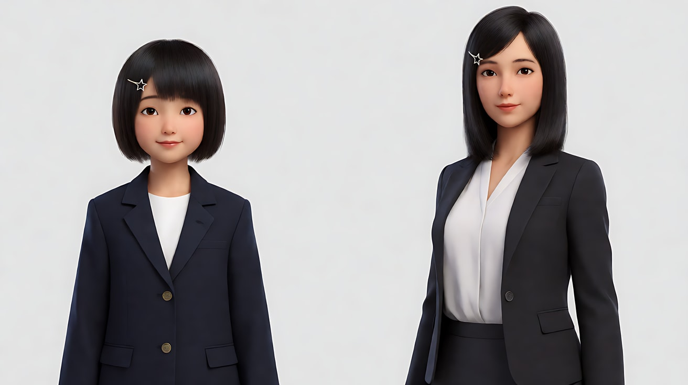

图2 首帧（教室）：

```
Using the twelve-year-old girl from image 1: a medium shot of her sitting at a wooden desk by the classroom window,
placed on the left third of the frame, chin resting on her hand, gazing out of the window at frame right where a tree with green summer leaves sways,
a blurred blackboard and other empty desks behind her.
Camera at seated eye level, 50mm lens, shallow depth of field.
Lighting: warm afternoon sunlight through the window from frame right as the key on her face, dappled leaf shadows on the desk.
Keep the face, hairstyle, star hair clip and outfit exactly as in image 1.
Stylized semi-realistic 3D CG rendering, feature-film animation quality. Aspect ratio 16:9.
```

中文释义：十二岁的她坐在教室窗边木课桌前，位于左三分之一，托着下巴望向画右窗外摇动的夏日绿树，背后是虚化的黑板和空课桌；坐姿视线高度、50mm、浅景深；画右午后暖阳照亮她的脸，课桌上有斑驳树影。

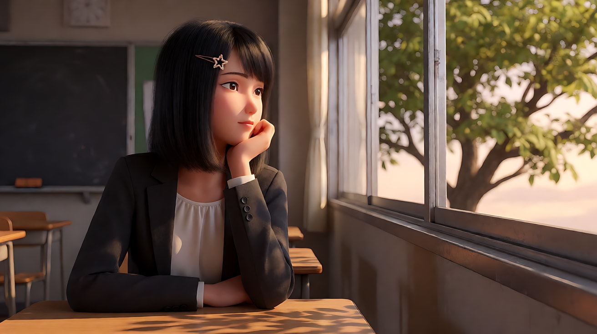

图3 尾帧（办公室）：

```
Using the thirty-year-old woman from image 1: a medium shot of her sitting at a modern office desk by a tall glass window,
placed on the left third of the frame, chin resting on her hand in exactly the same pose as the girl in image 2,
gazing out of the window at frame right over a sea of city towers, a laptop closed in front of her, blurred office cubicles behind.
Camera at seated eye level, 50mm lens, shallow depth of field.
Lighting: warm late-afternoon sunlight through the glass from frame right as the key on her face, soft reflections on the glass.
Keep the face, hairstyle, star hair clip, mole and outfit exactly as in image 1.
Stylized semi-realistic 3D CG rendering, feature-film animation quality. Aspect ratio 16:9.
```

中文释义：三十岁的她坐在写字楼高大玻璃窗边的现代办公桌前，位于左三分之一，托下巴的姿势与图2女孩完全相同，望向画右窗外成片的城市高楼，面前一台合上的笔记本电脑，背后是虚化的工位；同样的机位与暖色侧光。


**【首尾帧生视频 · Seedance】**

```
【素材分工】@图片2 为首帧；@图片3 为尾帧，是最终画面目标；@图片1 锁定她两个年龄的脸型、左眼下的小痣与星星发夹。只生成两帧之间的连续画面，用一次甩镜完成时空转换。
【画风】风格化写实三维CG质感，电影级布光。
十二岁的她托着下巴坐在教室窗边，窗外的绿树在风里摇动，她眨了眨眼，嘴角微微翘起。镜头顺着她的视线开始缓慢向右摇，接着骤然加速，变成一次极速向右的甩摇，整个画面被拉成横向的运动模糊，暖色的阳光拉成一道道光带。模糊散开，镜头急停：画面已经是写字楼的玻璃窗边，三十岁的她以同样的姿势托着下巴，位于画面左三分之一，望向画右窗外的城市。她眨了眨眼，嘴角同样微微翘起。结尾停在三十岁的她望向窗外的中景。
【声音】起初是夏日的蝉鸣和教室里翻书的声音；甩镜时一声短促的风声呼啸；模糊散开后变成写字楼里键盘的敲击声、空调的低鸣和远处城市的车流声，无配乐。
【约束】两个年龄的她都位于画面左三分之一、托着下巴、望向画右；保持脸型、小痣、星星发夹一致；只甩一次，不来回甩；不要字幕、水印、Logo。
时长：6秒
```

**参数**：时长 6 秒 ｜ 画幅 16:9

**【检查点】**
- 甩镜中途是否有明显的横向运动模糊
- 甩镜前后，她的位置与姿势是否呼应（同在画左、同样托下巴）
- 星星发夹和左眼下的小痣是否在两个年龄都出现

**【常见问题与修复】**
| 现象 | 修复 |
|---|---|
| 没有甩镜，直接溶解成尾帧 | 写"骤然加速，变成一次极速向右的甩摇，整个画面被拉成横向的运动模糊" |
| 甩完后人物位置在画面中央 | 约束写"两个年龄的她都位于画面左三分之一" |
| 甩镜来回好几次 | 约束写"只甩一次，不来回甩" |
| 两个年龄看起来不像同一人 | 定妆图写同一张脸型与小痣；首尾帧生图都上传定妆图 |

---

### 练习4：FPV 穿越 + 子弹时间 + 慢动作——滑板少年的腾空（难度 ★★★★，多镜头）

**目标**：三个镜头各用一种特殊运镜：FPV 穿越机贴地追随 → 子弹时间凝固环绕 → 慢动作落地后恢复正常速度。每个镜头只有一个特殊运镜。意图：让观众感到他等了整个夏天的这一跳，在空中停住了一秒。

**运镜合同**

| 镜头 | 起始构图 | 运动方式 | 速度 | 终点画面 | 运动动机 |
|---|---|---|---|---|---|
| 镜头1 | FPV 低空，从滑板场入口的拱门外贴地飞入 | FPV 穿越机贴地高速飞行，穿过拱门，追上少年，在他起跳前拉升 | 极快 | 少年踩着滑板冲上跳台的背影 | 速度感，把观众"射"进这一跳 |
| 镜头2 | 中景侧面，少年腾空在最高点，滑板在脚下翻转 | 子弹时间：时间几乎凝固，镜头以正常速度环绕约半圈 | 时间凝固，镜头匀速 | 中景正面三分之二侧，他张开双臂，脸上是专注的笑 | 一个瞬间被放大到可以绕着看 |
| 镜头3 | 低位全景，滑板从画面上方落下 | 固定低机位，慢动作落地后恢复正常速度 | 慢 → 正常 | 他稳稳落地滑出画右，扬起的灰尘在夕阳里飘 | 时间的顶点落下，回到现实 |

**【生图 · Nano Banana】**

图1 角色定妆：

```
Character turnaround sheet of an original teenage skater about sixteen: curly dark hair under a backwards orange cap,
a loose white T-shirt with a simple blue stripe pattern, baggy olive cargo pants, worn black skate shoes,
a skateboard with a plain teal deck and yellow wheels, no logos.
Front view, three-quarter view, side view and back view, full body with the skateboard, plain light-grey background.
Camera at eye level, 50mm lens, deep focus, even soft studio light from the front.
Stylized semi-realistic 3D CG rendering, feature-film animation quality. Aspect ratio 16:9.
```

中文释义：原创角色，约十六岁滑板少年，反戴橙色帽子下深色卷发，宽松白T带简单蓝色条纹，宽大橄榄绿工装裤，旧黑色滑板鞋，纯青绿色板面、黄色轮子的滑板，无任何标志；连滑板四视图全身。

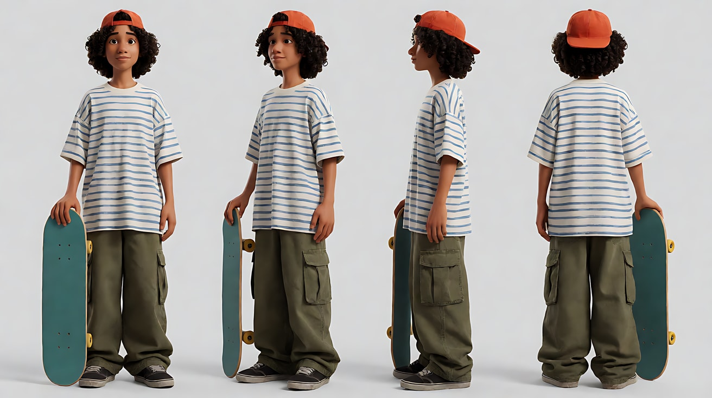

图2 场景（夕阳滑板场）：

```
An outdoor concrete skatepark at sunset, a low arched concrete gateway at the entrance in the foreground,
a long smooth runway leading to a single large launch ramp in the middle, palm trees and a distant sea horizon behind,
graffiti-free grey concrete, no people, no readable text.
Wide shot from just outside the gateway, camera at knee height, 24mm lens, deep focus.
Lighting: strong low golden sunset from frame right behind the ramp, long shadows toward the camera, warm haze.
Stylized semi-realistic 3D CG rendering, feature-film animation quality. Aspect ratio 16:9.
```

中文释义：夕阳下的户外水泥滑板场，前景是入口处低矮的水泥拱门，一条平滑长跑道通向中央一座大跳台，背后是棕榈树和远处海平线；灰色水泥面没有涂鸦，没有人、没有可读文字；从拱门外的膝盖高度全景、24mm、深景深；画右跳台后方强烈的低角度金色夕阳，长影子朝向镜头，暖色薄雾。

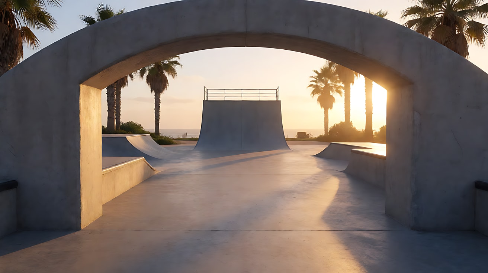

图3 镜头2关键帧（凝固瞬间）：

```
Using the character from image 1 at the skatepark of image 2:
a medium side shot of the skater frozen at the highest point of his jump above the ramp, knees bent, arms spread wide,
the teal skateboard flipping beneath his feet in mid-rotation, his cap and T-shirt fabric caught mid-flutter,
tiny dust particles suspended in the air around him, the sunset sun directly behind creating a strong golden rim.
Camera at his height in the air, 50mm lens, shallow depth of field, palm trees blurred behind.
Lighting: golden sunset backlight from frame right, warm bounce on his face from the concrete below.
Keep the face, hairstyle and outfit exactly as in image 1.
Stylized semi-realistic 3D CG rendering, feature-film animation quality. Aspect ratio 16:9.
```

中文释义：少年凝固在跳台上方最高点的中景侧面，屈膝、双臂张开，青绿色滑板在脚下翻转到一半，帽子和T恤布料定格在飘动中，周围悬着细小的灰尘颗粒，夕阳正在他身后形成强烈金色轮廓光；与他同高的空中机位、50mm、浅景深。

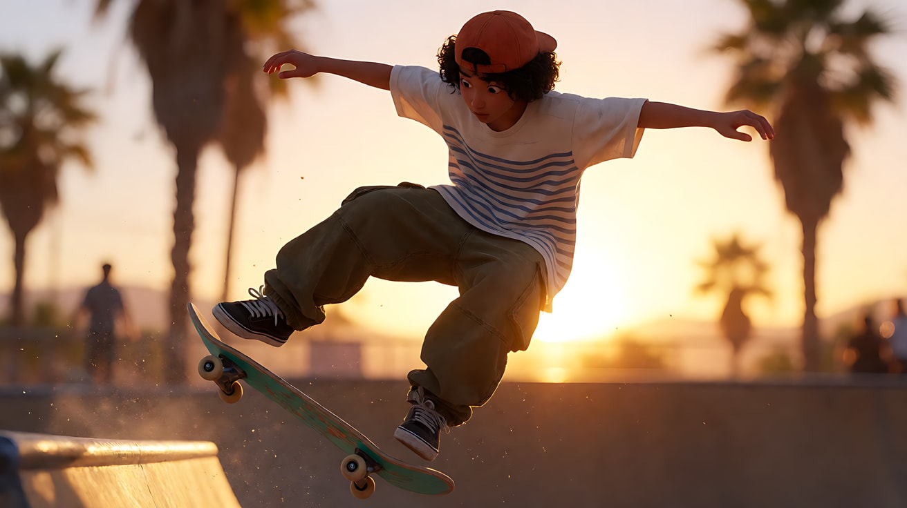

**【多图生视频 · Seedance】**

```
【素材分工】@图片1 锁定少年的身份、反戴的橙色帽子、服装与青绿色滑板，不参考其灰色背景；@图片2 仅参考滑板场的拱门、跑道、跳台与夕阳方向；@图片3 为镜头2的凝固瞬间参考，锁定腾空姿势与滑板位置。
【画风】风格化写实三维CG质感，电影级布光。
镜头1：FPV 穿越机视角，镜头贴着地面从入口拱门外高速飞入，穿过低矮的水泥拱门，沿跑道向前疾飞，地面的纹理飞速后退。前方少年踩着滑板加速冲向跳台，镜头迅速追近到他身后，在他冲上跳台的一瞬间向上拉升。结尾停在他冲上跳台的背影，夕阳在他前方。呼啸的风声和滑板轮子压过水泥的隆隆声。
镜头2：镜头切至中景侧面，少年腾空到最高点。时间几乎凝固：他张开双臂悬在半空，滑板在脚下翻转到一半停住，帽子和T恤的布料定格在飘动中，空气中的灰尘颗粒悬停。镜头以正常速度围绕他向左缓慢环绕约半圈，从侧面转到正面三分之二侧，夕阳的金色轮廓光在他身体边缘移动。他的脸上是专注的笑。周围的声音全部消失，只剩一声拉长的低沉心跳。
镜头3：镜头切至低机位全景，固定镜头。时间以慢动作恢复流动，滑板先落到画面中央，少年的双脚随后踩上去，落地时扬起一片灰尘在夕阳里慢慢散开。随后速度恢复正常，他一蹬地，稳稳地滑出画右，灰尘还在金色光里飘。结尾停在灰尘飘浮的跳台下方。
【锁定】光线：金色夕阳始终在画右跳台后方；少年始终反戴橙色帽子、踩青绿色滑板；镜头2只有少年和滑板凝固，镜头在动；每个镜头只有一个特殊运镜。
【声音】镜头1风声呼啸与滑板轮子的隆隆声；镜头2所有声音消失，只剩一声拉长的心跳；镜头3慢动作里落地声被拉长成一声闷响，速度恢复后轮子摩擦声和远处朋友的欢呼一起涌回来，节奏轻快的电子鼓点配乐进入。
【约束】保持少年脸型、发型、服装与滑板外观不变；画面中只有他一个人；滑板始终是同一块；不出现可读文字或标志；不要字幕、水印、Logo。
时长：13秒
```

**参数**：时长 13 秒 ｜ 画幅 16:9 ｜ 负载：3 个镜头、三种特殊运镜，"有挑战"档

**【检查点】**
- 镜头1 FPV 路线是否清楚：拱门 → 跑道 → 追上少年 → 拉升，没有绕路
- 镜头2是否"人凝固、镜头动"，而不是整个画面定格
- 镜头3是否有"慢 → 正常"的速度变化
- 三个镜头里滑板颜色与帽子是否一致

**【常见问题与修复】**
| 现象 | 修复 |
|---|---|
| 镜头2整个画面静止成图片 | 写"时间几乎凝固……镜头以正常速度围绕他环绕约半圈"，区分"人凝固"和"镜头运动" |
| 镜头2环绕时人物变形 | 用 @图片3 锁定姿势；环绕角度减到约九十度 |
| 镜头1 FPV 飞行路线混乱 | 路线只保留三个节点：拱门、跑道、跳台；删掉"翻滚""绕柱"等动作 |
| 镜头3一直慢动作没恢复 | 写"随后速度恢复正常，他一蹬地，稳稳地滑出画右" |

---

### 练习5：镜子迷宫——荷兰角、POV、甩镜与俯冲（难度 ★★★★★，四镜头 + 情绪弧线）

**目标**：四个镜头各用一个特殊运镜，组成一段从迷失到重逢的情绪弧线：荷兰角滚转（失衡）→ POV（迷失）→ 甩镜（发现）→ 俯冲（重逢的指认）。意图：让观众先和女孩一起在镜子迷宫里失去方向，最后从高处看见她和朋友在出口相遇。

**运镜合同**

| 镜头 | 起始构图 | 运动方式 | 速度 | 终点画面 | 运动动机 |
|---|---|---|---|---|---|
| 镜头1 | 中景，女孩站在镜子迷宫里，四周是她的多个倒影，画面水平 | 荷兰角滚转：镜头缓慢向左倾斜约二十度 | 缓慢 | 画面倾斜，她在倾斜的画面里慌张地转身 | 世界开始失衡 |
| 镜头2 | 第一人称 POV，眼前是一面面镜子和她自己的倒影 | 主观镜头随头部快速左右转动 | 中速，带呼吸般的轻微晃动 | 画面停在一条通道尽头透出的彩色灯光上 | 观众和她一起找出口 |
| 镜头3 | 近景，女孩回头，画面水平 | 极速向右甩摇 | 极快 → 急停 | 中景，朋友站在出口的彩色灯光里朝她挥手 | 一个声音让她转身，甩镜把"发现"砸在观众眼前 |
| 镜头4 | 高空大远景，夜晚游乐园全景，镜子屋在画面中央 | 俯冲：镜头从高空快速向下扑向镜子屋出口 | 快 → 减速停住 | 俯视中景，两个女孩在出口拥抱，周围是彩灯 | 从命运的高度指认"就是她们" |

**【生图 · Nano Banana】**

图1 角色定妆（两位原创角色）：

```
Character turnaround sheet of two original teenage girls about fifteen:
girl A with long straight black hair in a high ponytail, a glowing pink plastic bracelet, an oversized lavender hoodie, white shorts, white sneakers;
girl B with short curly red hair, round freckled cheeks, a yellow bomber jacket over a black T-shirt, dark jeans, holding a cloud of pink cotton candy.
Front view, three-quarter view, side view and back view of each, full body, plain light-grey background.
Camera at eye level, 50mm lens, deep focus, even soft studio light from the front.
Stylized semi-realistic 3D CG rendering, feature-film animation quality. Aspect ratio 16:9.
```

中文释义：两位约十五岁的原创少女：女孩A（黑色长直发高马尾、发光的粉色塑料手环、宽大薰衣草紫卫衣、白短裤、白运动鞋）；女孩B（红色短卷发、带雀斑的圆脸、黄色飞行员夹克配黑T、深色牛仔裤、拿着一团粉色棉花糖）；四视图全身。

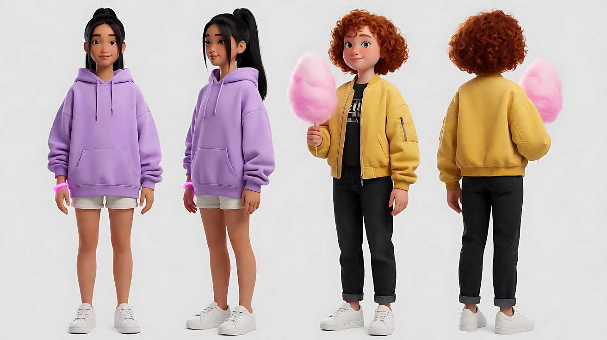

图2 场景（镜子迷宫内部）：

```
Inside a carnival hall of mirrors at night: narrow corridors lined with tall mirror panels at different angles creating endless reflections,
dim purple and blue neon strips along the floor and ceiling edges, at the end of one corridor an exit opening glowing with warm colorful carnival lights, no people, no readable text.
Medium-wide shot inside the corridor, camera at standing eye level, 24mm lens, deep focus.
Lighting: cool purple and blue neon strips as the main light, the warm multicolored glow from the distant exit.
Stylized semi-realistic 3D CG rendering, feature-film animation quality. Aspect ratio 16:9.
```

中文释义：夜晚游乐园镜子迷宫内部：狭窄通道两侧是不同角度的高大镜面，形成无尽倒影，地面和天花板边缘有昏暗的紫蓝色霓虹灯条，一条通道尽头的出口透出暖色的彩色游乐园灯光，没有人、没有可读文字；通道内中全景、站姿视线高度、24mm、深景深；紫蓝冷色霓虹为主光，远处出口的暖色彩光。

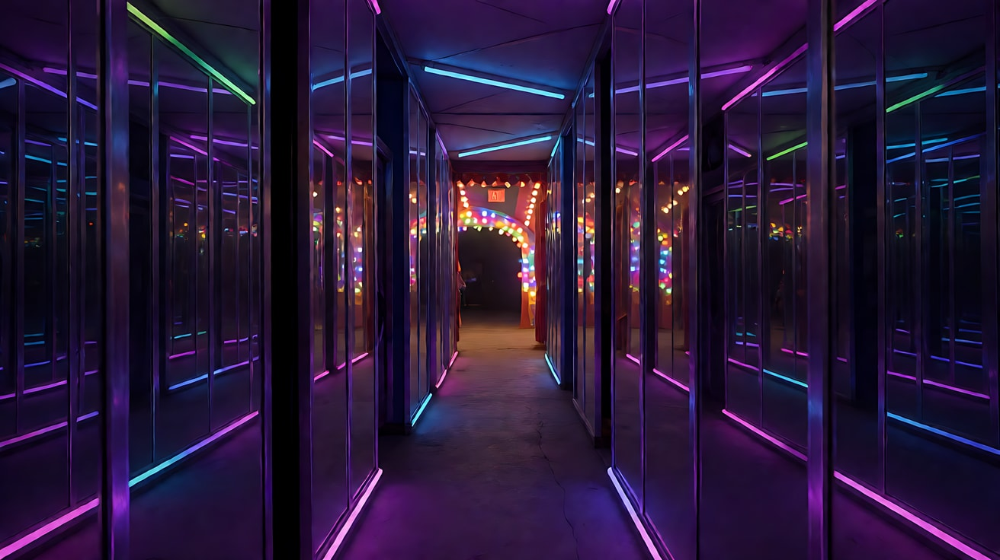

图3 场景（游乐园高空）：

```
A night carnival seen from high above: a glowing Ferris wheel on the left, colorful tents and string lights, crowds as tiny dots,
a small mirror-maze building with a purple neon roof edge at the center of the frame, its exit facing a plaza lit by warm bulbs, no readable text.
Extreme wide aerial view from very high, camera angled steeply down, 24mm lens, deep focus.
Lighting: warm and colorful carnival lights against a deep-navy night sky.
Stylized semi-realistic 3D CG rendering, feature-film animation quality. Aspect ratio 16:9.
```

中文释义：从极高处俯瞰的夜晚游乐园：画左发光的摩天轮，彩色帐篷与串灯，人群是细小的点，画面中央一座屋檐镶紫色霓虹的小镜子屋，出口面向一片被暖色灯泡照亮的小广场，没有可读文字；极高处陡峭俯视的大远景、24mm、深景深。

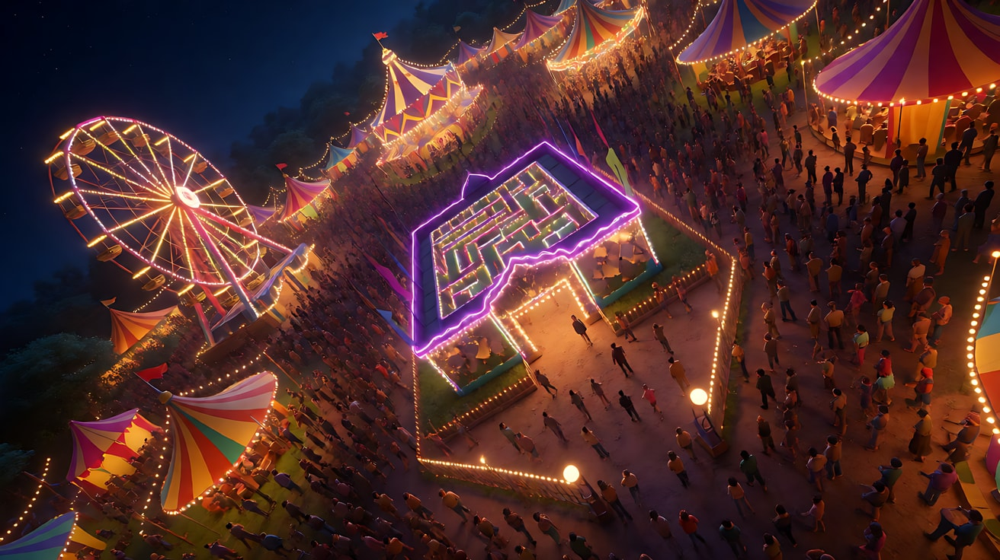

图4 镜头1首帧：

```
Using girl A from image 1 inside the hall of mirrors of image 2:
a medium shot of girl A standing in the middle of a mirror corridor, surrounded by many reflections of herself at different angles,
holding her glowing pink bracelet wrist close to her chest, eyes wide, placed at the center of the frame, the horizon perfectly level.
Camera at standing eye level, 35mm lens, moderate depth of field.
Lighting: cool purple and blue neon strips from the floor edges lighting her face from below, the pink bracelet casting a small warm glow.
Keep the face, hairstyle and outfit exactly as in image 1.
Stylized semi-realistic 3D CG rendering, feature-film animation quality. Aspect ratio 16:9.
```

中文释义：女孩A中景，站在镜子通道中间，被许多不同角度的自身倒影包围，把戴发光粉色手环的手腕贴在胸前，睁大眼睛，居中，画面水平；地面边缘的紫蓝霓虹从下方照亮她的脸，粉色手环发出一点暖光。

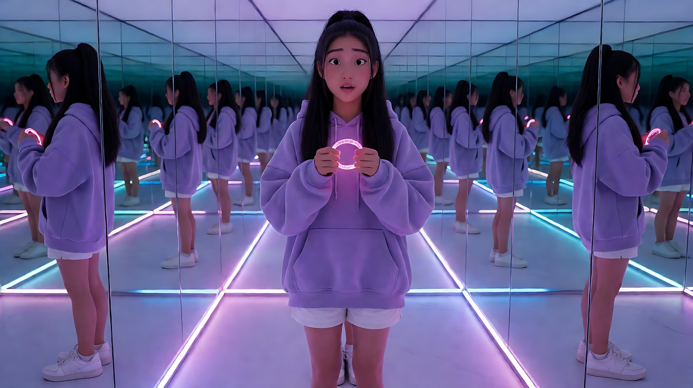

**【多图生视频 · Seedance】**

```
【素材分工】@图片1 锁定女孩A与女孩B的身份、发型与服装，不参考其背景；@图片2 仅参考镜子迷宫内部的镜面布局、霓虹灯条与出口光线；@图片3 仅参考游乐园全景与镜子屋的位置，作为镜头4俯冲的起点空间；@图片4 为镜头1首帧。
【画风】风格化写实三维CG质感，电影级布光。
镜头1：中景，起始画面水平。女孩A站在镜子通道中间，四周是她的许多倒影。她小声喊了一声朋友的名字，没有回应，开始慌张地左右转身。镜头缓慢向左滚转倾斜约二十度，地平线逐渐歪斜，倒影在倾斜的画面里显得更加混乱。结尾停在倾斜画面里她转身的中景。
镜头2：镜头切至女孩A的第一人称主观视角，画面下沿可见她戴着发光粉色手环的手扶在镜面上。镜头随她的头快速向左、再向右转动，带着呼吸般的轻微晃动，眼前是一面面镜子和镜子里她自己的倒影。最后镜头停在一条通道尽头透出的暖色彩光上。她急促的呼吸声。
镜头3：镜头切至女孩A的近景，画面恢复水平。身后传来朋友的喊声，她猛地回头。镜头极速向右甩摇，画面拉成横向的紫色与暖色运动模糊，模糊散开后急停：女孩B站在出口的彩色灯光里，举着棉花糖朝她用力挥手。
镜头4：镜头切至游乐园上空的高空大远景，镜子屋在画面中央，摩天轮在画左发光。镜头从高空快速向下俯冲，直扑镜子屋出口前的小广场，越接近越减速，最后停在两个女孩头顶上方的俯视中景：女孩A冲出来抱住女孩B，棉花糖举在两人头顶。周围的彩灯在地面上铺开一圈光。结尾停在两人拥抱的俯视画面。
【锁定】光线：迷宫内是紫蓝冷色霓虹，出口与广场是暖色彩光；女孩A始终穿薰衣草紫卫衣、戴发光粉色手环；女孩B始终是红色短卷发、黄色夹克、拿着棉花糖；每个镜头只有一个特殊运镜，镜头1倾斜，其余镜头画面水平。
【声音】镜头1迷宫里空洞的回声，女孩A（小声）："小满？"；镜头2急促的呼吸与手掌按在镜面上的轻响；镜头3女孩B（远处大喊）："这边！"，甩镜时一声短促的风声；镜头4游乐园的音乐、摩天轮的机械声和人群的欢笑从远处涌近。
【约束】保持两人脸型、发型、服装不变；镜子里的倒影只出现女孩A，不出现陌生人；不出现可读文字；不要字幕、水印、Logo。
时长：15秒
```

**参数**：时长 15 秒 ｜ 画幅 16:9 ｜ 负载：4 个镜头、四种特殊运镜、2 句短台词，"有挑战"上限；失败时拆成两次（镜头1–2 / 镜头3–4），第二次以镜头2尾帧接续

**【检查点】**
- 四个镜头的特殊运镜是否各自成立：倾斜 → 第一人称 → 甩镜 → 俯冲
- 只有镜头1是倾斜的，镜头3是否恢复了水平（情绪从失衡回到清醒）
- 镜头2是否有手环这个身体锚点，镜头里没有出现女孩A的正脸
- 镜头4俯冲的终点是否落在两人身上并减速停住

**【常见问题与修复】**
| 现象 | 修复 |
|---|---|
| 镜子倒影里出现陌生人或倒影动作不同步 | 约束写"镜子里的倒影只出现女孩A"；减少镜面数量，写"几面镜子" |
| 镜头3甩完后倾斜还在 | 镜头3开头写"画面恢复水平"，【锁定】写"其余镜头画面水平" |
| 镜头4俯冲路线偏离 | 用 @图片3 锁定镜子屋在画面中央；写"直扑镜子屋出口前的小广场" |
| POV 镜头里出现女孩A的脸（不是倒影） | 写"第一人称主观视角，画面下沿可见她的手"；如果倒影干扰太大，把镜头2的镜面改为布帘通道 |
| 四个特殊运镜让画面过于花哨 | 这是练习"重音"的极限版本；正式作品里选其中一到两个保留，其余换成常规运镜 |
