# L05-08 一镜到底与长镜头调度 · 提示词

> 本组练习：先画路线、再分阶段，用"起初 / 随后 / 最后"写出 Seedance 一镜到底；练习演员调度与摄影机调度，对比分镜版与一镜到底版，最后用尾帧接续把长镜头延长到 30 秒。｜ 配套教学：[L05-08-一镜到底与长镜头调度](../教学/L05-08-一镜到底与长镜头调度.md) ｜ 规范：[写作规范](../../模板/写作规范.md)
>
> 画风默认使用开关 A（风格化写实 CG）。如改用 2D 动画，删掉所有焦段、光圈、景深词。
>
> 一镜到底的运镜合同按"阶段"填写：每个阶段写清起始构图、过渡方式、速度、阶段终点和动机。

---

### 练习1：两阶段一镜到底——清晨面包店开门（难度 ★）

**目标**：单张关键帧生成一个两阶段的连续镜头：从烤盘特写开始，后拉并跟随面包师走到门口开门。只有一条单向路线、两个节点。意图：让观众感到一家小店的一天，是从一盘刚出炉的面包开始的。

**运镜合同**

| 阶段 | 起始构图 | 过渡与运动方式 | 速度 | 阶段终点 | 动机 |
|---|---|---|---|---|---|
| 起初 | 特写，刚出炉的一盘牛角面包，面包师的双手端着烤盘 | 镜头缓慢后拉，露出面包师的中景 | 缓慢 | 中景，面包师端着烤盘转身 | 先给观众最诱人的细节，再交代是谁 |
| 最后 | 中景侧面，面包师走向店门 | 镜头在她身侧平行跟随（稳定器） | 慢走 | 全景，她推开店门，清晨的天光涌进来 | 跟着她把一天"打开" |

**【生图 · Nano Banana】**

图1 关键帧：

```
A close-up of a tray of freshly baked golden croissants just pulled from the oven, steam rising, flaky layers glistening,
held by two hands in thick white oven mitts, the edge of a flour-dusted cream apron visible at the top of the frame.
Behind, out of focus, the interior of a tiny bakery at dawn: wooden shelves, a glass display counter, a front door with a small window on the far right.
Camera at chest height, 50mm lens, shallow depth of field.
Lighting: warm orange glow from the open oven at frame left as the key, cool blue pre-dawn light from the front door window at the far right.
Stylized semi-realistic 3D CG rendering, feature-film animation quality. Aspect ratio 16:9.
```

中文释义：特写，一盘刚出炉的金黄色牛角面包，冒着热气，酥层发亮，由戴厚白色隔热手套的双手端着，画面上沿露出沾着面粉的米色围裙边；背后虚化的是清晨的小面包店内部：木架、玻璃展示柜、画面最右侧一扇带小窗的店门；胸口高度、50mm、浅景深；画左打开的烤箱橙色暖光为主光，画面最右侧门窗透进黎明前的冷蓝光。

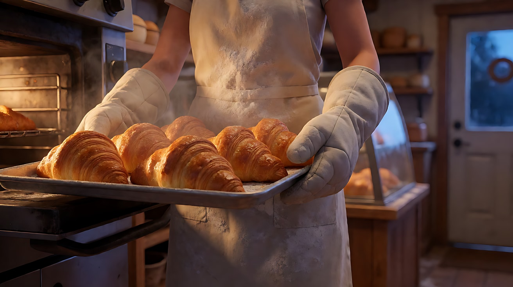

**【图生视频 · Seedance】**

```
【素材分工】@图片1 为首帧，锁定面包、烤盘、隔热手套与面包店内部布局。
【画风】风格化写实三维CG质感，电影级布光。
全程一镜到底，不切镜头，稳定器拍摄，画面平滑。
起初，画面是一盘刚出炉的牛角面包的特写，热气缓缓上升。镜头缓慢向后拉，一位四十多岁、圆脸、短发、系着沾满面粉的米色围裙的面包师露出来，她端着烤盘深吸了一口面包的香气，笑了一下，转身。
最后，镜头移到她身侧，与她平行跟随，她把烤盘放进玻璃展示柜，摘下隔热手套塞进围裙口袋，走向画右的店门。她推开店门，门上的铃铛响了一声，清晨淡金色的天光和街上的凉风一起涌进来，照亮她的脸和店里飘浮的面粉微尘。镜头随她停住。结尾停在她站在敞开的店门口、望向街道的全景。
【声音】起初是烤箱散热的轻微嗡声和面包表皮冷却时细微的噼啪声；随后是她的脚步声、玻璃柜门的滑动声；最后是门铃一声清响和清晨街道上的鸟鸣，无配乐。
【约束】全程不切镜头、不跳切；保持面包师外貌与服装在整段中一致；不要字幕、水印、Logo；画面中不出现可读文字。
时长：10秒
```

**参数**：时长 10 秒 ｜ 画幅 16:9 ｜ 负载：2 个阶段、单向路线，"稳妥"档

**【检查点】**
- 是否真的没有切镜：特写到全景是靠后拉和跟随完成的
- 路线是否单向：烤箱 → 展示柜 → 店门
- 光是否随空间变化：烤箱暖光 → 门外冷暖交织的晨光

**【常见问题与修复】**
| 现象 | 修复 |
|---|---|
| 从特写直接跳到全景 | 开头和约束都写"全程一镜到底，不切镜头"；起初阶段写清"缓慢向后拉" |
| 面包师外貌前后不一 | 本练习只有单图、没有定妆图，人物外貌写在正文里；更稳的做法是做练习2的定妆图 |
| 门外出现可读招牌 | 约束写"画面中不出现可读文字" |
| 推门后镜头冲出门外 | 写"镜头随她停住"，终点是"站在敞开的店门口" |

---

### 练习2：演员调度长镜头——裁缝铺里的那件外套（难度 ★★）

**目标**：用定妆图 + 场景图生成一个机位几乎不动的长镜头。景别变化全靠演员走位：学徒从背景深处走到前景，师傅从侧面进入，两人在近景里完成交接。意图：让观众感到学徒做的第一件外套，是一步一步走到师傅面前的。

**运镜合同**

| 阶段 | 起始构图 | 过渡与运动方式 | 速度 | 阶段终点 | 动机 |
|---|---|---|---|---|---|
| 起初 | 全景，师傅坐在前景画左的工作台旁背对镜头，学徒在背景深处的布帘后 | 机位固定，学徒掀开布帘从背景走向前景 | 慢走 | 学徒走到中景，双手捧着叠好的外套 | 让观众看着她"走过来"，紧张感由距离累积 |
| 随后 | 中景，学徒停在工作台前 | 师傅起身转向她，镜头轻微右摇跟上师傅 | 缓慢 | 双人中近景，两人隔着工作台面对面 | 重心从学徒转到两人之间 |
| 最后 | 双人中近景 | 机位不动，师傅展开外套举到胸前，学徒向前凑近一步进入近景 | 极慢 | 近景，学徒的脸在画右，师傅的手指抚过外套领口 | 结果交给一个小动作：领口的针脚 |

**【生图 · Nano Banana】**

图1 角色定妆（两位原创角色）：

```
Character turnaround sheet of two original characters:
an old master tailor in his seventies with a bald head, a short white beard, round wire glasses, a measuring tape around his neck,
a grey waistcoat over a white shirt with sleeve garters;
a young apprentice woman in her early twenties with a thick black braid, a dark-red pincushion strapped to her wrist,
a simple beige work dress with a brown canvas apron.
Front view, three-quarter view, side view and back view of each, full body, plain light-grey background.
Camera at eye level, 50mm lens, deep focus, even soft studio light from the front.
Stylized semi-realistic 3D CG rendering, feature-film animation quality. Aspect ratio 16:9.
```

中文释义：两位原创角色：七十多岁的老裁缝（光头、短白胡子、圆形金属框眼镜、脖子上挂软尺、灰色马甲配白衬衫和袖箍）；二十出头的女学徒（粗黑辫子、手腕绑着深红色针插、素米色工作裙配棕色帆布围裙）；四视图全身。

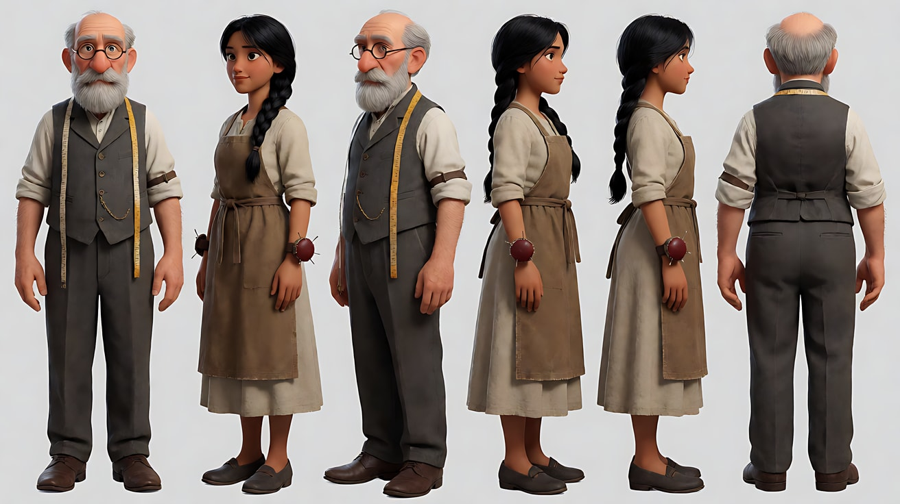

图2 场景（老裁缝铺纵深）：

```
An old narrow tailor shop on a rainy afternoon seen in deep perspective: in the foreground on the left a large wooden cutting table with scissors,
chalk and fabric rolls, a high-backed chair beside it; in the middle ground dress forms wearing half-finished jackets;
in the deep background a faded green curtain hanging over a doorway to the back workroom, warm light glowing behind it, no people.
Wide shot from the front of the shop, camera at seated eye level, 28mm lens, deep focus so every layer is sharp.
Lighting: soft grey daylight from a rain-streaked shop window at frame right, a warm green-shaded desk lamp on the cutting table, warm light behind the curtain in the back.
Stylized semi-realistic 3D CG rendering, feature-film animation quality. Aspect ratio 16:9.
```

中文释义：雨天午后狭长的老裁缝铺，强烈纵深：前景画左是大木裁剪台，上面有剪刀、划粉和布卷，旁边一把高背椅；中景是穿着半成品外套的人台；背景深处一道褪色绿布帘挂在通往后工作间的门口，帘后透出暖光；没有人；铺子前方坐姿视线高度的全景、28mm、深景深让每一层都清晰；画右雨痕橱窗的柔和灰色天光，裁剪台上一盏绿色灯罩台灯的暖光，后方布帘后的暖光。

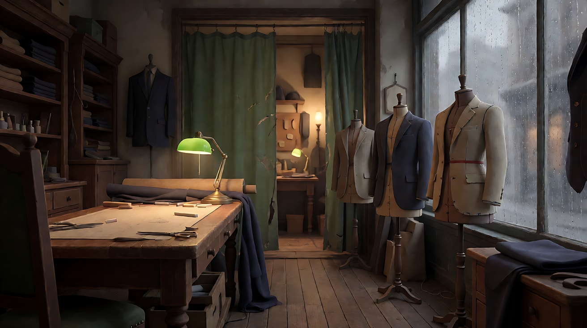

图3 首帧：

```
Using the characters from image 1 in the tailor shop of image 2:
a wide deep-focus shot, the old tailor sitting in the high-backed chair beside the cutting table in the left foreground with his back three-quarters to the camera,
reading glasses on, pinning a sleeve; in the deep background the apprentice is just pushing the green curtain aside,
holding a neatly folded dark-navy wool jacket in both hands, small in the frame.
Camera at seated eye level from the front of the shop, 28mm lens, deep focus.
Lighting: green-shaded desk lamp on the table lighting the tailor's hands, grey rainy daylight from the window at frame right, warm light behind the curtain outlining the apprentice.
Keep the faces, hairstyles and outfits exactly as in image 1.
Stylized semi-realistic 3D CG rendering, feature-film animation quality. Aspect ratio 16:9.
```

中文释义：深焦全景，老裁缝坐在前景画左裁剪台旁的高背椅上，三分之二背对镜头，戴着眼镜别袖子；背景深处学徒正掀开绿布帘，双手捧着一件叠好的深藏青羊毛外套，在画面中很小；台灯照亮裁缝的手，画右雨天灰光，帘后暖光勾出学徒的轮廓。

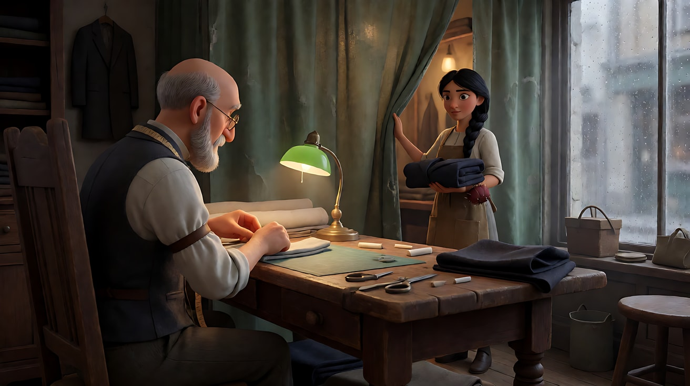

**【多图生视频 · Seedance】**

```
【素材分工】@图片1 锁定老裁缝与学徒的身份、发型与服装，不参考其背景；@图片2 仅参考裁缝铺的纵深布局、人台位置与光源；@图片3 为首帧，锁定两人的起始位置与深焦构图。
【画风】风格化写实三维CG质感，电影级布光，深焦，前中后景都清楚。
全程一镜到底，不切镜头。机位固定在铺子前方，几乎不移动，景别变化全部依靠人物走位。
起初，老裁缝坐在前景画左，低头给一只袖子别针。背景深处，学徒掀开绿布帘，双手捧着叠好的深藏青外套，从后工作间走出来，绕过中景的人台，一步一步向前景走来，越走越大，在裁剪台前停下，成为中景。她咬了一下嘴唇，把外套轻轻放在台面上。
随后，老裁缝放下针，摘下眼镜，从椅子上起身转向她，镜头轻微向右摇，把两人框成隔着裁剪台面对面的双人中近景。
最后，机位不动，老裁缝拿起外套抖开，举到胸前，学徒向前凑近一步进入近景，位于画右，紧张地看着。老裁缝的手指慢慢抚过外套的领口，停在一排细密的针脚上，点了一下头。学徒的肩膀松下来，嘴角慢慢扬起。结尾停在学徒画右的近景和师傅抚着领口的手。
【声音】雨点打在橱窗上的声音贯穿始终；起初是布帘环在横杆上滑动的声音和学徒轻轻的脚步；随后是椅子挪动的木头摩擦声；最后是外套被抖开的厚重布料声，老裁缝（抚着领口，低声）："针脚很匀。"无配乐。
【约束】全程不切镜头、不跳切；机位几乎不动，只允许一次轻微右摇；保持两人脸型、发型、服装不变；外套始终是同一件深藏青羊毛外套；不要字幕、水印、Logo。
时长：14秒
```

**参数**：时长 14 秒 ｜ 画幅 16:9 ｜ 负载：3 个阶段、1 句台词、机位几乎不动，"稳妥"偏"有挑战"

**【检查点】**
- 景别是否主要靠人物走位变化：全景 → 中景 → 双人中近景 → 近景
- 机位是否只有一次轻微右摇
- 深焦是否保持：学徒走过来时前景的裁缝和背景都清楚
- 外套是否在三个阶段里都是同一件

**【常见问题与修复】**
| 现象 | 修复 |
|---|---|
| 镜头推向学徒 | 写"机位固定……景别变化全部依靠人物走位"，约束写"只允许一次轻微右摇" |
| 学徒走到一半突然到了前景 | 写"绕过中景的人台，一步一步向前景走来，越走越大" |
| 背景虚化，看不清学徒 | 画风行加"深焦，前中后景都清楚" |
| 老裁缝也开始大段说话 | 只保留一句短台词；学徒的回应写成动作（肩膀松下来、嘴角扬起） |

---

### 练习3：穿过窗户的一镜到底——咖啡馆里的信与街上的她（难度 ★★★，首尾帧 + 途经参考）

**目标**：首帧是咖啡馆桌上的一封信，尾帧是窗外街上远去的她。中间是一个连续镜头：后拉、横移、穿过敞开的窗户到街上。用一张途经参考图锁定窗外的街道。意图：让观众先看到她留下的信，再追出去看她离开，却始终追不上。

**运镜合同**

| 阶段 | 起始构图 | 过渡与运动方式 | 速度 | 阶段终点 | 动机 |
|---|---|---|---|---|---|
| 起初 | 特写，桌上一封压在咖啡杯下的信，杯里的咖啡还在冒热气 | 镜头缓慢后拉并升起，露出空着的座位 | 缓慢 | 中景，空座位和敞开的木框窗户 | 先给"她留下了什么" |
| 随后 | 中景，敞开的窗户 | 镜头向前推进，穿过敞开的窗户 | 匀速 | 镜头来到窗外街上，高度约一人高 | 观众替那个来晚的人追出去 |
| 最后 | 街道全景 | 镜头在街上缓慢前推，她的背影在远处 | 缓慢，越来越慢 | 大远景，她撑着黄伞在街道尽头拐弯消失 | 追不上：镜头越来越慢，她越来越远 |

**【生图 · Nano Banana】**

图1 角色定妆：

```
Character turnaround sheet of an original woman in her late twenties: a short sleek black bob, a long camel-colored coat,
a dark-green scarf, black ankle boots, holding a bright yellow umbrella.
Front view, three-quarter view, side view and back view, full body, plain light-grey background.
Camera at eye level, 50mm lens, deep focus, even soft studio light from the front.
Stylized semi-realistic 3D CG rendering, feature-film animation quality. Aspect ratio 16:9.
```

中文释义：原创角色，近三十岁女性，利落黑色短波波头，驼色长大衣，深绿围巾，黑色短靴，撑一把亮黄色雨伞；四视图全身。

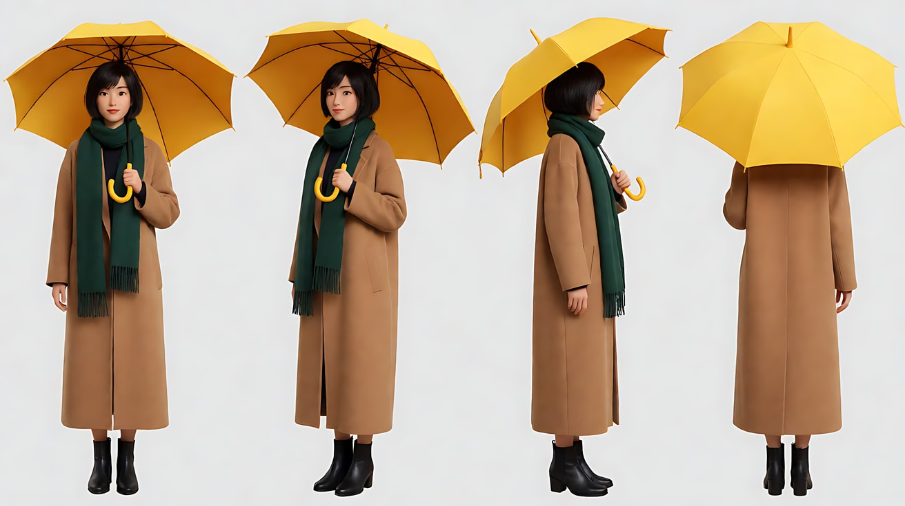

图2 首帧（桌上的信）：

```
A close-up of a small round marble café table by a large open wooden-framed window on a drizzly afternoon:
a sealed cream envelope with no writing lies under a white coffee cup that still steams, a chair pushed back empty beside the table,
the open window behind showing a blurred wet cobblestone street.
Camera just above table height, 50mm lens, shallow depth of field.
Lighting: soft grey daylight from the open window behind as the key, a warm café pendant lamp from above as fill, steam catching the light.
No readable text. Stylized semi-realistic 3D CG rendering, feature-film animation quality. Aspect ratio 16:9.
```

中文释义：特写，细雨午后的一张大理石小圆桌，旁边是一扇敞开的大木框窗；一只还冒着热气的白色咖啡杯下压着一个没写字的米色信封，旁边的椅子被推开空着，背后窗外是虚化的湿漉漉的石板街；略高于桌面、50mm、浅景深；背后窗外柔和的灰色天光为主光，头顶暖色吊灯补光，热气在光里可见；没有可读文字。

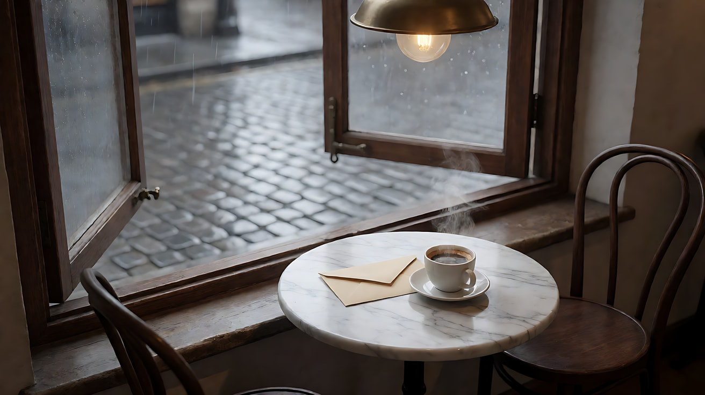

图3 途经参考（窗外街道）：

```
A narrow old cobblestone street on a drizzly afternoon, seen from just outside a café window at standing eye level,
looking straight down the street: wet stones reflecting the light, old three-story houses with shuttered windows on both sides,
the street curving left at the far end, a few bare trees, no people, no readable text.
Wide shot, 35mm lens, deep focus.
Lighting: soft grey overcast daylight, warm glows from a few shop windows, fine drizzle visible.
Stylized semi-realistic 3D CG rendering, feature-film animation quality. Aspect ratio 16:9.
```

中文释义：细雨午后狭窄的老石板街，从咖啡馆窗外站姿视线高度沿街望去：湿石板反光，两侧是带百叶窗的三层老房子，街道尽头向左拐，几棵秃树，没有人、没有可读文字；全景、35mm、深景深；阴天柔和灰光，几家店铺窗户的暖光，可见细雨。

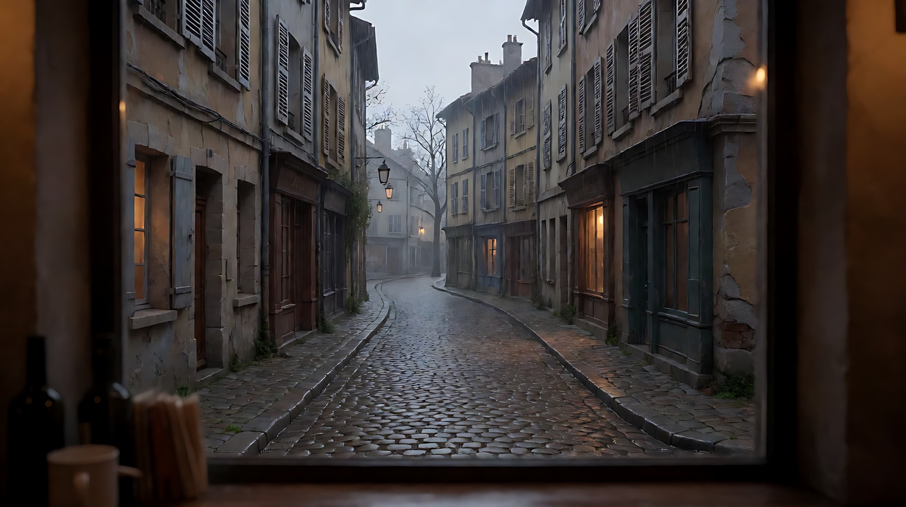

图4 尾帧：

```
Using the character from image 1 on the street of image 3:
an extreme wide shot looking down the wet cobblestone street, the woman seen from behind far away at the end of the street,
her bright yellow umbrella the only strong color in the grey frame, just about to turn the corner to the left.
Camera at standing eye level in the middle of the street, 35mm lens, deep focus.
Lighting: soft grey overcast daylight, fine drizzle, warm shop window glows along the street.
Keep the outfit and umbrella exactly as in image 1.
Stylized semi-realistic 3D CG rendering, feature-film animation quality. Aspect ratio 16:9.
```

中文释义：沿湿石板街望去的大远景，她的背影远远在街道尽头，亮黄色雨伞是灰色画面里唯一鲜明的颜色，正要向左拐过街角；街道中央站姿视线高度、35mm、深景深。

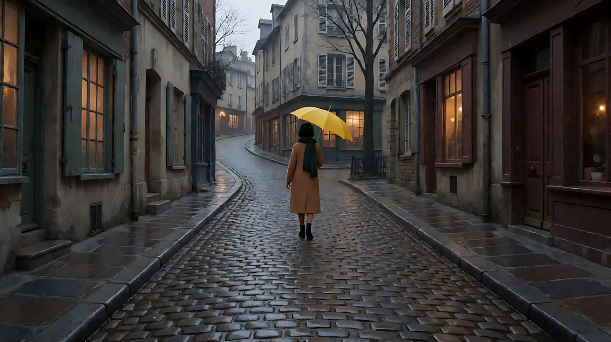

**【首尾帧生视频 · Seedance】**

```
【素材分工】@图片2 为首帧；@图片4 为尾帧，是最终画面目标；@图片1 锁定女子的服装与黄色雨伞；@图片3 仅作为窗外街道的途经参考，镜头穿出窗户后看到的街道以它为准。只生成两帧之间的连续运动。
【画风】风格化写实三维CG质感，电影级布光。
全程一镜到底，不切镜头，稳定器拍摄，画面平滑。
起初，画面是桌上那封压在咖啡杯下的信，咖啡还冒着热气。镜头缓慢向后拉并略微升起，露出被推开的空椅子和敞开的木框窗户，窗外细雨飘进来几滴，落在窗台上。
随后，镜头匀速向前推进，越过桌子，从敞开的窗户中间穿出去，窗框从画面四边划过，镜头来到窗外的石板街上，高度约一人高，面朝街道深处。
最后，镜头沿街道缓慢向前推，越来越慢。街道尽头，撑着亮黄色雨伞的女子背影在细雨中走远，她没有回头。镜头几乎停下时，她向左拐过街角。结尾停在她的黄伞刚刚消失在街角的大远景，石板路上只剩雨。
【声音】起初是咖啡馆里杯碟的轻响和屋里的低语；随后穿过窗户的一瞬，室内声音被切断，细雨声和街上的风声一下子包围过来；最后远处她的靴子踩过积水的声音越来越远，消失，无配乐。
【约束】全程不切镜头、不跳切；镜头穿过的是敞开的窗户，不穿墙；她始终背对镜头、不回头；信封上不出现文字；不要字幕、水印、Logo。
时长：12秒
```

**参数**：时长 12 秒 ｜ 画幅 16:9 ｜ 负载：3 个阶段、无对白，"稳妥"偏"有挑战"

**【检查点】**
- 穿过窗户的过渡是否连续：窗框从四边划过，没有跳切
- 窗外街道是否与 @图片3 一致（尽头向左拐）
- 最后阶段的推进是否"越来越慢"，体现"追不上"
- 室内声 → 室外声的切换是否发生在穿窗的瞬间

**【常见问题与修复】**
| 现象 | 修复 |
|---|---|
| 穿窗时直接切到街上 | 写"窗框从画面四边划过"，并把穿窗单独作为"随后"阶段 |
| 镜头穿墙而不是穿窗 | 约束写"镜头穿过的是敞开的窗户，不穿墙"；首帧中窗户要明确敞开 |
| 她在街上回头 | 约束写"她始终背对镜头、不回头" |
| 街道和参考图不同 | 素材分工写清"镜头穿出窗户后看到的街道以 @图片3 为准" |

---

### 练习4：分镜版 vs 一镜到底版——一道菜从后厨到餐桌（难度 ★★★★，多镜头 + 一镜到底对照）

**目标**：同一段情节写两遍：版本 A 是三镜头分镜，版本 B 是三阶段一镜到底。两次生成使用同一套参考图。看完后对比：观众在两个版本里分别"什么时候知道这道菜是给谁的"。意图：让观众感到这道菜是后厨送给一对老夫妇结婚纪念日的惊喜。

**运镜合同（版本 A：分镜）**

| 镜头 | 起始构图 | 运动方式 | 速度 | 终点画面 | 动机 |
|---|---|---|---|---|---|
| 镜头1 | 特写，主厨的手在盘子上放下最后一片花瓣 | 固定 | 零 | 主厨把盘子推到出菜口 | 细节建立"这道菜很用心" |
| 镜头2 | 中景，服务员端着盘子推开弹簧门 | 背后跟 | 慢走 | 她走进餐厅 | 交代路线 |
| 镜头3 | 中近景，窗边的老夫妇抬头 | 缓慢推近 | 缓慢 | 近景，老太太看到盘子，捂住嘴笑 | 结果落在反应上 |

**运镜合同（版本 B：一镜到底）**

| 阶段 | 起始构图 | 过渡与运动方式 | 速度 | 阶段终点 | 动机 |
|---|---|---|---|---|---|
| 起初 | 特写，主厨放下最后一片花瓣 | 镜头后拉并转向出菜口 | 缓慢 | 中景，服务员接过盘子 | 从细节过渡到交接 |
| 随后 | 中景背影，服务员端着盘子 | 稳定器背后跟，穿过弹簧门 | 慢走 | 全景，安静的餐厅，窗边一对老夫妇 | 观众和盘子一起"走"出去 |
| 最后 | 全景，窗边桌子 | 镜头越过服务员肩膀缓慢推近 | 缓慢 | 近景，老太太看到盘子，捂住嘴笑 | 揭示与反应在同一空间完成 |

**【生图 · Nano Banana】**

图1 角色定妆（四位原创角色合为一张）：

```
Character turnaround sheet of four original characters:
a head chef in his forties with a shaved head and a neat black beard, a white double-breasted chef jacket, a black apron;
a young waitress in her early twenties with a low bun, a white shirt, a black vest and a long black apron;
an elderly husband in his late seventies with combed-back white hair, a navy suit with a small white flower in the lapel;
an elderly wife in her late seventies with short silver curls, pearl earrings, a soft lilac cardigan over a cream dress.
Front view and three-quarter view of each, full body, plain light-grey background.
Camera at eye level, 50mm lens, deep focus, even soft studio light from the front.
Stylized semi-realistic 3D CG rendering, feature-film animation quality. Aspect ratio 16:9.
```

中文释义：四位原创角色合为一张定妆：四十多岁主厨（光头、修整的黑胡子、白色双排扣厨师服、黑围裙）；二十出头的女服务员（低发髻、白衬衫、黑马甲、黑色长围裙）；七十多岁的老先生（向后梳的白发、藏青西装、翻领别一朵小白花）；七十多岁的老太太（银色短卷发、珍珠耳环、淡紫色开衫配米色连衣裙）；各有正面与三分之二侧全身。

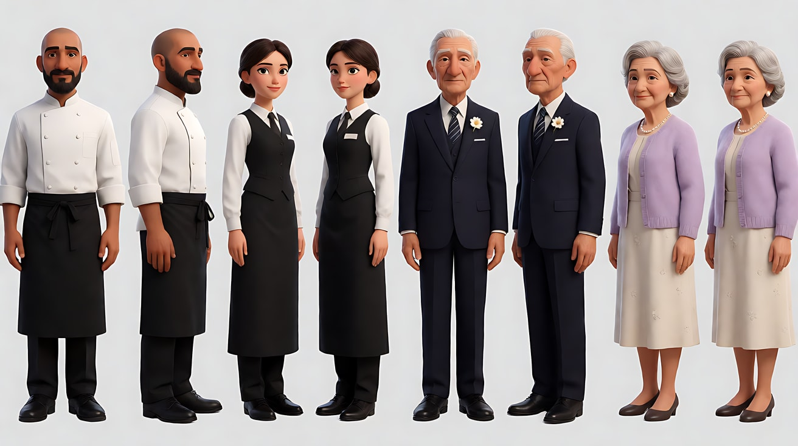

图2 场景（后厨）：

```
A small busy restaurant kitchen at night: a stainless-steel pass counter with heat lamps glowing orange in the center,
cooks blurred in motion in the background, copper pans hanging, a pair of swinging doors with round windows on the right leading to the dining room, no readable text.
Medium-wide shot from beside the pass, camera at standing eye level, 35mm lens, moderate depth of field.
Lighting: warm orange heat lamps above the pass, cool white kitchen ceiling lights, steam in the air.
Stylized semi-realistic 3D CG rendering, feature-film animation quality. Aspect ratio 16:9.
```

中文释义：夜晚繁忙的小餐厅后厨：中央不锈钢出菜台上方亮着橙色保温灯，背景是虚化的忙碌厨师，挂着铜锅，画右一对带圆窗的弹簧门通往餐厅，没有可读文字；出菜台旁站姿视线高度的中全景、35mm、中等景深；出菜台上方橙色暖光，后厨冷白顶灯，空气中有蒸汽。

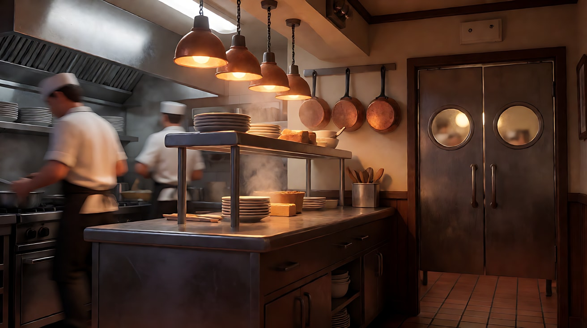

图3 场景（餐厅）：

```
A quiet elegant small restaurant dining room at night, about ten tables with white tablecloths and small candles,
a window table on the far left by a tall window showing soft city lights in the rain, the swinging kitchen doors on the right wall, no people, no readable text.
Wide shot from just inside the kitchen doors, camera at standing eye level, 35mm lens, deep focus.
Lighting: warm candlelight on each table, soft warm wall sconces, cool blue city light through the rainy window.
Stylized semi-realistic 3D CG rendering, feature-film animation quality. Aspect ratio 16:9.
```

中文释义：夜晚安静雅致的小餐厅，约十张铺白桌布点小蜡烛的桌子，最左侧高窗边一张靠窗桌，窗外是雨中柔和的城市灯光，右墙是后厨弹簧门，没有人、没有可读文字；从厨房门内侧的全景、站姿视线高度、35mm、深景深；每桌暖色烛光，墙上暖色壁灯，雨窗透进冷蓝城市光。

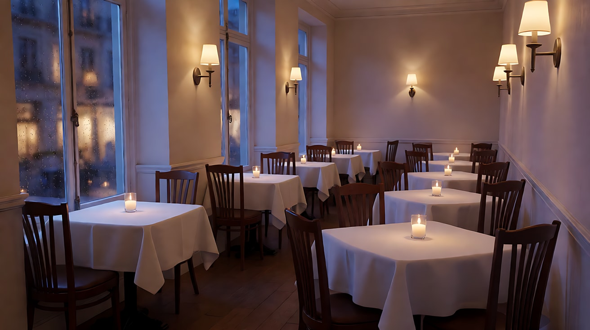

图4 首帧（两个版本共用）：

```
Using the head chef from image 1 in the kitchen of image 2:
a close-up of the chef's hands placing a single pink sugar flower petal with tweezers onto a small round cake on a white plate,
the cake decorated with a thin gold ring of sauce, the heat lamp glowing above, the chef's white sleeve at the edge of the frame.
Camera at counter height, 85mm lens, shallow depth of field.
Lighting: warm orange heat lamp from above as the key, cool kitchen light behind.
Keep the outfit exactly as in image 1.
Stylized semi-realistic 3D CG rendering, feature-film animation quality. Aspect ratio 16:9.
```

中文释义：主厨双手的特写，用镊子把一片粉色糖花花瓣放到白盘里的小圆蛋糕上，蛋糕外圈有一道细细的金色酱汁，上方保温灯发光，画面边缘露出主厨的白袖子；出菜台高度、85mm、浅景深。


**【多图生视频 · Seedance】**

版本 A：三镜头分镜

```
【素材分工】@图片1 锁定主厨、服务员、老先生、老太太四人的身份与服装，不参考其背景；@图片2 仅参考后厨布局与保温灯光线；@图片3 仅参考餐厅布局、靠窗桌与烛光；@图片4 为镜头1首帧。
【画风】风格化写实三维CG质感，电影级布光。
镜头1：特写，固定镜头。主厨用镊子把最后一片粉色糖花花瓣放到蛋糕上，停了一下，用手指轻轻把盘子转正，推到出菜口。保温灯的橙光照在蛋糕上。后厨锅铲声与排风扇声。
镜头2：镜头切至中景背影，镜头在服务员身后同速跟随。她双手端着盘子，用肩膀推开弹簧门，走进安静的餐厅，烛光在桌布上摇动。弹簧门在身后来回摆动的声音，后厨的嘈杂被门隔断。
镜头3：镜头切至窗边桌的中近景，老先生和老太太相对而坐，老太太在画左。镜头缓慢推近老太太。盘子被放到她面前，她低头看到蛋糕上的糖花，愣了一下，抬手捂住嘴，眼睛弯起来笑了。老先生在对面轻轻握住她放在桌上的另一只手。
【锁定】光线：后厨是橙色保温灯与冷白顶灯，餐厅是暖色烛光与冷蓝窗光；服务员始终从画右的弹簧门走向画左的窗边；老太太在画左、老先生在画右；盘子与蛋糕始终是同一份。
【声音】镜头1后厨锅铲与排风扇；镜头2弹簧门摆动，嘈杂被隔断，餐厅里只剩轻柔的钢琴；镜头3老太太（捂着嘴，轻声）："你还记得……"钢琴声继续。
【约束】保持四人脸型、发型、服装不变；蛋糕只有一块、糖花只有一朵；不出现可读文字；不要字幕、水印、Logo。
时长：13秒
```

版本 B：三阶段一镜到底

```
【素材分工】@图片1 锁定主厨、服务员、老先生、老太太四人的身份与服装，不参考其背景；@图片2 仅参考后厨布局与保温灯光线，作为起初阶段的空间；@图片3 仅参考餐厅布局、靠窗桌与烛光，作为随后和最后阶段的空间；@图片4 为首帧。
【画风】风格化写实三维CG质感，电影级布光。
全程一镜到底，不切镜头，稳定器拍摄，画面平滑。
起初，画面是主厨的手用镊子把最后一片粉色糖花放到蛋糕上的特写。他把盘子转正，推到出菜口。镜头缓慢后拉并向右转向出菜口，服务员走进画面，双手接过盘子，和主厨对视一下，点点头。
随后，镜头绕到服务员身后，稳定器同速跟随她的背影，她用肩膀推开弹簧门，镜头跟着她穿过来回摆动的门，进入安静的餐厅，后厨的嘈杂在身后被门隔断。烛光在一张张桌布上摇动，餐厅深处画左的靠窗桌边，一对老夫妇相对而坐。
最后，服务员走到窗边桌前，镜头越过她的肩膀缓慢推近老太太。盘子被放到老太太面前，她低头看到蛋糕上的糖花，愣了一下，抬手捂住嘴，眼睛弯起来笑了。老先生在对面轻轻握住她放在桌上的另一只手。结尾停在老太太捂着嘴笑的近景，老先生的手在画面一侧。
【锁定】光线：后厨是橙色保温灯与冷白顶灯，餐厅是暖色烛光与冷蓝窗光；服务员从画右的弹簧门走向画左的窗边；老太太在画左、老先生在画右；盘子与蛋糕始终是同一份。
【声音】起初是后厨锅铲声、排风扇声和镊子放下的轻响；随后是弹簧门摆动的声音，嘈杂被隔断，餐厅里只剩轻柔的钢琴；最后老太太（捂着嘴，轻声）："你还记得……"钢琴声继续。
【约束】全程不切镜头、不跳切；保持四人脸型、发型、服装不变；蛋糕只有一块、糖花只有一朵；不出现可读文字；不要字幕、水印、Logo。
时长：15秒
```

**参数**：版本 A 时长 13 秒、版本 B 时长 15 秒 ｜ 画幅 16:9 ｜ 负载：3 个镜头或 3 个阶段、1 句短台词，"有挑战"档

**【检查点】**
- 版本 A 是否真的切了三次，版本 B 是否真的一次都没切
- 两个版本里服务员的行进方向是否一致（从画右到画左）
- 对比回答：版本 A 里观众在镜头3才看到老夫妇；版本 B 里观众在穿过弹簧门时就远远看到了。哪种更有"惊喜"，哪种更有"陪伴"？
- 版本 B 的三个空间（出菜口、弹簧门、窗边桌）是否连成一条单向路线

**【常见问题与修复】**
| 现象 | 修复 |
|---|---|
| 版本 B 在穿过弹簧门时切镜 | 写"镜头跟着她穿过来回摆动的门"，开头与约束都写"不切镜头" |
| 版本 A 三个镜头连成了一个 | 每个镜头块开头写"镜头切至……"，并让三个机位明显不同 |
| 糖花或蛋糕在途中变样 | 【锁定】写"盘子与蛋糕始终是同一份"；版本 B 中镜头在随后阶段不给盘子特写 |
| 老夫妇左右位置互换 | 【锁定】写"老太太在画左、老先生在画右"；生成一张窗边桌关键帧作为补充参考 |

---

### 练习5：30 秒长镜头——灯会夜游的两段接续（难度 ★★★★★，一镜到底 × 2 + 尾帧接续）

**目标**：用两次生成拼出一个看起来不间断的 30 秒长镜头。第一段结尾不落定，保留运动作为"延展锚点"；第二段以第一段的最后一帧为首帧，从同样的运动状态继续。意图：让观众跟着女孩从热闹的灯会一路走到河上，在烟花升起时看见等她的爷爷。

**路线图**

```
  第一段（15秒）                                 第二段（15秒）
  ① 灯笼街（背后跟）                             ④ 镜头飞出阳台，越过河面
        │                                              │
        ▼                                              ▼
  ② 拐进茶楼，上木楼梯（稳定器）                  ⑤ 降落到一条小船旁，爷爷在摇橹
        │                                              │
        ▼                                              ▼
  ③ 到达二楼阳台，镜头越过她继续向河面滑出 ═══▶  ⑥ 烟花在两人头顶绽放（落定）
     （延展锚点：运动不停）            接缝：阳台栏杆从画面下方划过的瞬间
```

**运镜合同**

| 段落 | 阶段 | 起始构图 | 过渡与运动方式 | 速度 | 阶段终点 | 动机 |
|---|---|---|---|---|---|---|
| 第一段 | 起初 | 中景背影，女孩提着兔子灯走在灯笼街 | 稳定器背后跟 | 慢走 | 她拐进茶楼的门 | 带观众走进灯会 |
| 第一段 | 随后 | 中景背影，木楼梯 | 稳定器跟随上楼 | 慢 | 她走上二楼阳台 | 空间从热闹转向安静 |
| 第一段 | 最后 | 中景，她扶着阳台栏杆望向河面 | 镜头越过她的肩膀，继续向前滑出栏杆外 | 匀速，不停 | 阳台栏杆从画面下方划过，镜头悬在河面上方，仍在前进 | 延展锚点：运动留给下一段 |
| 第二段 | 起初 | 河面上方，前进中的镜头 | 继续同方向、同速度前进 | 匀速 | 河中央一条亮着灯的小船进入画面 | 接住上一段的运动 |
| 第二段 | 随后 | 小船全景 | 镜头缓慢降低高度，靠近小船 | 缓慢 | 中景，爷爷在船尾摇橹，抬头望向茶楼 | 揭示等她的人 |
| 第二段 | 最后 | 中景，爷爷抬头 | 镜头缓慢上摇，越过爷爷望向夜空 | 缓慢 | 烟花在河面上空绽放，倒映在水里；画面落定 | 情绪的终点 |

**【生图 · Nano Banana】**

图1 角色定妆（女孩与爷爷）：

```
Character turnaround sheet of two original characters:
a girl about ten with two round hair buns tied with red strings, a short padded jacket in jade green with frog buttons, dark trousers, cloth shoes,
carrying a white paper rabbit lantern on a short bamboo stick;
her grandfather in his seventies with short grey hair, a weathered tanned face, a dark-blue cotton jacket, a woven bamboo hat hanging on his back.
Front view, three-quarter view, side view and back view of each, full body, plain light-grey background.
Camera at eye level, 50mm lens, deep focus, even soft studio light from the front.
Stylized semi-realistic 3D CG rendering, feature-film animation quality. Aspect ratio 16:9.
```

中文释义：两位原创角色：约十岁女孩（两个用红绳扎的圆发髻、玉绿色盘扣短棉袄、深色裤子、布鞋，提一盏短竹竿上的白色纸兔子灯）；七十多岁爷爷（灰色短发、晒黑的沧桑脸庞、深蓝色棉布外套、背后挂一顶竹编斗笠）；四视图全身。

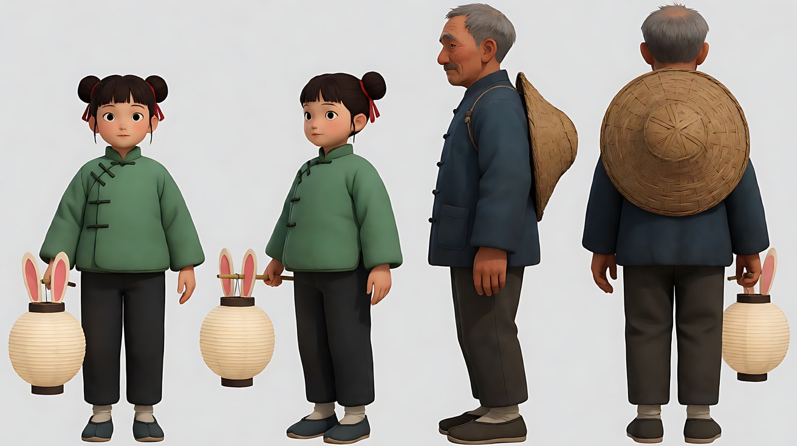

图2 场景（灯笼街与茶楼）：

```
A crowded old riverside lantern street at night during a festival, strings of red and orange lanterns overhead,
wooden two-story shops on both sides, blurred crowds, and on the left a two-story wooden teahouse with an open door and a narrow wooden staircase visible inside,
its upper balcony with a carved wooden railing facing the river behind, no readable text.
Wide shot down the street at standing eye level, 28mm lens, deep focus.
Lighting: warm red and orange lantern light overhead, deep-blue night sky.
Stylized semi-realistic 3D CG rendering, feature-film animation quality. Aspect ratio 16:9.
```

中文释义：节日夜晚拥挤的临河老灯笼街，头顶挂着成串的红橙色灯笼，两侧是木质二层店铺，虚化的人群；画左一座二层木茶楼，门开着，里面能看到窄木楼梯，二楼带雕花木栏杆的阳台背朝河面；没有可读文字；沿街站姿视线高度的全景、28mm、深景深；头顶红橙色灯笼暖光，深蓝夜空。

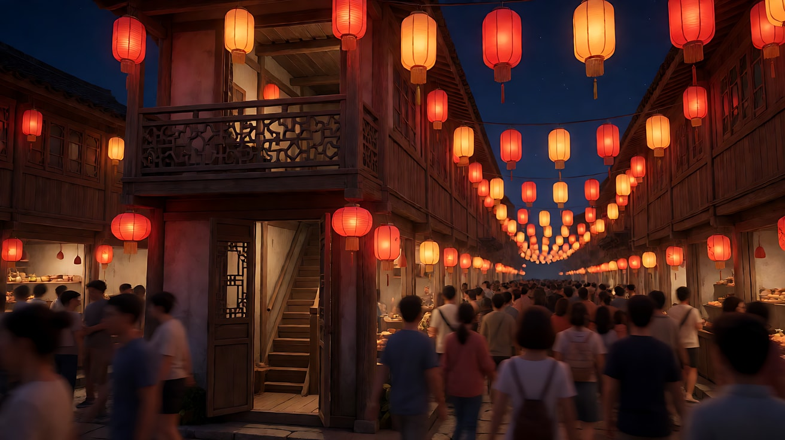

图3 场景（河面）：

```
A calm wide river at night seen from the height of a teahouse balcony, the dark water reflecting lantern lights from the riverbank,
a single small wooden boat with a warm hanging lantern at the stern floating in the middle of the river, old houses and lanterns along the far bank,
an empty night sky above, no people visible, no readable text.
Wide high-angle shot, camera about two stories above the water, 28mm lens, deep focus.
Lighting: warm lantern reflections on the water, the small boat lantern glowing, deep-blue night sky.
Stylized semi-realistic 3D CG rendering, feature-film animation quality. Aspect ratio 16:9.
```

中文释义：从茶楼阳台高度看夜晚平静宽阔的河面，深色河水倒映着岸边的灯笼光，河中央一条船尾挂着暖色小灯的小木船，对岸是老房子和灯笼，上方是空旷的夜空；没有可见的人、没有可读文字；离水面约两层楼高的俯角全景、28mm、深景深。


图4 第一段首帧：

```
Using the girl from image 1 on the lantern street of image 2:
a medium shot from behind of the girl walking through the festive crowd, holding her white rabbit lantern up beside her,
placed at the center of the frame, red lanterns overhead, the open door of the wooden teahouse ahead on the left.
Camera at a ten-year-old's shoulder height behind her, 35mm lens, moderate depth of field.
Lighting: warm red and orange lantern light from above, the soft white glow of her rabbit lantern on her jacket.
Keep the face, hairstyle and outfit exactly as in image 1.
Stylized semi-realistic 3D CG rendering, feature-film animation quality. Aspect ratio 16:9.
```

中文释义：女孩中景背影，穿过节日人群，把白色兔子灯举在身侧，居中，头顶红灯笼，前方画左是开着门的木茶楼；十岁孩子肩膀高度的身后机位、35mm、中等景深；头顶红橙灯笼暖光，兔子灯的柔和白光照在她的棉袄上。

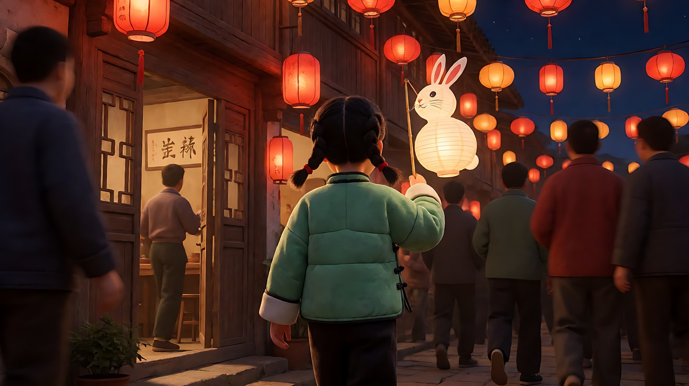

**【多图生视频 · Seedance】**

第一段（以延展锚点结尾）：

```
【素材分工】@图片1 锁定女孩的身份、圆发髻、玉绿色棉袄与兔子灯，不参考其背景；@图片2 仅参考灯笼街、茶楼门口、木楼梯与二楼阳台的空间关系；@图片3 仅参考阳台外河面的样子，作为本段结尾镜头滑出栏杆后看到的画面；@图片4 为首帧。
【画风】风格化写实三维CG质感，电影级布光。
全程一镜到底，不切镜头，稳定器拍摄，画面平滑漂浮。
起初，镜头在女孩身后，与她同速跟随，始终保持中景背影。她提着兔子灯穿过灯笼街的人群，头顶的红灯笼一串串向后滑过，她侧身让过一个举着糖葫芦的小孩，向左拐进茶楼敞开的门。
随后，镜头跟着她进入茶楼，室内突然安静下来，她沿着窄窄的木楼梯一级一级往上走，兔子灯的白光在木墙上晃动，镜头平滑地跟在她身后上楼。她走上二楼，穿过一扇门来到阳台，扶着雕花木栏杆，望向河面。
最后，镜头不停，越过她的肩膀继续向前滑出，雕花栏杆从画面下方划过，镜头悬到河面上方，仍在缓慢匀速地向前飞行，下方是倒映着灯笼的河水。结尾时镜头仍在向前运动，没有停下。
【声音】起初是灯会人群的喧闹、远处的锣鼓与小贩的吆喝；随后进入茶楼，喧闹被墙隔开变闷，木楼梯吱呀作响；最后走上阳台，河风吹来，喧闹在身后变远，水声轻轻拍岸，无配乐。
【约束】全程不切镜头、不跳切；结尾镜头保持向前运动，不停住、不落定；保持女孩脸型、发型、服装不变；不出现可读文字；不要字幕、水印、Logo。
时长：15秒
```

第二段（从第一段尾帧接续，落定结尾）：

> 先从第一段视频截取最后一帧，保存为图5。图5中应是"河面上方、仍在前进的镜头"。第二段是一次新的生成，平台按上传顺序重新编号：**先传图5，再传图1，再传图3**，它们在本段中依次是 @图片1、@图片2、@图片3。

```
【素材分工】@图片1 为首帧，是上一段的最后一帧，从这一帧的运动状态继续，不重新开始运镜；@图片2 锁定女孩与爷爷的身份和服装，本段画面中只出现爷爷，女孩只以画外声音出现，不参考其灰色背景；@图片3 仅参考河面、小船与对岸的布局，不复制其构图。
【画风】风格化写实三维CG质感，电影级布光。
全程一镜到底，不切镜头，画面平滑漂浮。
起初，镜头延续首帧的方向与速度，继续在河面上方缓慢匀速向前飞行，下方的河水倒映着两岸的灯笼光。河中央一条船尾挂着暖色小灯的小木船进入画面。
随后，镜头缓慢降低高度，向小船靠近，船尾的爷爷在摇橹，斗笠挂在背后。他停下手里的橹，抬起头，望向身后茶楼的方向，脸上的皱纹在小灯的暖光里舒展开，笑了。
最后，镜头停在爷爷的中景，随即缓慢向上摇，越过他的头顶望向夜空。一朵金色的烟花在河面上空绽放，接着又是一朵红色的，倒映在河水里。镜头停稳。结尾停在烟花在夜空与河面同时绽放的画面。
【声音】起初是河风和水声，延续上一段的环境音；随后是木橹搅水的吱呀声，远处茶楼方向传来女孩的喊声（画外，清脆）："爷爷——我在这儿！"；最后烟花升空的哨音与绽放的闷响，对岸人群的欢呼，一段舒缓的笛声配乐进入。
【约束】全程不切镜头、不跳切；从首帧的运动状态无缝继续；保持爷爷的脸型、发型、服装不变；画面中不出现女孩；不出现可读文字；不要字幕、水印、Logo。
时长：15秒
```

**参数**：两段各 15 秒，拼接后 30 秒 ｜ 画幅 16:9 ｜ 负载：每段 3 个阶段，属于"有挑战"上限；图片总数 5 张（两次生成分别使用 4 张和 3 张）

**接续操作要点**
1. 第一段结尾必须仍在运动；如果模型让镜头停住，重新生成，或在约束里加重"结尾镜头保持向前运动"。
2. 从已接受版本截取清楚的结尾帧；若取了最后一帧之前的画面，记录并调整剪辑点。首帧专门模式需实际指定素材，普通参考不能保证对齐。
3. 第二段第一句话写"延续首帧的方向与速度"。
4. 剪辑时两段直接相接；若接缝处有轻微跳动，把接缝放在"栏杆从画面下方划过"的那一瞬，或用两三帧的叠化掩盖。
5. 支持原视频延长时，把第一段作为待延长视频，写“向后延长视频1，接住结尾运动”，再写第二段事件。它不只是运镜参考，任务设置与输出拼接方式按入口确认。

**【检查点】**
- 第一段是否没有切镜，且结尾仍在运动（延展锚点）
- 第二段开头的方向与速度是否与第一段结尾一致
- 两段拼接后，接缝处的光线、河面、运动是否连续
- 第二段画面里是否只出现爷爷，女孩只以声音出现
- 烟花是否在最后才出现，作为整个 30 秒长镜头的落定点

**【常见问题与修复】**
| 现象 | 修复 |
|---|---|
| 第一段结尾镜头停住了 | 最后阶段写"镜头不停……结尾时镜头仍在向前运动，没有停下"，约束重复"不停住、不落定" |
| 第二段从静止重新开始运镜 | 素材分工写"从这一帧的运动状态继续，不重新开始运镜"，起初阶段写"延续首帧的方向与速度" |
| 茶楼楼梯段落被跳过 | 第一段阶段太多时，把"上楼"简化为"她走上楼梯，镜头跟着上到二楼阳台"一句 |
| 第二段出现了女孩 | 素材分工写"本段画面中只出现爷爷，女孩只以画外声音出现"，约束写"画面中不出现女孩" |
| 接缝处河面颜色不一致 | 两段都上传同一张河面场景图作参考，并在第一段结尾阶段就让镜头看到同样的河面 |
| 烟花过早出现 | 起初和随后阶段写清"夜空空旷"，烟花只写在最后阶段 |

#### 练习5扩展：30秒连续版（2.5，待实测）

**目标**：保留“女孩寻找爷爷”的信息链，把每次运镜变化与空间节点绑定。短版仍是前面的两段练习，不要求所有任务都加长。

**素材准备**：复用本练习图1人物、图2茶楼、图3河面、图4开场图，依次上传为图片1–4。普通参考任务；各图只指导其对应属性，不声称严格首尾帧锁定。

**【参考生视频 · Seedance 2.5】**

```text
【素材分工】@图片1 参考女孩和爷爷身份服装，不复制定妆图排版；@图片2 参考茶楼楼梯、二楼阳台与灯光；@图片3 参考河面、小船和两岸布局；@图片4 参考起始构图。
【画风】风格化写实CG，晚间暖灯与冷蓝夜色。
全程一镜到底。茶楼二楼阳台面向河面，路线连续，不穿过墙体。
0–8秒：镜头在女孩身后跟随，她从茶楼一层走上楼梯，手扶栏杆；楼梯脚步声逐渐变清楚。
8–16秒：她到二楼阳台，走向面河的栏杆，停下向外张望；摄影机随她转向河面，在她肩后短暂停留，水声进入。
16–24秒：她抬手指向河中央的小船。摄影机沿她的视线从开放阳台向外移动，越过栏杆后缓慢下降，靠近船尾，主角由女孩交接给摇橹的爷爷。
24–30秒：靠近后停止前移，保持爷爷的中景。他听见茶楼方向女孩喊“爷爷”，停下木橹，回头看向茶楼，露出笑容后保持；女孩不再入画。
【声音】室内脚步渐远，河风与水声渐近，最后一声画外“爷爷”，无配乐。
【保持】人物外观、河岸方向、小船位置关系和晚间光色一致，不额外加入字幕。结尾不增加烟花。
时长：30秒
```

**参数与依据**：30 秒、16:9；阶段数是课程设计，不是官方配额。方法来源见 [后台登台案例](../../附录/A-04-官方案例与版本差异.md#case-longtake)。

**【检查点】**：四段区间连续；女孩到阳台的路线可读；视线引出爷爷；摄影机没有穿墙；声音随距离变化；结尾只出现爷爷。

**【常见问题与修复】**
| 现象 | 修复 |
|---|---|
| 阳台到河面跳切或穿墙 | 先用粗白模预演开放路径；仍失败则回到两段版，用已接受结尾接续 |
| 人物交接时丢失小船 | 加强河面地标，减少同时运动的对象 |
| 30秒被拉成没有新信息的游移 | 缩短路线，保留指向与回应两处叙事变化，不用无关烟花填时长 |
