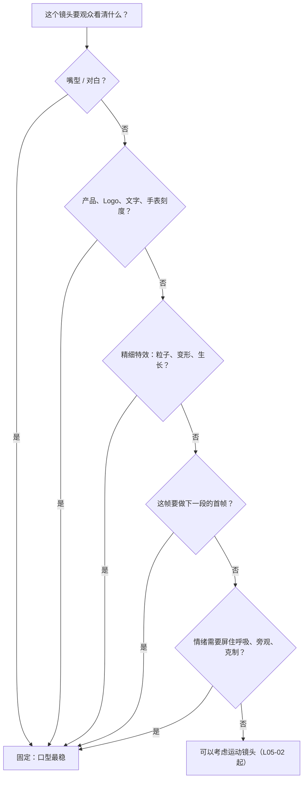
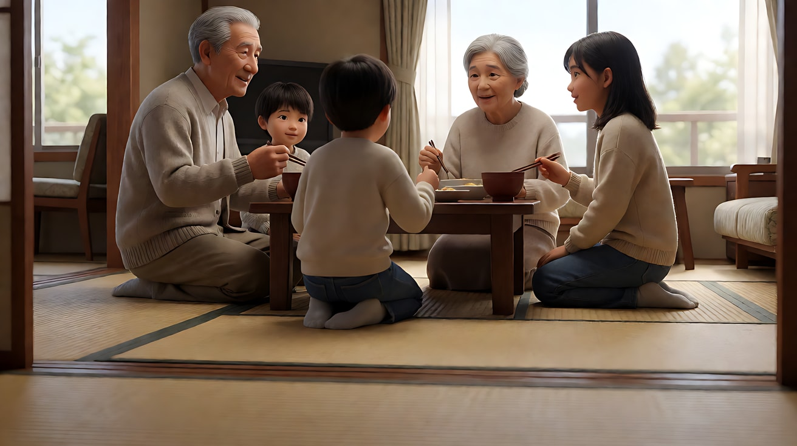
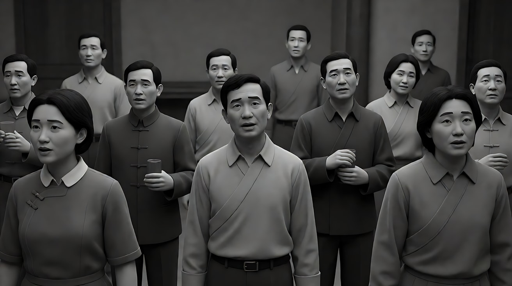

# L05-01 固定镜头：锁定机位的力量

> 段位：进阶 ｜ 建议用时：50 分钟 ｜ 配套提示词：[L05-01-固定镜头-提示词](../提示词/L05-01-固定镜头-提示词.md)

## 学习目标

- 能说清"固定镜头"锁住了哪几样东西：机位、角度、焦段、焦点
- 能分辨"画内运动"和"镜头运动"，并知道固定镜头的生命力来自画内
- 能判断哪些镜头**必须**固定：对白口型、产品与文字、精细特效、首尾帧锚点
- 能用"运镜合同五要素"写出一个固定镜头，包括"为什么不动"
- 能修复 Seedance 中固定镜头常见的"偷偷推进""画面冻结"两类问题

## 一、概念讲解

### 1. 本模块的通用工具：运镜合同五要素

从这一课开始，整个模块每写一个运镜，都要填满下面五格。少一格，模型就会替你随便补。

| 要素 | 要回答的问题 | 固定镜头怎么填 |
|---|---|---|
| 起始构图 | 第一帧观众看到什么、主体在画面哪里 | 例：中近景，人物在右三分之一，面朝画左 |
| 运动方式 | 机位怎么动（推、拉、摇、移、跟、升降、环绕、手持……） | **无**：机位锁定，不推不摇不移不变焦 |
| 速度 | 极慢 / 缓慢 / 匀速 / 快速 / 急速 | **零**：速度交给画内的人和物 |
| 终点画面 | 最后一帧停在什么构图和状态 | 与起始构图相同，但**画内状态变了** |
| 运动动机 | 为什么这样动（或为什么不动） | 例：让观众屏住呼吸、看清口型、看清产品 |

> 记住一句话：**固定镜头的终点画面 = 起始构图 + 画内的一个变化。** 如果首尾帧完全一样、画内也没变化，那不是固定镜头，是一张照片。

### 2. 固定镜头锁住的四样东西

```
┌──────────── 固定镜头（locked-off）────────────┐
│                                                │
│   机位    ── 三脚架钉死，不前后左右移动         │
│   角度    ── 不摇、不俯仰、不倾斜               │
│   焦段    ── 不变焦（zoom 也算镜头运动）         │
│   焦点    ── 通常不转焦；要转焦时只做一次        │
│                                                │
│   画框 = 舞台的台口，演出交给台上的人和光       │
└────────────────────────────────────────────────┘
```

很多新手以为"变焦"不算运镜，其实观众看到的画框在变，就等于镜头动了。在 Seedance 里写固定镜头，要把四样都锁住：**"镜头固定，不推进、不摇移、不变焦。"**

### 3. 画内运动 vs 镜头运动

```
   镜头运动（画框在动）                 画内运动（画框不动，内容在动）
┌───────────────────────┐            ┌───────────────────────┐
│ ←←←  整个世界在滑动  ←←← │            │   人物从左走到右  ──▶   │
│     [人]      [树]      │            │   [人]                 │
│ 观众感到：我在移动       │            │   窗帘被风吹起 ~~~      │
└───────────────────────┘            │   光斑在地板上爬行 ░░    │
                                     │ 观众感到：我在旁观       │
                                     └───────────────────────┘
```

| 画内运动的来源 | 例子 | 给 Seedance 的写法 |
|---|---|---|
| 人物动作 | 起身、转头、进出画 | "她从画右走入，在桌前停下" |
| 物件动作 | 茶杯冒热气、钟摆、风扇 | "电扇缓慢摇头，纸页被吹起一角" |
| 光的变化 | 云影掠过、车灯扫过、灯被打开 | "一束车灯从画右扫过墙面" |
| 介质 | 雨、雾、灰尘、烟 | "光柱里的灰尘缓慢下沉" |
| 景深内的层次 | 前景静止、背景有人经过 | "背景虚化处一个路人走过" |

### 4. 什么时候必须固定



理由很直接：每多一个运动变量，模型就多一处要"猜"的地方。口型、文字、产品轮廓、特效形状都是**脆弱锚点**，画框一动，它们最先变形。

### 5. 固定镜头的五种常用形态

| 形态 | 画面 | 用途 |
|---|---|---|
| 定场固定 | 大远景/全景，空间完整可读 | 交代地理、时间、天气 |
| 群像画框（tableau） | 多人像舞台剧一样排在画框里 | 人物关系一眼看清，带冷幽默或疏离 |
| 进出画 | 画框先空，人进来，做事，离开，画框又空 | 让空间比人更持久，制造孤独或余韵 |
| 固定 + 光变化 | 人和物几乎不动，光在走 | 时间流逝、心境转变 |
| 固定特写 | 手、眼睛、物件 | 细节就是剧情，任何移动都是干扰 |

## 二、情绪与叙事功能

| 技法 | 观众的感受 | 常用场景 |
|---|---|---|
| 固定中近景 + 对白 | 专注听这个人说话，不被打扰 | 告白、坦白、审问、独白 |
| 固定全景 + 人物进出画 | 空间留下来，人只是过客 | 离别、日常的重复、孤独 |
| 固定群像画框 | 冷静旁观，像看一出戏 | 家庭饭桌、会议、喜剧尴尬 |
| 固定长时间不切 | 屏住呼吸、时间被拉长 | 等待、对峙、悲伤后的沉默 |
| 固定 + 光变化 | 时间在流逝，人却没动 | 熬夜、守候、心境转变 |
| 运动镜头突然变为固定 | 一切停住，重量落下 | 坏消息到达的那一刻 |

**固定镜头的核心情绪是"克制"**：导演不替观众凑近，也不替观众转头，观众必须自己在画框里找重点。这就要求构图本身足够清楚——前面模块学的景别、构图、光在固定镜头里没有任何遮羞布。

## 三、经典影片案例

### 《东京物语》（1953，小津安二郎）
- 场景：老夫妇到东京探望子女，屋内的家常对话与吃饭。
- 怎么拍的：机位放得很低，接近人跪坐在榻榻米上的视线高度；绝大多数镜头固定不动，对话多用正面或接近正面的单人镜头交替；场景之间插入固定的空镜（走廊、街景、烟囱）。
- 为什么这样拍：意图是"让观众像家里的一员一样安静地坐着看"。机位不动，观众不会被引导去"发现"什么，情绪全部来自人物的停顿和语气。影片后段的失落感，正是靠这种不打扰的观看慢慢积累起来的。



### 《让娜·迪尔曼》（1975，香特尔·阿克曼）
- 场景：一位寡居母亲在公寓里日复一日地做饭、洗碗、整理床铺。
- 怎么拍的：大量正面、固定、接近中景到全景的镜头，几乎不切近景；家务动作以接近真实的时长完整呈现，人物进出画框后画面仍停留片刻。
- 为什么这样拍：意图是"让观众亲身感到日常的重量和秩序"。镜头不动、不省略，观众被迫和她一起度过这些时间，于是秩序里出现一点点偏差时，观众能立刻察觉到。


### 《寒枝雀静》（2014，罗伊·安德森）
- 场景：一组组彼此独立的生活片段，人物在灰白色调的室内或街景中说话、发呆。
- 怎么拍的：几乎每个场景都是一个固定的全景画框，景深很深，人物像舞台演员一样分布在前中后景，一个场景通常只用一个镜头。
- 为什么这样拍：意图是"让观众保持距离地看人的荒诞与孤独"。固定画框就像一个展示窗，没有特写替观众挑重点，观众自己发现角落里的小动作，冷幽默就从这种距离里出来。



## 四、在 AI 中怎么实现

- **生图阶段**：固定镜头的首帧就是整段的构图，必须一次画对。写清景别、机位高度、焦段、景深、主体在画面的位置、光源方向。如果后面会有人进出画，首帧要给"入口"留空间（门、画边的留白）。
- **视频阶段**：正文第一句就写"镜头固定，不推进、不摇移、不变焦"，然后把篇幅全部花在**画内运动**：谁做什么动作、光怎么变、介质怎么动。结尾写一个画面能装下的状态。
- **模型擅长**：固定机位下的口型同步、产品轮廓保持、粒子与光效、天气和介质（雨、雾、灰尘）、单人清楚的动作。
- **要避开**：
  1. 只写"镜头固定"不写画内动作——模型会把整段做成几乎静止的图，或者自作主张地加慢推。
  2. 写"画面静止""一动不动"——会被理解成人物也冻结。要写"机位静止"，人物"保持呼吸起伏、眨眼"。
  3. 在固定镜头里塞三个以上人物同时做主动作——画框不动时，观众的注意力全靠画内调度，主动作只能有一个。
  4. 固定镜头里安排"意外"（杯子被碰倒）——模型会把它演成故意的。

**固定镜头的提示词骨架：**

```
【素材分工】@图片1 为首帧，锁定构图、人物与场景布局。
镜头固定，机位锁定在[高度/角度]，不推进、不摇移、不变焦。
[起始画面：景别、主体位置]。
[画内主动作：一个人，一个动作链]。[画内次要运动：光/介质/物件]。
[运动动机写成可见结果：例如"让她说话的嘴型始终清楚"]。
结尾停在[同一构图下的新状态]。
```

## 五、练习作业

1. 找一部你喜欢的电影，数一数开场五分钟里有几个固定镜头，各自用的是哪种形态（定场、群像、进出画、光变化、固定特写）。
2. 把"一个人在雨夜的公交站等车"写成两个固定镜头：一个用"进出画"，一个用"固定 + 光变化（车灯扫过）"，分别填满运镜合同五要素。
3. 完成配套提示词的练习1–5。练习1生成两次：一次只写"镜头固定"，一次补全画内动作，对比画面生命力。

## 六、自检清单

- [ ] 我写了"不推进、不摇移、不变焦"，而不只是"镜头固定"
- [ ] 起始构图写清了景别、机位高度、主体位置
- [ ] 画内至少有一个主动作，加上一个光或介质的次要运动
- [ ] 终点画面和起始构图相同，但画内状态有了变化
- [ ] 我能说出这个镜头为什么必须固定（口型 / 产品 / 特效 / 首尾帧 / 情绪克制）
- [ ] 没有用"画面静止""一动不动"来描述人物

## 七、配套提示词

→ [L05-01-固定镜头-提示词](../提示词/L05-01-固定镜头-提示词.md)

---

上一课：[L04-07 光随剧情变化](../../04-光影与色彩/教学/L04-07-光随剧情变化.md) ｜ 下一课：[L05-02 摇镜与移镜](L05-02-摇镜与移镜.md) ｜ [返回总目录](../../README.md)
