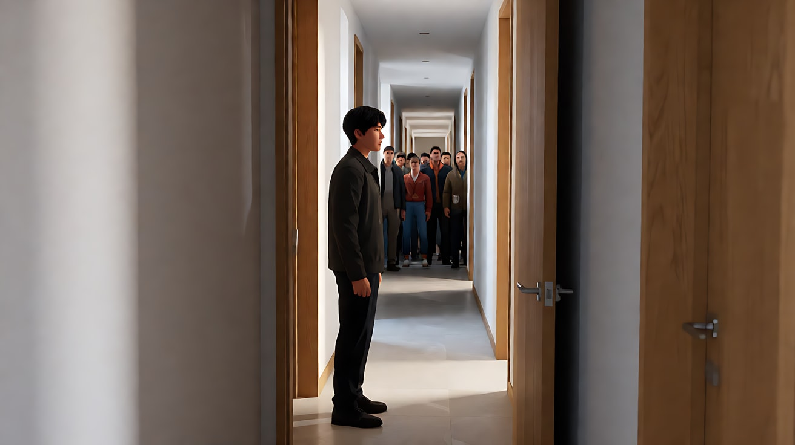

# L05-02 摇镜与移镜：转头和走路是两回事

> 段位：进阶 ｜ 建议用时：55 分钟 ｜ 配套提示词：[L05-02-摇镜与移镜-提示词](../提示词/L05-02-摇镜与移镜-提示词.md)

## 学习目标

- 能分清**摇（Pan / Tilt）**：机位不动、镜头绕轴转；**移（Truck 横移 / Dolly 轨道）**：机位本身在移动
- 能解释"视差"是什么，以及为什么只有移镜才有明显视差
- 能设计"横移经过前景"的镜头，用前景层次制造纵深和自然的遮挡转换
- 能根据运动动机选择摇或移：跟视线、跟主体、揭示信息、并行陪伴
- 能用运镜合同五要素写出摇镜和移镜，并控制速度避免画面拖影和抖动

## 一、概念讲解

### 1. 一句话区分

| 运镜 | 摄影机在干什么 | 像人的什么动作 | 英文 |
|---|---|---|---|
| 水平摇 | 三脚架不动，镜头左右转 | 站着不动，转头看 | Pan left / Pan right |
| 垂直摇 | 三脚架不动，镜头上下转 | 站着不动，抬头或低头 | Tilt up / Tilt down |
| 横移 | 整台摄影机沿轨道或滑轨左右平移 | 侧着身走路，眼睛一直看前方 | Truck left / Truck right，Lateral tracking |
| 轨道前后移 | 整台摄影机向前或向后移动 | 走近或走远 | Dolly in / Dolly out（下一课详讲） |

### 2. 俯视图：摇和移的机位差别

```
         摇镜（Pan）                              横移（Truck）

      A     B     C                         A      B      C
       \    |    /                          |      |      |
        \   |   /                           |      |      |
         \  |  /                            |      |      |
          \ | /                             ▣ ───▶ ▣ ───▶ ▣
            ▣  ← 机位不动，只转方向          ← 机位在轨道上移动，朝向不变

  观众感到：我站在原地环顾               观众感到：我在这个空间里经过
```

### 3. 视差：移镜的灵魂

当机位真正移动时，**离镜头近的东西在画面里移动得快，远的东西移动得慢**。这就是视差（parallax），它让观众的大脑立刻读出"空间有纵深"。

```
  横移向右 ──▶

  前景（柱子、树干、人群）   ◀◀◀◀◀◀  快速划过，常常虚化
  中景（主体）               ◀◀◀      中速
  背景（山、楼群、天空）     ◀         几乎不动
```

摇镜基本没有视差：画面里所有层次一起平移，像把一张宽幅照片在眼前拖过去。所以：

- 想要"空间立体、我身在其中"→ 用**移**
- 想要"站定观察、视线转移"→ 用**摇**

### 4. 横移经过前景

把前景物体（柱子、书架、门框、树干、路人、货架）放在镜头和主体之间，让横移的镜头"擦"过它们：

```
  画面1             画面2              画面3
┌──────────┐    ┌──────────┐     ┌──────────┐
│▓▓▓       │    │      ▓▓▓▓│     │   [人]   │
│▓▓▓ [人]  │ →  │ [人] ▓▓▓▓│  →  │          │
│▓▓▓       │    │      ▓▓▓▓│     │          │
└──────────┘    └──────────┘     └──────────┘
 前景柱子挡住半边   柱子划过主体       主体完整露出
```

它有三种功能：
1. **纵深**：前景让画面多一层，视差最明显。
2. **窥视感**：观众像在柱子后面偷看。
3. **天然的遮挡转换**：前景整块挡住画面的那一刻，可以作为隐藏剪辑点或场景过渡（L05-08 一镜到底会用到）。

### 5. 动机：为什么要摇，为什么要移

| 动机 | 适合 | 写法示例 |
|---|---|---|
| 跟随视线 | 摇 | "她望向画右，镜头随她的视线缓慢右摇，停在远处的船上" |
| 揭示画外信息 | 摇 | "镜头从他的脸缓慢左摇，露出门口站着的人" |
| 揭示高度与尺度 | 上摇 | "镜头从她的靴子缓慢上摇到树冠" |
| 与主体并行 | 横移 | "镜头与奔跑的孩子保持平行横移，市场摊位在前景划过" |
| 经过一个空间 | 横移 | "镜头沿走廊横移，依次经过三扇敞开的门" |
| 窥视 | 横移 + 前景 | "镜头从书架后横移，书架边缘划过，露出读书的女孩" |

### 6. 速度与稳定

- **慢摇**：观察、沉思、风景；越慢越像"看"。
- **匀速摇**：跟随走动的人。
- **快摇**：慌乱、找人；再快就成了甩镜（L05-07）。
- 中速摇过有大量竖线的画面（栅栏、楼房）容易出现频闪和拖影，AI 视频里尤其明显，**要么放慢，要么把竖线放到虚化的前景里**。
- 摇和移都要写清**终点画面**，否则模型会一路摇下去，或者在中间莫名回摆。

## 二、情绪与叙事功能

| 技法 | 观众的感受 | 常用场景 |
|---|---|---|
| 慢速水平摇 | 站定环顾，安静地观察 | 风景、房间的第一次进入、清晨的街 |
| 摇随视线 | 和人物一起发现 | 人物看到远方的某物、听见声音回头 |
| 上摇揭示 | 仰望、敬畏、压迫 | 建筑、巨物、强势人物出场 |
| 下摇落到细节 | 注意力被拉到线索上 | 从脸摇到手里的信、从天空摇到脚下的路 |
| 平行横移 | 陪伴、同行、旁观 | 行走、奔跑、队列、对峙的双方 |
| 横移经过前景 | 窥视、纵深、隐秘 | 偷看、寻找、悬疑铺垫 |
| 横移经过多个空间 | 一个世界的横截面 | 楼房剖面、长走廊、一排店铺 |

## 三、经典影片案例

### 《罗马》（2018，阿方索·卡隆）
- 场景：女佣在家中各房间之间走动、收拾、关灯。
- 怎么拍的：大量镜头把机位放在房间中央附近，镜头缓慢地水平摇动，跟随她从一个房间走到另一个房间，有时一口气摇过大半个空间；机位本身很少移动。
- 为什么这样拍：意图是"让观众像这个家里一个安静的旁观者"。摇镜像人站着转头看，没有视差带来的"闯入感"，观众始终保持距离，看到她的劳动被这个家的空间包围。


### 《老男孩》（2003，朴赞郁）走廊打斗
- 场景：主角在一条狭长走廊里，独自对抗一大群人。
- 怎么拍的：摄影机放在走廊侧面，沿走廊方向横向移动，在不切镜头的情况下拍了接近三分钟，画面像横版游戏一样从一端推进到另一端，主角始终被横移的镜头带着。
- 为什么这样拍：意图是"让观众感到每一米都是硬打出来的"。横移让走廊的长度变得可见，镜头不切，就不能用剪辑偷懒，观众和主角一样被困在这条线上。镜头偶尔停住或后退，就是战况的停顿与反复。



### 《布达佩斯大饭店》（2014，韦斯·安德森）
- 场景：饭店内外的大量走廊、房间和人物对话。
- 怎么拍的：大量正面构图配合干净的横向平移；镜头常在两个人物或两个方向之间做精准的 90 度摇镜，摇到位后立刻停稳，回到对称构图。
- 为什么这样拍：意图是"让观众感到这是一个被精心布置、像玩具盒一样的世界"。横移像拉开一排展示柜，直角摇镜像机械装置在转动，运镜的规整本身就是这部影片的叙事语气。


## 四、在 AI 中怎么实现

- **生图阶段**：
  - 摇镜：首帧只需要画起点，但场景图要画得**比首帧更宽**（例如用 21:9 或广角画出完整环境），让模型知道摇过去之后有什么。
  - 横移：首帧要明确画出**前景层**（柱子、货架、树干）和主体的相对位置；写清前景虚化。
  - 上摇或下摇：首帧和尾帧最好都画出来（脚和树冠、天空和地面），用首尾帧锁定两端。
- **视频阶段**：写清"机位不动，镜头向右摇"或"机位沿轨道向右横移，镜头朝向不变"——前者没有视差，后者要写"前景快速划过，背景缓慢移动"。
- **模型擅长**：慢速水平摇、上摇揭示高大物体、平行横移跟随行走的人、横移经过虚化的前景柱子。
- **要避开**：
  1. 只写"镜头移动"——模型会在摇、移、推之间随机选一个，甚至混在一起。
  2. 入门阶段把摇、推、升同时堆叠却不交代路径。本课先用一个主运镜控制变量，进阶组合见 [长镜头调度](L05-08-一镜到底与长镜头调度.md)，不是模型禁止组合。
  3. 摇过去后的内容不交代——模型会摇到一片空墙，或在中途把镜头摇回来。
  4. 中速摇过密集竖线（栅栏、百叶窗）——容易抖动和拖影。

**提示词骨架：**

```
摇镜：机位固定在[位置]，镜头从[起始构图]开始，[缓慢/匀速]向[左/右/上/下]摇，
      [动机：随她的视线 / 跟随他走动]，停在[终点画面]。
横移：机位沿轨道向[左/右]横移，镜头朝向保持不变，[速度]，
      前景的[物体]快速划过并虚化，背景[物体]缓慢移动，主体[与镜头平行行走/被逐渐露出]，
      停在[终点画面]。
```

## 五、练习作业

1. 站在房间中间用手机拍两段：一段原地转身（摇），一段侧着身子横着走（移）。回放时注意近处家具和远处窗户的相对运动，找出视差。
2. 设计一个"摇随视线"的镜头：人物听见声音 → 转头 → 镜头随视线摇过去 → 停在声源上，填满运镜合同五要素。
3. 设计一个"横移经过前景"的镜头，写出前景是什么、主体是谁、前景挡住主体的那一刻观众会期待什么。
4. 完成配套提示词的练习1–5。

## 六、自检清单

- [ ] 我写明了是"机位不动、镜头转"（摇）还是"机位移动"（移）
- [ ] 横移镜头写了前景、中景、背景三层的相对速度
- [ ] 每个摇或移都有动机：视线、跟随、揭示、并行、窥视
- [ ] 终点画面写清楚了，模型知道"停在哪"
- [ ] 一个镜头里只有一个主运镜，没有"边摇边推边升"
- [ ] 速度写了，并避开了中速摇过密集竖线

## 七、配套提示词

→ [L05-02-摇镜与移镜-提示词](../提示词/L05-02-摇镜与移镜-提示词.md)

---

上一课：[L05-01 固定镜头](L05-01-固定镜头.md) ｜ 下一课：[L05-03 推拉镜头](L05-03-推拉镜头.md) ｜ [返回总目录](../../README.md)
