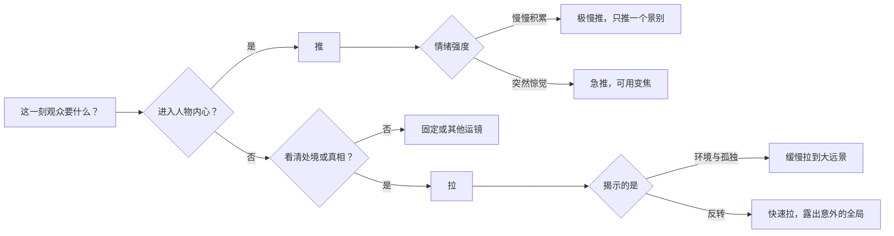
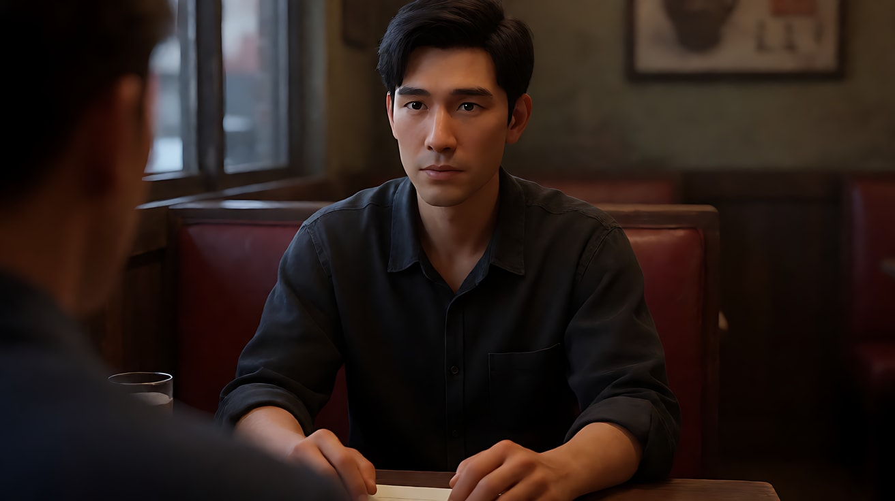
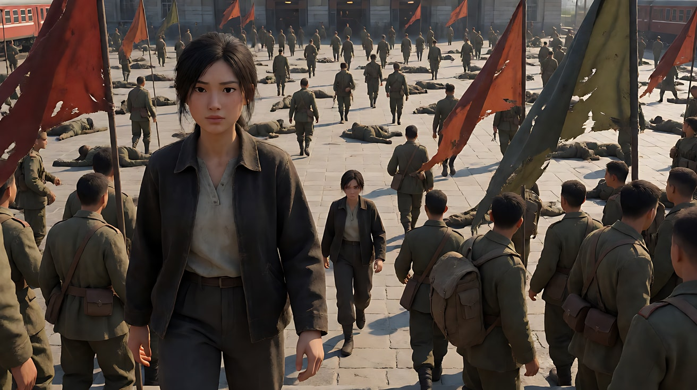
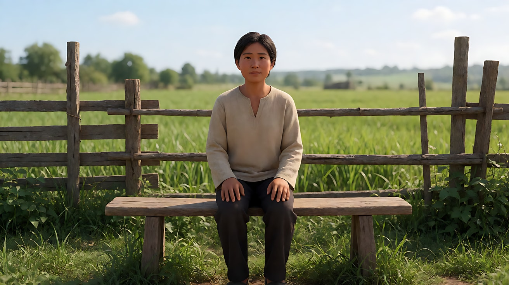

# L05-03 推拉镜头：靠近与抽离

> 段位：进阶 ｜ 建议用时：55 分钟 ｜ 配套提示词：[L05-03-推拉镜头-提示词](../提示词/L05-03-推拉镜头-提示词.md)

## 学习目标

- 能说出推镜和拉镜各自的情绪方向：推 = 靠近、领悟、压迫；拉 = 抽离、孤独、揭示
- 能根据情绪选择推拉速度：极慢、缓慢、匀速、急推
- 能分清**变焦（zoom）**和**物理推轨（dolly）**在画面上的差别，并在提示词里写准
- 能为推拉镜头找到动机：一句台词、一个声音、一个发现
- 能用运镜合同五要素写出"从什么景别推到什么景别、停在哪"

## 一、概念讲解

### 1. 推和拉是观众身体的冲动

```
         推（Push-in / Dolly in）                     拉（Pull-back / Dolly out）

   全景 ──▶ 中景 ──▶ 近景 ──▶ 特写               特写 ──▶ 近景 ──▶ 中景 ──▶ 全景
   ▣ ─────────────────────────▶ [人]           [人] ◀───────────────────────── ▣

   观众的冲动：凑近看，想知道他在想什么          观众的冲动：退后一步，看清他身处何地
   情绪：领悟、亲密、压迫、紧张聚焦              情绪：孤独、抽离、释然、真相揭示
```

| 运镜 | 镜头告诉观众 | 典型动机 |
|---|---|---|
| 推 | "注意，这里有事情正在发生" | 人物意识到什么、关键台词、听见一个声音、发现线索 |
| 拉 | "现在看看全局" | 揭示环境、揭示人物其实是孤身一人、离场、结尾抽离 |

### 2. 速度决定情绪强度

| 速度 | 观众感受 | 写法 |
|---|---|---|
| 极慢推（几乎察觉不到） | 心理压力一点点积累，观众说不清为什么越来越紧张 | "镜头极慢地推近，几乎难以察觉" |
| 缓慢推 | 沉浸、靠近、温柔的领悟 | "镜头缓慢推近，从中景到近景" |
| 匀速推 | 叙述性的靠近，带观众进入空间 | "镜头匀速向前推进，穿过门口" |
| 急推 | 惊觉、冲击、喜剧化的强调 | "镜头快速急推到他的眼睛特写" |
| 缓慢拉 | 情绪退潮、孤独慢慢显形 | "镜头缓慢后拉，从近景拉到大远景" |
| 快速拉 | 突然被抛开、反讽的揭示 | "镜头快速后拉，露出整个空荡的大厅" |

**推拉的长度和速度要匹配时长**：5 秒里从大远景推到特写，必然是急推；想要极慢推，就只推一个景别（中景 → 中近景）。

### 3. 变焦 vs 物理推轨

这是这一课最重要的技术区分。

```
  物理推轨（dolly in）：摄影机真的往前走          变焦（zoom in）：摄影机不动，焦距变长

   背景  ▢ ▢ ▢ ▢ ▢ ▢                              背景  ▢ ▢ ▢ ▢ ▢ ▢
                                                   
   主体       [人]                                 主体       [人]
                ▲                                              
                ▣  ←—— 机位前进                                ▣  ←—— 机位不动
                ▣                                              （镜头内部镜片移动）

  结果：主体变大，背景变大得比主体少           结果：主体和背景按同一比例放大
       前景划过、透视关系改变                      透视不变，像在照片上"放大"
       观众感到"我走进了空间"                      观众感到"我在远处盯着看"
```

| 对比项 | 物理推轨 Dolly | 变焦 Zoom |
|---|---|---|
| 机位 | 移动 | 不动 |
| 透视 | 变化：前景划过，背景相对缩小 | 不变：整个画面同比例放大 |
| 景深 | 基本不变 | 推长焦时背景更虚、空间更压缩 |
| 观众感受 | 身体走进去，沉浸 | 远处凝视、观察、窥视，带一点机械感 |
| 常见用途 | 领悟、亲密、进入空间 | 纪实感、监视感、喜剧化急推、复古影像语气 |
| Seedance 写法 | "镜头向前推进，机位靠近人物" | "机位不动，镜头缓慢变焦推近" |

两者结合（机位后退 + 变焦推近）就是"滑动变焦"，在 L05-07 特殊运镜里练。

### 4. 推拉的终点

推拉最容易出问题的不是起点，是**终点**。模型不知道停在哪，就会一直推到脸上糊成一片，或者拉到人物小得看不见脸。终点要写三件事：

1. **终点景别**："停在她眼睛到下巴的特写"
2. **终点构图**："她仍在画面右三分之一"
3. **终点状态**："她的手指停在信纸上那一行字"

### 5. 推拉镜头的决策



## 二、情绪与叙事功能

| 技法 | 观众的感受 | 常用场景 |
|---|---|---|
| 极慢推 | 压力在积累，越来越紧 | 决定前的沉默、对峙、阴谋酝酿 |
| 缓慢推到特写 | 进入他的内心，和他一起领悟 | 读信、听到消息、回忆涌上来 |
| 急推 | 惊觉、冲击、强调 | 发现线索、喜剧反应、悬疑提示 |
| 缓慢拉到大远景 | 孤独显形，情绪退潮 | 离别、结尾、失去之后 |
| 拉镜揭示 | "原来是这样" | 揭示他在舞台上、在病房里、在一大群人中间 |
| 变焦推 | 远处凝视、被监视 | 纪实、监控视角、复古风格 |
| 物理推 | 身体走进去 | 进入房间、靠近人物、沉浸叙事 |

## 三、经典影片案例

### 《教父》（1972，弗朗西斯·福特·科波拉）餐厅场景
- 场景：迈克尔在一家小餐厅与对手谈判，他即将做出改变一生的决定。
- 怎么拍的：在他下决心前的段落里，镜头对着他的脸极慢地推近，同时背景里火车经过的尖锐金属摩擦声越来越响；他的表情几乎没有变化。
- 为什么这样拍：意图是"让观众感到一个人正在跨过他回不了头的那条线"。演员几乎不演，镜头替观众靠近他的内心，声音替观众感到压力，极慢推让这几秒变得比任何动作都重。



### 《乱世佳人》（1939，维克多·弗莱明）亚特兰大车站
- 场景：女主角走进挤满伤兵的火车站广场寻找医生。
- 怎么拍的：镜头从她身边开始，借助大型升降设备不断后拉并升高，她越来越小，画面里露出的伤兵越来越多，最后整片广场躺满了人，残破的旗帜在前景飘动。
- 为什么这样拍：意图是"让观众感到个人在战争面前有多渺小"。拉镜是一种揭示：观众一开始只关心她，镜头退得越远，越清楚她要面对的是什么。



### 《巴里·林登》（1975，斯坦利·库布里克）
- 场景：贯穿全片的乡间、军营、宴会场景。
- 怎么拍的：大量镜头从人物或细节开始，慢速变焦拉远，最后落在一幅像古典油画一样构图的全景上；机位基本不动。
- 为什么这样拍：意图是"让观众以冷静的距离旁观人物被时代和阶层摆布"。用的是变焦而不是推轨，画面没有"走进去"的身体感，而像一幅画被慢慢展开，观众始终是画外人。



## 四、在 AI 中怎么实现

- **生图阶段**：
  - 推镜：首帧画起点景别，要给终点留足细节——推到特写时脸、手或物件要清楚，必要时再生成一张尾帧做目标。
  - 拉镜：最关键的是**揭示的内容**。只给近景首帧，模型不知道拉出来是什么，就会编一个平均环境。要先画一张大远景场景图作为参考，或者直接用尾帧锁定。
  - 变焦 vs 推轨：用首尾帧控制时，变焦的尾帧是首帧的"裁切放大"（背景比例不变）；推轨的尾帧里背景相对变小、更多环境露出来。
- **视频阶段**：写清起点景别 → 终点景别 → 速度 → 动机。"缓慢推近"后面紧跟"因为她读到了那一行字"之类可见的动机。
- **模型擅长**：缓慢推到近景、从中景拉到全景、推近时背景自然虚化、拉镜时环境逐渐展开（有参考图时）。
- **要避开**：
  1. 只写"推进"不写终点——会推过头，脸部变形。
  2. 5 秒内要求"从大远景极慢推到眼睛特写"——速度和距离自相矛盾。
  3. 推镜的同时让人物大幅走动——观众不知道该跟谁。推镜时人物动作要小。
  4. 混写"变焦"和"推近"——要选一个：机位动还是不动。

**提示词骨架：**

```
推：镜头从[起点景别与构图]开始，[极慢/缓慢/急速]地向前推近，机位靠近[主体]，
    [动机：在她读到那一行字时 / 随着火车声越来越响]，停在[终点景别]，[终点状态]。
拉：镜头从[起点近景]开始，[缓慢/快速]后拉，[逐渐露出的环境]，
    停在[终点景别]，[人物在画面中的大小和位置]。
变焦：机位不动，镜头[缓慢/快速]变焦推近（或拉远），透视不变，背景与主体同比例放大。
```

## 五、练习作业

1. 为同一句台词"我知道是你"设计两个版本：极慢推（压力积累）和急推（惊觉），分别写出起点景别、终点景别和速度。
2. 设计一个拉镜揭示：开场是一个人笑着的近景，拉开后揭示的处境让笑容变得心酸。写出揭示的内容和终点构图。
3. 用手机分别拍一段"走近"和一段"原地放大"，对比背景的变化，写下你看到的透视差异。
4. 完成配套提示词的练习1–5，重点对比练习3的两个版本。

## 六、自检清单

- [ ] 推或拉的情绪方向与意图一致（推 = 靠近，拉 = 抽离或揭示）
- [ ] 写了起点景别和终点景别，距离和时长匹配
- [ ] 速度写清楚了，并且与情绪强度匹配
- [ ] 写明是机位移动（推轨）还是机位不动（变焦）
- [ ] 推拉有可见的动机：台词、声音、发现
- [ ] 拉镜揭示的内容有参考图或尾帧支撑

## 七、配套提示词

→ [L05-03-推拉镜头-提示词](../提示词/L05-03-推拉镜头-提示词.md)

---

上一课：[L05-02 摇镜与移镜](L05-02-摇镜与移镜.md) ｜ 下一课：[L05-04 跟拍与前导](L05-04-跟拍与前导.md) ｜ [返回总目录](../../README.md)
