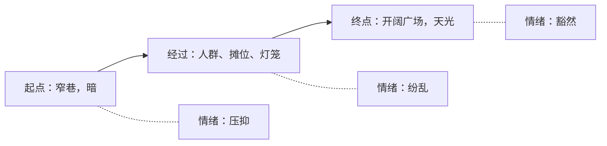
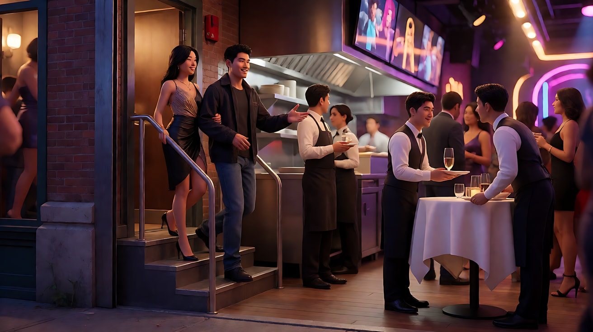
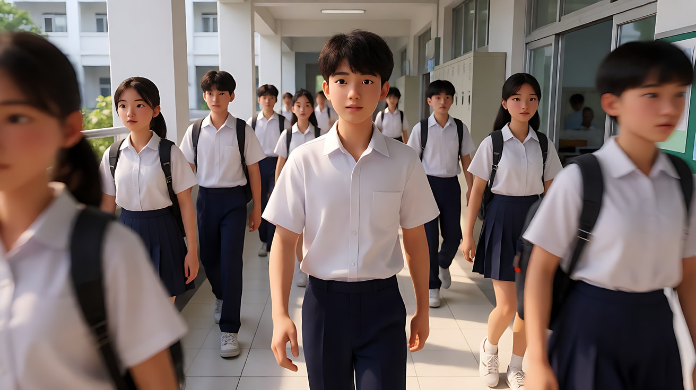
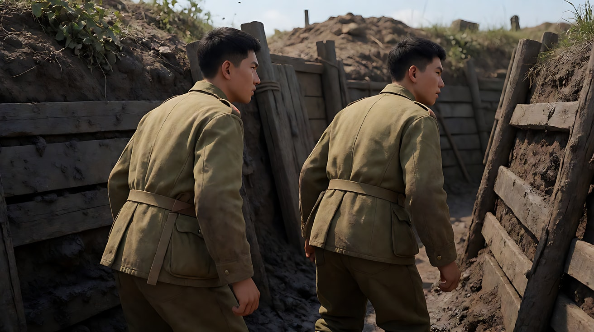

# L05-04 跟拍与前导：和主体一起走

> 段位：进阶 ｜ 建议用时：55 分钟 ｜ 配套提示词：[L05-04-跟拍与前导-提示词](../提示词/L05-04-跟拍与前导-提示词.md)

## 学习目标

- 能区分三种跟随关系：**背后跟**、**侧跟**、**前导倒退拍**，并说出各自让观众看到什么、看不到什么
- 能写出"跟随主体保持景别"：镜头与人物同速，距离不变，景别不变
- 能根据叙事选择跟随位置：代入未知、陪伴速度、看清表情与决心
- 能处理跟拍中的空间方向：人物朝哪走、画面方向在多个镜头里保持一致
- 能识别并修复 AI 跟拍常见问题：人物原地踏步、镜头追不上、景别忽大忽小

## 一、概念讲解

### 1. 跟拍的本质：镜头和主体结成"同行关系"

前面几课的镜头是"观看者"：站着、转头、走近、退后。跟拍的镜头是"同行者"：主体走，镜头也走，**两者的相对距离保持不变**。这让观众的身体和角色的身体绑在一起。

### 2. 三种位置（俯视图）

```
          前导倒退拍                  侧跟                       背后跟

        ▣  ← 镜头倒退               ▣ ─ ─ ─▶                       [人] ───▶ 前方
        ▲                           │ 镜头与人物                     ▲
        │ 镜头面朝人物               │ 平行同速                       │ 镜头在身后
       [人] ───▶ 前方              [人] ───▶                         ▣ ───▶

  观众看到：表情、决心            观众看到：侧脸、速度、          观众看到：背影、前方的路
  观众看不到：前方有什么          经过的环境、两人并行的关系       观众看不到：表情
  情绪：迎面而来、对峙、被追赶     情绪：陪伴、速度、同行           情绪：代入、进入未知、悬疑
```

| 类型 | 镜头位置 | 观众得到 | 观众失去 | 常用场景 |
|---|---|---|---|---|
| 背后跟 | 主体身后，同向前进 | 前方的路、和角色同一视线 | 表情 | 进入陌生空间、悬疑探索、走向舞台 |
| 侧跟 | 主体侧面，平行同速 | 速度感、环境层次、侧脸 | 前方的终点 | 奔跑、骑车、两人并肩说话 |
| 前导倒退拍 | 主体前方，倒退行进，镜头朝向主体 | 正脸表情、身后的追随者 | 前方（角色看见了观众看不见） | 决心、迎面走来、被追赶、对话边走边说 |

### 3. 跟随主体保持景别

跟拍最核心的技术要求：**主体在画框里的大小和位置不变**。

```
  正确：景别锁定                         错误：距离漂移

  ┌────────┐ ┌────────┐ ┌────────┐      ┌────────┐ ┌────────┐ ┌────────┐
  │  [人]  │ │  [人]  │ │  [人]  │      │  [人]  │ │  [ 人 ]│ │   人   │
  │  中景  │ │  中景  │ │  中景  │      │  中景  │ │ 中近景 │ │  全景  │
  └────────┘ └────────┘ └────────┘      └────────┘ └────────┘ └────────┘
   背景在变化，人物不变                   人物忽大忽小，观众以为镜头在推拉
```

背景在流动、人物稳定——这是跟拍的视觉签名。在提示词里要写三句：
1. **"镜头与她保持同速、保持相同距离"**
2. **"始终保持中景"（或具体景别）**
3. **"她始终位于画面中央"（或具体位置）**

### 4. 背景是跟拍的第二主角

跟拍时主体相对不动，**真正在变化的是背景**。好的跟拍会设计一条"背景路线"：从窄巷到开阔广场、从暗处到亮处、从人群到空无一人。背景的变化就是情绪的变化。



### 5. 跟拍的速度与动机

| 主体速度 | 跟拍支撑方式 | 观众感受 |
|---|---|---|
| 慢走 | 稳定器、推轨 | 平静、沉思、仪式感 |
| 快走 | 稳定器、手持 | 急迫、有目的 |
| 奔跑 | 车载、稳定器、手持 | 速度、追逐、逃离 |
| 骑车/滑板/车辆 | 车载侧跟、无人机 | 自由、速度、旅程 |

跟拍的动机永远来自主体：**主体为什么在走？走向哪里？**镜头只是陪着他。提示词里要先写主体的目的，再写镜头怎么跟。

## 二、情绪与叙事功能

| 技法 | 观众的感受 | 常用场景 |
|---|---|---|
| 背后跟，慢速 | 跟着他进入未知，紧张 | 走进黑暗走廊、推开一扇门之前 |
| 背后跟，穿过空间 | 带路、展示一个世界 | 带观众走进厨房后台、酒吧、校园 |
| 侧跟，同速奔跑 | 速度、陪伴、并肩 | 追赶、比赛、旅程 |
| 侧跟，两人并肩 | 关系平等，边走边谈 | 散步对话、同行的伙伴 |
| 前导倒退拍，慢速 | 迎面而来的决心 | 走向对手、出场、宣告 |
| 前导倒退拍，快速 | 被追赶、恐惧 | 逃跑、身后有东西 |
| 前导拍到停下 | 人物到达，看到观众看不到的东西 | 揭示前的停顿，下一镜头切到他看见的东西 |

## 三、经典影片案例

### 《好家伙》（1990，马丁·斯科塞斯）科帕卡巴纳夜总会
- 场景：亨利带着女友第一次走进夜总会，不排队，从侧门进去。
- 怎么拍的：一个连续的跟拍镜头，镜头跟在两人身后，从街边穿过侧门、走下楼梯、穿过忙碌的走廊和厨房，亨利一路和员工打招呼、随手塞小费，最后到达舞台前，服务员当场为他们加一张桌子。
- 为什么这样拍：意图是"让观众和女友一起被这个男人的特权征服"。背后跟让观众站在女友的位置，前方不断展开新空间，镜头不切，观众就没有机会喘气，只能被这条"贵宾通道"一路带进去。



### 《大象》（2003，格斯·范·桑特）
- 场景：一所普通高中里，几个学生在走廊、操场、食堂之间走动的平常一天。
- 怎么拍的：大量长时间的背后跟拍，镜头跟在学生身后，以接近步行的速度穿过走廊；同一段时间从不同学生的视角重复出现。
- 为什么这样拍：意图是"让观众感到平常的一天里每一个人都毫无防备"。背后跟让观众看不到表情、只看到前路，长时间的跟随把日常变得漫长而不安，观众知道某件事情即将到来，而镜头里的人不知道。



### 《1917》（2019，萨姆·门德斯）
- 场景：两名年轻士兵穿过战壕和无人区，去传递一道命令。
- 怎么拍的：全片被设计成接近连续的长镜头，镜头在士兵身后跟随、在前方倒退引导、在侧面并行之间不断切换位置，通过隐藏的剪辑点连接。
- 为什么这样拍：意图是"让观众和他们一起完成这段路，一步都不能省"。镜头在前方时观众看清他们的恐惧与疲惫；在身后时观众和他们一起面对前方的未知；跟随位置的变化就是叙事重心的变化。



## 四、在 AI 中怎么实现

- **生图阶段**：
  - 首帧要明确画出**镜头与主体的相对位置**：背后跟画背影、前导画正面迎来、侧跟画侧身。
  - 场景图要画出**路线**：一条走廊、一条街、一段站台，最好让路线有明确方向（从画面深处到前景，或从左到右）。
  - 如果路线中途要经过特定地点（门、拐角、广场），可以多画一张场景图作为途经参考。
- **视频阶段**：写清"镜头在她身后/侧面/前方"、"与她同速"、"始终保持中景"、"背景向后流动"。先写主体的目的地，再写镜头的跟随方式。
- **模型擅长**：背后跟随走路的人、侧跟奔跑或骑车、前导拍走向镜头的人物、背景流动与人群穿行。
- **要避开**：
  1. 只写"跟拍"不写位置——模型会在背后、侧面之间乱换，甚至变成环绕。
  2. 人物原地踏步：没写目的地和背景流动，模型就让人物"走"但不前进。要写"背景中的店铺、路灯依次向后退去"。
  3. 跟拍途中要人物做精细动作（掏钥匙、打电话）——跟拍时动作要大而简单：走、跑、回头、停下。
  4. 背后跟拍途中要求看清表情——背后跟就是看不到脸，想要表情就换前导。
  5. 跟拍时间过长导致人物变形：一段跟拍 6–10 秒为宜，更长的路线拆成多个镜头或用一镜到底的阶段写法（L05-08）。

**提示词骨架：**

```
背后跟：镜头在[人物]身后约[距离]，与他同速向前，始终保持中景背影，人物位于画面中央；
        [他要去哪里]，两侧的[环境]依次向后退去；停在[他停下的位置与画面]。
侧跟：  镜头在[人物]的[左/右]侧，与她平行同速移动，始终保持[景别]侧面；
        前景[物体]快速划过，背景[物体]缓慢移动；停在[终点]。
前导：  镜头在[人物]前方，面朝他倒退行进，与他同速，始终保持[景别]；
        他迎面走来，[表情/动作]；身后[环境/追随者]；停在[他停下的画面]。
```

## 五、练习作业

1. 选一个日常场景（下班回家、走进考场、去见一个人），分别用背后跟、侧跟、前导写三个版本，对比观众分别"看到什么、错过什么"。
2. 设计一条跟拍的背景路线：起点、经过、终点各是什么环境，各自对应什么情绪。
3. 用手机试拍：跟在朋友身后走 10 米，努力保持他在画面里的大小不变，体会"保持景别"有多难。
4. 完成配套提示词的练习1–5。

## 六、自检清单

- [ ] 我写明了镜头位置：背后、侧面还是前方
- [ ] 写了"同速""保持相同距离""始终保持某景别"
- [ ] 写了主体的目的地和背景的流动方向
- [ ] 跟拍中人物的动作大而简单
- [ ] 多个跟拍镜头里，人物的行进方向保持一致
- [ ] 跟拍有终点：人物停在哪，镜头停在哪

## 七、配套提示词

→ [L05-04-跟拍与前导-提示词](../提示词/L05-04-跟拍与前导-提示词.md)

---

上一课：[L05-03 推拉镜头](L05-03-推拉镜头.md) ｜ 下一课：[L05-05 环绕、升降与航拍](L05-05-环绕升降与航拍.md) ｜ [返回总目录](../../README.md)
