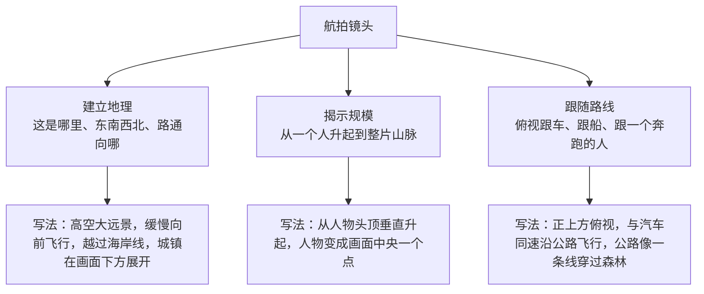
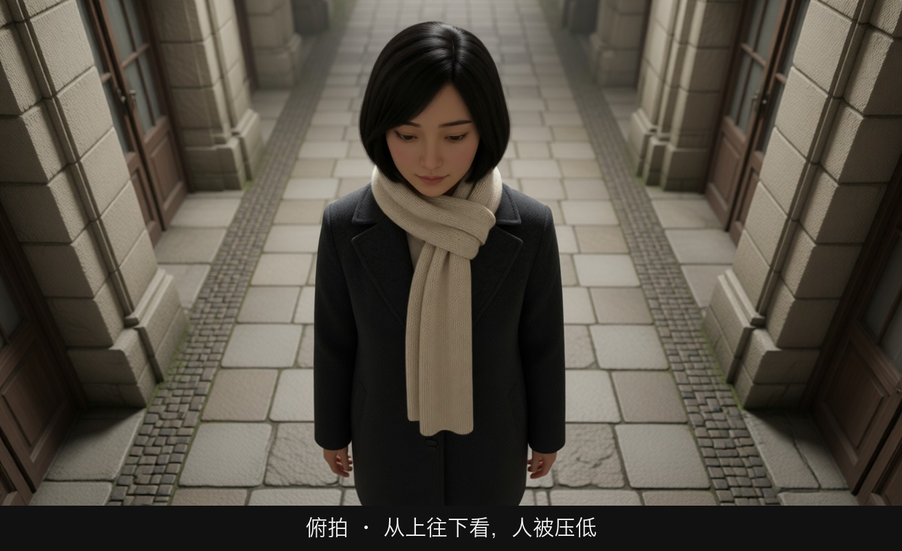
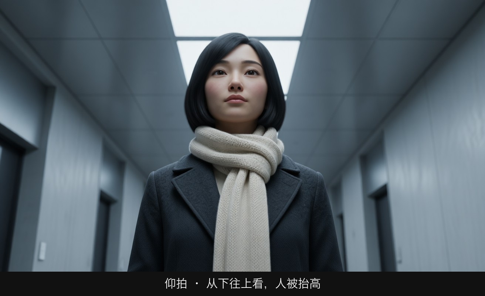
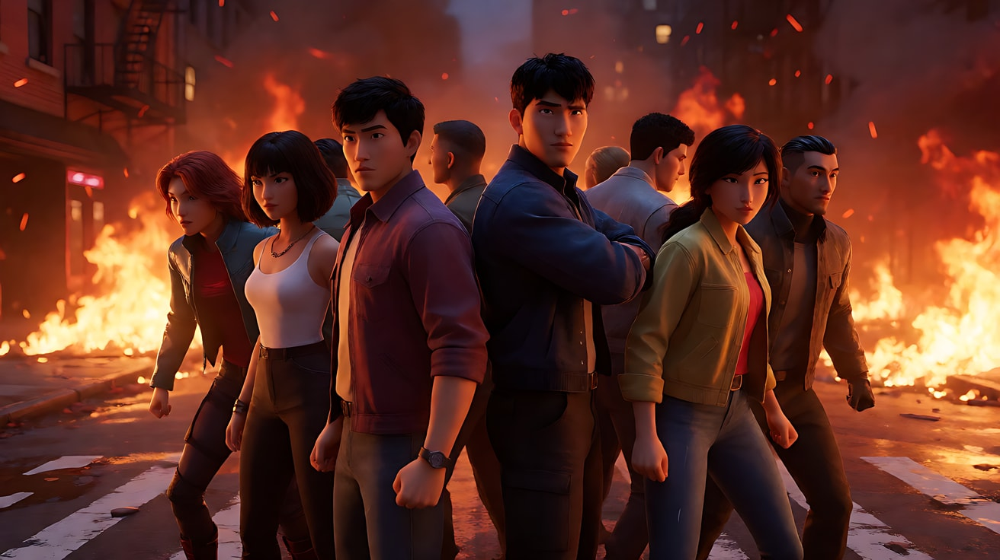
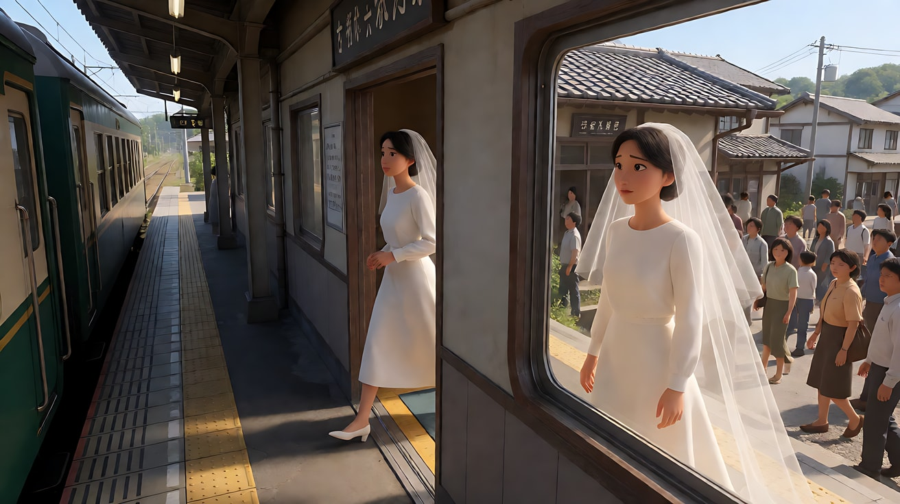
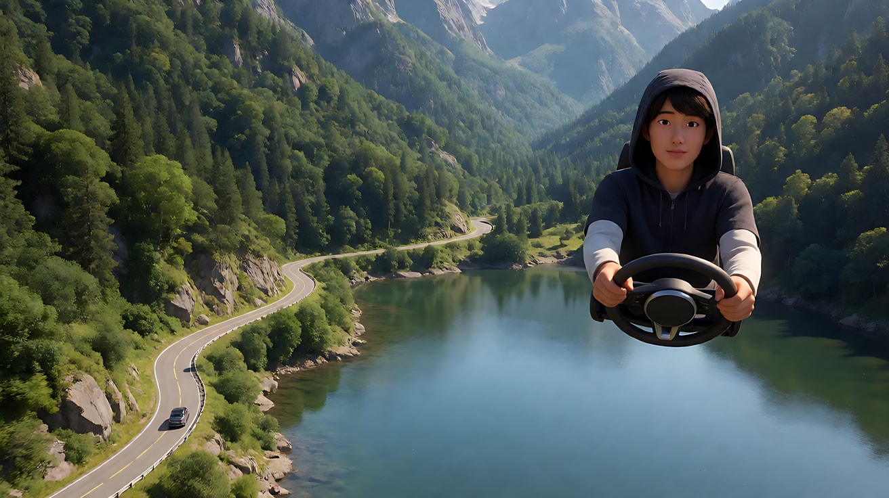
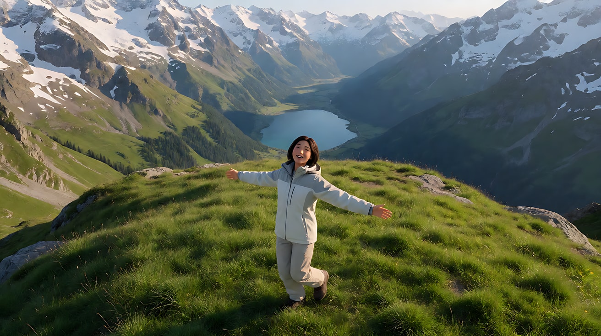

# L05-05 环绕、升降与航拍：改变观众站立的高度和角度

> 段位：进阶 ｜ 建议用时：60 分钟 ｜ 配套提示词：[L05-05-环绕升降与航拍-提示词](../提示词/L05-05-环绕升降与航拍-提示词.md)

## 学习目标

- 能区分半环绕与 360 度环绕，并知道环绕适合产品展示和英雄时刻
- 能解释 AI 环绕镜头最大的风险"身份漂移"，并用参考图、角度限制、速度控制来规避
- 能写出升镜（揭示、抽离、结尾）与降镜（进入、到达、开场）的起止画面
- 能用航拍完成三件事：建立地理、揭示规模、跟随路线
- 能在一个镜头里只保留一个主运镜，不把环绕、升降、推近叠在一起

## 一、概念讲解

### 1. 三种运镜改变的是什么

| 运镜 | 改变的维度 | 观众的身体 | 一句话功能 |
|---|---|---|---|
| 环绕（Orbit / Arc） | 水平角度：绕着主体转 | 绕着一个人或物走一圈 | "看，从每一面都值得看" |
| 升降（Crane / Jib / Pedestal） | 高度：上升或下降 | 升到空中或落回地面 | "抬起来看全局"或"落下来走进去" |
| 航拍（Aerial / Drone） | 尺度：从极高处观看 | 飞在空中 | "这个世界有多大，他在哪里" |

### 2. 环绕：俯视图

```
                 0°（正面）
                    ▣
           315° ▣       ▣ 45°
                                         半环绕：0° → 90° 或 0° → 180°
     270° ▣        [主体]        ▣ 90°    → 主体有一面始终可见，最稳
                                         
           225° ▣       ▣ 135°           360°环绕：转一整圈
                    ▣                     → 模型要"想象"主体背面，最容易漂移
                 180°（背面）
```

| 类型 | 角度范围 | 适合 | AI 风险 |
|---|---|---|---|
| 小弧度环绕 | 30°–60° | 对白中的情绪加强、产品轻微展示 | 低 |
| 半环绕 | 90°–180° | 产品亮相、英雄时刻、人物转折 | 中：转到侧脸与背面时面部可能变化 |
| 360° 环绕 | 一整圈 | 群像英雄时刻、舞蹈、产品旋转展示 | 高：背面靠猜，回到正面时脸可能已经变了 |

### 3. 环绕的"身份漂移"与对策

模型生成的每一帧都在"重新画"主体。机位转到首帧没有展示的角度时，它只能根据训练经验猜：发型、服装背面、脸的侧面轮廓……转回来时，这些猜测累积起来，人物就"不像了"。

**对策清单：**

1. **给全角度参考**：上传角色定妆四视图（正面、三分之二侧、侧面、背面），并写"@图片1 锁定人物在所有角度下的脸型、发型与服装"。
2. **减小角度**：能用 90° 就别用 180°，能用 180° 就别用 360°。
3. **主体静止或动作很小**：环绕时主体站定、只做呼吸、发丝飘动、抬头这类小动作。
4. **放慢速度**：越快越容易糊和变形。
5. **首尾帧锁两端**：首帧画起始角度，尾帧画终点角度，中间交给模型。
6. **产品要锁文字**：环绕产品时标签、刻字最容易乱，写"刻字始终清楚、不变形"，或干脆让产品没有文字。

### 4. 升降：侧视图

```
                         ▣  ← 升镜终点：俯瞰全局
                       ╱
                     ╱      升（Crane up）：从人物到环境
                   ╱        → 揭示、抽离、自由、结尾
                 ╱
   ▣ ─ ─ ─ ─ ─ ▣  ← 起点：人物视线高度
   [人]
                            降（Crane down）：从高空落到人物
                            → 进入场景、到达、开场、聚焦一个人
```

| 类型 | 说明 | 写法 |
|---|---|---|
| 摇臂升起 | 机位沿弧线升高，镜头通常同时下俯保持主体在画内 | "摇臂缓慢升起，镜头始终俯视她，她在画面中越来越小" |
| 摇臂降下 | 从高处落到人物高度 | "镜头从屋顶高度缓慢降下，落到他的视线高度" |
| 垂直升降（Pedestal） | 机位垂直上下，镜头朝向不变 | "机位垂直上升，镜头保持水平，越过窗台露出窗外" |
| 越过遮挡升起 | 从前景遮挡后升起，揭示后方 | "镜头从站台屋檐下升起，越过屋顶，露出整座小镇" |

注意升降和上下摇的区别（L05-02）：**摇是机位不动、镜头抬头；升是机位本身升高。**升镜会让地面上的物体产生视差，前景一层层沉到画面下方。

### 5. 航拍：三种任务



| 航拍运动 | 观众感受 | 常见位置 |
|---|---|---|
| 向前飞越 | 抵达、展开 | 片头、新地点第一次出现 |
| 越过山脊/建筑揭示 | "原来后面是这个" | 揭示目的地、揭示规模 |
| 正上方俯视（上帝视角） | 抽离、命运、图案感 | 车流、人群、孤独的人 |
| 垂直拉升远离 | 告别、结尾、渺小 | 片尾、人物独处 |
| 侧向跟随 | 旅程、速度 | 公路片、追逐 |

### 6. 入门先选一个主运镜

环绕、升降、航拍都是"大动作"，在短镜头里同时堆叠容易让路径和叙事重点不清楚。**本课入门练习每镜选一个主运镜；需要组合时可拆成多个镜头，用"镜头切至"连接。** 这不是模型硬上限。进阶连续运动需写清路径、触发点与终点，见 [长镜头调度](L05-08-一镜到底与长镜头调度.md)。

## 图解

> 这些示意图由多种生图模型分别生成（包括 Nano Banana、GPT Image 等），只用来说明镜头概念；不同模型的画面不能互相比较效果，也不能当作视频成片。


环绕和升降是运动。下面两张是升降停住之后的两个极端机位：镜头在上，人被压低；镜头在下，人被抬高。



从高处往下看。地面图案包住她，她在画面里变小、变被动。



镜头靠近地面往上看。天花板退到她身后，下巴和下颌线变重，人被赋予高度。

## 二、情绪与叙事功能

| 技法 | 观众的感受 | 常用场景 |
|---|---|---|
| 慢速半环绕产品 | 完整、精致、值得细看 | 产品亮相、道具第一次出现 |
| 环绕静止的人物 | 时间停住，这一刻属于他 | 英雄时刻、做出决定、重逢 |
| 360° 群像环绕 | 团结、集结、高潮 | 团队集结、舞蹈高潮 |
| 摇臂升起 | 抽离、自由、命运感 | 结尾、离别、独处 |
| 摇臂降下 | 到达、进入、聚焦 | 开场、人物出场 |
| 航拍飞越 | 新世界展开 | 片头、旅程开始 |
| 航拍揭示规模 | 渺小、敬畏 | 面对大自然、面对巨物 |
| 垂直俯视 | 冷静、宿命、图案 | 车流、孤独的人、对称布局 |

## 三、经典影片案例

### 《复仇者联盟》（2012，乔斯·韦登）纽约之战集结
- 场景：几位英雄第一次在纽约街头背靠背站在一起，准备迎战。
- 怎么拍的：镜头围绕站成一圈的英雄做一个连续的 360 度环绕，人物基本站定，只有转头和准备姿态的小动作，背景是燃烧的街道。
- 为什么这样拍：意图是"让观众感到这群各怀心事的人终于成为一个团队"。环绕把每个人轮流推到画面前方，又把他们框在同一个圆里；人物静止、镜头运动，这一刻像被时间单独拎出来。



### 《西部往事》（1968，塞尔乔·莱昂内）吉尔抵达小镇
- 场景：新娘吉尔走下火车，在站台上等不到来接她的人，走进车站。
- 怎么拍的：镜头跟着她走进车站，透过窗户看她询问，然后她走出车站另一侧时，镜头借助摇臂升起，越过车站屋顶，露出车站后面人来人往的整座小镇，配乐在这一刻涌上来。
- 为什么这样拍：意图是"让观众感到她走进的是一个全新而辽阔的世界"。升镜是揭示：观众从她的视线高度一下子被抬到能看见全局的位置，人物变小，未来变大。



### 《闪灵》（1980，斯坦利·库布里克）开场
- 场景：主角驾车前往山中的酒店。
- 怎么拍的：航拍镜头从湖面飞过，然后在高空跟随一辆小汽车沿山间公路蜿蜒前进，汽车在画面中只是一个小点，周围是无尽的山林。
- 为什么这样拍：意图是"让观众从一开始就感到这家人正被送进一个与世隔绝的地方"。航拍建立了地理：酒店离一切都很远；高空俯视让汽车显得渺小而无助，好像在被什么东西注视。



### 《音乐之声》（1965，罗伯特·怀斯）开场
- 场景：阿尔卑斯山区的清晨，女主角在山顶草地上唱歌。
- 怎么拍的：航拍从高空掠过雪山、湖泊和山谷，逐渐降低高度，飞向一片山顶草地，最后落到正在张开双臂转圈的女主角身上。
- 为什么这样拍：意图是"让观众感到这个人和这片山野融为一体"。航拍从世界开始、落到一个人身上，是"降"的思路：先建立她身处的世界，再把观众送到她身边。



## 四、在 AI 中怎么实现

- **生图阶段**：
  - 环绕：必须有角色定妆四视图或产品多角度图；首帧画起始角度，必要时尾帧画终点角度。
  - 升降：首帧画起点高度；升镜的终点（全局）要画一张场景大远景作为揭示参考。
  - 航拍：先画一张高空大远景，把地理关系（海岸、道路、城镇的方位）画清楚；地上的小人不要求脸。
- **视频阶段**：
  - 写清环绕的**角度范围**和**方向**："镜头从她背后开始，向左缓慢环绕半圈，停在她的正面三分之二侧。"
  - 升降写清**起点高度、终点高度、镜头朝向**："摇臂从她的视线高度升到屋顶以上，镜头始终俯视她。"
  - 航拍写清**飞行方向与高度**："高空航拍，沿海岸线向北缓慢飞行，高度不变。"
- **模型擅长**：产品慢速半环绕、静止人物的小角度环绕、航拍飞越风景、俯视跟车、从人物升起到大远景。
- **要避开**：
  1. 快速 360° 环绕正在说话或做复杂动作的人——脸和手会同时崩。
  2. 航拍镜头里要求小人做表情或口型——大远景里脸一定会漂。
  3. 环绕带文字的产品——标签会被重新"写"错。
  4. 升镜没有揭示内容——升上去只看到一片模糊的平均城市。
  5. 环绕 + 升降 + 推近叠加在同一个镜头里。

**提示词骨架：**

```
环绕：[主体]站定，[小动作]。镜头从[起始角度]开始，围绕[主体]向[左/右]缓慢环绕[角度]，
      距离与高度不变，[主体]始终位于画面中央，停在[终点角度与构图]。
升降：镜头从[起点高度与构图]开始，摇臂缓慢[升起/降下]，镜头始终[俯视/平视][主体]，
      [逐渐露出的环境]，停在[终点高度与画面]。
航拍：高空航拍，[飞行方向]，[速度]，[高度保持/逐渐降低/垂直拉升]，
      [地理信息在画面中的位置]，停在[终点画面]。
```

## 五、练习作业

1. 选一个你身边的小物件，用手机绕着它拍半圈。思考：它的哪一面最好看？环绕应该停在哪个角度？
2. 为一个结尾镜头设计升镜：起点是人物在做什么，升到多高，揭示了什么，人物最后在画面中多大。
3. 为一个新地点设计航拍建立镜头：观众需要知道的三条地理信息是什么（例如：靠海、只有一条路、离城镇很远）。
4. 完成配套提示词的练习1–5，练习2特别注意观察身份漂移。

## 六、自检清单

- [ ] 环绕写了角度范围、方向、速度和终点角度
- [ ] 环绕人物时上传了定妆多视图，并写了"所有角度下锁定"
- [ ] 升降写了起点高度、终点高度和镜头朝向
- [ ] 升镜或航拍有明确的揭示内容，并有参考图
- [ ] 大远景航拍不要求人物表情或口型
- [ ] 一个镜头只有一个主运镜

## 七、配套提示词

→ [L05-05-环绕升降与航拍-提示词](../提示词/L05-05-环绕升降与航拍-提示词.md)

---

上一课：[L05-04 跟拍与前导](L05-04-跟拍与前导.md) ｜ 下一课：[L05-06 手持与斯坦尼康](L05-06-手持与斯坦尼康.md) ｜ [返回总目录](../../README.md)
