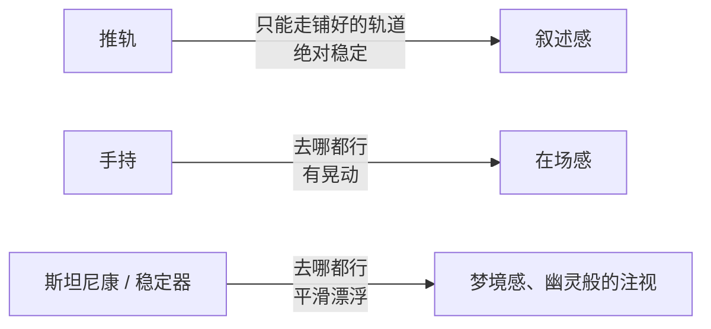
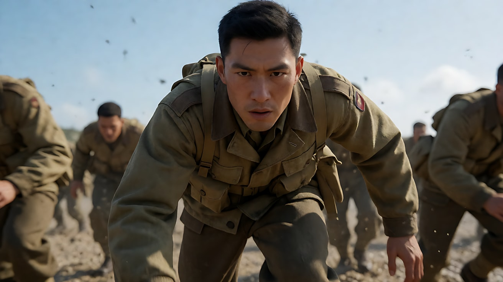
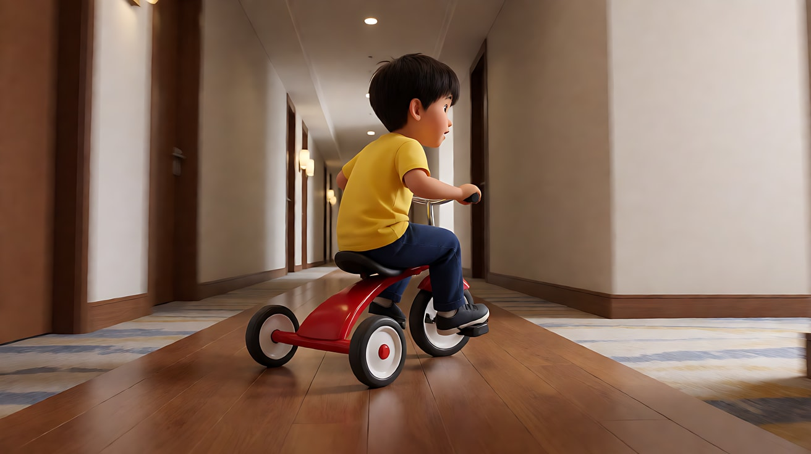
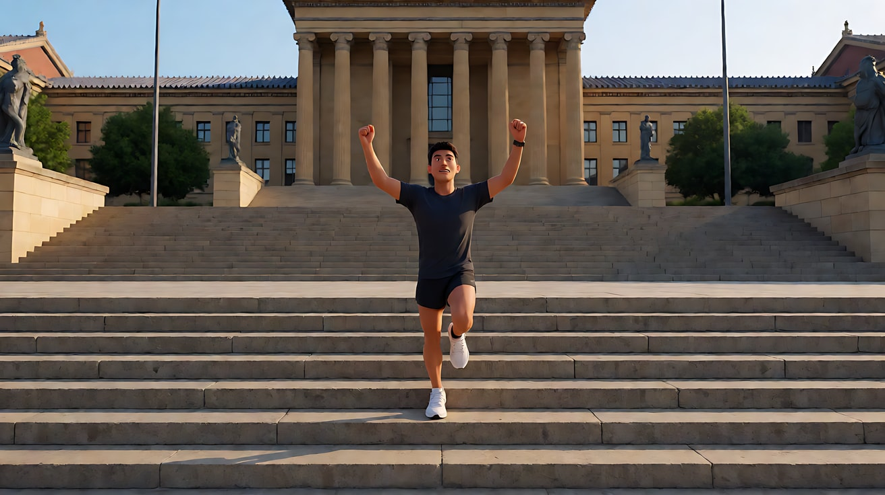

# L05-06 手持与斯坦尼康：有人在拿着摄影机

> 段位：进阶 ｜ 建议用时：55 分钟 ｜ 配套提示词：[L05-06-手持与斯坦尼康-提示词](../提示词/L05-06-手持与斯坦尼康-提示词.md)

## 学习目标

- 能说出手持镜头的三种情绪功能：呼吸感、纪实感、紧张感
- 能把晃动幅度分成四档，并按情绪精确选择，而不是写"镜头晃动"
- 能说清斯坦尼康（身体稳定器）和手持稳定器带来的"漂浮感"与推轨、手持有什么不同
- 能用提示词控制晃动幅度，同时保住人物身份与画面可读性
- 能在一场戏里根据情绪变化切换支撑方式：固定 → 稳定器 → 手持

## 一、概念讲解

### 1. 支撑方式决定"谁在看"

前几课讲的是镜头**怎么动**（推、拉、摇、移、跟、环绕）。这一课讲的是**摄影机被什么托着**，它决定了画面的"质地"：

| 支撑方式 | 画面质地 | 观众感到"谁在看" |
|---|---|---|
| 三脚架 / 推轨 | 绝对稳定，机械精确 | 一个冷静的叙述者 |
| 手持 | 有呼吸、有微小晃动和修正 | 一个在场的人，可能是记者，可能是旁观者 |
| 斯坦尼康 / 稳定器 | 平滑地漂浮移动，没有颠簸 | 一个无形的存在，像幽灵，像梦 |

同一个"跟在人物身后走"，用推轨是叙述，用手持是记录，用稳定器是漂浮的注视。

> 斯坦尼康（Steadicam）是一种穿戴在摄影师身上的减震稳定系统的品牌名，行业里常用它代指这类拍法。**在 Seedance 提示词里不写品牌名，写"稳定器跟拍，画面平滑漂浮"。**

### 2. 手持的三种情绪功能

```
  呼吸感                    纪实感                       紧张感
  ┌────────────┐          ┌────────────┐             ┌────────────┐
  │  ～～～～   │          │ ↔ 跟着反应 │             │ ≋≋≋≋≋≋≋≋  │
  │  [人] 微摆  │          │  [人] 修正 │             │  [人] 颠簸 │
  └────────────┘          └────────────┘             └────────────┘
  幅度：极小，像呼吸        幅度：小，偶尔追焦和补构图    幅度：中到大，节奏随奔跑
  感受：亲密，有人在身边    感受：真实，事情正在发生      感受：慌乱，失控，危险
```

**纪实感的关键不是晃，而是"反应"**：真实的摄影师会因为人物突然转身而慢半拍跟过去，会在对方开口时把镜头稍微移过去。写进提示词里就是："镜头在她说话时轻微地向她偏过去，慢半拍跟上她的转身。"

### 3. 晃动幅度的四档

| 档位 | 名称 | 画面表现 | 适合 | 提示词写法 |
|---|---|---|---|---|
| 1 | 呼吸 | 几乎察觉不到的缓慢起伏 | 亲密对话、安静的情绪特写 | "手持镜头，极轻微的呼吸感起伏" |
| 2 | 轻微 | 小幅度晃动，偶尔修正构图 | 纪实跟随、日常、边走边谈 | "手持镜头，轻微晃动，偶尔追着她的动作修正构图" |
| 3 | 明显 | 晃动清楚可见，随脚步颠簸 | 紧张、争吵、奔跑 | "手持镜头随奔跑明显颠簸，人物始终保持在画面中央" |
| 4 | 剧烈 | 大幅甩动，画面短暂失焦 | 混乱、冲击、爆发的一瞬 | "手持镜头剧烈晃动一下后稳住"——**只用一瞬，不要整段** |

```
  幅度    1 呼吸    2 轻微    3 明显    4 剧烈
          ───────   ───────   ───────   ───────
  情绪    亲密      真实      紧张      混乱
  AI风险  低        低        中        高（脸和手会糊）
```

### 4. 稳定器的漂浮感

斯坦尼康和手持稳定器的画面像"浮在空中滑行"：能像手持一样上楼梯、穿门、绕过家具，却没有手持的颠簸。



| 漂浮感的用途 | 例子 |
|---|---|
| 沉浸式跟随 | 跟着人物穿过一整栋房子 |
| 不安与诡异 | 镜头低低地滑过空荡的走廊，像有东西在跟着 |
| 梦境与回忆 | 镜头缓慢漂浮着环顾一个记忆中的房间 |
| 仪式感 | 跟着新人走过长长的通道 |

### 5. 控制晃动：AI 里的三条底线

1. **幅度写成数字一样精确**：写"轻微""明显"，不写"晃动的镜头""混乱的镜头"。
2. **晃动时锁住主体**："人物始终保持在画面中央""人物脸部始终清楚"。
3. **剧烈晃动只给一瞬**：整段剧烈晃动会让人物身份彻底漂移，也让观众看不清任何东西。

## 二、情绪与叙事功能

| 技法 | 观众的感受 | 常用场景 |
|---|---|---|
| 手持呼吸感特写 | 有人陪在身边，亲密而真实 | 病床边、深夜谈心、哭泣后的沉默 |
| 手持纪实跟随 | 事情正在真实地发生 | 街头、厨房、后台、工作现场 |
| 手持明显晃动 | 紧张、慌乱、身体在危险中 | 争吵、逃离、混乱的现场 |
| 手持剧烈一瞬 | 冲击、被撞到、失去平衡 | 爆炸、摔倒、惊吓 |
| 稳定器漂浮跟随 | 沉浸、流畅地进入一个世界 | 穿过房子、走进派对、走向舞台 |
| 稳定器低位滑行 | 诡异、被注视 | 空荡的走廊、孩子的视角、恐怖片 |
| 从手持切到稳定器 | 混乱平息，情绪落定 | 争吵后的安静、危险过去 |
| 从稳定器切到手持 | 平静被打破 | 坏消息到来、意外开始 |

## 三、经典影片案例

### 《拯救大兵瑞恩》（1998，史蒂文·斯皮尔伯格）奥马哈海滩
- 场景：盟军士兵在诺曼底海滩登陆，冲向敌方阵地。
- 怎么拍的：大量手持镜头紧贴士兵的高度和视线，镜头随冲锋颠簸、蹲下、扑倒；摄影指导贾努什·卡明斯基调整了快门和镜头处理，让画面动态更锐利、颗粒更粗，接近战地新闻影像的质感。
- 为什么这样拍：意图是"让观众感到自己就在海滩上，没有任何安全的位置"。手持把观众的身体放进士兵中间，晃动的幅度就是恐惧的幅度；没有一个稳定的"上帝视角"让观众松一口气。



### 《罗塞塔》（1999，让-皮埃尔·达内、吕克·达内）
- 场景：一个少女为了找到一份工作，在小城里不停地奔走、争执、挣扎。
- 怎么拍的：几乎全片手持，镜头紧跟在她身后或身侧，距离很近，常常只拍到她的后脑和肩膀；她突然转身或加速时，镜头慢半拍追上去。
- 为什么这样拍：意图是"让观众感到她的生活没有一刻喘息"。贴身手持带来强烈的纪实感和呼吸感，镜头像一个跟不上她的旁观者，观众的焦虑和她的焦虑同步。


### 《闪灵》（1980，斯坦利·库布里克）三轮车穿过走廊
- 场景：小男孩丹尼骑着儿童三轮车在空荡的酒店走廊里转来转去。
- 怎么拍的：用斯坦尼康把摄影机放得很低，几乎贴着地面，跟在三轮车后面平滑地滑过一条条走廊；车轮在木地板上响、在地毯上无声，声音一响一停。
- 为什么这样拍：意图是"让观众感到这座空酒店里有什么东西跟着这个孩子"。稳定器的平滑漂浮去掉了"人拿着摄影机"的痕迹，低机位又让镜头不属于任何成年人——观众像在看一个无形存在的视角。



### 《洛奇》（1976，约翰·G·艾维尔森）晨跑上台阶
- 场景：洛奇清晨训练，跑上费城艺术博物馆前的长台阶，在顶端举起双臂。
- 怎么拍的：这是斯坦尼康在电影中最早的著名应用之一，摄影机跟着他一路跑上台阶，画面平稳而有推进感。
- 为什么这样拍：意图是"让观众和他一起一口气冲上顶点"。如果是手持，台阶上的颠簸会让画面变得狼狈；稳定器让奔跑变得流畅有力，登顶的那一刻才像胜利而不是挣扎。



## 四、在 AI 中怎么实现

- **生图阶段**：手持和稳定器镜头的首帧和普通首帧一样画，但可以在关键帧里写 `slightly off-center handheld framing` 或 `low gliding camera height`，让构图带一点"人拿着拍"的随意感或稳定器的低位。
- **视频阶段**：
  - 手持：先写支撑方式和档位（"手持镜头，轻微晃动"），再写镜头的"反应"（"慢半拍跟上她的转身"），最后锁主体（"她始终保持在画面中央，脸部清楚"）。
  - 稳定器：写"稳定器跟拍，画面平滑漂浮，没有颠簸"，再写路线和高度。
- **模型擅长**：轻微手持晃动的纪实质感、手持跟随走路的人、稳定器平滑跟随穿过室内空间、低位滑行。
- **要避开**：
  1. 只写"手持"不写幅度——模型可能给你剧烈晃动，人物身份跟着漂。
  2. 整段剧烈晃动——人脸、手、文字全部糊掉。
  3. 手持特写时要求精细的手部动作——晃动 + 手指 = 双重风险。
  4. 写"斯坦尼康"这类品牌名——改写为"稳定器"。
  5. 写"镜头抖动得很有电影感"——空泛，换成档位和动机。

**提示词骨架：**

```
手持：手持镜头，[呼吸感起伏/轻微晃动/随奔跑明显颠簸]，[镜头的反应：慢半拍跟上、在她开口时偏向她]，
      [人物]始终保持在画面[位置]，脸部清楚。
稳定器：稳定器跟拍，画面平滑漂浮、没有颠簸，镜头保持在[高度]，
        [路线：穿过门厅、绕过沙发、上楼梯]，停在[终点画面]。
```

## 五、练习作业

1. 用手机分别拍三段 5 秒的视频：尽量稳、自然拿着、边走边拍。回放时给它们标上档位（1–3）。
2. 为同一个场景"她在医院走廊里接到电话"设计三个版本：固定、手持轻微、手持明显，写出每个版本的情绪差异。
3. 设计一个稳定器漂浮镜头：镜头从门口进入一个空房间，绕过什么，停在哪里，为什么用漂浮而不是推轨。
4. 完成配套提示词的练习1–5，重点体会练习4的幅度递增。

## 六、自检清单

- [ ] 写明了支撑方式：手持 / 稳定器 / 固定
- [ ] 手持写了档位：呼吸、轻微、明显、剧烈一瞬
- [ ] 写了手持镜头的"反应"，而不仅仅是晃
- [ ] 晃动时锁住了主体位置和脸部清晰度
- [ ] 稳定器镜头写了"平滑漂浮、没有颠簸"和路线
- [ ] 提示词里没有出现"斯坦尼康"等品牌名

## 七、配套提示词

→ [L05-06-手持与斯坦尼康-提示词](../提示词/L05-06-手持与斯坦尼康-提示词.md)

---

上一课：[L05-05 环绕、升降与航拍](L05-05-环绕升降与航拍.md) ｜ 下一课：[L05-07 特殊运镜](L05-07-特殊运镜.md) ｜ [返回总目录](../../README.md)
