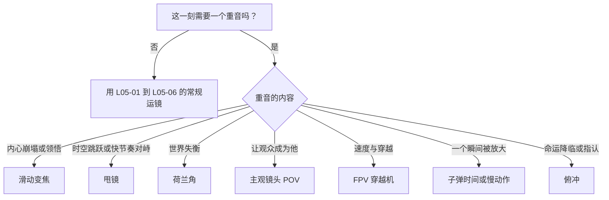
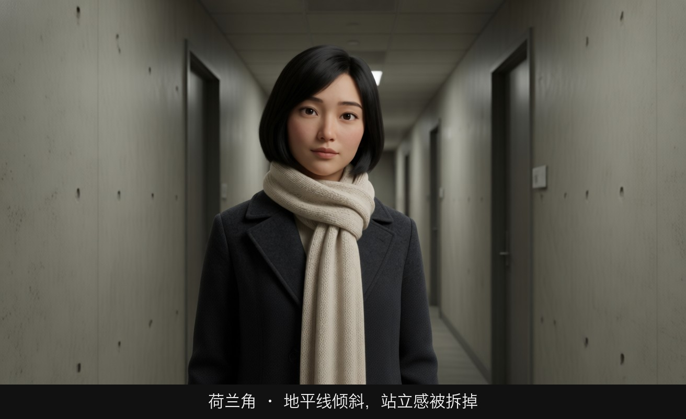
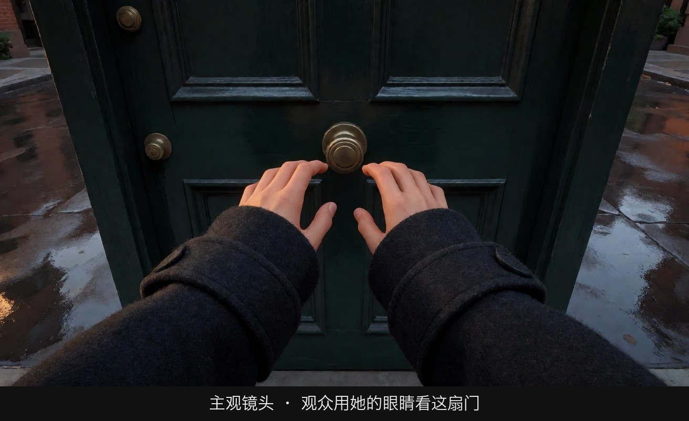
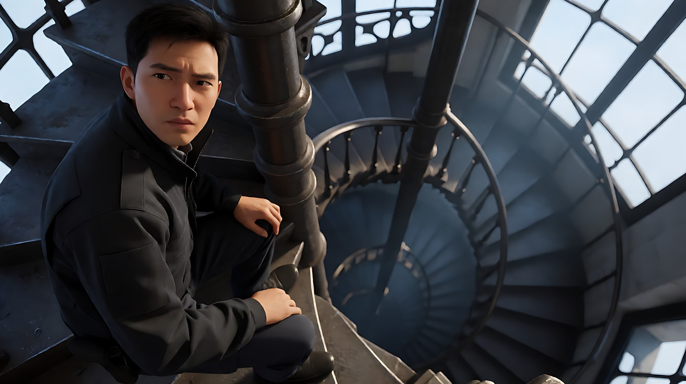
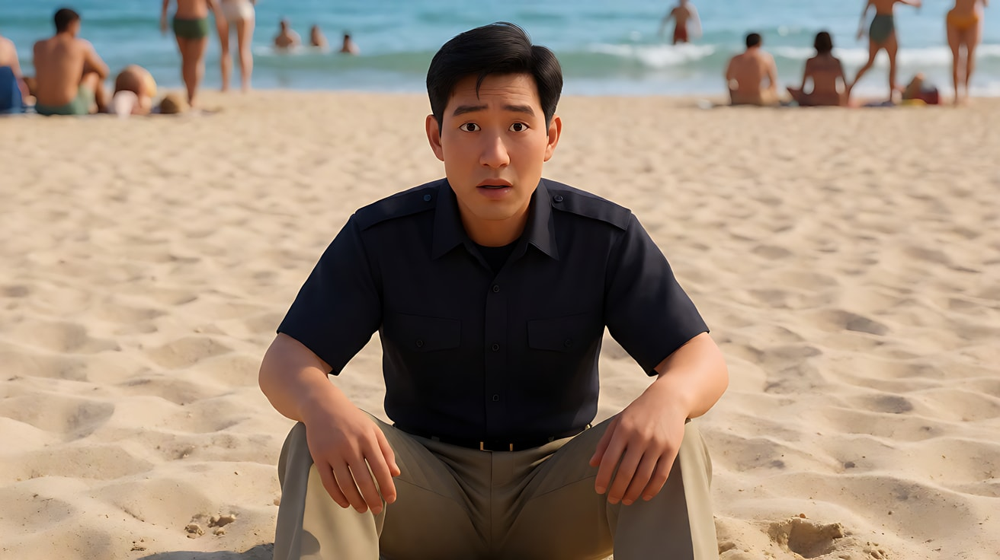
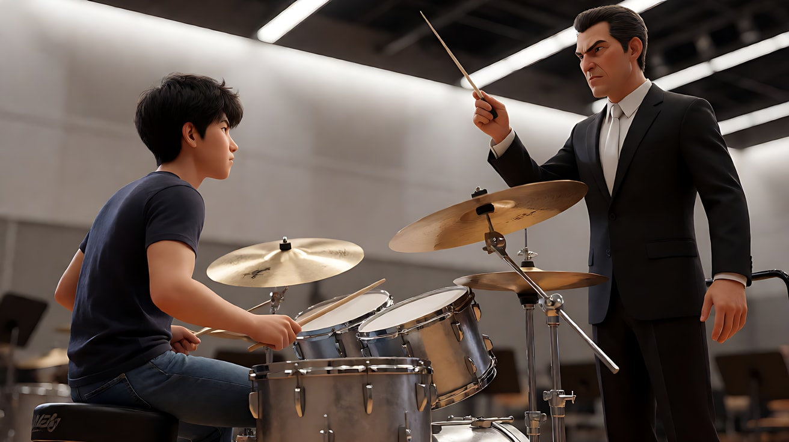
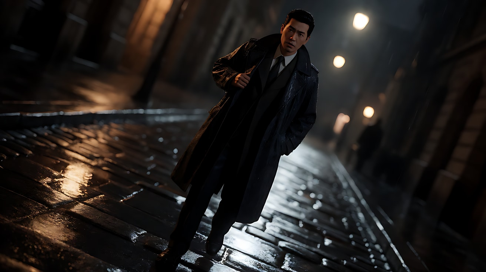
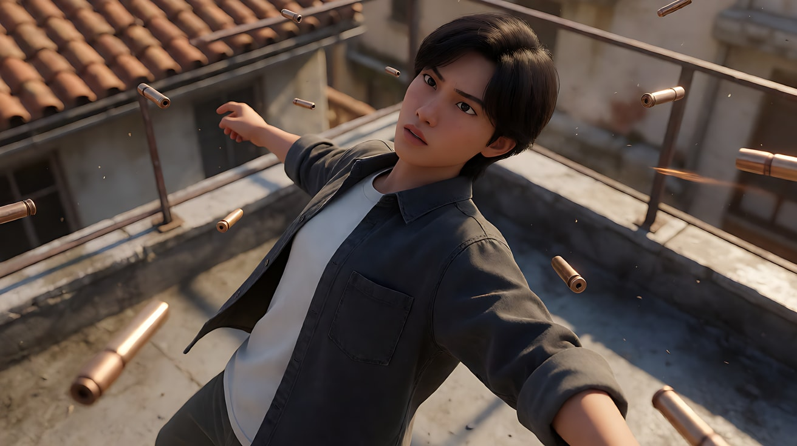
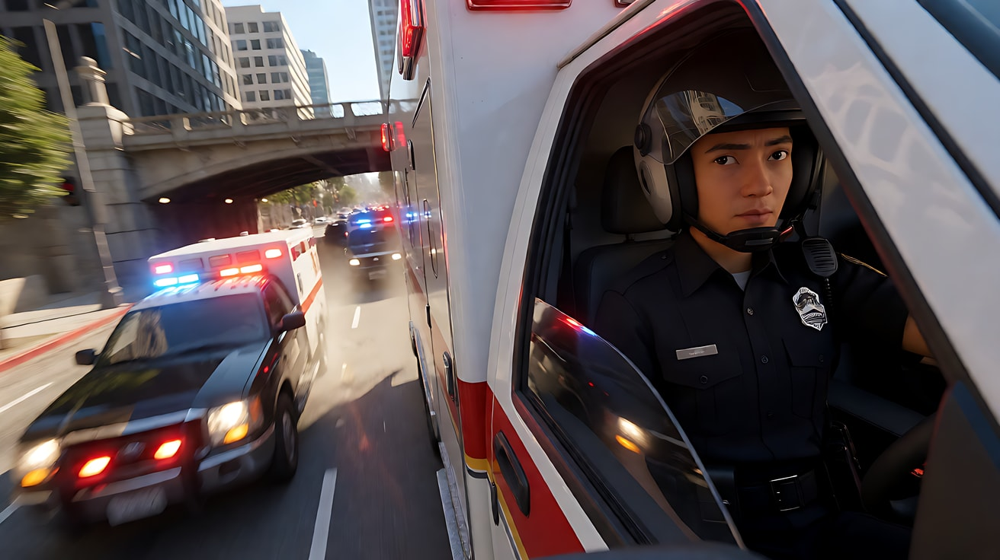

# L05-07 特殊运镜：只在关键时刻用的"重音"

> 段位：进阶 ｜ 建议用时：65 分钟 ｜ 配套提示词：[L05-07-特殊运镜-提示词](../提示词/L05-07-特殊运镜-提示词.md)

## 学习目标

- 能说清七种特殊运镜的原理：滑动变焦（希区柯克变焦）、甩镜、荷兰角、主观镜头 POV、FPV 穿越机、子弹时间与慢动作、俯冲
- 能为每种特殊运镜找到唯一正确的使用时机：它们是"重音"，不是"底色"
- 能把特殊运镜拆成运镜合同五要素写进提示词，而不是只写一个术语
- 能把标准术语配上可见解释，分清课程写作偏好与模型能力
- 能识别各特殊运镜在 AI 生成中的主要风险并提前规避

## 一、概念讲解

### 1. 特殊运镜是"重音"

前面六课的运镜是语言的"正常语速"。这一课的七种运镜是**重音和感叹号**：一部片子里用一两次，观众会记住；每个镜头都用，观众只会觉得累。

| 特殊运镜 | 一句话原理 | 情绪 | AI 难度 |
|---|---|---|---|
| 滑动变焦 | 机位后退的同时焦距推长（或反过来），主体大小不变、背景伸缩 | 眩晕、领悟、世界崩塌 | 高 |
| 甩镜 | 极速水平摇，中途画面拉成运动模糊 | 转场、冲击、快节奏对峙 | 中 |
| 荷兰角 | 画面水平线倾斜 | 失衡、不安、疯狂 | 低 |
| 主观镜头 POV | 镜头就是角色的眼睛 | 代入、窥视、恐惧 | 中 |
| FPV 穿越机 | 小型无人机以第一人称高速穿越狭窄空间 | 速度、刺激、自由 | 中高 |
| 子弹时间 / 慢动作 | 时间变慢或凝固，镜头可在凝固中移动 | 关键瞬间被放大 | 中高 |
| 俯冲 | 镜头从高处快速向下扑向主体 | 冲击、降临、命运落下 | 中 |

### 2. 滑动变焦（Dolly Zoom，俗称"希区柯克变焦"）

```
  起点                                     终点
  ┌──────────────────┐                   ┌──────────────────┐
  │ ▢ ▢ ▢  走廊  ▢ ▢ ▢│                   │▢▢   走廊被拉长  ▢▢│
  │      [人]        │      机位后退 ←    │      [人]        │
  │                  │      焦距推长 →    │   ▢          ▢   │
  └──────────────────┘                   └──────────────────┘
   人物大小不变；背景好像在向后"伸长"（或向前"压过来"）
```

| 组合 | 背景表现 | 情绪 |
|---|---|---|
| 机位前推 + 焦距拉广 | 主体不变，背景向远处"伸长"、空间被拉开 | 世界突然变远，眩晕、坠落感 |
| 机位后退 + 焦距推长 | 主体不变，背景向主体"压过来" | 压迫、领悟、被困住 |

**本课优先写“滑动变焦 + 可见效果”**，训练把术语拆开，例如：“滑动变焦：机位缓慢后退，同时镜头焦距推长，人物在画面中的大小保持不变。”这不是模型禁用人名术语；2.5 官方指南明确允许使用通行运镜词，小众词则补描述性解释。

### 3. 甩镜（Whip Pan）

```
  画面A（清楚）  →   极速水平摇（整个画面拉成横向模糊）   →   画面B（清楚）
  [她在教室]        ≡≡≡≡≡≡≡≡≡≡≡≡≡≡≡≡≡≡≡≡≡≡≡≡≡≡≡≡≡≡           [她在办公室]
                    ↑ 模糊中可以藏一个剪辑点或时空跳跃
```

- **对峙甩镜**：在两个人之间来回甩，节奏像打球（快节奏对话、对决）。
- **转场甩镜**：甩出去是一个地点/时间，甩回来已经是另一个（蒙太奇、时间跳跃）。
- 写法："镜头极速向右甩摇，画面拉成横向运动模糊，模糊散开后停在……"

### 4. 荷兰角（Dutch Angle）

荷兰角是**角度**而不是运动：摄影机绕镜头轴线倾斜，地平线不再水平。它可以是固定倾斜，也可以是一个**滚转运动**（画面逐渐倾斜），后者在本课算运镜。

```
  正常                 荷兰角 15°               荷兰角 30°
  ┌──────────┐        ┌──────────┐            ┌──────────┐
  │──────────│        │ ╲        │            │   ╲      │
  │   [人]   │        │   ╲ [人] │            │  [人]╲   │
  └──────────┘        └──────────┘            └──────────┘
   稳定                 不安                     失控、疯狂
```

用法：心理失衡、醉酒、阴谋、世界不对劲。写法："镜头缓慢向左滚转倾斜约二十度，地平线逐渐歪斜。"

### 5. 主观镜头 POV

镜头 = 角色的眼睛。观众看到角色看到的一切，**看不到角色本人**。

POV 的三个"真实感锚点"：
1. **画面里出现自己的手或身体一部分**（伸手、低头看脚）。
2. **镜头运动符合头部运动**：转头、低头、晃动、眨眼（短暂变暗）。
3. **视线高度符合角色身份**：孩子的视线、坐轮椅的视线、动物的视线。

通常要配一个**反应镜头**（切回角色的脸），观众才知道"这是谁在看"。

### 6. FPV 穿越机

FPV（First Person View）是一种小型竞速无人机，飞手戴眼镜以第一人称操控，能高速穿过窗户、门洞、树林间隙，贴地、翻滚、急升。

- 适合：建筑与空间的连续穿越、极限运动、追逐、开场的"一口气进入世界"。
- 写法："FPV 穿越机视角，贴着地面高速飞行，穿过拱门，沿楼梯扶手急升，从窗户飞出。"
- 风险：路线太复杂时空间会变形；路线要**像一条线**一样清楚，节点不超过三四个。

### 7. 子弹时间与慢动作

| 类型 | 原理 | 画面 |
|---|---|---|
| 慢动作 | 高速拍摄、正常播放，时间变慢 | 水花、飞扬的头发、落下的玻璃一点点展开 |
| 子弹时间 | 时间几乎凝固，镜头却在凝固的时空里正常速度移动（通常是环绕） | 人物腾空不动，镜头绕他转半圈 |
| 变速（速度坡度） | 正常速度 → 突然变慢 → 恢复 | 动作的顶点被拉长，然后猛地落下 |

写法："时间几乎凝固，她悬在空中，发丝和水珠都停住，镜头以正常速度围绕她缓慢环绕半圈，随后时间恢复，她落地。"

### 8. 俯冲

镜头从高处快速向下扑向主体（无人机或摇臂），常常终点是一个很近的俯视或平视。

- 情绪：降临、命运压下来、"就是他"的指认、冲击。
- 写法："镜头从高空快速向下俯冲，直扑广场中央的她，在她头顶上方减速停住。"

### 9. 选择特殊运镜的决策



## 图解

> 这些示意图由多种生图模型分别生成（包括 Nano Banana、GPT Image 等），只用来说明镜头概念；不同模型的画面不能互相比较效果，也不能当作视频成片。




地平线斜了。人还站直，世界先歪了。不安来自画框，不来自她的表情。



看不见她的脸，只能看见她的袖口和她正在看的那扇绿门。观众暂时用她的眼睛看。

## 二、情绪与叙事功能

| 技法 | 观众的感受 | 常用场景 | 起始 → 终点示例 |
|---|---|---|---|
| 滑动变焦 | 世界在脚下变形 | 震惊、恐高、领悟真相 | 中近景人物 → 同样大小的人物，背景被压近 |
| 甩镜对峙 | 节奏紧、你来我往 | 对决、争吵、竞赛 | 人物A → 模糊 → 人物B |
| 甩镜转场 | 时间或地点一下跳过去 | 蒙太奇、回忆、平行剪辑 | 童年教室 → 模糊 → 成年办公室 |
| 荷兰角 | 不对劲、失衡 | 阴谋、醉酒、精神失控 | 水平画面 → 逐渐倾斜 |
| 主观镜头 | 我就是他 | 恐怖、窥视、醒来、第一次看见 | 模糊 → 清楚的眼前世界 |
| FPV 穿越 | 速度、自由、刺激 | 开场、运动、追逐 | 远处入口 → 穿过空间 → 主体 |
| 子弹时间 | 一瞬间被放大到可以绕着看 | 动作高潮、命运瞬间 | 腾空 → 凝固环绕 → 落地 |
| 慢动作 | 美、悲伤或冲击被延长 | 重逢、失去、碰撞 | 正常速度 → 慢 → 正常 |
| 俯冲 | 降临、指认 | 主角登场、命运落下 | 高空大远景 → 主体头顶 |

## 三、经典影片案例

### 《迷魂记》（1958，阿尔弗雷德·希区柯克）钟楼楼梯
- 场景：患有恐高症的前警探追上钟楼，从楼梯井往下看。
- 怎么拍的：从他的主观视角俯视楼梯井时，镜头一边向后移动一边推长焦距（片中用缩微模型拍摄），楼梯井的纵深在画面里好像被拉伸、扭曲，而画框本身并没有移开。
- 为什么这样拍：意图是"让观众亲身体验他的眩晕"。普通的俯视只能告诉观众"很高"，滑动变焦让空间本身变形，观众的胃跟着往下沉。



### 《大白鲨》（1975，史蒂文·斯皮尔伯格）海滩
- 场景：警长坐在海滩上，盯着水里的游客，突然看到鲨鱼袭击。
- 怎么拍的：在他意识到发生了什么的瞬间，镜头对着他的脸做滑动变焦：镜头向他推近的同时焦距拉广，他在画面中的大小几乎不变，身后的海滩背景却好像突然向后退开、被拉远。
- 为什么这样拍：意图是"让观众感到他最害怕的事情变成了现实"。这一刻他周围的世界仿佛一下子被抽离，只剩他和那片海，滑动变焦把这种心理上的空间变化直接拍了出来。



### 《爆裂鼓手》（2014，达米恩·查泽雷）
- 场景：年轻鼓手与严苛的乐队指挥在排练与演出中的对峙。
- 怎么拍的：大量快速甩镜在鼓手、鼓、指挥之间来回切换，甩镜的节奏和鼓点同步；结尾的演出段落里甩镜成为两人"对话"的主要方式。
- 为什么这样拍：意图是"让观众感到两人之间是一场没有台词的决斗"。甩镜把镜头变成了一个在两人之间来回挥击的球，音乐的节奏就是剪辑的节奏。



### 《第三个人》（1949，卡罗尔·里德）
- 场景：战后的维也纳，美国作家调查朋友的离奇死亡。
- 怎么拍的：大量倾斜的荷兰角构图，配合高反差的夜景光影和湿漉漉的街道。
- 为什么这样拍：意图是"让观众感到这座城市的秩序已经歪了"。战后的维也纳被分区占领、黑市横行，没有一个人可以完全信任，倾斜的地平线就是这种道德失衡的视觉化。



### 《黑客帝国》（1999，沃卓斯基姐妹）屋顶
- 场景：主角在屋顶上向后仰身，闪避一连串飞来的子弹。
- 怎么拍的：用环形排列的大量静态相机按顺序拍摄，配合计算机插帧，形成"时间几乎凝固、镜头却能绕着人物转"的子弹时间效果。
- 为什么这样拍：意图是"让观众感到他开始超越这个世界的规则"。时间变慢是他的感知，镜头还能自由环绕，说明观众此刻站在了一个普通人不可能有的视角里。



### 《Ambulance》（2022，迈克尔·贝）
- 场景：一场贯穿洛杉矶的救护车追逐。
- 怎么拍的：大量使用 FPV 穿越机镜头，镜头沿摩天楼外墙高速俯冲而下，在追逐车辆之间、桥下、车辆周围穿梭。
- 为什么这样拍：意图是"让观众始终处于速度之中，没有一个安稳的观察点"。FPV 能把俯冲、跟车、穿越连成一条不间断的飞行线，传统航拍和车载拍不出这种贴近与失重感。



## 四、在 AI 中怎么实现

- **生图阶段**：
  - 滑动变焦：首帧画出主体和**有明显纵深线条的背景**（走廊、街道、楼梯井），没有纵深，变焦效果看不出来。
  - 甩镜转场：首帧和尾帧分别画两个时空，构图里主体的位置最好相近（例如都在画左窗边），甩完更像"同一个人在两个时间"。
  - POV：首帧要画出画面下沿的手或身体局部，并写 `first-person point of view`。
  - 荷兰角：直接在关键帧写 `Dutch angle tilted twenty degrees`。
  - 子弹时间：画一张"凝固瞬间"关键帧作为中点或尾帧参考。
- **视频阶段**：每个特殊运镜都按五要素写：起始构图 → 物理运动方式 → 速度 → 终点画面 → 动机。不要只写术语。
- **模型擅长**：甩镜的运动模糊、荷兰角倾斜、慢动作的水与发丝、FPV 式贴地高速飞行、高空俯冲。
- **要避开**：
  1. 只写人名、片名或术语，却不说明想要的可见结果；课程优先物理描述，不把它解释成模型禁令。
  2. 一个镜头里叠两个特殊运镜（甩镜 + 滑动变焦）。
  3. FPV 路线节点很多却没有空间预演，容易出现空间错误；三四节点是入门建议，不是模型上限。
  4. 子弹时间里让多个人同时凝固又移动——只凝固一个主体。
  5. 滑动变焦的背景太空——必须有走廊、楼梯、街道这样的纵深线条。
  6. 整段 POV 没有反应镜头——观众不知道是谁在看。

**特殊运镜的提示词速查：**

| 运镜 | 可直接用的写法 |
|---|---|
| 滑动变焦 | "滑动变焦：机位缓慢后退，同时镜头焦距推长，人物大小保持不变，身后的走廊向他压过来" |
| 甩镜 | "镜头极速向右甩摇，画面拉成横向运动模糊，模糊散开后停在……" |
| 荷兰角 | "镜头缓慢向左滚转，画面倾斜约二十度，地平线歪斜" |
| POV | "第一人称主观视角，画面下沿可见她自己的双手，镜头随她的头部转动" |
| FPV | "FPV 穿越机视角，贴地高速飞行，穿过拱门，沿楼梯急升，从窗口飞出" |
| 子弹时间 | "时间几乎凝固，他悬在半空，水珠停住，镜头以正常速度围绕他环绕半圈" |
| 慢动作 | "动作变为慢动作，水花一点点展开，随后恢复正常速度" |
| 俯冲 | "镜头从高空快速向下俯冲，直扑她的头顶，在她上方减速停住" |

## 五、练习作业

1. 选一部你看过的电影，找出一个特殊运镜，用运镜合同五要素把它写下来，并说出为什么这一刻需要"重音"。
2. 为"她得知自己被骗了"设计一个滑动变焦：她在什么空间里？背景的纵深线条是什么？背景是压过来还是伸出去？
3. 设计一个甩镜转场：从哪一个时空甩到哪一个时空？两个画面中主体的位置如何呼应？
4. 完成配套提示词的练习1–5。

## 六、自检清单

- [ ] 这一刻真的需要特殊运镜（是重音，不是装饰）
- [ ] 特殊运镜按五要素写出了起始、方式、速度、终点、动机
- [ ] 提示词里没有导演名、片名，只写物理描述
- [ ] 一个镜头里只用一个特殊运镜
- [ ] 滑动变焦的背景有足够的纵深线条
- [ ] POV 镜头有身体锚点，并配了反应镜头
- [ ] FPV 路线节点不超过四个

## 七、配套提示词

→ [L05-07-特殊运镜-提示词](../提示词/L05-07-特殊运镜-提示词.md)

---

上一课：[L05-06 手持与斯坦尼康](L05-06-手持与斯坦尼康.md) ｜ 下一课：[L05-08 一镜到底与长镜头调度](L05-08-一镜到底与长镜头调度.md) ｜ [返回总目录](../../README.md)
