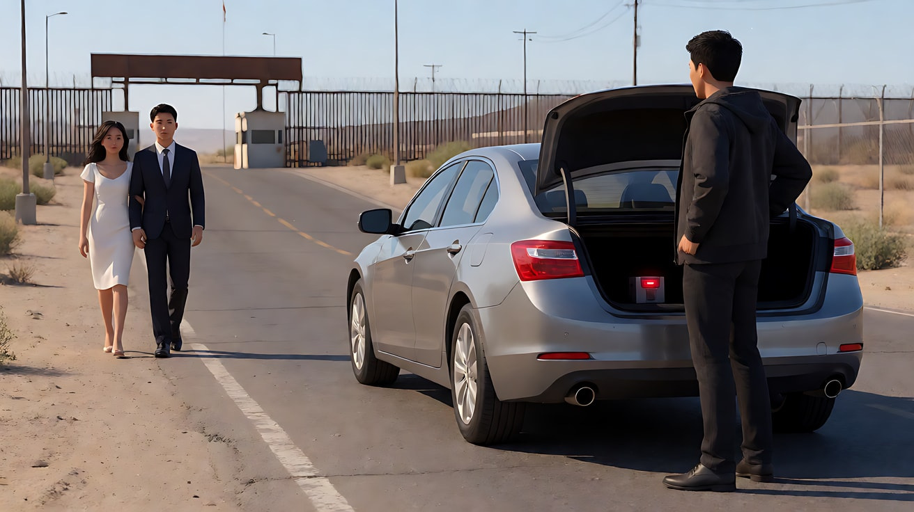
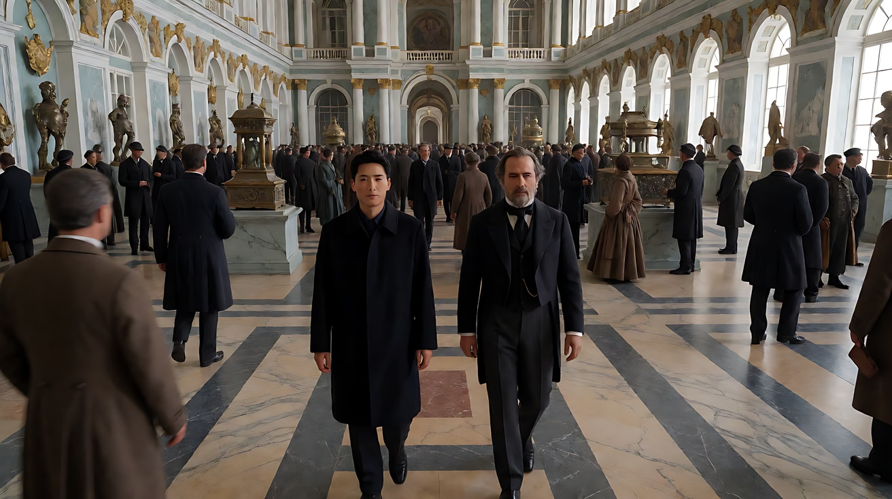
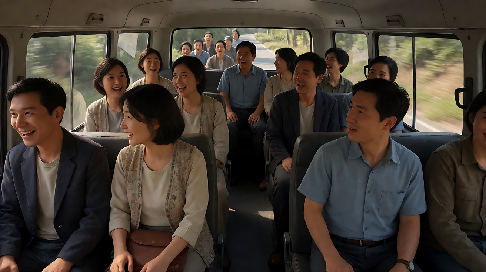
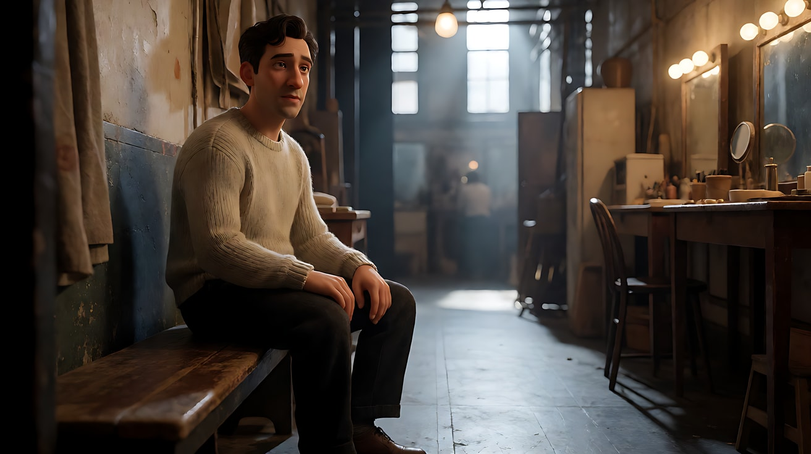

# L05-08 一镜到底与长镜头调度：在一个镜头里完成一场戏

> 段位：进阶 ｜ 建议用时：70 分钟 ｜ 配套提示词：[L05-08-一镜到底与长镜头调度-提示词](../提示词/L05-08-一镜到底与长镜头调度-提示词.md)

## 学习目标

- 能区分"长镜头"和"一镜到底"，并说出导演选择不切镜头的三个理由
- 能画出长镜头的**空间路线图**，并在路线上标出节点（每个节点就是一个"镜头内的镜头"）
- 能用**演员调度**和**摄影机调度**两种方式在一个镜头里改变景别与重心
- 能用阶段词或连续时间轴组织一镜到底，每次运动变化都有动机
- 了解单次生成、原视频延长和尾帧接续的区别，不把时长上限当成叙事目标

## 一、概念讲解

### 1. 长镜头与一镜到底

| 概念 | 定义 | 例子 |
|---|---|---|
| 长镜头（Long take） | 一个持续时间明显较长、不切的镜头，可以是固定也可以是运动 | 一段两分钟不切的对话 |
| 一镜到底（One-shot / Oner） | 一整场戏甚至一整部片看起来只有一个镜头，通常伴随复杂的运镜和调度 | 跟着人物从街上走进餐厅后厨再到舞台 |
| 隐藏剪辑 | 在遮挡、黑暗、甩镜、前景划过的瞬间藏一个剪辑点，让多个镜头看起来像一个 | 镜头经过一根柱子，柱子挡住全画面的那一帧就是剪辑点 |

### 2. 为什么不切

```
  切镜：导演替观众选择看哪里          不切：观众和角色一起"活过"这段时间
  ┌───┐┌───┐┌───┐┌───┐                ┌───────────────────────────────┐
  │ A ││ B ││ C ││ D │                │  A ────▶ B ────▶ C ────▶ D     │
  └───┘└───┘└───┘└───┘                └───────────────────────────────┘
  节奏由剪辑控制                       节奏由调度控制
  时间可以压缩                         时间是真实的，不能偷懒
```

导演选择一镜到底的三个理由：
1. **真实时间**：观众无法通过剪辑"跳过"等待和危险，紧张感真实累积。
2. **空间连续**：观众清楚地知道每个地方之间的距离和关系，地理被身体记住。
3. **沉浸与见证**：镜头像一个跟着走的人，观众"在场"，而不是"看剪好的片子"。

但不切也有代价：**没有剪辑来修正节奏**，所以长镜头必须靠精密的调度来制造变化。

### 3. 空间路线图

设计长镜头的第一步不是写提示词，而是**画平面图**：

```
              ┌──────────────── 餐厅 ────────────────┐
              │                                     │
              │   ④ 终点：靠窗的桌子                │
              │      [情侣] ◀───┐                   │
              │                 │ 镜头跟随服务员     │
              └────────── 门 ───┼────────────────────┘
                               │
              ┌──────────── 后厨 ───────────────────┐
              │  ② 出菜口   ③ 推开弹簧门            │
              │   ▣ ◀──────── ▣                     │
              │   ▲                                 │
              │   │ 镜头后拉，服务员接过盘子         │
              │  ① 起点：厨师摆盘（特写）            │
              └─────────────────────────────────────┘

  节点：① 摆盘特写 → ② 出菜口交接 → ③ 穿过弹簧门 → ④ 菜上桌
```

每个节点就是**一个"镜头内的镜头"**：它有自己的景别、构图、主体和信息。节点之间的移动是"转场"。

### 4. 两种调度：谁在动

| 调度方式 | 怎么改变景别 | 优点 | 例子 |
|---|---|---|---|
| 演员调度 | 机位基本不动，演员走近或走远 | 稳定、表演连贯、AI 最稳 | 人物从背景深处走到前景近景 |
| 摄影机调度 | 演员相对固定，镜头移动、推拉、绕行 | 空间展开、观众"走进去" | 镜头穿过门、上楼梯、绕过桌子 |
| 两者结合 | 演员与镜头一起移动，相对位置不断变化 | 最丰富，也最难 | 跟拍到途中超过人物，再回头拍她的正面 |


### 5. 长镜头的"镜头内剪辑"

一个好的长镜头内部仍然有节奏变化，只是不靠剪辑：

| 变化手段 | 在长镜头里怎么实现 |
|---|---|
| 景别变化 | 演员走近/走远，或镜头推近/后拉 |
| 重心转移 | 第二个人物进入画面，镜头转向他 |
| 空间转换 | 穿过门、窗、拐角，进入新空间 |
| 光的变化 | 从室内暖光走到室外天光，从暗处走进亮处 |
| 速度变化 | 慢走 → 奔跑 → 停下 |
| 声音变化 | 推开门的瞬间，音乐涌进来 |

### 6. Seedance 一镜到底的写法

不需要精确落点时，用**阶段词**组织顺序即可。2.0 通常推荐这种写法；2.5 也支持整数秒时间轴，区间应连续。两种写法都必须说明节点之间怎么过渡：

```
全程一镜到底，不切镜头。[支撑方式与整体路线]。
起初，[节点1：构图、主体、动作]。
随后，[转场方式：镜头跟随她穿过……]，[节点2：构图、主体、动作]。
最后，[转场方式]，[节点3：终点画面，停在哪]。
```

| 写法要点 | 原因 |
|---|---|
| 清楚写明"全程一镜到底，不切镜头" | 表明连续运动意图，但不保证不会生成切镜 |
| 每个阶段写清"镜头怎么从上一个节点到这一个节点" | 缺少过渡容易导致跳切或瞬移 |
| 入门每阶段安排一个注意力中心，进阶再安排多人交接 | 观众需要知道这一刻看谁，其他人仍可自然活动 |
| 短练习先尝试 2–3 个节点，再按结果增减 | 课程建议，不是阶段数上限；不要按时长线性增加动作 |
| 每个新空间都给一张场景参考图 | 模型不知道门后是什么，就会编 |
| 结尾选好"终点类型"：落定，还是为接续保留运动 | 要接续的镜头，结尾运动不能停 |

### 7. Seedance 一镜到底的限制

```
  ┌───────────────────────────────────────────────────────────────┐
  │ 单次时长按版本核对    →  2.5 最长30秒，不必每次用满              │
  │ 阶段多 → 可能被压缩   →  按动作负载决定简化、加时长或拆分        │
  │ 路线长 → 空间漂移     →  每个新空间配参考图，路线写成一条线      │
  │ 时间长 → 身份漂移     →  定妆图 + 【锁定】服装与发型             │
  │ 场景变 → 模型想切镜   →  "全程一镜到底，不切镜头"写两遍          │
  │ 精细动作 → 运动中崩坏 →  长镜头里只用大而简单的动作              │
  └───────────────────────────────────────────────────────────────┘
```

**接续延长长镜头**：
1. 第一段结尾选"延展锚点"：镜头运动、人物视线、环境声都还在继续，不要停住。
2. 尾帧路线：从已接受结果取清楚的结尾画面，在专门首帧任务指定它，或明确降级为普通参考；写明运动方向、速度与动作阶段。静态图本身不能保存运动速度和声音。
3. 第二段的第一个阶段要继续第一段结尾的运动方向和速度。
4. 原视频路线：支持延长任务时，以已接受视频为源，指定向后延长及新增事件；不要把源视频仅当作“运镜风格参考”。延长次数与入口边界见 [A-04](../../附录/A-04-官方案例与版本差异.md)。
5. 两段之间的接缝可以藏在遮挡物划过、穿过门框或镜头掠过黑暗处的瞬间。

### 8. 长段落靠关系变化，不靠运镜堆叠

把路线写成“起点 → 地标 → 主体交接 → 运镜过渡 → 终点”。例如先看演员整理衣领，工作人员入画递道具，摄影机随接道具的动作转向通道，再跟演员穿过幕布。每次移动都回答一个新的叙事问题。

**官方案例**：[歌手从后台登台](../../附录/A-04-官方案例与版本差异.md#case-longtake)展示了这种空间推进。**课程练习**：配套练习5保留两段短版，另给 30 秒连续版。长版不是质量升级按钮，只有新增节点确实带来新信息才值得用。


官方案例关键帧「后台登台」，媒体 00:14。递麦把通道变成任务交接点，人物移动才有叙事意义；静态图不能证明全程无切镜。来源：[官方发布文](https://seed.bytedance.com/zh/blog/one-take-creation-flexible-referencing-introducing-seedance-2-5)，[完整图组与引用说明](../../附录/A-04-官方案例与版本差异.md#case-longtake)。

## 二、情绪与叙事功能

| 技法 | 观众的感受 | 常用场景 |
|---|---|---|
| 固定长镜头 | 屏住呼吸，看完整场表演 | 争吵、告白、沉默的对峙 |
| 跟随型一镜到底 | 和角色一起走完这段路 | 走进一个世界、赶时间、逃离 |
| 多空间穿越的一镜到底 | 世界是连续的，一切同时发生 | 派对、后台、战场、开场介绍 |
| 演员调度长镜头 | 关系在空间里变化 | 两人靠近又分开、家庭群戏 |
| 隐藏剪辑的伪一镜到底 | 沉浸且节奏可控 | 长篇叙事、复杂动作戏 |
| 长镜头结尾突然切镜 | 连续被打断，冲击 | 灾难发生、情绪崩溃的一刻 |

## 三、经典影片案例

### 《历劫佳人》（1958，奥逊·威尔斯）开场
- 场景：美墨边境小镇，有人把一个定时装置放进一辆汽车的后备箱，汽车驶向边境。
- 怎么拍的：一个约三分多钟的连续升降镜头，从装置的特写开始，摇臂升起俯瞰街道，跟随汽车穿过小镇，中途与一对步行的新婚夫妇交错、并行，一直到边境检查站；汽车驶离检查站后，这对夫妇停下来亲吻，画外传来一声巨响，镜头才第一次切开。
- 为什么这样拍：意图是"让观众一直知道危险就在那辆车里，而画面里的人都不知道"。不切镜头意味着观众无法从危险中"跳开"，汽车每次出画又入画，观众的心就悬一次。



### 《俄罗斯方舟》（2002，亚历山大·索库洛夫）
- 场景：一位无形的叙述者和一位十九世纪的外交官穿过圣彼得堡冬宫的一个个大厅，遇见三百年间的历史人物与事件。
- 怎么拍的：整部影片约九十多分钟只有一个镜头，用斯坦尼康在冬宫内连续拍摄，穿过数十个展厅，调度了上千名演员和群众演员，最后以一场盛大的舞会和人群离场结束。
- 为什么这样拍：意图是"让观众感到历史是一条连续流动的长河"。一个房间就是一个时代，镜头不切，时代与时代之间就没有边界，观众像幽灵一样在历史里漫游。



### 《人类之子》（2006，阿方索·卡隆）车内遇袭
- 场景：主角与几个同伴乘车在乡间公路上行驶，聊天说笑，突然遭到一群人从树林里冲出来袭击。
- 怎么拍的：摄影机装在一套可以在车厢内移动和旋转的特制设备上，镜头在车内的乘客之间来回转动、推近、后退，从轻松的聊天一直拍到突然的混乱和车辆倒退逃离，中间没有切镜。
- 为什么这样拍：意图是"让观众和车里的人一样，没有任何准备，也无处可逃"。轻松的对话让观众放下戒备，危险在同一个镜头里突然到来，观众被困在狭小的车厢里，与人物共同经历这一切。



### 《鸟人》（2014，亚利桑德罗·冈萨雷斯·伊纳里图）
- 场景：一个过气演员在百老汇剧院排演话剧的几天。
- 怎么拍的：全片被设计成看起来几乎只有一个连续的镜头，镜头在后台走廊、化妆间、舞台、屋顶、街道之间穿行；实际上由多个长镜头通过隐藏剪辑（经过黑暗走廊、墙面、时间流逝的天空）拼接而成。
- 为什么这样拍：意图是"让观众感到他被困在自己的焦虑里，没有喘息"。镜头不停地跟着他、围着他，连时间的流逝也被处理成镜头的连续运动，就像他的一天从来没有真正结束。



## 四、在 AI 中怎么实现

- **生图阶段**：
  1. 先画平面路线图（纸上即可），标出节点。
  2. 为路线上**每一个新空间**生成一张场景参考图（不超过 3–4 张）。
  3. 生成首帧；如果终点构图很重要，再生成尾帧。
  4. 多人时明确每个人的素材映射，优先清楚的独立图；不为省数量把多人多视图塞成难以辨认的拼图。
- **视频阶段**：
  - 开头写"全程一镜到底，不切镜头"，再写支撑方式（稳定器、手持、航拍）。
  - 用"起初 / 随后 / 最后"写阶段，每个阶段写**过渡方式 + 节点画面 + 主体动作**。
  - 【约束】里再写一次"不切镜头、不跳切"。
  - 结尾按用途选择：独立成片就"落定"；要接续就"保留运动"。
- **模型擅长**：一条方向清楚的跟随路线、穿过一扇门进入新空间、从室内走到室外、2–3 个阶段的连续运动。
- **要避开**：
  1. 不看动作负载，只凭总时长塞入很多阶段，可能导致压缩或跳切。
  2. 路线来回折返——空间会扭曲。路线要像一条线，尽量单向。
  3. 长镜头里安排精细动作或多人对话——身份与口型最容易崩。
  4. 不给新空间参考图——"门后是什么"全靠模型猜。
  5. 时间轴区间不连续、同一时刻运动冲突，或要求逐帧准确；2.5 可用时间戳，2.0 优先用阶段词。

## 五、练习作业

1. 选一个你熟悉的空间（家、学校、办公室），画一张平面图，设计一条一镜到底的路线，标出 3 个节点，写出每个节点的景别和主体动作。
2. 把同一段情节写成两个版本：三镜头分镜版和一镜到底三阶段版。比较两个版本在"观众看到什么、什么时候看到"上的差别。
3. 设计一个"演员调度"长镜头：机位几乎不动，靠两个人物的走位完成全景 → 双人中景 → 单人近景的变化。
4. 完成配套提示词的练习1–5；练习5比较两段接续与 30 秒连续版，记录空间、动作与声音问题，而非只比较时长。

## 六、自检清单

- [ ] 我画了空间路线图，并标出了节点
- [ ] 开头和约束里都写了"全程一镜到底，不切镜头"
- [ ] 阶段词或时间轴顺序清楚；若用时间轴，区间连续
- [ ] 每个阶段都写了从上一个节点过来的过渡方式
- [ ] 动作负载与时长匹配，每个节点都有新的叙事信息
- [ ] 每个新空间都有参考图
- [ ] 结尾类型明确：落定，还是为接续保留运动

## 七、配套提示词

→ [L05-08-一镜到底与长镜头调度-提示词](../提示词/L05-08-一镜到底与长镜头调度-提示词.md)

---

上一课：[L05-07 特殊运镜](L05-07-特殊运镜.md) ｜ 下一课：[L06-01 镜头合同](../../06-镜头语言综合与分镜/教学/L06-01-镜头合同.md) ｜ [返回总目录](../../README.md)
