# L06-01 镜头合同 · 提示词

> 本组练习：先填镜头合同，再把合同逐格翻译成生图与 Seedance 提示词，并练习六种结尾形态。｜ 配套教学：[L06-01-镜头合同](../教学/L06-01-镜头合同.md) ｜ 规范：[写作规范](../../模板/写作规范.md)
>
> 画风默认使用开关 A（风格化写实 CG）。如改用 2D 动画，删掉所有焦段、光圈、景深词。

---

### 练习1：一张填满的合同 → 收束结尾（难度 ★）

**目标**：体验"合同先行"。先把十一格填满，再写提示词，提示词里的每句话都能在合同里找到出处。结尾形态：收束。

**镜头合同**

| 格子 | 决定 |
|---|---|
| 意图 | 让观众感到老人修好了一件以为修不好的东西 |
| 景别 | 中近景（胸部以上 + 工作台面） |
| 焦段 / 景深 | 85mm，浅景深，背景墙上的钟虚成光斑 |
| 构图 | 人物在右三分之一，面朝画左；左侧留给台灯和钟表零件 |
| 光影 | 画左一盏暖色台灯做主光，窗外冷色暮光做轮廓；灯下有细微灰尘 |
| 运镜 | 轨道缓慢推近，从中近景推到近景 |
| 起始帧 | 他戴着放大镜低头，镊子夹着一枚小齿轮 |
| 终点帧 | 他摘下放大镜，抬眼看向画左，桌上的怀表秒针在走 |
| 易损锚点 | 手指与镊子；怀表表盘形状 |
| 结尾形态 | 收束：动作完成，画面停稳 |
| 声音 | 无配乐；齿轮咬合的轻响，怀表开始滴答 |

**【生图 · Nano Banana】**

图1 关键帧（起始帧）：

```
A medium close-up of an original elderly watchmaker in his seventies, thin white hair, a brown knitted vest over a pale blue shirt,
a jeweler's loupe over his right eye, holding fine tweezers with a tiny brass gear above an open pocket watch on a cluttered workbench.
He is placed on the right third of the frame, facing frame left; tools and watch parts fill the left side.
Camera at seated eye level, 85mm lens, shallow depth of field, the wall clocks behind him dissolving into soft round highlights.
Lighting: a warm desk lamp from frame left as key light, cool blue dusk light from a window behind him as rim light,
fine dust floating in the lamp beam.
Stylized semi-realistic 3D CG rendering, feature-film animation quality. Aspect ratio 16:9.
```

中文释义：中近景，老钟表匠在右三分之一，面朝画左；右眼戴放大镜，镊子夹小铜齿轮在打开的怀表上方；坐姿平视、85mm、浅景深，背后墙上的钟虚成光斑；画左暖台灯做主光，背后窗外冷色暮光勾轮廓，灯下有灰尘。

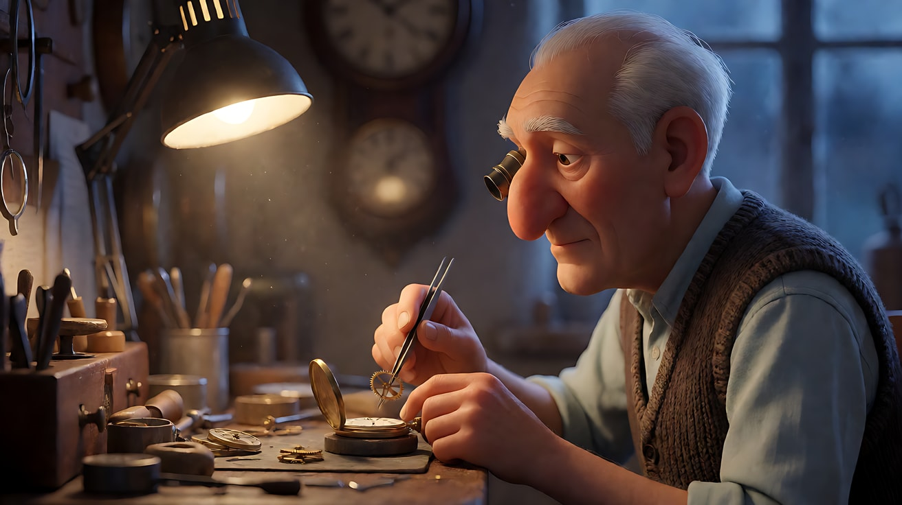

**【图生视频 · Seedance】**

```
【素材分工】@图片1 为首帧，锁定人物身份、服装、工作台布局与怀表外形。
【画风】风格化写实三维CG质感，电影级布光。
镜头：中近景，平视，长焦压缩感，浅景深。镜头从老人低头夹齿轮的中近景开始，沿轨道极慢地向前推近，同时老人把小齿轮放进怀表，镊子轻轻一压，停住；他用左手摘下放大镜，抬眼看向画左，桌上怀表的秒针开始走动。镜头推到近景后停稳，结束在他看向画左、怀表秒针在走的画面。画左暖色台灯照亮他的手和脸，背后窗外冷色暮光保持不变，灯光里灰尘缓慢飘动。
【声音】无配乐，齿轮落位的一声轻响，随后怀表清晰的滴答声，远处墙上的钟低低摆动。
【约束】保持人物脸型、发型、服装不变；镊子始终在右手，只夹一枚齿轮；怀表外形不变；不要字幕、水印、Logo。
时长：8秒
```

**参数**：时长 8 秒 ｜ 画幅 16:9

**【检查点】**
- 推近是否只有一个方向、速度均匀，最后停稳
- 终点帧是否同时看得见他的眼睛和走动的秒针
- 手指和镊子是否保持完整

**【常见问题与修复】**
| 现象 | 修复 |
|---|---|
| 推近后又开始环绕或上摇 | 删掉正文中所有其他运动词，加"镜头只向前推，不转向" |
| 秒针没有走 | 把"秒针开始走动"放在动作句的最后，并在声音里写滴答声与之对应 |
| 结尾还在漂移 | 加"推到近景后镜头完全静止" |
| 手指变多或镊子消失 | 减少手部动作，删掉"轻轻一压"，只保留"放进去、摘下放大镜" |

---

### 练习2：同一合同，两种结尾——收束 vs 延长锚点（难度 ★★）

**目标**：只改合同里的"结尾形态"一格，看最后一句提示词如何改变整个片段的去向。版本 A 单独成片；版本 B 要被下一段接住。

**镜头合同（只列两版不同的格子）**

| 格子 | 版本 A：收束 | 版本 B：延长锚点 |
|---|---|---|
| 终点帧 | 她踮脚把灯笼挂上屋檐的钩子，后退一步看着它 | 她提着灯笼继续向画右深处走，背影仍在移动 |
| 运镜 | 侧向跟移，她停下时镜头同时停 | 侧向跟移，结尾镜头仍以同速跟随 |
| 最后一帧 | 静止 | 仍在动，方向朝画右 |

**【生图 · Nano Banana】**

图1 角色定妆：

```
Character turnaround sheet of an original girl about twelve years old: two short braids, a mustard-yellow padded jacket,
dark red scarf, grey trousers, cloth shoes, holding a round red paper lantern on a short bamboo stick.
Front view, three-quarter view, side view and back view, full body, camera at eye level, 50mm lens, deep focus,
plain light-grey background, even soft studio light from the front, no shadows on the backdrop.
Stylized semi-realistic 3D CG rendering, feature-film animation quality. Aspect ratio 16:9.
```

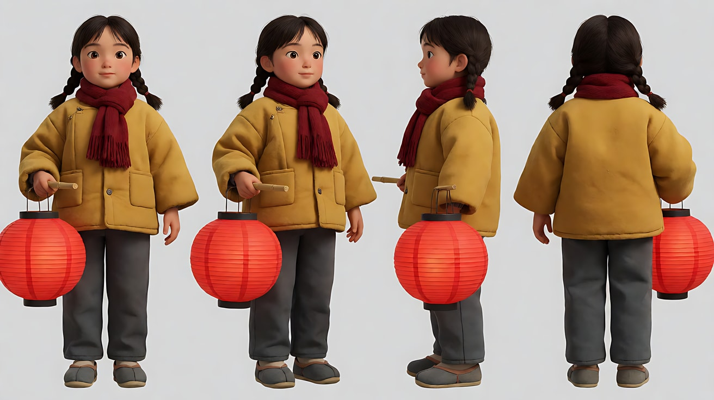

图2 场景：

```
Empty narrow old stone alley at blue hour in winter, low tiled roofs on both sides, a row of small iron hooks under the eaves,
two red lanterns already hanging further down the alley, wet stone pavement reflecting their glow, thin mist, no people.
Wide shot from the side of the alley, camera at eye level, 35mm lens, deep focus.
Lighting: cool blue dusk sky from above, warm red glow from the distant lanterns on the right.
Stylized semi-realistic 3D CG rendering, feature-film animation quality. Aspect ratio 16:9.
```

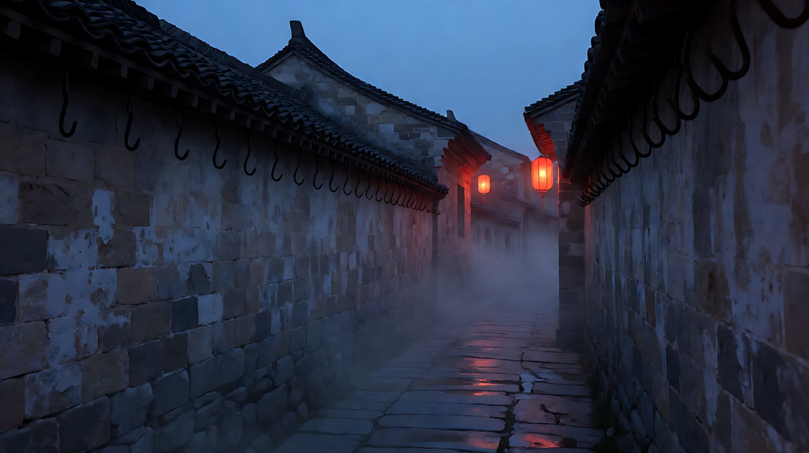

**【多图生视频 · Seedance】**

**版本 A：收束**

```
【素材分工】@图片1 锁定女孩的身份、发型、服装与红灯笼外形；@图片2 仅参考小巷布局、屋檐挂钩与光线，不复制其中的灯笼位置。
【画风】风格化写实三维CG质感，电影级布光。
冬日傍晚的石板小巷，天空是冷蓝色，远处画右两盏已挂好的红灯笼透出暖红光。镜头为平视全景，从画左跟着女孩向右侧移，她提着灯笼走到一个空挂钩下，镜头随她停下。她踮起脚，双手把灯笼的竹竿挂上钩子，放下手，后退一步，抬头看着灯笼。灯笼的暖光落在她仰起的脸上。画面停稳，结束在她仰头看灯笼的全景。
【声音】布鞋踩在湿石板上的脚步声，竹竿碰到铁钩的一声轻响，远处隐约的鞭炮声，无配乐。
【约束】保持人物脸型、发型、服装与灯笼外形不变；画面中只有一个女孩；不要字幕、水印、Logo。
时长：8秒
```

**版本 B：延长锚点**

```
【素材分工】@图片1 锁定女孩的身份、发型、服装与红灯笼外形；@图片2 仅参考小巷布局与光线，不复制其中人物。
【画风】风格化写实三维CG质感，电影级布光。
冬日傍晚的石板小巷，天空是冷蓝色，远处画右两盏红灯笼透出暖红光。镜头为平视全景，从画左跟着女孩向右侧移。她提着灯笼经过一个空挂钩，抬头看了一眼，没有停，继续向小巷深处走，灯笼在她手里轻轻晃。镜头保持同样的速度继续跟随，结尾时她仍在向画右行走，灯笼仍在摆动，湿石板上的倒影跟着移动。
【声音】持续的脚步声，灯笼竹竿轻微的吱呀声，远处隐约的鞭炮声，结尾脚步声不停。
【约束】保持人物脸型、发型、服装与灯笼外形不变；结尾不要减速、不要停下；不要字幕、水印、Logo。
时长：8秒
```

**参数**：时长 8 秒 ｜ 画幅 16:9

**【检查点】**
- 版本 A 最后一帧是否稳定、动作完成
- 版本 B 最后一帧是否仍在动，方向和速度与中段一致
- 两版的光线方向是否相同（冷蓝天光 + 画右暖红灯笼）

**【常见问题与修复】**
| 现象 | 修复 |
|---|---|
| 版本 B 结尾自己停下来了 | 把最后一句改成"结尾时她仍在走，镜头仍在跟"，并在【约束】写"结尾不要减速" |
| 版本 A 挂灯笼时手穿过灯笼 | 把动作简化为"举起竹竿，挂上钩子"，不写"调整位置" |
| 灯笼颜色变了 | 在正文再写一次"红色圆形纸灯笼" |
| 女孩变成两个 | 【约束】加"画面中只有一个女孩" |

---

### 练习3：首尾帧锁定"揭示"（难度 ★★★，首尾帧）

**目标**：揭示型结尾要求答案恰好落在最后一帧。用首帧锁住"只看得见门把手"，用尾帧锁住"整间阁楼的纸鹤"，中间只允许一个后拉运动。

**镜头合同**

| 格子 | 决定 |
|---|---|
| 意图 | 让观众感到他打开的是一个被藏了很多年的秘密 |
| 起始帧 | 特写：少年的手握住旧木门的黄铜把手 |
| 运动 | 门被推开的同时，镜头穿过门缝向前推入，再上升到阁楼高处俯看 |
| 终点帧 | 大全景：成百上千只彩色纸鹤从房梁垂下，少年站在门口很小 |
| 易损锚点 | 手与把手；纸鹤的数量与形状 |
| 结尾形态 | 揭示：最后一帧落地即停 |

> 注意：上面"推入再上升"其实是两个运动。合同检查会把它退回，改成**一个**运动：机位一开始就在门内高处，从把手特写一路极慢地向后拉开到全景；门被推开、光涌进来照亮纸鹤，都是画面里的变化，不是第二个运镜。下面的提示词按修改后的合同写。

**【生图 · Nano Banana】**

图1 角色定妆：

```
Character turnaround sheet of an original boy about fourteen years old: messy black hair, a faded green hoodie,
rolled-up jeans, white canvas sneakers, a small flashlight clipped to his hoodie pocket.
Front view, three-quarter view, side view and back view, full body, camera at eye level, 50mm lens, deep focus,
plain light-grey background, even soft studio light from the front.
Stylized semi-realistic 3D CG rendering, feature-film animation quality. Aspect ratio 16:9.
```

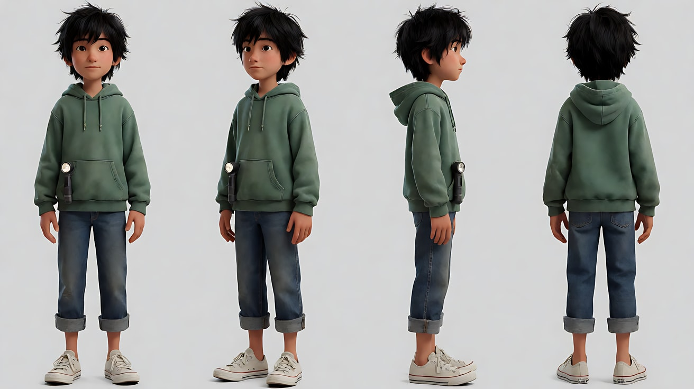

图2 首帧：

```
Using the character from image 1: an extreme close-up of the boy's right hand gripping the worn brass knob of an old wooden attic door,
seen from inside the dark attic, the door still closed, a thin line of warm daylight leaking through the gap at the bottom.
Camera high inside the attic looking down toward the door, 50mm lens, shallow depth of field, the hand and knob sharp.
Lighting: almost total darkness, only the warm sliver of light under the door from the hallway.
Keep the face, hairstyle and outfit exactly as in image 1.
Stylized semi-realistic 3D CG rendering, feature-film animation quality. Aspect ratio 16:9.
```

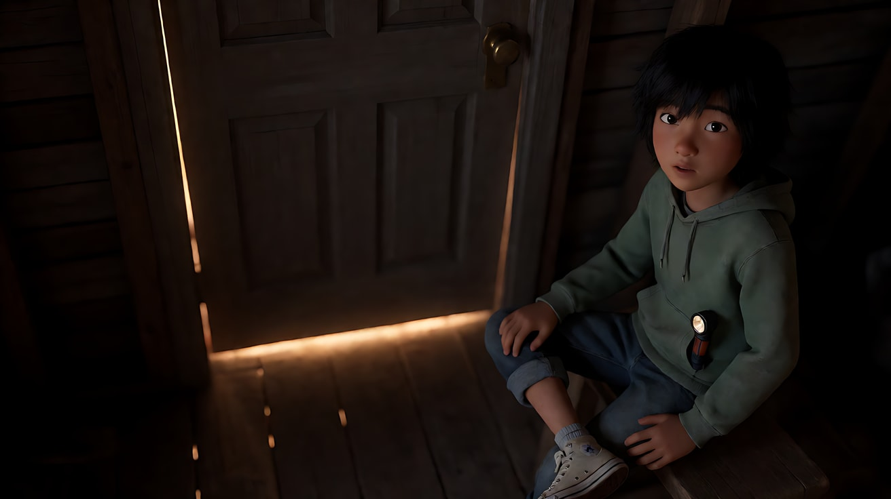

图3 尾帧：

```
Using the character from image 1, seen from the same high camera position inside the attic as image 2:
an extreme wide shot of the whole attic, the door now wide open, the boy standing small in the doorway at the bottom of the frame,
looking up. Hundreds of colorful folded paper cranes hang on threads from the wooden rafters, filling the upper two thirds of the frame.
Camera high in the rafters looking down at the doorway, 24mm lens, deep focus.
Lighting: warm afternoon daylight pouring in through the open door from behind the boy, catching dust and the edges of the paper cranes.
Keep the face, hairstyle and outfit exactly as in image 1.
Stylized semi-realistic 3D CG rendering, feature-film animation quality. Aspect ratio 16:9.
```

中文释义：图2 从阁楼里高处往下看门，只看见手握铜把手和门缝下一线暖光；图3 同一高机位，门大开，少年在画面底部很小，房梁上垂下成百上千只彩色纸鹤，暖光从他身后涌入。

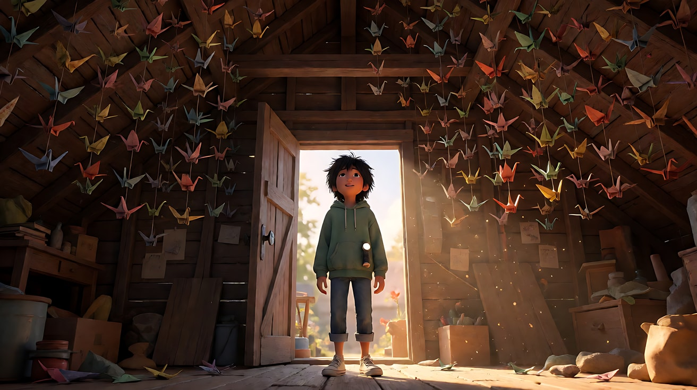

**【首尾帧生视频 · Seedance】**

```
【素材分工】@图片2 为首帧，锁定黑暗中手握门把手的特写与高处机位；@图片3 为尾帧，是最终画面目标，锁定纸鹤全部被照亮的大全景；@图片1 锁定少年身份与服装，不提供场景信息。只生成两帧之间的连续动作。
【画风】风格化写实三维CG质感，电影级布光。
黑暗的阁楼里，少年的手握着铜把手，慢慢转动，门向内推开。走廊的暖色日光从门口涌进来，像一道扩大的光带，依次照亮漂浮的灰尘、地板、房梁，以及房梁上垂下的成百上千只彩色纸鹤。少年走进门口一步，停下，抬头看。镜头为高处机位，从手部特写极慢地向后拉开、扩大视野，直到看见整间阁楼。最后一帧落在纸鹤全部被照亮、少年仰头站在门口的大全景，画面停稳。
【声音】门轴生锈的吱呀声，门开时远处走廊的鸟叫涌进来，纸鹤被气流吹动的极轻沙沙声，无配乐。
【约束】保持少年脸型、发型、服装不变；纸鹤只是悬挂摆动，不要飞起来；中间动作连续，不跳切；不要字幕、水印、Logo。
时长：8秒
```

**参数**：时长 8 秒 ｜ 画幅 16:9 ｜ 模式：首尾帧

**【检查点】**
- 揭示是否留到最后一帧，而不是在中段就把纸鹤全部亮出来
- 光是否有来源（门口涌入），依次照亮
- 最后一帧是否停稳，没有余动冲淡揭示

**【常见问题与修复】**
| 现象 | 修复 |
|---|---|
| 纸鹤一开始就全部可见 | 首帧必须足够黑；正文强调"光依次照亮，最后才照到纸鹤" |
| 纸鹤飞了起来 | 【约束】写"纸鹤只是悬挂轻摆，不飞、不掉落" |
| 拉开过程中出现跳切 | 写"一镜到底，不切镜头"，并确认首尾两帧的机位高度一致 |
| 少年变成成人或换衣服 | 首尾帧都用 `Using the character from image 1` 重新生成 |

---

### 练习4：三镜头，三张合同，英雄定格收尾（难度 ★★★★，多镜头）

**目标**：给每个镜头单独写合同，再合并成一次多镜头生成。景别从环境到手到器物，最后一个镜头的结尾形态是英雄定格。意图：让观众感到这只茶碗是一双手花了一整天的结果。

**三张合同（压缩成表）**

| 镜头 | 景别 / 焦段 | 构图 | 光 | 运镜 | 终点帧 | 结尾形态 |
|---|---|---|---|---|---|---|
| 1 | 全景 / 35mm / 深焦 | 窑口在画左，陶艺师在画右侧身 | 窑口橙色火光从画左 | 固定 | 她戴手套从窑里取出茶碗 | 剪辑点 |
| 2 | 特写 / 85mm / 浅景深 | 双手捧碗在画面中下 | 同一窑火从画左 + 窗外冷光 | 缓慢下摇 | 拇指抹过碗沿的釉色 | 剪辑点 |
| 3 | 近景 / 100mm 微距感 / 浅景深 | 茶碗正中，木台面 | 窗外冷色侧光从画右 | 极慢推近后停稳 | 茶碗静置在画面正中 | 英雄定格 |

**【生图 · Nano Banana】**

图1 角色定妆：

```
Character turnaround sheet of an original woman potter in her forties: short grey-streaked hair tied back with a cloth band,
a rust-brown canvas apron over a cream linen shirt with rolled sleeves, thick grey heat-resistant gloves tucked in the apron pocket.
Front view, three-quarter view, side view and back view, full body, camera at eye level, 50mm lens, deep focus,
plain light-grey background, even soft studio light from the front.
Stylized semi-realistic 3D CG rendering, feature-film animation quality. Aspect ratio 16:9.
```

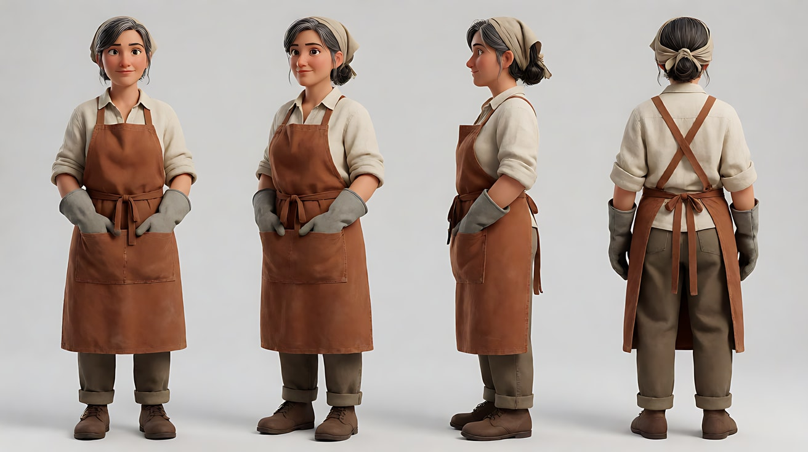

图2 器物：

```
A single handmade ceramic tea bowl with an uneven rim, deep blue glaze running into warm brown at the foot,
fine crackle texture, placed on a plain light-grey surface. Product three-quarter view, camera slightly above eye level,
100mm macro lens, shallow depth of field. Soft studio light from frame right.
Stylized semi-realistic 3D CG rendering, feature-film animation quality. Aspect ratio 16:9.
```

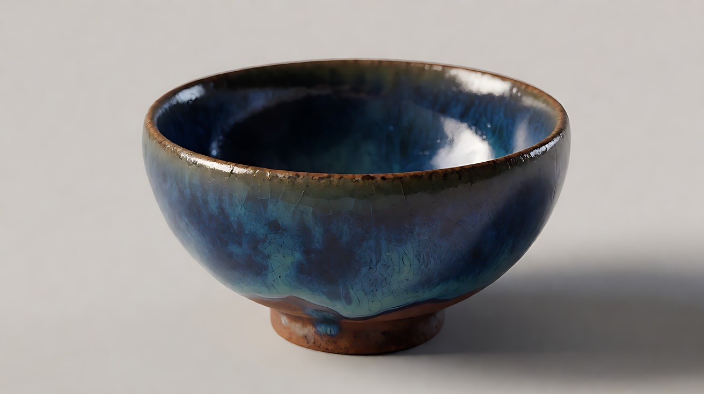

图3 场景：

```
Empty small pottery studio at dusk, a brick kiln on the left with its door open and orange fire glowing inside,
shelves of unglazed pots, a wooden worktable by a window on the right, cool blue dusk light through the window, no people.
Wide shot, camera at eye level, 35mm lens, deep focus.
Stylized semi-realistic 3D CG rendering, feature-film animation quality. Aspect ratio 16:9.
```

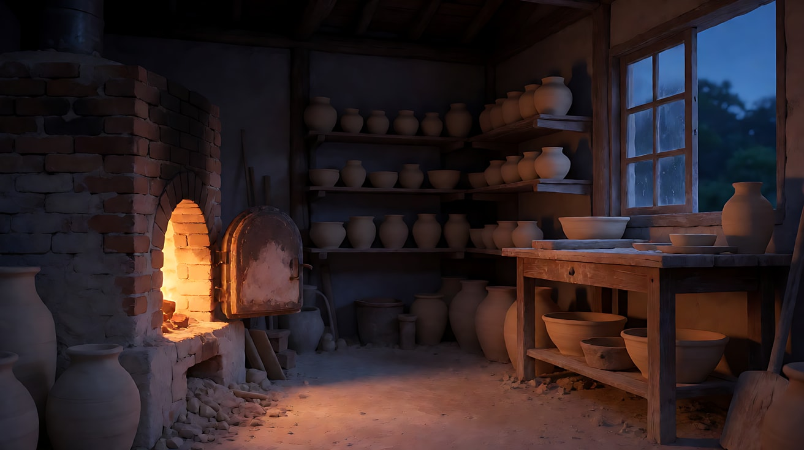

**【多图生视频 · Seedance】**

```
【素材分工】@图片1 锁定陶艺师的身份、发型与服装；@图片2 锁定茶碗的形状、釉色与碗沿轮廓，不改变其设计；@图片3 仅参考工作室布局、窑与窗的位置，不复制其中光线强弱。
【画风】风格化写实三维CG质感，电影级布光。
镜头1：固定全景，窑口在画左，橙色火光从窑里照出来；陶艺师在画右，侧身戴上灰色隔热手套，伸手进窑口，双手捧出一只茶碗，转身朝向画右。窑火噼啪声，手套摩擦声。
镜头2：镜头切至双手捧碗的特写，镜头从她的胸前缓慢下摇到碗，她摘掉右手手套，用拇指慢慢抹过碗沿，蓝色釉面在窑火里反光。拇指擦过釉面的细微摩擦声。
镜头3：镜头切至木桌台面的近景，茶碗已经放在画面正中，窗外冷色侧光从画右照在釉面上，镜头极慢地向前推近一点后完全停稳，茶碗清晰、无遮挡，停住。窑火声退远，只剩窗外很轻的风声。
【锁定】光线：窑口橙色火光始终在画左，窗外冷蓝色暮光始终在画右；陶艺师：四十多岁女性，灰白短发用布带扎起，铁锈色帆布围裙，米色亚麻衬衫；茶碗：碗沿不规则，深蓝釉向底部过渡为暖棕；机位始终在工作室靠窗一侧。
【声音】无配乐；窑火噼啪声由近到远，最后只剩风声和一声极轻的瓷器落在木头上的声音。
【约束】保持人物脸型、发型、服装不变；茶碗形状、釉色、碗沿轮廓三个镜头完全一致；镜头3结尾不要任何移动；不要字幕、水印、Logo。
时长：12秒
```

**参数**：时长 12 秒 ｜ 画幅 16:9 ｜ 负载：3 个镜头，镜头2 有一个运镜、一个手与器物接触，属于"稳妥"档

**【检查点】**
- 三个镜头的景别是否明显不同（全景 → 特写 → 近景）
- 茶碗在三个镜头中是否是同一只
- 镜头3 是否真正停稳，茶碗无遮挡、可以看清

**【常见问题与修复】**
| 现象 | 修复 |
|---|---|
| 茶碗在镜头3 变了形或换了颜色 | 把 @图片2 的用途写成"锁定茶碗形状与釉色"，并在【锁定】重复描述 |
| 镜头3 还在缓慢环绕 | 把"推近"改为"固定机位"，英雄定格宁可完全不动 |
| 镜头2 手套和手指穿插变形 | 删掉"摘掉右手手套"，直接写"她的右手没有戴手套" |
| 三个镜头连成一个长镜头 | 每个镜头块开头写"镜头切至……"，并让三个机位高度、景别都不同 |

---

### 练习5：循环接缝——首帧即尾帧（难度 ★★★★★，首尾帧 + 相位匹配）

**目标**：做一个可以无限循环播放的片段。循环接缝要求结尾在**位置、运动相位、曝光、声音**四件事上回到开头，四件对三件也会被看出跳帧。这是唯一一种"停下来反而是错"的结尾。

**镜头合同**

| 格子 | 决定 |
|---|---|
| 意图 | 让观众感到时间在这个雨夜被悬置 |
| 景别 / 焦段 | 中景，50mm，中等景深 |
| 构图 | 窗在画面中央，人物在窗左侧的旧沙发上侧坐，猫在窗台右侧 |
| 光影 | 窗外冷蓝色雨夜街灯从画面背后照入；室内一盏暖色落地灯在画左 |
| 运镜 | 固定，不动 |
| 起始帧 = 终点帧 | 她低头看书，翻到一半的书页立着；猫尾巴垂在窗台边 |
| 运动相位 | 一页书翻过去并落下，下一页刚好立起到同一位置；猫尾巴摆一个来回 |
| 易损锚点 | 脸、书页、猫的花色 |
| 结尾形态 | 循环接缝 |

**【生图 · Nano Banana】**

图1 角色定妆：

```
Character turnaround sheet of an original young woman in her twenties: a loose low bun with a pencil stuck through it,
round tortoiseshell glasses, an oversized oatmeal knitted sweater, dark green corduroy trousers, thick wool socks.
Front view, three-quarter view, side view and back view, full body, camera at eye level, 50mm lens, deep focus,
plain light-grey background, even soft studio light from the front.
Stylized semi-realistic 3D CG rendering, feature-film animation quality. Aspect ratio 16:9.
```

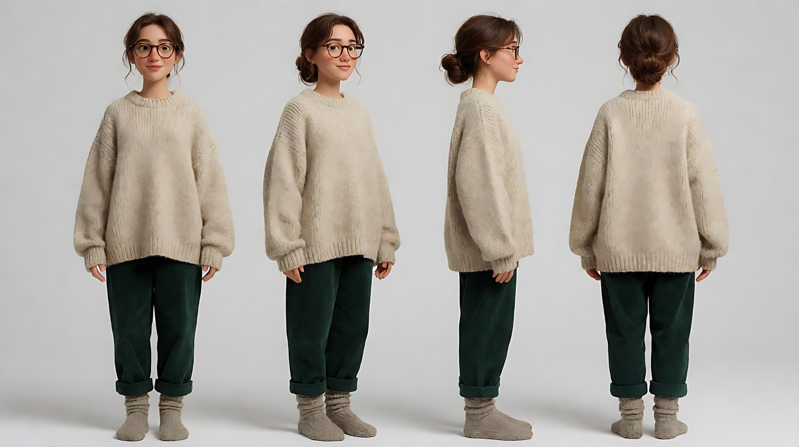

图2 循环帧（同时作首帧与尾帧）：

```
Using the character from image 1: a medium shot of her sitting sideways on a worn velvet sofa to the left of a tall rainy window,
knees drawn up, reading a thick book, one page standing upright mid-turn between her fingers.
A grey tabby cat lies on the right side of the windowsill, its tail hanging down over the edge.
Rain streaks run down the glass; blurred blue streetlights outside.
Camera at seated eye level, 50mm lens, moderate depth of field, the window and the cat still readable.
Lighting: a warm floor lamp from frame left as key light on her face and the book,
cool blue streetlight through the rainy window behind her as rim light.
Keep the face, hairstyle and outfit exactly as in image 1.
Stylized semi-realistic 3D CG rendering, feature-film animation quality. Aspect ratio 16:9.
```

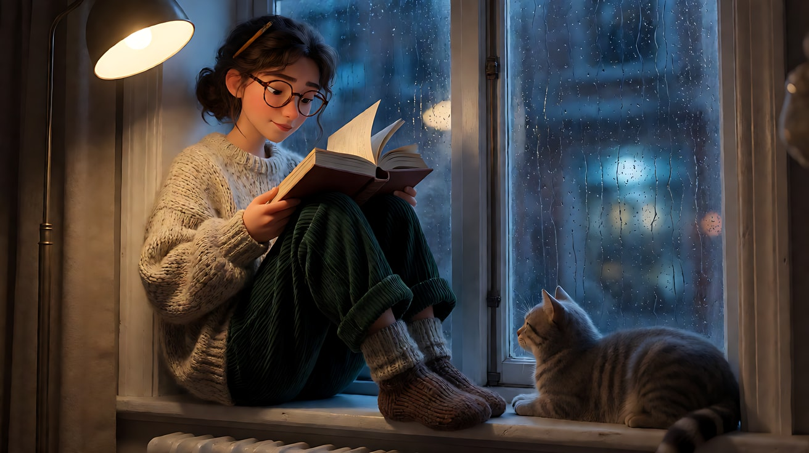

**【首尾帧生视频 · Seedance】**

```
【素材分工】@图片2 同时作为首帧和尾帧，最后一帧必须与第一帧完全一致；@图片1 锁定人物身份、眼镜与服装。只生成两帧之间的连续动作。
【画风】风格化写实三维CG质感，电影级布光。
雨夜，她侧坐在窗边沙发上看书。她手指间立着的那页书慢慢翻过去，落下，她的目光随着移到下一页，读了几行，手指又捏起下一页，把它翻到立起的位置，停在与开头相同的角度。窗台上的猫尾巴从垂着的位置向右摆起，再摆回垂下的原位。窗玻璃上的雨痕持续以同样的速度向下流。镜头固定中景，完全不动。画左暖色落地灯与背后冷蓝色街灯的亮度从头到尾不变。结尾的人物姿势、书页角度、猫尾巴位置、雨痕流速与开头完全一致。
【声音】持续均匀的雨声，书页翻动的一声纸响，落地灯极轻的电流声；声音从头到尾音量一致，结尾不淡出，无配乐。
【约束】保持人物脸型、发型、眼镜、服装不变；猫的花色与大小不变；光线亮度不变；结尾不要减速、不要定格；不要字幕、水印、Logo。
时长：6秒
```

**参数**：时长 6 秒 ｜ 画幅 16:9 ｜ 模式：首尾帧（同一张图）

**【检查点】**
- 把片段在播放器里设为循环播放，看接缝处是否有跳动
- 四件事逐一核对：位置（书页、猫尾巴）、运动相位（雨痕、翻页）、曝光（灯的亮度）、声音（雨声不淡出）
- 结尾是否在动，而不是先减速停下再"跳"回开头

**【常见问题与修复】**
| 现象 | 修复 |
|---|---|
| 结尾先停住再跳回开头 | 删掉所有"慢慢停下""安静下来"的词，加"结尾不要减速、不要定格" |
| 声音在结尾淡出 | 【声音】写"音量从头到尾一致，结尾不淡出"；后期也可以单独铺一条循环雨声 |
| 书页翻了两页 | 把"翻页"限定为"只翻一页"，或缩短时长到 5 秒 |
| 光线在后段变暗 | 写"灯的亮度从头到尾不变"，并避免写"夜越来越深" |
| 接缝仍可见 | 后期在接缝处做 4–6 帧交叉溶解，作为最后保险 |
