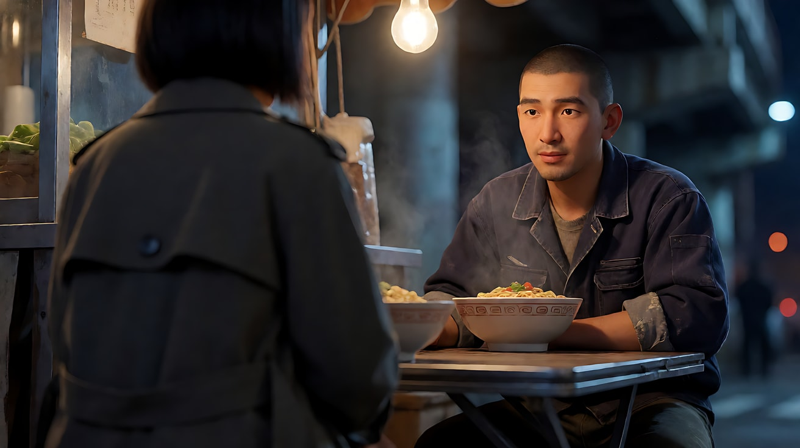
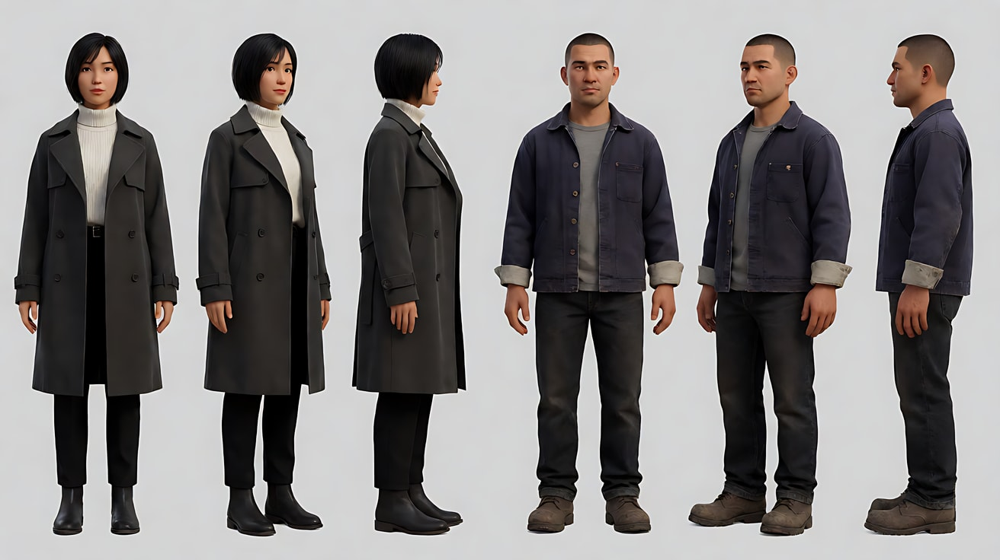
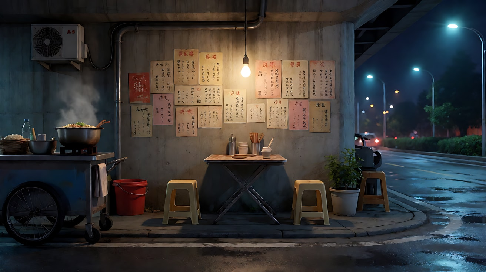
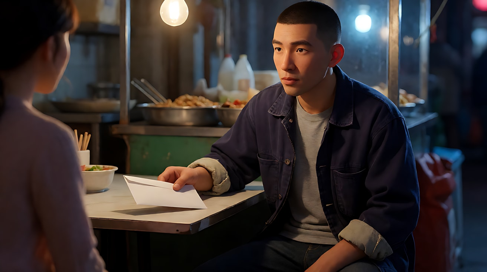
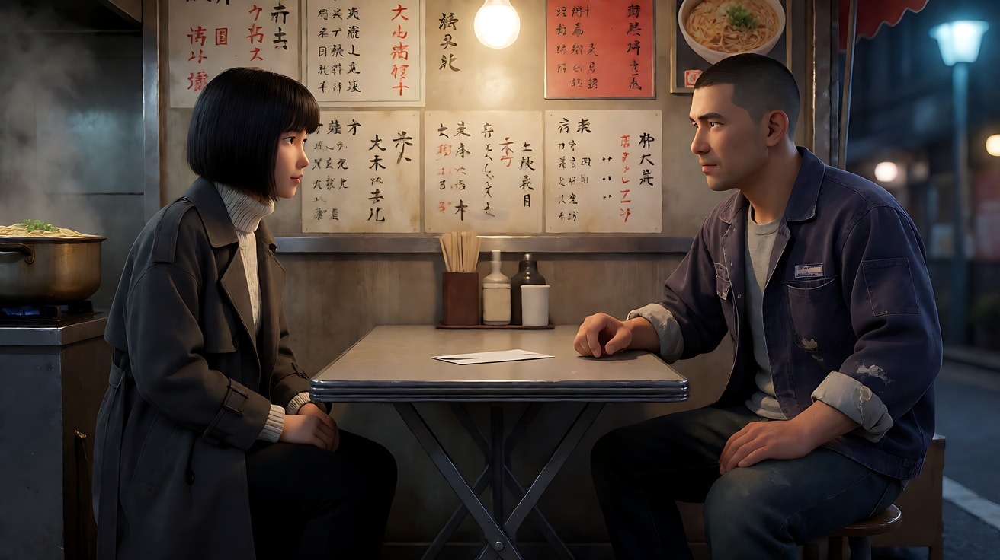
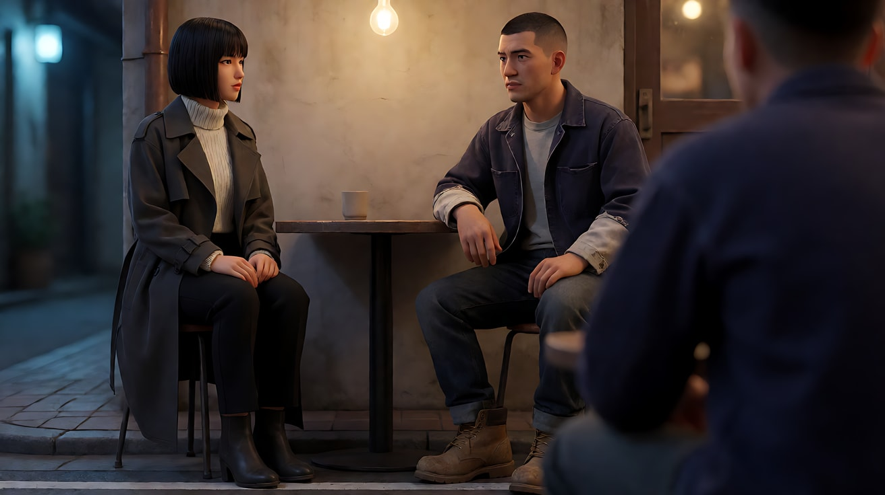
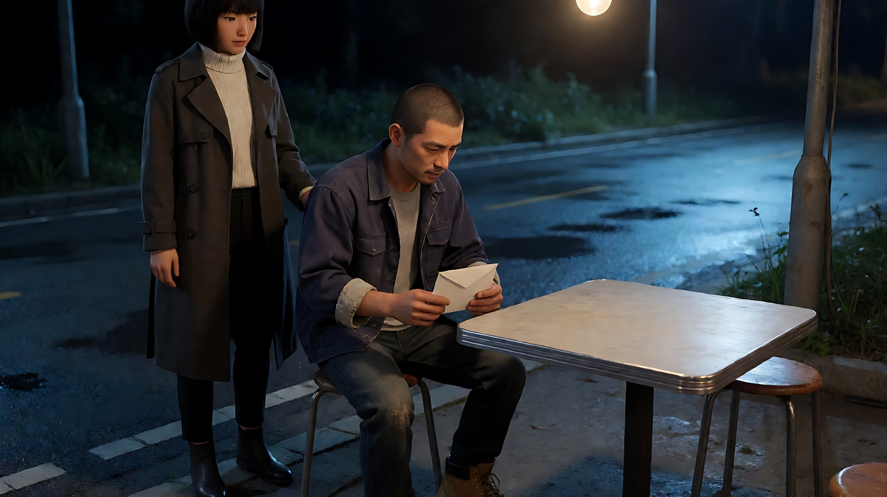

# L06-02 正反打与对话覆盖 · 提示词

> 本组练习：用同一对原创角色、同一个夜宵摊，从一个过肩镜头开始，逐步搭出完整的对话覆盖方案，最后练一次有动机的越轴。｜ 配套教学：[L06-02-正反打与对话覆盖](../教学/L06-02-正反打与对话覆盖.md) ｜ 规范：[写作规范](../../模板/写作规范.md)
>
> 画风默认使用开关 A（风格化写实 CG）。如改用 2D 动画，删掉所有焦段、光圈、景深词。

---

**全组通用平面图（每个练习都按它摆机位）**

```
               墙（贴满旧菜单）
   ┌─────────────────────────────────────┐
   │        暖色裸灯泡（桌子正上方）       │
   │                                     │
   │   林岚 ●━━━━━━ 折叠小桌 ━━━━━━● 周野  │   ← 轴线
   │   面朝右                     面朝左   │
   │                                     │
   └─────────────────────────────────────┘
        📷 所有机位都在这一侧（靠马路）
        远处画右：高架桥下的冷蓝色路灯
```

- 林岚：三十岁出头，黑色齐肩短发，深灰色风衣，里面是白色高领毛衣；坐在画左，面朝右
- 周野：三十岁出头，寸头，藏青色工装夹克，袖口磨白；坐在画右，面朝左
- 光：桌子正上方一盏暖色裸灯泡；背景画右远处高架桥下的冷蓝色路灯
- 机位：始终在桌子靠马路的一侧

---

### 练习1：一个过肩镜头，一句台词（难度 ★）

**目标**：做对一个过肩镜头：前景肩膀虚、后景人脸实、视线越过前景人看向她。只让一个人说一句话，听的人保持小动作。

**【生图 · Nano Banana】**

图1 关键帧（过肩：从林岚右后肩看周野）：

```
An over-the-shoulder medium close-up at a small night street food stall under an overpass.
In the foreground on the left, the back of an original woman's head and her right shoulder, short black bob hair and a dark grey trench coat,
soft and out of focus. On the right third, an original man in his early thirties with a buzz cut and a navy work jacket with worn cuffs,
sitting at a folding table, facing frame left, looking at her, a bowl of noodles in front of him.
Camera behind the woman's right shoulder at seated eye level, 85mm lens, shallow depth of field, the man's face sharp.
Lighting: a warm bare bulb hanging directly above the table as key light from above,
cool blue streetlight under the overpass far in the background on the right as rim light, light steam rising from the bowl.
Stylized semi-realistic 3D CG rendering, feature-film animation quality. Aspect ratio 16:9.
```

中文释义：过肩中近景。前景画左是林岚的后脑和右肩（虚），周野在右三分之一，面朝画左看着她；坐姿平视、85mm、浅景深；桌子正上方暖色裸灯泡做顶部主光，画右远处冷蓝路灯勾轮廓，面碗冒热气。



**【图生视频 · Seedance】**

```
【素材分工】@图片1 为首帧，锁定两人的位置、朝向、服装与夜宵摊布局。
【画风】风格化写实三维CG质感，电影级布光。
过肩中近景，镜头固定不动。前景画左是林岚虚化的后脑和右肩，她轻轻呼吸，肩膀有细微起伏。周野坐在画右，面朝画左，看着她，用筷子挑了一下面又放下，抬起眼睛，笑了一下，有点不好意思。周野放下筷子，声音不大：“你怎么知道我在这儿？”说完他没有移开目光，等她回答。桌子正上方的暖色灯泡照在他脸上，画右远处冷蓝色路灯不变，面碗里热气持续上升。
【声音】夜宵摊的锅铲声和远处车流声，周野一句台词，无配乐。
【约束】保持两人脸型、发型、服装不变；只有周野说话，林岚不说话；不要字幕、水印、Logo。
时长：6秒
```

**参数**：时长 6 秒 ｜ 画幅 16:9

**【检查点】**
- 前景肩膀是否一直在画左并保持虚化
- 周野的视线是否看向画左（林岚的方向），而不是看镜头
- 台词说完后，他的脸有没有"活着"（等回答），而不是僵住

**【常见问题与修复】**
| 现象 | 修复 |
|---|---|
| 周野看向镜头 | 写"他的视线越过前景的肩膀，看向画左的林岚" |
| 前景林岚转过身来 | 写"林岚始终背对镜头，只有呼吸起伏" |
| 口型对不上 | 缩短台词，或把机位改成更稳的中景 |
| 台词说完脸僵住 | 加"说完他没有移开目光，嘴角还留着一点笑" |

---

### 练习2：双人全景——先把轴线建起来（难度 ★★）

**目标**：用定妆图 + 场景图生成一个双人全景（Master），让观众一眼看懂"谁在左、谁在右、灯在哪、路在哪"。后面所有练习的过肩与反应镜头都以它为准。

**【生图 · Nano Banana】**

图1 双人角色定妆：

```
Character turnaround sheet of two original characters in their early thirties.
The woman: short straight black bob, a dark grey trench coat over a white turtleneck sweater, black trousers, ankle boots.
The man: buzz cut, a navy work jacket with worn pale cuffs over a grey T-shirt, dark jeans, scuffed work boots.
Front view, three-quarter view and side view of each, full body, camera at eye level, 50mm lens, deep focus,
plain light-grey background, even soft studio light from the front.
Stylized semi-realistic 3D CG rendering, feature-film animation quality. Aspect ratio 16:9.
```



图2 场景：

```
Empty small night street food stall under a concrete overpass, a low folding table with two plastic stools facing each other,
a wall of faded paper menus behind, a single warm bare bulb hanging directly above the table,
a steaming noodle pot on a cart to the left, cool blue streetlights under the overpass in the far background on the right,
wet asphalt reflecting the lights, no people.
Wide shot from the roadside, camera at seated eye level, 28mm lens, deep focus.
Stylized semi-realistic 3D CG rendering, feature-film animation quality. Aspect ratio 16:9.
```



**【多图生视频 · Seedance】**

```
【素材分工】@图片1 锁定林岚（女）与周野（男）的身份与服装；@图片2 仅参考夜宵摊布局、灯泡位置与路灯方向，不复制其中的人物或多余陈设。
【画风】风格化写实三维CG质感，电影级布光。
深夜，高架桥下的夜宵摊。双人全景，机位在桌子靠马路的一侧，平视，镜头固定。林岚坐在画左，面朝右；周野坐在画右，面朝左，两人中间是折叠小桌，桌子正上方一盏暖色裸灯泡。周野低头吃面，偶尔用筷子搅一下。林岚把一瓶汽水推到他面前，手停在瓶子旁边，开口，语气平静但清楚：“慢点吃，没人跟你抢。”说完她靠回凳子，看着他。周野吃面的动作停了一下，又继续。画左推车上的面锅冒着热气，画右远处冷蓝色路灯照着湿的柏油路。
【声音】锅里汤水翻滚声，筷子碰碗声，汽水瓶在桌面上滑动的一声，远处车流声，无配乐。
【约束】保持两人脸型、发型、服装不变；林岚始终在画左面朝右，周野始终在画右面朝左；只有林岚说话；不要字幕、水印、Logo。
时长：8秒
```

**参数**：时长 8 秒 ｜ 画幅 16:9

**【检查点】**
- 林岚在画左面朝右、周野在画右面朝左，全程没有对调
- 灯泡在桌子正上方，路灯在画右远处
- 周野在林岚说话时有小动作，而不是冻结

**【常见问题与修复】**
| 现象 | 修复 |
|---|---|
| 两人都面朝镜头 | 写"两人侧对镜头，彼此相对" |
| 周野也开口说话 | 【约束】写"只有林岚说话，周野不说话" |
| 灯光变成均匀白光 | 正文重复"桌子正上方一盏暖色裸灯泡是唯一的主光" |
| 场景图里的空凳子多出一个人 | 素材分工写"不复制其中人物"，并在正文写"画面中只有两个人" |

---

### 练习3：反应镜头——视线越过镜头（难度 ★★★，首尾帧）

**目标**：做一个没有台词的反应镜头。林岚在画外说出关键的一句话，镜头里只有周野的反应：从低头看信封，到抬眼看向画左。机位站在林岚那一侧，所以他的眼睛越过镜头左边缘看向她。

**【生图 · Nano Banana】**

沿用练习2 的图1（双人定妆），新做首帧和尾帧：

图2 首帧：

```
Using the man from image 1: a close-up of him sitting at the night food stall table, head lowered,
looking down at a plain white envelope lying next to his noodle bowl, both hands resting on the table edge.
He is on the right third of the frame, his body angled toward frame left. No other person in frame.
Camera at seated eye level from the woman's side of the table, just to the left of where she sits, 85mm lens, shallow depth of field.
Lighting: a warm bare bulb directly above as key light, casting soft shadows under his brows,
cool blue streetlight in the far background on the right as rim light on his right ear and shoulder.
Keep the face, hairstyle and outfit exactly as in image 1.
Stylized semi-realistic 3D CG rendering, feature-film animation quality. Aspect ratio 16:9.
```


图3 尾帧：

```
Using the man from image 1, with exactly the same framing, camera position and lighting as image 2:
he has raised his eyes and is now looking just past the left edge of the lens, toward where the woman sits off-screen,
his lips slightly parted, his right hand has stopped halfway toward the envelope.
Keep the face, hairstyle and outfit exactly as in image 1.
Stylized semi-realistic 3D CG rendering, feature-film animation quality. Aspect ratio 16:9.
```

中文释义：同一机位的周野近景。首帧低头看桌上白信封；尾帧抬眼，视线贴着镜头左边缘看向画外的林岚，右手伸向信封停在半路。机位在林岚那一侧。



**【首尾帧生视频 · Seedance】**

```
【素材分工】@图片2 为首帧，锁定周野低头看信封的近景与机位；@图片3 为尾帧，是最终画面目标，锁定他抬眼看向画左的视线；@图片1 锁定周野的身份与服装，本片段画面中只出现周野。只生成两帧之间的连续动作。
【画风】风格化写实三维CG质感，电影级布光。
近景，镜头固定不动，机位在林岚那一侧。周野低头看着桌上的白信封。画外传来林岚的声音，很轻但每个字都清楚：“这是你妈托我带给你的。”周野愣住，呼吸停了一拍，右手慢慢伸向信封，停在半路。他抬起眼睛，视线越过镜头左边缘，看向画外的林岚，嘴唇微微张开，喉结动了一下。桌子正上方的暖色灯泡照着他的眉骨，画右远处的冷蓝色路灯勾着他的耳朵和肩膀，面碗的热气在画面下方慢慢上升。
【声音】林岚的画外台词，之后夜宵摊的嘈杂声像被调小了一样变远，只剩锅里轻微的翻滚声，无配乐。
【约束】保持周野脸型、发型、服装不变；画面中只出现周野；周野不说话；中间动作连续，不跳切；不要字幕、水印、Logo。
时长：6秒
```

**参数**：时长 6 秒 ｜ 画幅 16:9 ｜ 模式：首尾帧

**【检查点】**
- 他的视线是看向画左、越过镜头边缘，而不是正对镜头
- 情绪是否由"愣住 + 喉结动"这种可见动作表达
- 画外台词是否被识别为画外音（画面里没有林岚）

**【常见问题与修复】**
| 现象 | 修复 |
|---|---|
| 他直视镜头 | 尾帧重做，写 `looking just past the left edge of the lens`；正文写"视线越过镜头左边缘" |
| 林岚出现在画面里 | 素材分工写"本片段画面中只出现周野"，台词前写"画外传来" |
| 周野开口说话 | 【约束】写"周野不说话"，并把"嘴唇微微张开"放在台词之后 |
| 手伸过头直接拿起了信封 | 写"停在半路，没有碰到信封" |

---

### 练习4：完整覆盖方案——全景、过肩、过肩、反应（难度 ★★★★，多镜头）

**目标**：在一次生成里完成一套标准对话覆盖：先用全景建立轴线，再用两个过肩完成一来一回两句台词，最后切给听者的反应。景别逐步收紧，机位始终在同一侧。

**负载估算**：4 个镜头，2 句短台词（各不超过 12 个字，各记 1 点），反应镜头记半拍。每个负载点约 15 ÷（3.5 + 2）≈ 2.7 秒，属于"有挑战"档。这是短剧对话的常规节奏；如果是第一次尝试，可以先删掉镜头1 降到"稳妥"档。

**【生图 · Nano Banana】**

沿用练习2 的图1（双人定妆）和图2（场景），新做镜头1 首帧：

图3 镜头1 首帧（双人中全景）：

```
Using the two characters from image 1 and the food stall from image 2:
a medium-wide two-shot from the roadside, the woman on the left facing frame right, the man on the right facing frame left,
both seated at the low folding table, a white envelope lying in the middle of the table between them.
Camera at seated eye level, 35mm lens, moderate depth of field, the menu wall behind readable but soft.
Lighting: a warm bare bulb directly above the table as the only key light, cool blue streetlight far in the background on the right,
light steam from the noodle pot on the left.
Keep the faces, hairstyles and outfits exactly as in image 1.
Stylized semi-realistic 3D CG rendering, feature-film animation quality. Aspect ratio 16:9.
```



**【多图生视频 · Seedance】**

```
【素材分工】@图片1 锁定林岚（女）与周野（男）的身份与服装；@图片2 仅参考夜宵摊布局与光源位置，不复制其中人物；@图片3 为首帧，锁定两人的位置与朝向。
【画风】风格化写实三维CG质感，电影级布光。
镜头1：固定双人中全景，机位在桌子靠马路一侧。林岚在画左面朝右，用两根手指把桌子中间的白信封推到周野面前。周野低头看着信封，筷子停在碗边。锅里汤水翻滚声。
镜头2：镜头切至从林岚右后肩拍向周野的过肩中近景，前景是林岚虚化的后脑和右肩。周野没有碰信封，抬眼看她，声音发紧：“我说过，我不回去。”说完他把筷子放下，看着她。远处车流声。
镜头3：镜头切至从周野左后肩拍向林岚的过肩中近景，前景是周野虚化的后脑和左肩。林岚看着他，停了一下，声音很轻但每个字都清楚：“她上个月住院了。”说完她没有移开目光，眼眶有一点红，没有眼泪。
镜头4：镜头切至周野的单人近景，没有前景肩膀，机位在林岚那一侧。周野愣住，惊慌，视线越过镜头左边缘看向林岚，喉结动了一下，右手慢慢放到信封上。夜宵摊的嘈杂声变远。
【锁定】光线：桌子正上方一盏暖色裸灯泡是唯一主光，画右远处是冷蓝色路灯；林岚：三十岁出头，黑色齐肩短发，深灰色风衣配白色高领毛衣，坐在画左，面朝右；周野：三十岁出头，寸头，藏青色工装夹克，坐在画右，面朝左；白信封在桌子中间；机位始终在桌子靠马路的一侧。
【声音】夜宵摊环境声贯穿，两句台词各在自己的镜头里，镜头4 环境声变远，无配乐。
【约束】保持两人脸型、发型、服装不变；每个镜头只有一个人说话；林岚始终在画左，周野始终在画右；不要字幕、水印、Logo。
时长：15秒
```

**参数**：时长 15 秒 ｜ 画幅 16:9 ｜ 负载：有挑战档

**【检查点】**
- 四个镜头中两人有没有左右对调
- 镜头2 和镜头3 的过肩方向是否对称（前景肩膀分别在画左、画右）
- 镜头4 是否是干净的单人镜头，视线看向画左
- 两句台词是否都完整说完

**【常见问题与修复】**
| 现象 | 修复 |
|---|---|
| 镜头3 两人左右对调 | 【锁定】重复两人位置与朝向，并写"机位始终在桌子靠马路一侧" |
| 第二句台词被截断 | 删掉镜头1，或把时长保持 15 秒并缩短台词 |
| 镜头4 林岚的肩膀又出现 | 写"没有前景肩膀，画面里只有周野" |
| 信封在镜头间跑位 | 【锁定】写信封位置，并在镜头1 写出推信封的动作 |
| 两个过肩连成一个环绕运镜 | 每个镜头块开头写"镜头切至……"，并写出前景是谁的肩膀 |

---

### 练习5：有动机的越轴——局势翻转（难度 ★★★★★，多镜头）

**目标**：让越轴成为剧情。林岚站起来，绕过桌子走到周野身后；镜头在一个镜头内部跟着她横移，**观众看着它越过轴线**。越轴之后，两人在画面上的左右位置翻转，象征主动权换手。

**越轴前后的平面图**

```
  越轴前（俯视）：                        越轴后（俯视）：
              墙                                  墙   📷 新机位（靠墙一侧）
   林岚 ●━━━━ 桌 ━━━━● 周野              林岚 ● 周野 ●━━ 桌 ━━（空凳）
         📷 机位（靠马路一侧）                         马路、冷蓝路灯
   画面上：林岚在左，周野在右             画面上：周野在中间偏左面朝右，林岚站在他身后（画面最左侧）

  镜头2 里：林岚起身绕过桌子一端 → 镜头跟着她横移，从靠马路一侧移到靠墙一侧，越过原来的轴线
```

**【生图 · Nano Banana】**

沿用练习2 的图1、图2，新做镜头1 首帧和镜头3 关键帧：

图3 镜头1 首帧（越轴前，过肩拍林岚）：

```
Using the two characters from image 1 and the food stall from image 2:
an over-the-shoulder medium shot from behind the man's left shoulder, his shoulder and the back of his head soft in the foreground on the right,
the woman seated on the left third facing frame right, looking at him.
Camera on the roadside of the table, seated eye level, 50mm lens, shallow depth of field.
Lighting: a warm bare bulb directly above the table, cool blue streetlight in the far background.
Keep the faces, hairstyles and outfits exactly as in image 1.
Stylized semi-realistic 3D CG rendering, feature-film animation quality. Aspect ratio 16:9.
```



图4 镜头3 关键帧（越轴后，从墙一侧拍）：

```
Using the two characters from image 1 and the food stall from image 2, now seen from the wall side of the table:
a medium shot of the man still seated, now left of center facing frame right toward the table and the empty stool, head lowered, holding the white envelope with both hands.
The woman stands behind him at the far left of the frame, slightly out of focus, one hand resting on the back of his stool, looking down at him.
The roadside, wet asphalt and the cool blue streetlights are now visible behind them.
Camera at seated eye level, 50mm lens, moderate depth of field.
Lighting: the same warm bare bulb directly above, cool blue streetlight now behind them in the background.
Keep the faces, hairstyles and outfits exactly as in image 1.
Stylized semi-realistic 3D CG rendering, feature-film animation quality. Aspect ratio 16:9.
```



**【多图生视频 · Seedance】**

```
【素材分工】@图片1 锁定林岚（女）与周野（男）的身份与服装；@图片2 仅参考夜宵摊布局与光源位置，不复制其中人物；@图片3 为首帧，锁定越轴前的位置与朝向；@图片4 仅作为镜头3 的构图参考，锁定越轴后的位置，不作为首帧。
【画风】风格化写实三维CG质感，电影级布光。
镜头1：固定过肩中景，机位在桌子靠马路一侧，前景是周野虚化的左肩。林岚坐在画左面朝右，看着他，开口，声音平稳：“你不回去，我就一直坐在这儿。”说完她没有移开目光。周野低头，手指摩挲着信封的边。锅里汤水翻滚声。
镜头2：镜头切至双人中景，林岚站起来，绕过桌子的一端，慢慢走到周野身后；镜头跟着她以同样慢的速度横向移动，从桌子靠马路的一侧绕到靠墙的一侧，越过两人之间的连线。周野没有回头，只是把信封握紧。脚步踩在湿地面上的声音。
镜头3：镜头切至靠墙一侧的中景，周野坐在画面中间偏左，面朝画右的桌子和空凳子，低头双手握着信封；林岚站在他身后，在画面最左侧，一只手搭在他的凳子靠背上，低头看着他。画面背后现在是马路和冷蓝色路灯。周野肩膀慢慢落下来，长出一口气。远处车流声。
【锁定】光线：桌子正上方一盏暖色裸灯泡是唯一主光，冷蓝色路灯在马路方向；林岚：三十岁出头，黑色齐肩短发，深灰色风衣配白色高领毛衣；周野：三十岁出头，寸头，藏青色工装夹克，始终坐在凳子上；白信封在周野手里；镜头1 机位在桌子靠马路一侧，镜头2 机位从靠马路一侧移到靠墙一侧，镜头3 机位在靠墙一侧。
【声音】夜宵摊环境声贯穿；一句台词在镜头1；镜头2 只有脚步声；镜头3 只有一声长出气和远处车流，无配乐。
【约束】保持两人脸型、发型、服装不变；只有林岚说话；镜头2 的横移只有一个方向，不环绕；周野全程坐着不起身；不要字幕、水印、Logo。
时长：13秒
```

**参数**：时长 13 秒 ｜ 画幅 16:9 ｜ 负载：3 个镜头，1 句台词，1 段走位 + 1 个运镜，属于"有挑战"档

**【检查点】**
- 镜头2 里观众是否能看到机位越过两人连线的过程
- 镜头3 的左右翻转是否清楚：周野从画右换到画面左半边、面朝右，背景变成马路
- 越轴之后的光线来源是否仍然一致（灯泡在头顶，路灯换到背景）

**【常见问题与修复】**
| 现象 | 修复 |
|---|---|
| 镜头2 没有越轴，直接跳到镜头3 | 写清"镜头跟着她横向移动，从靠马路一侧绕到靠墙一侧"，并让她的走位成为镜头的唯一动作 |
| 林岚在镜头3 又坐回了原位 | 【锁定】写"林岚站在周野身后"，并用 @图片4 作构图参考 |
| 镜头2 变成快速环绕 | 写"横移速度与她的脚步一致，缓慢" |
| 越轴后观众迷路 | 镜头3 加一个空间信号：背景出现马路与路灯 |
| 生成失败率高 | 拆成两次：镜头1 单独生成；镜头2 + 镜头3 用镜头1 的尾帧作首帧再生成 |
