# L06-03 剪辑语法 · 提示词

> 本组练习：把甩镜、匹配剪辑、跳切、蒙太奇、J-cut、交叉剪辑一一写成 Seedance 能执行的文字切镜，并分清哪些在一次生成里完成、哪些交给剪辑软件。｜ 配套教学：[L06-03-剪辑语法](../教学/L06-03-剪辑语法.md) ｜ 规范：[写作规范](../../模板/写作规范.md)
>
> 画风默认使用开关 A（风格化写实 CG）。如改用 2D 动画，删掉所有焦段、光圈、景深词。

---

### 练习1：镜头内部的甩镜（难度 ★）

**目标**：甩镜是唯一一种可以在**一个镜头内部**完成的"转场"。练习用一个快速横摇把观众的注意力从人甩到他召唤的东西上。结尾形态：揭示。

**【生图 · Nano Banana】**

图1 关键帧：

```
A medium shot of an original elderly man in his late sixties standing on a flat rooftop at early morning,
a faded blue cotton jacket, a grey flat cap, holding a long bamboo pole with a small red cloth tied to its tip,
two fingers at his lips about to whistle, looking toward frame right.
He is placed on the left third of the frame; behind him, old tiled rooftops and a pale sky.
Camera at eye level, 35mm lens, moderate depth of field.
Lighting: low warm sunrise light from frame right, long soft shadows, thin morning haze over the rooftops.
Stylized semi-realistic 3D CG rendering, feature-film animation quality. Aspect ratio 16:9.
```

中文释义：中景，老人站在清晨的平屋顶上，在画左三分之一，手指放在嘴边准备吹口哨，看向画右；平视、35mm、中等景深；画右低角度暖色朝阳，屋顶上有薄雾。

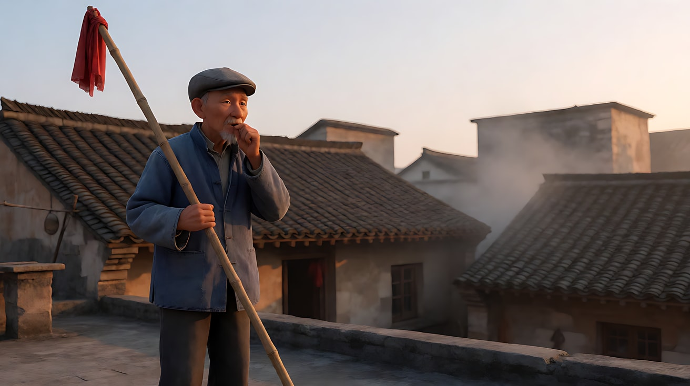

**【图生视频 · Seedance】**

```
【素材分工】@图片1 为首帧，锁定人物身份、服装、竹竿与屋顶环境。
【画风】风格化写实三维CG质感，电影级布光。
清晨的屋顶，老人站在画左，把两根手指放到嘴边，吹出一声长长的口哨，同时举起竹竿，竿头的红布在风里一甩。镜头先固定中景，口哨声响起的瞬间，镜头快速向画右甩开，画面拉成一片模糊的暖色光带，再在画右停稳：一群灰白色的鸽子正从对面的屋脊上一起起飞，翅膀被朝阳照亮。镜头停在鸽群飞起的画面上。
【声音】一声长口哨，鸽子翅膀成片扑动的声音，远处隐约的鸽哨嗡鸣，无配乐。
【约束】保持人物脸型、服装、竹竿不变；全片只有一次甩镜，方向向画右；不要字幕、水印、Logo。
时长：6秒
```

**参数**：时长 6 秒 ｜ 画幅 16:9

**【检查点】**
- 甩镜是否只有一次、方向是否向画右（与他的视线方向一致）
- 甩镜中段是否有明显的运动模糊，而不是平滑横摇
- 鸽群是否在甩镜停下后才"揭示"出来

**【常见问题与修复】**
| 现象 | 修复 |
|---|---|
| 甩镜太慢，变成普通横摇 | 写"快速甩开，画面拉成一片模糊的光带" |
| 甩过去后又甩回来 | 【约束】写"只有一次甩镜，不回摇" |
| 鸽子一开始就在画面里 | 首帧画面右侧只保留屋顶和天空，正文写"甩镜停下后才看见鸽群" |
| 老人在甩镜后又出现 | 写"镜头停在鸽群上，不再回到老人" |

---

### 练习2：匹配剪辑——挂钟变月亮（难度 ★★）

**目标**：用形状相同、内容不同的两个镜头，完成一次跨越时间和地点的匹配剪辑。关键是两个圆形在画面中的**位置和大小完全相同**。意图：让观众感到她在教室里熬过的白天，换来了屋顶上的这个夜晚。

**负载估算**：2 个镜头，一次地点变化（记 2 点），一个下摇运镜（记 0.5 点）。10 ÷（2 + 2.5）≈ 2.2 秒，"有挑战"档；这是匹配剪辑的代价，地点必须换。

**【生图 · Nano Banana】**

图1 角色定妆：

```
Character turnaround sheet of an original high-school girl about seventeen: a long black ponytail, a white school shirt
with a navy ribbon tie, a navy pleated skirt, a light grey cardigan tied around her waist, white sneakers.
Front view, three-quarter view, side view and back view, full body, camera at eye level, 50mm lens, deep focus,
plain light-grey background, even soft studio light from the front.
Stylized semi-realistic 3D CG rendering, feature-film animation quality. Aspect ratio 16:9.
```

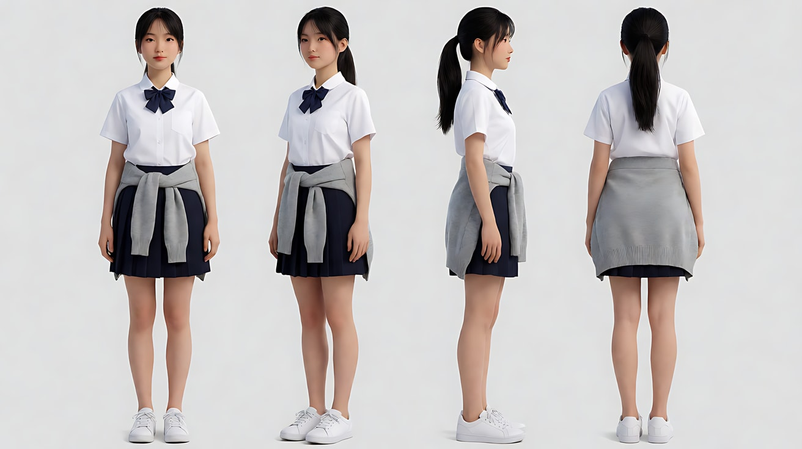

图2 场景（教室，挂钟居中）：

```
Empty high-school classroom in late afternoon, a round white wall clock with black hands mounted on the front wall
exactly in the center of the frame, occupying about one third of the frame height, rows of empty desks below it,
no people. Medium shot facing the front wall, camera at eye level, 50mm lens, moderate depth of field.
Lighting: warm low afternoon sunlight from windows on the left, casting long window-frame shadows across the wall.
Stylized semi-realistic 3D CG rendering, feature-film animation quality. Aspect ratio 16:9.
```


图3 场景（夜晚屋顶，月亮居中）：

```
Empty flat rooftop of a school building at night, a large full moon exactly in the center of the frame,
occupying about one third of the frame height, a low railing and a water tank at the bottom of the frame, city lights far below, no people.
Medium shot looking up at the moon, camera slightly below eye level, 50mm lens, deep focus.
Lighting: cool silver moonlight from above, faint warm city glow from below the railing.
Stylized semi-realistic 3D CG rendering, feature-film animation quality. Aspect ratio 16:9.
```

中文释义：图2 与图3 的圆形（挂钟 / 月亮）都在画面正中、占画面高度三分之一，焦段都是 50mm——这就是匹配剪辑的"接口"。

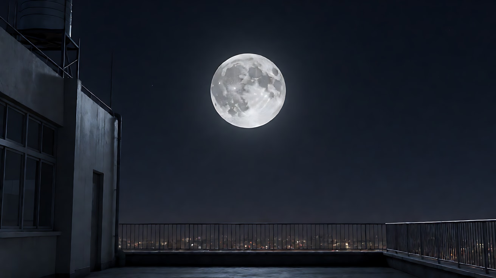

**【多图生视频 · Seedance】**

```
【素材分工】@图片1 锁定女孩的身份、发型与校服；@图片2 为首帧，锁定教室与挂钟的位置和大小；@图片3 仅参考屋顶夜景与月亮的位置和大小，不作为首帧。
【画风】风格化写实三维CG质感，电影级布光。
镜头1：固定中景，圆形挂钟在画面正中，占画面高度三分之一，下午的暖色阳光从画左的窗户斜照在墙上。挂钟的秒针一格一格地走，分针跳到整点。挂钟清晰的滴答声，远处放学的铃声。
镜头2：镜头切至夜晚的屋顶，一轮满月出现在与上一镜头挂钟完全相同的画面正中、相同大小。镜头从月亮缓慢下摇，露出屋顶的栏杆，女孩背靠水箱坐在栏杆边，校服外面披着灰色开衫，抱着膝盖仰头看月亮，冷色月光照在她脸上。滴答声消失，只剩远处城市低低的车流声和风声。
【锁定】光线：镜头1 为画左窗户的暖色斜阳，镜头2 为头顶冷色月光加栏杆下方微弱的城市暖光；女孩：十七岁左右，黑色长马尾，白衬衫配藏青领结与百褶裙，灰色开衫；圆形主体在两个镜头中都位于画面正中、占画面高度三分之一。
【声音】镜头1 滴答声与铃声，镜头2 滴答声戛然而止，换成风声和远处车流，无配乐。
【约束】保持女孩脸型、发型、服装不变；镜头1 画面里没有人；只有一次切镜；不要字幕、水印、Logo。
时长：10秒
```

**参数**：时长 10 秒 ｜ 画幅 16:9 ｜ 负载：有挑战档

**【检查点】**
- 挂钟与月亮在切镜瞬间是否在同一位置、同一大小
- 切镜是否是干脆的硬切，而不是溶解或推拉
- 下摇是否在切镜之后才开始

**【常见问题与修复】**
| 现象 | 修复 |
|---|---|
| 月亮比挂钟小很多 | 正文写"与上一镜头挂钟完全相同的位置和大小"，图3 也要严格按"三分之一画面高度"生成 |
| 切镜做成了慢溶解 | 写"硬切"，并删除"渐渐""过渡"等词 |
| 下摇和切镜同时发生，形状对不上 | 写"切镜后先停在月亮上一拍，再开始下摇" |
| 镜头1 里出现女孩 | 【约束】写"镜头1 画面里没有人" |

---

### 练习3：同机位跳切——时间被剪掉（难度 ★★★，首尾帧）

**目标**：用首帧和尾帧锁定"同一机位的两个时间点"，让模型在中间做几次跳切，表达漫长的等待。跳切的要点：**机位和构图不变，只有人物位置、光线和道具状态在跳**。

> 提示：首尾帧模式默认生成连续动作。这里是一个有意的实验——如果模型给出的是连续变化（像延时摄影），也是可接受的结果；如果你想要严格的跳切，最稳的做法是生成三四个固定机位的短片段，在剪辑软件里拼。

**【生图 · Nano Banana】**

图1 角色定妆：

```
Character turnaround sheet of an original young man in his mid-twenties: curly brown hair, a mustard-yellow hoodie,
black track pants, white socks with blue stripes, worn slide sandals, a canvas laundry bag.
Front view, three-quarter view, side view and back view, full body, camera at eye level, 50mm lens, deep focus,
plain light-grey background, even soft studio light from the front.
Stylized semi-realistic 3D CG rendering, feature-film animation quality. Aspect ratio 16:9.
```

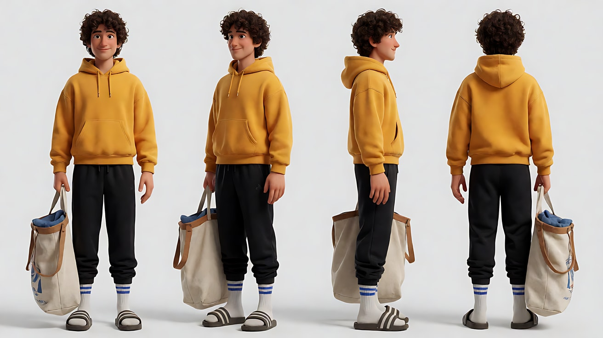

图2 首帧（下午）：

```
Using the character from image 1: a wide shot of a small self-service laundromat, a row of front-loading washing machines along the back wall,
a long wooden bench in front of them. The young man sits upright at the left end of the bench, the canvas laundry bag on his lap,
looking at the round window of the third machine. Symmetrical frontal composition.
Camera locked at eye level facing the machines, 28mm lens, deep focus.
Lighting: bright warm afternoon sunlight through a large shop window on the right, hard-edged light patches on the floor.
Keep the face, hairstyle and outfit exactly as in image 1.
Stylized semi-realistic 3D CG rendering, feature-film animation quality. Aspect ratio 16:9.
```

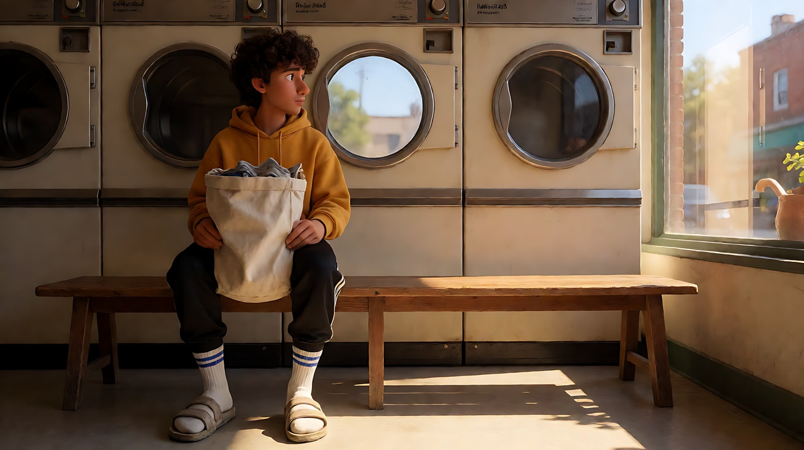

图3 尾帧（夜晚，同一机位）：

```
Using the character from image 1, with exactly the same camera position, lens and framing as image 2:
now late at night, the young man lies stretched across the whole bench on his back, one arm hanging down,
the laundry bag on the floor, an empty paper cup beside it. The third machine's round window is dark and still.
Lighting: the shop window on the right now shows a dark blue night street; cool flickering fluorescent tubes on the ceiling are the only light.
Keep the face, hairstyle and outfit exactly as in image 1.
Stylized semi-realistic 3D CG rendering, feature-film animation quality. Aspect ratio 16:9.
```

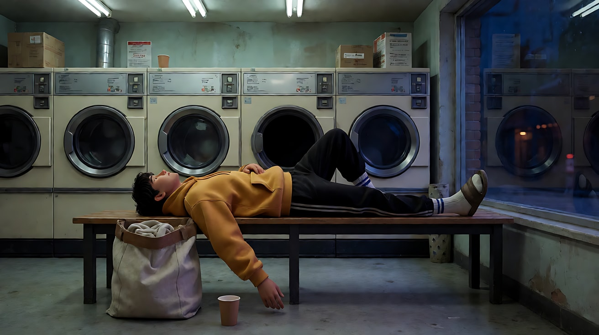

**【首尾帧生视频 · Seedance】**

```
【素材分工】@图片2 为首帧，锁定下午的洗衣店构图与他的起始位置；@图片3 为尾帧，是最终画面目标，锁定夜晚的光线与他躺下的姿势；@图片1 锁定人物身份与服装，不提供场景信息。机位与构图从头到尾完全不变。
【画风】风格化写实三维CG质感，电影级布光。
镜头固定正面全景，自助洗衣店里一排滚筒洗衣机，前面一条长木凳。同一机位连续跳切，时间一段一段被剪掉：他先端坐在长凳左端看着第三台洗衣机；跳切，他挪到长凳中间，低头玩手机，窗外阳光变成橙色；跳切，他靠在洗衣机上打哈欠，窗外天色变蓝，头顶日光灯亮起；跳切，他仰面躺满整条长凳，一只手垂下来，第三台洗衣机的圆窗已经停转变暗。每次跳切画面构图完全一样，只有他的位置和光线在变。
【声音】洗衣机滚筒的轰隆声持续，在每次跳切处突然换成不同的音量；最后只剩日光灯的电流嗡声，无配乐。
【约束】保持人物脸型、发型、服装不变；机位、焦段、构图全程不变；画面中只有他一个人；不要字幕、水印、Logo。
时长：10秒
```

**参数**：时长 10 秒 ｜ 画幅 16:9 ｜ 模式：首尾帧

**【检查点】**
- 机位是否真的没动（洗衣机的位置在每一跳中都一样）
- 光线是否有清楚的时间推进：暖白 → 橙 → 蓝 → 日光灯
- 每一跳他的位置是否明显不同

**【常见问题与修复】**
| 现象 | 修复 |
|---|---|
| 变成平滑的延时摄影 | 接受为备选；要严格跳切，就拆成四个固定机位片段，后期拼接 |
| 机位在跳切中变化 | 【约束】写"机位、焦段、构图全程不变"，首尾两帧必须同机位生成 |
| 跳切次数太多，画面闪烁 | 把跳切减到两次 |
| 出现第二个人 | 【约束】写"画面中只有他一个人" |

---

### 练习4：清晨面包房蒙太奇 + J-cut（难度 ★★★★，多镜头）

**目标**：用五个无对白的短镜头压缩一个清晨的劳动，并在最后一次切镜用 J-cut：先听到门铃，再看到门。意图：让观众感到天亮之前，有一个人已经为整条街准备好了早餐。

**负载估算**：1 个建立镜头（一个推近，0.5 点），3 个插入镜头（各半拍），1 个结尾镜头（一次手与门的接触，1 点）。约 15 ÷（1 + 1.5 + 1 + 1.5）= 3 秒每点，"稳妥"档。

**【生图 · Nano Banana】**

图1 角色定妆：

```
Character turnaround sheet of an original baker, a man in his fifties: a round friendly face, short grey beard,
a white baker's cap, a white double-breasted jacket with sleeves rolled up, a long dark brown canvas apron dusted with flour.
Front view, three-quarter view, side view and back view, full body, camera at eye level, 50mm lens, deep focus,
plain light-grey background, even soft studio light from the front.
Stylized semi-realistic 3D CG rendering, feature-film animation quality. Aspect ratio 16:9.
```

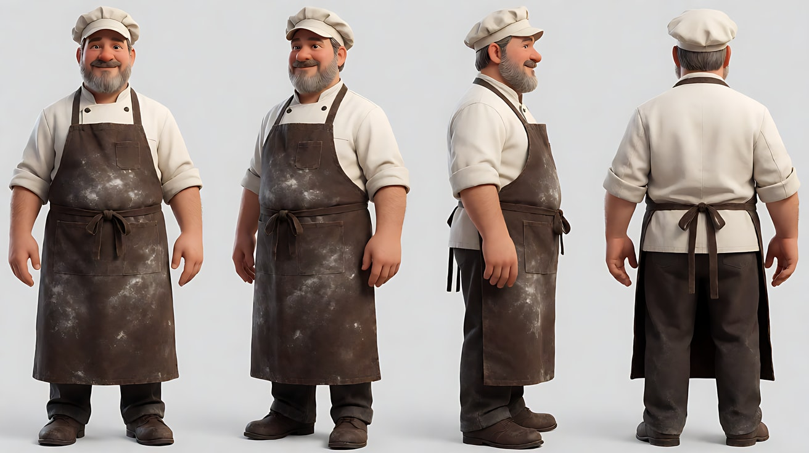

图2 场景：

```
Empty small neighborhood bakery before dawn, a floured wooden kneading table in the center, a deck oven with a glowing orange window on the left,
wooden bread shelves along the right wall, a glass front door with a small brass bell at the far back, dark blue street outside, no people.
Wide shot from behind the kneading table, camera at eye level, 28mm lens, deep focus.
Lighting: warm orange glow from the oven window on the left, a single warm pendant lamp above the table, cool blue pre-dawn light from the front door.
Stylized semi-realistic 3D CG rendering, feature-film animation quality. Aspect ratio 16:9.
```

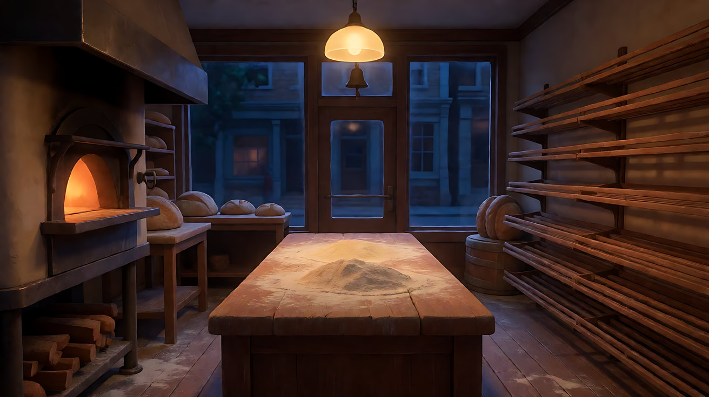

图3 镜头1 首帧：

```
Using the character from image 1 and the bakery from image 2:
a wide shot of the baker alone at the kneading table, both hands pressing into a large ball of dough, a cloud of flour in the lamp light,
the oven glowing on the left, the dark glass door at the far back.
Camera at eye level from behind the table, 28mm lens, deep focus.
Lighting: warm pendant lamp above, orange oven glow from the left, cool blue pre-dawn light at the door.
Keep the face, hairstyle and outfit exactly as in image 1.
Stylized semi-realistic 3D CG rendering, feature-film animation quality. Aspect ratio 16:9.
```


**【多图生视频 · Seedance】**

```
【素材分工】@图片1 锁定面包师的身份与服装；@图片2 仅参考面包房布局、烤炉与门的位置，不复制其中光线强弱；@图片3 为首帧，锁定镜头1 的揉面构图与人物位置。
【画风】风格化写实三维CG质感，电影级布光。
镜头1：全景，镜头从案板后方缓慢向前推近，面包师双手用力揉压一大团面，面粉在吊灯光里扬起，画左烤炉窗透出橙光。揉面的闷响。
镜头2：硬切到烤炉窗的特写，橙色火光里一排面包正在鼓起、表皮变成金黄。烤炉风扇的低鸣。
镜头3：硬切到长木铲的特写，木铲从烤炉里抽出，一排金黄的面包滑到铁架上，冒着热气。面包落在铁架上的一连串轻响。
镜头4：硬切到画右木架的近景，木架从空到满，一层层摆着刚出炉的面包，门外的冷蓝色天光已经变成浅灰。面包房里很安静，只有烤炉的低鸣；这一镜头结尾，门口已经先传来一声清脆的铜铃声。
镜头5：镜头切至从店内看向玻璃门的中景，门口的铜铃还在晃，门外天色微亮。面包师从画右走进画面，擦了擦手，把门上的牌子翻过来，推开门，清晨的冷空气和街上的鸟叫一起涌进来。
【锁定】光线：画左烤炉窗的橙色火光与案板上方的暖色吊灯始终不变，门外天色从深蓝变为浅灰；面包师：五十多岁，灰色短胡子，白色厨师帽，白色双排扣厨师服，深棕色帆布长围裙沾着面粉；机位始终在店内，门在画面深处。
【声音】无对白，无配乐；揉面声、烤炉低鸣、面包落架声依次出现；镜头4 结尾铜铃声提前响起，延续到镜头5；镜头5 结尾是开门声与鸟叫。
【约束】保持人物脸型、服装不变；面包形状在镜头2 到镜头4 保持一致；门牌上不要出现文字；不要字幕、水印、Logo。
时长：15秒
```

**参数**：时长 15 秒 ｜ 画幅 16:9 ｜ 负载：稳妥档

**【检查点】**
- 五个镜头是否都是硬切，景别是否在全景、特写、近景之间明显变化
- 铜铃声是否在镜头4 结尾就响起（J-cut），观众先听到再看到门
- 门外天色是否从深蓝推进到浅灰，体现时间压缩

**【常见问题与修复】**
| 现象 | 修复 |
|---|---|
| 铃声和画面同时出现，没有 J-cut 效果 | 把"铜铃声提前响起"写在镜头4 的最后一句；精确对位可在后期把声音往前拖几帧 |
| 插入镜头里出现面包师的脸 | 写"镜头2、3 只有烤炉、木铲与面包，不出现人脸" |
| 门牌上出现乱码文字 | 【约束】已写"门牌上不要出现文字"；仍出现就改为"他推开门"，删掉翻牌动作 |
| 五个镜头只生成了三个 | 把镜头2 和镜头3 合并为一个镜头，降一档 |

---

### 练习5：交叉剪辑——分开生成，后期交织（难度 ★★★★★，多镜头 + 后期）

**目标**：交叉剪辑的两条线发生在两个地点，在一次生成里来回交替会让负载超标（每次换地点记 2 点）。正确做法是：**每条线单独生成一次多镜头，各自锁定光线与人物，再在剪辑软件里交叉**，并用一个声音（火车汽笛）做 J-cut 声音桥。意图：让观众担心"他赶得上吗"。

**剪辑方案（先写这张表，再生成）**

| 剪辑顺序 | 来源 | 画面 | 声音处理 |
|---|---|---|---|
| 1 | 生成 A 镜头1 | 站台：外婆抱着保温桶，看站台大钟 | 站台广播 |
| 2 | 生成 B 镜头1 | 天桥：少年奔跑 | J-cut：汽笛声在 1 的结尾提前进入 |
| 3 | 生成 A 镜头2 | 站台：火车进站，外婆踮脚张望 | 汽笛声延续（L-cut） |
| 4 | 生成 B 镜头2 | 天桥楼梯：少年一步两级冲下 | 喘息声，脚步声 |
| 5 | 生成 A 镜头3 | 站台：外婆的手被一只年轻的手握住 | 环境声收住 |

**【生图 · Nano Banana】**

图1 外婆定妆：

```
Character turnaround sheet of an original grandmother in her seventies: short permed grey hair, a plum-red padded jacket,
dark trousers, black cloth shoes, holding a dented aluminum thermos lunch box with both hands.
Front view, three-quarter view, side view and back view, full body, camera at eye level, 50mm lens, deep focus,
plain light-grey background, even soft studio light from the front.
Stylized semi-realistic 3D CG rendering, feature-film animation quality. Aspect ratio 16:9.
```

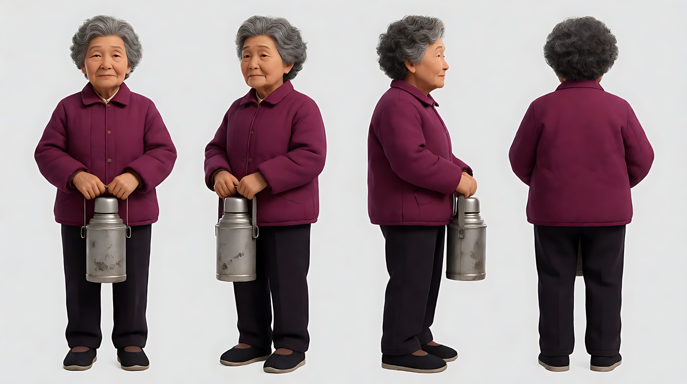

图2 少年定妆：

```
Character turnaround sheet of an original teenage boy about sixteen: short spiky black hair, a navy-and-white school tracksuit,
a heavy black backpack, white running shoes, a red string bracelet on his left wrist.
Front view, three-quarter view, side view and back view, full body, camera at eye level, 50mm lens, deep focus,
plain light-grey background, even soft studio light from the front.
Stylized semi-realistic 3D CG rendering, feature-film animation quality. Aspect ratio 16:9.
```

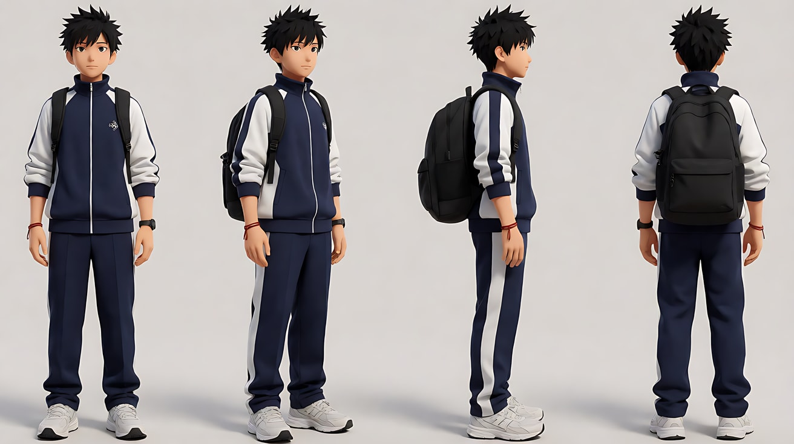

图3 站台场景：

```
Empty small-town railway platform in winter late afternoon, a large round platform clock on a post, a yellow safety line along the edge,
tracks curving away into the distance on the right, low winter sun from frame right, cold breath-like mist, no people.
Wide shot along the platform, camera at eye level, 35mm lens, deep focus.
Stylized semi-realistic 3D CG rendering, feature-film animation quality. Aspect ratio 16:9.
```

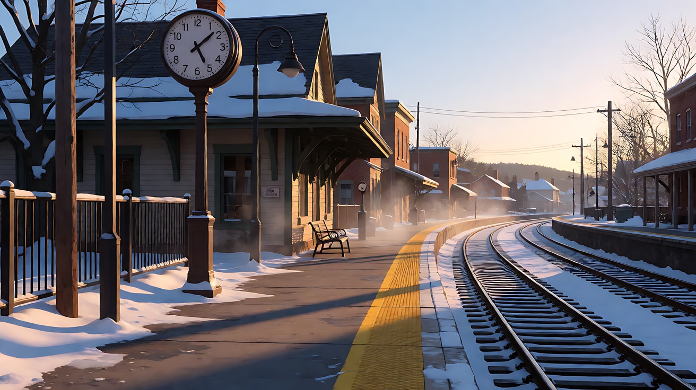

图4 天桥场景：

```
Empty enclosed pedestrian footbridge over railway tracks in winter late afternoon, long corridor with windows on the left,
a steep staircase going down at the far end, low orange sun through the windows casting stripes on the floor, no people.
Wide shot down the corridor, camera at eye level, 24mm lens, deep focus.
Stylized semi-realistic 3D CG rendering, feature-film animation quality. Aspect ratio 16:9.
```

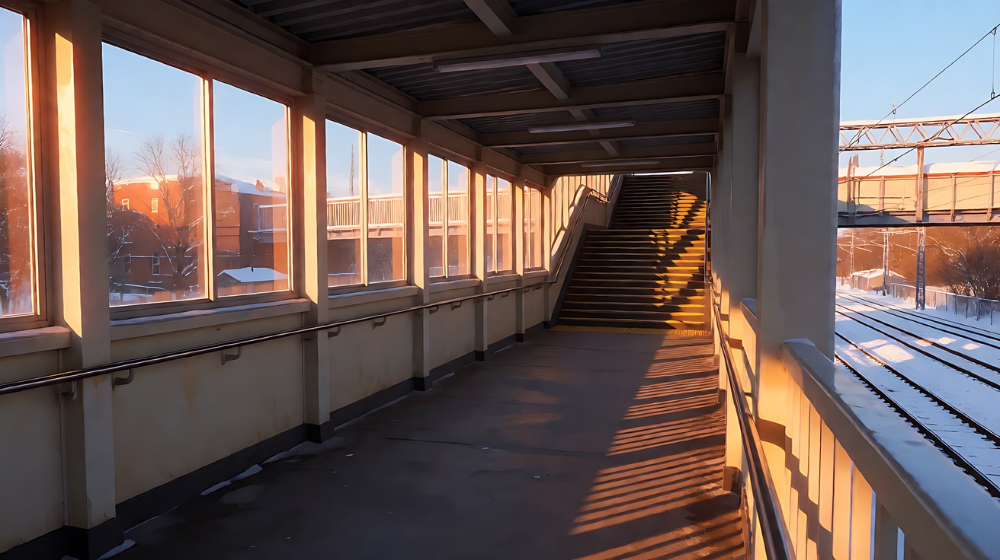

**【多图生视频 · Seedance】生成 A：站台线**（上传顺序：图1 作 @图片1，图2 作 @图片2，图3 作 @图片3）

```
【素材分工】@图片1 锁定外婆的身份、服装与保温桶；@图片2 仅锁定少年的手腕与红绳，本片段只出现他的手和袖口，不出现他的脸；@图片3 仅参考站台布局、大钟位置与低角度夕阳，不复制其中人物。
【画风】风格化写实三维CG质感，电影级布光。
镜头1：固定中景，外婆站在黄色安全线后面，双手抱着保温桶，抬头看站台上的大圆钟，又低头看铁轨远处。画右低角度的冬日夕阳照在她侧脸上，她呼出的白气缓慢散开。站台广播的回声。
镜头2：镜头切至沿站台的全景，一列绿色火车从画右远处的弯道驶进站台，车头灯亮着。外婆踮起脚，一只手抱着保温桶，另一只手扶着帽檐张望。火车汽笛声长鸣，车轮与铁轨的轰响。
镜头3：镜头切至外婆双手的特写，她一只手托着保温桶，另一只手垂在身侧；一只戴着红绳手链的年轻的手从画左伸进来，握住了她的手。外婆的手指慢慢收紧。环境声慢慢变远。
【锁定】光线：画右低角度的冬日夕阳，暖橙色，空气里有白色呼气；外婆：七十多岁，灰色短卷发，梅红色棉袄，深色裤子，双手抱着凹痕铝制保温桶；机位始终在站台靠墙一侧，铁轨在画右。
【声音】站台广播、火车汽笛与车轮声、最后环境声变远，无配乐。
【约束】保持外婆脸型、发型、服装与保温桶外形不变；镜头3 只出现少年的手，不出现他的脸；不要字幕、水印、Logo。
时长：12秒
```

**【多图生视频 · Seedance】生成 B：天桥线**（上传顺序：图2 作 @图片1，图4 作 @图片2）

```
【素材分工】@图片1 锁定少年的身份、校服、书包与红绳手链；@图片2 仅参考天桥走廊、楼梯与窗外夕阳的方向，不复制其中人物。
【画风】风格化写实三维CG质感，电影级布光。
镜头1：镜头在少年前方后退领跑，中景，他沿着天桥走廊向镜头全速奔跑，书包在背上跳动，画左窗户的橙色夕阳一条条扫过他的脸。远处已经传来一声火车汽笛，他抬头看了一眼窗外，跑得更快。急促的脚步声与喘息声。
镜头2：镜头切至楼梯底部向上的仰拍全景，少年从楼梯顶端冲下来，一步跨两级台阶，一只手抓着扶手，镜头固定。脚步在铁质台阶上的重响，越来越近的汽笛余音。
【锁定】光线：画左窗户射入的低角度橙色冬日夕阳；少年：十六岁左右，黑色短刺头，藏青白相间校服运动服，黑色双肩书包，白色跑鞋，左手腕红绳手链；奔跑方向始终从画面深处冲向镜头。
【声音】脚步声、喘息声、远处汽笛声，无配乐。
【约束】保持少年脸型、发型、服装与红绳不变；不要字幕、水印、Logo。
时长：8秒
```

**参数**：生成 A 时长 12 秒、生成 B 时长 8 秒 ｜ 画幅 16:9 ｜ 后期：按剪辑方案表交叉，把汽笛声在第 1 段结尾提前铺入（J-cut）

**【检查点】**
- 两次生成的夕阳方向是否在同一个"世界"里（低角度、暖橙色）
- 生成 B 的奔跑方向是否始终冲向镜头，交叉后观众能感到他在"靠近"站台
- 生成 A 镜头3 的红绳手链与生成 B 的少年是否一致，最后一握能接上两条线
- 在剪辑软件里按表交叉后，汽笛声是否把两条线缝在了一起

**【常见问题与修复】**
| 现象 | 修复 |
|---|---|
| 想在一次生成里交替四次地点 | 每次换地点记 2 点，必然超载；坚持分开生成、后期交叉 |
| 生成 A 镜头3 出现了少年的脸 | 素材分工写"只出现他的手和袖口"，正文写"一只年轻的手从画左伸进来" |
| 两条线光线色温不一致 | 两次生成的【锁定】用完全相同的光线描述"低角度橙色冬日夕阳" |
| 少年奔跑方向一会儿向左一会儿向右 | 【锁定】写"奔跑方向始终从画面深处冲向镜头" |
| 交叉后节奏拖沓 | 后期把每段裁短，越接近汇合，每段越短 |
