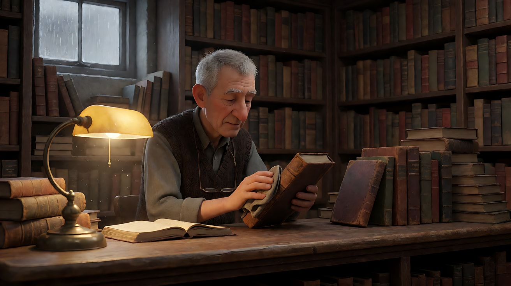
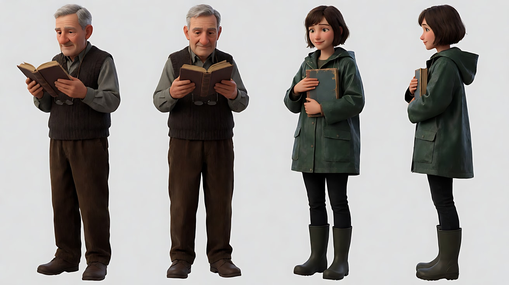
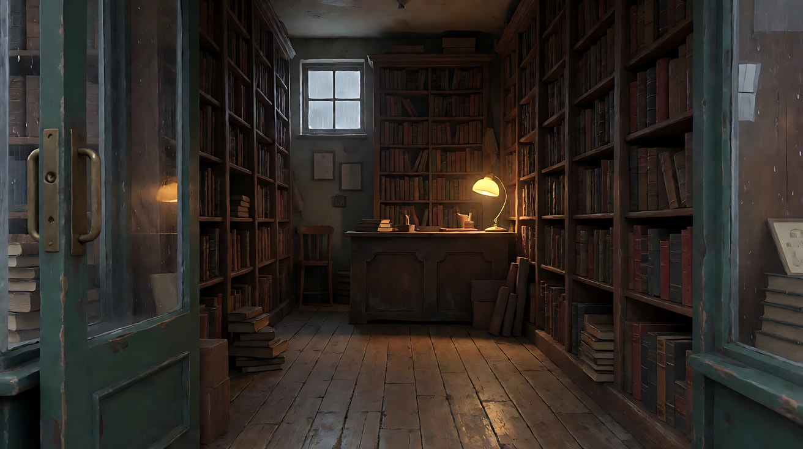
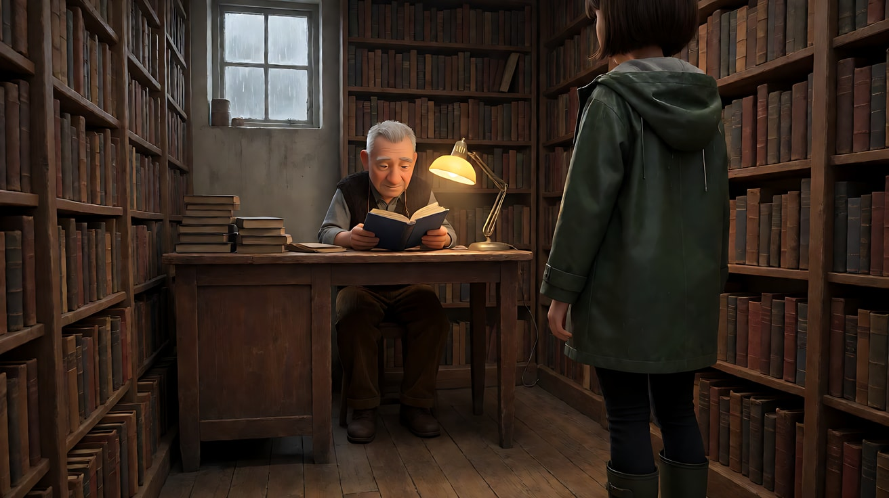
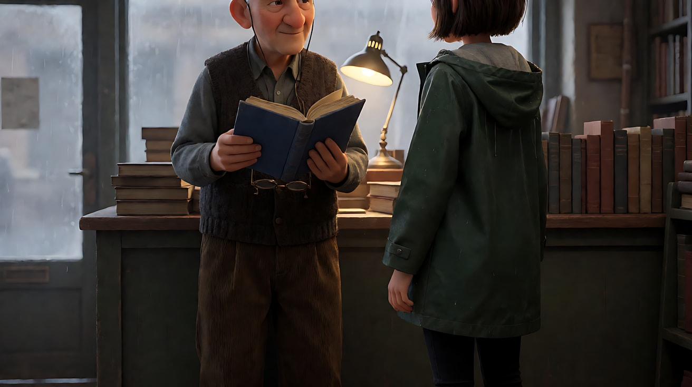
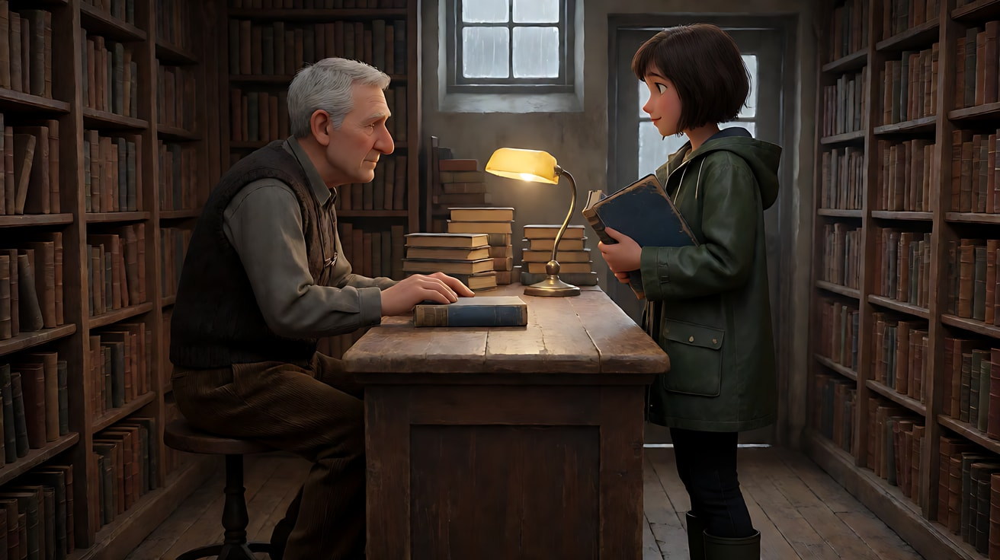
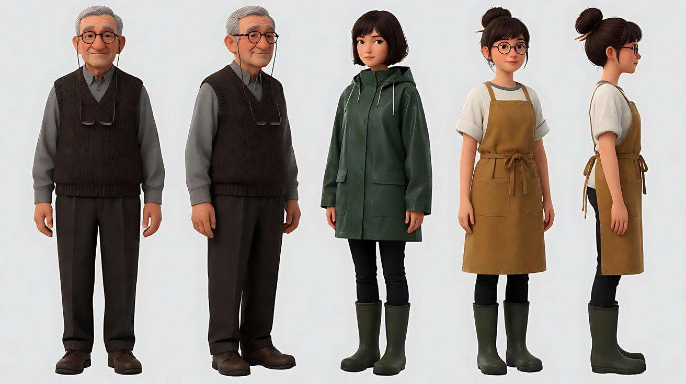
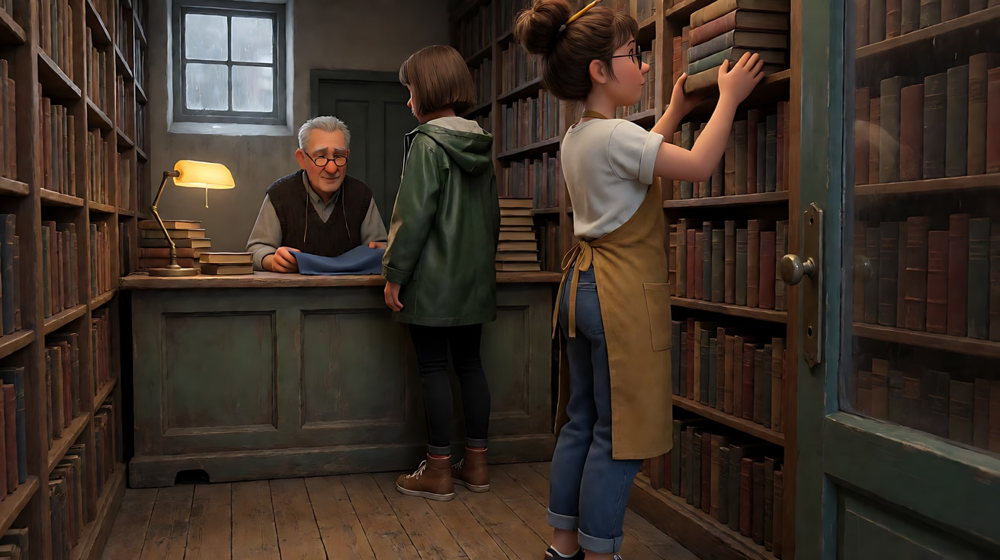

# L06-04 分镜表与场面调度 · 提示词

> 本组练习：同一间旧书店、同一场戏，每个练习都**先写平面图和分镜表，再写提示词**；从一行表到五行表，最后修复一张有缺陷的表。｜ 配套教学：[L06-04-分镜表与场面调度](../教学/L06-04-分镜表与场面调度.md) ｜ 规范：[写作规范](../../模板/写作规范.md)
>
> 画风默认使用开关 A（风格化写实 CG）。如改用 2D 动画，删掉所有焦段、光圈、景深词。

---

**全组通用平面图（文字版 + 俯视图）**

> 一间窄长的旧书店。南墙是玻璃门，门上挂一只铜铃；北面深处是木柜台，柜台上一盏暖黄色台灯；东西两侧是顶到天花板的书架；西墙高处有一扇小窗，透进冷灰色的雨天光。店主坐在柜台后，面朝玻璃门。轴线：玻璃门 ↔ 柜台。

```
                     北：柜台（暖黄台灯）
             ┌──────────[ 柜 台 ]──────────┐
             │            ● 老宋（面朝门）   │
   西：书架   │                              │  东：书架
   高处小窗 → │                              │
   冷灰雨光   │            ↑                 │
             │            │ 苏晚的走位路线    │
             │            │                 │
             │            ● 苏晚（进门站定）  │
             └────────[ 玻璃门 + 铜铃 ]──────┘
                          南
   📷A 门内西南角，向北看全景（主机位，靠西侧）
   📷B 柜台西侧，向南看门（反打，拍老宋时站在苏晚一侧）
```

- 老宋：六十多岁，花白短发，深棕色毛线背心配灰色衬衫，老花镜挂在胸前
- 苏晚：二十多岁，齐耳短发被雨打湿，墨绿色雨衣，怀里抱着一本蓝布面旧书
- 光：柜台上一盏暖黄色台灯；西墙高处小窗的冷灰雨天光
- 所有机位都在轴线西侧（靠窗一侧）

---

### 练习1：一行分镜表 → 一个镜头（难度 ★）

**目标**：哪怕只有一个镜头，也先把表填满。体验"表里每一格都能在提示词里找到"。

**分镜表**

| 镜号 | 景别 | 角度 | 运镜 | 机位侧 | 画内人物与朝向 | 视线 | 动作 | 对白 | 其他人 | 光 | 声音 | 时长感 | 终点帧 |
|---|---|---|---|---|---|---|---|---|---|---|---|---|---|
| 1 | 中景 | 平视 | 固定 | 柜台西侧，斜对老宋 | 老宋坐在柜台后，面朝南边的门 | 先看手里的书，最后抬眼看门 | 用布擦一本旧书的书脊，听到铃声抬头 | 无 | 无 | 暖黄台灯在柜台上，西窗冷灰雨光 | 雨声、擦书声、门铃 | 中，抬头后停一拍 | 老宋抬眼看向画面外的门口 |

**【生图 · Nano Banana】**

图1 关键帧：

```
A medium shot of an original elderly bookseller in his sixties, short grey hair, a dark brown knitted vest over a grey shirt,
reading glasses hanging on a cord at his chest, sitting behind an old wooden counter,
wiping the spine of an old hardcover book with a soft cloth, eyes lowered to the book.
He is slightly left of center, his body facing frame right toward the shop door off-screen; tall packed bookshelves behind him.
Camera on the west side of the counter at seated eye level, 50mm lens, moderate depth of field, the shelves soft but readable.
Lighting: a warm yellow desk lamp on the counter as key light from frame left-below, cool grey rainy daylight from a small high window behind the camera on the left as fill,
dust floating in the lamp light.
Stylized semi-realistic 3D CG rendering, feature-film animation quality. Aspect ratio 16:9.
```

中文释义：中景，老宋坐在柜台后略偏左，身体朝向画右（画外的门）；低头擦书脊；机位在柜台西侧，平视、50mm、中等景深；柜台上暖黄台灯做主光，机位身后左侧高处小窗的冷灰雨光做辅光。



**【图生视频 · Seedance】**

```
【素材分工】@图片1 为首帧，锁定店主的身份、服装、柜台与书架布局。
【画风】风格化写实三维CG质感，电影级布光。
中景，镜头固定，机位在柜台西侧。老宋坐在柜台后，身体朝向画右的店门，低头用一块软布慢慢擦着一本旧书的书脊。画面外传来一声清脆的门铃。他手上的动作停住，抬起眼睛，视线越过画右边缘看向门口，停住一拍，手里的布还搭在书上。柜台上暖黄色台灯照着他的手和脸，机位身后高处小窗透进冷灰色雨光，灯光里有灰尘飘动。
【声音】窗外持续的雨声，软布擦过书脊的沙沙声，一声门铃，之后店里安静下来，无配乐。
【约束】保持人物脸型、发型、服装不变；画面中只有老宋一个人；不要字幕、水印、Logo。
时长：6秒
```

**参数**：时长 6 秒 ｜ 画幅 16:9

**【检查点】**
- 表里的十四格是否都在提示词里出现
- 他抬眼的方向是画右（门的方向），而不是看镜头
- 终点帧是否是"抬眼看门、停一拍"

**【常见问题与修复】**
| 现象 | 修复 |
|---|---|
| 他看向镜头 | 写"视线越过画右边缘看向门口"，首帧里他的身体也要朝向画右 |
| 门出现在画面里，还走进一个人 | 写"门在画面外，画面中只有老宋" |
| 抬头后又低头继续擦 | 终点帧写"停住，布还搭在书上" |

---

### 练习2：走位要有自己的一行（难度 ★★）

**目标**：苏晚从门口走到柜台前。这段走位必须**拍出来**，不能从门口直接切到柜台（瞬移）。两行表、两个镜头，第一行就是走位本身。

**分镜表**

| 镜号 | 景别 / 角度 / 运镜 | 机位侧 | 画内人物与朝向 | 动作 | 其他人 | 光 | 声音 | 时长感 | 终点帧 |
|---|---|---|---|---|---|---|---|---|---|
| 1 | 全景 / 平视 / 固定 | 门内西南角，向北看 | 苏晚从门口进来，面朝北边的柜台；老宋在深处柜台后，面朝门 | 苏晚抱着书，从门口一路走到柜台前站定 | 老宋放下手里的书，看着她走近 | 暖黄台灯在柜台，西窗冷灰雨光 | 门铃余音、雨衣滴水、脚步踩木地板 | 长：整段路都走完 | 苏晚在柜台前站定，背对镜头 |
| 2 | 中近景 / 平视 / 固定 | 柜台西侧，向南看 | 苏晚站在柜台前，面朝北边的老宋 | 她把蓝布面旧书放在柜台上，推向老宋 | 老宋双手搭在柜台上，看着书 | 同第 1 行：暖黄台灯在柜台，西窗冷灰雨光 | 书放在木台面上的一声闷响 | 中，书放下后停一拍 | 书在柜台中央，她的手离开书 |

**【生图 · Nano Banana】**

图1 双人角色定妆：

```
Character turnaround sheet of two original characters.
An elderly bookseller in his sixties: short grey hair, a dark brown knitted vest over a grey shirt, reading glasses on a cord at his chest, brown corduroy trousers.
A young woman in her mid-twenties: a chin-length bob wet from the rain, a dark green hooded raincoat, black jeans, short rubber boots,
holding an old book with a faded blue cloth cover against her chest.
Front view, three-quarter view and side view of each, full body, camera at eye level, 50mm lens, deep focus,
plain light-grey background, even soft studio light from the front.
Stylized semi-realistic 3D CG rendering, feature-film animation quality. Aspect ratio 16:9.
```



图2 场景（主机位空镜）：

```
Empty narrow old bookshop on a rainy afternoon, seen from just inside the glass front door in the south-west corner, looking north.
Floor-to-ceiling wooden bookshelves on both sides, a worn wooden floor leading to an old counter at the far end,
a warm yellow desk lamp on the counter, a small high window on the left wall letting in cool grey rainy light, no people.
Wide shot, camera at eye level, 28mm lens, deep focus.
Stylized semi-realistic 3D CG rendering, feature-film animation quality. Aspect ratio 16:9.
```



**【多图生视频 · Seedance】**

```
【素材分工】@图片1 锁定老宋（男，六十多岁）与苏晚（女，二十多岁）的身份与服装；@图片2 仅参考书店布局、柜台与窗的位置，不复制其中光线强弱。
【画风】风格化写实三维CG质感，电影级布光。
镜头1：固定全景，机位在门内西南角，向北看向深处的柜台。苏晚抱着蓝布面旧书，从画面下方的门口走进来，雨衣下摆滴着水，沿着两排书架之间的木地板一步一步走向柜台，走到柜台前站定，背对镜头。深处柜台后的老宋放下手里的书，看着她走近。脚步踩在旧木地板上的吱呀声，门铃余音。
镜头2：镜头切至柜台西侧向南看的中近景，苏晚站在柜台前，面朝老宋。她把蓝布面旧书放在柜台上，用指尖推到老宋面前，手离开书，停住。老宋双手搭在柜台边，低头看着书。书落在木台面上的一声闷响。
【锁定】光线：柜台上一盏暖黄色台灯，西墙高处小窗透进冷灰色雨光；老宋：六十多岁，花白短发，深棕色毛线背心配灰衬衫，坐在柜台后，面朝门；苏晚：二十多岁，湿的齐耳短发，墨绿色雨衣，站在柜台前，面朝老宋；所有机位都在书店靠西窗一侧。
【声音】窗外雨声贯穿，脚步声与书放下的声音，无配乐。
【约束】保持两人脸型、发型、服装不变；只有苏晚在走动，老宋坐着不起身；不要字幕、水印、Logo。
时长：10秒
```

**参数**：时长 10 秒 ｜ 画幅 16:9 ｜ 负载：2 个镜头，一段走位、一次书与台面的接触，"稳妥"档

**【检查点】**
- 镜头1 是否完整拍出了从门口到柜台的走位
- 镜头2 开头苏晚是否已经在柜台前（与镜头1 终点帧一致）
- 两个镜头的光线描述是否一样

**【常见问题与修复】**
| 现象 | 修复 |
|---|---|
| 镜头1 她只走了一半就切了 | 时长感写"长"，正文写"走到柜台前站定" |
| 镜头2 她又站回门口 | 【锁定】写"站在柜台前"，位置相对地标写定 |
| 老宋也站起来迎她 | 【约束】写"只有苏晚在走动，老宋坐着不起身" |
| 书变成别的颜色 | 每次出现都写"蓝布面旧书" |

---

### 练习3：纵深调度——首尾帧锁住起点与终点（难度 ★★★，首尾帧）

**目标**：不切镜头，靠人物从背景走到前景完成"收紧"。老宋从柜台后起身，绕出柜台，走到前景的苏晚面前，景别自然从全景变成近景。分镜表的"起始帧"和"终点帧"两格就是生图的两张图。

**分镜表（一行，带起止帧）**

| 镜号 | 景别变化 | 机位侧 | 起始帧 | 终点帧 | 动作 | 其他人 | 光 | 声音 | 时长感 |
|---|---|---|---|---|---|---|---|---|---|
| 1 | 全景 → 近景（靠走位完成） | 苏晚身后偏西，向北看柜台 | 前景画右是苏晚的背影与左肩；深处老宋坐在柜台后，翻开书 | 老宋站在苏晚面前，在画面左半边成为近景，双手捧着书，看着她 | 老宋起身，绕出柜台，走到苏晚面前 | 苏晚站着不动，只有呼吸与雨衣滴水 | 暖黄台灯在柜台，西窗冷灰雨光 | 椅子挪动、脚步、雨声 | 长 |

**【生图 · Nano Banana】**

沿用练习2 的图1（双人定妆）、图2（场景）。

图3 首帧：

```
Using the two characters from image 1 and the bookshop from image 2:
a deep-focus wide composition looking north toward the counter. In the foreground on the right, the back and left shoulder of the young woman
in the dark green raincoat, standing still. Far in the background, the elderly bookseller sits behind the counter, small in the frame,
holding the open blue cloth book under the warm desk lamp, looking down at its first page.
Camera behind the woman, slightly to the west, at standing eye level, 35mm lens, deep focus so both are sharp.
Lighting: warm yellow desk lamp on the counter, cool grey rainy light from the small high window on frame left.
Keep the faces, hairstyles and outfits exactly as in image 1.
Stylized semi-realistic 3D CG rendering, feature-film animation quality. Aspect ratio 16:9.
```



图4 尾帧：

```
Using the two characters from image 1, with exactly the same camera position and lens as image 3:
the elderly bookseller now stands directly in front of the young woman, in close-up on the left half of the frame,
holding the open blue cloth book against his chest with both hands, his reading glasses now on, looking at her face.
The woman's back and left shoulder remain in the foreground on the right. The counter and desk lamp are now behind him, small.
Lighting: the same warm desk lamp behind him as a rim light, cool grey window light from frame left on his face.
Keep the faces, hairstyles and outfits exactly as in image 1.
Stylized semi-realistic 3D CG rendering, feature-film animation quality. Aspect ratio 16:9.
```



**【首尾帧生视频 · Seedance】**

```
【素材分工】@图片3 为首帧，锁定前景苏晚的背影与深处柜台后的老宋；@图片4 为尾帧，是最终画面目标，锁定老宋走到前景后的近景构图；@图片1 锁定两人身份与服装；@图片2 仅参考书店布局，不复制其中光线强弱。只生成两帧之间的连续动作。
【画风】风格化写实三维CG质感，电影级布光。
镜头固定不动，深焦。前景画右是苏晚的背影，她站着不动，呼吸时肩膀微微起伏，雨衣下摆滴着水。深处柜台后的老宋看着书的第一页，手指停在一行字上。他戴上老花镜，慢慢站起来，绕过柜台的西端，沿着书架之间的木地板一步一步向镜头走来，越走越大，最后停在苏晚面前，在画面左半边成为近景，双手把书抱在胸前，看着她的脸，嘴唇动了一下，没有说出话。台灯从他身后变成轮廓光，西窗的冷灰雨光照在他脸上。
【声音】椅子在木地板上挪动的声音，缓慢的脚步声由远及近，窗外雨声，无配乐。
【约束】保持两人脸型、发型、服装不变；镜头不推不移，景别变化只靠老宋走近；苏晚始终背对镜头不转身；中间动作连续，不跳切；不要字幕、水印、Logo。
时长：10秒
```

**参数**：时长 10 秒 ｜ 画幅 16:9 ｜ 模式：首尾帧

**【检查点】**
- 镜头是否真的没有推近，景别变化完全来自走位
- 老宋绕出柜台的路线是否合理（从柜台一端绕出，不穿过柜台）
- 苏晚是否保持背影、有呼吸，没有冻结

**【常见问题与修复】**
| 现象 | 修复 |
|---|---|
| 镜头自己推了上去 | 写"镜头不推不移，景别变化只靠人物走近" |
| 老宋穿过了柜台 | 写清路线"绕过柜台的西端"，首帧里柜台西端要留出通道 |
| 苏晚转过身来 | 【约束】写"苏晚始终背对镜头" |
| 深焦失败，后景糊掉 | 首帧焦段用 35mm 并写 `deep focus so both are sharp` |

---

### 练习4：四行表，一场完整的小戏（难度 ★★★★，多镜头）

**目标**：把一场有台词、有插入、有反应的小戏写成四行表，纸面预演通过后再一行一行翻译成镜头块。

**平面图补充**：苏晚站在柜台南侧，面朝北；老宋坐在柜台北侧，面朝南；书在两人之间的柜台中央。

**分镜表**

| 镜号 | 景别 / 角度 / 运镜 | 机位侧 | 画内人物与朝向 | 视线 | 动作 | 对白 | 其他人 | 光 | 声音 | 时长感 | 终点帧 |
|---|---|---|---|---|---|---|---|---|---|---|---|
| 1 | 双人中景 / 平视 / 固定 | 柜台西侧，侧面看两人 | 老宋在画左面朝右，苏晚在画右面朝左 | 苏晚看老宋，老宋看书 | 苏晚开口说台词 | 苏晚，轻但清楚："这本书，扉页上写着您的名字。" | 老宋手指摩挲书的布面 | 暖黄台灯，西窗冷灰雨光 | 雨声，台词 | 中 | 苏晚说完，看着他 |
| 2 | 插入特写 / 俯视 / 固定 | 柜台上方，老宋视角 | 只有书和老宋的手 | — | 老宋的右手翻开封面，扉页上一行褪色的钢笔字 | 无 | — | 同第1行 | 翻页声 | 短，半拍 | 他的手指停在那行字旁边 |
| 3 | 近景 / 平视 / 固定 | 柜台南侧偏西（苏晚一侧） | 老宋坐在柜台后，面朝南 | 视线越过镜头右边缘看向苏晚 | 他愣住，惊讶，喉结动了一下，摘下老花镜 | 无 | — | 同第1行 | 雨声变远 | 中，摘下眼镜后停一拍 | 他握着眼镜，看着苏晚 |
| 4 | 过肩中近景 / 平视 / 固定 | 老宋右后肩，柜台北侧偏西 | 前景画左是老宋的后肩；苏晚在画右，面朝老宋 | 苏晚看老宋 | 苏晚说第二句，说完眼眶微红 | 苏晚："我外公买下它的时候，夹了一张字条给您。" | 前景老宋的呼吸起伏 | 同第1行 | 台词，雨声 | 中 | 苏晚看着他，没有眼泪 |

**纸面预演记录**：第3行的机位必须在苏晚一侧（被看的人那边），否则老宋会看向镜头 ✔；第4行过肩用老宋**靠机位一侧**（西侧）的肩，机位不越轴 ✔；第2行插入镜头不需要机位侧以外的人物信息 ✔；每行都有终点帧，都在机位看得见的范围内 ✔。

**【生图 · Nano Banana】**

沿用练习2 的图1、图2，新做镜头1 首帧：

图3 镜头1 首帧：

```
Using the two characters from image 1 and the bookshop from image 2:
a medium two-shot in profile across the old wooden counter, the elderly bookseller sitting behind the counter on the left facing frame right,
the young woman in the dark green raincoat standing on the right facing frame left, the closed blue cloth book lying between them in the center of the counter,
his fingers resting on its cover. Bookshelves behind both of them.
Camera on the west side of the counter at standing eye level, 50mm lens, moderate depth of field.
Lighting: a warm yellow desk lamp on the counter between them, cool grey rainy light from a small high window behind the camera.
Keep the faces, hairstyles and outfits exactly as in image 1.
Stylized semi-realistic 3D CG rendering, feature-film animation quality. Aspect ratio 16:9.
```



**【多图生视频 · Seedance】**

```
【素材分工】@图片1 锁定老宋（男，六十多岁）与苏晚（女，二十多岁）的身份与服装；@图片2 仅参考书店布局与光源位置，不复制其中人物；@图片3 为首帧，锁定两人位置、朝向与书的位置。
【画风】风格化写实三维CG质感，电影级布光。
镜头1：固定双人中景，机位在柜台西侧。苏晚站在画右面朝左，看着老宋，声音轻但每个字都清楚：“这本书，扉页上写着您的名字。”说完她没有移开目光。老宋坐在画左，低头看着书，手指慢慢摩挲蓝色布面。窗外雨声。
镜头2：镜头切至柜台上方俯视的插入特写，画面里只有书和老宋的右手。他的右手翻开封面，扉页上有一行褪色的钢笔字，字迹模糊看不清。他的手指停在那行字旁边。纸页翻动的轻响。
镜头3：镜头切至柜台南侧、苏晚一侧的近景，老宋坐在柜台后，面朝苏晚。他愣住，惊讶，喉结动了一下，慢慢摘下老花镜，握在手里，视线越过镜头右边缘看向苏晚。雨声像被隔远了。
镜头4：镜头切至从老宋右后肩拍向苏晚的过肩中近景，前景画左是老宋虚化的后肩，随呼吸起伏。苏晚在画右，看着他，声音发紧：“我外公买下它的时候，夹了一张字条给您。”说完她的眼眶有一点红，没有眼泪，目光没有离开他。
【锁定】光线：柜台上一盏暖黄色台灯，西墙高处小窗透进冷灰色雨光；老宋：六十多岁，花白短发，深棕色毛线背心配灰衬衫，坐在柜台北侧，面朝南；苏晚：二十多岁，湿的齐耳短发，墨绿色雨衣，站在柜台南侧，面朝北；蓝布面旧书在柜台中央；所有机位都在柜台西侧。
【声音】窗外雨声贯穿；两句台词分别在镜头1 和镜头4；镜头3 雨声变远，无配乐。
【约束】保持两人脸型、发型、服装不变；每个镜头只有一个人说话；扉页上的字不可辨认；不要字幕、水印、Logo。
时长：15秒
```

**参数**：时长 15 秒 ｜ 画幅 16:9 ｜ 负载：4 个镜头（插入、反应各半拍），2 句台词，"有挑战"档

**【检查点】**
- 每个镜头与表中的一行一一对应，没有多出来的内容
- 镜头3 老宋的视线方向是否看向画右（苏晚）而非镜头
- 镜头4 的过肩是否用老宋靠西侧的肩，两人左右关系与镜头1 一致

**【常见问题与修复】**
| 现象 | 修复 |
|---|---|
| 扉页出现乱码大字 | 【约束】写"扉页上的字不可辨认"，正文写"字迹模糊看不清" |
| 镜头4 两人左右对调 | 检查表中机位侧，【锁定】再写一次"所有机位都在柜台西侧" |
| 第二句台词被截断 | 删掉镜头2 的翻页，改为"扉页已经打开"，减少一次接触 |
| 镜头3 他开口说话 | 【约束】加"老宋全程不说话" |

---

### 练习5：修一张有缺陷的分镜表（难度 ★★★★★，纸面预演 + 多镜头）

**目标**：下面这张表是一个新手写的，三个人物（老宋、苏晚、店员小满），五个镜头。先自己做纸面预演找出所有错误，再看修正版，最后用修正版生成。

**有缺陷的原表**

| 镜号 | 景别 | 机位侧 | 画内人物 | 动作 | 其他人 | 光 | 时长感 | 终点帧 |
|---|---|---|---|---|---|---|---|---|
| 1 | 全景 | （空） | 三人在店里 | 小满在书架前整理书 | 其他人不动 | 暖光 | 写了一个秒数区间 | 小满抱着书 |
| 2 | 中景 | 柜台西侧 | 苏晚在柜台前 | 苏晚把字条递给老宋 | 同上 | 同上 | 写了一个秒数区间 | 字条在老宋手里 |
| 3 | 近景 | 老宋正前方 | 老宋 | 老宋读字条，愣住 | — | 同上 | 写了一个秒数区间 | 老宋看着苏晚 |
| 4 | 全景 | 门内西南角 | 小满 | 小满听见了，抱着书走过来，手里的书掉了一本 | — | — | 写了一个秒数区间 | 门口的雨水坑 |
| 5 | 近景 | 柜台西侧 | 老宋 | 老宋笑了，起身，拥抱苏晚，对小满说话 | — | — | 写了一个秒数区间 | 三人合影一样站着 |

**纸面预演找到的错误**

| 行 | 错误 | 后果 | 修正 |
|---|---|---|---|
| 1 | 机位侧空着；"三人在店里"没有位置和朝向 | 模型随便摆人 | 写清机位与每人相对地标的位置 |
| 1、2 | "其他人不动""同上" | 一屋子蜡像 | 每人一句持续小动作，字要重抄 |
| 全部 | 只写“一个秒数区间”，没有实际预算 | 无法核对区间连续性与动作负载；秒数本身不是错误 | 2.5 填具体连续区间；2.0 可用行为节奏："停一拍""走完整段路" |
| 1、4、5 | 光只写"暖光"或空着 | 切镜后光漂移 | 每行写"暖黄台灯在柜台，西窗冷灰雨光" |
| 2 | 苏晚从哪拿出字条没写 | 字条凭空出现 | "从书的扉页里抽出一张折起的字条" |
| 3 | 机位在老宋正前方 | 他看向镜头 = 看空气 | 机位移到苏晚一侧，视线越过镜头边缘 |
| 4 | "书掉了一本"是意外 | 模型会演成故意扔书 | 删掉，换成"她停下脚步" |
| 4 | 终点帧是门口水坑，但这一镜头拍的是小满 | 机位看不见的终点 | 终点帧改为"小满停在书架尽头，看着柜台" |
| 5 | 一个镜头四个动作，且有肢体接触和对白 | 只会保留一个动作 | 只保留"老宋笑了，把字条按在胸口"，拥抱和对白删掉或拆到下一次生成 |
| 5 | 终点帧"三人合影一样站着" | 近景装不下三个人，且会冻结 | 改为"老宋把字条按在胸口，看着苏晚" |

**修正版分镜表**

| 镜号 | 景别 / 运镜 | 机位侧 | 画内人物与朝向 | 视线 | 动作 | 其他人 | 光 | 声音 | 时长感 | 终点帧 |
|---|---|---|---|---|---|---|---|---|---|---|
| 1 | 全景 / 固定 | 门内西南角，向北 | 小满在东侧书架前背对柜台；苏晚在柜台南侧面朝北；老宋在柜台后面朝南 | 小满看书架 | 小满踮脚把一摞书塞进高处书架 | 苏晚和老宋低头看柜台上的书，轻声说话（听不清） | 暖黄台灯在柜台，西窗冷灰雨光 | 雨声，书塞进书架的摩擦声 | 中 | 小满放好书，手还扶着书架 |
| 2 | 中景 / 固定 | 柜台西侧 | 老宋在画左面朝右，苏晚在画右面朝左 | 两人看字条 | 苏晚从扉页里抽出一张折起的字条，放到老宋手里 | 老宋伸手接住 | 同上，原字重抄 | 纸张声 | 中 | 字条在老宋手里 |
| 3 | 近景 / 固定 | 柜台南侧偏西（苏晚一侧） | 老宋面朝南 | 先看字条，再越过镜头右边缘看苏晚 | 老宋展开字条读，愣住，抬眼看苏晚 | — | 同上 | 雨声变远 | 中，抬眼后停一拍 | 老宋看着苏晚 |
| 4 | 中景 / 固定 | 东侧书架尽头，向西看柜台 | 小满站在书架尽头，面朝柜台 | 小满看向柜台的两人 | 小满抱着书，停下手里的动作，转头看向柜台 | 远处两人在柜台边，静静对视 | 同上 | 雨声 | 短，半拍 | 小满抱着书看向柜台 |
| 5 | 近景 / 极慢推近 | 柜台南侧偏西 | 老宋面朝南 | 看苏晚 | 老宋笑了，眼睛发红，把字条按在胸口 | — | 同上 | 一声长出气，雨声 | 中，按住后停一拍 | 老宋把字条按在胸口，看着苏晚 |

**【生图 · Nano Banana】**

沿用练习2 的图2（场景），新做三人定妆和镜头1 首帧：

图1 三人角色定妆：

```
Character turnaround sheet of three original characters.
An elderly bookseller in his sixties: short grey hair, a dark brown knitted vest over a grey shirt, reading glasses on a cord.
A young woman in her mid-twenties: a wet chin-length bob, a dark green hooded raincoat, black jeans, short rubber boots.
A shop assistant girl about nineteen: a high bun with a pencil through it, round glasses, a mustard canvas apron over a white T-shirt, rolled-up sleeves.
Front view, three-quarter view and side view of each, full body, camera at eye level, 50mm lens, deep focus,
plain light-grey background, even soft studio light from the front.
Stylized semi-realistic 3D CG rendering, feature-film animation quality. Aspect ratio 16:9.
```



图3 镜头1 首帧：

```
Using the three characters from image 1 and the bookshop from image 2:
a wide shot looking north from just inside the glass door in the south-west corner.
On the right side, the shop assistant girl stands on tiptoe at the east bookshelf with her back to the counter, pushing a stack of books onto a high shelf.
Far in the background, the young woman in the dark green raincoat stands at the south side of the counter facing north,
and the elderly bookseller sits behind the counter facing south; both look down at a blue cloth book on the counter.
Camera at standing eye level, 28mm lens, deep focus.
Lighting: a warm yellow desk lamp on the counter, cool grey rainy light from a small high window on the left wall.
Keep the faces, hairstyles and outfits exactly as in image 1.
Stylized semi-realistic 3D CG rendering, feature-film animation quality. Aspect ratio 16:9.
```



**【多图生视频 · Seedance】**

```
【素材分工】@图片1 锁定老宋（男，六十多岁）、苏晚（女，二十多岁）、小满（女，十九岁左右）三人的身份与服装；@图片2 仅参考书店布局与光源位置，不复制其中人物；@图片3 为首帧，锁定三人开场位置与朝向。
【画风】风格化写实三维CG质感，电影级布光。
镜头1：固定全景，机位在门内西南角向北看。画右的小满背对柜台，踮脚把一摞书塞进东侧书架高处，放好后手还扶着书架。深处柜台边，苏晚和老宋低头看着柜台上的书，轻声说着听不清的话。窗外雨声，书塞进书架的摩擦声。
镜头2：镜头切至柜台西侧的双人中景，老宋在画左面朝右，苏晚在画右面朝左。苏晚从蓝布面旧书的扉页里抽出一张折起的字条，放到老宋伸出的手里。纸张摩擦的轻响。
镜头3：镜头切至柜台南侧、苏晚一侧的近景，老宋展开字条低头读，读到一半愣住，惊讶，喉结动了一下，抬起眼睛，视线越过镜头右边缘看向苏晚，停住。雨声变远。
镜头4：镜头切至东侧书架尽头的中景，小满抱着几本书站在书架尽头，停下手里的动作，转头看向柜台，镜片反着台灯的暖光。远处柜台边两人静静对视。
镜头5：镜头切至柜台南侧、苏晚一侧的近景，镜头极慢地推近一点。老宋笑了，眼睛发红，把字条按在胸口，看着苏晚，长出一口气。
【锁定】光线：柜台上一盏暖黄色台灯，西墙高处小窗透进冷灰色雨光；老宋：六十多岁，花白短发，深棕色毛线背心配灰衬衫，坐在柜台北侧，面朝南；苏晚：二十多岁，湿的齐耳短发，墨绿色雨衣，站在柜台南侧，面朝北；小满：十九岁左右，高发髻插着铅笔，圆眼镜，芥末黄帆布围裙，在东侧书架边；所有机位都在书店靠西窗一侧或东侧书架尽头，不越过门与柜台的连线去拍苏晚的正脸。
【声音】窗外雨声贯穿，无对白，无配乐；镜头5 只有一声长出气。
【约束】保持三人脸型、发型、服装不变；字条上的字不可辨认；没有人拥抱，没有东西掉落；不要字幕、水印、Logo。
时长：15秒
```

**参数**：时长 15 秒 ｜ 画幅 16:9 ｜ 负载：5 个镜头（镜头4 为半拍反应），1 次手递手接触，1 个运镜，无台词，"有挑战"档

**【检查点】**
- 把生成结果逐行对照修正版表格：每一格是否兑现
- 小满在镜头1 和镜头4 是否都在东侧书架附近，没有瞬移
- 镜头3、5 老宋的视线是否看向苏晚而非镜头
- 背景人物是否都有持续的小动作，没有冻结

**【常见问题与修复】**
| 现象 | 修复 |
|---|---|
| 镜头4 小满出现在柜台旁 | 【锁定】中她的位置写"在东侧书架边"，镜头4 写"站在书架尽头" |
| 镜头1 背景两人僵住 | 写"轻声说着听不清的话"，给他们持续的小动作 |
| 五个镜头只出了四个 | 合并镜头4 与镜头5，或按 L06-05 的方法拆成两次生成 |
| 字条递交时手指纠缠 | 写成"放到他伸出的手里"，一只手、一个方向 |
| 拥抱的冲动又回来了 | 【约束】写"没有人拥抱"，拥抱如需要，留给下一次生成单独拍 |

---

### 练习6：三节点白模预演（难度 ★★★★，2.5，待实测）

**目标**：先验证书店走位，再替换外观；不要求用模型凭空猜摄影机位置。

**素材准备（不需要新生图）**

- 图片1：从已有苏晚素材选出清楚的单人图；图片2：老宋单人图；图片3：本课书店场景图。
- 视频1：自行用简单几何体制作或使用已获授权的 12 秒粗白模预演。红模型是苏晚，蓝模型是老宋；门在南侧、柜台在北侧、窗在西侧。不要把现成真人表演片段称为白模。

| 时间 | 白模节点 | 摄影机与动作 |
|---|---|---|
| 0–4秒 | 南门口 | 摄影机在西南角固定全景，红模型入门停下；蓝模型在柜台北侧 |
| 4–8秒 | 柜台南侧 | 红模型走向柜台，摄影机沿西侧平移跟随，不越过两人轴线 |
| 8–12秒 | 双人会面 | 红模型停在柜台南侧；摄影机停止，蓝模型面朝红模型 |

**【白模参考生视频 · Seedance 2.5】**

```text
【素材分工】@视频1 参考书店空间、三个节点、人物轨迹和摄影机路径，不参考几何体外观与灰色材质；红模型对应 @图片1 的苏晚，蓝模型对应 @图片2 的老宋；@图片3 参考书店陈设、材质与灯光。
【剧情】苏晚抱着一本旧书，从南门走入，在门边短暂停留，然后走到北侧柜台的南边。老宋始终在柜台北侧，看见她停下后抬头。两人隔着柜台对视，不递书、不拥抱。
【摄影机】按白模从西南角全景开始，沿西侧跟随苏晚，到柜台旁停止；角色左右与地标关系不变。
【外观与光】风格化写实CG，窗外冷灰雨光，柜台台灯暖黄。白模不负责光照，采用图片3的光源布局。
【声音】入门风铃、脚步、衣料声、窗外细雨，无对白、无配乐。
【结尾】停在柜台两侧的双人画面，不继续新的剧情，不额外加入字幕。
时长：12秒
```

**参数**：12 秒、16:9。先看白模，再检查文字是否与它一致；不在描述中添加白模没有的路线或穿墙镜头。

**【检查点】**：三节点是否按顺序出现；红蓝对应的人有没有互换；机位是否保持西侧；白模是否只贡献结构而没有把灰材质带入。

**【常见问题与修复】**
| 现象 | 修复 |
|---|---|
| 无法准备白模视频 | 先做三格简约线稿与纸面预演，不冒充白模；接受故事板主要提供剧情参考 |
| 角色互换 | 检查红蓝映射与独立人物图；减少一位非必要配角 |
| 机位看不到表情 | 先改预演机位再生成，不只在文字里命令“表情清楚” |
| 材质取对了但人物穿过柜台 | 调整白模轨迹和停点；先验收空间再谈画风 |
