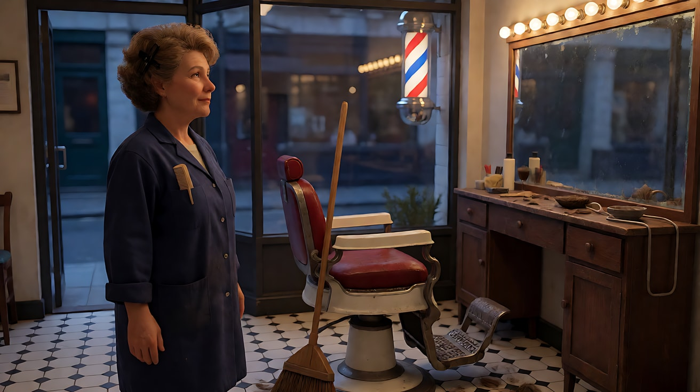
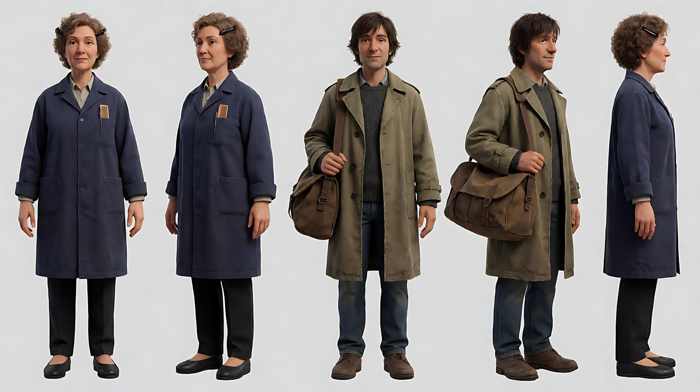
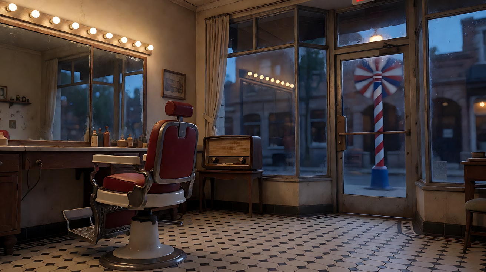
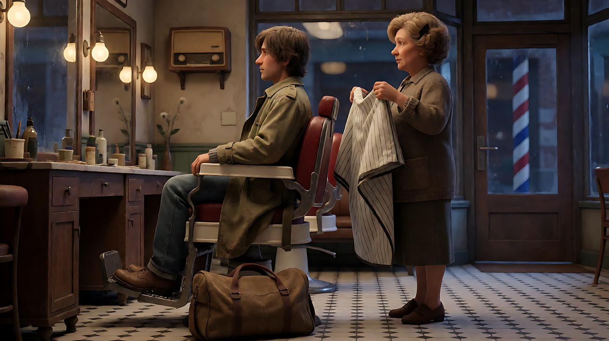
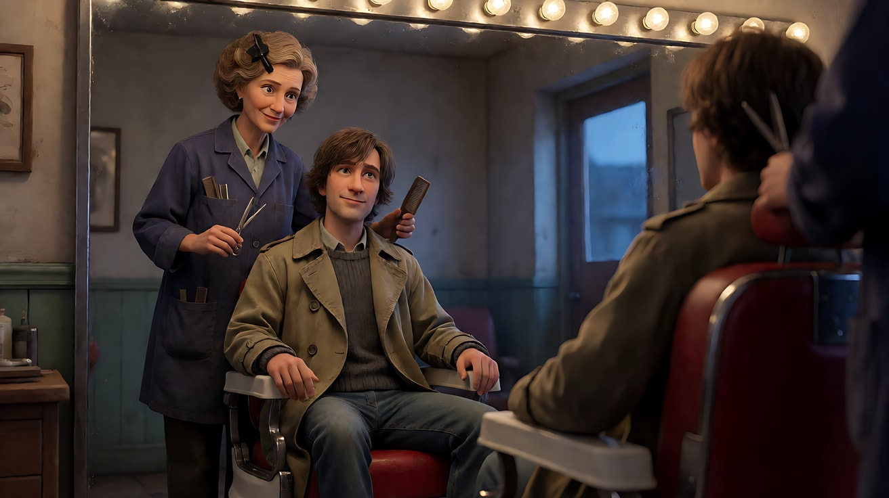
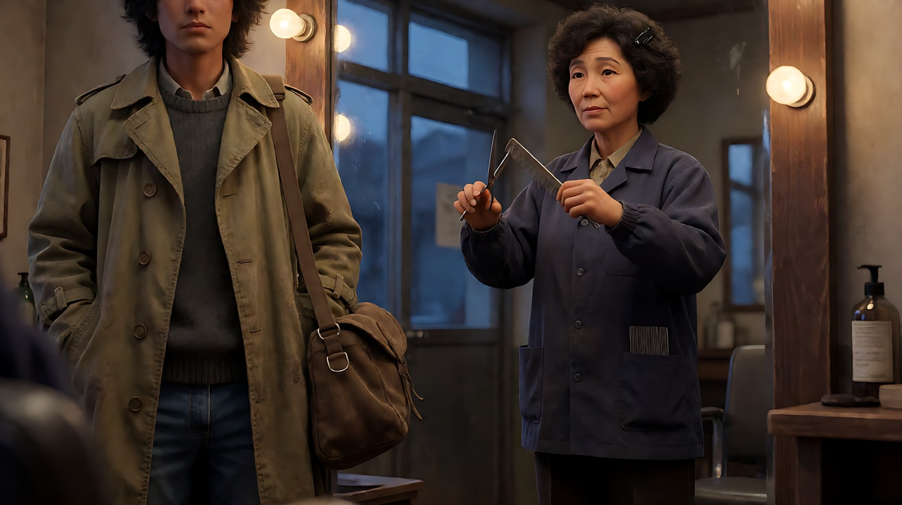
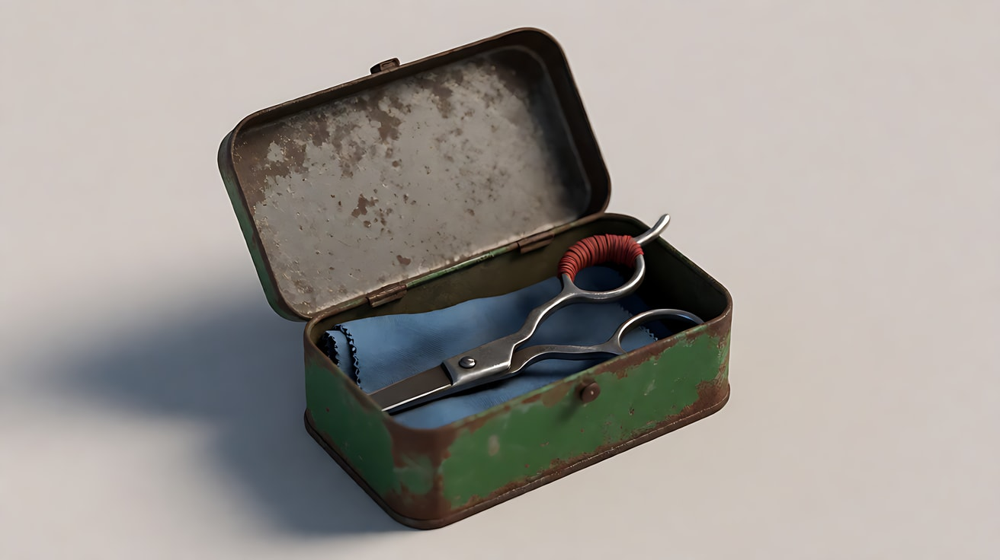

# L06-05 单次生成多镜头 · 提示词

> 本组练习：同一间老理发店、同一场重逢戏，从"一段话不分镜"到"稳妥 / 有挑战 / 冒险"三档多镜头，最后把冒险档拆成两次生成。每个练习都先算负载再写提示词。｜ 配套教学：[L06-05-单次生成多镜头](../教学/L06-05-单次生成多镜头.md) ｜ 规范：[写作规范](../../模板/写作规范.md)
>
> 画风默认使用开关 A（风格化写实 CG）。如改用 2D 动画，删掉所有焦段、光圈、景深词。

---

**全组通用设定**

> 一间开了三十年的老理发店，傍晚。东墙是一整面大镜子，镜子上方一排暖黄色灯泡；镜子前是一把旧的红色皮质理发椅。南面是玻璃门，门外有一根旋转的红白蓝条纹灯柱，街上的冷蓝色暮光透进来。北墙挂着一台旧收音机。

```
                北墙：旧收音机
   ┌──────────────────────────────────┐
   │                                  │ 东
   │                  ┃ 大镜子 + 暖黄灯泡 │ 墙
 西 │    长凳            ● 理发椅（面朝镜子）│
 墙 │                                  │
   │                                  │
   └──────────[ 玻璃门 ]───────────────┘
           南：门外旋转灯柱，冷蓝暮光
```

- 陈姨：五十多岁女理发师，烫过的短卷发夹着一个黑色发夹，藏青色工作罩衫，胸前口袋插着一把细齿梳子
- 阿杰：二十七八岁，头发长得盖住耳朵，旧的卡其色风衣，背一只旅行包
- 光：镜子上方一排暖黄灯泡；玻璃门外冷蓝色暮光与旋转灯柱的红色反光

---

### 练习1：连续形态——不分镜也能有层次（难度 ★）

**目标**：一个人、一个空间、一个连续动作，用**一段话**写，不写镜头编号，阶段用"开始……接着……最后……"表达。体会"镜头数量由内容决定，不由时长决定"。

**负载判断**：一个人、一个连续动作、一个慢推，没有地点变化 → 连续形态，不需要算 S。

**【生图 · Nano Banana】**

图1 关键帧：

```
A medium-wide shot of an original woman barber in her fifties, short permed hair held by a black hair clip,
a navy work smock with a fine-tooth comb in the chest pocket, sweeping cut hair on the black-and-white tiled floor
with a wooden broom beside an old red leather barber chair. A large wall mirror on frame right with a row of warm bulbs above it.
She is placed on the left third of the frame, facing frame right.
Camera at standing eye level, 35mm lens, moderate depth of field.
Lighting: warm yellow bulbs above the mirror as key light from frame right, cool blue dusk light through the glass door from behind the camera,
a faint red reflection from a rotating striped barber pole outside moving across the tiles.
Stylized semi-realistic 3D CG rendering, feature-film animation quality. Aspect ratio 16:9.
```

中文释义：中全景，陈姨在画左三分之一，面朝画右，用扫帚扫黑白格地砖上的碎发；画右是大镜子与红色理发椅；站姿平视、35mm、中等景深；镜子上方暖黄灯泡做主光，机位身后玻璃门透入冷蓝暮光，门外灯柱的红色反光在地砖上移动。



**【图生视频 · Seedance】**

```
【素材分工】@图片1 为首帧，锁定人物身份、服装、理发椅与镜子的位置。
【画风】风格化写实三维CG质感，电影级布光。
傍晚，老理发店快要关门。开始，陈姨弯着腰把地砖上的碎发扫成一小堆；接着，她直起身，把扫帚靠在理发椅边，用手掌拍了拍红色皮椅的椅面，拍掉几根碎发；最后，她抬头看向画右的大镜子，看了镜子里的自己一会儿，伸手把发夹重新夹紧。镜头从中全景极慢地向前推近，结束在她看着镜子的中景，画面停稳。镜子上方暖黄灯泡照着她，门外旋转灯柱的红色反光一圈一圈扫过地砖。
【声音】扫帚扫过地砖的沙沙声，手掌拍皮椅的闷响，墙上旧收音机里低低的老歌，门外灯柱电机的轻微嗡声。
【约束】保持人物脸型、发型、服装不变；画面中只有她一个人；一镜到底，不切镜头；不要字幕、水印、Logo。
时长：10秒
```

**参数**：时长 10 秒 ｜ 画幅 16:9 ｜ 形态：连续

**【检查点】**
- 是否没有出现切镜，而是一镜到底
- 三个阶段（扫、拍椅子、看镜子）是否依次发生
- 推近是否只有一个方向

**【常见问题与修复】**
| 现象 | 修复 |
|---|---|
| 模型自己切了镜头 | 【约束】写"一镜到底，不切镜头"，删除"然后切到"之类的词 |
| 三个阶段只完成了两个 | 删掉"拍椅子"，阶段越少越稳 |
| 镜子里的倒影动作和本人不一致 | 减少镜子在画面中的面积，或让她只是看镜子不做手部动作 |

---

### 练习2：两镜头，稳妥档（难度 ★★）

**目标**：门被推开，阿杰走进来；切给陈姨的反应。第一个多镜头练习，选稳妥档，并练习"反应镜头只算半拍"。

**负载估算**：镜头1 是 1 拍，推门是一次必须落地的接触（1 点）；镜头2 是反应镜头（半拍）。S = 10 ÷（1.5 + 1）= 4.0 → **稳妥**。

**【生图 · Nano Banana】**

图1 双人角色定妆：

```
Character turnaround sheet of two original characters.
A woman barber in her fifties: short permed hair with a black hair clip, a navy work smock with a fine-tooth comb in the chest pocket, dark trousers, flat black shoes.
A man in his late twenties: shaggy hair grown over his ears, a worn khaki trench coat, a grey sweater, jeans, a brown canvas travel bag over one shoulder.
Front view, three-quarter view and side view of each, full body, camera at eye level, 50mm lens, deep focus,
plain light-grey background, even soft studio light from the front.
Stylized semi-realistic 3D CG rendering, feature-film animation quality. Aspect ratio 16:9.
```



图2 场景：

```
Empty old barbershop at dusk, seen from the back of the shop looking south toward the glass front door,
a red leather barber chair in front of a large wall mirror on the left with a row of warm bulbs above it,
black-and-white tiled floor, an old radio on the back wall, a rotating red-white-blue striped pole outside the door,
cool blue dusk street light coming through the glass, no people.
Wide shot, camera at standing eye level, 28mm lens, deep focus.
Stylized semi-realistic 3D CG rendering, feature-film animation quality. Aspect ratio 16:9.
```



**【多图生视频 · Seedance】**

```
【素材分工】@图片1 锁定陈姨（女，五十多岁）与阿杰（男，二十七八岁）的身份与服装；@图片2 仅参考理发店布局、镜子与玻璃门的位置，不复制其中光线强弱。
【画风】风格化写实三维CG质感，电影级布光。
镜头1：固定全景，机位在店内深处，向南看着玻璃门。门外旋转灯柱的红色反光一闪一闪。阿杰推开玻璃门，门上的铃铛响了一声，他走进门，站在门口，旅行包从肩上滑到手里，环顾店里。门铃声，门外街上的车声随门开涌进来又被关在门外。
镜头2：镜头切至陈姨的近景，机位在门口方向，她站在理发椅旁，手里还拿着扫帚。她愣住，认出了他，扫帚停在半空，嘴唇动了一下，没出声，视线越过镜头边缘看向门口。收音机里的老歌继续低低地放。
【锁定】光线：镜子上方一排暖黄灯泡，玻璃门外冷蓝色暮光与灯柱的红色反光；陈姨：五十多岁，烫过的短卷发夹着黑色发夹，藏青色工作罩衫，站在理发椅旁；阿杰：二十七八岁，头发盖住耳朵，卡其色旧风衣，提着棕色帆布旅行包，站在玻璃门内；机位始终在店内，不在门外。
【声音】门铃一声，门外车声，收音机老歌贯穿，无额外配乐。
【约束】保持两人脸型、发型、服装不变；两人都不说话；不要字幕、水印、Logo。
时长：10秒
```

**参数**：时长 10 秒 ｜ 画幅 16:9 ｜ 负载：S = 4.0，稳妥档

**【检查点】**
- 镜头1 推门、进门、站定是否完整
- 镜头2 是否是陈姨的反应，机位站在门口方向，视线越过镜头边缘
- 收音机的声音是否贯穿两个镜头

**【常见问题与修复】**
| 现象 | 修复 |
|---|---|
| 两个镜头连成一个推近 | 镜头2 开头写"镜头切至陈姨的近景，机位在门口方向" |
| 陈姨在镜头2 开口说话 | 【约束】写"两人都不说话" |
| 扫帚掉到地上 | 写"扫帚停在半空，仍握在手里"，不要写任何意外 |
| 镜头2 陈姨看镜头 | 写清"视线越过镜头边缘看向门口" |

---

### 练习3：首帧锁开头、尾帧锁结尾，中间三个镜头（难度 ★★★，首尾帧 + 多镜头）

**目标**：首尾帧不一定只能做一个连续动作。这里用首帧锁住镜头1 的开头、尾帧锁住镜头3 的结尾，中间让模型切三个镜头。这是一个**实验性写法**：如果平台的首尾帧模式只接受连续动作，就把它改为"首帧 + 尾帧作构图参考"。

**负载估算**：镜头1 抖开围布并围上（1 拍 + 接触 1 点）；镜头2 插入：手从抽屉里取出旧剪刀（半拍 + 接触 1 点）；镜头3 镜中双人，一句 9 字台词（1 拍 + 1 点）。S = 12 ÷（2.5 + 3）≈ 2.2 → **有挑战**。

**【生图 · Nano Banana】**

沿用练习2 的图1（双人定妆）、图2（场景）。

图3 首帧（镜头1 开头）：

```
Using the two characters from image 1 in the barbershop from image 2:
a medium shot of the young man in the khaki trench coat now seated in the red leather barber chair, his travel bag on the floor beside it,
the woman barber standing behind the chair holding a folded white cutting cape in both hands, about to shake it open.
Seen from the side, the large wall mirror on frame left.
Camera at standing eye level, 50mm lens, moderate depth of field.
Lighting: warm bulbs above the mirror as key light from frame left, cool blue dusk light from the glass door on frame right.
Keep the faces, hairstyles and outfits exactly as in image 1.
Stylized semi-realistic 3D CG rendering, feature-film animation quality. Aspect ratio 16:9.
```



图4 尾帧（镜头3 结尾，镜中双人）：

```
Using the two characters from image 1: a medium two-shot seen in the large barbershop mirror, shot from behind the chair.
In the reflection, the young man sits in the red barber chair wearing a white cutting cape, looking up at the woman's reflection;
the woman barber stands behind him holding a pair of old silver scissors and a fine-tooth comb, looking at him in the mirror, a small smile.
A row of warm bulbs runs along the top edge of the mirror.
Camera behind the barber chair at standing eye level, 50mm lens, shallow depth of field focused on the reflection.
Lighting: warm bulbs above the mirror lighting both faces, cool blue dusk light from the door behind them in the reflection.
Keep the faces, hairstyles and outfits exactly as in image 1.
Stylized semi-realistic 3D CG rendering, feature-film animation quality. Aspect ratio 16:9.
```



**【首尾帧生视频 · Seedance】**

```
【素材分工】@图片3 为首帧，锁定镜头1 的开头；@图片4 为尾帧，是镜头3 的最终画面目标；@图片1 锁定两人身份与服装；@图片2 仅参考理发店布局。
【画风】风格化写实三维CG质感，电影级布光。
镜头1：固定侧面中景，大镜子在画左。陈姨站在理发椅后面，双手把白色围布抖开，绕过阿杰的肩膀围上，在他脖子后面系好。阿杰坐着不动，眼睛看着镜子。围布抖开的哗啦一声。
镜头2：硬切到镜台抽屉的插入特写，陈姨的右手拉开抽屉，从里面取出一把旧的银色剪刀，剪刀柄上缠着一圈褪色的红线。抽屉滑动声，剪刀轻碰木头的一声。
镜头3：镜头切至理发椅后方看向镜子的中景，镜子里阿杰抬眼看着陈姨的倒影，陈姨一手拿剪刀一手拿梳子，看着镜子里的他，笑了一下，声音不大：“还是老样子剪？”说完她没有移开目光，等他点头。镜头停在两人在镜中对视的画面上。
【锁定】光线：镜子上方一排暖黄灯泡，玻璃门外冷蓝色暮光；陈姨：五十多岁，烫过的短卷发夹着黑色发夹，藏青色工作罩衫，站在理发椅后；阿杰：二十七八岁，头发盖住耳朵，卡其色旧风衣外围着白色围布，坐在红色理发椅上，面朝镜子；机位始终在店内镜子对面一侧或理发椅后方。
【声音】收音机老歌低低贯穿，围布声、抽屉声、一句台词，无额外配乐。
【约束】保持两人脸型、发型、服装不变；镜子里的倒影与人物动作一致；只有陈姨说话；不要字幕、水印、Logo。
时长：12秒
```

**参数**：时长 12 秒 ｜ 画幅 16:9 ｜ 负载：S ≈ 2.2，有挑战档 ｜ 模式：首尾帧（实验）

**【检查点】**
- 首帧与镜头1 开头、尾帧与镜头3 结尾是否一致
- 中间是否真的切出了插入镜头，而不是连续动作
- 镜中倒影与人物是否一致，没有出现第三个人

**【常见问题与修复】**
| 现象 | 修复 |
|---|---|
| 模型把三个镜头做成一个连续动作 | 平台首尾帧模式只支持连续时，把 @图片4 改为"仅作镜头3 构图参考，不作尾帧" |
| 镜子里多出一个人 | 写"镜子里只有他们两人的倒影" |
| 围布系结时手指纠缠 | 把镜头1 简化为"抖开围布，围在他肩上"，不写系结 |
| 台词被截断 | 时长保持 12 秒，删除镜头2 的"红线"细节，减少需要看清的东西 |

---

### 练习4：五个镜头的短剧覆盖，有挑战档（难度 ★★★★，多镜头）

**目标**：15 秒里放五个镜头，两句短台词，一个插入、一个反应、一个插入——这是短剧对话戏的标准节奏。练习用"半拍"镜头把五个镜头放进"有挑战"档。

**负载估算**

| 镜头 | 类型 | 拍子 | 负载点 |
|---|---|---|---|
| 1 | 镜中双人，陈姨剪发，说一句（9 字） | 1 | 台词 1 |
| 2 | 插入：一缕头发落在白围布上 | 0.5 | 0 |
| 3 | 阿杰镜中近景，说一句（11 字） | 1 | 台词 1 |
| 4 | 反应：陈姨的脸 | 0.5 | 0 |
| 5 | 插入：剪刀停在半空 | 0.5 | 0 |
| 合计 | | 3.5 | 2 |

S = 15 ÷（3.5 + 2）≈ 2.7 → **有挑战**。如果是第一次尝试，可删掉镜头5，降到 S ≈ 3.0 的稳妥档。

**【生图 · Nano Banana】**

沿用练习2 的图1、图2，沿用练习3 的图4 作为镜头1 首帧（下面按本练习的上传顺序重新编号）。

图3 镜头4 构图参考（陈姨反应近景，从镜子方向拍）：

```
Using the woman barber from image 1: a close-up of her standing behind the barber chair, seen from the mirror's direction,
scissors and comb paused in her hands at chest height, her eyes lowered toward the back of the young man's head just below the frame,
her mouth slightly open. Warm bulbs above the mirror light her face from the front; cool blue dusk light from the door behind her as rim light.
Camera at her eye level from the mirror side, 85mm lens, shallow depth of field.
Keep the face, hairstyle and outfit exactly as in image 1.
Stylized semi-realistic 3D CG rendering, feature-film animation quality. Aspect ratio 16:9.
```



**【多图生视频 · Seedance】**（上传顺序：练习2 图1 作 @图片1，练习2 图2 作 @图片2，练习3 图4 作 @图片3，本练习图3 作 @图片4）

```
【素材分工】@图片1 锁定陈姨（女，五十多岁）与阿杰（男，二十七八岁）的身份与服装；@图片2 仅参考理发店布局与光源位置，不复制其中人物；@图片3 为首帧，锁定镜中双人构图；@图片4 仅作镜头4 的构图参考，不作首帧。
【画风】风格化写实三维CG质感，电影级布光。
镜头1：固定中景，从理发椅后方看向镜子。镜子里陈姨一手梳起阿杰耳边的头发，一手剪下一剪，看着镜子里的他，语气轻松：“这几年在外面好吗？”说完她继续剪。阿杰在镜子里看着她。剪刀咔嚓声。
镜头2：硬切到白围布的插入特写，一缕黑发落在他肩头的白围布上，停住。剪刀声在画外继续。
镜头3：镜头切至镜中阿杰的近景，他看着镜子里的陈姨，停了一下，声音低但清楚：“我爸走之前，说想来剪一次。”说完他的目光没有离开镜子，下巴绷着。
镜头4：镜头切至从镜子方向拍的陈姨近景，她愣住，难过，剪刀和梳子停在胸前，眼睛垂下看着他的后脑，嘴唇微微张开，没有出声。收音机里的老歌仍在低低地放。
镜头5：硬切到剪刀的插入特写，陈姨手里的剪刀张开着停在半空，慢慢合上，没有剪下去。剪刀合上时极轻的一声。
【锁定】光线：镜子上方一排暖黄灯泡，玻璃门外冷蓝色暮光；陈姨：五十多岁，烫过的短卷发夹着黑色发夹，藏青色工作罩衫，站在理发椅后，面朝镜子；阿杰：二十七八岁，头发盖住耳朵，围着白色围布，坐在红色理发椅上，面朝镜子；机位在理发椅后方或镜子一侧。
【声音】收音机老歌低低贯穿，剪刀声在镜头1、2 持续，镜头3 之后剪刀声停止，两句台词分别在镜头1 和镜头3，无额外配乐。
【约束】保持两人脸型、发型、服装不变；每个镜头只有一个人说话；镜子里只有两人的倒影；不要字幕、水印、Logo。
时长：15秒
```

**参数**：时长 15 秒 ｜ 画幅 16:9 ｜ 负载：S ≈ 2.7，有挑战档

**【检查点】**
- 五个镜头是否全部落地，是否出现镜头被吞
- 两句台词是否完整；镜头3 的台词后是否给了镜头4 的反应
- 剪刀声在镜头3 之后是否停止，与情绪转折对应

**【常见问题与修复】**
| 现象 | 修复 |
|---|---|
| 只出现了四个镜头 | 删除镜头5，降到稳妥档；剪刀停住的动作并入镜头4 |
| 镜头3 的台词含糊 | 缩短为"我爸想来剪一次"；或按练习5 拆成两次生成 |
| 镜头4 陈姨开口说话 | 【约束】加"镜头4 陈姨不说话" |
| 剪刀在镜头5 剪了下去 | 写"慢慢合上，没有剪下去"，并在【约束】写"镜头5 不剪头发" |

---

### 练习5：冒险档 → 拆成两次生成（难度 ★★★★★，多镜头 × 2）

**目标**：导演想要的完整段落有 7 个拍子、3 句台词、一次走位。算出来是冒险档。正确做法不是删掉镜头，而是**拆成两次生成**：第一次以"剪辑点"结尾，截取尾帧；第二次以尾帧为首帧继续，且不重复已完成的拍子。

**原始拍子清单与负载**

| 拍子 | 内容 | 拍子数 | 负载点 |
|---|---|---|---|
| a | 镜中双人，陈姨说"剪好了，你看看。"（7 字） | 1 | 1 |
| b | 插入：她解下围布，抖落碎发 | 0.5 | 接触 1 |
| c | 阿杰起身，走到收音机前（走位） | 1 | 运镜 0.5 |
| d | 阿杰从旅行包里取出一只旧铁皮盒，放在收音机旁 | 1 | 接触 1 |
| e | 阿杰说"这是他留给您的。"（7 字） | 1 | 1 |
| f | 反应：陈姨的脸 | 0.5 | 0 |
| g | 陈姨打开铁皮盒，里面是一把旧剪刀，说"他还留着。"（4 字） | 1 | 接触 1 + 台词 1 |
| 合计 | | 6 | 6.5 |

S = 15 ÷（6 + 6.5）≈ 1.2 → **冒险**。按阶梯规则，拆成两次生成：

| 生成 | 拍子 | S | 档位 | 结尾形态 |
|---|---|---|---|---|
| A | a、b、c | 12 ÷（2.5 + 2.5）= 2.4 | 有挑战 | 剪辑点：阿杰停在收音机前，手伸向旅行包 |
| B | d、e、f、g | 15 ÷（3.5 + 4）= 2.0 | 有挑战（临界） | 英雄定格：打开的铁皮盒与旧剪刀 |

**【生图 · Nano Banana】**

沿用练习2 的图1（双人定妆）、图2（场景）、练习3 的图4（镜中双人，作生成 A 首帧）。新做道具图：

图5 道具（铁皮盒与旧剪刀）：

```
A small rectangular old tin box with faded green paint and rusted corners, its lid open,
an old pair of silver barber scissors inside resting on a folded piece of blue cloth, the scissor handle wrapped with faded red thread.
Product three-quarter view, camera slightly above, 85mm lens, shallow depth of field, plain light-grey surface,
soft studio light from frame left.
Stylized semi-realistic 3D CG rendering, feature-film animation quality. Aspect ratio 16:9.
```



**【多图生视频 · Seedance】生成 A**（上传顺序：图1 作 @图片1，图2 作 @图片2，练习3 图4 作 @图片3）

```
【素材分工】@图片1 锁定陈姨（女，五十多岁）与阿杰（男，二十七八岁）的身份与服装；@图片2 仅参考理发店布局、收音机与镜子的位置，不复制其中人物；@图片3 为首帧，锁定镜中双人构图。
【画风】风格化写实三维CG质感，电影级布光。
镜头1：固定中景，从理发椅后方看向镜子。镜子里陈姨放下剪刀，用梳子把阿杰额前的头发理顺，看着镜子里的他，声音带笑：“剪好了，你看看。”说完她把手搭在椅背上。阿杰看着镜子里的自己，眨了眨眼。
镜头2：硬切到白围布的插入特写，陈姨解开他脖子后面的围布，双手提着围布一抖，碎发落到黑白地砖上。围布抖动的一声。
镜头3：镜头切至店内西侧的全景，机位在长凳旁。阿杰从理发椅上站起来，拎起地上的旅行包，从画右的镜子前走向画面深处北墙的旧收音机，停在收音机前，背对镜头，一只手伸进旅行包里。镜头随他缓慢向左横摇。陈姨站在理发椅旁，叠着手里的围布，看着他的背影。脚步声，收音机的老歌越来越近。
【锁定】光线：镜子上方一排暖黄灯泡，玻璃门外冷蓝色暮光；陈姨：五十多岁，烫过的短卷发夹着黑色发夹，藏青色工作罩衫，站在理发椅旁；阿杰：二十七八岁，头发已剪短露出耳朵，卡其色旧风衣，提着棕色帆布旅行包；收音机在北墙；机位始终在店内，不在门外。
【声音】收音机老歌贯穿，一句台词在镜头1，围布声、脚步声，无额外配乐。
【约束】保持两人脸型、服装不变；阿杰剪后的发型从镜头1 起保持一致；镜头3 结尾他的手仍在旅行包里，还没有拿出任何东西；不要字幕、水印、Logo。
时长：12秒
```

**生成 A 之后的交接**：审片通过后，截取最后一帧（阿杰站在收音机前、手伸进旅行包、陈姨在理发椅旁）作为生成 B 的首帧。记录：已完成拍子 a、b、c；人物位置；光线；阿杰剪后的发型。生成 B 不再重复剪发、解围布、走路。

**【多图生视频 · Seedance】生成 B**（上传顺序：图1 作 @图片1，生成 A 的尾帧作 @图片2，图5 作 @图片3）

```
【素材分工】@图片1 锁定陈姨与阿杰的身份与服装；@图片2 为首帧，是上一段的最后画面，锁定两人位置、阿杰剪短后的发型与光线；@图片3 锁定铁皮盒与旧剪刀的外形，不改变其设计。
【画风】风格化写实三维CG质感，电影级布光。
镜头1：固定全景，延续上一段的机位。阿杰站在北墙的旧收音机前，从旅行包里取出一只褪色的绿色铁皮盒，双手放在收音机旁的柜面上。陈姨站在理发椅旁看着他。铁皮盒放在木柜上的一声轻响。
镜头2：镜头切至阿杰的中近景，机位在理发椅方向。他转过身看着陈姨，声音很轻：“这是他留给您的。”说完他的手还按在铁皮盒的盖子上，目光没有移开。
镜头3：镜头切至陈姨的近景，机位在收音机方向，她愣住，难过，手里叠好的围布慢慢垂下来，视线越过镜头边缘看向铁皮盒。收音机的老歌在这时刚好放完一首，安静了一拍。
镜头4：镜头切至铁皮盒的特写，陈姨的手从画左伸进来，掀开盒盖，里面是一把缠着褪色红线的旧银色剪刀，压在一块叠好的蓝布上。画外陈姨的声音发颤：“他还留着。”镜头停稳在打开的盒子和剪刀上。
【锁定】光线：镜子上方一排暖黄灯泡，玻璃门外冷蓝色暮光；陈姨：五十多岁，烫过的短卷发夹着黑色发夹，藏青色工作罩衫，开始时站在理发椅旁；阿杰：二十七八岁，剪短的头发露出耳朵，卡其色旧风衣，站在北墙收音机前；铁皮盒：褪色绿漆，锈蚀的边角，里面是缠红线的旧银色剪刀；机位始终在店内。
【声音】收音机老歌在镜头3 结束，之后只剩门外灯柱的轻微嗡声；两句台词分别在镜头2 和镜头4，无额外配乐。
【约束】保持两人脸型、发型、服装不变；不重复剪发、解围布与走路的动作；铁皮盒与剪刀外形与 @图片3 一致；镜头4 结尾不要移动；不要字幕、水印、Logo。
时长：15秒
```

**参数**：生成 A 12 秒，生成 B 15 秒 ｜ 画幅 16:9 ｜ 负载：两次均为有挑战档 ｜ 后期：两段直接硬切相接

**【检查点】**
- 生成 A 的结尾是否停在"手伸进包、还没拿出东西"，给 B 留出动作
- 生成 B 的开头与 A 的尾帧是否位置、光线、发型一致
- B 有没有重复 A 已经完成的拍子
- 两段接起来后，台词是否都完整，反应镜头是否保留

**【常见问题与修复】**
| 现象 | 修复 |
|---|---|
| 生成 A 里阿杰已经把铁皮盒拿出来了 | 【约束】写"结尾他的手仍在旅行包里，还没有拿出任何东西" |
| 生成 B 里他的头发又变长了 | 素材分工写"@图片2 锁定剪短后的发型"，【锁定】也写"剪短的头发露出耳朵" |
| 生成 B 重新演了一遍剪发 | 【约束】写"不重复剪发、解围布与走路的动作" |
| 生成 B 的最后一句被吞 | 生成 B 处于临界，可把镜头1 并入镜头2（"他取出铁皮盒放好，转身说……"） |
| 剪刀外形与道具图不一致 | 镜头4 机位固定，素材分工写"不改变其设计" |

---

### 练习6：30秒里完成一条因果链（难度 ★★★★，2.5，待实测）

**目标**：从发现、确认、转折到选择，而不是单纯增加镜头数量。本题是独立小情境，不接前面剪发剧情。

**素材准备**：复用练习2的双人定妆图、理发店场景图，本次分别为图片1、图片2。明确陈姨与阿杰的身份映射；不需要新图，车票上的字不作为叙事依据。

**【参考生视频 · Seedance 2.5】**

```text
【素材分工】@图片1 中藏青色罩衫、短卷发的陈姨是主角，卡其风衣、长发盖耳的阿杰在门外等候，只参考两人外观，不参考定妆图排版；@图片2 参考理发店布局、陈设和光源。
【画风】风格化写实CG。镜子上方暖黄灯泡，南面玻璃门透进冷蓝暮光。
0–6秒：固定中景，陈姨坐在西侧长凳上，翻开一本旧书，看见夹在里面的一张折过的旧车票，手停住。只听纸张摩擦与低低收音机声。
6–14秒：镜头切至书和手的近景，她用指腹抚平车票折痕，又停下来；票面文字模糊，不出现需要读清的数字。
14–22秒：镜头切至她侧后方的过肩中景，南面玻璃门外的阿杰轻敲玻璃。陈姨抬头，看向门口；阿杰在原处等待，不进门。敲玻璃声清楚。
22–30秒：镜头切至西侧全景，陈姨把车票夹回书里，合上书放在长凳上，起身向南门走去。镜头固定，结尾停在她走到门内、两人隔着玻璃相望的画面，不开门。
【声音】收音机低声持续，纸声、敲玻璃声、脚步声，无对白、无新增配乐。
【保持】人物服装发型、书和车票外观、南门与长凳位置一致，不额外加入字幕。
时长：30秒
```

**参数**：30 秒、16:9；四段是本题叙事设计，不是模型镜头上限。情绪没有传达时先检查事件和反应，不能只看“出了几刀”。

**【检查点】**：车票引发停顿；敲门使视线改变；合书与起身构成选择；不提前开门；时间轴连续，外观、地标与声音没有跳变。

**【常见问题与修复】**
| 现象 | 修复 |
|---|---|
| 车票特写拖沓，没有新信息 | 缩短停留，重新分配连续区间，不为用满30秒重复抚平动作 |
| 镜头多但观众不懂关系 | 强化“看见车票后停住”和“看见阿杰后合书”的反应因果 |
| 阿杰直接出现在店内 | 重申在门外等候，本段不开门；必要时单独生成门口反应镜头 |
| 最后起身动作被吞 | 给起身与走路更多时间，或拆成两段，不套用负载分数作保证 |
