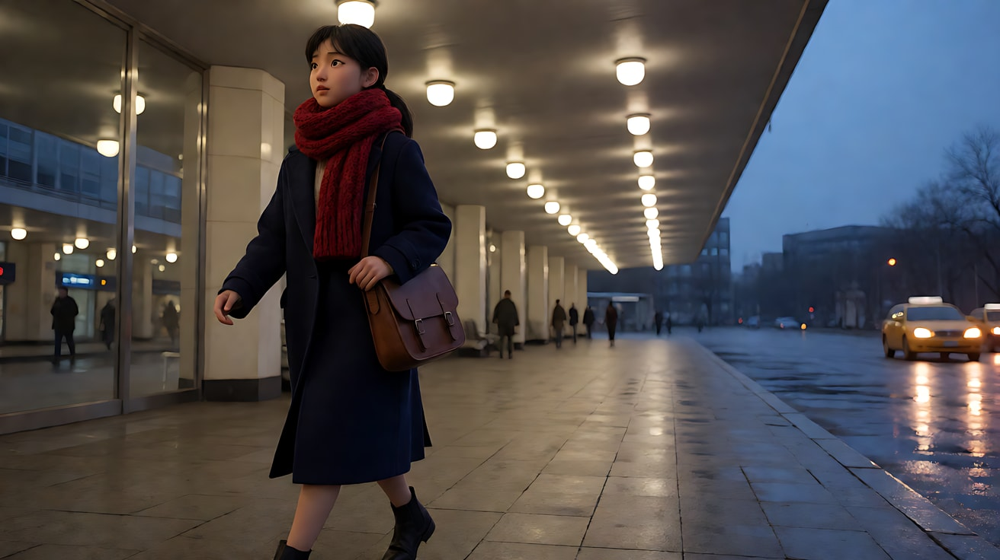
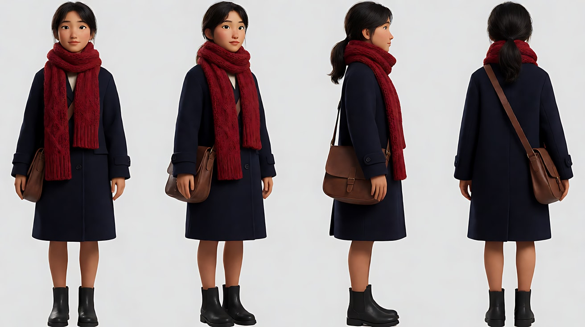
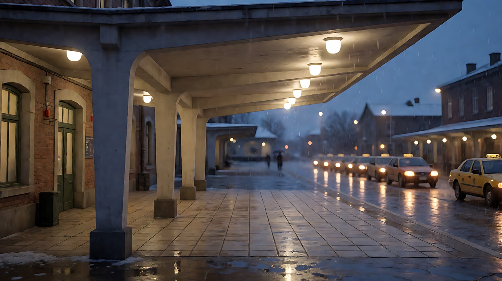
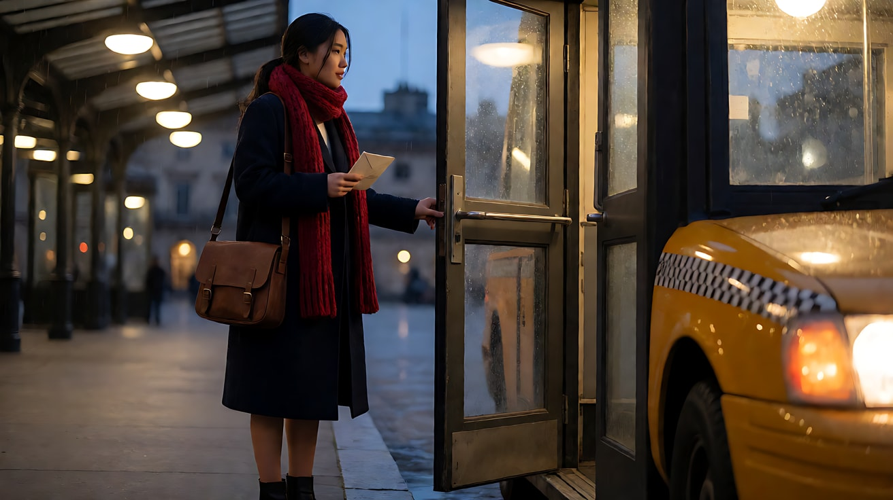
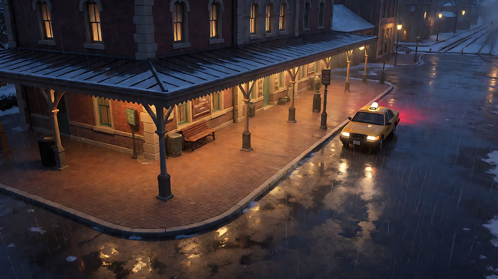
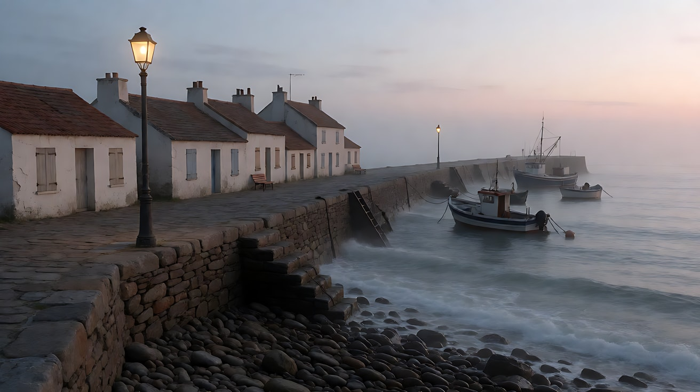
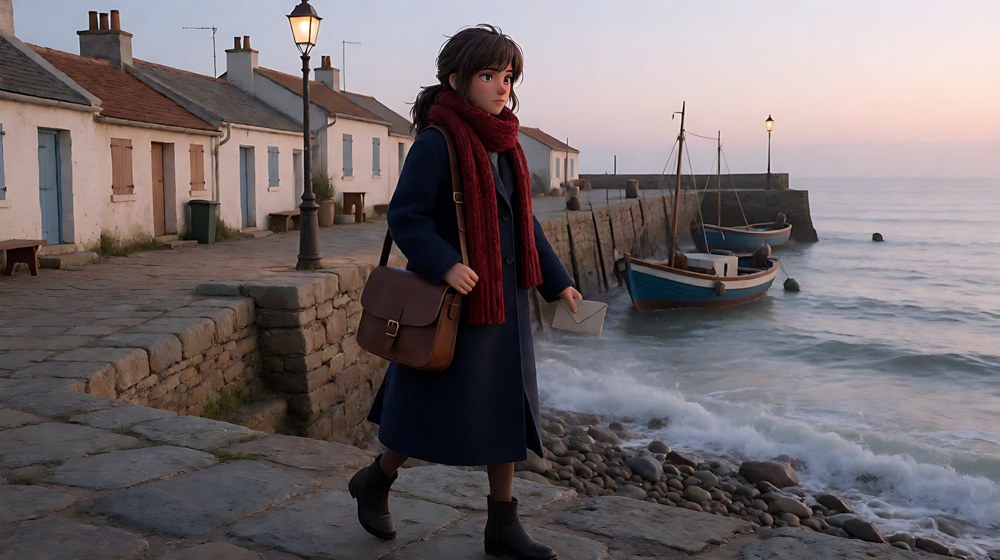

# L06-06 连续性与首尾帧链 · 提示词

> 本组练习：用五次生成接成一条完整的链——雨夜车站、读信、上车、离开、抵达海边小镇。每一段都对照连续性账本，用上一段被接受的尾帧作下一段的首帧，并在链条末端做一次重锚定。｜ 配套教学：[L06-06-连续性与首尾帧链](../教学/L06-06-连续性与首尾帧链.md) ｜ 规范：[写作规范](../../模板/写作规范.md)
>
> 画风默认使用开关 A（风格化写实 CG）。如改用 2D 动画，删掉所有焦段、光圈、景深词。

---

**整条链的规划**

```
 生成01 走出车站  →  生成02 檐下读信  →  生成03 桥接：走到出租车  →  生成04 上车离开  →  生成05 抵达海边（跨场景）
  延长锚点            剪辑点               首尾帧桥接                  收束                   重锚定 + 有意的下一镜头
```

**连续性账本（初始状态，每段生成后更新）**

| 锚点 | 内容 |
|---|---|
| 角色 | 林夏，二十出头，低马尾，左眉尾有一颗小痣 |
| 服装 | 深蓝色及膝呢子大衣，红色粗毛线围巾，黑色短靴，斜挎棕色皮质邮差包（包在左侧胯边） |
| 道具 | 牛皮纸信封，封口一枚深红色蜡封，没有任何文字；开始时在邮差包里 |
| 地点 | 小城火车站出口：宽大的雨棚，雨棚外是广场，出租车停在画右 |
| 画面方向 | 林夏始终从画左走向画右 |
| 光线 | 冬日傍晚，冷蓝色天光；雨棚下一排暖白顶灯；画右出租车的暖黄车灯 |
| 机位 | 平视，35–50mm，稳定器跟拍或固定 |
| 声音 | 雨声贯穿；车站广播远远回响；无配乐 |

---

### 练习1：链条第一环——以"延长锚点"结尾（难度 ★）

**目标**：生成整条链的第一段。她从车站出口走出来，边走边把围巾扯松。结尾形态必须是**延长锚点**：她仍在向画右走，镜头仍在跟，为下一段留出运动。生成后，更新账本里"围巾"的状态。

**【生图 · Nano Banana】**

图1 关键帧（首帧）：

```
A medium-wide tracking shot of an original young woman in her early twenties walking out of a small-town railway station exit at dusk,
a low ponytail, a small mole at the end of her left eyebrow, a knee-length navy wool coat, a chunky red knitted scarf wrapped tightly around her neck,
black ankle boots, a brown leather messenger bag on her left hip. She walks from frame left toward frame right under a wide station canopy,
the rainy plaza visible beyond the canopy edge on the right.
Camera at eye level moving alongside her on her right side, 35mm lens, moderate depth of field.
Lighting: a row of warm white canopy lights overhead, cool blue dusk light from the open plaza, warm yellow headlights of taxis far on frame right,
rain falling beyond the canopy edge.
Stylized semi-realistic 3D CG rendering, feature-film animation quality. Aspect ratio 16:9.
```

中文释义：中全景跟拍，林夏从画左走向画右，走出车站出口的雨棚；低马尾、左眉尾小痣、深蓝呢子大衣、红色粗毛线围巾裹得很紧、棕色邮差包在左胯；平视、35mm、中等景深；雨棚下暖白顶灯，广场冷蓝天光，画右远处出租车暖黄车灯，雨棚外在下雨。



**【图生视频 · Seedance】**

```
【素材分工】@图片1 为首帧，锁定人物身份、服装、邮差包位置与车站雨棚布局。
【画风】风格化写实三维CG质感，电影级布光。
傍晚的火车站出口，林夏从画左向画右走，穿过宽大的雨棚。她一边走，一边用右手把裹紧的红围巾扯松，围巾松开后两端垂在胸前。镜头在她右侧以同样的速度横向跟随。雨棚外的雨越下越密，画右远处出租车的暖黄车灯在雨里晕开。结尾时她仍在向画右走，脚步不减速，镜头仍在跟，围巾的两端随步子摆动。
【声音】雨打在雨棚上的密集声，短靴踩在湿地面上的脚步声，远处车站广播的回声，无配乐。
【约束】保持人物脸型、发型、服装与邮差包位置不变；围巾松开后不要掉落；结尾不要停下、不要减速；不要字幕、水印、Logo。
时长：8秒
```

**参数**：时长 8 秒 ｜ 画幅 16:9 ｜ 结尾形态：延长锚点

**审片后更新账本**：围巾 → **已扯松，两端垂在胸前**；动作状态 → 已走出车站出口，仍在雨棚下向画右走。从生成结果中挑一帧清楚、无运动模糊、脸和手完整的接近结尾的画面，保存为"01 尾帧"。

**【检查点】**
- 画面方向是否始终从左到右
- 结尾是否仍在动（延长锚点），而不是停下
- 围巾是否被扯松而不是被摘掉

**【常见问题与修复】**
| 现象 | 修复 |
|---|---|
| 结尾她停下来回头 | 删掉所有"停""回头"，加"结尾不要停下、不要减速" |
| 围巾被整条摘下 | 写"扯松，两端垂在胸前，仍挂在脖子上" |
| 邮差包换到右边 | 正文与约束都写"邮差包在左胯" |
| 最后一帧运动模糊，不适合作首帧 | 不必取最后一帧，往前选一帧清楚的；或把跟拍速度写"缓慢" |

---

### 练习2：有意的下一镜头——换机位，服装道具连戏（难度 ★★）

**目标**：第二段不是无缝延长，而是一个**有意的下一镜头**：换到正面中景，她在雨棚边缘停下，从包里取出信封，拆开读。重点是跨两次生成的连戏：服装（围巾已松开）、道具（信封、蜡封）、光线方向一致。用定妆图 + 场景图 + 道具图三张参考。

**【生图 · Nano Banana】**

图1 角色定妆：

```
Character turnaround sheet of an original young woman in her early twenties: a low ponytail, a small mole at the end of her left eyebrow,
a knee-length navy wool coat, a chunky red knitted scarf worn loose with both ends hanging down the front,
black ankle boots, a brown leather messenger bag worn crossbody on her left hip.
Front view, three-quarter view, side view and back view, full body, camera at eye level, 50mm lens, deep focus,
plain light-grey background, even soft studio light from the front.
Stylized semi-realistic 3D CG rendering, feature-film animation quality. Aspect ratio 16:9.
```



图2 场景：

```
Empty edge of a small-town railway station canopy at dusk in winter rain, a wide concrete canopy with a row of warm white lights,
a wet tiled floor, the rainy plaza beyond with a line of taxis on the right, their warm yellow headlights blurred by rain, no people.
Medium-wide shot facing out from the canopy edge, camera at eye level, 35mm lens, moderate depth of field.
Lighting: warm white canopy lights from above, cool blue dusk sky, warm taxi headlights from frame right.
Stylized semi-realistic 3D CG rendering, feature-film animation quality. Aspect ratio 16:9.
```



图3 道具：

```
A plain kraft paper envelope with no writing, sealed with a round deep red wax seal pressed with a simple leaf pattern,
slightly creased at one corner. Product three-quarter view, camera slightly above, 85mm lens, shallow depth of field,
plain light-grey surface, soft studio light from frame left.
Stylized semi-realistic 3D CG rendering, feature-film animation quality. Aspect ratio 16:9.
```


**【多图生视频 · Seedance】**

```
【素材分工】@图片1 锁定林夏的身份、发型、服装与松开的红围巾状态；@图片2 仅参考雨棚边缘、广场与出租车的位置和光线，不复制其中人物；@图片3 锁定信封与深红蜡封的外形，信封上没有文字。
【画风】风格化写实三维CG质感，电影级布光。
镜头1：正面中景，机位在雨棚外侧略偏右，镜头固定。林夏从画左走进画面，停在雨棚边缘，雨在她面前落下。她从左胯的邮差包里取出牛皮纸信封，用拇指掀开深红色蜡封。蜡封裂开的一声轻响，雨声。
镜头2：镜头切至她胸口高度的中近景，她抽出一张对折的信纸，展开，低头读。读到一半，她的呼吸停了一拍，嘴唇抿紧，手指把信纸捏出一道折痕。她慢慢把信纸折回去，攥在右手里，抬眼看向画右的出租车方向。头顶暖白顶灯照着信纸，画右出租车的暖黄车灯在她脸侧晃。
【锁定】光线：雨棚下一排暖白顶灯，广场冷蓝色暮光，画右出租车的暖黄车灯；林夏：二十出头，低马尾，左眉尾一颗小痣，深蓝色及膝呢子大衣，红色粗毛线围巾已松开、两端垂在胸前，棕色邮差包在左胯；信封：牛皮纸，深红蜡封，没有文字；她面朝画右方向时视线指向出租车；机位始终在她右前方。
【声音】雨打雨棚的声音贯穿，蜡封裂开声，纸张展开声，远处车站广播，无配乐。
【约束】保持人物脸型、发型、服装不变；围巾保持松开状态；信封与信纸上不出现可读文字；不要字幕、水印、Logo。
时长：10秒
```

**参数**：时长 10 秒 ｜ 画幅 16:9 ｜ 接续方式：有意的下一镜头 ｜ 结尾形态：剪辑点

**审片后更新账本**：道具 → **信已读，折起攥在右手，信封在左手或已放回包里（以实际画面为准）**；视线 → 看向画右出租车。保存"02 尾帧"。

**【检查点】**
- 围巾是否延续"已松开"的状态，而不是又裹紧了
- 邮差包是否仍在左胯
- 光线方向是否与生成01 一致（暖黄车灯在画右）

**【常见问题与修复】**
| 现象 | 修复 |
|---|---|
| 围巾又裹紧了 | 定妆图本身就画"松开的围巾"；【锁定】写"已松开、两端垂在胸前" |
| 信纸上出现大段文字 | 【约束】写"不出现可读文字"，让信纸在画面里偏小、偏虚 |
| 蜡封颜色变成金色 | @图片3 用途写"锁定深红蜡封"，正文每次都写"深红色蜡封" |
| 实际画面里信封去向与计划不同 | 以审片结果为准更新账本——观察到的状态优先于计划 |

---

### 练习3：桥接——两个已知状态之间（难度 ★★★，首尾帧）

**目标**：起点已知（02 尾帧：她在雨棚边攥着信看向出租车），终点也已知（计划中生成04 的首帧：她站在出租车旁，拉开后车门）。中间缺一段：冒雨走过去。这就是**桥接**：首帧 = 上一段尾帧，尾帧 = 下一段首帧。

**【生图 · Nano Banana】**

图1：练习2 的角色定妆（重新上传，锁身份）。

图2：**02 尾帧**（从生成02 中截取，不需要生图提示词）。

图3 尾帧（生成04 的首帧，提前生成）：

```
Using the character from image 1: a medium shot of her standing beside a taxi in the rainy station plaza at dusk,
her left hand pulling the rear door open, her right hand still clutching a folded letter, rain on her hair and shoulders,
the red scarf loose with both ends hanging down, the messenger bag on her left hip. She is on the left third of the frame facing frame right toward the open door.
Camera at eye level on the plaza side, 50mm lens, shallow depth of field, the station canopy lights blurred in the background on the left.
Lighting: warm yellow light from the taxi's interior and headlights on frame right, cool blue dusk light from above, rain catching the light.
Keep the face, hairstyle and outfit exactly as in image 1.
Stylized semi-realistic 3D CG rendering, feature-film animation quality. Aspect ratio 16:9.
```

中文释义：中景，林夏站在出租车旁，左手拉开后车门，右手仍攥着折起的信，头发和肩上有雨；围巾松开，邮差包在左胯；她在画左三分之一，面朝画右的车门；平视、50mm、浅景深，背景画左是虚化的雨棚灯；车内与车灯的暖黄光来自画右，冷蓝天光在上。



**【首尾帧生视频 · Seedance】**

```
【素材分工】@图片2 为首帧，是上一段的最后画面，锁定位置、姿势、围巾状态与光线；@图片3 为尾帧，是最终画面目标；@图片1 锁定人物身份与服装。只生成两帧之间的连续动作。
【画风】风格化写实三维CG质感，电影级布光。
她仍站在雨棚边缘，右手攥着折起的信。她低头把信按在胸口，走出雨棚，冒着雨向画右的出租车走去，雨很快打湿她的头发和肩膀，她没有加快脚步。走到车旁，她用左手拉开后车门，停住，车内的暖黄光照在她脸上。镜头以稳定器在她右侧缓慢跟随，从雨棚下的暖白光进入广场的冷蓝雨幕，最后停在她拉开车门的中景。
【声音】雨棚下的雨声变成直接打在她身上和车顶的雨声，脚步踩进积水的声音，车门把手的一声咔哒，无配乐。
【约束】保持人物脸型、发型、服装不变；围巾保持松开状态；邮差包在左胯；不重复拆信和读信的动作；本段在她拉开车门时结束，她不上车；中间动作连续，不跳切；不要字幕、水印、Logo。
时长：8秒
```

**参数**：时长 8 秒 ｜ 画幅 16:9 ｜ 接续方式：桥接 ｜ 模式：首尾帧

**审片后更新账本**：她已走到出租车旁，左手拉开后车门，头发和肩膀被雨打湿（**新增状态，之后每段都要保留**）。保存"03 尾帧"。

**【检查点】**
- 开头是否和 02 尾帧无缝衔接（位置、姿势、光线）
- 画面方向是否仍是从左到右
- 是否停在拉开车门、没有上车
- 头发打湿这个新状态是否出现

**【常见问题与修复】**
| 现象 | 修复 |
|---|---|
| 她又把信展开读了一遍 | 【约束】写"不重复拆信和读信的动作" |
| 她直接坐进车里 | 【约束】写"本段在她拉开车门时结束，她不上车" |
| 中间她向画左走 | 正文写"向画右的出租车走去"，尾帧中出租车必须在画右 |
| 开头有跳动 | 换一张更清楚的 02 尾帧；首帧与尾帧的机位高度尽量一致 |

---

### 练习4：尾帧做首帧，多镜头接续（难度 ★★★★，多镜头）

**目标**：用 03 尾帧作首帧，在一次生成里完成三个镜头：上车 → 车内看信 → 车开走。注意**画面方向**：出租车向画右开走，延续全链的左到右。提示词只写本段，已完成的拍子（走出车站、读信、走到车旁）一律不重演。

**负载估算**：镜头1 上车（1 拍 + 接触 1 点）；镜头2 车内反应（半拍）；镜头3 车开走，换到外景全景（1 拍，同一广场不算换地点，一个横摇 0.5 点）。S = 12 ÷（2.5 + 1.5）= 3.0 → **稳妥**。

**【生图 · Nano Banana】**

图1：练习2 的角色定妆（重新上传）。

图2：**03 尾帧**（从生成03 中截取）。

图3 镜头3 构图参考（广场全景）：

```
An extreme wide shot of a small-town railway station plaza at dusk in heavy winter rain, seen from a high corner of the plaza.
The station building with its long warm-lit canopy on frame left, a single taxi with its headlights and taillights on
pulling away from the curb toward frame right, wet asphalt reflecting the lights, no other moving cars.
Camera high and static at first, 28mm lens, deep focus.
Lighting: warm canopy lights, warm yellow taxi lights and red taillights, cool blue dusk sky, dense rain streaks.
Stylized semi-realistic 3D CG rendering, feature-film animation quality. Aspect ratio 16:9.
```



**【多图生视频 · Seedance】**

```
【素材分工】@图片2 为首帧，是上一段的最后画面，锁定她的位置、姿势、打湿的头发与光线；@图片1 锁定林夏的身份与服装；@图片3 仅作镜头3 的广场构图与车辆行驶方向参考，不作首帧。
【画风】风格化写实三维CG质感，电影级布光。
镜头1：中景，延续上一段的机位，镜头固定。林夏拉着车门，弯腰坐进出租车后座，把邮差包抱到腿上，伸手关上车门。车门关上的一声闷响，雨打在车顶上。
镜头2：镜头切至车内的近景，机位在前排副驾驶位置看向后座。她靠在座椅上，头发湿着贴在脸侧，右手里的信还攥着，她低头看了一眼信，又转头看向画右的车窗外。车窗上的雨水把外面的灯光晕成一片片暖黄。车内很安静，只有雨刷来回的声音。
镜头3：镜头切至广场高处的大全景，雨棚的暖光在画左，那辆出租车从路边启动，向画右驶去，镜头缓慢向画右横摇跟随，红色尾灯在湿路面上拖出倒影。雨声与渐远的引擎声。
【锁定】光线：雨棚下暖白顶灯，广场冷蓝色暮光，出租车暖黄车灯与红色尾灯；林夏：二十出头，低马尾，左眉尾一颗小痣，深蓝色呢子大衣，红色粗毛线围巾已松开，棕色邮差包，头发被雨打湿；信折起攥在她右手；出租车与人物的运动方向始终从画左到画右。
【声音】雨声贯穿；车门声、雨刷声、渐远的引擎声，无配乐。
【约束】保持人物脸型、发型、服装不变；不重复走出车站、读信、走向出租车的动作；出租车车身不出现文字与标识；车只向画右行驶；不要字幕、水印、Logo。
时长：12秒
```

**参数**：时长 12 秒 ｜ 画幅 16:9 ｜ 负载：S = 3.0，稳妥档 ｜ 结尾形态：收束

**审片后更新账本**：她已上车离开车站；车向画右驶出。场景即将切换。保存"04 尾帧"（仅作记录，下一段跨场景，不作首帧）。

**【检查点】**
- 镜头1 开头是否与 03 尾帧一致
- 镜头3 出租车是否向画右驶去，保持全链的画面方向
- 头发打湿、围巾松开、信在右手——三个状态是否都保留

**【常见问题与修复】**
| 现象 | 修复 |
|---|---|
| 车向画左开 | 【锁定】与【约束】都写"只向画右行驶"；@图片3 中车头也朝画右 |
| 车身出现文字 | 【约束】写"车身不出现文字与标识" |
| 车内镜头她的头发是干的 | 【锁定】写"头发被雨打湿"，正文写"头发湿着贴在脸侧" |
| 她又从车站走出来一次 | 【约束】写清"不重复"的具体动作清单 |

---

### 练习5：漂移诊断 + 重锚定 + 跨场景（难度 ★★★★★，多镜头）

**目标**：第五段跨场景：第二天清晨，她抵达海边小镇。链条已经接了四段，审片发现漂移；而且跨场景不能承诺无缝。这一段要做两件事：**重锚定**（回到定妆图，生成一张干净的新首帧），以及**有意的下一镜头**（新场景、新光线，但人物与道具状态延续）。

**漂移诊断（对照生成04 与生成01）**

| 锚点 | 生成01 | 生成04 观察到的 | 判断 |
|---|---|---|---|
| 脸 | 瘦长脸，左眉尾小痣 | 脸变圆，小痣消失 | 漂移 |
| 围巾颜色 | 正红 | 偏橙红 | 漂移 |
| 邮差包 | 棕色皮质，有金属扣 | 颜色变深，扣子消失 | 轻微漂移 |
| 大衣 | 深蓝，及膝 | 深蓝，及膝 | 稳定 |

**处理**：不再用 04 尾帧作首帧（它是复印件的复印件）；回到**定妆图**，加上新场景图和道具图，重新生成一张干净的首帧。账本中延续的状态：围巾松开、信件仍在她手里、她一夜没睡（新状态：用"眼睛下面有淡淡的青色"表达）。

**【生图 · Nano Banana】**

图1：练习2 的角色定妆（源头，重新上传）。

图2：练习2 的道具图（信封与深红蜡封）。

图3 新场景：

```
Empty small seaside town at early dawn in winter, a narrow stone pier stretching out to the right into a calm grey-blue sea,
a few small fishing boats moored, a row of low white houses with closed shutters on the left, a single old lamppost still lit,
thin sea mist, wet stones, no people.
Wide shot from the land end of the pier, camera at eye level, 35mm lens, deep focus.
Lighting: soft pale pink and grey dawn light from the horizon on frame right, the warm lamppost light fading on the left.
Stylized semi-realistic 3D CG rendering, feature-film animation quality. Aspect ratio 16:9.
```



图4 重锚定首帧：

```
Using the character from image 1 and the seaside pier from image 3:
a medium-wide shot of her walking from frame left toward frame right at the land end of the stone pier at early dawn,
the red scarf loose with both ends hanging down the front, the brown leather messenger bag with a brass buckle on her left hip,
a folded letter in her right hand. Her hair is dry now but slightly messy, faint blue-grey shadows under her eyes,
a small mole at the end of her left eyebrow.
Camera at eye level, moving alongside her on the sea side, 35mm lens, moderate depth of field.
Lighting: soft pale pink dawn light from the horizon on frame right as key light on her face, the fading warm lamppost on the left, thin sea mist.
Keep the face, hairstyle and outfit exactly as in image 1.
Stylized semi-realistic 3D CG rendering, feature-film animation quality. Aspect ratio 16:9.
```

中文释义：重锚定首帧以定妆图为源头重新生成：她在清晨的石码头起点从画左走向画右，围巾松开、铜扣棕色邮差包在左胯、右手拿着折起的信；头发已干但有点乱，眼下淡青；平视跟拍、35mm、中等景深；画右地平线的淡粉晨光做主光，画左路灯余光渐弱，海雾。



**【多图生视频 · Seedance】**（上传顺序：图1 作 @图片1，图2 作 @图片2，图3 作 @图片3，图4 作 @图片4）

```
【素材分工】@图片4 为首帧，锁定她在码头起点的位置、姿势与晨光方向；@图片1 锁定林夏的脸型、左眉尾小痣、发型与服装，以此为准纠正任何偏差；@图片2 锁定信封与深红蜡封的外形；@图片3 仅参考码头、房屋与海面的布局，不复制其中光线强弱。
【画风】风格化写实三维CG质感，电影级布光。
镜头1：中全景，镜头在她靠海一侧以同样的速度横向跟随。清晨的石码头，林夏从画左向画右走上码头，右手拿着折起的信，红围巾松开的两端被海风吹起。画右地平线的淡粉晨光照在她脸上，画左的旧路灯刚刚熄灭。海浪拍打石头的声音，海鸥远远叫了一声。
镜头2：镜头切至码头尽头的中景，机位在海的方向看向她。她停在码头尽头，从邮差包里取出牛皮纸信封，把折起的信放回信封，按住深红色蜡封的位置，双手把信封抱在胸前，望着画右的海面，长出一口气。风声与海浪声。
镜头3：镜头切至她背后的全景，镜头固定。她站在码头尽头，背对镜头，面朝海，晨光在海面上铺开一条淡粉色的光带，几只小渔船在晨雾里轻轻摇晃。画面停稳。
【锁定】光线：画右地平线的淡粉色晨光，海面薄雾，画左旧路灯已熄灭；林夏：二十出头，瘦长脸，低马尾，左眉尾一颗小痣，眼下淡淡的青色，深蓝色及膝呢子大衣，正红色粗毛线围巾松开、两端垂下，棕色皮质邮差包带铜扣、在左胯；信封：牛皮纸，深红蜡封，没有文字；她的运动方向从画左到画右，面朝海时海在画右或画面深处。
【声音】海浪声与风声贯穿，海鸥一声，无对白，无配乐。
【约束】保持人物脸型、左眉尾小痣、发型、服装与 @图片1 一致；围巾为正红色，不偏橙；不重复车站、读信、上车的任何动作；信封上不出现文字；不要字幕、水印、Logo。
时长：13秒
```

**参数**：时长 13 秒 ｜ 画幅 16:9 ｜ 接续方式：重锚定 + 有意的下一镜头 ｜ 负载：3 个镜头，1 个运镜，1 次手与信封接触，"稳妥"档

**【检查点】**
- 漂移的三项（脸型与小痣、围巾颜色、包扣）是否回到了定妆图的状态
- 延续的状态（围巾松开、信件在手、一夜未眠）是否保留
- 画面方向是否仍从左到右
- 把五段视频按顺序拼接，每个接缝对照账本逐项检查

**【常见问题与修复】**
| 现象 | 修复 |
|---|---|
| 漂移仍然存在 | 重新生成图4 时只用图1 作人物参考，不要上传任何旧尾帧 |
| 新场景里她又出现在车站 | 素材分工删除所有车站相关图片；【约束】写"不重复车站的任何动作" |
| 跨场景的连接显得突兀 | 这是有意的下一镜头，不承诺无缝；后期在 04 结尾与 05 开头之间加海浪声的 J-cut 声音桥 |
| 围巾仍偏橙 | 【约束】写"正红色，不偏橙"，并检查图4 本身的围巾颜色 |
| 五段拼起来配乐不连贯 | 全链每段都写"无配乐"，整条配乐在后期统一铺 |

---

### 练习6：同一交接，原视频延长与尾帧参考（难度 ★★★★，2.5，待实测）

**目标**：分清源视频动态上下文与静态帧状态。此题独立练习，不要求接在前面五段剧情之后。

**素材准备**：从自有或获授权片段选一条8秒视频：本课女主穿既定服装，松开的红围巾挂在颈前，右手拿着已拆开的信，在车站出口向画右走；末尾尚未到达出租车。只选实际满足该状态且已审片通过的片段，不用文字假装状态已实现。准备人物定妆图，以及该片段清楚的结尾帧；若缺少这类片段，先完成纸面交接，不虚构实测结果。

**共同交接单**

```text
已完成：走出车站、拆信、读信。
仍在发生：她向画右走，雨持续。
本段新增：走到出租车旁，左手握住门把。
留给以后：开门、上车、车辆驶离。
声音：雨声不断，上一段没有未说完的台词，无配乐。
```

**A：原视频延长**

上传视频1 = 已接受的8秒片段；图片1 = 身份图。

```text
向后延长 @视频1，新增8秒，延续它实际结尾的运动与声场。@图片1 仅参考女主身份、发型与服装，不参考其背景。
她继续向画右走，右手始终拿着已拆开的信，红围巾松开挂在颈前。摄影机保持上一段跟随方向，她来到车站出口右侧的出租车旁，左手握住门把后停住，不开门、不上车。
延续原视频雨声，无对白、无配乐，不重复走出车站、拆信或读信。保持原场景光色与人物外观，不额外加入字幕。
```

**B：尾帧普通参考**

上传图片1 = 身份图；图片2 = 实际结尾帧。不上传视频，也不声称这是专门首帧模式。

```text
@图片1 参考女主身份与服装；@图片2 参考开场构图、姿态、光色和车站出口布局，从这个已接受状态继续。
她正向画右迈步，右手拿着已拆开的信，红围巾松开挂在颈前。摄影机同方向平稳跟随，她走到画右出租车旁，左手握住门把后停住，不开门、不上车。
持续细雨声，无对白、无配乐；不重复已完成的动作，不额外加入字幕。
时长：8秒
```

**参数**：A 新增8秒，画幅沿用源视频；B 8秒，画幅匹配源片段。按入口核对 A 返回完整延长结果还是新增段，剪辑时不能重复放入原片。原视频延长若不可用，只做 B；需要更强起点约束时另选专门首帧任务。

**【检查点】**：两版都从真实状态继续；方向、持信手和围巾状态不变；门未打开；比较接点速度与雨声，不以单张截图判断无缝。

**【常见问题与修复】**
| 现象 | 修复 |
|---|---|
| B在开头重新起步或雨声重启 | 静态帧没有完整动态上下文；写清步态，必要时后期选接点并续接环境声 |
| A重复了源片段 | 核对任务确实是延长，以及返回视频是否已包含原片 |
| 实际末尾已到出租车 | 换符合题目状态的已接受片段，或按实际状态重写新增动作，不假装还在车站 |
| 门提前打开 | 缩短动作目标，强调握住后停住；不把未通过版作为下一段源素材 |
