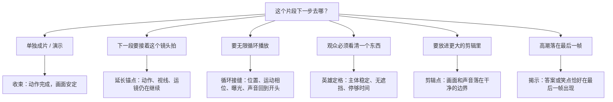
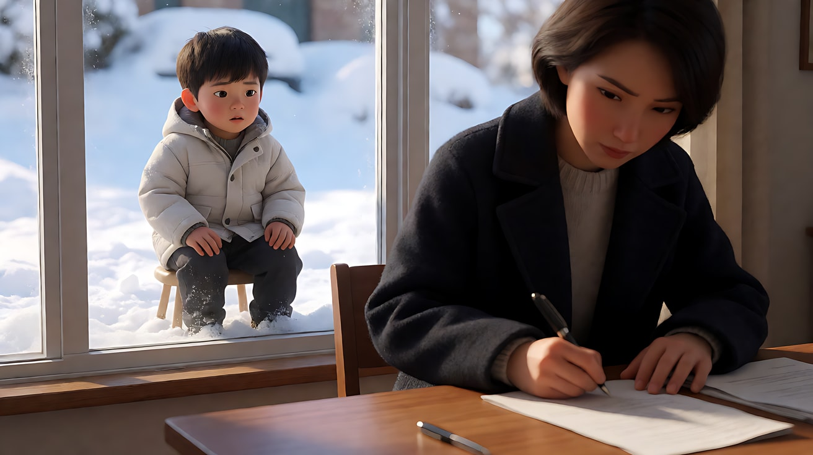

# L06-01 镜头合同：五要素合一

> 段位：高级 ｜ 建议用时：60 分钟 ｜ 配套提示词：[L06-01-镜头合同-提示词](../提示词/L06-01-镜头合同-提示词.md)

## 学习目标

- 能把景别、景深/焦段、构图、光影、运镜五要素写进**同一个镜头**，并让它们指向同一个意图
- 能为每个镜头写出**起始帧、终点帧和易损锚点**，不再让模型替你决定"从哪开始、停在哪里"
- 能根据"这个片段下一步要去哪"，从六种**结尾形态**里选一种：收束、延长锚点、循环接缝、英雄定格、剪辑点、揭示
- 能用一句标准句式把镜头合同翻译成 Seedance 提示词

## 一、概念讲解

### 1. 为什么叫"合同"

前五个模块你分别学了景别、景深与焦段、构图、光影、运镜。单独练的时候，每样都能写对；放进同一个镜头时，新手常犯两种错：

1. **漏写**：只写了景别和运镜，光和终点没写。模型会用"最常见的默认值"填空，默认值从来不带戏。
2. **打架**：85mm 浅景深的亲密特写，配上一个大幅度环绕；中心对称的庄严构图，配上晃动的手持。每样都专业，合在一起意图互相抵消。

所以我们把一个镜头的全部决定写成一张**合同**：每一格都必须填，每一格都要回答"因为意图是……"。合同写完之前，不写提示词。

### 2. 合同的十一个格子

```
┌─────────────────────── 镜头合同 · 镜号 ____ ───────────────────────┐
│ 意图     让观众感到：______________________（必须含一个变化）        │
├──────────┬──────────────────────────────────────────────────────────┤
│ ① 景别   │ 大远 / 远 / 全 / 中 / 中近 / 近 / 特写 / 微距             │
│ ② 焦段   │ 24mm 广角张力 / 35mm 自然 / 50mm / 85mm 压缩 / 135mm 孤立 │
│   景深   │ 浅景深（只看他）/ 深焦（看清他和处境）                    │
│ ③ 构图   │ 主体在画面哪里、朝向哪边、留白在哪边、前景有什么          │
│ ④ 光影   │ 主光来源 + 方向 + 色温；辅光/轮廓光；空气介质             │
│ ⑤ 运镜   │ 支撑（固定/轨道/手持/摇臂）+ 一个运动 + 速度              │
├──────────┼──────────────────────────────────────────────────────────┤
│ 起始帧   │ 第一眼看到的构图                                           │
│ 终点帧   │ 结束时画面装着什么（必须是这个机位看得见的）               │
│ 易损锚点 │ 脸 / 手 / 文字 / 道具位置 / 服装 / 产品形状               │
│ 结尾形态 │ 收束 / 延长锚点 / 循环接缝 / 英雄定格 / 剪辑点 / 揭示     │
│ 声音     │ 环境声 + 动作音 + 对白 + 是否配乐                         │
└──────────┴──────────────────────────────────────────────────────────┘
```

五要素决定"这一帧长什么样"，后面四格决定"这个镜头怎么开始、怎么结束、哪里不能坏"。前者是摄影，后者是导演。

### 3. 起始帧 → 运动 → 终点帧

一个镜头是一条有方向的线段，不是一张图：

```
 起始帧                      运动（只有一个）                    终点帧
┌──────────┐                                                 ┌──────────┐
│  门把手   │  ──── 缓慢推近 ───→  手握紧、门被推开  ───→     │ 屋内全貌  │
│  特写     │       （支撑：轨道）   （主体动作）               │ 揭示     │
└──────────┘                                                 └──────────┘
   ↑ 用生图锁定                                                 ↑ 用文字或尾帧锁定
```

- **起始帧**最好由生图模型做出来，作为首帧上传，这样五要素在第一帧就是对的。
- **终点帧**必须写成"这个机位看得见的状态"。一个人脸的近景，不能"结束在门口的水洼上"——要么写出镜头下摇到水洼的运动，要么另起一个镜头。
- **运动只有一个**。推近就别同时环绕；手持跟随就别同时变焦。

### 4. 易损锚点：先说清哪里不能坏

模型最容易在这些地方出错，合同里要点名，提示词里要写"保持……不变"：

| 锚点 | 容易出的问题 | 合同里的保护写法 |
|---|---|---|
| 脸 | 运动中换脸、转身后变人 | 起始帧上传 + "保持脸型、发型不变"；大角度转身时减少运动幅度 |
| 手 | 手指数量、握持姿势变形 | 动作写成"一只手、一个方向、一次完成" |
| 文字 / 招牌 | 被重画成乱码 | 让文字在画面里小、远、虚，或者后期加 |
| 道具位置 | 杯子变多、钥匙换手 | "桌上始终只有一只杯子，在她右手边" |
| 服装 | 镜头后段换颜色 | 写出颜色与款式，并在【约束】里重复 |
| 产品形状 | 瓶身、壶嘴被重设计 | 固定机位或慢推，"只有光在移动" |

### 5. 六种结尾形态

结尾不是一件事。先问"这个片段**下一步**要去哪"，再选结尾：



| 结尾形态 | 最后一帧的状态 | 最后一帧该不该动 |
|---|---|---|
| 收束 | 动作完成、运动停稳、结果看得懂 | 停稳 |
| 延长锚点 | 运动、视线、运镜都还"活着"，有方向 | **必须在动**，下一段要接住 |
| 循环接缝 | 位置、运动相位、曝光、声音与开头一致 | **必须在动**，而且速度与开头一致；减速停下反而穿帮 |
| 英雄定格 | 主体稳定、清晰、没有遮挡 | 停稳，残余运动会糊掉要看的东西 |
| 剪辑点 | 画面与声音落在干净边界，便于剪 | 停稳或落在动作中点（为动作剪辑留口） |
| 揭示 | 答案在最后一帧落地 | 落地即停，余动会冲淡揭示 |

**关键认识**：错的不是"动"或"静"，而是**没人接住的动**。为了显得"有生命力"在结尾加一点漂移，是更常见的错误；但把所有结尾都写成静止，又会让循环和延长全部穿帮。

## 二、情绪与叙事功能

| 结尾形态 | 观众的感受 | 常用场景 |
|---|---|---|
| 收束 | 一件事办完了，可以呼吸 | 独立短片、产品演示、段落结尾 |
| 延长锚点 | 故事还没完，想看下一秒 | 长镜头拆段生成、追逐、走路 |
| 循环接缝 | 时间被悬置，像一幅会呼吸的画 | 社交平台循环、氛围背景、产品旋转 |
| 英雄定格 | "记住它" | 产品落版、关键道具、角色亮相 |
| 剪辑点 | 不察觉的流畅 | 插入镜头、对话覆盖、动作剪辑 |
| 揭示 | 恍然、惊吓、发笑 | 悬疑反转、笑点、标题出现 |

五要素的一致性同样决定情绪：85mm 浅景深 + 侧窗冷光 + 缓推 + 收束结尾 = "他终于明白了"；同样的画面换成手持晃动 + 延长锚点 = "事情还在失控"。

## 三、经典影片案例

### 《公民凯恩》（1941，奥逊·威尔斯）雪中男孩与签字
- 场景：童年凯恩在屋外雪地里玩耍，屋里母亲正在签署把他交给银行家监护的文件。
- 怎么拍的：镜头从窗外雪地里的男孩开始，向后退入屋内，一路退到桌边签字的大人；深焦让前景的签字、中景的父亲、窗框里远处的男孩同时清晰。男孩始终被框在窗户里，越来越小。
- 为什么这样拍：意图是"让观众感到孩子的命运在他看不见的地方被决定"。五要素全部服务这一句：深焦（他和决定同时可见）、框中框（他被关在窗里）、后退运镜（从他的世界退到大人的世界）、起始帧是孩子、终点帧是签字的桌子。这是一张写得极满的镜头合同。



### 《毕业生》（1967，迈克·尼科尔斯）公交车后座
- 场景：本杰明带着从婚礼上跑出来的伊莱恩跳上公交车，坐到最后一排。
- 怎么拍的：机位固定在两人面前，两人先是兴奋地笑，镜头不切走，一直停着，笑容慢慢褪去，两人各自看向前方，神情变得茫然。
- 为什么这样拍：常规的"收束"会停在笑容上——私奔成功，结束。导演选择把结尾**延长到收束之后**，让观众看到"然后呢"。同一个固定双人镜头，因为终点帧往后挪了几拍，意义整个翻转。这说明结尾形态是一个导演决定，不是自然停下。


### 《罗马》（2018，阿方索·卡隆）片头地砖
- 场景：影片开场，片头字幕叠在俯拍的地砖上。
- 怎么拍的：长时间固定俯拍，一桶桶水泼上地面，水面积起时映出天空，一架飞机从倒影中飞过；之后镜头才离开地面，展开人物与空间。
- 为什么这样拍：起始帧极度克制，只给地砖；"揭示"不是靠剧情反转，而是靠倒影让观众在一块地砖里先看见更大的世界。起始帧的选择本身就是叙事。


## 四、在 AI 中怎么实现

- **生图阶段**：起始帧就是合同的前五格。把景别、机位、焦段、景深、主光方向、构图位置、画幅全部写进英文关键帧提示词。需要精确终点时，再生成一张尾帧。
- **视频阶段**：Seedance 提示词只负责"一个运动 + 主体动作 + 终点帧 + 易损锚点 + 声音"。标准句式：

```
镜头：[景别/角度/焦段感]。镜头从[起始构图]开始，[一个运动]以[速度]进行，同时[主体动作]，结束在[终点画面]。保持[易损锚点]不变。
```

- **按结尾形态写最后一句**：
  - 收束："她把杯子放回桌面，手离开杯子，画面停稳。"
  - 延长锚点："她仍在向画右走，镜头继续以同样速度跟随，脚步声不断。"
  - 循环接缝：首帧和尾帧用同一张图，并写"结尾的位置、速度、光线与开头完全一致"。
  - 英雄定格："茶碗停在画面正中，镜头停稳，光不再移动。"
  - 剪辑点："动作在抬手的一半处结束，声音同时收住。"
  - 揭示："镜头拉开到最后一刻，才露出整面墙的纸鹤。"
- **模型擅长**：一个慢推、一个慢拉、固定机位里的光线变化；空气介质（灰尘、薄雾、蒸汽）；首帧清楚时的稳定开场。
- **要避开**：一个镜头里叠两个运镜；终点帧写成机位看不见的东西；循环片段写"慢慢停下"；英雄定格写"镜头继续漂移"；把易损锚点交给大幅运动（转身 + 环绕 + 手部操作同时出现）。

## 五、练习作业

1. 选一部你喜欢的电影，挑一个不超过 15 秒的镜头，填满一张镜头合同的十一个格子。哪一格你填不出来，就是你还没看懂的地方。
2. 为"一个女孩推开阁楼的门"写三张合同，结尾形态分别是收束、延长锚点、揭示。比较三张合同里哪些格子变了、哪些没变。
3. 完成配套提示词练习1–5。每次生成后，对照合同逐格打分：哪一格模型兑现了，哪一格被默认值替换了。
4. 把练习 3 的失败项写成一行修改（只改一格），重生成一次，看是否修复。

## 六、自检清单

- [ ] 我的镜头合同十一格全部填满，没有"随意""默认"
- [ ] 五要素指向同一个意图，没有互相打架的选择
- [ ] 每个镜头只有一个运动，写清了支撑和速度
- [ ] 终点帧是这个机位看得见的画面
- [ ] 至少点名了一个易损锚点，并在【约束】里保护它
- [ ] 结尾形态是根据"下一步去哪"选的，最后一帧该动还是该停写清楚了

## 七、配套提示词

→ [L06-01-镜头合同-提示词](../提示词/L06-01-镜头合同-提示词.md)

---

上一课：[L05-08 一镜到底与长镜头调度](../../05-运镜/教学/L05-08-一镜到底与长镜头调度.md) ｜ 下一课：[L06-02 正反打与对话覆盖](L06-02-正反打与对话覆盖.md) ｜ [返回总目录](../../README.md)
