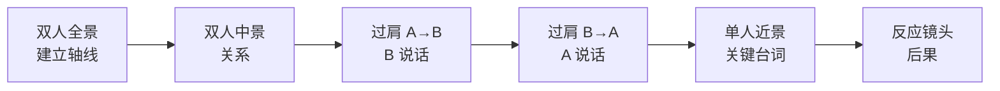
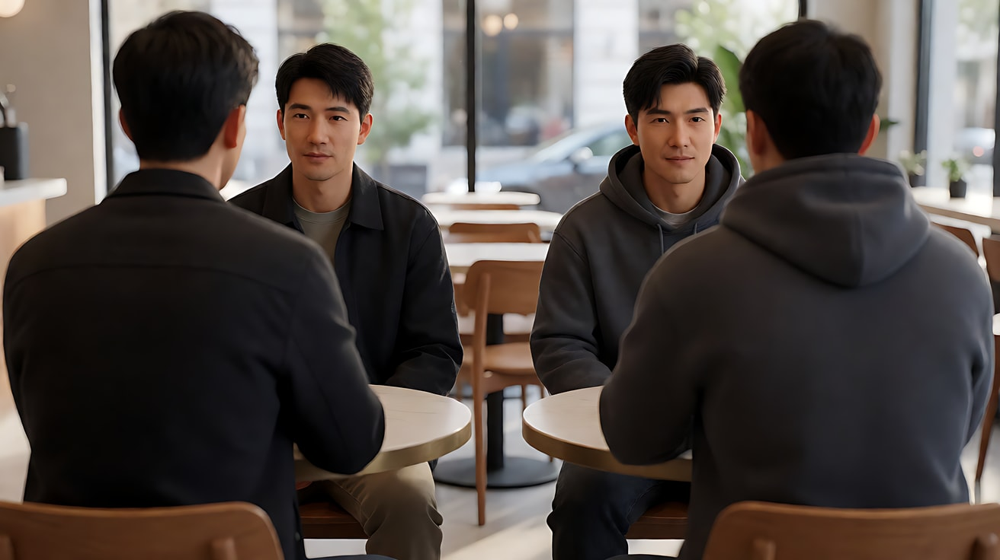
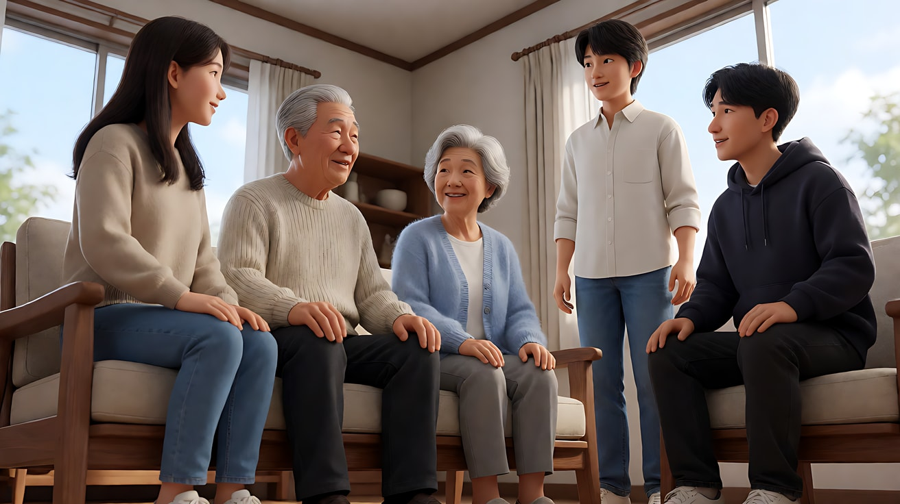
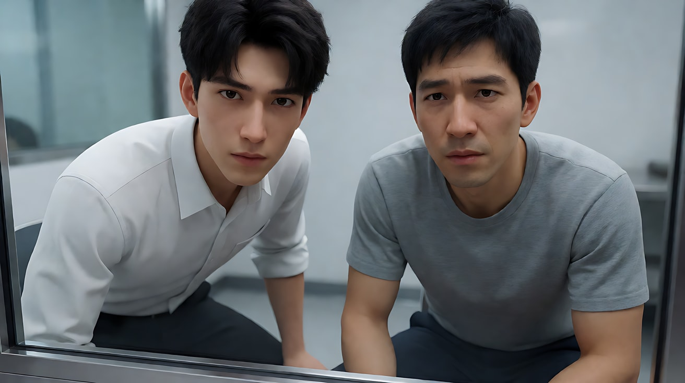

# L06-02 正反打与对话覆盖

> 段位：高级 ｜ 建议用时：70 分钟 ｜ 配套提示词：[L06-02-正反打与对话覆盖-提示词](../提示词/L06-02-正反打与对话覆盖-提示词.md)

## 学习目标

- 能画出一场双人对话的**轴线**，说出 180 度规则保护的是什么
- 能区分过肩镜头、单人镜头、反应镜头，并说出各自的权力含义
- 能写出视线匹配：A 看画右，B 就看画左，反应镜头的机位站在"被看的东西"那一侧
- 能设计一套**覆盖方案**（全景 → 中景 → 近景 → 反应），并决定哪一刻收紧、哪一刻越轴
- 能在 Seedance 的【锁定】行里写清"机位在轴线哪一侧"

## 一、概念讲解

### 1. 轴线：两个人之间的那条看不见的线

两人对话时，把两人的头连成一条线，这就是**轴线**（也叫 180 度线、动作轴）。所有机位都放在线的**同一侧**，观众就始终知道"A 在左、B 在右"。

```
                    轴线（180 度线）
        A ●━━━━━━━━━━━━━━━━━━━━━━━━━━━━━━● B
         面朝右                          面朝左

   ───────────── 机位只能在这一侧 ─────────────
         ①                ②                ③
   过肩拍 B           双人全景 Master       过肩拍 A
  （A 的后肩在画左）   （A 左 B 右）       （B 的后肩在画右）

   ④ 越过这条线放机位 → A 和 B 在画面上左右对调，观众迷路
```

- 机位①：从 A 的右后肩（靠机位一侧的肩）看 B，B 在画右，面朝画左
- 机位③：从 B 的左后肩（靠机位一侧的肩）看 A，A 在画左，面朝画右
- 小窍门：过肩永远用**靠机位那一侧的肩膀**。写成"从他的另一侧肩膀拍过去"，机位就已经越轴了
- 两个镜头切来切去时，A 始终"看右"，B 始终"看左"，视线在空中对上了——这就是**视线匹配**

### 2. 覆盖镜头家族

| 镜头 | 画面 | 承载什么 |
|---|---|---|
| 双人全景（Master） | 两人全身或膝上，桌子、门、窗都看得见 | 建立空间和轴线，告诉观众"谁在哪" |
| 双人中景（Two-shot） | 两人腰部以上同框 | 关系：距离、朝向、谁靠前 |
| 过肩镜头（OTS） | 前景一个人的后肩与后脑虚化，后景另一个人的脸 | 关系里的一方：听者仍在场 |
| 单人镜头（Single） | 只有一个人，没有前景肩膀 | 孤立：他一个人承受这句话 |
| 近景 / 特写 | 脸占画面大半 | 内心：观众贴近他的眼睛 |
| 反应镜头（Reaction） | 听者的脸，没有台词 | 这句话的**后果** |
| 插入镜头（Insert） | 手、杯子、信、戒指 | 被忽略的真相 |

**从过肩到单人，是一个关系变化**：过肩镜头里对方的肩膀还在，两人仍"连着"；切到干净的单人镜头，这个人被孤立了。很多对话戏的高潮，就是从过肩换到单人的那一刻。

### 3. 视线：反应镜头的机位站在哪

反应镜头最容易拍错。规则是：**机位站在被看的东西那一侧**，让人物的眼睛越过镜头边缘看过去。

```
   错：机位在 B 正前方，A 在 B 背后的门口         对：机位放在门口（A 所在的方向）
        门口 A                                         门口 A + 📷
          ↓                                              ↓
        B ●  ←📷   B 看向镜头 = 看向空气              B ●   B 的眼睛越过镜头看向门口
```

视线的三个参数都要写：**看向哪边（画左/画右）、看得多高（平视/仰视/俯视）、离镜头多远（贴着镜头边/偏得很远）**。贴着镜头边的视线更亲密，偏得远的视线更疏离。

### 4. 对话中的固定机位

对白镜头尽量**固定机位**。理由有二：

1. 导演层面：对白的戏在脸上，运镜会抢走注意力；固定机位让观众只看表演。
2. 模型层面：口型同步、脸部稳定在固定或极慢推近时最可靠；环绕和大幅手持会让脸漂移。

需要情绪推进时，用**切镜收紧**（中景 → 近景 → 特写）代替镜头里的大运动，或只用一个极慢推近。

### 5. 覆盖方案：先全景，后收紧，最后给反应



**收紧的节奏跟着戏走**：戏轻松时停留在中景和过肩；戏转折时切到近景；最重的那句台词之后，不切给说话的人，切给**听的人**。

### 6. 有意越轴

越轴不是禁止，是一种需要动机的武器：

- **用运镜带过去**：镜头在一个镜头内部从轴线一侧移到另一侧，观众看着它越过，不会迷路，反而感到"局势翻转了"。
- **用人物走位重建轴线**：一个人站起来绕到另一边，新的轴线随之建立。
- **故意跳轴**：在关系破裂的瞬间直接切到对面，制造方向错乱，让观众和人物一起失衡。

## 图解

> 这些示意图由多种生图模型分别生成（包括 Nano Banana、GPT Image 等），只用来说明镜头概念；不同模型的画面不能互相比较效果，也不能当作视频成片。


这组覆盖镜头和 [L03-06](../../03-构图/教学/L03-06-动态构图与轴线.md) 是同一场对话。剪的时候左右不能换。


总镜头建立左右，正反打保持视线一右一左，过肩镜头用前景的肩提醒「对面还有一个人」。

## 二、情绪与叙事功能

| 技法 | 观众的感受 | 常用场景 |
|---|---|---|
| 双人全景 | 旁观、看清局势 | 对话开头、关系揭示 |
| 过肩正反打 | 参与对话，两人仍连着 | 日常交流、谈判 |
| 干净单人镜头 | 这个人被孤立了 | 关系破裂、独白、坦白 |
| 越来越紧的近景 | 被拉进去，喘不过气 | 审讯、表白、对峙 |
| 反应镜头 | 这句话"落地了" | 每个重要台词之后 |
| 视线贴近镜头 | 亲密、被直视 | 心理对决、真心话 |
| 有意越轴 | 局势翻转、方向错乱 | 权力易手、背叛 |

## 三、经典影片案例

### 《盗火线》（1995，迈克尔·曼）咖啡馆对坐
- 场景：一个追查者和一个职业劫匪在咖啡馆里面对面坐下，平静地交谈。
- 怎么拍的：几乎整场都由两个过肩镜头的正反打完成，景别克制，不做花哨运镜。幕后资料普遍提到这场戏用两台摄影机同时拍两个过肩机位，让两位演员的交锋在同一条表演里完成。
- 为什么这样拍：意图是"让观众感到这两个人是彼此的镜像"。对称的过肩机位让两人在画面里的大小、位置、朝向完全对应；前景肩膀始终在场，说明谁也没法把对方从自己的世界里去掉。



### 《东京物语》（1953，小津安二郎）家人对话
- 场景：老夫妇与子女、儿媳之间的日常对话。
- 怎么拍的：低机位、固定镜头，切到说话人时，人物几乎正对镜头说话，视线贴近镜头中轴；小津并不拘泥于传统的 180 度规则。
- 为什么这样拍：近乎正面的视线让观众站在"被说话的那个人"的位置上，被礼貌而克制地直视。规则可以被打破，但打破要有统一的系统——整部片都这样，观众就接受了这种语法。



### 《沉默的羔羊》（1991，乔纳森·戴米）隔着玻璃的会面
- 场景：年轻的探员与关押中的心理医生多次隔着玻璃对话。
- 怎么拍的：随着对话越来越深入，正反打的景别逐步收紧，到后期人物几乎直视镜头说话，近景的视线贴着镜头中轴。
- 为什么这样拍：意图是"让观众感到她正在被看穿"。越来越紧的景别与越来越正的视线，让观众也被那双眼睛盯住。覆盖方案的"收紧节奏"在这里就是情绪曲线。



## 四、在 AI 中怎么实现

- **生图阶段**：
  - 先做一张**双人全景关键帧**，把轴线定死：谁在画左、面朝哪边，桌子、门、窗在哪。
  - 过肩关键帧写清 `over-the-shoulder from behind A's right shoulder, A's shoulder and the back of the head soft in the foreground on the left, B on the right third facing frame left`。
  - 反应镜头关键帧写清视线：`looking just past the left edge of the lens`。
- **视频阶段**：
  - 【锁定】行必须写**机位在哪一侧**："机位始终在两人连线靠窗的一侧，A 在画左面朝右，B 在画右面朝左。"
  - 对白写成：`角色名 + 动作 + 冒号 + 引号台词`，并写语气和眼睛："林岚把杯子推回去，声音很轻但每个字都清楚：'我已经买好票了。'说完她没有移开目光。"
  - 一个镜头只有一个人说话；另一个人有小动作（呼吸、手指敲桌、低头看杯子），不要冻结。
  - 反应镜头写成"一个直白的情绪词 + 一个身体锚点"："他愣住，惊慌，眼睛盯着她，喉结动了一下。"
- **模型擅长**：固定机位下的单人说话、过肩构图、景别逐步收紧、雨夜/灯光等环境的连续。
- **要避开**：两人同时说话；一个镜头里两人都做大动作；"他脸色一变""目光如刀"这类成语（会被画成字面意思）；不写机位侧，导致下一镜两人左右对调；反应镜头机位放在人物正前方，导致他看着镜头。

## 五、练习作业

1. 选一场你喜欢的双人对话戏，画出俯视平面图：两人位置、轴线、每个镜头的机位编号。数一数导演用了几种覆盖镜头，哪一刻从过肩换成了单人。
2. 为"两个老同学在夜宵摊重逢，其中一个要借钱"设计一套覆盖方案：至少包括全景、两个过肩、一个单人近景、一个反应镜头。写出每个镜头的机位侧。
3. 在同一场戏里设计一次有意越轴：用什么动机（运镜带过 / 人物走位 / 直接跳轴）？它对应剧情里的哪个转折？
4. 完成配套提示词练习1–5，检查每次切镜后两人的左右位置是否保持。

## 六、自检清单

- [ ] 我能画出这场戏的轴线，所有机位都在同一侧（或越轴有明确动机）
- [ ] A 始终看画右，B 始终看画左，视线在剪辑中对得上
- [ ] 反应镜头的机位站在被看的东西那一侧
- [ ] 每个镜头只有一个人说话，另一个人有小动作而不是冻结
- [ ] 景别收紧的节奏和剧情转折对应
- [ ] 【锁定】行写了光、两人身份、位置、朝向和机位侧

## 七、配套提示词

→ [L06-02-正反打与对话覆盖-提示词](../提示词/L06-02-正反打与对话覆盖-提示词.md)

---

上一课：[L06-01 镜头合同](L06-01-镜头合同.md) ｜ 下一课：[L06-03 剪辑语法](L06-03-剪辑语法.md) ｜ [返回总目录](../../README.md)
