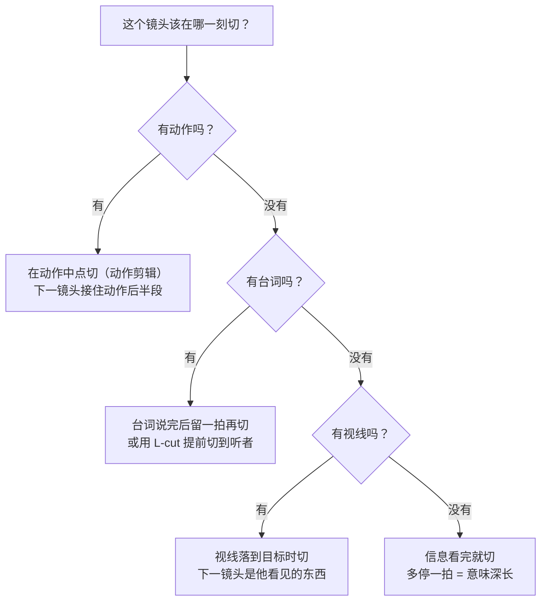
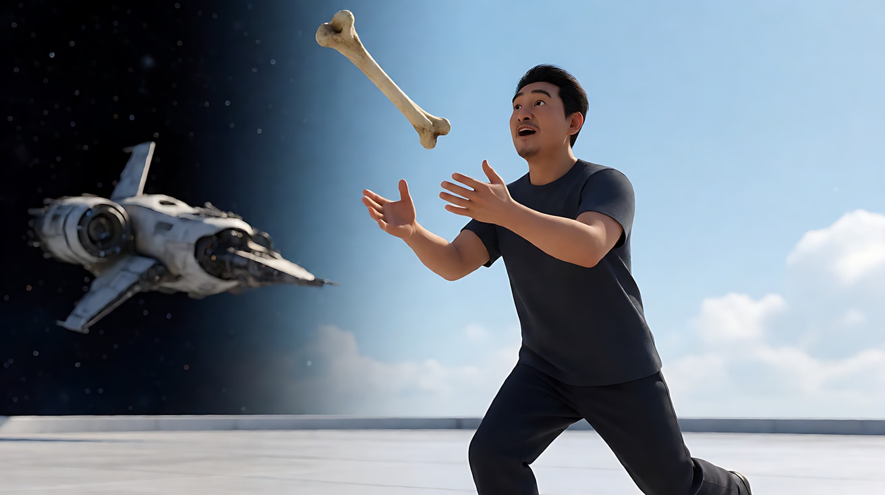
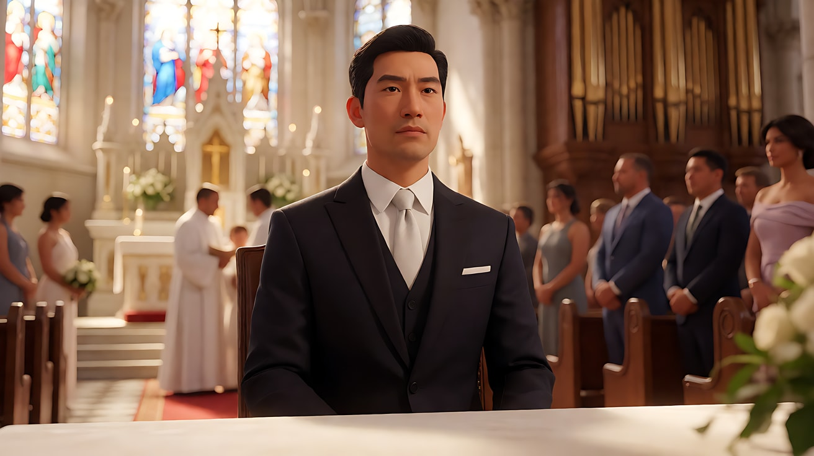
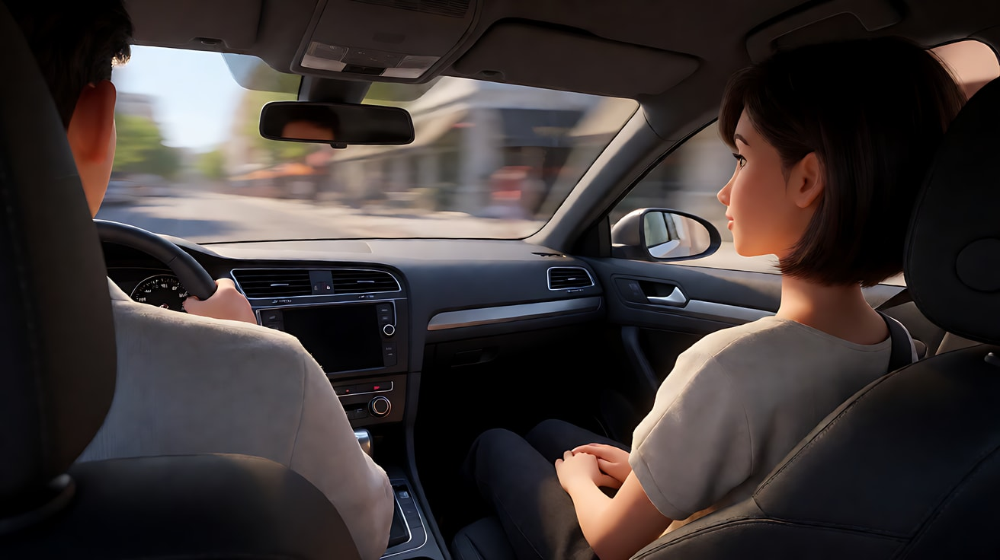
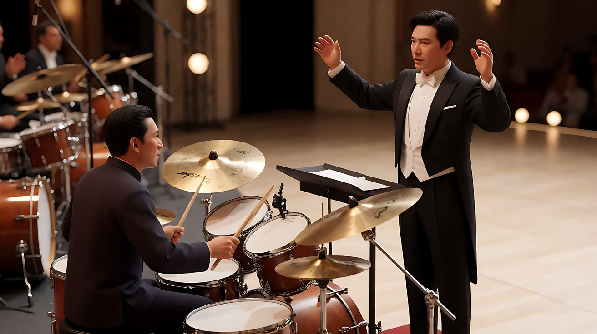

# L06-03 剪辑语法：镜头与镜头之间

> 段位：高级 ｜ 建议用时：70 分钟 ｜ 配套提示词：[L06-03-剪辑语法-提示词](../提示词/L06-03-剪辑语法-提示词.md)

## 学习目标

- 能说出八种常用剪辑方式：硬切、匹配剪辑、动作剪辑、跳切、交叉剪辑、蒙太奇、J-cut / L-cut、甩镜转场
- 能为每一次切镜说出**动机**：为什么在这一刻切、切到什么
- 能判断哪些剪辑可以在 Seedance 一次生成里"用文字写出来"，哪些应该分开生成、交给剪辑软件
- 能把切镜写成 Seedance 能执行的句子："镜头切至……""硬切到……"，而不是只写编号

## 一、概念讲解

### 1. 剪辑是第二次导演

镜头决定观众看到什么，剪辑决定观众**什么时候**看到、**和什么放在一起**看到。同样两个镜头——一个人抬头、一扇门——放在一起，观众自动脑补"他看见了门"。这种"1 + 1 > 2"叫库里肖夫效应，是所有剪辑语法的地基。

每一次切镜都要回答三个问题：

```
  为什么切？        切在哪一刻？          切到什么？
  ─────────        ──────────           ──────────
  新信息 / 反应     动作中点 / 台词之后    新景别、新机位、新地点
  / 情绪转折        / 视线落点            （至少换一样，否则像跳帧）
```

### 2. 八种剪辑方式

| 剪辑 | 怎么做 | 观众感受 | Seedance 能否一次写出 |
|---|---|---|---|
| **硬切** | A 镜头直接接 B 镜头，没有过渡 | 干脆、客观、"接下来" | 能，最稳 |
| **匹配剪辑** | 前后两个镜头的形状、动作或位置相同，内容不同 | 时间或空间被一跃跨过，二者被联系起来 | 能，需写清形状在画面中的位置与大小 |
| **动作剪辑** | 在动作进行中切，下一镜头从同一动作的延续开始 | 流畅，看不出剪辑 | 能，但动作必须简单（开门、坐下、转身） |
| **跳切** | 同一机位、同一主体，时间被剪掉一段 | 不安、焦躁、时间流逝 | 部分能，建议同一构图明确写"跳切" |
| **交叉剪辑** | 两条同时发生的线来回交替 | 紧张、对比、"他们会不会相遇" | 每条线最好分开生成，后期交叉 |
| **蒙太奇** | 一连串短镜头压缩时间或累积意义 | 时间飞逝、主题叠加 | 能，用无对白的插入镜头 |
| **J-cut / L-cut** | 声音先于画面（J）或晚于画面（L）跨过剪辑点 | 柔和，被声音牵着走 | 能写在【声音】里；精确对位交给后期 |
| **甩镜转场** | 镜头快速横摇成模糊，下一镜头从模糊中甩出 | 能量、联想、"与此同时" | 能，在镜头内部写"快速甩向画右，画面模糊" |

### 3. J-cut 与 L-cut 的时间线

```
  J-cut（声音先进）：
  画面 │■■■■■ 镜头A ■■■■■│□□□□□ 镜头B □□□□□│
  声音 │▲▲▲ A 的声音 ▲▲│△△△△△△ B 的声音 △△△△△△│
                     ↑ B 的声音提前进入，画面还在 A

  L-cut（声音拖后）：
  画面 │■■■■■ 镜头A ■■■■■│□□□□□ 镜头B □□□□□│
  声音 │▲▲▲▲▲▲ A 的声音 ▲▲▲▲▲▲▲│△△△ B 的声音 △△│
                                  ↑ A 的声音延续到 B 的画面里
```

- **J-cut**：观众先听到火车汽笛，再看到站台。声音像一只手把观众拉进下一场。
- **L-cut**：她的台词说完前，画面已经切到听者的反应。反应镜头因此有了"正在听"的质感。

### 4. 剪辑点在哪一刻



### 5. 在 Seedance 中用文字写切镜

可以按"镜头1 / 镜头2 / 镜头3"的顺序组织事件；2.5 也支持连续时间轴。但**编号或时间戳本身不等于切镜方式**，需要用文字说明硬切、匹配或连续运动：

| 剪辑 | 镜头块开头的写法 |
|---|---|
| 硬切 | `镜头2：硬切到……` / `镜头2：镜头切至……` |
| 匹配剪辑 | `镜头2：镜头切至……，[新物体]出现在与上一镜头[旧物体]完全相同的画面位置和大小` |
| 动作剪辑 | `镜头1：……他伸手推门，门刚开一半。镜头2：镜头切至门内的全景，门从一半继续推开……` |
| 跳切 | `镜头2：同一机位跳切，时间已过去……，她的位置变成……` |
| 甩镜 | `镜头1：……镜头快速向画右甩开，画面拉成模糊。镜头2：画面从同方向的模糊中甩出，停在……` |
| J-cut | `镜头1：……画面还在她脸上，远处已经传来火车汽笛声。镜头2：镜头切至站台……` |

**后期优先的场合**：需要精确到帧的节拍、复杂交叉剪辑、严格音乐卡点，优先分别生成素材后剪辑。2.5 时间戳适合编排某个时间段发生什么，不等于逐帧剪辑控制；2.0 通常建议镜号顺序。见 [A-04](../../附录/A-04-官方案例与版本差异.md)。

## 二、情绪与叙事功能

| 技法 | 观众的感受 | 常用场景 |
|---|---|---|
| 硬切 | 冷静、陈述、节奏感 | 绝大多数对话与叙事 |
| 匹配剪辑 | 惊叹、"原来这两者相连" | 时间跨越、命运呼应 |
| 动作剪辑 | 无缝、身临其境 | 动作戏、进出门、日常动作 |
| 跳切 | 焦躁、时间断裂 | 等待、崩溃、青春躁动 |
| 交叉剪辑 | 悬念、对比、讽刺 | 营救、平行命运、仪式与暴力并置 |
| 蒙太奇 | 时间被压缩、意义被累积 | 训练、成长、准备、回忆 |
| J-cut / L-cut | 柔和过渡、被声音牵引 | 场景转换、对话中的反应 |
| 甩镜 | 能量、"与此同时" | 喜剧、快节奏、空间跳跃 |

## 三、经典影片案例

### 《2001太空漫游》（1968，斯坦利·库布里克）骨头与卫星
- 场景：远古猿人第一次把骨头当作工具，兴奋地把它抛向天空。
- 怎么拍的：骨头在空中翻转，硬切到一个形状相似、在太空中漂浮的人造航天器。
- 为什么这样拍：一次匹配剪辑跨越了几百万年。两个形状在画面中的相似，让观众自己得出结论："从骨头到航天器，是同一条工具的历史。"匹配剪辑的力量来自**形状相同、内容天差地别**。



### 《教父》（1972，弗朗西斯·福特·科波拉）洗礼仪式
- 场景：迈克尔在教堂里作为教父参加孩子的洗礼，同一时间，他安排的家族清算在城市各处展开。
- 怎么拍的：教堂里的仪式与外面各个地点的行动交叉剪辑，管风琴音乐和神父的祷词贯穿两条线。
- 为什么这样拍：意图是"让观众感到他在宣誓弃绝罪恶的同一时刻，成为了真正的继承者"。交叉剪辑让两条线互相评论，声音跨越剪辑点统一了它们——这是交叉剪辑与声音桥的经典组合。



### 《精疲力尽》（1960，让-吕克·戈达尔）车内跳切
- 场景：男主角开车，女主角坐在副驾驶。
- 怎么拍的：镜头始终对着她的后脑和侧脸，画面却连续跳切，背景街道跳动，她的位置几乎不变，男主角的画外声持续。
- 为什么这样拍：跳切打破了好莱坞"看不见的剪辑"，让时间变得断裂、躁动，与人物不安分的状态一致。它证明了剪辑可以被"看见"，并且看见本身就是表达。



### 《爆裂鼓手》（2014，达米恩·查泽雷）终场演奏
- 场景：鼓手与严苛的指挥在舞台上对峙式的演奏。
- 怎么拍的：大量快速的甩镜在鼓手与指挥之间来回，配合鼓点的短促剪辑与鼓、镲、汗珠的插入特写。
- 为什么这样拍：甩镜让两人之间的空间变成一种张力，镜头本身像被两人的意志来回拉扯；插入镜头的蒙太奇把音乐的节奏变成画面的节奏。



## 四、在 AI 中怎么实现

- **生图阶段**：
  - 匹配剪辑要为前后两个镜头各做一张关键帧，**形状放在画面中完全相同的位置和大小**（例如都在画面中心、占画面高度三分之一）。
  - 动作剪辑的两张关键帧，人物的服装、光线方向、动作方向一致，只换机位和景别。
- **视频阶段**：
  - 每个镜头块开头写切镜方式；切到的新镜头至少换一样：景别、机位或地点。
  - 动作剪辑：上一镜头结束在"动作一半"，下一镜头开头写"从一半继续"。
  - J-cut / L-cut：在上一镜头里写"已经听到下一个场景的声音"，或在下一镜头里写"上一镜头的声音还在继续"。
  - 蒙太奇：每个镜头一个画面、一个动作、一个声音，不要台词。
  - 交叉剪辑：两条线**分别生成**，各自保持光线与服装锁定，在剪辑软件里交叉。
- **模型擅长**：硬切、景别变化明显的切换、无对白的插入镜头、镜头内部的甩镜。
- **要避开**：只写镜号不说明切镜方式；匹配剪辑不写位置与大小；频繁换地点却没有空间交代；2.5 时间轴出现重叠、空档或超过总时长。2.0 兼容写法优先用镜号，不强求精确秒数。

## 五、练习作业

1. 看一部电影的前十分钟，每遇到一次切镜就记一笔：是哪种剪辑？为什么在这一刻切？统计硬切所占的比例。
2. 为"一个女孩从起床到冲出家门"设计一段蒙太奇：不超过 5 个镜头，每个镜头一个动作一个声音。
3. 为同一个故事设计一次匹配剪辑和一次甩镜转场，写出前后两个镜头的关键帧描述。
4. 完成配套提示词练习1–5，比较"只写编号"和"写出切镜方式"两种写法的生成差异。

## 六、自检清单

- [ ] 每一次切镜都有动机：新信息、反应或情绪转折
- [ ] 每个镜头块开头都写了切镜方式，而不只是编号
- [ ] 切到的新镜头至少换了景别、机位或地点中的一样
- [ ] 匹配剪辑写清了形状在画面中的位置和大小
- [ ] 动作剪辑的上一镜头停在动作一半，下一镜头从一半继续
- [ ] 交叉剪辑与精确卡点交给了后期，而不是硬塞进一次生成

## 七、配套提示词

→ [L06-03-剪辑语法-提示词](../提示词/L06-03-剪辑语法-提示词.md)

---

上一课：[L06-02 正反打与对话覆盖](L06-02-正反打与对话覆盖.md) ｜ 下一课：[L06-04 分镜表与场面调度](L06-04-分镜表与场面调度.md) ｜ [返回总目录](../../README.md)
