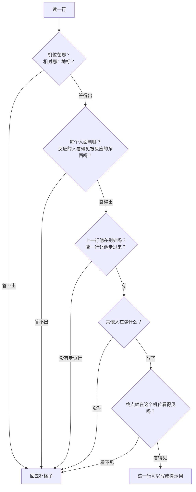
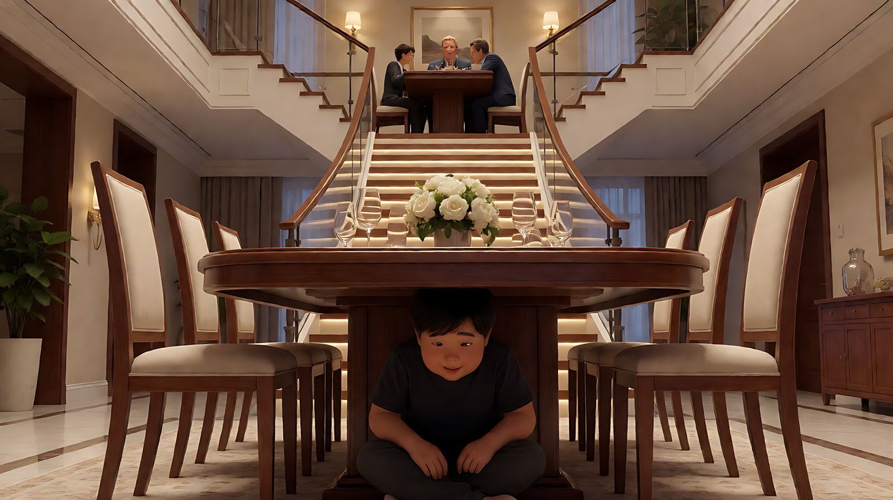

# L06-04 分镜表与场面调度

> 段位：高级 ｜ 建议用时：80 分钟 ｜ 配套提示词：[L06-04-分镜表与场面调度-提示词](../提示词/L06-04-分镜表与场面调度-提示词.md)

## 学习目标

- 能写出一张字段完整的分镜表：镜号、景别、角度、运镜、动作、对白、声音、时长感，以及 AI 专用的机位侧、视线、其他人、光、终点帧
- 能画出一场戏的**人物走位平面图**，标出地标、起始位置、走位路线和每个机位
- 能做一次"纸面预演"：在花钱生成之前，从表里找出空格、瞬移和看不见的终点
- 能按目标选择宫格故事板、独立关键帧或粗白模视频，并写清角色映射
- 养成"**先写表，再写提示词**"的习惯，并能把每一行翻译成一个镜头块

## 一、概念讲解

### 1. 为什么先写表

视频模型像一支从没见过你、也不能提问的剧组。你没写的每一格，它都会用"最常见的默认值"填上：

| 你没写的 | 模型的默认值 | 结果 |
|---|---|---|
| 机位在哪一侧 | 最常见的构图，主位正对镜头 | 两人左右对调，视线对不上 |
| 人物怎么从门口走到桌边 | 上一镜头的位置 | 人物"瞬移" |
| 其他人在做什么 | 冻结，或者乱演 | 一屋子人像蜡像 |
| 光 | 每次切镜都漂一点 | 暖黄灯光两镜之后变成蓝色 |
| 镜头结束在哪 | 第一个看懂的动词 | 后面的动作被丢掉 |

分镜表把这些空格暴露在纸上。**纸面上发现一个错误不花钱，生成之后才发现要花一次重拍的钱。**

### 2. 第一步：平面图（用文字也要画得出来）

在表格之前，先写三四句话，让一个陌生人能据此画出俯视图：地标（门、桌、窗、柜台）、每个人开场在哪、面朝什么、光从哪来、轴线是什么。

```
                 北墙：整面旧书架
   ┌──────────────────────────────────────────┐
   │  书架        书架        书架              │
   │                                          │
   │        ●B 店主（坐在柜台后，面朝门）        │
   │       ┌──────┐                            │
   │       │ 柜台 │  ← 暖黄台灯在柜台上          │
   │       └──────┘                            │
   │            ↖                               │
   │              ↖ A 的走位路线                │
   │                 ↖                          │
 窗│                    ●A 顾客（进门后站定）    │
 冷│                                     🚪 门  │
 光│  📷1 全景（门边角落）    📷3 反打（柜台后侧） │
   └──────────────────────────────────────────┘
        📷2 跟拍：在 A 前方后退

   轴线：A 与 B 的连线（门 ↔ 柜台）
   机位 1、2 在轴线靠窗一侧；机位 3 为 B 的反应镜头，站在 A 的方向
```

### 3. 第二步：分镜表字段

传统分镜表的八个字段，加上 AI 生成必需的五个字段：

| 字段 | 填什么 | 传统 / AI |
|---|---|---|
| 镜号 | 按事件顺序编号 | 传统 |
| 景别 | 大远 / 全 / 中 / 近 / 特写 / 插入 | 传统 |
| 角度 | 平视 / 仰 / 俯 / 过肩 / 主观 | 传统 |
| 运镜 | 固定 / 推 / 拉 / 摇 / 移 / 跟；进阶分阶段变化写清触发点 | 传统 |
| 动作 | 这个镜头**唯一**的主动作 | 传统 |
| 对白 | 角色名 + 语气 + 台词 | 传统 |
| 声音 | 环境声 / 动作音 / 配乐 | 传统 |
| 时长感或预算 | 短 / 中 / 长、"停一拍"；需要时标连续秒数区间 | 传统；再按任务支持转成提示词 |
| **机位侧** | 相对地标：在门边 / 在柜台后 / 在窗一侧 | AI 必填 |
| **画内人物与朝向** | 每个人在哪、面朝哪个地标 | AI 必填 |
| **视线** | 谁看什么；反应镜头机位在被看的东西一侧 | AI 必填 |
| **其他人** | 一句持续的小动作 | AI 必填 |
| **光** | 光源与颜色，与第一行用同样的字 | AI 必填 |
| **终点帧** | 镜头结束时画面里有什么（机位必须看得见） | AI 必填 |

> 分镜表可以记录时间预算。2.0 提示词通常采用镜号或行为节奏，2.5 支持连续整数秒时间轴；不把旧版模型建议反过来限制通用分镜表。总时长按任务设置，逐帧节奏仍需后期核对。

### 4. 第三步：纸面预演

表写完，像一个从没见过你的剧组那样**一行一行大声读**，回答这些问题：



**三条硬规则**：

1. **走位要有自己的一行**：人物从门口走到桌边，必须有一个镜头拍他走（或一个镜头的主动作就是走），否则就是瞬移。而且走位往往是整场戏最有张力的镜头。
2. **位置相对地标，不相对上一镜头**：写"站在柜台前，面朝书架"，不写"还在原来的位置"。
3. **空格、"默认"、"同上"都等于没写**：同上也要把字重抄一遍。

### 5. 第四步：从表到提示词

每一行变成一个镜头块，顺序固定：

```
镜头N：[切镜方式 + 机位侧 + 景别 + 运镜]，[主动作与表情]，[位置或空间变化]，[本镜头声音]。
```

所有行写完后，加一条【锁定】行：光线、每个主要人物的身份与服装、各自位置与朝向、机位侧——**和第一行用一模一样的字**。规则：**表里有的，提示词里都有；表里没有的，提示词里不出现。**

### 6. 场面调度：让人物的移动说话

场面调度（mise-en-scène 中的调度部分）是安排人物在空间里的位置与移动。分镜表只是记录，调度才是设计。

| 调度手法 | 画面 | 意义 |
|---|---|---|
| 纵深走位 | 人物从背景走到前景（或反之） | 逼近、压迫，或退出、疏远 |
| 横向走位 | 人物横穿画面 | 旅程、经过、错过 |
| 高低差 | 一人站、一人坐；楼梯上下 | 权力关系 |
| 遮挡与露出 | 人物走到门框、柱子后再出现 | 隐藏、揭示 |
| 距离变化 | 两人从桌两端走到并肩 | 关系变化本身 |
| 静止中的一动 | 全场不动，只有一人起身 | 决定、打破平衡 |

**好的调度能替代一次切镜**：一个固定全景里，人物从背景走到前景，景别自然从全景变成近景——这就是不用剪辑的"收紧"。

### 7. 从纸面到白模预演

**先选择你需要控制的层级**：宫格线稿主要交代剧情；独立关键帧加强具体画面；白模视频表达“空间 + 轨迹 + 摄影机路径”。这三种输入不是彼此替代的同一个任务。依据见 [2.5 官方任务说明](../../附录/A-04-官方案例与版本差异.md)。

白模不必精细建模，用方块表示门和柜台，用红、蓝几何体表示人物即可：

1. 标出门、柜台、窗等固定地标，把纸面走位变成三个可见节点。
2. 从预定摄影机位置检查：脸是否能看见，道具是否被遮住，过渡时是否穿墙。
3. 分配映射：红模型对应顾客图，蓝模型对应店主图；白模只参考结构、轨迹和镜头，外观与材质交给参考图。
4. 明确光照来源。白模不含光变时不要说“完全照搬光影”；需要光变时说明哪部分沿用。
5. 文字补齐剧情和声音，不能与白模路线矛盾。先验收调度，再追求材质美观。

**官方案例**：[白模转幻想短片](../../附录/A-04-官方案例与版本差异.md#case-whitebox)。它说明的是结构与外观可以分工，不保证任何复杂预演都能原样复现。配套练习6用书店的三个节点练习这一方法。


官方案例关键帧「白模转幻想短片」，媒体 00:17。左侧先表达主体和遮挡物的位置关系，右侧补充幻想外观；轨迹是否一致需观看视频。来源：[官方发布文](https://seed.bytedance.com/zh/blog/one-take-creation-flexible-referencing-introducing-seedance-2-5)，[完整图组与引用说明](../../附录/A-04-官方案例与版本差异.md#case-whitebox)。

## 二、情绪与叙事功能

| 技法 | 观众的感受 | 常用场景 |
|---|---|---|
| 完整的分镜表 | 空间清楚、不迷路 | 任何多人、多镜头的戏 |
| 走位单独成镜 | 靠近或离开的过程被感受到 | 对峙、告白、离别 |
| 纵深调度 | 压迫或疏远在一个镜头里完成 | 威胁逼近、关系疏离 |
| 高低差调度 | 谁占上风一目了然 | 审问、求助、家庭冲突 |
| 其他人持续小动作 | 世界是活的 | 宴会、餐馆、教室 |

## 三、经典影片案例

### 《寄生虫》（2019，奉俊昊）豪宅里的上下层
- 场景：穷人一家渗透进富人家庭，豪宅的楼梯与地下室贯穿全片。
- 怎么拍的：奉俊昊以拍摄前就画好极其详细的分镜著称，本片的分镜后来还以图像小说的形式出版。人物的位置与高低始终被精确设计：富人在楼上，穷人向下、藏在桌下、退到地下室；楼梯在画面里一再出现。
- 为什么这样拍：意图是"让观众感到阶级就是空间里的上与下"。调度不是在拍摄现场临时想的，而是写在分镜里的结构。分镜表在这里就是主题。



### 《十二怒汉》（1957，西德尼·吕美特）陪审团房间
- 场景：十二名陪审员在一个房间里争论一桩案件，几乎整部片都在这间屋子里。
- 怎么拍的：吕美特在他的著作《拍电影》里描述过他的"镜头计划"：随着剧情推进，逐步换用更长的焦段、降低机位，让房间显得越来越小、越来越压迫；人物不断起身、走到窗边、围拢、散开。
- 为什么这样拍：一个房间、十二个人，如果没有精密的调度和镜头计划，观众会迷路也会疲倦。人物每一次起身、换座、靠近，都是关系变化的可视化。


### 《七武士》（1954，黑泽明）村庄地图
- 场景：武士首领勘察村庄地形，规划防守。
- 怎么拍的：片中首领对着一张村庄地图讲解地形、入口与防线；战斗开始后，他用一张画满圆圈的名单记录来袭者，每击退一个就划掉一个。
- 为什么这样拍：这是"平面图先行"在银幕上的现身。观众和人物共用同一张地图和同一份账本，后面的多线混战才不会混乱。你的分镜平面图，就是给模型的那张"村庄地图"。


## 四、在 AI 中怎么实现

- **生图阶段**：
  - 先生成一张**空场景的全景图**，作为平面图的视觉版本：门、桌、窗、光源都在固定位置。
  - 为分镜表中每个关键行的"起始帧"做关键帧；走位行最好同时有首帧（起点）和尾帧（终点）。
- **视频阶段**：
  - 提示词逐行从表里翻译，不增不减。
  - 走位行写清方向："她从画右深处的门口向镜头走来，停在柜台前。"
  - 多人戏中，背景人群写一次，给一句持续的小动作；需要做事的人升为主要人物，进【锁定】行。
  - 生成后，把表格和提示词一起保存，审片时逐行对照。
- **模型擅长**：一个人朝镜头或横穿画面的简单走位；固定机位里的纵深调度；被写清楚的单一动作。
- **要避开**：多人同时走位却没有任务分工；不写机位侧；连续时间场景中省略必要走位；"大家都不动"；终点帧写成机位看不见的东西。有意的时间省略可以剪辑，不必把所有移动完整拍出。

## 五、练习作业

1. 选一场三人以上的电影场景，画出平面图，再反推出它的分镜表（至少 6 行）。把十三个字段都填上，哪一格最难填？
2. 为"旧书店里，一个陌生人拿着一本书走到店主面前，说这是店主三十年前卖掉的"写平面图和分镜表。至少包含一个走位行和一个反应行。
3. 对第 2 题做纸面预演，记录你发现并修复的问题数量。
4. 完成配套提示词练习1–5。对练习5 的"有缺陷的表"，先自己找错，再看答案。
5. 用练习6做一次粗白模预演：先检查三处节点，再写结构和外观的映射。

## 六、自检清单

- [ ] 我先写了平面图，陌生人能据此画出俯视图
- [ ] 分镜表每一行、每一格都填了，没有"默认""同上"
- [ ] 每个走位都有自己的一行，没有瞬移
- [ ] 反应镜头的机位站在被反应的东西一侧
- [ ] 时间预算或行为节奏明确；用时间轴时区间连续
- [ ] 提示词与表格逐行对应，表外的内容没有混进提示词
- [ ] 故事板、关键帧和白模各有明确用途，角色映射与参考没有冲突

## 七、配套提示词

→ [L06-04-分镜表与场面调度-提示词](../提示词/L06-04-分镜表与场面调度-提示词.md)

---

上一课：[L06-03 剪辑语法](L06-03-剪辑语法.md) ｜ 下一课：[L06-05 单次生成多镜头](L06-05-单次生成多镜头.md) ｜ [返回总目录](../../README.md)
