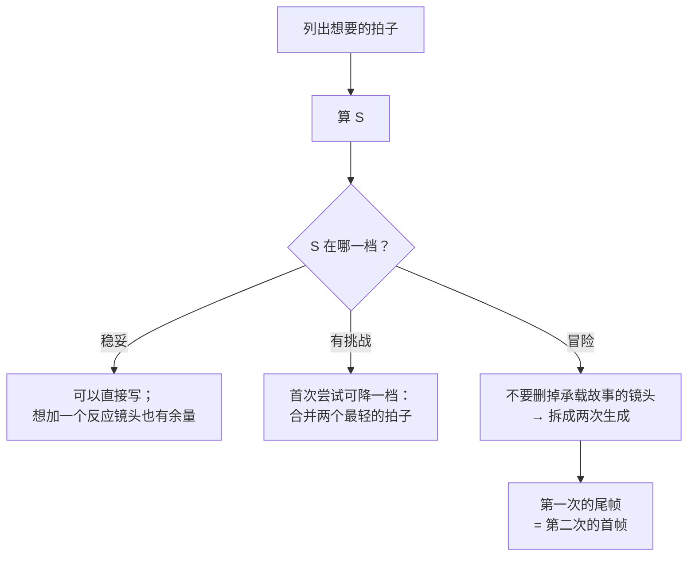
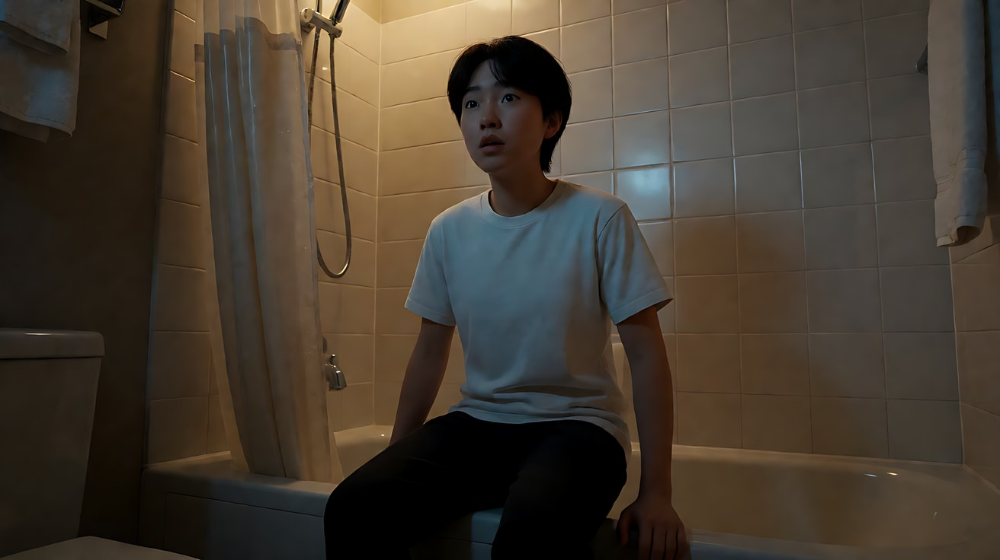

# L06-05 单次生成多镜头

> 段位：高级 ｜ 建议用时：75 分钟 ｜ 配套提示词：[L06-05-单次生成多镜头-提示词](../提示词/L06-05-单次生成多镜头-提示词.md)

## 学习目标

- 能判断一段内容该用**连续形态**（一段话）还是**分镜形态**（镜头1 / 镜头2 / 镜头3）
- 能用负载估算把一次生成放到**稳妥 / 有挑战 / 冒险**三档中的一档，并说出理由
- 能写出规范的镜头块：编号 + 切镜方式 + 主动作 + 空间变化 + 本镜头声音，以及结尾的【锁定】行
- 能把反应镜头与插入镜头当作"半拍"来使用，让 15 秒也能剪得像对话覆盖
- 能判断什么时候应该**拆成两次生成**，并写出两次生成之间的交接

## 一、概念讲解

### 1. 一次生成里切镜头，是 Seedance 的原生能力

Seedance 从 1.0 起就支持在一次生成里输出多个镜头，2.0 的官方示例也展示了带声音的多镜头片段。但"能切"不等于"每一刀都能落地"——镜头越多、台词越多，就越容易出现台词含糊、镜头被吞、动作被压缩。官方的补救方法很朴素：**太满就拆成两条视频**。

### 2. 先选形态，再写编号

| 形态 | 什么时候用 | 写法 |
|---|---|---|
| **连续形态** | 一个连续动作或状态变化，初学先减少多人对白 | 从起始画面（场景、光、景别）开始，一个运镜与主体动作同时进行，结束在结尾画面；2.5 有落点需求时可加连续时间轴 |
| **分镜形态** | 多个事件、换地点、需要切镜的揭示、对比、对话覆盖 | 镜头1 / 镜头2 / 镜头3 按事件顺序，每块一个主运镜 |

一个女人读一封信，读了 15 秒，是**一段话**，不是三个镜头。镜头数量是内容决定，不是时长决定。

### 3. 镜头块的标准写法

```
镜头N：[切镜方式 / 运镜]，[主体动作与表情]，[位置或空间变化]，[本镜头声音]。
                 ↑               ↑                 ↑                  ↑
          "镜头切至……"     一个人一个主动作     走到哪、停在哪     环境声、动作音、台词
          "硬切到……"       其他人一句小动作
```

所有镜头块之后：

```
【锁定】光线：……；人物A：年龄、发型、服装、位置、朝向；人物B：……；机位在……一侧。
【声音】……
【约束】……
时长：X秒
```

**三个检查点**：

1. **时间结构与版本匹配**。2.0 通常推荐镜号与行为节奏；2.5 支持镜号或时间戳，区间连续、内容与时间相称。不强求逐帧落点；需要停留时也可以写“停在她的手上一拍”。
2. **不只写编号**。"镜头2：她转身"不是切镜命令；要写"镜头2：镜头切至门口的低机位……"。
3. **不把下一次生成的内容写进这一次**。属于下一条视频的事件，留在下一条。

### 4. 负载阶梯：数一数你往一次生成里塞了多少

这是一套**课程经验估算**，不是官方上限或成功率预测器。15 秒里放三个镜头只是一种经验参照，并不能据此规定所有任务的镜头数量。它只帮助发现内容可能过满。

**第一步：数拍子（beats）**——每个镜头算 1 拍；**反应镜头和插入镜头**（没有新动作、没有台词、没有运镜：一张脸接收信息、一只手放在杯子上、一扇门关上）**只算半拍**。

**第二步：加负载点**：

| 镜头里的元素 | 负载点 |
|---|---|
| 镜头内有一个运镜（切到新的固定机位不算） | 0.5 |
| 一句台词 | 每 12 个汉字 1 点，至少 1 点 |
| 镜头里每多一个**做主动作**的人 | 1 |
| 画面里第二个人只是站着、反应或被经过 | 0.5 |
| 背景人群做持续小动作 | 0 |
| 必须落地的身体接触（人与人、人与道具） | 1 |
| 换一个地点或场景 | 2 |
| 必须对上动作的音效 | 0.5 |

**第三步：算每个负载点分到几秒**：

```
           本次设定时长 D（秒）
  S  =  ─────────────────────────────
         拍子数 + 负载点 L
```

| S | 判断 | 档位 |
|---|---|---|
| ≥ 3.0 | 宽松 | **稳妥** |
| 2.0 – 3.0 | 紧，台词和接触有风险 | **有挑战** |
| < 2.0 | 进入本课程建议的高负载区 | **冒险**：考虑简化、加时长或拆分 |

速查表（写作规范中的经验法则）：

以下沿用短练习的启发式；不把阈值线性外推为“30秒一定能放两倍镜头”。对白、身体接触、空间关系和参考质量会改变实际难度。

| 时长 | 稳妥 | 有挑战 | 冒险（建议拆成两次生成） |
|---|---|---|---|
| 5 秒 | 1 个镜头 | 2 个镜头 | 3 个以上 |
| 10 秒 | 2 个镜头 | 3 个镜头 | 4 个以上 |
| 15 秒 | 3 个镜头 | 4–5 个镜头 | 6 个以上，或含多句对白 |

**举例**：15 秒，四个镜头：全景（推近 0.5）、过肩说一句 10 字台词（1）、反应镜头（半拍）、插入镜头（半拍）。拍子 = 1 + 1 + 0.5 + 0.5 = 3；L = 0.5 + 1 = 1.5；S = 15 ÷ 4.5 ≈ 3.3，**稳妥**。

### 5. 阶梯怎么用：给自己三个选项



- **降一档**：把两个最轻的拍子合并成一个镜头（例如"她放下杯子"和"她看向门"合成一个镜头），切镜消失，内容保留。
- **升一档**：加上你最想要的那个反应镜头。
- **冒险档的正确做法**是拆，不是删。阶梯只评估风险，**不修改分镜表**：承载轴线的走位、承载情绪的反应镜头，宁可拆到第二次生成也不要删掉。

### 6. 反应镜头和插入镜头：半拍的力量

短剧和对话戏的节奏来自覆盖：全景、脸、插入、反应、脸。因为反应和插入只算半拍，15 秒里放 5 个镜头仍可能只在"有挑战"档。

| 半拍镜头 | 写法要点 |
|---|---|
| 反应镜头 | 一个直白的情绪词 + 一个身体锚点："她愣住，手指停在杯沿上"；机位站在被看的东西那一侧 |
| 插入镜头 | 只有物件和手："特写，一只手把钥匙放在桌上，推远"；写清哪只手、往哪推 |
| 空镜 | 一个能听见的细节："特写，窗外的雨顺着玻璃流下，钟表滴答" |

### 7. 何时拆成两次生成

| 信号 | 为什么拆 |
|---|---|
| S < 2.0 | 内容可能过满，需结合动作和对白判断，不是必然失败 |
| 两句以上台词，且有反应镜头 | 台词需要自己的时间 |
| 换了两次以上地点 | 每个新地点都是新构图和新光 |
| 有一个必须精准的道具动作（倒茶、递信） | 单独一个特写镜头最稳 |
| 同一提示词重生成三次都失败 | 降低合同复杂度，或拆开 |

拆开后，第一次生成的**结尾形态**选"延长锚点"或"剪辑点"，接受后截取尾帧，作为第二次生成的首帧——下一课会详细讲这条链。

### 8. 30秒应该多出故事，不只是多出镜头

**官方说明**：2.5 支持单次最长30秒，可按整数秒时间戳组织。**课程设计**：把“收到线索 → 尝试确认 → 发现转折 → 作出选择”排成一条因果链。镜头数由信息变化决定，不由时长决定。

例如：0–6秒发现旧书中的车票，6–14秒观察票上的折痕，14–22秒从门口认出等候的人，22–30秒合上书、向门口走去。文字不要求生成可读票面，而用道具与反应表达线索。配套练习6给出可执行版本。

若后半段没有新信息，缩短比填空更好；若转折需要复杂接触或长对白，拆成可单独修复的段落。参考 [A-04 官方案例与版本边界](../../附录/A-04-官方案例与版本差异.md)。

## 二、情绪与叙事功能

| 技法 | 观众的感受 | 常用场景 |
|---|---|---|
| 连续形态 | 沉浸、不被打断 | 独处、长动作、仪式 |
| 稳妥档多镜头 | 清楚、从容 | 叙事段落、产品故事 |
| 有挑战档覆盖 | 紧凑、短剧式节奏 | 冲突、对话、反转 |
| 反应镜头 | 这句话落地了 | 每个重要台词之后 |
| 插入镜头 | 被忽略的细节被看见 | 线索、道具、暗示 |
| 拆成两次生成 | （观众不察觉）每一拍都完整 | 长对话、复杂调度 |

## 三、经典影片案例

### 《僵尸肖恩》（2004，埃德加·赖特）早晨例行公事
- 场景：主角每天早上从起床到去便利店的日常。
- 怎么拍的：一连串极短的特写插入镜头，配合夸张的音效：开灯、刷牙、开冰箱、拉门。同样的例行公事在片中以几乎相同的镜头组合重复出现。
- 为什么这样拍：插入镜头几乎不承载表演，只承载"一个动作 + 一个声音"，所以可以剪得极快而不让观众迷路。这正是"插入镜头只算半拍"的直观证明：信息密度高，但每个镜头的负担很轻。


### 《惊魂记》（1960，阿尔弗雷德·希区柯克）浴室场景
- 场景：影片中段，旅馆浴室里的一场突袭。
- 怎么拍的：短短一分钟左右的段落由数十个镜头剪成，绝大多数是极短的局部：手、浴帘、花洒、排水口、眼睛。
- 为什么这样拍：希区柯克用大量"半拍"的局部镜头，让观众在脑中完成本没有直接展示的画面。高密度剪辑的前提是每个镜头只有一个清楚的信息。对 AI 而言，这样的密度应该拆成多次生成，再在剪辑软件里组合。



### 《十二怒汉》（1957，西德尼·吕美特）对比：何时**不**切
- 场景：陪审团房间里的长段落辩论。
- 怎么拍的：影片开场有一个持续数分钟的长镜头，在房间里穿行，介绍一个个陪审员，而不是用切镜逐一交代。
- 为什么这样拍：当内容是"同一空间、一个连续状态"，连续形态比分镜形态更有力。先选形态再写编号——不是所有内容都需要切。


## 四、在 AI 中怎么实现

- **生图阶段**：按需要准备定妆、场景与关键帧；特别重要的构图用独立关键帧指导，写清对应节点。普通参考不等于专门首尾帧。素材上限按 [A-04](../../附录/A-04-官方案例与版本差异.md)与实际入口核对，不要求填满。
- **视频阶段**：
  - 写之前先算 S，在参数里注明档位。
  - 需要切镜时写清切镜方式；入门每镜一个主运镜和主动作，进阶分阶段交接写清路径与触发点。
  - 【锁定】行重复光线、每个主要人物的身份服装位置朝向、机位侧——**与镜头1 一字不差**。
  - 时长在平台参数里设定，提示词末尾附"时长：X秒"作提醒。
- **入门优先**：少量镜头、景别差异明显的切换；无对白的插入与反应；一个地点内的覆盖。这是练习选择，不是新版能力上限。
- **要避开**：不连续的时间轴；只写编号不写切镜；动作和对白超过可用时间；换地点却无地标或过渡；把下一条视频内容写进这一条。

## 五、练习作业

1. 为下面三段内容各判断形态（连续 / 分镜），并说明理由：(a) 老人在海边慢慢收起渔网；(b) 女孩在家里接到电话，冲出门，跑到车站；(c) 两人在餐桌前争吵，一人摔门离开。
2. 对 (b) 和 (c) 计算 S，给出稳妥、有挑战、冒险三档的方案各一个。
3. 选一个冒险档方案，写出拆成两次生成的分界点：第一次结束在哪个画面？第二次从哪开始？
4. 完成配套提示词练习1–5，记录每次生成实际落地的镜头数与台词完整度，和你算出的档位对照。
5. 完成练习6的30秒因果链，再提出一个更短的版本：说明删掉哪段仍不影响故事。

## 六、自检清单

- [ ] 我先选了形态：连续还是分镜
- [ ] 我算了 S，并在参数里写明了档位
- [ ] 切镜方式明确；时间轴若使用则连续、与总时长一致
- [ ] 主动作可读，运镜变化有动机，多人任务与空间关系清楚
- [ ] 反应与插入镜头写成"情绪词 + 身体锚点"或"物件 + 手"
- [ ] 【锁定】行与镜头1 的描述一字不差
- [ ] 冒险档我选择了拆分，而不是删掉承载故事的镜头

## 七、配套提示词

→ [L06-05-单次生成多镜头-提示词](../提示词/L06-05-单次生成多镜头-提示词.md)

---

上一课：[L06-04 分镜表与场面调度](L06-04-分镜表与场面调度.md) ｜ 下一课：[L06-06 连续性与首尾帧链](L06-06-连续性与首尾帧链.md) ｜ [返回总目录](../../README.md)
