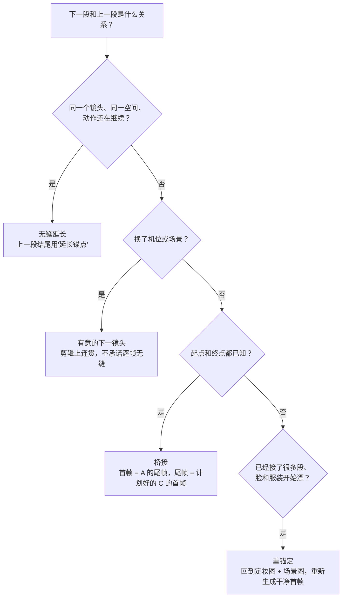
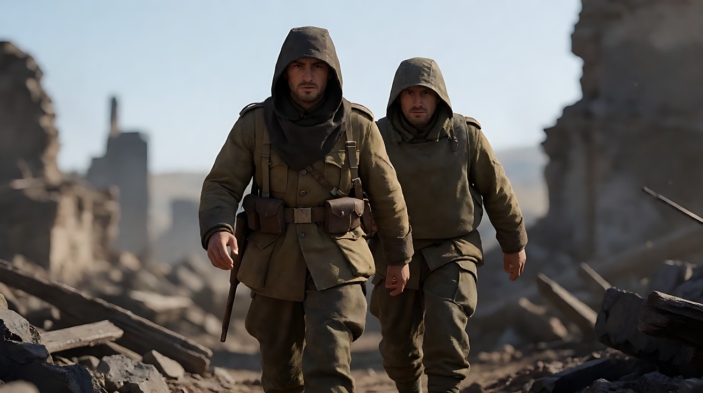

# L06-06 连续性与首尾帧链

> 段位：高级 ｜ 建议用时：80 分钟 ｜ 配套提示词：[L06-06-连续性与首尾帧链-提示词](../提示词/L06-06-连续性与首尾帧链-提示词.md)

## 学习目标

- 能建立一份**连续性账本**：角色、服装、道具、位置、画面方向、视线、光线、声音、动作状态
- 能把上一段**被接受**的尾帧，作为下一段的首帧，搭起一条首尾帧链
- 能区分四种接续方式：无缝延长、有意的下一镜头、两个已知状态之间的桥接、漂移后的重锚定
- 能在接续提示词里排除**已完成的拍子**和**留给以后的拍子**
- 能识别连续性漂移，并用定妆图 + 场景图 + 尾帧完成重锚定

## 一、概念讲解

### 1. 连续性：观众不会注意到，除非它坏了

在传统片场，有一位专职的场记盯着每个镜头：她左手拿的是杯子还是包？领口扣了几颗？烟燃到哪里了？AI 生成也需要场记。独立任务不会自动获得上一段全部上下文；原视频延长可以带入动态与声音，但仍需记录已接受的实际状态。

### 2. 连续性账本

每一段生成都要对照这张表：

| 锚点 | 记录什么 | 举例 |
|---|---|---|
| 角色 | 年龄段、发型、体态、标志物、情绪状态 | 三十岁，马尾，左眉有一道小疤，刚哭过 |
| 服装 | 颜色、款式、穿戴状态 | 红围巾**已经解开**挂在脖子上 |
| 道具 | 归属、位置、状态 | 信封在她右手，**已拆开** |
| 地点 | 布局、左右关系、门窗位置 | 门在画右，窗在身后 |
| 画面方向 | 主体向哪边移动 | 她始终从画左走向画右 |
| 视线 | 谁看哪里，正反打是否匹配 | 她看画右，他看画左 |
| 光线 | 主光方向、实用光源、时间、空气 | 夕阳从画右，越来越低 |
| 机位 | 焦段感、高度、稳定方式、运动家族 | 50mm，平视，手持轻晃 |
| 动作状态 | 上一段结束时完成了什么 | 已经走出车站，还没上车 |
| 声音状态 | 配乐、环境声、对白进行到哪 | 雨声持续，台词已说完 |

**状态比外观更容易丢**：模型能靠参考图记住"红围巾"，但记不住"围巾已经解开"。账本里最重要的一栏，常常是"已经发生了什么"。

### 3. 首尾帧链

这是**取帧后另生成**的路线，不是原视频延长功能的别名。使用专门首帧任务时真实指定输入；普通参考中写“为首帧”只作语义指导。取帧无法保存完整速度、声场和台词状态，需要交接说明与后期核对。

```
  生成 01                   生成 02                   生成 03
┌─────────────┐  尾帧   ┌─────────────┐  尾帧   ┌─────────────┐
│ 首帧(生图)    │ ─────→ │ 首帧 = 01尾帧 │ ─────→ │ 首帧 = 02尾帧 │
│   ↓ 动作      │        │   ↓ 动作      │        │   ↓ 动作      │
│ 尾帧 ★审片通过 │        │ 尾帧 ★审片通过 │        │ 尾帧          │
└─────────────┘        └─────────────┘        └─────────────┘
       ↑                       ↑                       ↑
   定妆图 + 场景图（每一段都重新上传，作为身份与空间的"锚"）
```

三条铁律：

1. **只用审片通过的素材接续**。被拒绝的片段永远不进入"正史"。
2. **观察到的状态优先于计划的状态**。计划里她在门口停下，实际生成里她走到了窗边——如果你接受了这一条，下一段就从窗边开始，而不是假装她在门口。
3. **下一段的提示词只写下一段**。已完成的动作不重复，留给以后的动作不提前。

### 4. 四种接续方式



| 方式 | 何时用 | 上一段的结尾形态 | 首帧来源 |
|---|---|---|---|
| 无缝延长 | 同一镜头的延续：走路、追逐、长镜头分段 | 延长锚点（运动还活着） | 上一段的尾帧 |
| 有意的下一镜头 | 剪辑切换：换机位、换景别，或跨场景 | 剪辑点或收束 | 定妆图 + 场景图 + 新关键帧；尾帧可作参考 |
| 桥接 | 两个已知状态之间缺一段过渡 | — | 首帧 = A 尾帧，尾帧 = C 首帧 |
| 重锚定 | 接了三四段后，脸、服装、光开始漂移 | — | 回到定妆图重新生成一张干净首帧 |

**跨场景时默认用"有意的下一镜头"**，不要承诺逐帧无缝。

### 4.1 原视频延长与尾帧桥接

| 路径 | 输入与用途 | 适合 | 审片重点 |
|---|---|---|---|
| 原视频延长 | 已保留视频 + 必要的身份参考；明确向前或向后延长 | 继续同一事件与动态 | 动作速度、声场、主体是否遗漏，已发生的事件是否重演 |
| 尾帧桥接 | 清楚的结尾帧 + 身份图，必要时指定目标尾帧 | 接口没有延长任务，或要连接两个已知状态 | 开场构图、动作启动、声音断点与累积漂移 |
| 独立下一镜头 | 新构图 + 连续性账本 | 有意切机位、换地点或省略时间 | 视线、方向、道具状态与声音桥，不要求画面逐帧相同 |

**官方说明**：2.5 支持视频延长；发布文称多轮，当前模型主页写两次，实际入口需确认，不作无限延长承诺。参见[车厢追逐案例](../../附录/A-04-官方案例与版本差异.md#case-extension)。

**课程建议**：源视频不是“只借它的运镜”，而是本次要继续的已接受事件。提示词写本段新增内容，继承实际状态。如果用尾帧桥接，明确声音需要另行延续。两条路径都不能替代审片，也不能把已漂移结果继续传下去。

### 5. 漂移：链越长，越要回到源头

每次用尾帧作首帧，都是"复印件的复印件"：一点点脸型变化、一点点颜色偏移会累积。经验做法：

- **每一段都重新上传定妆图**，不只靠尾帧。
- 接续三段左右，检查一次脸、服装、光；发现漂移就**重锚定**：用定妆图 + 场景图 + 当前尾帧的姿势，重新生成一张干净的首帧。
- 尾帧选择要讲究：选**清楚、不模糊、人物脸和手完整**的一帧，而不是机械地取最后一帧。运动模糊的帧做首帧，会把模糊传下去。

如果取的是最后时刻之前的清楚帧，记录实际取帧时间并把前段剪到相应位置，避免动作重复。固定“每三段重锚定”只是课程检查提醒，发现漂移就处理，不用等满段数。

### 6. 接续的交接记录

每次接续前，写一张交接记录（可以很短）：

```
上一段：生成 02（已接受）
结尾状态：她站在车站出口，右手拿着拆开的信，红围巾解开挂在脖子上，面朝画右
仍在进行的运动：她正向画右迈出一步；雨在下
光线：傍晚，冷蓝天光 + 画右出租车的暖色车灯
声音：雨声持续；台词已说完；无配乐
已完成：走出车站、拆信、读信
本段要做：她走到出租车前，拉开车门
留给以后：上车、车开走（不能出现在本段）
```

## 二、情绪与叙事功能

| 技法 | 观众的感受 | 常用场景 |
|---|---|---|
| 严格的服装道具连戏 | （不察觉）世界可信 | 所有叙事 |
| 无缝延长 | 时间不被打断，身临其境 | 长镜头、追逐、旅程 |
| 有意的下一镜头 | 节奏、信息切换 | 对话、跨场景叙事 |
| 桥接 | 状态变化被看见 | 变身、时间流逝、情绪转折 |
| 隐藏剪辑点 | 一镜到底的幻觉 | 长镜头、沉浸式段落 |
| 连续性故意断裂 | 不安、梦境、记忆错位 | 心理惊悚、回忆 |

## 三、经典影片案例

### 《夺魂索》（1948，阿尔弗雷德·希区柯克）隐藏剪辑点
- 场景：整部片设计为在一间公寓里连续发生，看起来像一个长镜头。
- 怎么拍的：受当时胶片片盒长度的限制，每段只能拍十分钟左右。在多数接点处，希区柯克让摄影机推近到某个人物深色外套的背部，画面短暂全黑，下一段从同一个黑背开始拉出；也有几处接点是直接切换的。
- 为什么这样拍：这就是"尾帧 = 下一段首帧"的胶片时代版本。连接点选择的是一个**没有信息、容易匹配**的画面（深色背部），而不是人物的脸。AI 接续时也一样：尾帧选一个稳定、简单、容易复现的画面，接缝最不容易被看出。


### 《1917》（2019，萨姆·门德斯）伪一镜到底
- 场景：两名士兵穿越战场传递命令，全片呈现为几乎连续的长镜头。
- 怎么拍的：全片由多段长镜头组成，借助人物经过墙角、黑暗、近距离遮挡等时刻衔接；唯一明显的断点是主角失去意识后的黑场。
- 为什么这样拍：意图是"让观众和士兵一起走完这段路，不被允许喘息"。每个接缝都是精心设计的"延长锚点"：人物和摄影机的运动都在继续，下一段接住同一个运动。



### 《风月俏佳人》（1990，加里·马歇尔）早餐里的可颂
- 场景：女主角在酒店里吃早餐。
- 怎么拍的：这场戏中她手里拿着一个可颂，切到下一个镜头时手里变成了一块薄饼——这是影迷津津乐道的著名连戏错误。
- 为什么值得学：即便是专业剧组，道具状态也会在剪辑中"跳"。这正是 AI 生成最常见的错误类型。连续性账本的"道具"一栏，就是为了防止你的作品出现同样的问题。


## 四、在 AI 中怎么实现

- **生图阶段**：
  - 第一段的首帧用定妆图 + 场景图生成，这是整条链的"源头"。
  - 桥接段需要提前生成**下一段的首帧**作为尾帧目标。
  - 重锚定时，用 `Using the character from image 1` + 当前尾帧的姿势描述，重新生成一张干净的首帧。
- **视频阶段**：
  - 【素材分工】写清："@图片N 为首帧，是上一段的最后画面，锁定位置、姿势与光线。"同时上传定妆图锁身份。
  - 正文开头一句写**延续的状态**："她仍在向画右走，雨仍在下。"
  - 【约束】写"不重复上一段已完成的动作"，并写出本段不能越过的终点："本段在她拉开车门时结束，不上车。"
  - 无缝延长时，上一段与下一段的运镜方向、速度、焦段一致；声音也要延续（雨声不断）。
  - 跨段的连续配乐交给后期铺设，不要指望每段生成的配乐能自然接上。
- **模型擅长**：从清楚的首帧开始延续简单动作；有定妆图时保持服装与发型；固定机位下的状态变化。
- **要避开**：用运动模糊的帧做首帧；只靠尾帧不上传定妆图；在一段里重演上一段的动作；把以后的拍子提前写进来；接了五六段从不回到源头；跨场景时承诺逐帧无缝。

## 五、练习作业

1. 选一部电影的一场戏（3–5 个镜头），为它填一份连续性账本。试着找出一个连戏错误或一个精心设计的连戏细节。
2. 为"一个女孩从车站出来，在雨里读一封信，然后坐上出租车离开"规划一条三段的首尾帧链：每段写结尾形态、交接记录、已完成和留给以后的拍子。
3. 判断第 2 题的三次接续分别属于哪种方式（无缝延长 / 有意的下一镜头 / 桥接 / 重锚定）。
4. 完成配套提示词练习1–5。完成后把五段视频按顺序拼接，逐个接缝检查连续性账本。
5. 完成练习6，对同一份交接记录分别写原视频延长版和尾帧参考版，比较两者缺失的上下文。

## 六、自检清单

- [ ] 我为整条链建立了连续性账本，"状态"一栏写的是已经发生的事
- [ ] 每次接续只用审片通过的素材，选的尾帧清楚、无运动模糊
- [ ] 每一段都重新上传了定妆图，不只靠尾帧
- [ ] 接续提示词开头写了延续的状态，【约束】排除了已完成和留给以后的拍子
- [ ] 我能说出每次接续属于哪一种方式
- [ ] 我分清原视频延长与取帧另生成，记录了实际取帧点与声音处理方式
- [ ] 链条接了三段左右，我检查过漂移，必要时做了重锚定

## 七、配套提示词

→ [L06-06-连续性与首尾帧链-提示词](../提示词/L06-06-连续性与首尾帧链-提示词.md)

---

上一课：[L06-05 单次生成多镜头](L06-05-单次生成多镜头.md) ｜ 下一课：[L07-00 风格拆解方法论](../../07-世界导演风格/教学/L07-00-风格拆解方法论.md) ｜ [返回总目录](../../README.md)
