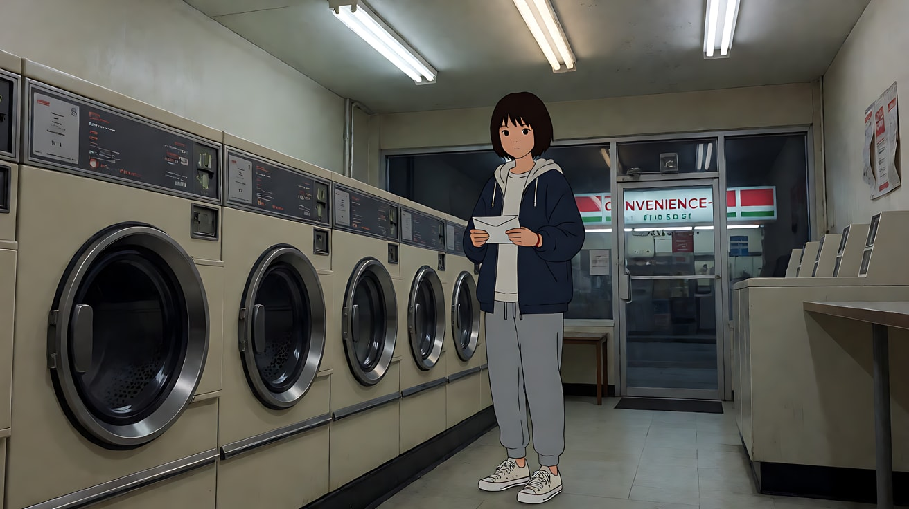
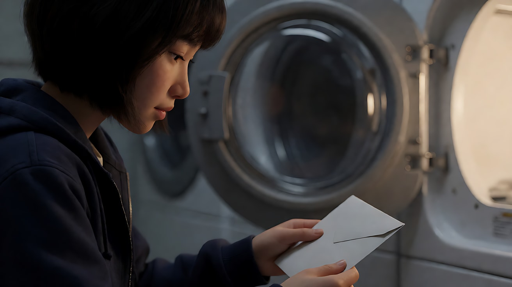
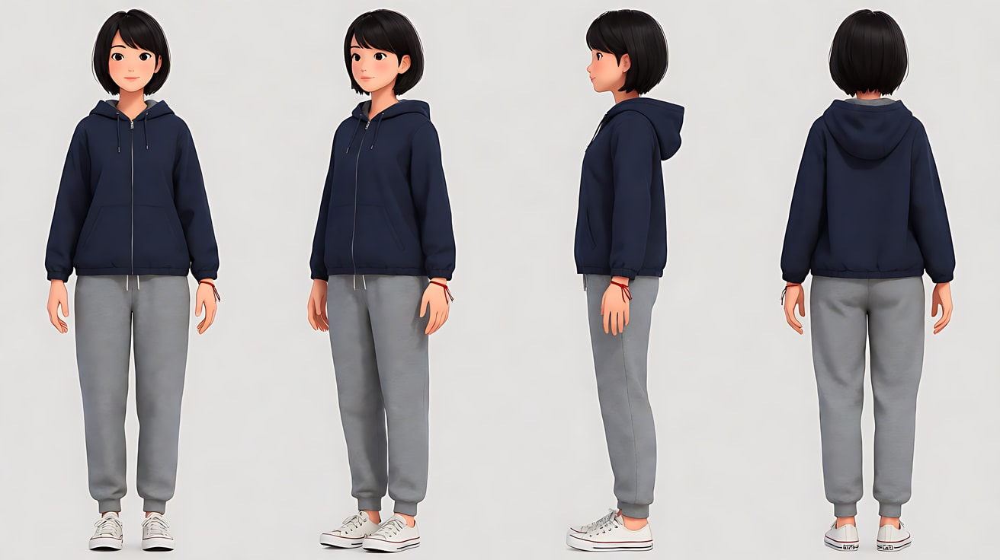
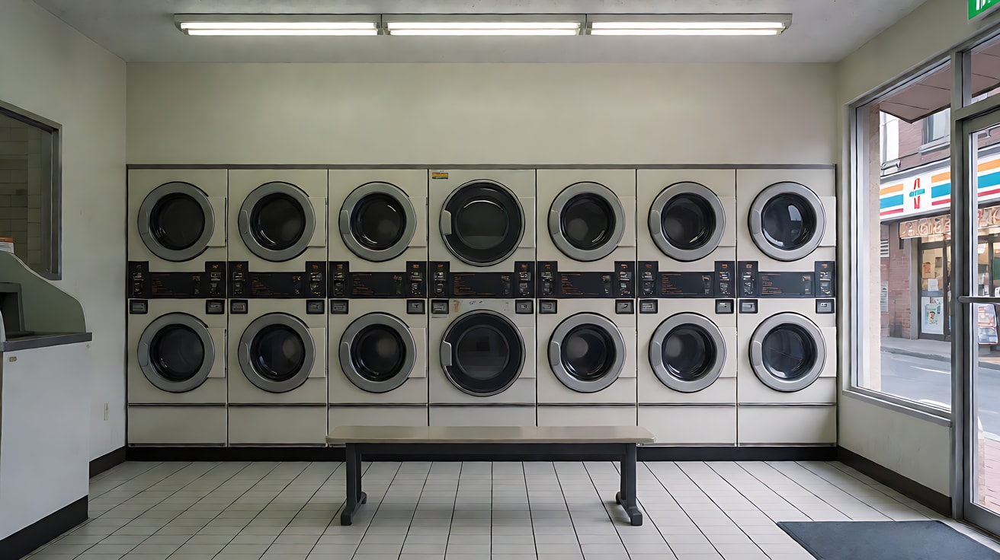
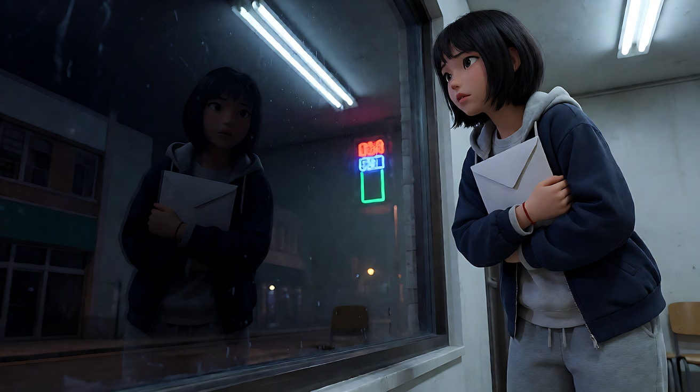
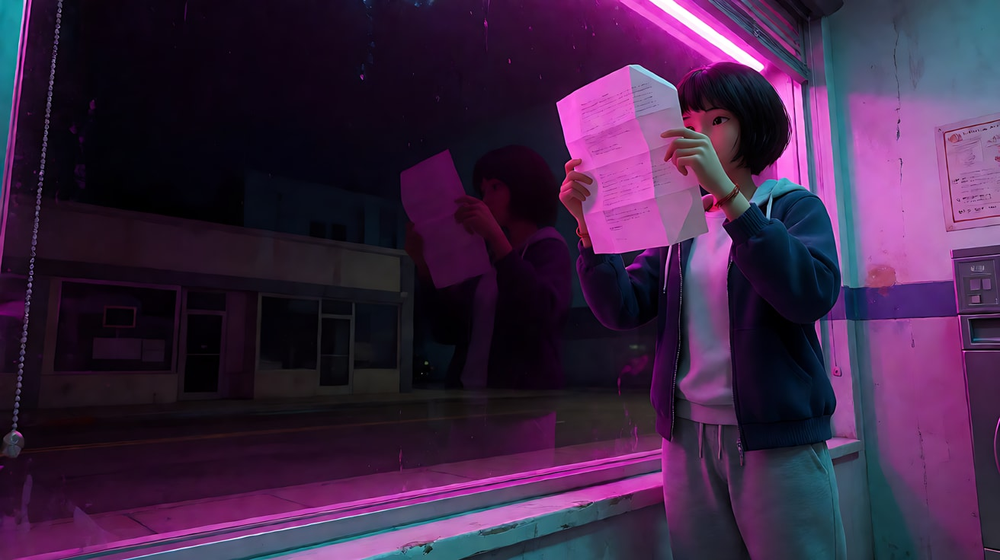
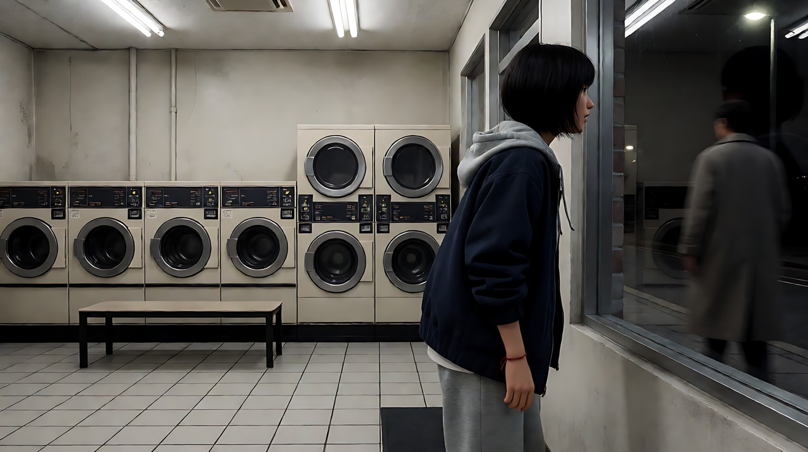
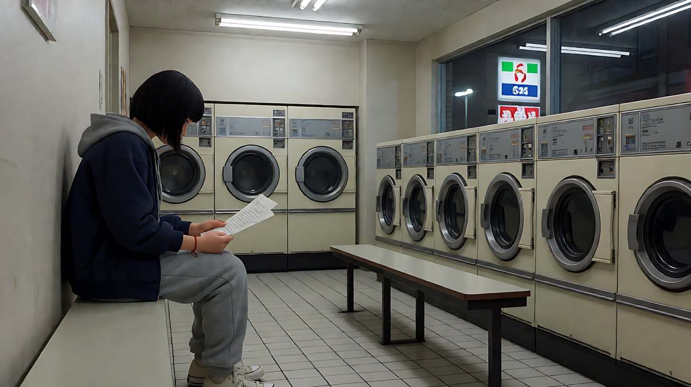
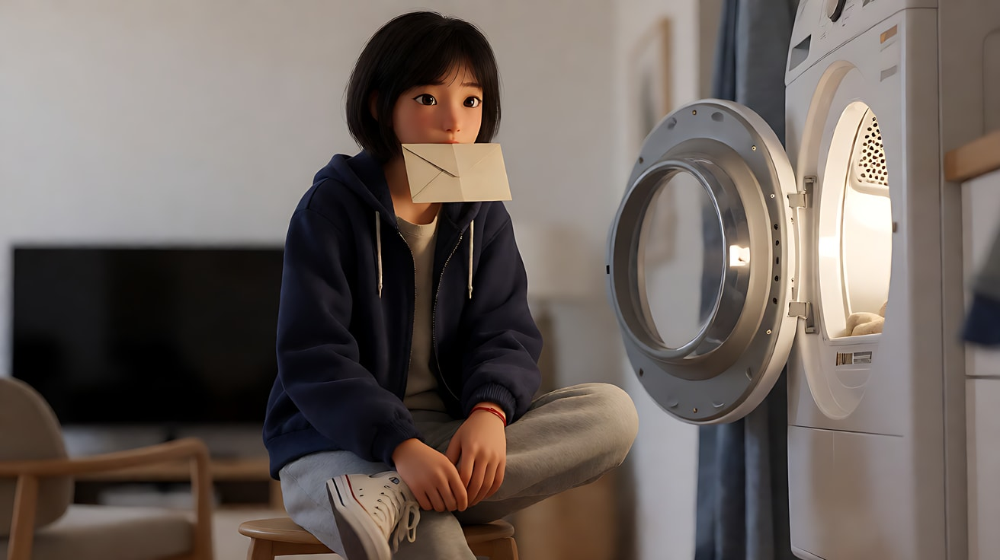

# L07-00 风格拆解方法论 · 提示词

> 本组练习：同一个原创场景（深夜洗衣房里的一封陌生信），分别套用六种功能型导演声音，体会"只改技术选择、不写任何人名"就能换掉整部片的手感。｜ 配套教学：[L07-00-风格拆解方法论](../教学/L07-00-风格拆解方法论.md) ｜ 规范：[写作规范](../../模板/写作规范.md)
>
> 画风默认使用开关 A（风格化写实 CG）。如改用 2D 动画，删掉所有焦段、光圈、景深词。

**本组共用的原创场景**

- 人物：苏禾，二十六岁，夜班后来洗衣服；齐耳短发，深蓝色连帽外套，灰色运动裤，白色帆布鞋，左手腕一根红绳。
- 地点：凌晨的小区自助洗衣房，一排滚筒洗衣机，顶部荧光灯，窗外是空街和一块亮着的便利店招牌。
- 事件：她从烘干机里取衣服，发现夹在衣服里的一封不属于她的信，信封上写着"给明天的自己"。
- 一句话意图：让观众感到她在"拆还是不拆"之间犹豫。

**六种声音速查（翻译中枢）**

| 声音 | 一句话技术开关（可直接放进提示词） |
|---|---|
| 观察自然主义 | 固定或轻微手持，现场荧光灯为唯一光源，低饱和真实色，长镜头不切，动作生活化 |
| 古典构图 | 平衡构图、平视、稳重的缓慢推轨，动机光经过雕琢，色彩和谐，动作精确收敛 |
| 动感本能 | 手持贴身跟拍，硬光高反差，去饱和颗粒感，短促切镜，动作用力 |
| 表现主义风格 | 大胆构图与设计好的运动，霓虹动机光被推到极致，高饱和标志色，节奏有音乐性 |
| 亲密极简 | 近景、长焦段、极小的推进，单一柔光源，暖而克制，几乎不切，微小动作 |
| 图形形式主义 | 固定机位、几何化正面构图，硬而被塑形的光，限定色板，精确冷面节奏 |

---

### 练习1：观察自然主义 vs 亲密极简（难度 ★）

**目标**：同一个瞬间，一个"远远看着"，一个"贴着她呼吸"。只用单张关键帧图生视频，比较景别、焦段、光源数量带来的差别。

**【生图 · Nano Banana】**

图1A 关键帧（观察自然主义）：

```
A static wide shot of an original young woman with a short bob haircut, wearing a navy hooded jacket, grey sweatpants
and white canvas sneakers, a red string on her left wrist, standing in front of an open tumble dryer
in a small self-service laundromat at 3 a.m. She holds a plain white envelope she has just found among her clothes.
She is placed slightly right of center, small in the frame, the row of washing machines stretching to the left.
Camera at standing eye level from the far corner, 28mm lens, deep focus so the whole room stays readable.
Lighting: flat cool-white overhead fluorescent tubes as the only source, one tube slightly dimmer than the others,
a convenience-store sign glowing faintly through the street window behind her. Muted, true-to-life colors.
Stylized semi-realistic 3D CG rendering, feature-film animation quality. Aspect ratio 16:9.
```

中文释义：全景、固定、28mm 深焦，人物偏右、在画面中很小；顶部冷白荧光灯是唯一主光，窗外便利店招牌微亮；低饱和真实色。



图1B 关键帧（亲密极简）：

```
A close-up of the same original young woman with a short bob haircut and a navy hooded jacket,
her face in three-quarter profile on the left third of the frame, looking down at a plain white envelope
held in both hands just below the frame edge, her thumb resting on the sealed flap.
Camera at her eye level, very close, 85mm lens, shallow depth of field, the washing machines behind her
dissolved into soft grey shapes.
Lighting: a single soft warm source from the open dryer drum at frame right, glowing on her cheek and fingers,
the rest of the room falling into dim cool shadow.
Stylized semi-realistic 3D CG rendering, feature-film animation quality. Aspect ratio 16:9.
```

中文释义：近景、85mm 浅景深，人物三分之二侧脸在左三分之一；唯一光源是烘干机滚筒里透出的暖光，其余沉入冷暗。



**【图生视频 · Seedance】**

版本 A：观察自然主义

```
【素材分工】@图片1 为首帧，锁定人物身份、服装与洗衣房布局。
【画风】风格化写实三维CG质感，低饱和真实色调。
苏禾站在打开的烘干机前，把信封翻到背面看了一眼，又翻回正面，然后把它放在烘干机顶上，继续把衣服一件件塞进购物袋，动作不快不慢。镜头固定全景，不推不拉，像一位站在角落的旁观者。顶部荧光灯持续发出冷白光，其中一根灯管轻微闪动。结尾停在她拎起购物袋、目光又落回烘干机顶上那封信的瞬间。
【声音】无配乐，荧光灯电流嗡声，远处一台洗衣机脱水的低沉轰鸣，衣服摩擦塑料袋的沙沙声。
【约束】保持人物脸型、发型、服装不变；不切镜头；不要字幕、水印、Logo。
时长：10秒
```

版本 B：亲密极简

```
【素材分工】@图片1 为首帧，锁定人物身份、服装与面部光线。
【画风】风格化写实三维CG质感，暖色单一光源。
苏禾低头看着手里的信封，拇指沿着封口慢慢滑过，停在封口的一角，指尖轻轻按住，没有撕开。她吸了一口气，嘴唇抿紧。镜头极慢地向前推近一点，最终停在她低垂的眼睛和按住封口的拇指同框的近景。烘干机滚筒的暖光始终是唯一主光。
【声音】几乎无声，烘干机滚筒余转的轻微咔嗒声，她一次清楚的呼吸声，无配乐。
【约束】保持人物脸型、发型、服装不变；不切镜头；不要字幕、水印、Logo。
时长：8秒
```

**参数**：时长 8–10 秒 ｜ 画幅 16:9

**【检查点】**
- 版本 A 里人物是否始终"小"，空间信息是否完整
- 版本 B 里是否只有一个暖色光源，背景是否虚掉
- 两版是否都没有出现任何风格名、人名

**【常见问题与修复】**
| 现象 | 修复 |
|---|---|
| 版本 A 镜头自己推近了 | 写"镜头固定全景，不推不拉，不切镜头" |
| 版本 B 出现顶部冷光把脸打亮 | 写"顶部荧光灯已关闭，只有烘干机滚筒的暖光" |
| 信封被撕开 | 写"始终没有撕开封口" |

---

### 练习2：古典构图 vs 图形形式主义（难度 ★★）

**目标**：用定妆图 + 场景图做多图参考，对比两种"讲究构图"的声音：一种平衡而有呼吸，一种几何而冷面。

**【生图 · Nano Banana】**

图1 角色定妆：

```
Character turnaround sheet of an original young woman in her mid-twenties: short black bob haircut, a navy hooded jacket,
grey sweatpants, white canvas sneakers, a thin red string tied on her left wrist.
Front view, three-quarter view, side view and back view, full body, plain light-grey background,
even soft studio light, no shadows on the backdrop.
Stylized semi-realistic 3D CG rendering, feature-film animation quality. Aspect ratio 16:9.
```



图2 场景：

```
Empty small self-service laundromat at 3 a.m., a straight row of identical front-loading washing machines along the back wall,
two tumble dryers stacked at the center, a narrow bench in front, white tiled floor, a street window on the right
showing an empty street and a glowing convenience-store sign, overhead fluorescent tubes, no people.
Frontal wide shot, eye level, 35mm lens, deep focus.
Stylized semi-realistic 3D CG rendering, feature-film animation quality. Aspect ratio 16:9.
```



**【多图生视频 · Seedance】**

版本 A：古典构图

```
【素材分工】@图片1 锁定人物身份与服装；@图片2 仅参考洗衣房布局与陈设，不复制其中光线。
【画风】风格化写实三维CG质感，柔和而有层次的布光。
平衡的中全景，苏禾坐在长凳左侧，信封放在长凳右侧，人物与信封在画面两侧形成左右平衡。顶部荧光灯调暗，窗外便利店招牌的暖光从画右斜照进来，在地砖上投出一块柔和的光斑，正好落在信封旁边。她伸手把信封拿起，放在膝上，双手压住。镜头从中全景以稳定的缓慢推轨向前推进，停在她与膝上信封同框的中景。
【声音】轻柔的单簧管低音配乐，洗衣机运转的规律嗡声，信封纸张的一声轻响。
【约束】保持人物脸型、发型、服装不变；不切镜头；不要字幕、水印、Logo。
时长：10秒
```

版本 B：图形形式主义

```
【素材分工】@图片1 锁定人物身份与服装；@图片2 仅参考洗衣房布局与陈设，不复制其中光线。
【画风】风格化写实三维CG质感，限定色板：冷白、灰蓝、一点红。
严格正面平视，固定机位，画面中心是两台叠放的烘干机，两侧洗衣机等距排列成对称图案。苏禾正对镜头站在画面正中、烘干机前，双手把信封举在胸前，面无表情地看着镜头，停顿，再把信封平稳地放进外套口袋。全身唯一的暖色是她手腕上的红绳。顶部荧光灯给出硬朗、均匀的白光，地面有清晰的短阴影。结尾停在她双手垂下、仍正对镜头站定。
【声音】无配乐，一台洗衣机结束时清脆的"叮"一声，然后是安静的电流嗡声。
【约束】保持人物脸型、发型、服装不变；机位不动，不切镜头；不要字幕、水印、Logo。
时长：8秒
```

**参数**：时长 8–10 秒 ｜ 画幅 16:9

**【检查点】**
- 版本 A：画面是"左右平衡"但不死板，运动只有一次缓慢推轨
- 版本 B：画面是否真正左右对称，人物是否正对镜头，色彩是否只有冷白 + 一点红
- 两版是否都没有从 @图片2 复制冷荧光以外的光线设定

**【常见问题与修复】**
| 现象 | 修复 |
|---|---|
| 版本 B 不对称 | 加"画面中轴线穿过人物鼻梁与两台烘干机的中缝" |
| 版本 B 人物有表情变化 | 写"面无表情，眼睛不眨，动作像被精确计时" |
| 版本 A 推轨过快 | 写"推进速度如同缓慢步行的一半，几乎察觉不到" |

---

### 练习3：表现主义风格——首尾帧让光变成情绪（难度 ★★★）

**目标**：用首帧和尾帧锁定"光的转折"。窗外霓虹招牌突然亮起，把整个洗衣房从冷白推成饱和品红，同时她做出"打开"的决定。

**【生图 · Nano Banana】**

图1 角色定妆：沿用练习2的图1。

图2 首帧：

```
Using the character from image 1: a medium shot of her standing at the street window of a laundromat at night,
holding the sealed white envelope against her chest, her body angled toward the window, placed on the right third,
a large dark window occupying the left two thirds. Low camera, slightly tilted upward, 24mm lens, deep focus,
the empty street and an unlit neon sign visible outside.
Lighting: cold blue-white overhead fluorescent light only, hard shadows under her chin.
Keep the face, hairstyle and outfit exactly as in image 1.
Stylized semi-realistic 3D CG rendering, feature-film animation quality. Aspect ratio 16:9.
```



图3 尾帧：

```
Using the character and the exact same framing as image 2: the large neon sign outside is now lit,
flooding the whole room with saturated magenta and cyan light through the window; the envelope is open,
she holds the unfolded letter up in front of her face with both hands, the letter glowing translucent magenta,
her silhouette rimmed in cyan. Keep the face, hairstyle and outfit exactly as in image 1.
Stylized semi-realistic 3D CG rendering, feature-film animation quality. Aspect ratio 16:9.
```



**【首尾帧生视频 · Seedance】**

```
【素材分工】@图片2 为首帧；@图片3 为尾帧，是最终画面目标；@图片1 锁定人物身份与服装。只生成两帧之间的连续动作。
【画风】风格化写实三维CG质感，高饱和品红与青色。
苏禾把信封从胸前拿开，低头看了一眼。窗外的霓虹招牌先闪了一下，再整块亮起，品红和青色的光从窗户涌进来，盖过顶部冷白灯光。她在新亮起的光里撕开封口，抽出信纸，双手把信纸举到面前展开。镜头保持低机位仰角，缓慢向画左横移，让窗户与霓虹逐渐进入构图，停在尾帧。
【声音】霓虹灯管点亮时的"嗞"一声电流音，随后进入低沉的合成器长音配乐，信纸展开的清脆声。
【约束】保持人物脸型、发型、服装不变；中间动作连续，不跳切；不要字幕、水印、Logo、可读文字。
时长：8秒
```

**参数**：时长 8 秒 ｜ 画幅 16:9

**【检查点】**
- 光的变化是否有来源（窗外招牌点亮），而不是凭空变色
- "撕开—抽出—展开"三个动作是否连续
- 尾帧信纸上是否没有出现乱码文字

**【常见问题与修复】**
| 现象 | 修复 |
|---|---|
| 颜色凭空变化 | 写清"光的变化来自窗外招牌点亮"，并保留窗户在画面里 |
| 信纸出现乱码字 | 写"信纸背对镜头，只看到透光的纸面，不显示文字" |
| 手指变形 | 删掉"撕开封口"，尾帧改为信封已打开 |

---

### 练习4：动感本能——三镜头追出门（难度 ★★★★）

**目标**：同一场景换成动感本能声音：她发现窗外有人走远，抓起信追出去。手持、硬光、短促切镜，体会"节奏也是风格"。

**【生图 · Nano Banana】**

图1 角色定妆：沿用练习2的图1。

图2 场景：沿用练习2的图2。

图3 镜头1关键帧：

```
Using the character from image 1 and the laundromat from image 2: a tight handheld medium close-up from slightly behind her shoulder,
she snaps her head toward the street window where a blurred figure in a long grey coat is walking away under a streetlight.
Camera at shoulder height, 28mm lens close to her, moderate depth of field, slight motion blur.
Lighting: hard overhead fluorescent light, high contrast, deep black shadows, desaturated colors with visible grain.
Keep the face, hairstyle and outfit exactly as in image 1.
Stylized semi-realistic 3D CG rendering, feature-film animation quality. Aspect ratio 16:9.
```



**【多图生视频 · Seedance】**

```
【素材分工】@图片1 锁定人物身份与服装；@图片2 仅参考洗衣房布局与窗户位置，不复制其中光线；@图片3 为首帧。
【画风】风格化写实三维CG质感，去饱和高反差，带颗粒感。
镜头1：手持中近景，从她肩后贴身拍摄，她猛地转头看向窗外，一个穿灰色长大衣的人正走出路灯范围。手持轻微晃动。洗衣机轰鸣声里混进她短促的吸气声。
镜头2：镜头切至手部特写，她一把抓起烘干机顶上的信封攥在手里，手持镜头跟着手的动作向上甩。信封纸被攥紧的脆响。
镜头3：镜头切至门外街道的低机位广角，玻璃门被她推开，她冲出门向画右跑去，手持镜头跟跑两步后停下，她的背影冲进便利店招牌的冷光里。门上风铃剧烈晃响，运动鞋踩过湿地面的急促脚步声。
【锁定】光线：室内顶部冷白硬光，室外只有路灯与便利店招牌；人物始终穿深蓝连帽外套、手腕红绳；奔跑方向始终从画左到画右。
【声音】无配乐，用洗衣机轰鸣、攥纸声、风铃、脚步声构成节奏，越来越急。
【约束】保持人物脸型、发型、服装不变；画面中只有她一个人清楚可见，灰大衣的人始终模糊且在远处；不要字幕、水印、Logo。
时长：10秒
```

**参数**：时长 10 秒 ｜ 画幅 16:9 ｜ 负载：3 个镜头，镜头2为半拍插入，属于"有挑战"档

**【检查点】**
- 三个镜头是否真的切开了，而不是一个连续镜头
- 奔跑方向是否保持从左到右
- 灰大衣人物是否始终模糊、不抢戏

**【常见问题与修复】**
| 现象 | 修复 |
|---|---|
| 手持晃得看不清 | 写"手持轻微晃动，主体始终清楚" |
| 灰大衣人物变成正脸特写 | 写"他始终背对镜头、在远处、处于虚焦" |
| 镜头3方向反了 | 在【锁定】里再写一遍"从画左跑向画右" |

---

### 练习5：写自己的指纹表，并在第三镜打破它（难度 ★★★★★）

**目标**：完整走一遍"指纹表 → 声音 → 三镜头"的流程。项目声音定为**观察自然主义**，前两镜严格遵守，第三镜**有意切换成亲密极简**，让"打破规则"成为情感高点。

**先写指纹表（填在笔记里，不放进提示词）**

| 维度 | 默认值 | 第三镜的例外 |
|---|---|---|
| 景别 | 全景、中全景 | 第一次用近景 |
| 景深与焦段 | 28–35mm，深焦 | 85mm，浅焦 |
| 构图 | 人物偏离中心，留出空间 | 人物脸占画面左半 |
| 光影与色彩 | 顶部冷白荧光，低饱和 | 只剩烘干机滚筒的暖光 |
| 运镜 | 固定 | 唯一一次极慢推近 |
| 剪辑与节奏 | 长、晚切 | 停留最久 |
| 声音 | 环境声为主，无配乐 | 环境声退去，只剩呼吸 |

**【生图 · Nano Banana】**

图1 角色定妆：沿用练习2的图1。

图2 场景：沿用练习2的图2。

图3 镜头1关键帧：

```
Using the character from image 1 and the laundromat from image 2: a static medium-wide shot of her sitting on the bench,
reading the open letter in her lap, placed on the left third, the row of washing machines filling the right side.
Camera at seated eye level from across the room, 35mm lens, deep focus.
Lighting: flat cool-white overhead fluorescent tubes, muted true colors, the dark street window at frame right.
Keep the face, hairstyle and outfit exactly as in image 1.
Stylized semi-realistic 3D CG rendering, feature-film animation quality. Aspect ratio 16:9.
```



图4 镜头3关键帧：

```
Using the character from image 1: a close-up of her face in profile on the left half of the frame, eyes lowered,
the folded letter pressed against her lips, her eyes wet but no tears falling.
Camera at her eye level, 85mm lens, shallow depth of field, background reduced to soft dark shapes.
Lighting: the overhead lights are off; a single soft warm glow from an open dryer drum at frame right lights her face.
Keep the face, hairstyle and outfit exactly as in image 1.
Stylized semi-realistic 3D CG rendering, feature-film animation quality. Aspect ratio 16:9.
```



**【多图生视频 · Seedance】**

```
【素材分工】@图片1 锁定人物身份与服装；@图片2 仅参考洗衣房布局与陈设；@图片3 为镜头1首帧；@图片4 仅作为镜头3的构图与光线参考，不作为首帧。
【画风】风格化写实三维CG质感，低饱和真实色调。
镜头1：固定中全景，苏禾坐在长凳左侧，低头读膝上的信，读完一行，手指在纸上停住。顶部冷白荧光灯平铺全屋，窗外街道漆黑。洗衣机运转的低鸣与荧光灯电流声。
镜头2：镜头切至固定全景，从洗衣房另一角拍摄，她把信折成小方块，起身走到打开的烘干机前，伸手关掉墙上的顶灯开关，房间暗下来，只剩滚筒里透出的暖光。开关"咔哒"一声，电流声随之消失。
镜头3：镜头切至近景，她侧脸在画面左半边，把折好的信贴在嘴唇上，眼睛低垂，没有眨眼。滚筒暖光是唯一光源。镜头极慢地向前推近一点，停在她贴着信纸的侧脸上。只剩她一次缓慢的呼吸声和滚筒余转的轻响。
【锁定】光线：镜头1与镜头2前半为顶部冷白荧光，关灯后只剩画右烘干机滚筒的暖光；人物始终穿深蓝连帽外套、手腕红绳；机位始终在长凳正面一侧。
【声音】无配乐；环境声从"洗衣机 + 电流声"逐步变稀，到镜头3只剩呼吸。
【约束】保持人物脸型、发型、服装不变；信纸不显示可读文字；不要字幕、水印、Logo。
时长：12秒
```

**参数**：时长 12 秒 ｜ 画幅 16:9 ｜ 负载：3 个镜头、1 个关灯动作，属于"稳妥"档

**【检查点】**
- 前两镜是否保持"固定、深焦、冷光、远观"的规则
- 第三镜是否同时打破了景别、焦段、光、运镜四个维度
- 关灯动作是否成为光变化的来源
- 通读一遍提示词，确认没有任何导演名、片名、风格名

**【常见问题与修复】**
| 现象 | 修复 |
|---|---|
| 镜头1、2也开始推近 | 镜头1、2分别写"固定机位，不推不拉" |
| 关灯后整屏全黑 | 写"关灯后滚筒暖光足以照亮她的脸和手" |
| 镜头3流泪过度 | 写"眼眶湿润，但眼泪没有落下" |
| 第三镜和前两镜一样冷 | 在【锁定】里写清关灯后的光源只剩暖色滚筒光 |
