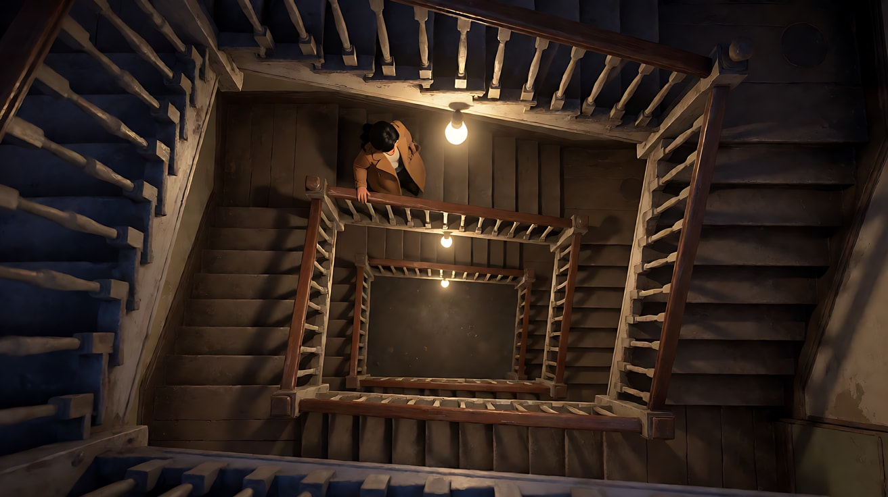
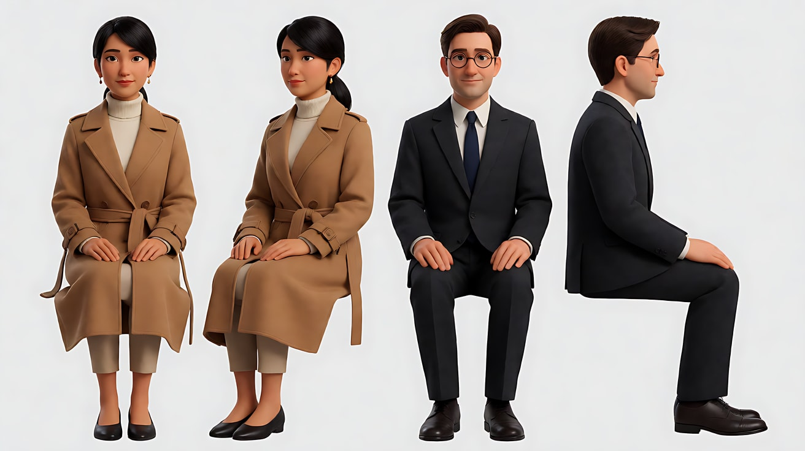
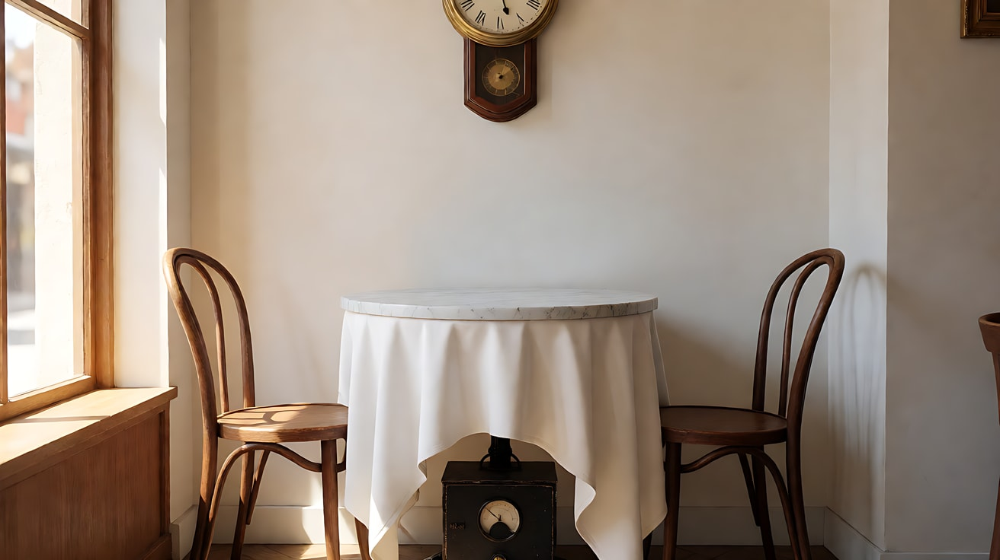
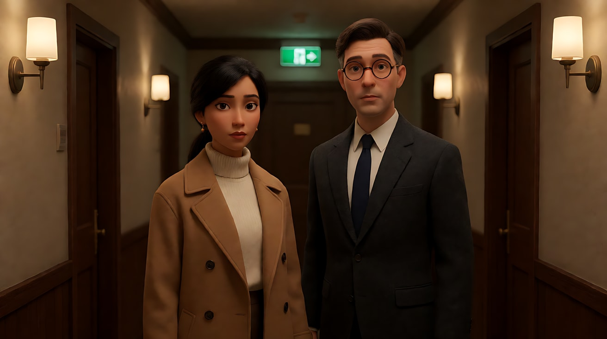
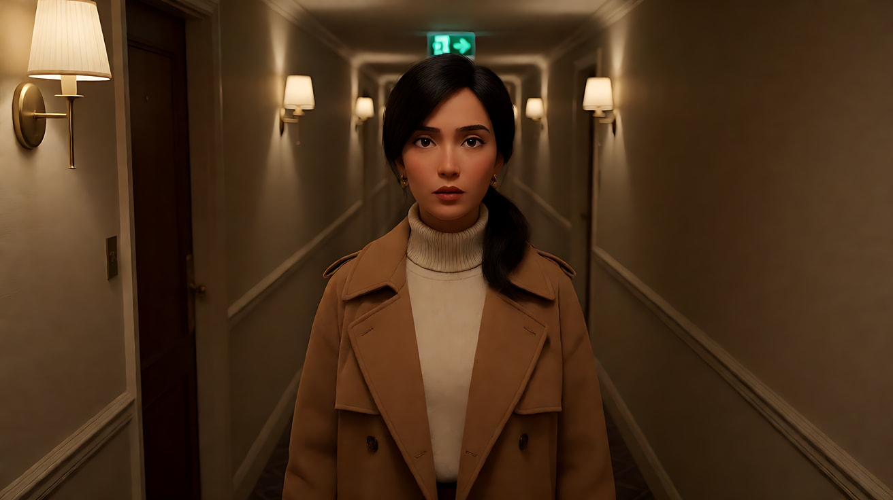
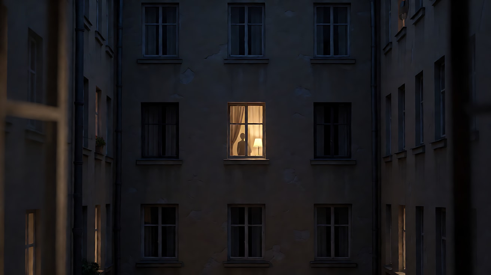
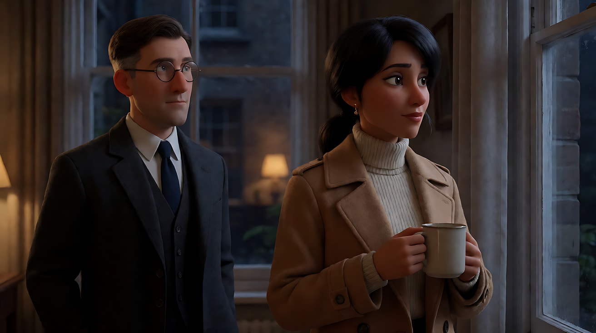
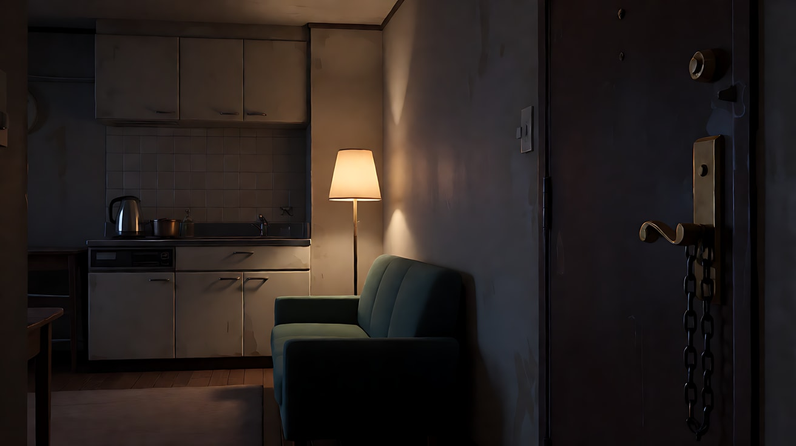
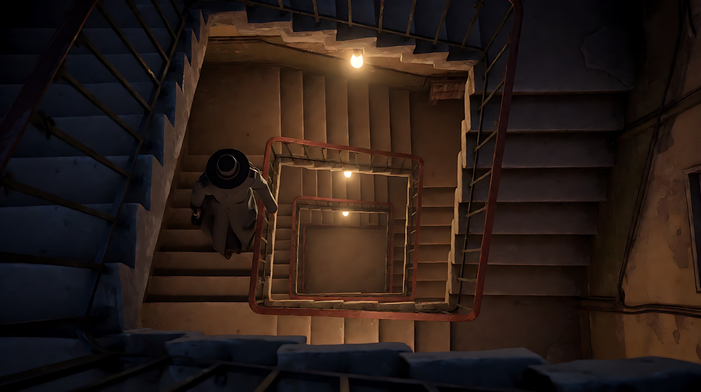
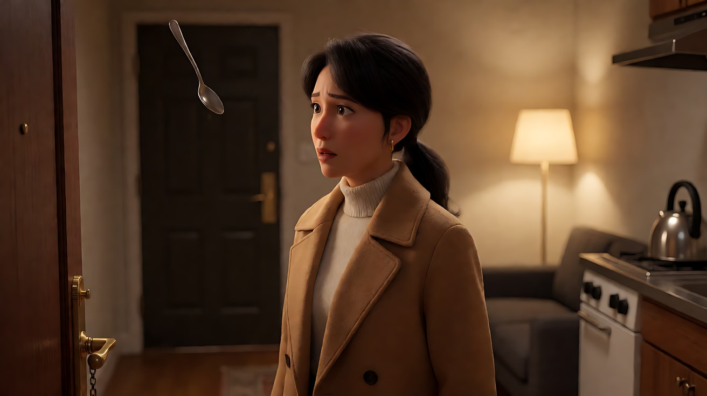

# L07-01 悬念机器 · 提示词

> 本组练习：用高位俯拍、"观众知道得比角色多"、滑动变焦、主观镜头三段式，拍出原创的悬念场景。提示词只写技术，不写任何人名与片名。｜ 配套教学：[L07-01 教学文件](../教学/L07-01-希区柯克.md) ｜ 规范：[写作规范](../../模板/写作规范.md)
>
> 画风默认使用开关 A（风格化写实 CG）。如改用 2D 动画，删掉所有焦段、光圈、景深词。

**本组技法开关（不含人名，可直接复用）**

```
信息不对称：先让观众看到危险物，角色不知道。
主观三段式：角色看向画外 → 镜头切至她看到的画面 → 镜头切至她的反应。
高位俯拍：从极高处垂直向下，角色在画面中很小。
滑动变焦：镜头向后拉的同时变焦推近，人物大小不变，背景透视被拉长。
长距离推近：从大全景一路推到一件小物件的特写。
```

---

### 练习1：高位俯拍——楼梯井里的渺小（难度 ★）

**目标**：用单张关键帧，体会"从上往下看"如何让角色显得无处可逃。

**【生图 · Nano Banana】**

图1 关键帧：

```
An extreme high overhead shot looking straight down the square stairwell of an old five-storey apartment building at night.
Far below, an original woman in her thirties with dark hair in a low ponytail and a camel trench coat climbs the stairs,
one hand on the wooden banister, very small in the frame, placed near the center of the spiralling rectangle of handrails.
Camera at the top floor, pointing vertically down, 24mm lens, deep focus so every landing is sharp.
Lighting: a single bare warm bulb on each landing, pools of light separated by dark gaps, hard shadows of the railings
falling across the steps. Stylized semi-realistic 3D CG rendering, feature-film animation quality. Aspect ratio 16:9.
```

中文释义：极端高位垂直俯拍老公寓方形楼梯井；女人在最底部向上爬，非常小；24mm 深焦；每层平台一盏裸灯泡，扶手投影切过台阶。



**【图生视频 · Seedance】**

```
【素材分工】@图片1 为首帧，锁定人物身份、服装与楼梯井结构。
【画风】风格化写实三维CG质感，低调明暗对比。
女人扶着木扶手一层一层向上走，经过一盏灯泡时被照亮，走进两盏灯之间时沉入暗处。镜头固定在顶层垂直向下，不移动。她在第二层平台停下，抬头向上看了一眼，然后继续往上走。结尾停在她站在一盏灯下、仰脸向上的画面。
【声音】无配乐，鞋跟踩在木台阶上的回声，老楼梯的吱呀声，灯泡轻微的电流嗡声。
【约束】保持人物脸型、发型、服装不变；机位不动，不切镜头；不要字幕、水印、Logo。
时长：8秒
```

**参数**：时长 8 秒 ｜ 画幅 16:9

**【检查点】**
- 是否真正垂直俯拍，楼梯井呈层层嵌套的方框
- 人物经过亮区与暗区的交替是否清楚
- 结尾抬头那一眼是否把"上面有东西"的暗示交给观众

**【常见问题与修复】**
| 现象 | 修复 |
|---|---|
| 变成斜俯拍 | 写"摄影机垂直朝下，画面是层层嵌套的方形扶手" |
| 人物太大 | 写"人物只占画面高度的十分之一" |
| 灯光全亮无暗区 | 写"两盏灯之间是完全的暗区" |

---

### 练习2：观众知道得比角色多——桌下的计时装置（难度 ★★）

**目标**：用定妆图 + 场景图，在一个连续镜头里先让观众看到两人聊天，再把镜头降到桌下，揭示一个嘀嗒作响的金属盒。角色始终不知道。

**【生图 · Nano Banana】**

图1 角色定妆：

```
Character turnaround sheet of two original characters in their thirties:
a woman with dark hair in a low ponytail, a camel trench coat over a cream turtleneck, small gold earrings;
a man with neatly combed brown hair, round wire glasses, a charcoal suit with a navy tie.
Front view, three-quarter view and side view of each, full body, plain light-grey background,
even soft studio light. Stylized semi-realistic 3D CG rendering, feature-film animation quality. Aspect ratio 16:9.
```



图2 场景：

```
Empty small café corner in the afternoon, a round marble table with a long white tablecloth reaching almost to the floor,
two bentwood chairs facing each other, a brass wall clock above, warm window light from frame left,
and under the table, partly hidden by the cloth, a small black metal box with a round dial. No people.
Medium-wide shot, eye level, 35mm lens, deep focus.
Stylized semi-realistic 3D CG rendering, feature-film animation quality. Aspect ratio 16:9.
```



**【多图生视频 · Seedance】**

```
【素材分工】@图片1 锁定两位人物的身份与服装；@图片2 仅参考咖啡馆布局、圆桌、挂钟与桌下金属盒的位置，不复制其中光线强度。
【画风】风格化写实三维CG质感，午后温暖的窗光。
午后暖光从画左的窗户斜照进来。女人坐在画左，男人坐在画右，两人隔着圆桌聊天，男人笑着往咖啡里加一块方糖，女人用勺子慢慢搅动自己的杯子。镜头从平视中景双人镜头开始，平稳地向下降落，越过桌沿，穿过桌布下沿的缝隙，停在桌下那个黑色金属盒的特写上，表盘指针在走动。桌面上的两人始终没有低头看。
【声音】轻松的咖啡馆环境声，杯碟碰撞，两人模糊的笑声；镜头降到桌下后，环境声变闷，一个清晰的机械嘀嗒声逐渐突出。
【约束】保持两人脸型、发型、服装不变；金属盒不打开、不发生任何变化；不切镜头；不要字幕、水印、Logo。
时长：10秒
```

**参数**：时长 10 秒 ｜ 画幅 16:9

**【检查点】**
- 镜头下降是否是唯一的主运镜
- 两人是否始终不知情、不低头
- 声音是否从"轻松"过渡到"只剩嘀嗒声"

**【常见问题与修复】**
| 现象 | 修复 |
|---|---|
| 金属盒爆开或冒烟 | 写"金属盒不打开、不发光、不冒烟，只有指针在走" |
| 两人低头看桌下 | 写"两人的目光始终在对方脸上" |
| 镜头钻不过桌布 | 改为"镜头下降到桌沿以下，桌布下沿掀起一角，露出金属盒" |

---

### 练习3：滑动变焦——走廊尽头的顿悟（难度 ★★★，首尾帧）

**目标**：用首尾帧锁定"人物大小不变、背景透视被拉长"的变化，让模型生成中间的推拉反向运动。

**【生图 · Nano Banana】**

图1 角色定妆：沿用练习2的图1（只用女人）。

图2 首帧：

```
Using the woman from image 1: a medium close-up of her standing at the far end of a long, narrow hotel corridor,
facing the camera, her face frozen as she realises something, placed at the exact center of the frame.
Camera at eye level, 50mm lens, moderate depth of field, the corridor behind her looking normal in length,
three doors visible on each side. Lighting: dim warm wall sconces along both walls, a green exit light at the far end.
Keep the face, hairstyle and outfit exactly as in image 1.
Stylized semi-realistic 3D CG rendering, feature-film animation quality. Aspect ratio 16:9.
```



图3 尾帧：

```
Using the woman from image 1 and the same corridor as image 2: the woman is exactly the same size and position in the frame,
but the corridor behind her now appears stretched extremely long and deep, many more doors receding to a tiny vanishing point,
wide-angle perspective distortion on the walls, the green exit light now a small dot far away.
Keep the face, hairstyle and outfit exactly as in image 1.
Stylized semi-realistic 3D CG rendering, feature-film animation quality. Aspect ratio 16:9.
```



**【首尾帧生视频 · Seedance】**

```
【素材分工】@图片2 为首帧；@图片3 为尾帧，是最终画面目标；@图片1 锁定人物身份与服装。只生成两帧之间的连续变化。
【画风】风格化写实三维CG质感，昏暗暖色壁灯。
女人站在走廊里正对镜头，一动不动，只有瞳孔微微放大，嘴唇微张，呼吸停了一拍。镜头向后拉的同时变焦推近，她在画面中的大小与位置始终不变，身后的走廊透视被持续拉长，两侧房门一扇扇向远处延伸，尽头的绿色出口灯越来越远。
【声音】低沉的弦乐长音逐渐升高，壁灯电流声被拉长变形，无对白。
【约束】保持人物脸型、发型、服装不变；人物大小与位置不变；中间不跳切；不要字幕、水印、Logo。
时长：6秒
```

**参数**：时长 6 秒 ｜ 画幅 16:9

**【检查点】**
- 人物大小是否几乎不变
- 背景是否被"拉长"而不是简单放大或缩小
- 人物是否只有微表情，没有走动

**【常见问题与修复】**
| 现象 | 修复 |
|---|---|
| 人物也跟着变小 | 强调"人物在画面中的大小与位置始终不变"，并缩短时长到 5 秒 |
| 只做了普通推镜 | 尾帧图3要把走廊画得明显更长；正文写"背景透视被拉长" |
| 人物向前走 | 写"她双脚不动，身体不前后移动" |

---

### 练习4：主观镜头三段式——看、所见、反应（难度 ★★★★，多镜头）

**目标**：用三个镜头把观众放进角色的眼睛：她从窗口看到对面楼里有人在看她。

**【生图 · Nano Banana】**

图1 角色定妆：沿用练习2的图1（只用女人）。

图2 场景（对面楼窗户）：

```
Night view across a narrow courtyard toward the opposite apartment building, rows of windows,
most dark, one window on the third floor lit with a warm lamp and a half-drawn curtain,
a vague silhouette of a person standing behind the curtain, no faces visible.
Telephoto compression, 135mm lens, slight foreground blur of a window frame edge.
Stylized semi-realistic 3D CG rendering, feature-film animation quality. Aspect ratio 16:9.
```



图3 镜头1关键帧：

```
Using the woman from image 1: a medium close-up of her standing at her own dark apartment window at night,
holding a mug of tea, her face turned slightly to frame right, looking out across the courtyard.
Camera at eye level from inside the room, 50mm lens, moderate depth of field.
Lighting: cool moonlight through the window from frame right on her face, the room behind her dark,
a faint warm glow from a lamp in the opposite building reflected in the glass.
Keep the face, hairstyle and outfit exactly as in image 1.
Stylized semi-realistic 3D CG rendering, feature-film animation quality. Aspect ratio 16:9.
```



**【多图生视频 · Seedance】**

```
【素材分工】@图片1 锁定女人的身份与服装；@图片2 仅参考对面楼窗户的构图与光线，作为主观镜头画面，不出现可辨认的人脸；@图片3 为镜头1首帧。
【画风】风格化写实三维CG质感，夜间冷月光与远处暖灯。
镜头1：固定中近景，女人站在自家暗窗前，端着茶杯，漫不经心地看向窗外画右方向，然后目光停住。窗外冷月光照在她脸上。远处偶尔一声狗叫。
镜头2：镜头切至她的主观镜头，长焦压缩画面，越过院子看向对面三楼唯一亮着的窗户，半拉的窗帘后站着一个模糊的人影，人影一动不动。画面边缘有她窗框的虚化前景。镜头缓慢推近那扇窗户。声音只剩极轻的风声。
镜头3：镜头切至她的近景，正面略偏，她慢慢放下茶杯，身体向窗帘后侧退半步，眼睛始终没离开窗外。月光在她脸上被窗框切成两半。停在她半张脸藏进阴影里的画面。
【锁定】光线：她这边是画右来的冷月光，对面窗户是暖色台灯；她始终面向画右；对面人影始终模糊、没有五官。
【声音】无配乐，前两镜只有环境声，镜头3进入一个低沉的单音弦乐长音。
【约束】保持女人脸型、发型、服装不变；对面人影不出现清楚五官，不做任何动作；不要字幕、水印、Logo。
时长：12秒
```

**参数**：时长 12 秒 ｜ 画幅 16:9 ｜ 负载：3 个镜头、1 个后退动作，属于"稳妥"档

**【检查点】**
- 镜头1的视线方向（画右）与镜头2的主观画面是否连得上
- 镜头2是否有"她窗框"的前景，确认这是她的视点
- 镜头3的反应是一个看得见的动作（放下杯子、后退）

**【常见问题与修复】**
| 现象 | 修复 |
|---|---|
| 镜头2看起来像客观镜头 | 加"画面边缘是她窗框的虚化前景，镜头带轻微呼吸感" |
| 对面人影走动或挥手 | 写"人影一动不动，始终站在窗帘后" |
| 镜头3她转身离开 | 写"只后退半步，眼睛始终没离开窗外" |

---

### 练习5：原创三镜头悬念场景——门没锁（难度 ★★★★★）

**目标**：综合运用本课技法拍一个原创场景。意图：让观众比她更早知道"有人正上楼"，并在她察觉的那一刻停住。镜头1用高位俯拍给出危险（信息不对称），镜头2用长距离推近把注意力带到没锁的门，镜头3用近景反应收住。

**【生图 · Nano Banana】**

图1 角色定妆：沿用练习2的图1（只用女人）。

图2 场景（她的公寓）：

```
Empty small old apartment living room at night, a front door with a brass lever handle and an unlocked chain hanging loose,
a kitchenette on the right with a kettle, a single warm floor lamp by the sofa, dark corners, no people.
Wide shot, eye level, 28mm lens, deep focus.
Stylized semi-realistic 3D CG rendering, feature-film animation quality. Aspect ratio 16:9.
```



图3 镜头1关键帧：

```
An extreme high overhead shot looking straight down the square stairwell of an old apartment building at night;
on the lowest landing, a figure in a long dark-grey coat and a wide-brimmed hat climbs the stairs, seen only from above,
the hat hiding the face completely, very small in the frame. Pools of warm light from bare bulbs on each landing.
24mm lens, deep focus. Stylized semi-realistic 3D CG rendering, feature-film animation quality. Aspect ratio 16:9.
```



图4 镜头3关键帧：

```
Using the woman from image 1 and the apartment from image 2: a close-up of her at the kitchenette,
a teaspoon frozen above a cup, her head turned toward the front door at frame left, eyes wide.
Camera at eye level, 85mm lens, shallow depth of field, the door a soft dark shape in the background.
Lighting: warm floor lamp from frame right as key, the left side of her face in shadow.
Keep the face, hairstyle and outfit exactly as in image 1.
Stylized semi-realistic 3D CG rendering, feature-film animation quality. Aspect ratio 16:9.
```



**【多图生视频 · Seedance】**

```
【素材分工】@图片1 锁定女人的身份与服装；@图片2 仅参考公寓布局、门把手与门链的位置；@图片3 为镜头1首帧，楼梯上的人物只从顶部可见，不出现面孔；@图片4 仅作为镜头3的构图与光线参考，不作为首帧。
【画风】风格化写实三维CG质感，低调暖光与深暗部。
镜头1：固定的高位垂直俯拍，楼梯井最底层，一个穿深灰长大衣、戴宽檐帽的人影扶着扶手一层层往上走，帽檐完全挡住面孔，在画面中很小。每层平台的裸灯泡依次照亮他。沉重缓慢的脚步声在楼梯井里回荡。
镜头2：镜头切至公寓客厅的大全景，女人在画右的小厨房背对门口泡茶，轻声哼着歌。镜头从客厅另一端开始，平稳地长距离推近，越过沙发，一直推到门口，停在黄铜门把手和松垂着没挂上的门链的特写上。她的哼歌声逐渐变远，脚步声从门外隐约传来。
镜头3：镜头切至她的近景，她手里的茶匙停在杯子上方，头转向画左的门口，眼睛睁大，呼吸停住。落地灯从画右照亮她半边脸。停在她盯着门口的脸上。画外传来门把手被轻轻压下的金属声。
【锁定】光线：楼梯井是裸灯泡暖光，公寓里只有画右落地灯一盏暖光；女人始终穿驼色风衣与米色高领毛衣；门在画左，厨房在画右；楼梯上的人物始终不露面孔。
【声音】无配乐到镜头3才进入一个低沉的弦乐单音；脚步声贯穿三个镜头，从清楚到隐约再到停止，最后是门把手的金属声。
【约束】保持女人脸型、发型、服装不变；门不打开，画面中不出现第二个人；不要字幕、水印、Logo。
时长：13秒
```

**参数**：时长 13 秒 ｜ 画幅 16:9 ｜ 负载：3 个镜头、1 个长推镜，属于"稳妥"偏"有挑战"档

**【检查点】**
- 观众是否在镜头1就知道"有人上楼"，而她在镜头2不知道
- 镜头2的推镜是否最终停在门把手和门链上
- 镜头3是否在门打开之前停住，悬念没有被释放
- 通读提示词，没有任何人名、片名和触发词

**【常见问题与修复】**
| 现象 | 修复 |
|---|---|
| 门被打开、有人进来 | 写"门不打开，画面中不出现第二个人"，并把结尾写成她的脸 |
| 镜头1人影露脸 | 写"只从正上方看到帽顶和肩膀" |
| 镜头2推镜中途切了 | 写"一个连续推镜，从客厅另一端一直推到门把手特写" |
| 三镜头光线不统一 | 在【锁定】里写清两处空间各自唯一的光源 |
