# L07-02 对称与一点透视 · 提示词

> 本组练习：用一点透视中心对称、广角深焦、沿中轴的稳定器长跟拍、画内烛光与慢速变焦拉开、低头上目的冷静凝视，拍原创空间里的原创人物。提示词只写技术，不写任何人名、片名与品牌。｜ 配套教学：[L07-02 教学文件](../教学/L07-02-库布里克.md) ｜ 规范：[写作规范](../../模板/写作规范.md)
>
> 画风默认使用开关 A（风格化写实 CG）。如改用 2D 动画，删掉所有焦段、光圈、景深词。

**本组技法开关（不含人名，可直接复用）**

```
一点透视：消失点在画面正中，所有线条向中心汇聚，人物站在中轴线上。
广角深焦：18–24mm，前景到消失点全部清楚。
中轴跟拍：稳定器沿中轴直线前进或后退，速度恒定，画面平稳，始终对称。
画内光源：灯带、灯箱、烛火都在画面里可见。
冷静凝视：头部微微下压，眼睛向上直视镜头，嘴角不动，不眨眼。
```

---

### 练习1：一点透视——书架通道（难度 ★）

**目标**：用单张关键帧建立"所有线条汇向正中"的构图，让人物在中轴上缓慢走向镜头。

**【生图 · Nano Banana】**

图1 关键帧：

```
A perfectly symmetrical one-point perspective wide shot down a very long, narrow aisle between towering grey metal archive shelves
in an underground records hall. The vanishing point sits at the exact center of the frame.
An original man in his forties with short grey hair, a dark-green cardigan over a white shirt and brown trousers
stands far away on the central axis, small in the frame. Camera at standing eye level on the central axis, 18mm lens,
deep focus from the foreground floor to the far wall. Lighting: a continuous strip of cool white ceiling light panels
running down the center of the aisle toward the vanishing point, the floor reflecting it.
Stylized semi-realistic 3D CG rendering, feature-film animation quality. Aspect ratio 16:9.
```

中文释义：严格对称一点透视全景，消失点在正中；男人在中轴远处，很小；18mm 深焦；天花板正中一条冷白灯带一直延伸到消失点。

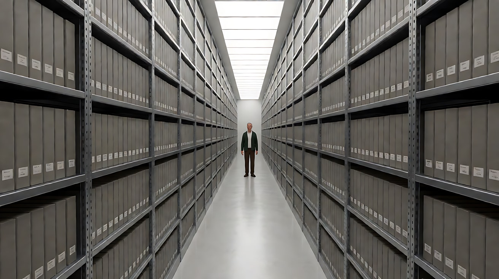

**【图生视频 · Seedance】**

```
【素材分工】@图片1 为首帧，锁定人物身份、服装与通道结构。
【画风】风格化写实三维CG质感，冷白画内光源。
男人沿着通道的中轴线，以均匀、不快不慢的步速笔直走向镜头，双手垂在身侧，目光平视前方。镜头固定在中轴线上不动，画面始终保持左右对称。天花板灯带持续亮着。结尾停在他走到中景、停下脚步、正对镜头站定的画面。
【声音】无配乐，皮鞋踩在水泥地上的规律脚步声在通道里回响，灯带轻微的电流嗡声。
【约束】保持人物脸型、发型、服装不变；人物不偏离中轴；不切镜头；不要字幕、水印、Logo。
时长：8秒
```

**参数**：时长 8 秒 ｜ 画幅 16:9

**【检查点】**
- 消失点是否在画面正中
- 人物是否始终走在中轴线上
- 步速是否均匀，像被测量过

**【常见问题与修复】**
| 现象 | 修复 |
|---|---|
| 人物斜着走 | 写"沿着地面中缝笔直行走，不偏左也不偏右" |
| 构图不对称 | 写"左右书架数量与高度完全一致，中轴线穿过人物身体中央" |
| 镜头自己推进 | 写"镜头固定不动" |

---

### 练习2：稳定器低机位长跟拍（难度 ★★）

**目标**：用定妆图 + 场景图，让镜头以孩子的高度在身后长距离平稳跟随。重点是"流畅却停不下来"。

**【生图 · Nano Banana】**

图1 角色定妆：

```
Character turnaround sheet of an original nine-year-old girl: a short straight black bob with blunt bangs,
a mustard-yellow knitted sweater, navy shorts, white knee socks, red sneakers, riding a small blue kick scooter.
Front view, three-quarter view, side view and back view, full body, plain light-grey background,
even soft studio light. Stylized semi-realistic 3D CG rendering, feature-film animation quality. Aspect ratio 16:9.
```

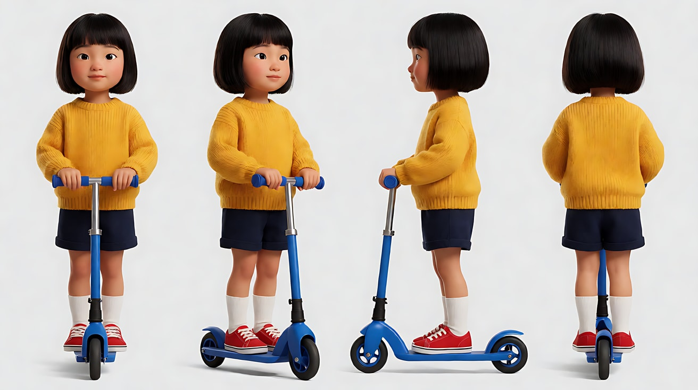

图2 场景：

```
Empty long corridor of an old boarding school at night, perfectly symmetrical, identical wooden doors evenly spaced on both sides,
a polished wooden floor alternating with long woven runner rugs, a row of round frosted ceiling lamps down the center,
a heavy double door at the far end. No people. One-point perspective, eye level, 18mm lens, deep focus.
Stylized semi-realistic 3D CG rendering, feature-film animation quality. Aspect ratio 16:9.
```

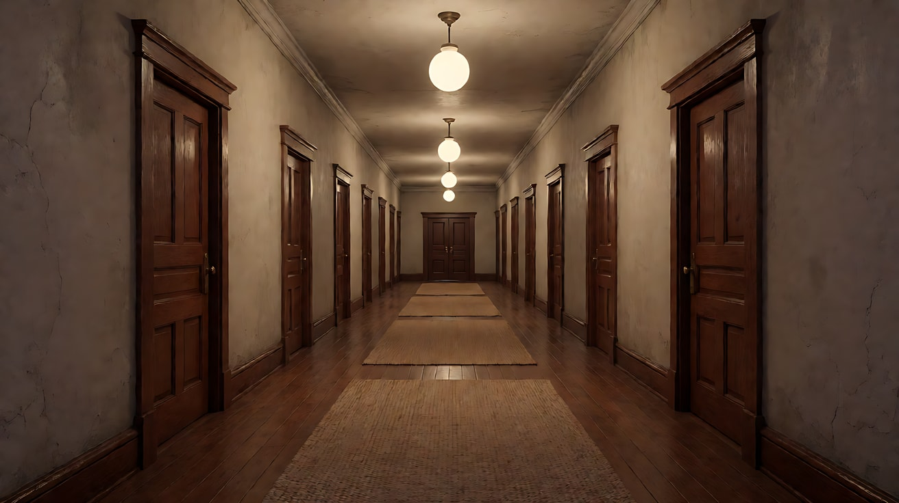

**【多图生视频 · Seedance】**

```
【素材分工】@图片1 锁定女孩身份、服装与蓝色滑板车；@图片2 仅参考走廊结构、地板与灯具，不复制其中视角高度。
【画风】风格化写实三维CG质感，暖白圆形吊灯。
女孩踩着滑板车沿走廊中轴向远处滑行，单脚一下一下地蹬地。镜头为稳定器低机位，高度在她的腰部，紧跟在她身后约两米处，以与她相同的速度平稳前进，画面始终保持左右对称、无晃动。她依次滑过木地板和长地毯。结尾停在她滑到走廊尽头双开门前停下、单脚踩地站住的背影。
【声音】无配乐；轮子压过木地板时是响亮的连续滚动声，压上地毯时突然变闷，再回到木地板时又变响，如此交替。
【约束】保持女孩脸型、发型、服装与滑板车不变；镜头不转弯、不环绕；不切镜头；不要字幕、水印、Logo。
时长：10秒
```

**参数**：时长 10 秒 ｜ 画幅 16:9

**【检查点】**
- 机位高度是否在孩子腰部，而不是成人视线高度
- 跟随距离与速度是否恒定
- 木地板 / 地毯交替的声音节奏是否出现

**【常见问题与修复】**
| 现象 | 修复 |
|---|---|
| 画面晃动 | 写"稳定器跟随，画面如滑轨般平稳" |
| 女孩转身看镜头 | 写"她始终背对镜头，不回头" |
| 镜头超过女孩 | 写"始终保持在她身后两米处" |

---

### 练习3：烛光 + 慢速变焦拉开成画（难度 ★★★，首尾帧）

**目标**：首帧是烛光下一只手移动棋子的特写，尾帧是对称的烛光大厅全景。模型生成中间缓慢的变焦拉开，人物逐渐在空间里变小。

**【生图 · Nano Banana】**

图1 角色定妆：

```
Character turnaround sheet of two original characters in eighteenth-century inspired clothing:
a young man with tied-back chestnut hair, a pale blue silk coat with silver buttons and a white lace cravat;
an older man with a powdered grey wig, a deep crimson velvet coat and a black waistcoat.
Front view, three-quarter view and side view of each, full body, plain light-grey background, even soft studio light.
Stylized semi-realistic 3D CG rendering, feature-film animation quality. Aspect ratio 16:9.
```

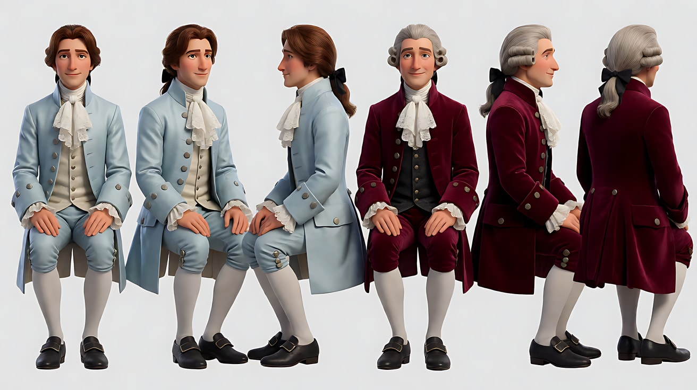

图2 首帧：

```
Using the characters from image 1: an extreme close-up of the young man's hand in a lace cuff
moving a carved ivory chess piece across a board, three candles in a silver candelabra glowing at frame top.
Camera slightly above the table, long telephoto framing, very shallow depth of field, the background pure darkness.
Lighting: candlelight only, warm amber, soft flicker on the skin and lace.
Stylized semi-realistic 3D CG rendering, feature-film animation quality. Aspect ratio 16:9.
```

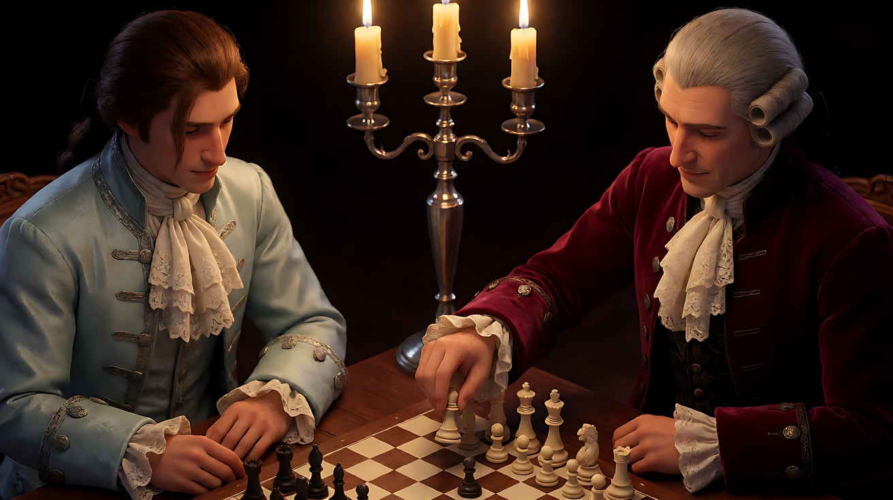

图3 尾帧：

```
Using the characters from image 1: a perfectly symmetrical wide shot of a tall candlelit hall,
a long table at the center with a chessboard, the young man seated on the left and the older man on the right,
both small in the frame, two silver candelabras on the table and rows of candles on wall sconces as the only light,
dark painted portraits on the walls, the composition resembling a classical oil painting.
Camera at seated eye level on the central axis, deep focus. Keep the faces and outfits exactly as in image 1.
Stylized semi-realistic 3D CG rendering, feature-film animation quality. Aspect ratio 16:9.
```

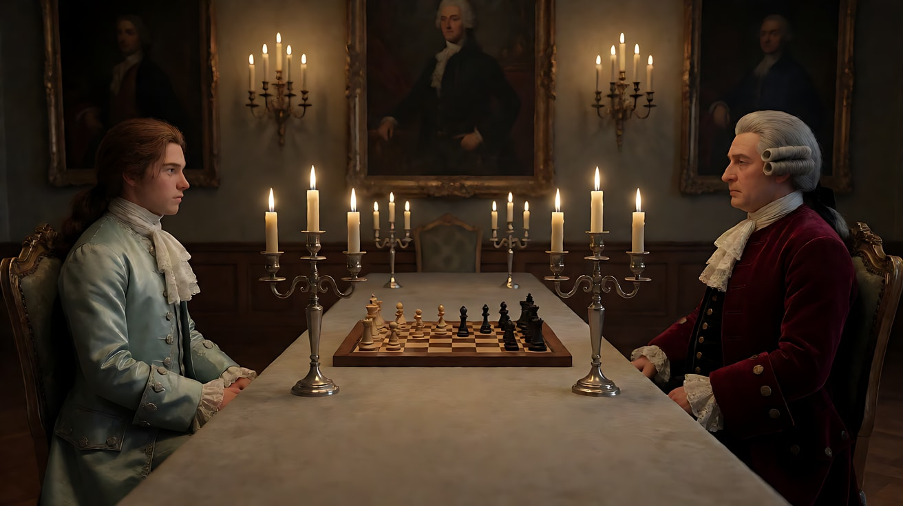

**【首尾帧生视频 · Seedance】**

```
【素材分工】@图片2 为首帧；@图片3 为尾帧，是最终画面目标；@图片1 锁定两位人物的身份与服装。只生成两帧之间的连续变化。
【画风】风格化写实三维CG质感，只有烛光，琥珀暖色，暗部深沉。
年轻人的手把棋子推到新的格子上，松开手指，收回手。镜头以极慢、匀速的变焦向外拉开，先露出棋盘与烛台，再露出两人的上半身，最终成为对称的大厅全景，两人坐在长桌两端一动不动。年长者只做一个小动作：慢慢把手放回扶手上。所有烛火持续轻微颤动，脸上的光随之明暗起伏。
【声音】古典羽管键琴的慢板独奏，棋子落在木质棋盘上的一声轻响，烛芯的细微噼啪声。
【约束】保持两人脸型、发型、服装不变；画面中不出现电灯或任何现代光源；中间不跳切；不要字幕、水印、Logo。
时长：10秒
```

**参数**：时长 10 秒 ｜ 画幅 16:9

**【检查点】**
- 拉开是否匀速、慢，最终形成对称"油画"
- 唯一光源是否是烛火，脸上有颤动的暖光
- 两人在拉开过程中是否几乎静止

**【常见问题与修复】**
| 现象 | 修复 |
|---|---|
| 出现顶光或补光 | 写"画面中所有光都来自可见的蜡烛，没有其他光源" |
| 拉开太快 | 时长加到 12 秒，并写"极慢、匀速" |
| 手部变形 | 首帧改为棋子已落定、手指刚松开 |

---

### 练习4：中轴后退跟拍 + 冷静凝视（难度 ★★★★，多镜头）

**目标**：三个镜头从"空间"收紧到"眼睛"：对称全景 → 沿中轴后退跟拍 → 广角近景的低头上目凝视。

**【生图 · Nano Banana】**

图1 角色定妆：

```
Character turnaround sheet of an original man in his forties: short grey hair, a pale face, a dark-green cardigan over a white shirt,
brown trousers, black leather shoes, a ring of keys clipped to his belt.
Front view, three-quarter view, side view and back view, full body, plain light-grey background, even soft studio light.
Stylized semi-realistic 3D CG rendering, feature-film animation quality. Aspect ratio 16:9.
```

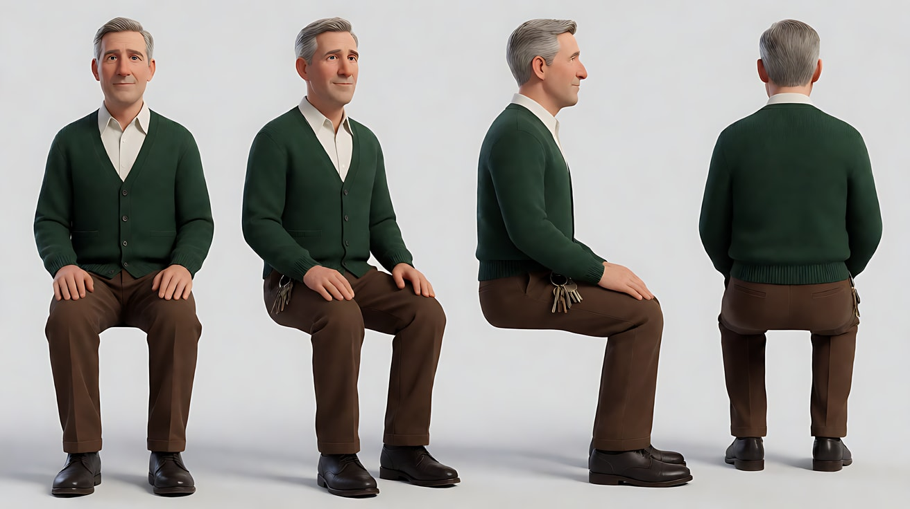

图2 场景：

```
Empty underground records hall, a very long aisle between towering grey metal shelves, perfectly symmetrical,
a continuous strip of cool white ceiling light panels down the center, a polished concrete floor, no people.
One-point perspective, eye level, 18mm lens, deep focus.
Stylized semi-realistic 3D CG rendering, feature-film animation quality. Aspect ratio 16:9.
```

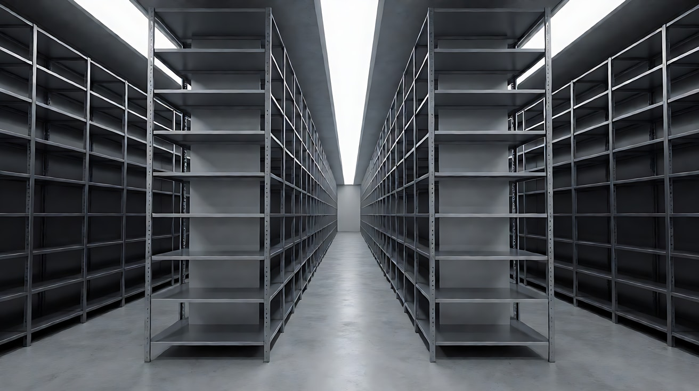

图3 镜头3关键帧：

```
Using the character from image 1 and the aisle from image 2: a wide-angle close-up of the man on the central axis,
his head tilted slightly down, his eyes looking up directly into the lens so the whites show beneath the irises,
mouth closed and still. The aisle recedes symmetrically behind his head to the vanishing point.
Camera very close at chest height, 18mm lens, deep focus, slight wide-angle stretching of the face.
Lighting: cool white overhead panel light, shadows under the brow.
Keep the face, hairstyle and outfit exactly as in image 1.
Stylized semi-realistic 3D CG rendering, feature-film animation quality. Aspect ratio 16:9.
```

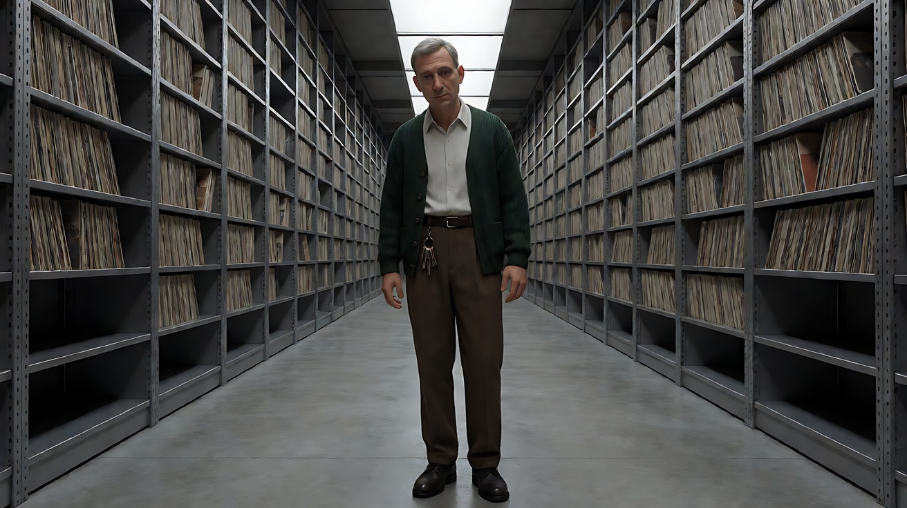

**【多图生视频 · Seedance】**

```
【素材分工】@图片1 锁定人物身份与服装；@图片2 仅参考通道结构与灯带；@图片3 仅作为镜头3的构图与表情参考，不作为首帧。
【画风】风格化写实三维CG质感，冷白画内光源，严格对称。
镜头1：固定的一点透视大全景，男人站在通道尽头的中轴线上，很小，一动不动。天花板灯带一直延伸到他身后。灯带电流的嗡声。
镜头2：镜头切至中景，男人沿中轴走向镜头，镜头以与他相同的速度沿中轴平稳后退，他在画面中的大小保持不变，两侧书架匀速向后流动，画面始终左右对称。腰间钥匙串随步伐轻响。
镜头3：镜头切至广角近景，他停下，头部微微下压，眼睛向上直视镜头，眼白露在瞳孔下方，嘴角不动，不眨眼。身后通道对称地汇向他头部后方的消失点。停在这个凝视上。钥匙声停止，只剩电流声。
【锁定】光线：只有天花板中央冷白灯带；人物始终在中轴线上，正对镜头；画面始终左右对称。
【声音】无配乐，脚步、钥匙、电流嗡声，镜头3进入完全的安静，只有一声低沉的持续电子音。
【约束】保持人物脸型、发型、服装不变；表情只在镜头3出现，且不夸张；不要字幕、水印、Logo。
时长：12秒
```

**参数**：时长 12 秒 ｜ 画幅 16:9 ｜ 负载：3 个镜头，属于"稳妥"档

**【检查点】**
- 三个镜头是否都保持对称
- 镜头2是否是"后退跟拍"，人物大小恒定
- 镜头3的凝视是否是"头低、眼上、嘴不动"

**【常见问题与修复】**
| 现象 | 修复 |
|---|---|
| 凝视变成狰狞表情 | 写"面部肌肉放松，只有眼神向上，嘴角不动" |
| 镜头2人物越来越大 | 写"镜头后退速度与他前进速度一致" |
| 镜头3背景变浅焦 | 写"18mm 广角，深焦，背景通道清楚" |

---

### 练习5：原创三镜头场景——熄灯的档案库（难度 ★★★★★）

**目标**：用本课全部技法拍一个原创场景。意图：让观众感到这座档案库在"审视"她，而她终于发现了。镜头1一点透视建立空间，镜头2稳定器低机位中轴跟拍，镜头3冷静凝视 + 灯带从远处依次熄灭（画内光源的变化就是剧情转折）。

**【生图 · Nano Banana】**

图1 角色定妆：

```
Character turnaround sheet of an original woman in her late twenties: a neat high bun of black hair, thin black-framed glasses,
a light-grey knee-length lab coat over a navy turtleneck, black trousers, flat black shoes, a lanyard with a white badge.
Front view, three-quarter view, side view and back view, full body, plain light-grey background, even soft studio light.
Stylized semi-realistic 3D CG rendering, feature-film animation quality. Aspect ratio 16:9.
```

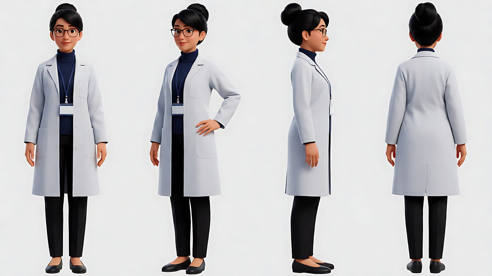

图2 场景：沿用练习4的图2（档案库通道）。

图3 镜头1关键帧：

```
Using the character from image 1 and the aisle from image 2: a perfectly symmetrical one-point perspective extreme wide shot,
the woman standing small at the near end of the aisle with a metal file cart, her back to camera, facing the far vanishing point,
the strip of ceiling lights receding ahead of her. Camera at eye level on the central axis, 18mm lens, deep focus.
Lighting: cool white ceiling panels only. Keep the face, hairstyle and outfit exactly as in image 1.
Stylized semi-realistic 3D CG rendering, feature-film animation quality. Aspect ratio 16:9.
```

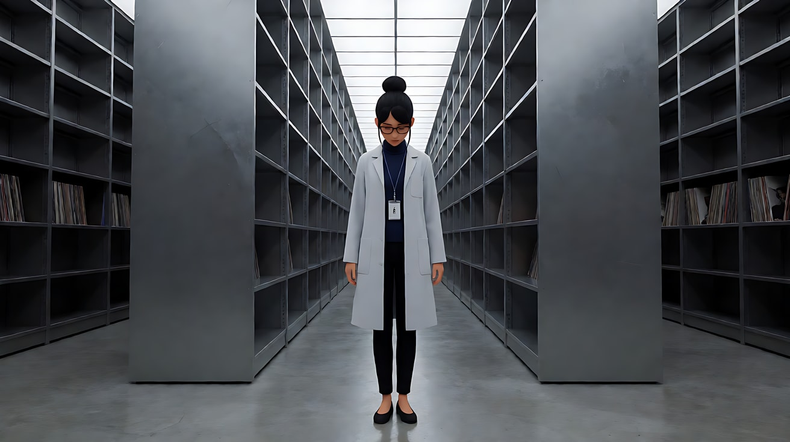

图4 镜头3关键帧：

```
Using the character from image 1: a symmetrical wide-angle medium close-up of the woman on the central axis, turned toward camera,
her head slightly lowered, eyes looking up into the lens over her glasses, the aisle behind her now dark
except for the last few ceiling panels near her. Camera at chest height, 18mm lens, deep focus.
Keep the face, hairstyle and outfit exactly as in image 1.
Stylized semi-realistic 3D CG rendering, feature-film animation quality. Aspect ratio 16:9.
```

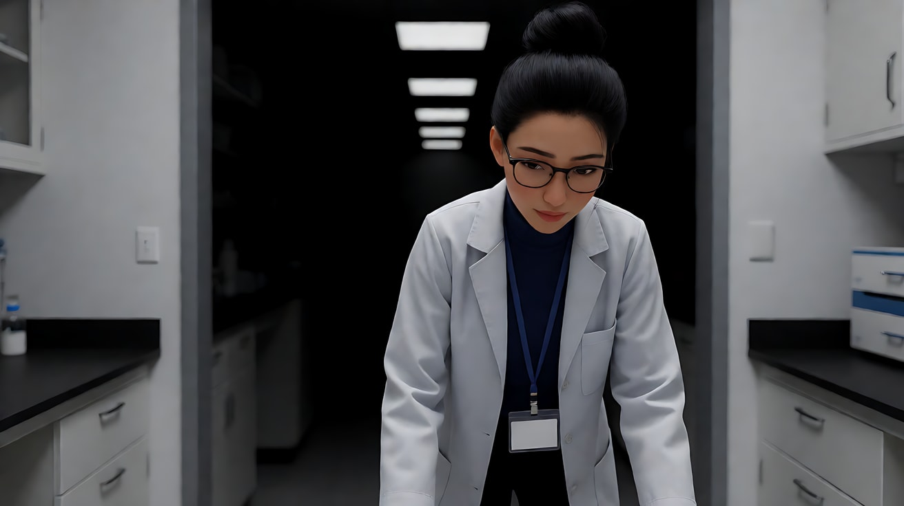

**【多图生视频 · Seedance】**

```
【素材分工】@图片1 锁定女人身份、服装与眼镜；@图片2 仅参考通道结构与灯带；@图片3 为镜头1首帧；@图片4 仅作为镜头3的构图、光线与表情参考，不作为首帧。
【画风】风格化写实三维CG质感，冷白画内光源，严格中心对称。
镜头1：固定的一点透视大全景，女人背对镜头站在通道近端，手扶金属档案车，面朝远处的消失点。天花板灯带一节节延伸向前。她推起档案车开始向前走。灯带的电流嗡声在空旷空间里回响。
镜头2：镜头切至稳定器低机位，高度在档案车把手附近，紧跟在她身后两米，沿中轴以恒定速度向前推进，两侧书架匀速向后流动，画面始终对称、无晃动。车轮压过地面接缝时发出规律的咔哒声。
镜头3：镜头切至对称的广角中近景，她停下转身面对镜头，头部微微下压，眼睛越过镜框向上直视镜头，嘴角不动。在她身后，天花板灯带从通道最远端开始一节一节熄灭，黑暗沿中轴向她逼近，最终停在只剩她头顶几节灯还亮着的画面。
【锁定】光线：唯一光源是天花板中央的冷白灯带，镜头3中从远端依次熄灭；女人始终穿浅灰实验服、戴黑框眼镜；人物始终在中轴线上；画面始终左右对称。
【声音】无配乐；轮子咔哒声贯穿前两镜；镜头3每熄灭一节灯，就有一声沉闷的继电器"咔"声，由远及近。
【约束】保持女人脸型、发型、服装与眼镜不变；画面中不出现其他人；不要字幕、水印、Logo。
时长：13秒
```

**参数**：时长 13 秒 ｜ 画幅 16:9 ｜ 负载：3 个镜头、1 个转身、1 个连续光变化，属于"有挑战"档

**【检查点】**
- 三个镜头是否都对称、消失点都在中央
- 镜头2是否保持稳定器的平稳与恒速
- 灯带熄灭是否由远及近，成为画内可见的光变化
- 通读提示词，没有任何人名、片名、品牌名

**【常见问题与修复】**
| 现象 | 修复 |
|---|---|
| 灯一下子全灭 | 写"一节一节依次熄灭，每节之间有短暂停顿" |
| 镜头3背景也是亮的 | 尾段写清"她身后只剩最近的几节灯亮着" |
| 档案车在镜头3消失 | 在【锁定】里加"档案车停在她身边画左" |
| 镜头2晃动 | 写"稳定器跟随，画面如滑轨般平稳" |
