# L07-03 深焦与低角度 · 提示词

> 本组练习：用低角度带天花板的仰拍、深焦三层调度、单向硬光的明暗对照、仰俯对立的权力镜头，拍原创人物之间的权力关系。提示词只写技术，不写任何人名与片名。｜ 配套教学：[L07-03 教学文件](../教学/L07-03-奥逊威尔斯.md) ｜ 规范：[写作规范](../../模板/写作规范.md)
>
> 画风默认使用开关 A（风格化写实 CG）。本组多处使用黑白画面，强化明暗对照；如改用 2D 动画，删掉所有焦段、光圈、景深词。

**本组技法开关（不含人名，可直接复用）**

```
深焦三层：前景物件、中景人物、后景人物全部清楚，三层各有一件事在发生。
低角度带天花板：摄影机几乎贴地向上仰，人物头顶的天花板或横梁在画内。
明暗对照：单向硬光，画面大面积纯黑，人物一半在光里一半在黑里。
仰俯对立：强者用低角度仰拍，弱者用高角度俯拍。
```

---

### 练习1：低角度带天花板——船厂老板（难度 ★）

**目标**：用单张关键帧体会"被抬高又被罩住"：仰拍让他高大，天花板横梁压在头顶。

**【生图 · Nano Banana】**

图1 关键帧：

```
A dramatic low-angle full shot of an original heavy-set man in his fifties with slicked-back dark hair and a thick moustache,
wearing a double-breasted dark suit with a pocket watch chain, standing with his hands on his hips
in a low-ceilinged shipyard office. Camera almost at floor level, tilted steeply upward, 24mm lens, deep focus,
the dark wooden ceiling beams clearly visible directly above his head, filling the top of the frame.
Lighting: a single hard lamp on the desk below him lighting his face from beneath and the side,
the corners of the room falling into pure black. Black-and-white image with deep blacks and bright highlights.
Stylized semi-realistic 3D CG rendering, feature-film animation quality. Aspect ratio 16:9.
```

中文释义：低角度全身仰拍，摄影机几乎贴地；24mm 深焦，头顶木横梁占满画面上部；书桌台灯从下侧方打硬光，四角纯黑；黑白画面。

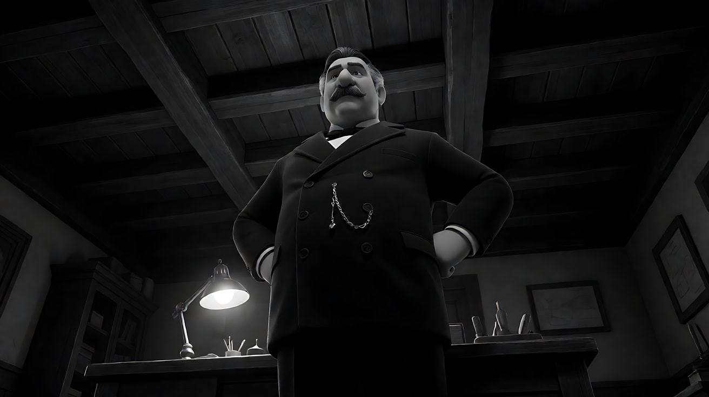

**【图生视频 · Seedance】**

```
【素材分工】@图片1 为首帧，锁定人物身份、服装与办公室的天花板结构。
【画风】风格化写实三维CG质感，黑白画面，强烈明暗对照。
男人从双手叉腰的姿势慢慢放下手，向前迈出一步，俯身用双手撑住画面下方的桌沿，低头俯视镜头。镜头固定在低处仰拍，不移动，天花板横梁始终在他头顶。台灯从下方照亮他的下巴和眉骨，眼窝里留着阴影。结尾停在他撑着桌子俯视镜头的画面。
【声音】无配乐，窗外远处船厂的金属撞击声，木地板被踩压的吱呀声，他沉重的一次呼气。
【约束】保持人物脸型、发型、服装不变；机位不动，不切镜头；不要字幕、水印、Logo。
时长：6秒
```

**参数**：时长 6 秒 ｜ 画幅 16:9

**【检查点】**
- 天花板横梁是否始终在画内
- 他前倾后是否显得更加压迫
- 暗部是否是真正的纯黑

**【常见问题与修复】**
| 现象 | 修复 |
|---|---|
| 看不到天花板 | 写"画面上方三分之一是天花板木横梁" |
| 变成彩色 | 【画风】写"黑白画面，没有任何颜色" |
| 面部全亮 | 写"眼窝和颈部保持阴影" |

---

### 练习2：深焦三层调度——离家的那个下午（难度 ★★）

**目标**：用定妆图 + 场景图，让三层同时清楚、各有一件事：前景外公修钟表、中景母亲打电话安排、后景少年在门口收拾行李。观众自己发现"他要走了"。

**【生图 · Nano Banana】**

图1 角色定妆：

```
Character turnaround sheet of three original characters of one family:
a grandfather in his seventies with white hair and a white beard, a brown leather apron over a striped shirt, magnifying spectacles on his forehead;
a mother in her forties with a short dark bob, a grey cardigan over a dark blue dress;
a teenage boy of sixteen with messy black hair, a white T-shirt under an unbuttoned denim jacket.
Front view, three-quarter view and side view of each, full body, plain light-grey background, even soft studio light.
Stylized semi-realistic 3D CG rendering, feature-film animation quality. Aspect ratio 16:9.
```

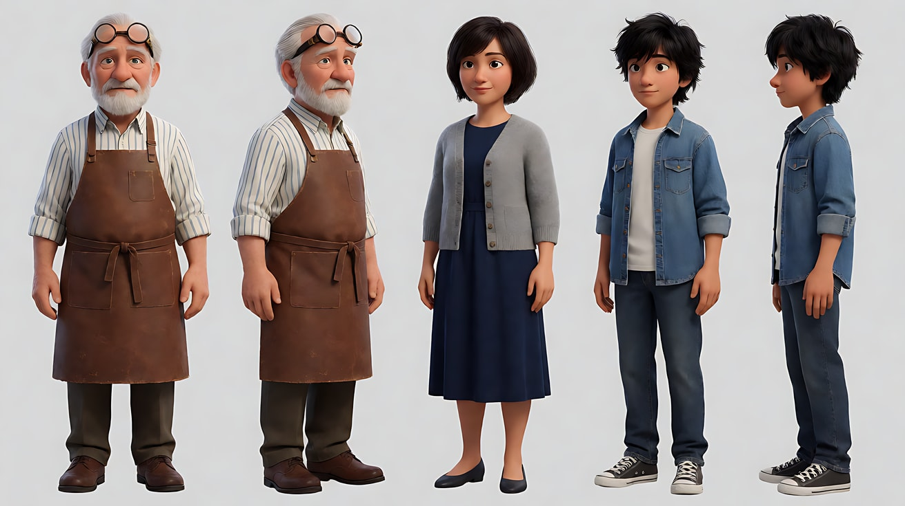

图2 场景：

```
Empty old clock-repair workshop in a family house, afternoon. A workbench with a disassembled antique clock in the immediate foreground,
the workshop room in the middle with a wall telephone, and through an open doorway at the back a narrow hallway with the front door,
a half-packed suitcase on the hallway floor. No people. Camera low behind the workbench, 24mm lens, deep focus f/11,
everything from the foreground clock to the far front door in sharp focus.
Lighting: hard afternoon sunlight through a window at frame right, long shadows.
Stylized semi-realistic 3D CG rendering, feature-film animation quality. Aspect ratio 16:9.
```

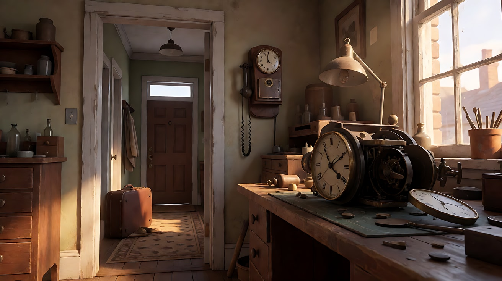

**【多图生视频 · Seedance】**

```
【素材分工】@图片1 锁定三位人物的身份与服装；@图片2 仅参考作坊的三层空间布局与光线方向，不复制其中的空镜状态。
【画风】风格化写实三维CG质感，黑白画面，深焦，强烈侧光。
前景：外公坐在工作台前，背对画面的大半张脸低着，用镊子把一个小齿轮放回钟里，动作很慢。中景：母亲站在墙上的电话前，一手捂着话筒，侧身朝后景看了一眼，又转回去低声说话。后景：门口走廊里，少年蹲着把一件叠好的毛衣塞进行李箱，然后合上箱盖，站起身。三层同时清楚。镜头固定不动。画右窗户的硬光斜切过整个房间。结尾停在少年拎起箱子站在门口、外公的手停在钟上的画面。
【声音】无配乐；前景钟表齿轮的细碎嘀嗒声最响，中景母亲模糊的低声通话，后景行李箱拉链的长长一声。
【约束】保持三人脸型、发型、服装不变；三层同时保持清晰；只有少年做完整动作，其他两人保持小动作；不切镜头；不要字幕、水印、Logo。
时长：10秒
```

**参数**：时长 10 秒 ｜ 画幅 16:9

**【检查点】**
- 前、中、后三层是否都清楚
- 三层的事件是否形成关系：修钟（时间）、安排（决定）、离开（结果）
- 少年是主动作，其他两人是否只有小动作

**【常见问题与修复】**
| 现象 | 修复 |
|---|---|
| 后景虚掉 | 写"深焦，f/11，后景走廊与人物完全清楚" |
| 三人同时大动作，画面混乱 | 写"外公只动手指，母亲只转头一次" |
| 少年走到前景 | 写"少年始终在后景门口，不走进作坊" |

---

### 练习3：明暗对照——走进光柱（难度 ★★★，首尾帧）

**目标**：首帧人物完全在黑暗中只剩剪影，尾帧他走进一束舞台追光，脸只亮一半。模型生成中间的"现身"。

**【生图 · Nano Banana】**

图1 角色定妆：

```
Character turnaround sheet of an original man in his thirties: a lean face with high cheekbones, short slicked-back black hair,
a long black overcoat with the collar turned up, a dark grey scarf, black leather gloves.
Front view, three-quarter view, side view and back view, full body, plain light-grey background, even soft studio light.
Stylized semi-realistic 3D CG rendering, feature-film animation quality. Aspect ratio 16:9.
```

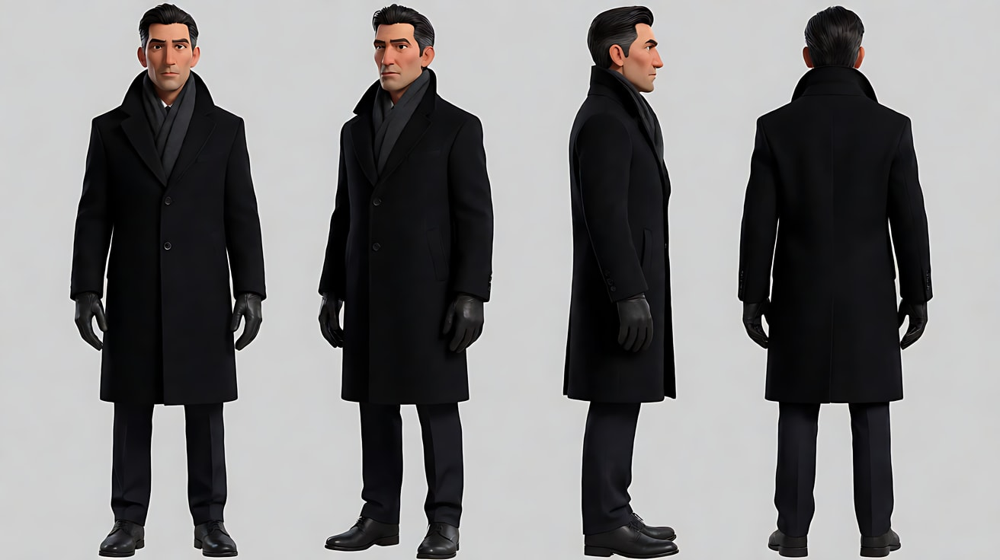

图2 首帧：

```
Using the character from image 1: a medium-wide shot backstage of an empty old theatre at night,
a single hard spotlight beam slanting down from high on frame left through drifting dust and haze,
landing in a bright oval on the wooden floor at center. The man stands just outside the beam on the right,
seen only as a black silhouette against the glowing haze. Camera at eye level, 35mm lens, deep focus.
Black-and-white image, pure black shadows. Keep the outfit exactly as in image 1.
Stylized semi-realistic 3D CG rendering, feature-film animation quality. Aspect ratio 16:9.
```

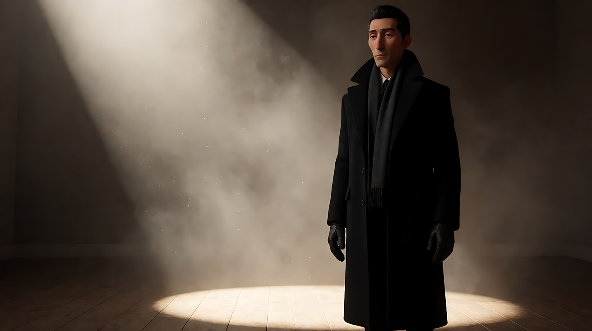

图3 尾帧：

```
Using the character from image 1 and the same backstage space and framing as image 2:
the man now stands inside the spotlight oval at center, the hard light hitting the left half of his face,
the right half of his face falling into pure black, his eyes looking toward the camera, collar turned up.
Black-and-white image. Keep the face, hairstyle and outfit exactly as in image 1.
Stylized semi-realistic 3D CG rendering, feature-film animation quality. Aspect ratio 16:9.
```

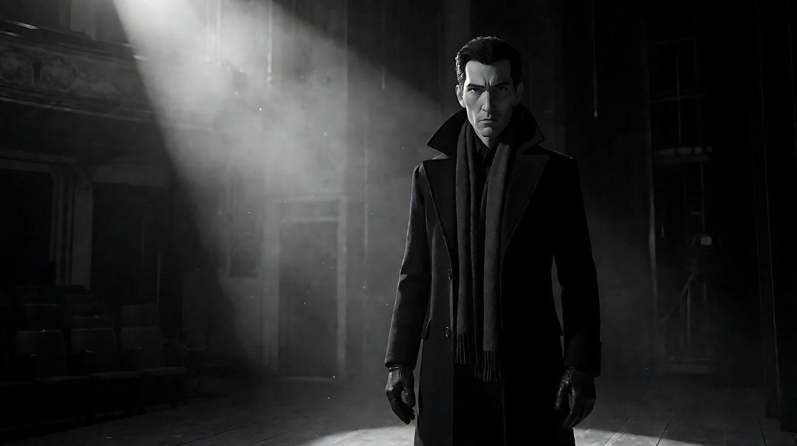

**【首尾帧生视频 · Seedance】**

```
【素材分工】@图片2 为首帧；@图片3 为尾帧，是最终画面目标；@图片1 锁定人物身份与服装。只生成两帧之间的连续动作。
【画风】风格化写实三维CG质感，黑白画面，单向硬光，大面积纯黑。
男人的剪影在光柱外停了一下，然后缓慢地向左迈两步，走进追光照出的光圈。光先照亮他的大衣下摆，再照亮肩膀，最后照亮他左半边脸，右半边脸留在纯黑里。他抬起眼睛看向镜头。镜头固定，不移动。光柱里的灰尘缓慢翻滚。
【声音】无配乐，空旷剧场的回声，皮鞋踩在木地板上的两声脚步，追光灯具的低沉风扇声。
【约束】保持人物脸型、发型、服装不变；光源只有左上方的一束追光；中间不跳切；不要字幕、水印、Logo。
时长：6秒
```

**参数**：时长 6 秒 ｜ 画幅 16:9

**【检查点】**
- 光是否"从下往上"依次照亮他，而不是整个人突然变亮
- 尾帧脸是否只亮一半
- 暗部是否保持纯黑

**【常见问题与修复】**
| 现象 | 修复 |
|---|---|
| 环境被补光照亮 | 写"光柱以外的一切都是纯黑" |
| 他走得太远出了光圈 | 写"走两步，停在光圈中央" |
| 脸两边都亮 | 写"光从画左上方来，右半边脸完全在阴影里" |

---

### 练习4：仰俯对立的权力三镜头（难度 ★★★★，多镜头）

**目标**：深焦全景交代两人的距离，然后用低角度仰拍强者、高角度俯拍弱者，让权力关系不用台词就清楚。

**【生图 · Nano Banana】**

图1 角色定妆：

```
Character turnaround sheet of two original characters:
a heavy-set man in his fifties with slicked-back dark hair and a thick moustache, a double-breasted dark suit, a pocket watch chain;
a thin young clerk in his twenties with neatly parted hair, round glasses, a too-large brown suit, holding a cloth cap.
Front view, three-quarter view and side view of each, full body, plain light-grey background, even soft studio light.
Stylized semi-realistic 3D CG rendering, feature-film animation quality. Aspect ratio 16:9.
```

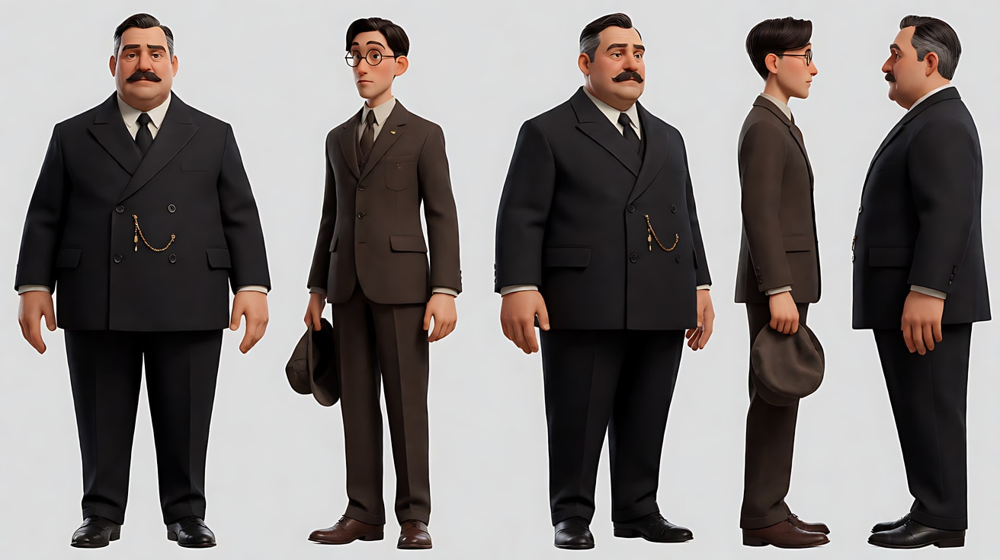

图2 场景：

```
Empty vast shipyard owner's office at dusk, a huge dark desk in the foreground, a long polished floor,
a tall door far in the background, a low ceiling with heavy wooden beams, a row of tall windows on the right
with hard orange-grey dusk light, no people. Deep focus wide shot from low behind the desk, 24mm lens.
Stylized semi-realistic 3D CG rendering, feature-film animation quality. Aspect ratio 16:9.
```

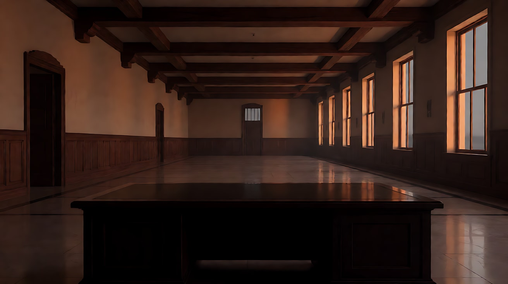

**【多图生视频 · Seedance】**

```
【素材分工】@图片1 锁定两位人物的身份与服装；@图片2 仅参考办公室布局、天花板横梁与窗户方向。
【画风】风格化写实三维CG质感，黑白画面，深焦，强烈侧光。
镜头1：深焦大全景，低机位放在书桌后方，前景是老板宽大的背影和肩膀，远处高门打开，年轻职员拿着帽子走进来，在长长的地板上走了几步后停住，在画面中很小。两人同时清楚。门轴吱呀声，他的脚步声在空旷房间里回响。
镜头2：镜头切至低角度仰拍，摄影机贴近地面，老板从椅子上站起来，身体占满画面，头顶的木横梁清楚可见。窗户硬光从画右照亮他半边脸。他把怀表合上，"咔"一声。
镜头3：镜头切至高角度俯拍，职员站在空旷地板中央，显得很小，他把手里的帽子攥紧在胸前，低下头。他的影子被窗光拉得很长。停在他低头不动的画面。
【锁定】光线：画右窗户的硬朗黄昏侧光，其余暗部纯黑；老板始终在书桌后，职员始终在门与桌之间的地板中央；机位始终在两人连线的同一侧。
【声音】无配乐；回声、怀表声、帽檐被攥紧的布料声，最后是长长的沉默。
【约束】保持两人脸型、发型、服装不变；两人不发生肢体接触；不要字幕、水印、Logo。
时长：12秒
```

**参数**：时长 12 秒 ｜ 画幅 16:9 ｜ 负载：3 个镜头，属于"稳妥"档

**【检查点】**
- 镜头1前景与后景是否同时清楚
- 镜头2是否看得到天花板横梁
- 镜头3俯拍是否让职员显得渺小
- 两人位置与方向在三镜之间是否一致

**【常见问题与修复】**
| 现象 | 修复 |
|---|---|
| 镜头1后景人物模糊 | 写"深焦，前景背影与远处职员同样清楚" |
| 镜头3变成平视 | 写"摄影机在他头顶上方很高处向下俯拍" |
| 职员走到桌前 | 写"职员始终站在地板中央，不再前进" |

---

### 练习5：原创三镜头场景——生日宴上的空位（难度 ★★★★★）

**目标**：用本课技法拍一个原创场景。意图：让观众感到这个掌控一切的人，在儿子到来的那一刻失去了掌控。镜头1深焦 + 低角度带天花板建立权力，镜头2低角度仰拍儿子（权力转移），镜头3高角度俯拍父亲独坐（失势）。

**【生图 · Nano Banana】**

图1 角色定妆：

```
Character turnaround sheet of two original characters:
a father in his sixties with silver slicked-back hair and a thick grey moustache, a black dinner jacket, a white bow tie, a heavy gold ring;
his son in his early thirties with short dark hair and a clean-shaven sharp jaw, a plain dark-grey overcoat over a black sweater.
Front view, three-quarter view and side view of each, full body, plain light-grey background, even soft studio light.
Stylized semi-realistic 3D CG rendering, feature-film animation quality. Aspect ratio 16:9.
```

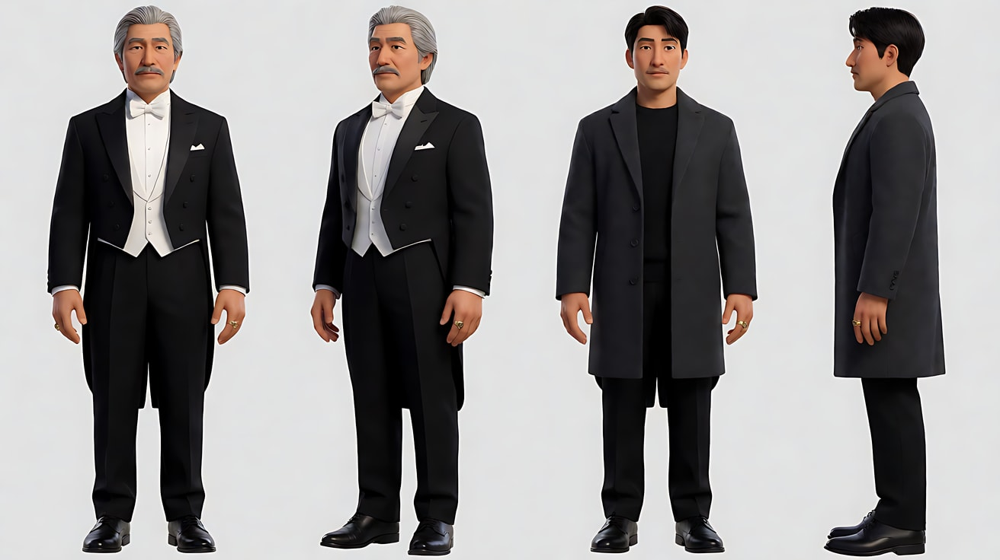

图2 场景：

```
Empty grand old dining hall at night, an extremely long banquet table set for twenty with untouched plates and candles,
a heavy carved chair at the head of the table in the foreground, a low coffered ceiling with dark beams,
a pair of tall doors far at the opposite end, a large fireplace on the left wall burning, no people.
Low-angle deep focus wide shot from behind the head chair, 24mm lens.
Stylized semi-realistic 3D CG rendering, feature-film animation quality. Aspect ratio 16:9.
```

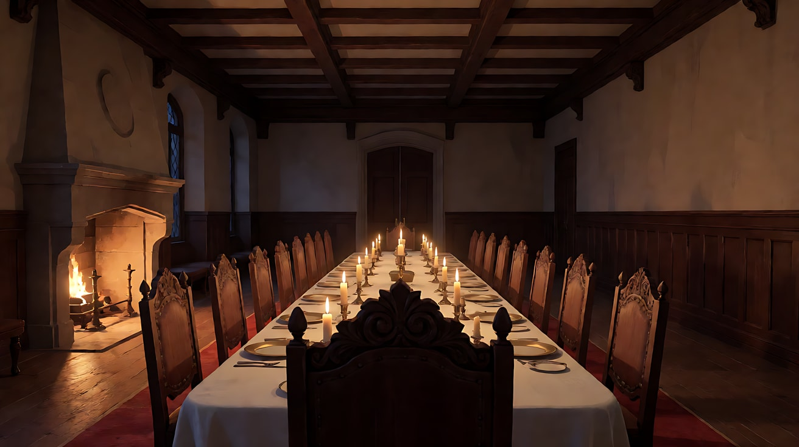

图3 镜头1关键帧：

```
Using the characters from image 1 and the hall from image 2: a low-angle deep-focus wide shot from just behind the father's shoulder,
the father seated in the carved chair in the foreground filling the left side of the frame,
the long empty table receding to the tall doors far away, where the son has just stepped in, small but sharply in focus.
The coffered ceiling beams are visible across the top of the frame. 24mm lens, deep focus f/11.
Lighting: firelight from the fireplace on the left as the hard key, candlelight on the table, deep black shadows.
Black-and-white image. Keep the faces, hairstyles and outfits exactly as in image 1.
Stylized semi-realistic 3D CG rendering, feature-film animation quality. Aspect ratio 16:9.
```

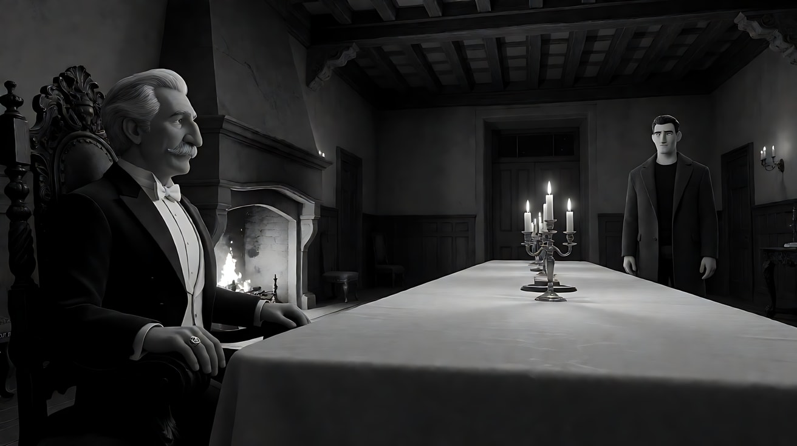

**【多图生视频 · Seedance】**

```
【素材分工】@图片1 锁定父子二人的身份与服装；@图片2 仅参考宴会厅布局、长桌与天花板横梁；@图片3 为镜头1首帧。
【画风】风格化写实三维CG质感，黑白画面，深焦，火光作为单向硬光。
镜头1：低角度深焦大全景，前景是父亲坐在雕花主位上的侧背影，长桌一直延伸到远处的高门，儿子刚刚走进门，站在门口，在画面中很小但清楚。天花板横梁横过画面上方。父亲用戒指轻敲酒杯，叮的一声，等儿子走过来。壁炉噼啪作响。
镜头2：镜头切至低角度仰拍，儿子已经走到长桌中段，停下，没有坐下，也没有脱大衣，站着俯视父亲的方向，头顶的天花板横梁在画内。壁炉火光从画左照亮他半边脸。他把一把钥匙放在桌上，转身离开画面。钥匙落在桌上的金属声。
镜头3：镜头切至极高的高角度俯拍，父亲独自坐在长长的宴会桌尽头，二十个空盘子和蜡烛排成两列，他在画面一角很小。他慢慢把面前的酒杯推远，双手放在桌面上不动。停在这个画面。远处高门关上的沉闷回声。
【锁定】光线：画左壁炉火光为唯一硬光源，桌上蜡烛为辅助，其余纯黑；父亲始终在主位，儿子在长桌中段到门之间；机位始终在长桌左侧。
【声音】无配乐；敲杯、壁炉、钥匙、关门四个声音构成全部节奏，最后是空旷大厅的寂静。
【约束】保持二人脸型、发型、服装不变；两人没有肢体接触；不要字幕、水印、Logo。
时长：13秒
```

**参数**：时长 13 秒 ｜ 画幅 16:9 ｜ 负载：3 个镜头，镜头2含放钥匙与转身离开，属于"有挑战"档

**【检查点】**
- 镜头1前景父亲与远处儿子是否同时清楚
- 镜头2仰拍中儿子是否"占据"了原本属于父亲的高度
- 镜头3俯拍是否让父亲在长桌尽头显得渺小
- 通读提示词，没有任何人名、片名

**【常见问题与修复】**
| 现象 | 修复 |
|---|---|
| 儿子在镜头2坐下 | 写"他站着，没有坐下，没有脱大衣" |
| 镜头3父亲太大 | 写"父亲只占画面一角，长桌与空盘占满画面" |
| 火光变成均匀照明 | 写"只有画左壁炉火光照亮，画右沉入黑暗" |
| 钥匙变成别的物件 | 写"一把普通的黄铜钥匙" |
