# L07-04 天气、长焦与动势 · 提示词

> 本组练习：用长焦压缩横移、具体的天气、动势构图、划像转场、多机位同轴切近，拍原创的风雨场景。提示词只写技术，不写任何人名与片名，不出现武器与暴力触发词。｜ 配套教学：[L07-04 教学文件](../教学/L07-04-黑泽明.md) ｜ 规范：[写作规范](../../模板/写作规范.md)
>
> 画风默认使用开关 A（风格化写实 CG）。本组部分练习使用黑白画面以突出天气质感；如改用 2D 动画，删掉所有焦段、光圈、景深词。

**本组技法开关（不含人名，可直接复用）**

```
长焦压缩：200–300mm，纵深被压扁，人群成墙，雨线密集。
天气即情绪：写清天气的方向、密度、打在什么上（斜雨打在泥地溅起水花、风把芦苇压向画右）。
动势构图：画面里永远有东西在动，且朝同一方向——草、旗、雨、人群。
横移跟拍：镜头与人物平行横移，背景向反方向流动。
多机位同轴切近：同一动作、同一轴线，镜头切至更近的景别。
划像：一道竖直边界从画左扫到画右，新画面推走旧画面。
```

---

### 练习1：长焦横移——风中的信使（难度 ★）

**目标**：用单张关键帧体会长焦横移：人物在原地拼命奔跑似的，背景像画卷一样流过，芦苇被风压向同一方向。

**【生图 · Nano Banana】**

图1 关键帧：

```
A telephoto side-on full shot of an original young man in his twenties running from frame left to frame right
across a vast field of tall silver reeds on a windy overcast afternoon. He wears a faded indigo short work jacket tied with a rope belt,
loose grey trousers wrapped at the shins, straw sandals, a cloth bundle tied across his back, a white headband.
Camera at waist height, perfectly parallel to his path, 300mm lens, compressed perspective,
the reeds in the foreground and background flattened into dense layers, strong wind bending every reed toward frame right.
Lighting: flat silver overcast light with a brighter patch of sky at upper right. Black-and-white image.
Stylized semi-realistic 3D CG rendering, feature-film animation quality. Aspect ratio 16:9.
```

中文释义：长焦侧面全身，人物从左向右奔跑；300mm 压缩，前后芦苇压成密层，风把芦苇全部压向画右；阴天银灰光；黑白画面。

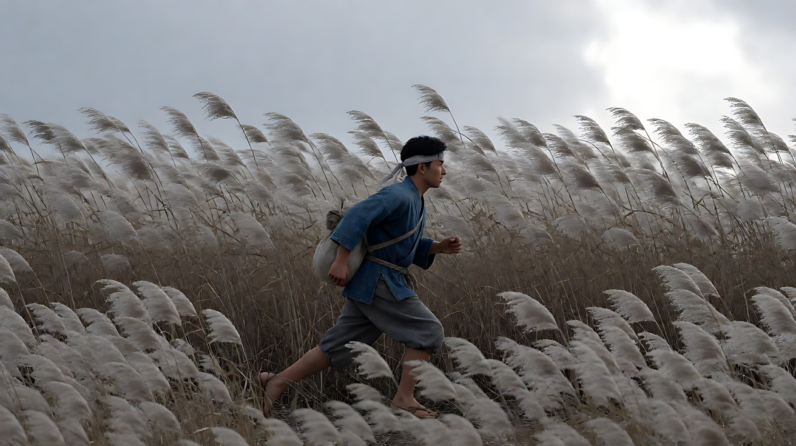

**【图生视频 · Seedance】**

```
【素材分工】@图片1 为首帧，锁定人物身份、服装与芦苇原野。
【画风】风格化写实三维CG质感，黑白画面，长焦压缩。
年轻人从画左向画右持续奔跑，双臂大幅摆动，背上的布包随步伐弹动，头带的布尾在身后飘。镜头以长焦与他平行横移，速度与他一致，他始终保持在画面中央，前景和背景的芦苇快速向画左流过。强风持续把芦苇压向画右，芦苇的波浪一阵一阵翻过画面。结尾停在他仍在奔跑、头带布尾被风扯直的画面。
【声音】无配乐，呼啸的风声，芦苇大片摩擦的沙沙声，他急促的呼吸与草鞋踏地声。
【约束】保持人物脸型、发型、服装不变；奔跑方向始终从左到右；不切镜头；不要字幕、水印、Logo。
时长：8秒
```

**参数**：时长 8 秒 ｜ 画幅 16:9

**【检查点】**
- 背景是否被压缩成扁平的密层
- 人物是否始终在画面中央、背景在流动
- 芦苇是否全部朝同一方向倒

**【常见问题与修复】**
| 现象 | 修复 |
|---|---|
| 背景不动，人物跑出画面 | 写"镜头与他同速横移，他始终在画面中央" |
| 风向混乱 | 写"所有芦苇、头带、衣角都被风吹向画右" |
| 透视太开阔 | 写"300mm 长焦，纵深被压扁" |

---

### 练习2：天气即情绪——暴雨中的渡口（难度 ★★）

**目标**：用定妆图 + 场景图，让雨成为主角：长焦下又大又斜的雨线，打在蓑衣、泥地、河面上。

**【生图 · Nano Banana】**

图1 角色定妆：

```
Character turnaround sheet of an original old ferryman in his sixties: a weathered lean face, a short grey beard,
a wide conical straw hat, a thick straw rain cape over a dark brown patched work robe, rolled trousers, bare legs, straw sandals,
holding a long wooden punting pole. Front view, three-quarter view, side view and back view, full body,
plain light-grey background, even soft studio light.
Stylized semi-realistic 3D CG rendering, feature-film animation quality. Aspect ratio 16:9.
```

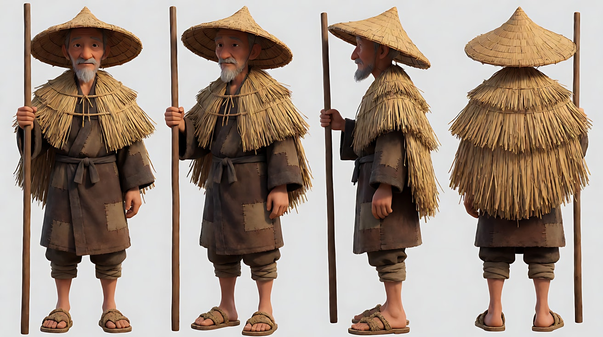

图2 场景：

```
Empty old river ferry crossing during a heavy rainstorm, a muddy riverbank with a wooden post and a rope,
a flat wooden ferry boat tied to the post, a wide brown swollen river behind, a bent willow tree on the left, no people.
Heavy diagonal rain falling from upper left to lower right in large visible streaks, mud splashing.
Telephoto wide shot, 200mm lens, compressed perspective. Black-and-white image, dark grey sky.
Stylized semi-realistic 3D CG rendering, feature-film animation quality. Aspect ratio 16:9.
```

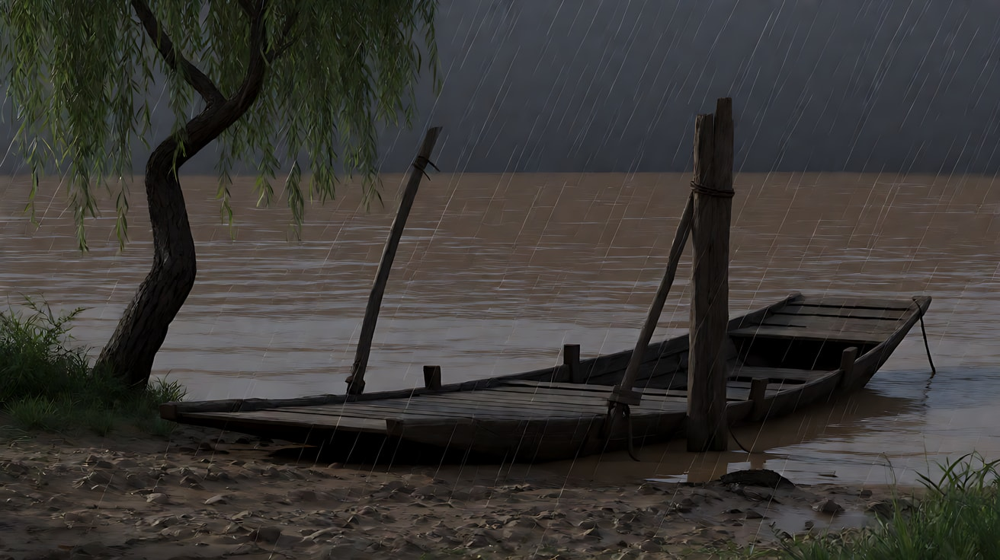

**【多图生视频 · Seedance】**

```
【素材分工】@图片1 锁定摆渡人的身份、服装与长篙；@图片2 仅参考渡口布局、雨的方向与河面，不复制其中的空镜状态。
【画风】风格化写实三维CG质感，黑白画面，长焦压缩，暴雨。
暴雨从画左上方斜着砸下来，雨线又粗又密，打在泥地上溅起水花，打在蓑衣上弹开。老摆渡人从画左走进画面，脚陷进泥里，他走到木桩前，双手抓住缆绳用力解开，把长篙插进泥里稳住身体，抬头望向对岸。柳枝被风雨压向画右。镜头以长焦固定中全景，不移动。结尾停在他扶着长篙、斗笠边缘不断滴水、望向对岸的侧影。
【声音】无配乐，密集的雨声砸在水面和斗笠上，河水湍急的轰响，缆绳摩擦木桩的吱嘎声，脚踩泥浆的吸力声。
【约束】保持人物脸型、发型、服装与长篙不变；雨的方向始终从左上到右下；不切镜头；不要字幕、水印、Logo。
时长：10秒
```

**参数**：时长 10 秒 ｜ 画幅 16:9

**【检查点】**
- 雨是否"看得见"：粗、密、斜
- 雨与人物、泥地是否有接触反馈（溅水、弹开、滴水）
- 解缆绳这个动作是否清楚

**【常见问题与修复】**
| 现象 | 修复 |
|---|---|
| 雨太细像雾 | 写"雨线粗而密，在长焦下清晰可见" |
| 手部与绳子缠绕变形 | 改为"他双手抓住缆绳，向后一拉，绳结松开"，减少细节 |
| 雨的方向前后不一 | 在【约束】写明方向 |

---

### 练习3：划像转场——从雾中村口到晴天山道（难度 ★★★，首尾帧）

**目标**：首帧是雾中的村口，尾帧是阳光下的山道。用一道竖直边界从左到右扫过，完成段落跳转。

**【生图 · Nano Banana】**

图1 角色定妆：沿用练习1中的年轻信使（另生成一张定妆图）：

```
Character turnaround sheet of an original young messenger in his twenties: a faded indigo short work jacket tied with a rope belt,
loose grey trousers wrapped at the shins, straw sandals, a cloth bundle tied across his back, a white headband.
Front view, three-quarter view, side view and back view, full body, plain light-grey background, even soft studio light.
Stylized semi-realistic 3D CG rendering, feature-film animation quality. Aspect ratio 16:9.
```

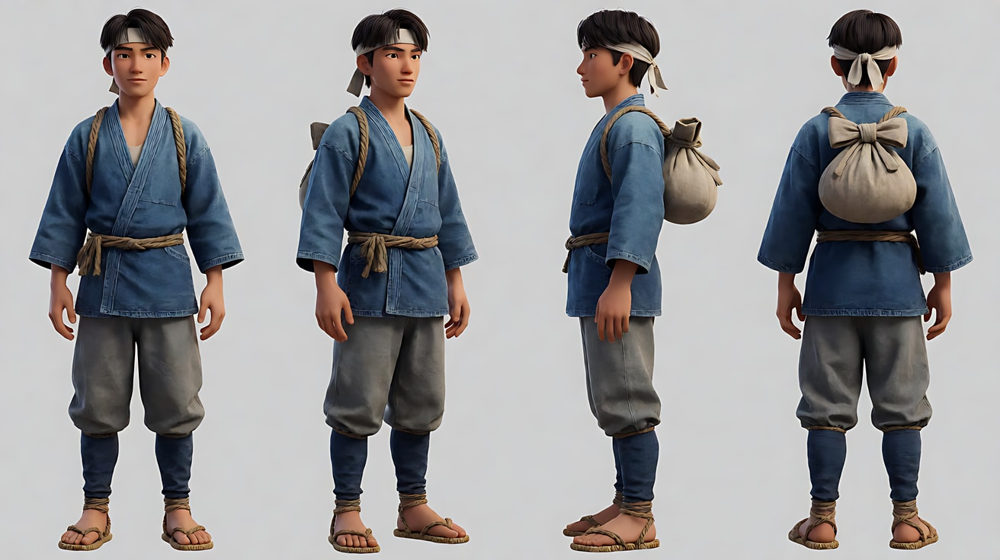

图2 首帧：

```
Using the character from image 1: a telephoto wide shot of a wooden village gate in thick morning fog,
the messenger walking away from camera through the gate, his figure half dissolved in the fog,
thatched roofs barely visible behind. 200mm lens, compressed perspective, soft diffused grey light.
Black-and-white image. Keep the outfit exactly as in image 1.
Stylized semi-realistic 3D CG rendering, feature-film animation quality. Aspect ratio 16:9.
```

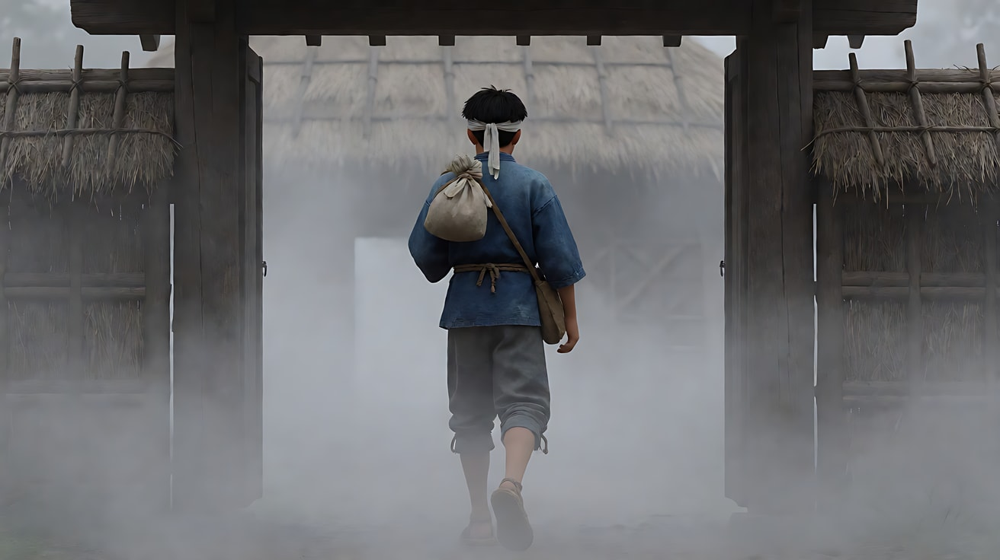

图3 尾帧：

```
Using the character from image 1: a telephoto wide shot of a steep mountain path in bright midday sun,
the messenger small in the frame climbing toward frame right, hard sunlight casting short sharp shadows,
pine branches in the foreground swaying in the wind toward frame right, white clouds moving.
200mm lens, compressed perspective. Black-and-white image, high contrast.
Keep the outfit exactly as in image 1.
Stylized semi-realistic 3D CG rendering, feature-film animation quality. Aspect ratio 16:9.
```

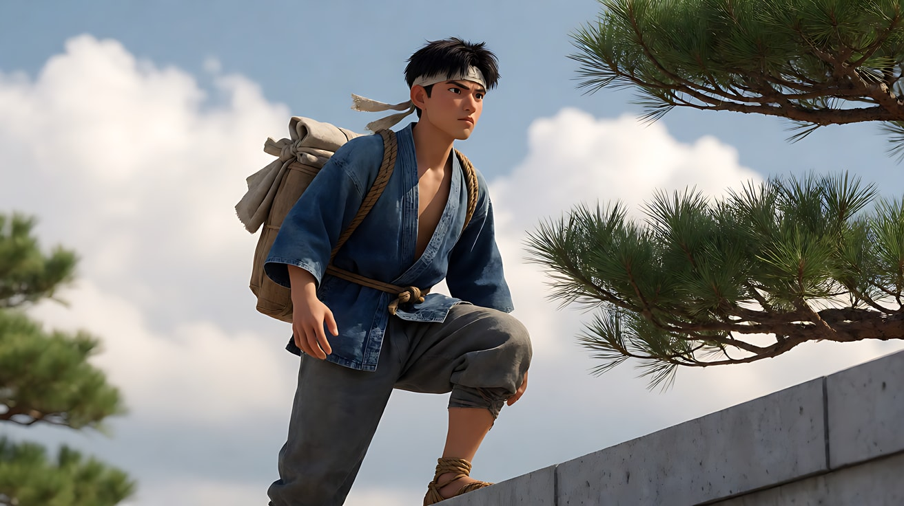

**【首尾帧生视频 · Seedance】**

```
【素材分工】@图片2 为首帧；@图片3 为尾帧，是最终画面目标；@图片1 锁定人物身份与服装。
【画风】风格化写实三维CG质感，黑白画面，长焦压缩。
首先是雾中村口的固定画面，信使背对镜头穿过木门，身影渐渐被雾吞没。然后一道干脆的竖直边界从画左匀速扫向画右，边界左边已经是阳光下的山道，边界右边仍是雾中村口，新画面把旧画面推出画右。划像完成后，阳光山道上，信使朝画右向上攀爬，前景松枝被风吹向画右。
【声音】雾中段只有远处一声鸡鸣和脚步声；划像经过时一声短促的鼓点；山道段是风吹松林声和清脆的鸟鸣。
【约束】保持人物服装不变；划像边界是一条干净的竖线，不是溶解或闪白；不要字幕、水印、Logo。
时长：8秒
```

**参数**：时长 8 秒 ｜ 画幅 16:9

**【检查点】**
- 转场是否是"一条竖线扫过"，而不是叠化
- 划像方向是否从左到右，与人物前进方向一致
- 两个画面的天气是否截然不同（雾 / 烈日）

**【常见问题与修复】**
| 现象 | 修复 |
|---|---|
| 变成了叠化 | 写"边界清晰锐利，两侧画面不重叠、不透明混合" |
| 划像太快看不清 | 写"边界匀速扫过，用时约一拍" |
| 划像失败 | 拆成两段分别生成，在剪辑软件里做划像 |

---

### 练习4：多机位同轴切近——风雨中击鼓（难度 ★★★★，多镜头）

**目标**：同一动作，从同一轴线由远到近切三次，模拟多机位同时拍摄后的剪辑冲击。

**【生图 · Nano Banana】**

图1 角色定妆：

```
Character turnaround sheet of an original village elder woman in her fifties: a strong broad face, grey hair tied tightly back
with a dark cloth, a dark indigo work kimono with sleeves tied back by a white cord, a straw rain cape, bare forearms,
holding two thick wooden drumsticks. Front view, three-quarter view, side view and back view, full body,
plain light-grey background, even soft studio light.
Stylized semi-realistic 3D CG rendering, feature-film animation quality. Aspect ratio 16:9.
```

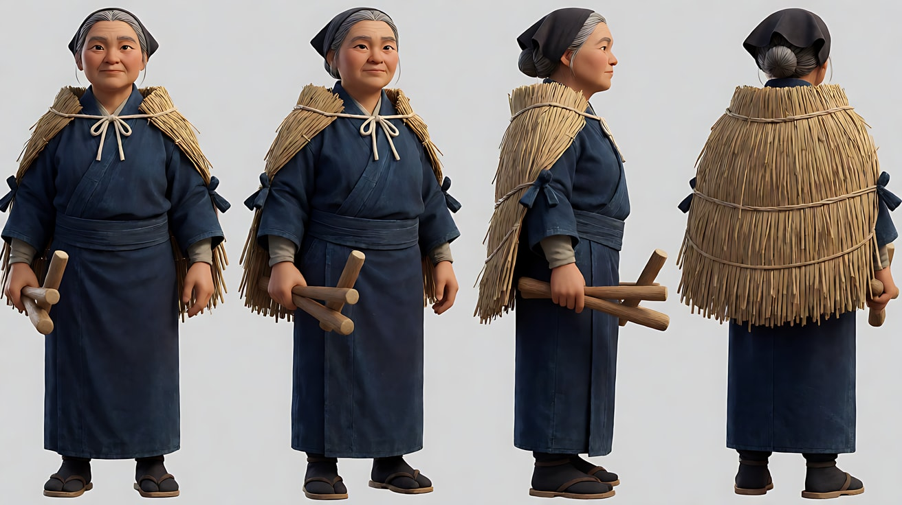

图2 场景：

```
Empty wooden watchtower platform at the edge of a village at dusk during a windstorm, a large barrel drum hanging in a wooden frame,
a long cloth banner on a pole snapping toward frame right, rain slanting from upper left, dark rice fields below, no people.
Telephoto wide shot, 300mm lens, compressed perspective. Black-and-white image.
Stylized semi-realistic 3D CG rendering, feature-film animation quality. Aspect ratio 16:9.
```

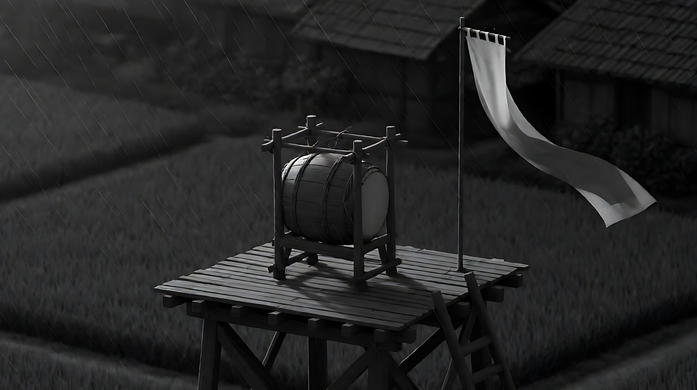

**【多图生视频 · Seedance】**

```
【素材分工】@图片1 锁定老妇人的身份、服装与鼓槌；@图片2 仅参考瞭望台、大鼓、旗帜与风雨方向。
【画风】风格化写实三维CG质感，黑白画面，长焦压缩，风雨。
镜头1：长焦大全景，瞭望台在画面中央，老妇人站在大鼓前，双臂高举鼓槌，旗帜被风扯向画右，斜雨打在台上。她第一次重重击下鼓面。低沉的鼓声在风雨里炸开。
镜头2：镜头切至同一轴线上的中景，她再次高举双臂，蓑衣被风掀起，雨水从鼓面上被震起，她第二次击下。鼓声更近、更响。
镜头3：镜头切至同一轴线上的近景，她的脸被雨打湿，眼睛盯着远方，双臂第三次举起，停在最高点，鼓槌在头顶，雨水顺着手臂流下。停在这个高举的瞬间。风声骤然变大。
【锁定】光线：黄昏阴暗天光，从画左来的斜雨；人物始终面朝画右远方；三个镜头机位在同一条轴线上，只改变景别；旗帜始终被吹向画右。
【声音】无配乐，风雨声持续，两记鼓声一记比一记近，第三镜在击下前停住，只剩风声。
【约束】保持人物脸型、发型、服装不变；三个镜头的机位角度相同，只是越来越近；不要字幕、水印、Logo。
时长：12秒
```

**参数**：时长 12 秒 ｜ 画幅 16:9 ｜ 负载：3 个镜头、同一动作重复，属于"稳妥"档

**【检查点】**
- 三个镜头是否在同一轴线上，只是景别越来越近
- 每一镜都有一个清楚的"举起—击下"动作
- 第三镜是否停在高举的瞬间，留下张力

**【常见问题与修复】**
| 现象 | 修复 |
|---|---|
| 三个镜头角度不同 | 写"机位角度不变，只是沿同一直线越来越靠近" |
| 鼓槌变形或多出一根 | 写"始终是两根粗木鼓槌，各握在一只手里" |
| 第三镜也击下了 | 写"停在双臂高举的最高点，不击下" |

---

### 练习5：原创三镜头场景——守堤之夜（难度 ★★★★★）

**目标**：用本课技法拍一个原创场景。意图：让观众感到一群人在风暴面前用身体筑墙。镜头1长焦横移的人群，镜头2动势构图（旗杆插进泥里，旗帜被风扯成一条斜线），镜头3长焦近景在雨中抬头。三镜之间用风雨的方向统一。

**【生图 · Nano Banana】**

图1 角色定妆：

```
Character turnaround sheet of an original village leader in his forties: a square jaw, short cropped black hair, a weathered sun-darkened face,
a dark short work jacket with rolled sleeves, a rope belt, mud-stained trousers, straw sandals, a white cloth tied around his forehead.
Front view, three-quarter view, side view and back view, full body, plain light-grey background, even soft studio light.
Stylized semi-realistic 3D CG rendering, feature-film animation quality. Aspect ratio 16:9.
```

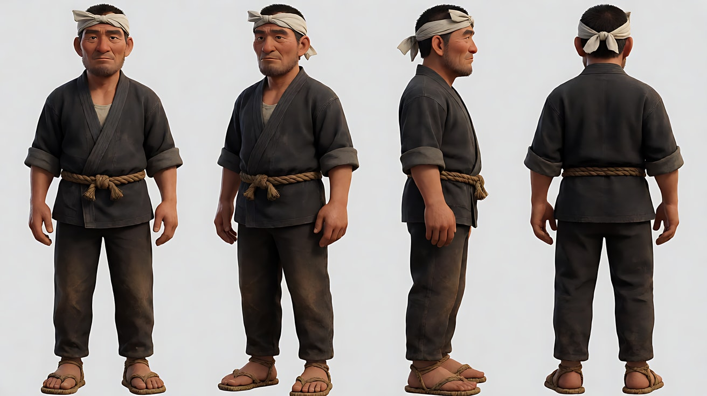

图2 场景：

```
Empty earthen river embankment at night during a typhoon, a long muddy dike stretching across the frame,
a swollen river roaring on the right side higher than the fields on the left, stacks of straw sandbags,
a few burning torches on poles leaning in the wind, heavy rain slanting from upper left, no people.
Telephoto wide shot, 300mm lens, compressed perspective. Black-and-white image, firelight flickering.
Stylized semi-realistic 3D CG rendering, feature-film animation quality. Aspect ratio 16:9.
```

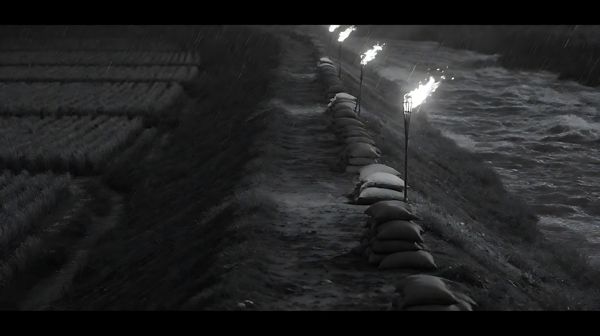

图3 镜头1关键帧：

```
Using the leader from image 1 and the embankment from image 2: a telephoto side-on wide shot of a long line of villagers
carrying straw sandbags on their shoulders along the dike from frame left to frame right, compressed into a dense wall of bodies,
the leader in the middle of the line. Heavy rain slanting across the frame, torches flickering behind.
300mm lens, compressed perspective. Black-and-white image. Keep the leader's face and outfit exactly as in image 1.
Stylized semi-realistic 3D CG rendering, feature-film animation quality. Aspect ratio 16:9.
```

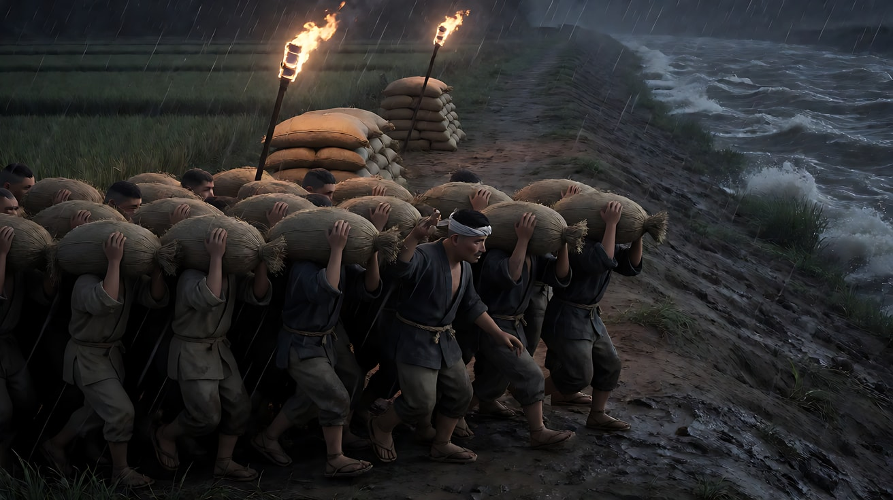

**【多图生视频 · Seedance】**

```
【素材分工】@图片1 锁定首领的身份与服装；@图片2 仅参考堤坝、河水、火把与风雨方向；@图片3 为镜头1首帧，人群只作为背景群像。
【画风】风格化写实三维CG质感，黑白画面，长焦压缩，台风暴雨，火把光。
镜头1：长焦横移，镜头与人群平行，一长列村民肩扛草袋沿堤坝从画左走向画右，被长焦压缩成一堵密集的人墙，首领走在队伍中间，背景火把在风里倾斜摇曳。斜雨横穿画面。人群沉重的脚步声和号子声混在风雨里。
镜头2：镜头切至低机位全景，首领走到堤坝最高处，双手把一根挂着白色长布的竹竿狠狠插进泥里，长布立刻被狂风扯成一条斜向画右的直线，猎猎作响。他身后河水翻涌。竹竿插入泥地的闷响与长布的抽打声。
镜头3：镜头切至长焦近景，首领站在竹竿旁，雨水从额头的白布上流过眼睛，他眯起眼睛，抬头望向画右涨起的河面，下颌绷紧。背景是被压扁成灰白一片的雨幕和火光。停在他望着河面的侧脸上。风声盖过一切。
【锁定】光线：夜间，火把的摇曳暖光（黑白画面中表现为闪动的高光），其余为暗灰；雨始终从左上斜向右下；河在画右，田在画左；首领始终穿深色短工衣、额头系白布。
【声音】无配乐；镜头1是脚步与号子，镜头2是竹竿入泥与长布抽打，镜头3只剩呼啸的风雨与河水轰鸣。
【约束】保持首领脸型、发型、服装不变；人群只作背景，不出现清楚的面孔；不要字幕、水印、Logo。
时长：13秒
```

**参数**：时长 13 秒 ｜ 画幅 16:9 ｜ 负载：3 个镜头、含群像与天气，属于"有挑战"档

**【检查点】**
- 镜头1人群是否被长焦压缩成一堵墙
- 镜头2长布是否形成一条强烈的斜线（动势构图）
- 三镜之间风雨方向、河的位置是否一致
- 通读提示词，没有任何人名、片名与暴力触发词

**【常见问题与修复】**
| 现象 | 修复 |
|---|---|
| 镜头1人群面孔崩坏 | 写"人群为长焦远景，面孔被雨和草袋遮挡" |
| 长布方向乱飘 | 写"被狂风扯成一条斜向画右的直线" |
| 河的位置在镜头间跳动 | 在【锁定】里写"河在画右，田在画左" |
| 火光把画面变成彩色 | 【画风】再写一次"黑白画面" |
