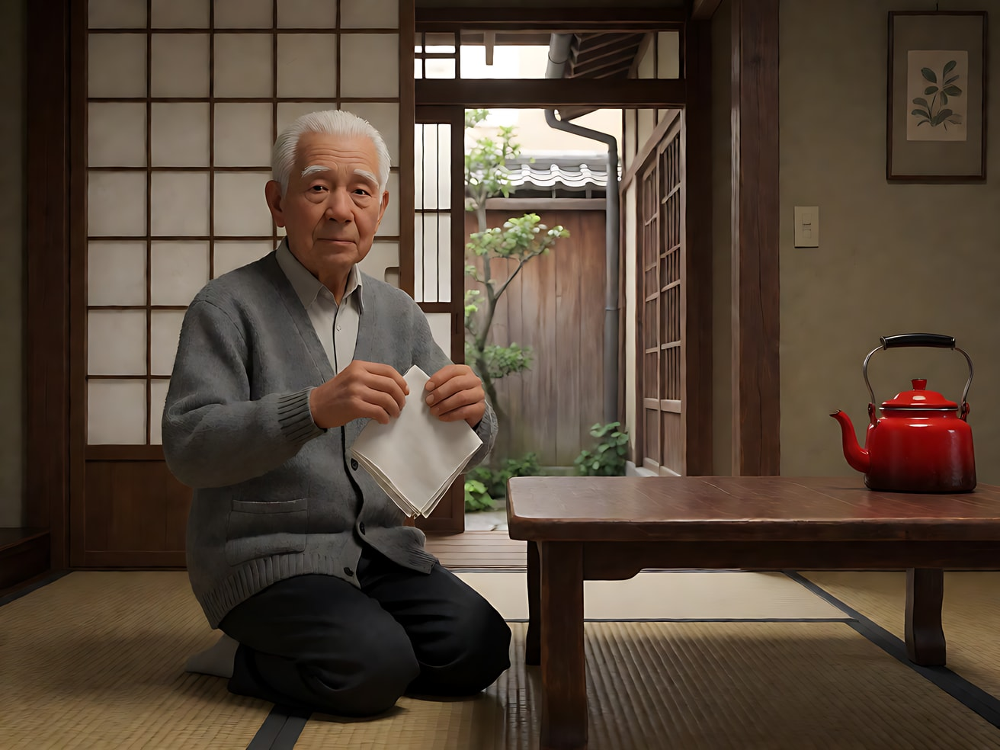
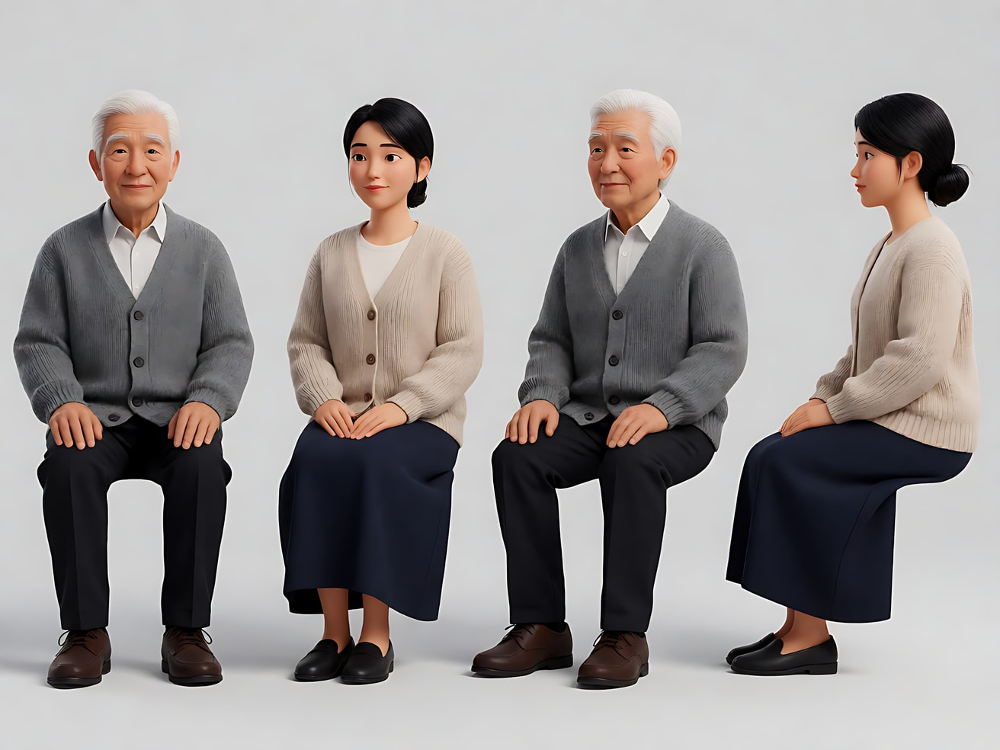
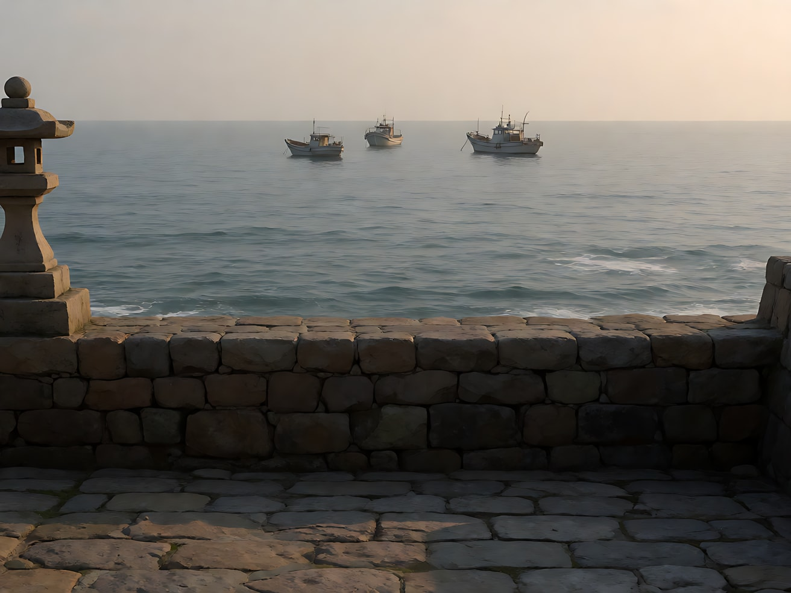
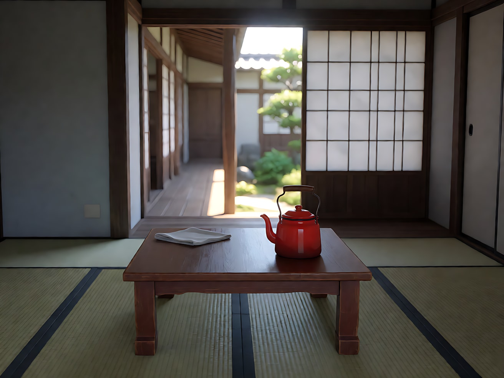
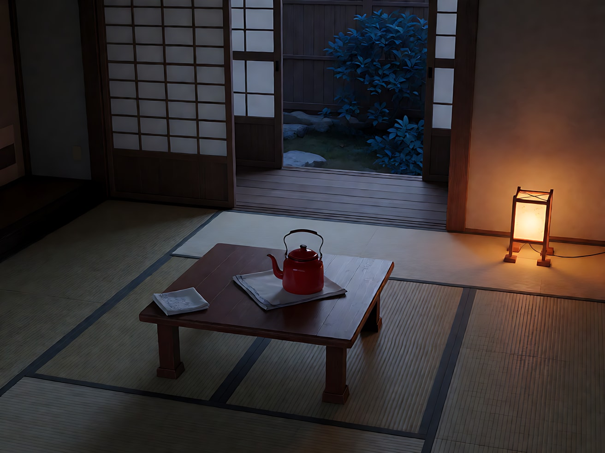
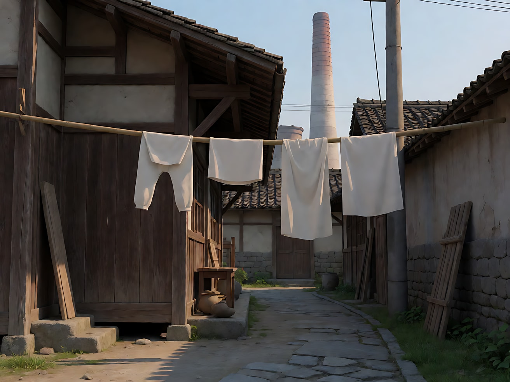
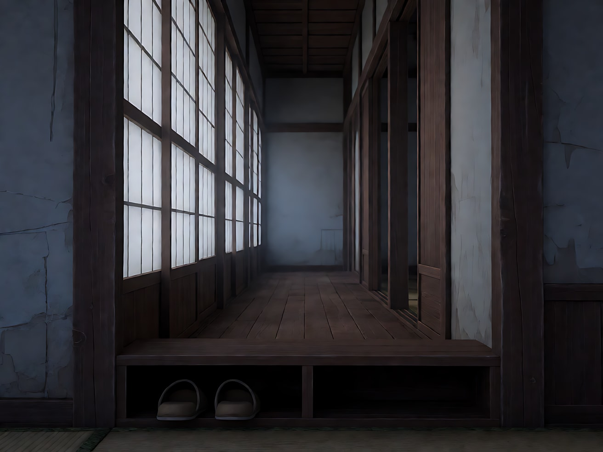
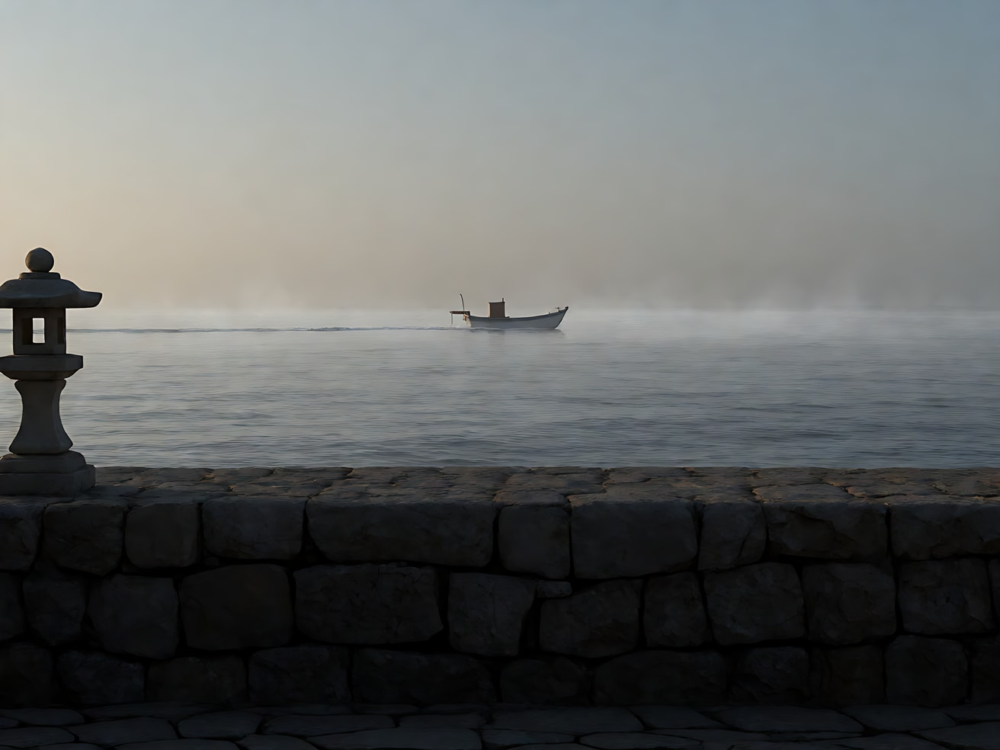

# L07-05 低机位与空镜 · 提示词

> 本组练习：用坐姿高度的水平低机位、固定镜头、正面几何构图、视线接近镜头的正反打、空镜节奏，拍一个原创家庭故事。提示词只写技术，不写任何人名与片名。｜ 配套教学：[L07-05 教学文件](../教学/L07-05-小津安二郎.md) ｜ 规范：[写作规范](../../模板/写作规范.md)
>
> 画风默认使用开关 A（风格化写实 CG）。纯空镜可改用开关 B（写实摄影）。如改用 2D 动画，删掉所有焦段、光圈、景深词。

**本组技法开关（不含人名，可直接复用）**

```
坐姿低机位：摄影机放在跪坐者的眼睛高度，镜头保持水平，不仰拍。
固定镜头：摄影机完全不动，不推、不拉、不摇、不移。
正面几何：正面构图，用拉门、门框、走廊形成层层方框；人物常并排面向同一方向。
视线接近镜头：对话时人物几乎正对镜头说话，视线落在镜头旁边一点。
空镜：无人的日常景物（晾衣竿、烟囱、走廊、招牌、经过的电车），作为段落间的呼吸。
色点：低饱和画面里放一件红色小物件。
```

**本组共用的原创人物与地点**

- 父亲：周老先生，六十八岁，退休的钟表匠，短白发，灰色开襟毛衣，深色长裤。
- 女儿：周晴，二十八岁，即将出嫁，黑发低髻，浅米色针织衫，深蓝长裙。
- 地点：海边小城的一栋老式和室木屋，拉门、走廊、榻榻米，矮桌上一只红色搪瓷水壶。

---

### 练习1：坐姿低机位 + 固定——父亲叠手帕（难度 ★）

**目标**：用单张关键帧体会"像坐在一旁的家人"那样看一个人：低、平、正、不动。

**【生图 · Nano Banana】**

图1 关键帧：

```
A static frontal medium-wide shot of an original elderly man in his late sixties with short white hair,
a grey button-up cardigan and dark trousers, kneeling on a tatami floor at a low wooden table, folding a white handkerchief.
He sits slightly left of center, facing the camera. Behind him, an open sliding paper door frames a narrow wooden corridor
and a small garden, forming nested rectangles. A red enamel kettle sits on the table at frame right.
Camera placed low at the eye height of a person kneeling on the floor, lens perfectly level, not tilted, 50mm lens,
natural perspective, moderate depth of field. Lighting: soft even afternoon daylight from the garden behind,
gentle fill from the room. Muted colors except the red kettle.
Stylized semi-realistic 3D CG rendering, feature-film animation quality. Aspect ratio 4:3.
```

中文释义：正面中全景，老人跪坐矮桌前叠手帕；身后拉门框出走廊与庭院，层层方框；坐姿高度、水平、50mm；柔和午后天光；低饱和，只有红水壶一个色点；4:3 画幅。



**【图生视频 · Seedance】**

```
【素材分工】@图片1 为首帧，锁定人物身份、服装与和室布局。
【画风】风格化写实三维CG质感，柔和均匀的午后天光，低饱和配色。
老人把手帕对折、再对折，用手掌轻轻压平，放在桌角，然后双手放回膝上，抬头看向庭院方向，停住。镜头固定不动，坐姿高度，水平正面。庭院里的树叶在微风中轻轻晃动。结尾停在他双手放在膝上、望着庭院的画面。
【声音】轻微的风铃声，远处一声电车经过的铃响，手帕布料的细微摩擦声，无配乐。
【约束】保持人物脸型、发型、服装不变；镜头完全不动，不切镜头；不要字幕、水印、Logo。
时长：8秒
```

**参数**：时长 8 秒 ｜ 画幅 4:3

**【检查点】**
- 机位是否是坐姿高度且水平，而不是仰拍
- 拉门、走廊、庭院是否形成层层方框
- 动作是否只是一个安静的日常动作

**【常见问题与修复】**
| 现象 | 修复 |
|---|---|
| 变成仰拍 | 写"镜头保持水平，不向上倾斜" |
| 镜头缓慢推近 | 写"镜头完全不动，不推不拉" |
| 颜色过于鲜艳 | 写"低饱和配色，只有红色水壶是鲜明的颜色" |

---

### 练习2：正面并排——父女看海（难度 ★★）

**目标**：用定妆图 + 场景图，让两人并排坐、同时面向镜头方向的大海，画面正面、固定，"一家人面对同一件事"。

**【生图 · Nano Banana】**

图1 角色定妆：

```
Character turnaround sheet of two original characters:
an elderly man in his late sixties with short white hair, a grey button-up cardigan, dark trousers;
his daughter in her late twenties with black hair in a low bun, a light beige knitted cardigan, a long navy skirt.
Front view, three-quarter view and side view of each, full body, plain light-grey background, even soft studio light.
Stylized semi-realistic 3D CG rendering, feature-film animation quality. Aspect ratio 4:3.
```



图2 场景：

```
Empty low stone seawall at the edge of a small harbor town in the late afternoon, a calm grey-blue sea,
a few small fishing boats far away, a stone lantern at frame left, no people.
Frontal composition from the sea side, camera low at seated eye height, lens level, 50mm lens.
Soft hazy late afternoon light. Muted colors.
Stylized semi-realistic 3D CG rendering, feature-film animation quality. Aspect ratio 4:3.
```



**【多图生视频 · Seedance】**

```
【素材分工】@图片1 锁定父女二人的身份与服装；@图片2 仅参考海堤、石灯笼与港口布局，不复制其中的空镜状态。
【画风】风格化写实三维CG质感，柔和朦胧的傍晚光，低饱和配色。
父女两人并排坐在石堤上，正面朝向镜头，也就是朝向大海。父亲在画左，女儿在画右，中间隔着一拳的距离。两人都看着海面，女儿把耳边一缕头发拢到耳后，父亲轻轻点了点头，像是认同一句没说出口的话。镜头固定不动，坐姿高度，水平正面。远处一条渔船缓缓驶过。结尾停在两人一起看海、一动不动的画面。
【声音】海浪轻拍石堤，远处一声汽笛，海鸥偶尔的叫声，无对白，无配乐。
【约束】保持两人脸型、发型、服装不变；两人不转头对视；镜头完全不动，不切镜头；不要字幕、水印、Logo。
时长：8秒
```

**参数**：时长 8 秒 ｜ 画幅 4:3

**【检查点】**
- 两人是否并排、面向同一方向
- 画面是否正面、对称而不僵硬
- 两人的小动作是否轻到几乎看不出

**【常见问题与修复】**
| 现象 | 修复 |
|---|---|
| 两人转头对话 | 写"两人始终看着海面，不对视、不说话" |
| 构图变成背影 | 写"摄影机在海的一侧，两人正面朝向镜头" |
| 渔船抢画面 | 写"渔船在远处很小，缓慢驶过" |

---

### 练习3：空镜里的时间——同一间屋从午后到黄昏（难度 ★★★，首尾帧）

**目标**：只用空镜，靠光的变化让时间流逝。首帧是午后的空和室，尾帧是黄昏亮起台灯的同一间屋。

**【生图 · Nano Banana】**

图1 首帧：

```
An empty traditional tatami room in the afternoon, frontal composition, a low wooden table at center with a red enamel kettle on it,
an open sliding paper door at the back framing a wooden corridor and a small garden, a folded white handkerchief on the table corner.
No people. Camera low at kneeling eye height, lens level, 50mm lens, moderate depth of field.
Soft bright afternoon daylight from the garden. Muted colors except the red kettle.
Stylized semi-realistic 3D CG rendering, feature-film animation quality. Aspect ratio 4:3.
```



图2 尾帧：

```
The exact same empty tatami room, same framing and objects as image 1, now at dusk:
the garden outside has turned deep blue, a small paper floor lamp in the corner is lit with warm orange light,
long soft shadows across the tatami, the red kettle catching the lamp light. No people.
Stylized semi-realistic 3D CG rendering, feature-film animation quality. Aspect ratio 4:3.
```



**【首尾帧生视频 · Seedance】**

```
【素材分工】@图片1 为首帧；@图片2 为尾帧，是最终画面目标。只生成两帧之间的连续光线变化，画面中不出现人物。
【画风】风格化写实三维CG质感，低饱和配色。
空无一人的和室。镜头固定不动。庭院的午后天光慢慢变暗、变蓝，屋里的影子慢慢拉长，矮桌上的红水壶从明亮变成暗红。房间角落的纸灯亮起，一圈温暖的橙光铺开在榻榻米上。庭院里树叶在微风中轻晃。
【声音】风铃轻响，远处电车铃声由近及远，傍晚的蝉鸣渐弱，最后一切安静，无配乐。
【约束】画面中不出现任何人；镜头完全不动；陈设位置不变；不要字幕、水印、Logo。
时长：8秒
```

**参数**：时长 8 秒 ｜ 画幅 4:3

**【检查点】**
- 画面是否完全没有人
- 光的变化是否连续、有来源（天光变暗、纸灯亮起）
- 陈设是否保持不动

**【常见问题与修复】**
| 现象 | 修复 |
|---|---|
| 出现人物走过 | 写"画面中始终没有任何人" |
| 纸灯凭空出现 | 首帧图1里就把纸灯放在角落，只是没亮 |
| 光变化太快像跳变 | 时长加到 10 秒，写"缓慢、连续" |

---

### 练习4：空镜 + 视线接近镜头的正反打（难度 ★★★★，多镜头）

**目标**：用"空镜 → 父亲正面说话 → 女儿正面回答"三镜，体会视线不匹配的正反打：两人都几乎正对镜头。

**【生图 · Nano Banana】**

图1 角色定妆：沿用练习2的图1。

图2 场景：沿用练习3的图1（午后和室）。

图3 镜头1空镜：

```
An empty narrow lane outside an old wooden house in the afternoon, white laundry hanging on a bamboo pole
across the frame, a factory chimney in the distance, frontal and static. No people.
Camera at low eye height, lens level, 50mm lens. Soft daylight. Muted colors.
Stylized semi-realistic 3D CG rendering, feature-film animation quality. Aspect ratio 4:3.
```



**【多图生视频 · Seedance】**

```
【素材分工】@图片1 锁定父女二人的身份与服装；@图片2 仅参考和室布局、矮桌与红水壶；@图片3 为镜头1首帧（空镜，无人）。
【画风】风格化写实三维CG质感，柔和午后天光，低饱和配色。
镜头1：固定空镜，晾衣竿上的白衣服在微风中轻轻摆动，远处的烟囱一动不动。远处一声电车铃。
镜头2：镜头切至坐姿高度的正面中景，父亲跪坐在矮桌前，几乎正对镜头，视线落在镜头旁边一点。他把茶杯放下，平静地说："那边的人，都还好吧。"镜头固定。
镜头3：镜头切至坐姿高度的正面中景，女儿跪坐在矮桌另一侧，也几乎正对镜头，视线落在镜头旁边一点。她微微一笑，点头说："嗯，都很好。"然后低下眼睛，手指摸着茶杯边缘。镜头固定。停在她低眼的画面。
【锁定】光线：画面后方庭院的柔和午后天光；父女都穿定妆中的服装；两人都几乎正对镜头，三镜都是固定、水平、坐姿高度。
【声音】无配乐；风铃、电车铃、茶杯放在木桌上的轻响；两句对白语气平静、缓慢。
【约束】保持两人脸型、发型、服装不变；三个镜头都不移动；不要字幕、水印、Logo。
时长：12秒
```

**参数**：时长 12 秒 ｜ 画幅 4:3 ｜ 负载：3 个镜头（含空镜半拍）、两句短对白，属于"稳妥"档

**【检查点】**
- 镜头2、3两人是否都几乎正对镜头
- 对白是否平静、简短，没有情绪化表演
- 空镜是否完全无人

**【常见问题与修复】**
| 现象 | 修复 |
|---|---|
| 两人侧脸对视 | 写"几乎正对镜头，视线落在镜头旁边一点" |
| 镜头3女儿流泪 | 写"微笑点头，低下眼睛，没有流泪" |
| 对白口型不对 | 把台词缩短到一句 6 字以内 |

---

### 练习5：原创三镜头场景——出嫁后的第一个早晨（难度 ★★★★★）

**目标**：用本课技法拍一个原创场景。意图：让观众感到"她已经不在这个家了"，而父亲什么也没说。镜头1空镜走廊（她的拖鞋不在了），镜头2坐姿低机位正面，父亲给自己倒一杯茶，镜头3空镜海面。情感高点不推近、不特写，交给空镜。

**【生图 · Nano Banana】**

图1 角色定妆：沿用练习2的图1（本片段只出现父亲）。

图2 场景：沿用练习3的图1（午后和室，换成清晨光线时在提示词中说明）。

图3 镜头1空镜：

```
An empty narrow wooden corridor inside an old house in the early morning, frontal composition looking down the corridor,
a row of sliding paper doors on the left, a low shoe shelf at the entrance with only one pair of men's slippers on it
and one empty space beside them. No people. Camera low at kneeling eye height, lens level, 50mm lens, moderate depth of field.
Cool soft early morning light through the paper doors. Muted colors.
Stylized semi-realistic 3D CG rendering, feature-film animation quality. Aspect ratio 4:3.
```



图4 镜头3空镜：

```
A static frontal wide shot of a calm grey sea from a low stone seawall in the early morning,
a single small boat moving slowly across the horizon, a thin mist over the water, a stone lantern at frame left. No people.
Camera at low eye height, lens level, 50mm lens. Soft cool morning light. Muted colors.
Stylized semi-realistic 3D CG rendering, feature-film animation quality. Aspect ratio 4:3.
```



**【多图生视频 · Seedance】**

```
【素材分工】@图片1 锁定父亲的身份与服装，本片段画面中只出现父亲；@图片2 仅参考和室布局、矮桌与红水壶；@图片3 为镜头1首帧（空镜，无人）；@图片4 仅作为镜头3空镜的构图与光线参考。
【画风】风格化写实三维CG质感，清晨冷柔光，低饱和配色。
镜头1：固定空镜，清晨的木走廊，鞋架上只有一双男式拖鞋，旁边空着一个位置。拉门透进冷柔的晨光。远处一声电车铃。
镜头2：镜头切至坐姿高度的水平正面中景，父亲独自跪坐在矮桌前，对面空着。他提起红色搪瓷水壶，给自己倒了一杯茶，把水壶放回原处，双手捧起茶杯，没有喝，停了一会儿，又把茶杯放下。镜头固定不动。倒茶的水声，茶杯落在木桌上的一声轻响。
镜头3：镜头切至固定空镜，清晨灰蓝的海面，一条小船缓缓驶过地平线，海面上一层薄雾。停在小船驶到画面中央的画面。海浪声与远处一声汽笛。
【锁定】光线：清晨冷柔光，室内来自拉门，室外来自海面天空；父亲始终穿灰色开襟毛衣、独自一人；三个镜头都是坐姿高度、水平、固定、正面。
【声音】无配乐到镜头3才进入一段轻柔的弦乐；镜头1、2只有电车铃、水声、杯声。
【约束】保持父亲脸型、发型、服装不变；画面中不出现女儿；三个镜头都不移动；不要字幕、水印、Logo。
时长：12秒
```

**参数**：时长 12 秒 ｜ 画幅 4:3 ｜ 负载：3 个镜头（两个空镜各占半拍）、1 个倒茶动作，属于"稳妥"档

**【检查点】**
- 第一个空镜是否用"空着的位置"暗示缺席
- 镜头2是否只有倒茶、捧杯、放下这一个动作链
- 情感高点是否交给了空镜，而没有推近人脸
- 通读提示词，没有任何人名、片名（本课原创人物名不计）

**【常见问题与修复】**
| 现象 | 修复 |
|---|---|
| 镜头2父亲流泪 | 写"面无波澜，只有手的停顿" |
| 镜头1鞋架上鞋子数量不对 | 写"鞋架上只有一双男式拖鞋，旁边空着" |
| 镜头2摄影机推近 | 写"镜头固定不动" |
| 茶水洒出 | 删掉"倒茶"，改为"他把已经倒好的茶捧起来" |
