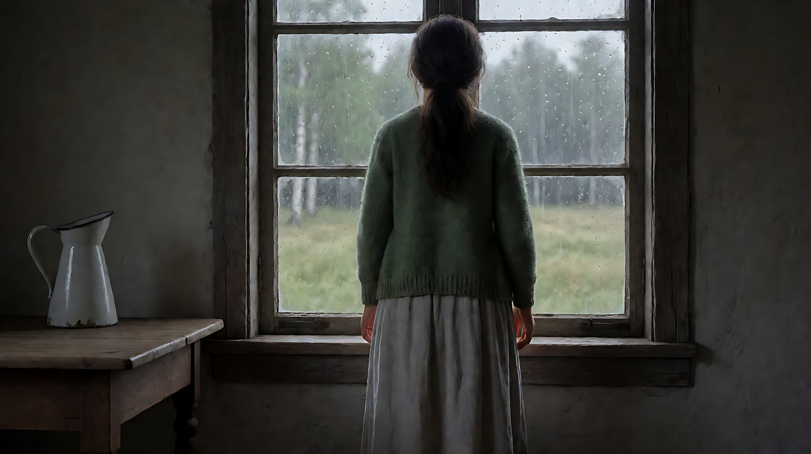
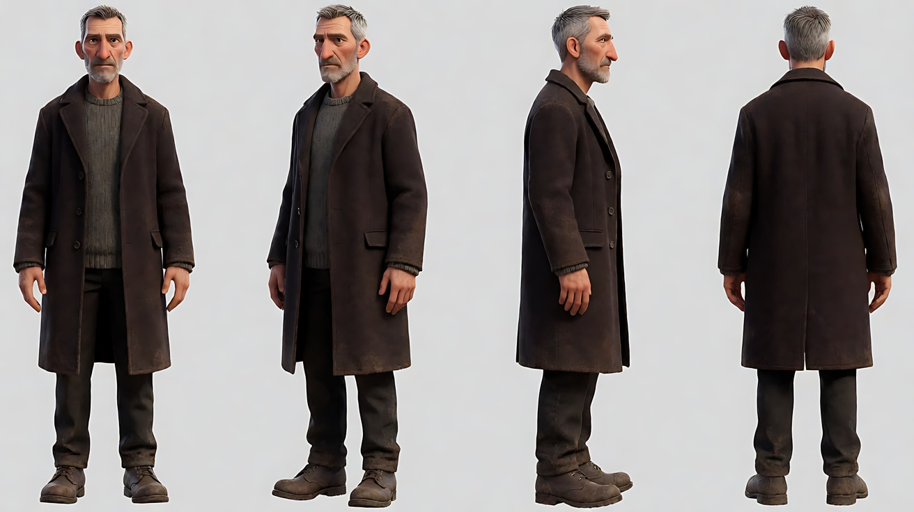
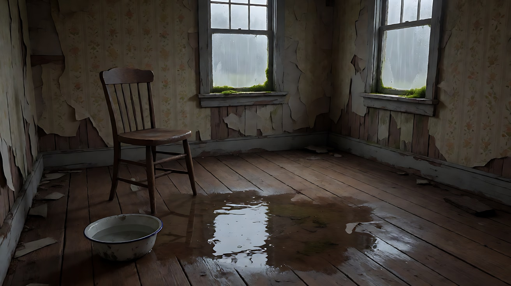
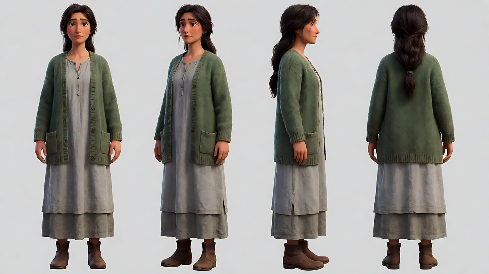
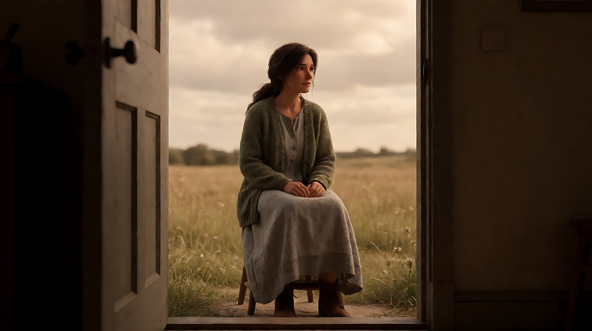
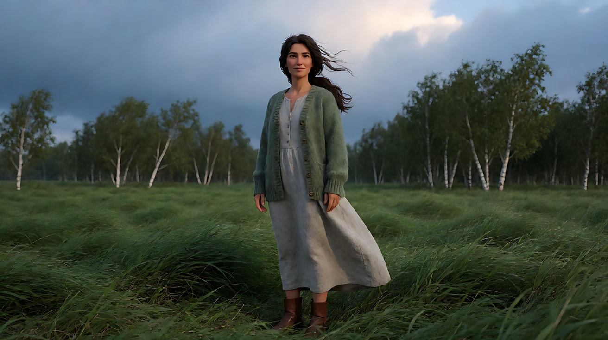
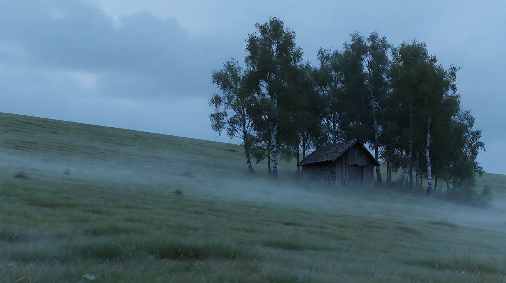
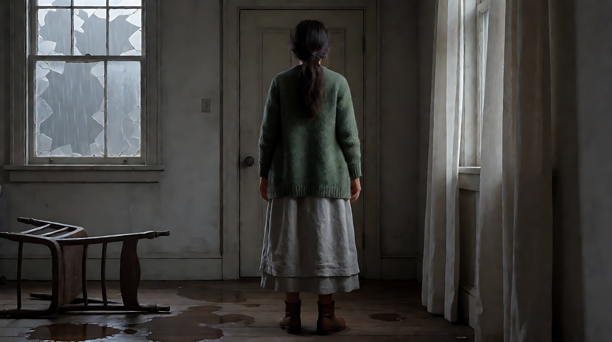
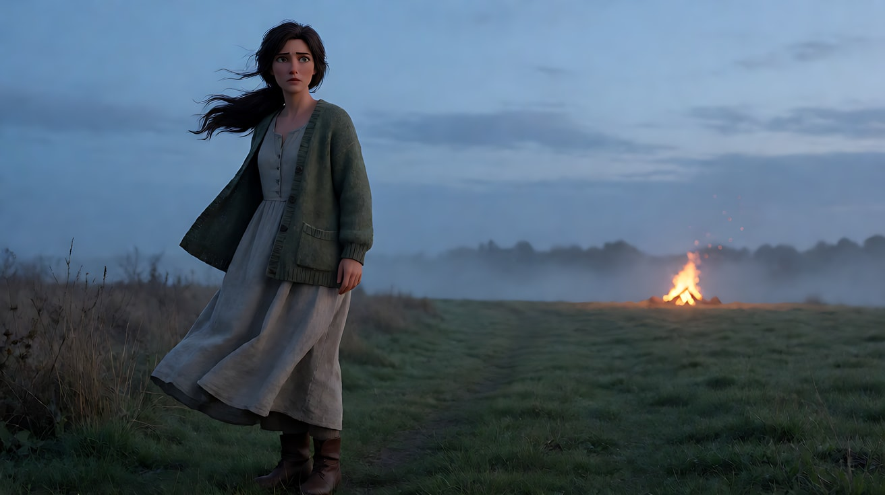

# L07-06 时间雕刻 · 提示词

> 本组练习：在 AI 的短时长里做出"时间感"：一个镜头只做一件慢事，极慢推轨，水、火、风作为具体的物理元素，用单色到彩色的切换表示跨过门槛。提示词只写技术，不写任何人名与片名。｜ 配套教学：[L07-06 教学文件](../教学/L07-06-塔可夫斯基.md) ｜ 规范：[写作规范](../../模板/写作规范.md)
>
> 画风默认使用开关 A（风格化写实 CG）。如改用 2D 动画，删掉所有焦段、光圈、景深词。

**本组技法开关（不含人名，可直接复用）**

```
一件慢事：一个片段只有一个持续而缓慢的动作，不切镜头。
极慢推轨：推进速度慢到几乎察觉不到，结束时画面只比开始近一点。
水：雨从屋顶破洞落下、水滴落进搪瓷碗、积水倒映天光。
火：远处木棚燃烧，火把空气烤得扭曲；或一盏烛火在风里摇晃。
风：风一阵一阵扫过草地，草浪从远处翻滚到近处；窗帘被吹起。
单色 / 彩色：跨过一道门槛（门口、桥、水面）时，画面从棕褐单色变为彩色。
```

---

### 练习1：极慢推轨——雨窗前的女人（难度 ★）

**目标**：用单张关键帧做一个"几乎什么都没发生"的 10 秒镜头：她站在窗前，镜头极慢地推近，雨在窗外流。

**【生图 · Nano Banana】**

图1 关键帧：

```
A medium-wide shot from behind of an original woman in her forties with long dark-brown hair loosely tied at the nape,
wearing a faded green wool cardigan over a long grey linen dress, standing still at a tall old wooden window
in a dim country house, looking out at a rain-soaked meadow and a line of birch trees.
She stands slightly right of center; a wooden table with a white enamel jug sits at frame left.
Camera at standing eye level, 50mm lens, moderate depth of field. Lighting: soft grey overcast daylight from the window
as the only source, the room interior falling into soft shadow, rain streaks on the glass.
Stylized semi-realistic 3D CG rendering, feature-film animation quality. Aspect ratio 16:9.
```

中文释义：女人背对镜头站在旧木窗前，窗外是雨中的草地与白桦；画左木桌上一只白搪瓷水罐；窗外阴天光是唯一光源；50mm、中等景深。



**【图生视频 · Seedance】**

```
【素材分工】@图片1 为首帧，锁定人物身份、服装与房间布局。
【画风】风格化写实三维CG质感，阴天柔光，色彩低饱和而潮湿。
女人一直站在窗前，背对镜头，几乎不动，只在中途把一只手轻轻放在窗框上。窗外的雨持续落下，玻璃上的雨痕缓慢向下流，远处白桦在微风里轻晃。镜头以极慢的推轨向她的背影推进，速度慢到几乎察觉不到，结束时画面只比开始近一点。结尾停在她手扶窗框的背影上。
【声音】无配乐，雨打在窗玻璃与屋檐上的声音，屋内一只挂钟缓慢的嘀嗒声，远处一声火车汽笛。
【约束】保持人物脸型、发型、服装不变；人物不转身；不切镜头；不要字幕、水印、Logo。
时长：10秒
```

**参数**：时长 10 秒 ｜ 画幅 16:9

**【检查点】**
- 推轨是否慢到"几乎察觉不到"
- 人物是否几乎静止，只有一个小动作
- 声音是否让人注意到时间（钟声、雨声）

**【常见问题与修复】**
| 现象 | 修复 |
|---|---|
| 推得太快 | 写"结束时画面只比开始近一点" |
| 人物转身看镜头 | 写"始终背对镜头，不转身" |
| 画面完全静止像照片 | 强调"雨痕在玻璃上缓慢流动，白桦在微风中晃动" |

---

### 练习2：水——屋里的雨（难度 ★★）

**目标**：用定妆图 + 场景图，让"水"成为画面的主角：雨从废弃木屋的屋顶破洞落下，滴进地板上的积水，男人坐在一旁不动。

**【生图 · Nano Banana】**

图1 角色定妆：

```
Character turnaround sheet of an original man in his fifties: a gaunt face with grey stubble, short cropped grey hair,
a worn dark-brown wool overcoat over a knitted grey sweater, dark trousers, muddy leather boots.
Front view, three-quarter view, side view and back view, full body, plain light-grey background, even soft studio light.
Stylized semi-realistic 3D CG rendering, feature-film animation quality. Aspect ratio 16:9.
```



图2 场景：

```
Empty abandoned wooden farmhouse room on a rainy afternoon, peeling wallpaper, a hole in the ceiling with rain falling through
in a thin steady stream into a wide shallow puddle on the warped wooden floor, the puddle reflecting the grey light from the hole,
a single old wooden chair beside the puddle, a white enamel bowl half full of water on the floor, moss on the window sill, no people.
Medium-wide shot, eye level, 35mm lens, moderate depth of field. Soft grey light from the ceiling hole and a dirty window.
Stylized semi-realistic 3D CG rendering, feature-film animation quality. Aspect ratio 16:9.
```



**【多图生视频 · Seedance】**

```
【素材分工】@图片1 锁定人物身份与服装；@图片2 仅参考废屋布局、屋顶破洞、积水与搪瓷碗的位置。
【画风】风格化写实三维CG质感，阴天柔光，潮湿而低饱和的色彩。
男人坐在积水旁的旧木椅上，身体前倾，手肘撑在膝上，一动不动地看着从屋顶破洞落下的细雨。雨水落进积水，激起一圈圈涟漪，水面倒映的灰白天光被打碎又复原；旁边搪瓷碗里的水满了一点，溢出一滴。镜头从中全景以极慢的横移从画左移向画右，让积水逐渐占据画面下方，结束时停在男人与积水同框、倒影里映出他的轮廓。
【声音】无配乐，雨水落进积水的细碎声，水滴打在搪瓷碗里的清脆单音，一次一次间隔规律，窗外远处的风声。
【约束】保持人物脸型、发型、服装不变；人物不起身；不切镜头；不要字幕、水印、Logo。
时长：10秒
```

**参数**：时长 10 秒 ｜ 画幅 16:9

**【检查点】**
- 水是否有清楚的物理反馈：涟漪、倒影、溢出
- 横移是否极慢，最后让倒影入画
- 人物是否几乎静止

**【常见问题与修复】**
| 现象 | 修复 |
|---|---|
| 雨像瀑布 | 写"细细一股，稳定落下" |
| 倒影不出现 | 尾段写"积水倒影里清楚映出他的轮廓" |
| 人物起身走动 | 写"他始终坐着，只有呼吸起伏" |

---

### 练习3：跨过门槛——从单色到彩色（难度 ★★★，首尾帧）

**目标**：首帧是棕褐单色的室内，人物背对镜头站在门口；尾帧是她走出门后，彩色的风中草原。颜色的切换就是叙事事件。

**【生图 · Nano Banana】**

图1 角色定妆：

```
Character turnaround sheet of an original woman in her forties with long dark-brown hair loosely tied at the nape,
a faded green wool cardigan over a long grey linen dress, brown leather ankle boots.
Front view, three-quarter view, side view and back view, full body, plain light-grey background, even soft studio light.
Stylized semi-realistic 3D CG rendering, feature-film animation quality. Aspect ratio 16:9.
```



图2 首帧：

```
Using the character from image 1: a medium-wide shot from behind of her standing in the open back doorway of a dim wooden house,
looking out at a wide meadow under a cloudy sky. The entire image is sepia monochrome, warm brown tones only.
Camera at eye level inside the house, 35mm lens, moderate depth of field, the door frame forming a dark rectangle around the bright meadow.
Keep the outfit exactly as in image 1. Stylized semi-realistic 3D CG rendering, feature-film animation quality. Aspect ratio 16:9.
```



图3 尾帧：

```
Using the character from image 1: a wide shot from behind of her standing in the middle of a vast meadow of tall grass, now in full natural color,
deep green grass bending in waves under a strong wind, a line of white birch trees in the distance, a heavy blue-grey cloudy sky
with a break of pale sunlight. Her green cardigan and long hair blowing to frame right.
Camera at eye level, 35mm lens. Keep the outfit exactly as in image 1.
Stylized semi-realistic 3D CG rendering, feature-film animation quality. Aspect ratio 16:9.
```



**【首尾帧生视频 · Seedance】**

```
【素材分工】@图片2 为首帧；@图片3 为尾帧，是最终画面目标；@图片1 锁定人物身份与服装。只生成两帧之间的连续动作与色彩变化。
【画风】风格化写实三维CG质感；前半段为棕褐单色，后半段为自然彩色。
她站在门口停了一会儿，然后缓慢地迈过门槛走出去。就在她跨过门槛的一刻，画面从棕褐单色逐渐转为彩色，草的绿色第一次出现。一阵风从远处扫过草原，草浪一波一波向她涌来，吹动她的开衫和头发。她继续向草原中央走了几步，停下。镜头以极慢的推轨跟随在她身后，穿过门框走到屋外，速度与她的步伐一致。
【声音】屋内是一只钟的嘀嗒声；跨过门槛后钟声消失，风声由远而近涌来，草叶大片摩擦，远处一声鸟鸣，无配乐。
【约束】保持人物脸型、发型、服装不变；色彩变化只在她跨过门槛时发生；中间不跳切；不要字幕、水印、Logo。
时长：10秒
```

**参数**：时长 10 秒 ｜ 画幅 16:9

**【检查点】**
- 颜色切换是否发生在"跨过门槛"那一刻
- 风是否以"草浪一波一波涌来"的形式出现
- 声音是否也跟着跨过门槛发生了变化

**【常见问题与修复】**
| 现象 | 修复 |
|---|---|
| 全程都是彩色 | 首帧图2严格用单色生成，正文写"前半段为棕褐单色" |
| 颜色切换得太早 | 写"直到她迈过门槛之前，画面保持单色" |
| 风向混乱 | 写"风从远处吹向画右，草浪一致" |

---

### 练习4：水、风、火三联（难度 ★★★★，多镜头）

**目标**：三个镜头分别给水、风、火，每个镜头都慢而长，人物只在第三镜出现，作为火的观看者。

**【生图 · Nano Banana】**

图1 角色定妆：沿用练习2的图1（男人）。

图2 场景（远处的木棚）：

```
Empty wide dusk landscape, a meadow sloping down to a small old wooden shed near a birch grove, a cold blue-grey sky,
light mist low over the grass, no people. Wide shot, eye level, 50mm lens, deep focus.
Stylized semi-realistic 3D CG rendering, feature-film animation quality. Aspect ratio 16:9.
```



**【多图生视频 · Seedance】**

```
【素材分工】@图片1 锁定男人的身份与服装，只在镜头3出现；@图片2 仅参考草地、木棚与白桦林的布局。
【画风】风格化写实三维CG质感，黄昏冷色天光，低饱和。
镜头1：俯拍特写，一只白色搪瓷碗放在木地板上，屋顶落下的水滴一滴一滴落进碗里，水面泛起同心圆，倒映着上方的灰白天光。镜头极慢地向下推近。清脆的水滴声，每一滴之间隔着长长的停顿。
镜头2：镜头切至固定大全景，黄昏的草地，一阵风从远处的白桦林吹来，草浪一波一波翻滚着涌向镜头，白桦树梢同时弯下。风声由远及近，草叶大片摩擦。
镜头3：镜头切至男人背影的中全景，他站在草地上一动不动，远处坡下的小木棚正在燃烧，火焰高高窜起，热气让木棚上方的空气扭曲，火光映在低处的薄雾上。镜头以极慢的推轨从他背后推近，让他的背影逐渐占据画面左侧，火在画右远处。停在他背对镜头、看着火的画面。远处木头燃烧的噼啪声，风声减弱。
【锁定】光线：黄昏冷色天光，镜头3增加远处火焰的暖光；男人始终背对镜头，穿深棕大衣；火始终在画右远处。
【声音】无配乐；水滴、风、火三种声音分属三个镜头，每一种都清晰而孤立。
【约束】保持人物服装与体形不变；火只在远处燃烧，不蔓延到人物附近；不要字幕、水印、Logo。
时长：14秒
```

**参数**：时长 14 秒 ｜ 画幅 16:9 ｜ 负载：3 个慢镜头、无对白，属于"稳妥"档

**【检查点】**
- 每个镜头是否只承载一个元素
- 三个镜头的节奏是否都"慢"
- 火是否保持在远处，人物只是观看者

**【常见问题与修复】**
| 现象 | 修复 |
|---|---|
| 火变成爆炸 | 写"火焰稳定燃烧，没有爆开、没有飞溅" |
| 镜头2风太小 | 写"草浪从远处一波一波翻滚到镜头前" |
| 镜头3男人转身 | 写"始终背对镜头，一动不动" |

---

### 练习5：原创三镜头场景——回到老屋（难度 ★★★★★）

**目标**：用本课技法拍一个原创场景。意图：让观众感到她跨过了"记忆"和"现在"之间的门槛。镜头1是单色的空屋长镜（水），镜头2她推开后门、风扫过草原、画面转为彩色（风 + 门槛），镜头3极慢推轨到她的背影，远处田埂上有人点燃一堆篝火（火）。

**【生图 · Nano Banana】**

图1 角色定妆：沿用练习3的图1（女人）。

图2 镜头1关键帧：

```
Using the character from image 1: a wide shot of the inside of an abandoned wooden country house, sepia monochrome only,
rain dripping from the ceiling into several puddles on the warped floorboards, an overturned chair, a white curtain hanging still,
the woman standing small at the far end of the room facing a closed back door, her back to the camera.
Camera at eye level, 35mm lens, deep focus. Soft grey light from a broken window.
Keep the outfit exactly as in image 1. Stylized semi-realistic 3D CG rendering, feature-film animation quality. Aspect ratio 16:9.
```



图3 镜头3关键帧：

```
Using the character from image 1: a medium shot from behind of her standing in a tall-grass meadow at dusk in full natural color,
her hair and cardigan moving in the wind, on the left half of the frame. Far away on a field ridge at frame right,
a small bonfire burns, its orange light glowing on a low mist. Cold blue dusk sky.
Camera at eye level, 50mm lens, moderate depth of field. Keep the outfit exactly as in image 1.
Stylized semi-realistic 3D CG rendering, feature-film animation quality. Aspect ratio 16:9.
```



**【多图生视频 · Seedance】**

```
【素材分工】@图片1 锁定女人身份与服装；@图片2 为镜头1首帧；@图片3 仅作为镜头3的构图、色彩与光线参考，不作为首帧。
【画风】风格化写实三维CG质感；镜头1为棕褐单色，镜头2中途转为自然彩色，镜头3为彩色黄昏。
镜头1：棕褐单色的大全景，废弃木屋内，屋顶的雨水滴进地板上几处积水，白色窗帘垂着不动。女人站在房间尽头，背对镜头，面对紧闭的后门。镜头以极慢的推轨向她推进，几乎察觉不到。水滴声此起彼伏，屋里的寂静很重。
镜头2：镜头切至她身后的中景，她伸手推开后门，门外是一片高草原。一阵风扑进屋来，掀起白色窗帘，草浪一波一波翻滚而来；就在风灌进门的一刻，画面从单色转为彩色，草的绿色第一次出现。她迈过门槛。门轴吱呀声，风声猛地涌入。
镜头3：镜头切至彩色黄昏的中景背影，她站在草原中，头发和开衫被风吹动，在画面左半边；远处画右的田埂上，一堆篝火燃起，橙色火光映在低处薄雾上。镜头以极慢的推轨向她推近。停在她背对镜头、望着远处篝火的画面。风声渐弱，只剩远处木柴的噼啪声。
【锁定】光线：镜头1为破窗灰光，镜头2门外阴天光，镜头3冷蓝黄昏加远处篝火暖光；女人始终背对镜头，穿绿色开衫与灰色长裙；篝火始终在画右远处。
【声音】无配乐；水滴 → 风 → 火的噼啪声，三种声音依次接力。
【约束】保持人物服装与体形不变；色彩只在镜头2风灌进门时转变；篝火只在远处稳定燃烧；不要字幕、水印、Logo。
时长：14秒
```

**参数**：时长 14 秒 ｜ 画幅 16:9 ｜ 负载：3 个慢镜头、1 个推门动作、1 次色彩转变，属于"有挑战"档

**【检查点】**
- 镜头1是否是单色、慢、只有水的声音
- 色彩转变是否发生在"推门—风灌进来"这一刻
- 镜头3推轨是否极慢，篝火是否保持在远处
- 通读提示词，没有任何人名、片名

**【常见问题与修复】**
| 现象 | 修复 |
|---|---|
| 镜头1已经是彩色 | 镜头1首帧图2严格用单色生成，并在镜头1块里写"棕褐单色" |
| 篝火变成大火 | 写"一小堆篝火，稳定燃烧" |
| 三个镜头连成一个 | 每块开头写"镜头切至……"，并让机位明显不同 |
| 女人转身露出正脸 | 写"她始终背对镜头" |
