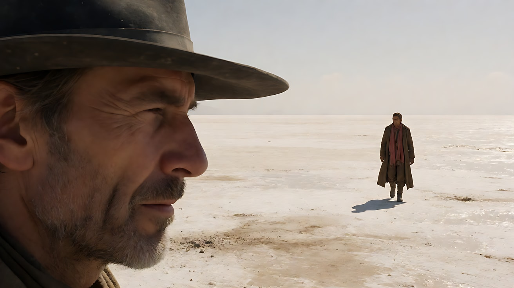
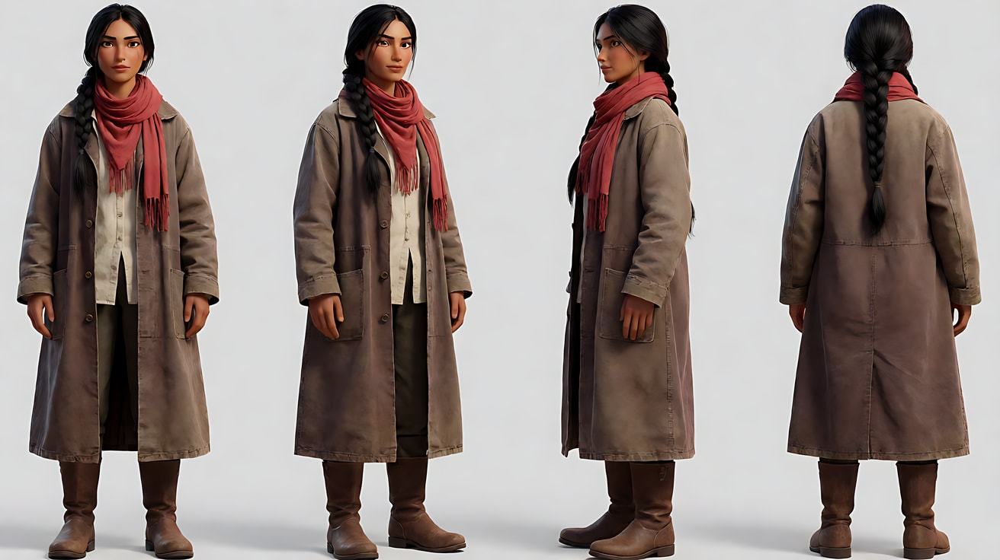
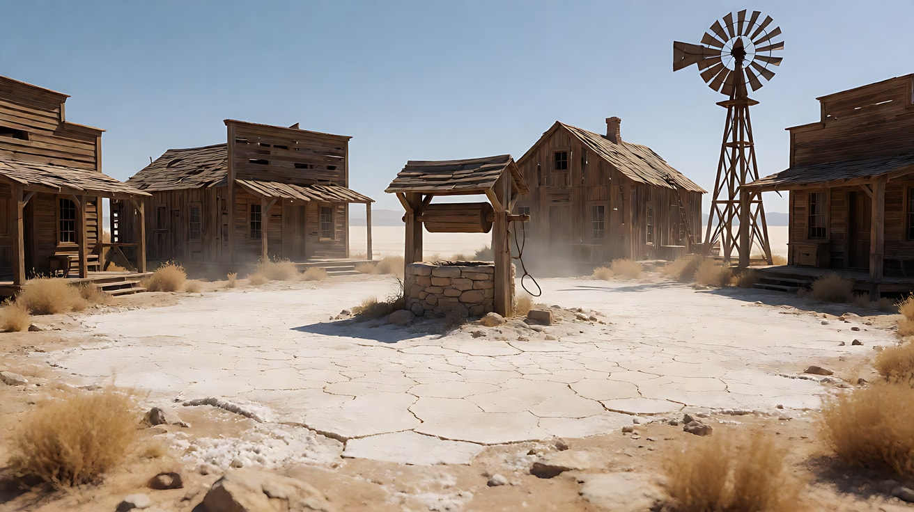
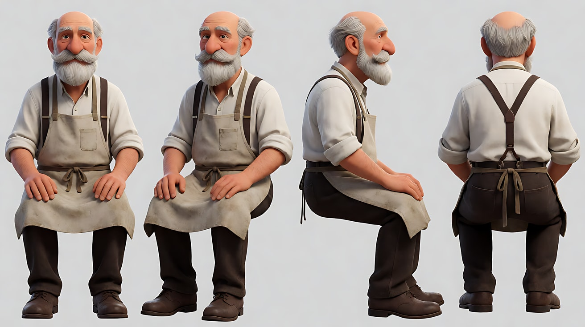
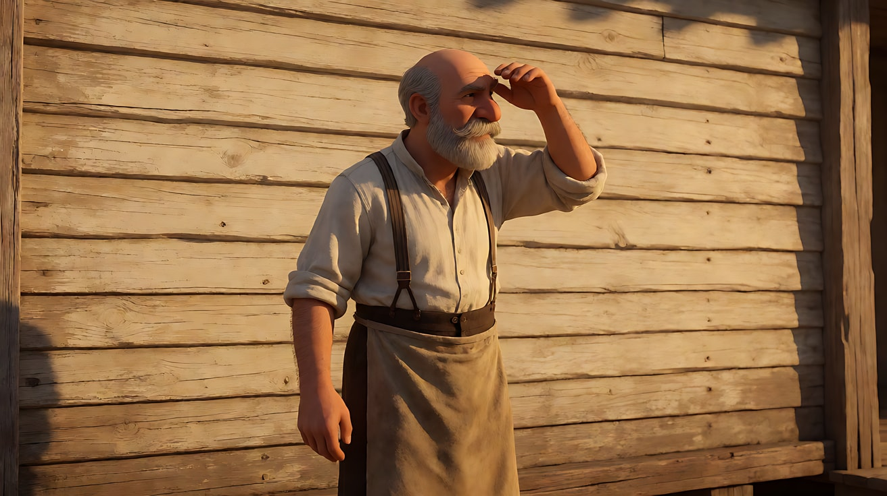
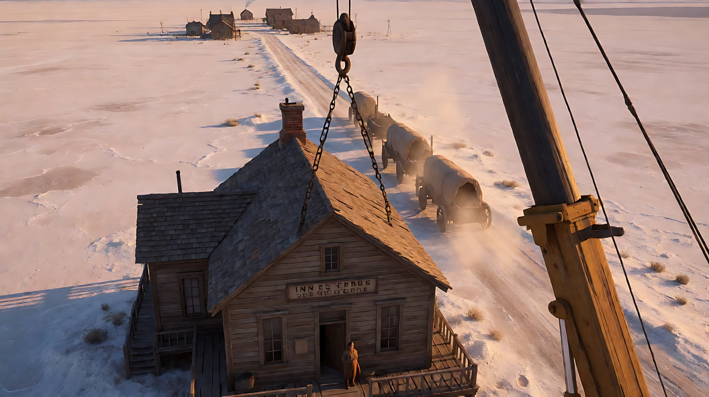
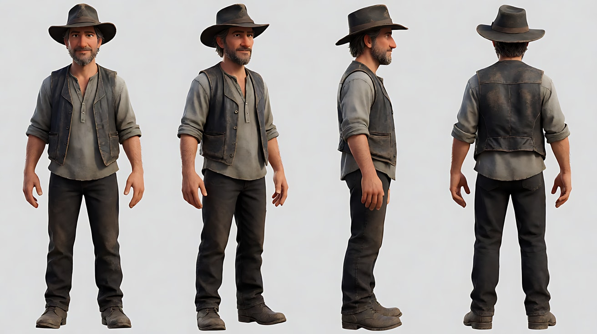
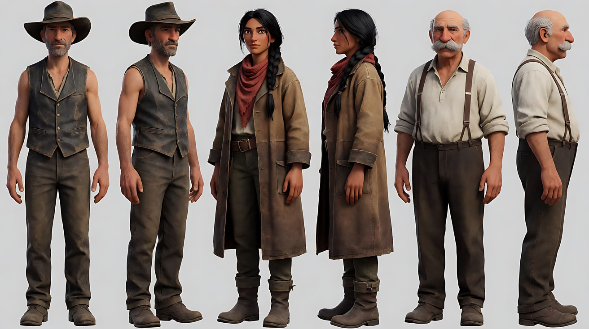
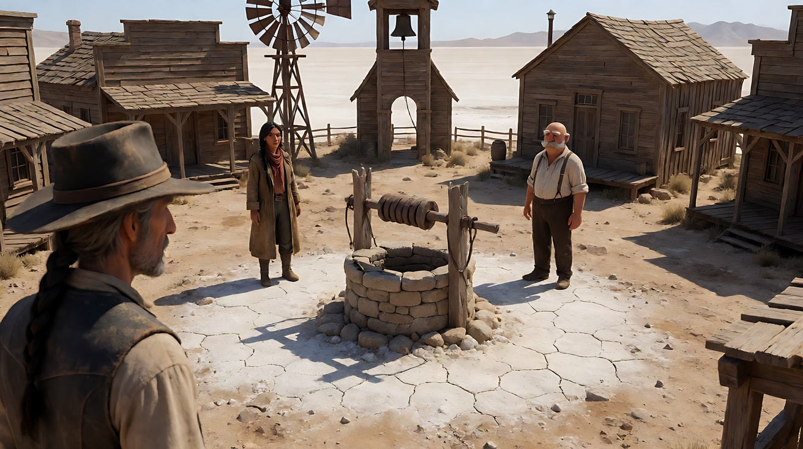
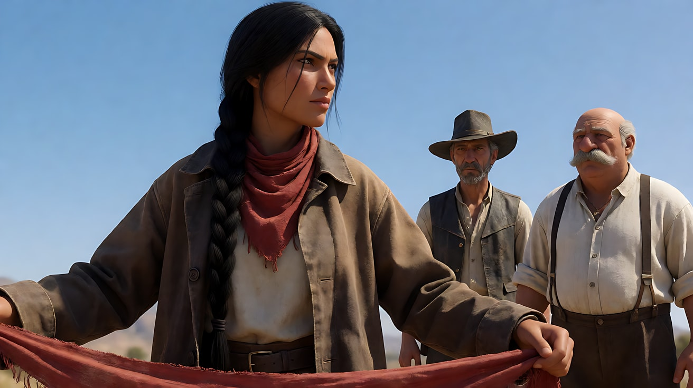

# L07-07 大远景与大特写 · 提示词

> 本组练习：用宽银幕构图、大远景与眼部大特写的对撞、前景脸 + 后景人物、被拉长的等待、随音乐加速的仪式化对峙，拍原创的无武器对峙。提示词只写技术，不写任何人名、片名与武器词。｜ 配套教学：[L07-07 教学文件](../教学/L07-07-塞尔乔莱昂内.md) ｜ 规范：[写作规范](../../模板/写作规范.md)
>
> 画风默认使用开关 A（风格化写实 CG）。如改用 2D 动画，删掉所有焦段、光圈、景深词。Seedance 画幅选 21:9。

**本组技法开关（不含人名，可直接复用）**

```
宽银幕：生图写 ultra-wide 2.39:1 widescreen frame；Seedance 选 21:9。
景别对撞：大远景（人物是荒野里的小点）直接切到眼部大特写（一双眼睛横贯画面）。
前景脸 + 后景人物：一张脸的侧面占据画面一端，极近而清楚；远处另一端有一个很小的人物。
拉长的等待：放大微小声音（水滴、苍蝇、风车、指节），动作极少。
仪式化对峙：圆形场地、三角站位、景别逐镜收紧、音乐越来越急，停在动作发生前。
```

**本组共用的原创设定**

- 地点：盐湖边的废弃驿站小镇，干裂的白色地面，热浪，一口带木质辘轳的旧井。
- 人物：
  - 灰帽人：四十多岁，瘦长脸，深灰宽檐帽，旧皮马甲，灰白胡茬，眯眼。
  - 红巾女：三十多岁，晒黑的皮肤，黑色长辫，脖子上一条褪色红围巾，棕色长外套。
  - 老掌柜：六十多岁，秃顶，浓白胡子，背带裤，挽起的白衬衫袖子。

---

### 练习1：前景脸 + 后景人物（难度 ★）

**目标**：用单张关键帧在一个宽银幕画面里同时放"极近的脸"和"极远的人"，让两人的关系一画完成。

**【生图 · Nano Banana】**

图1 关键帧：

```
An ultra-wide widescreen composition on a blinding white salt flat at noon. In the extreme foreground at frame left,
the sharp profile of an original lean man in his forties with grey stubble and a dusty dark-grey wide-brimmed hat,
squinting toward frame right, his face filling the left quarter of the frame from brim to chin, beads of sweat on his temple.
Far away at frame right, on the shimmering horizon, a tiny figure in a long brown coat with a faded red scarf walks toward camera,
distorted by heat haze. Empty white ground and pale sky in between.
Camera at the man's eye level, 40mm lens, deep focus so both the foreground face and the distant figure are sharp.
Lighting: harsh overhead noon sun, short hard shadows, bleached ochre and dusty brown tones.
Stylized semi-realistic 3D CG rendering, feature-film animation quality. Ultra-wide 2.39:1 widescreen frame.
```

中文释义：宽银幕；画左前景是灰帽人的侧脸大特写，眯眼看向画右，鬓角有汗；画右远处地平线上一个穿棕外套、红围巾的小人影在热浪中走来；深焦两者都清楚；正午硬光，土黄褐色调。



**【图生视频 · Seedance】**

```
【素材分工】@图片1 为首帧，锁定前景人物身份与服装、远处人物的服装轮廓与盐湖地貌。
【画风】风格化写实三维CG质感，正午硬光，土黄与焦褐色调。
画左前景的男人一动不动地眯眼望向画右，一滴汗从鬓角慢慢滑到下颌。远处画右的人影在热浪中缓慢走近，轮廓随热浪扭曲，但在画面中仍然很小。镜头固定不动。风卷起一缕白色盐尘从两人之间横穿画面。结尾停在男人眼皮微微一收、远处人影停下脚步的画面。
【声音】无配乐，热风的低鸣，远处脚步踩碎盐壳的细响，一声孤零零的乌鸦叫。
【约束】保持人物脸型、帽子与服装不变；远处人物始终很小，不走到前景；不切镜头；不要字幕、水印、Logo。
时长：8秒
```

**参数**：时长 8 秒 ｜ 画幅 21:9

**【检查点】**
- 前景脸与远处人影是否同时清楚
- 画面中间是否保持空旷
- 汗珠滑落是否是前景唯一的明显动作

**【常见问题与修复】**
| 现象 | 修复 |
|---|---|
| 远处人物走得太近 | 写"在画面中仍然很小，只走了几步就停下" |
| 前景脸虚焦 | 写"深焦，前景脸部与远处人物同样清楚" |
| 画幅变成 16:9 | 平台参数选 21:9，生图句尾写 2.39:1 |

---

### 练习2：眼部大特写——一双眼睛横贯画面（难度 ★★）

**目标**：用定妆图 + 场景图，生成一个只有眼睛的宽银幕大特写，体会"读取意图"的心理战。

**【生图 · Nano Banana】**

图1 角色定妆：

```
Character turnaround sheet of an original woman in her thirties: sun-tanned skin, a long black braid, sharp dark eyes,
a faded red cotton scarf around her neck, a long dusty brown canvas coat over a cream shirt, brown leather boots.
Front view, three-quarter view, side view and back view, full body, plain light-grey background, even soft studio light.
Stylized semi-realistic 3D CG rendering, feature-film animation quality. Aspect ratio 16:9.
```



图2 场景：

```
Empty abandoned waystation town square at the edge of a white salt flat at noon, a circular patch of cracked white ground,
an old stone well with a wooden winch at the exact center, weathered wooden buildings around the edge, a rusty windmill turning slowly,
heat haze, no people. Extreme wide shot, eye level, 35mm lens, deep focus.
Harsh overhead sun, ochre and dusty brown tones.
Stylized semi-realistic 3D CG rendering, feature-film animation quality. Ultra-wide 2.39:1 widescreen frame.
```



**【多图生视频 · Seedance】**

```
【素材分工】@图片1 锁定女人的面部特征、眼睛与红围巾；@图片2 仅参考环境光线与色调，不出现在画面中。
【画风】风格化写实三维CG质感，正午硬光，土黄色调。
宽银幕眼部大特写，画面上下只框住她的眉毛到鼻梁，一双眼睛横贯整个画面宽度，皮肤上有细小的盐尘和汗珠。她先是直视前方，眼睛缓慢眯起，然后眼珠向画右一转，停住，再缓慢转回正中。睫毛上沾着一粒白色盐尘。镜头固定不动。结尾停在她眯着眼直视前方的画面。
【声音】一段低沉的口琴长音缓缓响起，热风声，她一次克制的呼吸声。
【约束】保持人物眼型、肤色、眉形不变；画面只包含眉毛到鼻梁；不切镜头；不要字幕、水印、Logo。
时长：6秒
```

**参数**：时长 6 秒 ｜ 画幅 21:9

**【检查点】**
- 画面是否只框住双眼，横贯画面宽度
- 眼神变化是否清楚（眯眼—转向—回正）
- 汗珠与盐尘等质感是否可见

**【常见问题与修复】**
| 现象 | 修复 |
|---|---|
| 框成了整张脸 | 写"画面上缘在眉毛，下缘在鼻梁，只有眼睛" |
| 眼珠乱转 | 写"眼珠只转向画右一次，再回到正中" |
| 眨眼过于频繁 | 写"不眨眼" |

---

### 练习3：升起揭示——从一个人到一座镇（难度 ★★★，首尾帧）

**目标**：首帧是老掌柜站在驿站门口的中景，尾帧是越过屋顶的高位大远景，揭示整片盐湖和远处的小镇。音乐在升起时打开。

**【生图 · Nano Banana】**

图1 角色定妆：

```
Character turnaround sheet of an original old innkeeper in his sixties: bald head, a thick white moustache and beard,
a white shirt with rolled-up sleeves, dark brown suspenders and trousers, a dirty canvas apron.
Front view, three-quarter view, side view and back view, full body, plain light-grey background, even soft studio light.
Stylized semi-realistic 3D CG rendering, feature-film animation quality. Aspect ratio 16:9.
```



图2 首帧：

```
Using the character from image 1: a medium shot of the innkeeper standing at the open door of a weathered one-storey wooden waystation,
shading his eyes with one hand and looking toward frame right, the sun-bleached wooden wall filling the background.
Camera at eye level, 40mm lens, moderate depth of field. Harsh late-afternoon sun from frame left, ochre tones.
Keep the face and outfit exactly as in image 1.
Stylized semi-realistic 3D CG rendering, feature-film animation quality. Ultra-wide 2.39:1 widescreen frame.
```



图3 尾帧：

```
A high crane view rising above the roof of the same weathered wooden waystation, the innkeeper tiny at the door below,
revealing a vast white salt flat stretching to the horizon, a long dusty road leading to a small cluster of buildings far away,
a line of wagons approaching on the road raising dust, late-afternoon golden side light, long shadows.
Deep focus. Stylized semi-realistic 3D CG rendering, feature-film animation quality. Ultra-wide 2.39:1 widescreen frame.
```



**【首尾帧生视频 · Seedance】**

```
【素材分工】@图片2 为首帧；@图片3 为尾帧，是最终画面目标；@图片1 锁定老掌柜的身份与服装。只生成两帧之间的连续运动。
【画风】风格化写实三维CG质感，午后金色侧光，土黄色调。
老掌柜手搭凉棚望向画右，放下手，轻轻点了一下头。镜头开始平稳地向上升起，越过驿站的木屋顶，老掌柜在门口变成一个小点，盐湖的白色大地在画面里铺展到地平线，远处道路上一列马车扬着尘土驶来。升起速度先慢后稳，结束在高位大远景。
【声音】开头只有风声；镜头开始升起时，一段宏大的女声吟唱与弦乐主题同时升起，在镜头到达最高点时达到饱满。
【约束】保持老掌柜脸型与服装不变；中间不跳切；不要字幕、水印、Logo。
时长：8秒
```

**参数**：时长 8 秒 ｜ 画幅 21:9

**【检查点】**
- 升起是否是唯一主运镜
- 音乐是否与镜头同步"打开"
- 尾帧是否达到"一个人 → 整个世界"的比例变化

**【常见问题与修复】**
| 现象 | 修复 |
|---|---|
| 镜头变成后拉而非升起 | 写"镜头垂直向上升起，越过屋顶" |
| 马车方向混乱 | 写"马车沿道路从远处驶向驿站" |
| 屋顶穿模 | 首帧机位稍后退，写"从屋檐外侧升起" |

---

### 练习4：拉长的等待——放大小声音（难度 ★★★★，多镜头）

**目标**：三个镜头，几乎没有动作，只靠"大远景 → 小声音的大特写 → 眼睛"把等待变成戏。

**【生图 · Nano Banana】**

图1 角色定妆：

```
Character turnaround sheet of an original lean man in his forties: grey stubble, a dusty dark-grey wide-brimmed hat,
a worn black leather vest over a faded grey collarless shirt, dark trousers, scuffed boots.
Front view, three-quarter view, side view and back view, full body, plain light-grey background, even soft studio light.
Stylized semi-realistic 3D CG rendering, feature-film animation quality. Aspect ratio 16:9.
```



图2 场景：沿用练习2的图2（废弃驿站广场）。

**【多图生视频 · Seedance】**

```
【素材分工】@图片1 锁定灰帽人的身份与服装；@图片2 仅参考广场、水井、风车与色调。
【画风】风格化写实三维CG质感，正午硬光，土黄色调。
镜头1：宽银幕大远景，灰帽人独自坐在广场边一张木凳上，背靠木墙，帽檐压低，双臂抱胸，在画面中很小。广场中央的旧井一动不动，生锈的风车在画右缓慢转动。风车每转一圈发出一声长长的吱呀。
镜头2：镜头切至他帽檐的大特写，帽檐上方的屋檐漏下一滴水，"嗒"地落在帽檐上，水渍慢慢洇开。又一滴落下。他一动不动。水滴声被放大得清清楚楚。
镜头3：镜头切至眼部大特写，帽檐阴影下，他的眼睛缓慢睁开，眯着望向画右远方。停在他睁眼凝视的画面。远处隐约传来一声马嘶。
【锁定】光线：正午头顶硬光，帽檐在眼部投下阴影；人物始终坐在木凳上、帽檐压低；风车在画右。
【声音】无配乐；风车吱呀、水滴、远处马嘶三个声音依次出现，彼此之间是长长的寂静。
【约束】保持人物脸型、帽子、服装不变；人物除睁眼外不做其他动作；不要字幕、水印、Logo。
时长：12秒
```

**参数**：时长 12 秒 ｜ 画幅 21:9 ｜ 负载：3 个镜头、几乎无动作，属于"稳妥"档

**【检查点】**
- 镜头1与镜头2/3是否形成大远景与大特写的直接对撞
- 小声音是否被放大、彼此之间有寂静
- 睁眼是否是全片唯一的"事件"

**【常见问题与修复】**
| 现象 | 修复 |
|---|---|
| 人物起身 | 写"他始终坐着，双臂抱胸" |
| 水滴变成雨 | 写"只有屋檐漏下的单独一滴，间隔很长" |
| 镜头3眼睛不在帽檐阴影里 | 写"帽檐阴影横在眉毛上方" |

---

### 练习5：原创三镜头场景——井边的钥匙（难度 ★★★★★）

**目标**：用本课技法拍一个原创的无武器三方对峙。意图：让观众感到三个人都想要井沿上那把铜钥匙，但谁先伸手谁就输了。镜头1宽银幕大远景交代三角站位，镜头2前景大特写 + 后景两人，镜头3眼部大特写，钟楼敲响，停在伸手之前。

**【生图 · Nano Banana】**

图1 角色定妆：

```
Character turnaround sheet of three original characters:
a lean man in his forties with grey stubble, a dusty dark-grey wide-brimmed hat and a worn black leather vest;
a sun-tanned woman in her thirties with a long black braid, a faded red scarf and a long brown canvas coat;
a bald old innkeeper in his sixties with a thick white moustache, a white shirt with rolled sleeves and dark brown suspenders.
Front view, three-quarter view and side view of each, full body, plain light-grey background, even soft studio light.
Stylized semi-realistic 3D CG rendering, feature-film animation quality. Aspect ratio 16:9.
```



图2 场景：沿用练习2的图2（废弃驿站广场，井在正中）。

图3 镜头1关键帧：

```
Using the characters from image 1 and the square from image 2: a high extreme wide shot of the circular cracked-white square,
the stone well at the exact center with a small brass key lying on its rim, the three characters standing at three equal points
around the circle forming a triangle, each about twenty steps from the well, each very small in the frame,
long hard shadows, heat haze, a wooden bell tower at the edge of the square.
Deep focus, 35mm lens. Ochre and dusty brown tones. Keep the outfits exactly as in image 1.
Stylized semi-realistic 3D CG rendering, feature-film animation quality. Ultra-wide 2.39:1 widescreen frame.
```



图4 镜头2关键帧：

```
Using the characters from image 1: an ultra-wide composition with the woman's profile in extreme close-up at frame left,
her red scarf at the bottom edge, eyes narrowed toward frame right; in the deep background at frame right,
the lean man in the grey hat and the old innkeeper stand small on either side of the stone well, both sharp.
Deep focus, 40mm lens. Harsh noon sun. Keep the faces and outfits exactly as in image 1.
Stylized semi-realistic 3D CG rendering, feature-film animation quality. Ultra-wide 2.39:1 widescreen frame.
```



**【多图生视频 · Seedance】**

```
【素材分工】@图片1 锁定三人的身份与服装；@图片2 仅参考广场、水井与钟楼布局；@图片3 为镜头1首帧；@图片4 仅作为镜头2的构图参考，不作为首帧。
【画风】风格化写实三维CG质感，正午硬光，土黄与焦褐色调，宽银幕。
镜头1：高位宽银幕大远景，圆形白色广场，井在正中，井沿上放着一把小小的铜钥匙。三人在圆周上三等分站立，彼此相距相同，在画面中都很小，影子短而硬。三人都一动不动。风卷着盐尘从画面横穿。一段口琴旋律缓缓响起。
镜头2：镜头切至宽银幕前景大特写，红巾女的侧脸占据画左，眯眼看向画右；后景画右远处，灰帽人与老掌柜分立井的两侧，同样清楚。她的手指在外套下摆边缘轻轻动了一下。口琴之上加入了急促的吉他拨弦，节奏加快。
镜头3：镜头切至灰帽人的眼部大特写，眼睛横贯画面，帽檐阴影压在眉上方，他的眼珠向画左一转，又转回正中。钟楼的钟敲响第一下，音乐在钟声中骤然停住。停在他直视前方、谁也没有伸手的画面。
【锁定】光线：正午头顶硬光，土黄色调；红巾女在画左一侧，灰帽人与老掌柜在井的两侧；钥匙始终在井沿上未被触碰；三人始终站在原位。
【声音】口琴 → 口琴加急促拨弦 → 钟声与音乐骤停后的绝对寂静，节奏一镜比一镜急。
【约束】保持三人脸型、服装不变；三人都不移动脚步、不伸手拿钥匙；画面中不出现任何武器；不要字幕、水印、Logo。
时长：13秒
```

**参数**：时长 13 秒 ｜ 画幅 21:9 ｜ 负载：3 个镜头、三人群戏但几乎无动作，属于"有挑战"档

**【检查点】**
- 镜头1是否清楚交代三角站位与钥匙位置
- 镜头2前景脸与后景两人是否同时清楚
- 景别是否从大远景 → 前景大特写 → 眼部大特写逐镜收紧
- 结尾是否停在"伸手之前"
- 通读提示词，没有任何人名、片名、武器词

**【常见问题与修复】**
| 现象 | 修复 |
|---|---|
| 有人去拿钥匙 | 写"三人都不移动脚步、不伸手" |
| 镜头1三人站位不均 | 写"三人在圆周上三等分站立，彼此相距相同" |
| 镜头2后景人物模糊 | 写"深焦，前景侧脸与后景两人同样清楚" |
| 人物腰间出现可疑物件 | 【约束】写"画面中不出现任何武器" |
