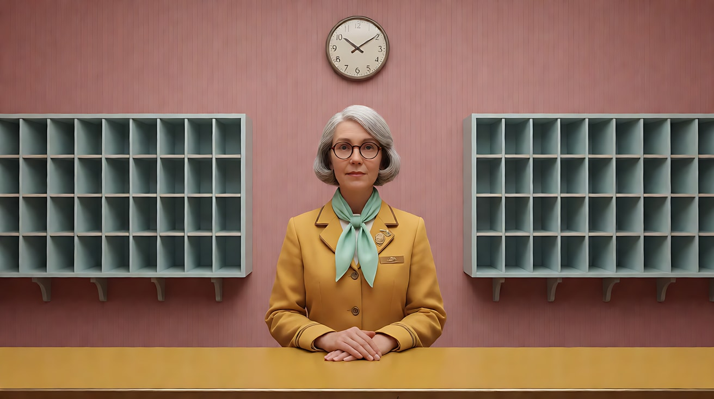
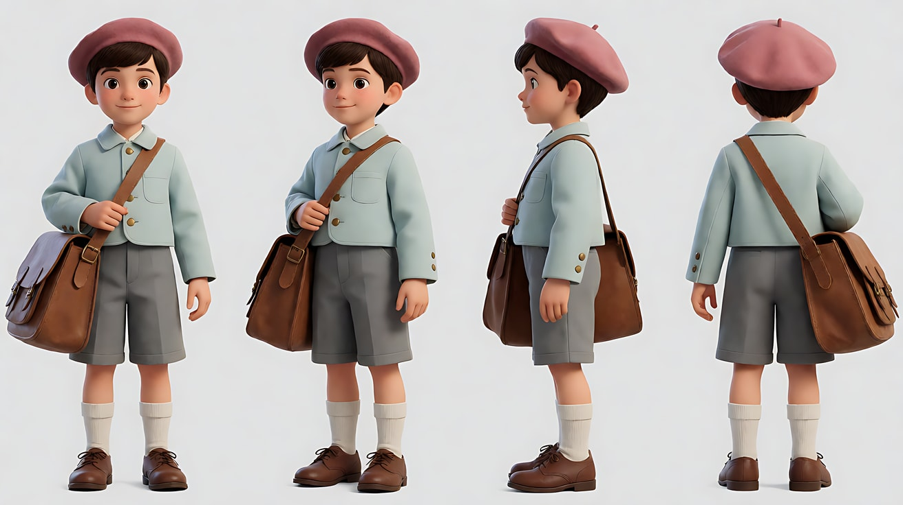
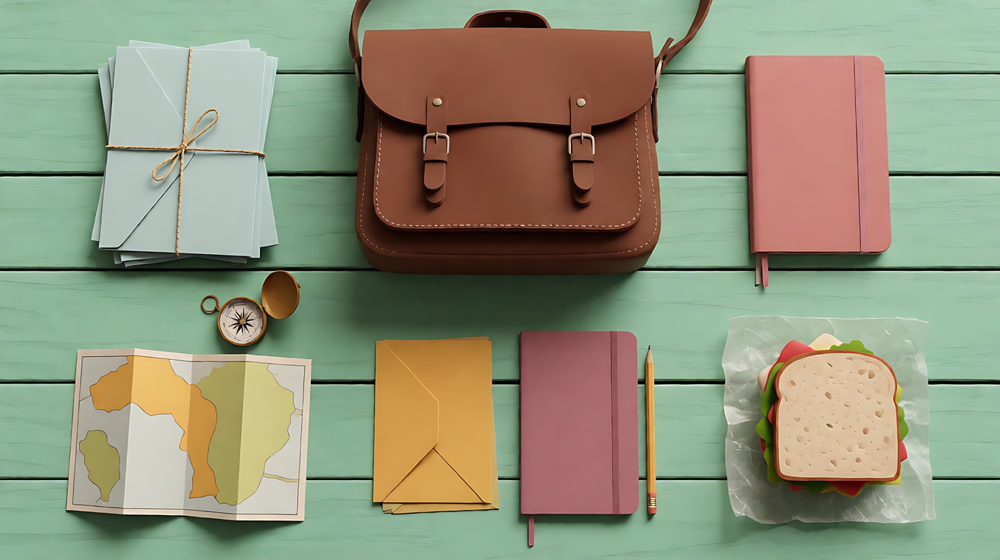
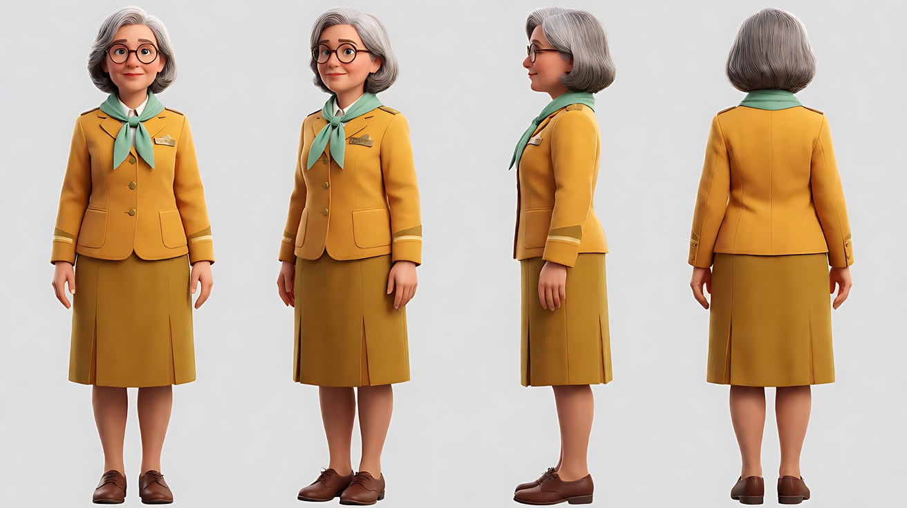
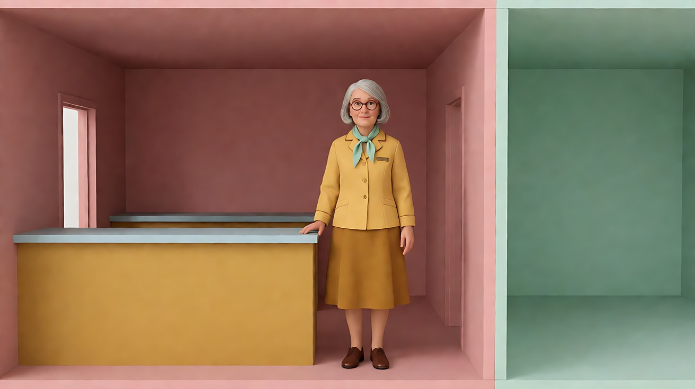
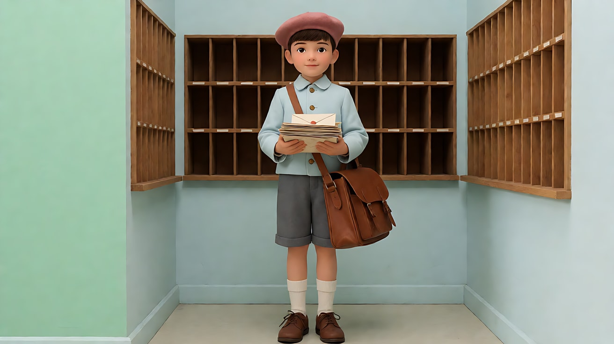
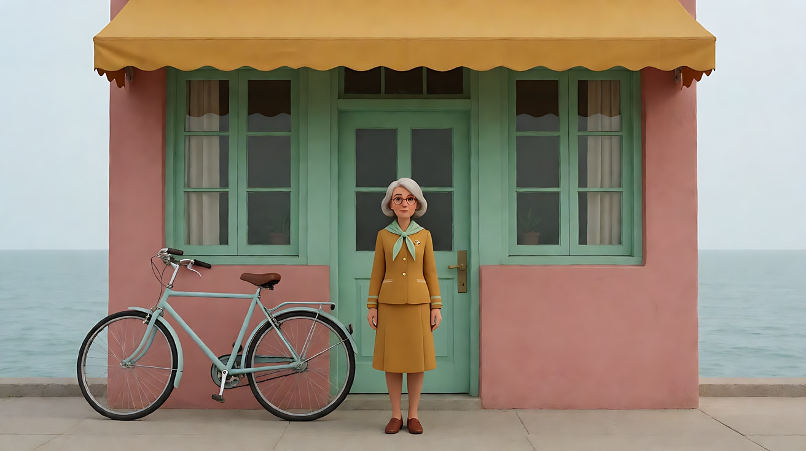
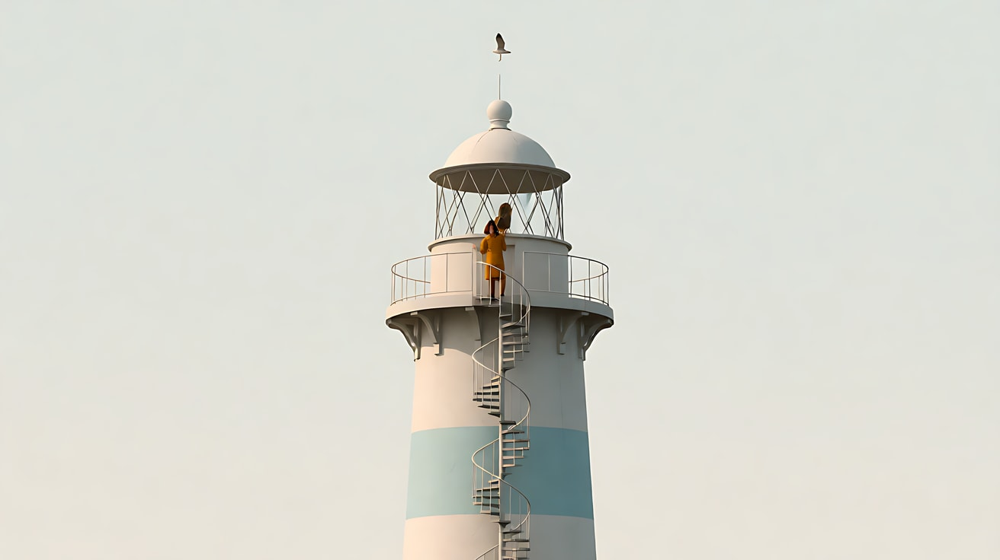

# L07-08 平面对称与色板 · 提示词

> 本组练习：用中心对称的平面正面构图、限定粉彩色板、直线横移、90 度快速摇镜、俯拍桌面、冷面表演，搭建一个原创的小世界。提示词只写技术，不写任何人名与片名。｜ 配套教学：[L07-08 教学文件](../教学/L07-08-韦斯安德森.md) ｜ 规范：[写作规范](../../模板/写作规范.md)
>
> 画风默认使用开关 A（风格化写实 CG）。如改用 2D 动画，删掉所有焦段、光圈、景深词。

**本组技法开关（不含人名，可直接复用）**

```
平面正面：摄影机与背景墙平行，人物站在画面正中、正对镜头，像站在舞台剖面上。
限定色板：灰粉、薄荷绿、芥末黄、淡蓝四色，写在墙、制服、道具上，不用滤镜。
平光：柔和均匀的正面光，几乎没有硬阴影。
直线横移：镜头沿直线向画右平移，像经过一个个剖开的房间。
快速摇镜：镜头快速甩九十度，停在另一个人的正面居中构图上。
俯拍桌面：摄影机在桌子正上方垂直向下，手与物件排列整齐。
冷面表演：面无表情，语速平稳，动作像被精确计时。
```

**本组共用的原创小世界**

- 地点：海角灯塔下的小邮局，灰粉色外墙、薄荷绿窗框、芥末黄柜台、淡蓝色地砖。
- 人物：
  - 邮局局长：五十岁女性，整齐的银灰短发，圆框眼镜，芥末黄制服外套配薄荷绿领巾，胸前一枚小铜徽章。
  - 送信少年：十二岁，淡蓝色短外套，灰粉色贝雷帽，斜挎一个过大的棕色皮邮包。

---

### 练习1：平面正面中心构图——局长登场（难度 ★）

**目标**：用单张关键帧建立"舞台剖面"般的正面构图：人物居中、正对镜头、背景墙平行。

**【生图 · Nano Banana】**

图1 关键帧：

```
A planimetric frontal medium-wide shot of an original woman in her fifties with a neat silver-grey bob and round glasses,
wearing a mustard-yellow uniform jacket with a mint-green neckerchief and a small brass badge, standing perfectly upright
at the exact center of the frame behind a mustard-yellow post office counter, facing the lens directly, hands folded on the counter.
The back wall is parallel to the camera: dusty-pink wallpaper, a row of identical pale-blue pigeonhole mail slots
arranged symmetrically on both sides of her, a round clock centered above her head.
Camera at chest height, perfectly level, 32mm lens, deep focus. Lighting: soft flat even frontal light, almost no shadows.
A limited pastel palette of dusty pink, mint green, mustard yellow and pale blue.
Stylized semi-realistic 3D CG rendering, feature-film animation quality. Aspect ratio 16:9.
```

中文释义：平面正面中全景，局长站在柜台后正中、正对镜头；背后灰粉墙纸、两侧对称的淡蓝信格、头顶居中圆钟；水平机位、32mm 深焦；平光；四色限定色板。



**【图生视频 · Seedance】**

```
【素材分工】@图片1 为首帧，锁定人物身份、服装与邮局布局。
【画风】风格化写实三维CG质感，柔和平光，灰粉、薄荷绿、芥末黄、淡蓝四色色板。
局长正对镜头站定，面无表情，先用食指把眼镜往上推了一下，然后从柜台下拿出一枚圆形邮戳，在柜台上的一张空白信封上"啪"地盖下，把邮戳放回原位，双手重新叠放在柜台上，看着镜头。每个动作之间停顿精确。镜头固定不动，画面始终左右对称。结尾停在她双手叠放、正对镜头的画面。
【声音】轻快的拨弦小乐曲，墙上圆钟的嘀嗒声，一声清脆的盖章声。
【约束】保持人物脸型、发型、眼镜、服装不变；镜头完全不动，不切镜头；信封上不出现可读文字；不要字幕、水印、Logo。
时长：8秒
```

**参数**：时长 8 秒 ｜ 画幅 16:9

**【检查点】**
- 背景墙是否与镜头平行，没有透视汇聚线
- 画面是否左右对称，人物在正中
- 表演是否冷面、动作之间有精确停顿

**【常见问题与修复】**
| 现象 | 修复 |
|---|---|
| 出现斜向透视 | 写"摄影机与背景墙完全平行，没有斜线" |
| 色彩跑出色板 | 写"画面只有灰粉、薄荷绿、芥末黄、淡蓝四种颜色" |
| 人物微笑或夸张 | 写"面无表情，嘴角不动" |

---

### 练习2：俯拍桌面——打包一只邮包（难度 ★★）

**目标**：用定妆图 + 道具场景图，生成一个垂直俯拍的桌面插入镜头：手把物件逐一整齐放进邮包。

**【生图 · Nano Banana】**

图1 角色定妆：

```
Character turnaround sheet of an original twelve-year-old boy: short neat brown hair, a pale-blue short jacket with brass buttons,
a dusty-pink beret, grey shorts, white knee socks, brown lace-up shoes, an oversized brown leather mailbag across his body.
Front view, three-quarter view, side view and back view, full body, plain light-grey background, even soft studio light.
Stylized semi-realistic 3D CG rendering, feature-film animation quality. Aspect ratio 16:9.
```



图2 场景（桌面道具）：

```
A top-down overhead shot looking straight down at a mint-green wooden table, items laid out in a perfect grid:
an open brown leather mailbag at the center, a stack of three pale-blue envelopes tied with string, a small brass compass,
a folded paper map, a dusty-pink notebook, a pencil, and a wrapped sandwich in wax paper, all evenly spaced and parallel to the table edges.
Camera directly above, lens perpendicular to the table, deep focus. Soft flat even light, no hard shadows.
A limited pastel palette of dusty pink, mint green, mustard yellow and pale blue.
Stylized semi-realistic 3D CG rendering, feature-film animation quality. Aspect ratio 16:9.
```



**【多图生视频 · Seedance】**

```
【素材分工】@图片1 仅锁定少年的淡蓝色外套袖口与手的样子；@图片2 为首帧，锁定桌面道具的种类与排列。
【画风】风格化写实三维CG质感，柔和平光，四色粉彩色板。
垂直俯拍桌面，摄影机在桌子正上方不动。两只穿淡蓝色袖口的手从画面下方伸进来，按从左到右的顺序，把信封、指南针、地图、笔记本、铅笔、三明治逐一放进打开的皮邮包，每放一件停顿一下，动作干脆、整齐。最后双手合上邮包的盖子，扣上铜扣，收回画外。结尾停在桌面中央只剩一只扣好的邮包的画面。
【声音】轻快的木琴小节奏，每放进一件物品配一声不同的细小音效（纸声、金属声、铅笔声），最后一声铜扣"咔嗒"。
【约束】摄影机垂直向下不动；物品数量与样式不变；手部动作干脆，不出现多余的手指；不要字幕、水印、Logo、可读文字。
时长：10秒
```

**参数**：时长 10 秒 ｜ 画幅 16:9

**【检查点】**
- 是否是严格的垂直俯拍
- 物件是否按顺序逐一放入，节奏整齐
- 结尾桌面是否干净、只剩邮包

**【常见问题与修复】**
| 现象 | 修复 |
|---|---|
| 手指变形 | 减少物件数量到四件，写"每次只拿一件" |
| 视角变成斜俯 | 写"镜头与桌面垂直，桌子四边与画面四边平行" |
| 物品被弄乱 | 写"其他物品保持原位不动" |

---

### 练习3：直线横移——灯塔邮局剖面（难度 ★★★，首尾帧）

**目标**：首帧是剖面房屋中的邮局柜台间，尾帧是隔壁的分拣室。镜头沿直线横移，像经过玩偶屋的剖面。

**【生图 · Nano Banana】**

图1 角色定妆：沿用练习2的图1（少年）。

图2 角色定妆（局长）：

```
Character turnaround sheet of an original woman in her fifties: a neat silver-grey bob, round glasses,
a mustard-yellow uniform jacket with a mint-green neckerchief, a small brass badge, a knee-length mustard skirt, brown shoes.
Front view, three-quarter view, side view and back view, full body, plain light-grey background, even soft studio light.
Stylized semi-realistic 3D CG rendering, feature-film animation quality. Aspect ratio 16:9.
```



图3 首帧：

```
Using the woman from image 2: a planimetric frontal wide shot of a cross-section of a small post office building,
like a cut-away dollhouse: the counter room on the left half with dusty-pink walls and a mustard counter, the woman standing at the center
of that room behind the counter; a mint-green interior wall at the right edge of the frame separating the next room.
Camera parallel to the walls, chest height, 32mm lens, deep focus. Soft flat even light.
A limited pastel palette of dusty pink, mint green, mustard yellow and pale blue.
Keep the face, hairstyle and outfit exactly as in image 2.
Stylized semi-realistic 3D CG rendering, feature-film animation quality. Aspect ratio 16:9.
```



图4 尾帧：

```
Using the boy from image 1: the same cut-away building, framing moved exactly one room to the right:
the sorting room with pale-blue walls and rows of wooden pigeonholes, the boy standing at the exact center facing the lens,
holding a stack of letters to his chest, a mint-green wall at the left edge of the frame.
Camera parallel to the walls, same height and lens as before. Soft flat even light. Same pastel palette.
Keep the face, hairstyle and outfit exactly as in image 1.
Stylized semi-realistic 3D CG rendering, feature-film animation quality. Aspect ratio 16:9.
```



**【首尾帧生视频 · Seedance】**

```
【素材分工】@图片3 为首帧；@图片4 为尾帧，是最终画面目标；@图片1 锁定少年的身份与服装；@图片2 锁定局长的身份与服装。只生成两帧之间的连续横移。
【画风】风格化写实三维CG质感，柔和平光，四色粉彩色板，剖面房屋。
局长站在柜台间正中，面无表情地朝画右偏了一下头，像在示意。镜头沿直线匀速向画右横移，越过两间屋之间的薄荷绿隔墙，进入分拣室；少年已经站在分拣室正中，抱着一叠信，正对镜头。镜头恰好停在他居中的位置，画面重新左右对称。
【声音】轻快的拨弦小乐曲贯穿；横移经过隔墙时有一声轻柔的木块敲击，进入分拣室后能听见纸张翻动声。
【约束】保持两人脸型、发型、服装不变；镜头只做直线横移，不推不拉、不转向；不要字幕、水印、Logo。
时长：6秒
```

**参数**：时长 6 秒 ｜ 画幅 16:9

**【检查点】**
- 横移是否是一条直线，高度和角度不变
- 镜头是否恰好停在少年居中的位置
- 两间屋的主色是否不同（灰粉 / 淡蓝）

**【常见问题与修复】**
| 现象 | 修复 |
|---|---|
| 镜头转向或推进 | 写"镜头像在轨道上平行滑动，角度不变" |
| 停的位置不居中 | 强调"以 @图片4 的构图为终点" |
| 隔墙消失 | 写"两间屋之间有一面薄荷绿隔墙，镜头经过墙的剖面" |

---

### 练习4：快速摇镜对话（难度 ★★★★，多镜头）

**目标**：用"正面居中 A → 快速甩镜到正面居中 B → 俯拍插入"三镜，体会精确的喜剧节奏。

**【生图 · Nano Banana】**

图1 角色定妆：沿用练习3的图2（局长）。

图2 角色定妆：沿用练习2的图1（少年）。

图3 场景：沿用练习1的图1（邮局柜台间，只作布局参考）。

**【多图生视频 · Seedance】**

```
【素材分工】@图片1 锁定局长的身份与服装；@图片2 锁定少年的身份与服装；@图片3 仅参考邮局柜台间的布局与色板，不复制其中的人物站位。
【画风】风格化写实三维CG质感，柔和平光，四色粉彩色板。
镜头1：平面正面中景，局长站在柜台后正中，正对镜头，面无表情地说："这封信，寄往灯塔。"她把一只淡蓝信封平推到柜台中央。镜头固定。
镜头2：镜头切至柜台另一侧，起始画面是空着的淡蓝墙面，镜头快速向画左甩九十度，停在少年的正面居中中景上，他站得笔直，正对镜头，面无表情地回答："明白。"然后把贝雷帽扶正。
镜头3：镜头切至垂直俯拍柜台面，一只淡蓝袖口的手从画面下方伸进来，把信封拿起，放进打开的皮邮包里，扣上铜扣。停在柜台面上只剩一枚邮戳的画面。
【锁定】光线：柔和平光；局长在柜台内侧，少年在柜台外侧；两人都正对镜头、居中构图；色板只有灰粉、薄荷绿、芥末黄、淡蓝。
【声音】轻快的拨弦乐曲；甩镜时一声短促的"嗖"；两句台词语速平稳；最后一声铜扣"咔嗒"。
【约束】保持两人脸型、发型、服装不变；表情冷面；信封上不出现可读文字；不要字幕、水印、Logo。
时长：10秒
```

**参数**：时长 10 秒 ｜ 画幅 16:9 ｜ 负载：3 个镜头、两句短对白，属于"有挑战"档

**【检查点】**
- 镜头2是否有"甩镜后精确停在居中构图上"的动作
- 两人是否都正对镜头、居中
- 俯拍插入是否干净、整齐

**【常见问题与修复】**
| 现象 | 修复 |
|---|---|
| 甩镜模糊后人物变形 | 改为硬切到少年的居中构图，删掉甩镜 |
| 两人同框 | 写"每个镜头只出现一个人" |
| 对白口型错乱 | 台词缩短到 5 字以内 |

---

### 练习5：原创三镜头场景——最后一封信（难度 ★★★★★）

**目标**：用本课技法拍一个原创场景。意图：用精确、冷面的形式，让观众感到一件小事的郑重——局长决定亲自把最后一封信送上灯塔。镜头1平面正面的邮局外景大全景，镜头2直线横移从柜台间到门口，镜头3垂直升起揭示灯塔。

**【生图 · Nano Banana】**

图1 角色定妆：沿用练习3的图2（局长）。

图2 镜头1关键帧：

```
Using the character from image 1: a planimetric frontal extreme wide shot of a tiny two-storey post office at the foot of a white-and-pale-blue lighthouse on a grassy cape,
the building perfectly centered: dusty-pink walls, mint-green window frames and door, a mustard-yellow awning,
a pale-blue bicycle leaning exactly beside the door, a flat calm sea and a flat pale sky behind.
The woman stands small at the exact center in front of the door, facing the lens.
Camera perfectly level, parallel to the facade, 32mm lens, deep focus. Soft flat overcast light, no hard shadows.
A limited pastel palette of dusty pink, mint green, mustard yellow and pale blue.
Keep the face, hairstyle and outfit exactly as in image 1.
Stylized semi-realistic 3D CG rendering, feature-film animation quality. Aspect ratio 16:9.
```



图3 镜头3关键帧：

```
A planimetric frontal wide shot looking up the face of a white-and-pale-blue striped lighthouse, perfectly centered,
its narrow spiral outdoor staircase visible, the small figure of a woman in a mustard-yellow uniform climbing near the top,
a flat pale sky, a single seagull centered above the lamp room. Camera level and parallel, deep focus. Soft flat light.
Same pastel palette. Stylized semi-realistic 3D CG rendering, feature-film animation quality. Aspect ratio 16:9.
```



**【多图生视频 · Seedance】**

```
【素材分工】@图片1 锁定局长的身份与服装；@图片2 为镜头1首帧；@图片3 仅作为镜头3的构图与色板参考，不作为首帧。
【画风】风格化写实三维CG质感，柔和平光，灰粉、薄荷绿、芥末黄、淡蓝四色色板。
镜头1：平面正面大全景，粉色小邮局在画面正中，局长站在门前正中，正对镜头，从胸前口袋里取出一只淡蓝信封，举在胸前停顿一拍，再收回口袋。镜头固定，画面左右对称。远处海浪与海鸥声。
镜头2：镜头切至平面正面中景，她走到停在门边的淡蓝自行车旁，面无表情地把信封插进车把上的小皮夹，扶正帽子，推着车向画右走去。镜头与她同速沿直线向画右横移，经过邮局外墙上一排对称的薄荷绿窗户，停在墙角她刚好走出画面的位置。车链轻响。
镜头3：镜头切至灯塔的平面正面全景，局长小小的身影正沿着灯塔外侧的螺旋楼梯往上爬，接近顶部。镜头垂直向上平稳升起，跟随她的高度，停在灯室与上方居中的一只海鸥同框、画面左右对称的位置。
【锁定】光线：阴天柔和平光，无硬阴影；局长始终穿芥末黄制服与薄荷绿领巾；所有构图都与建筑立面平行、居中；色板只有四种颜色。
【声音】一支轻快而略带忧伤的拨弦与口哨小乐曲贯穿三个镜头；镜头3结束时，灯塔上一声悠长的雾笛。
【约束】保持局长脸型、发型、眼镜、服装不变；运镜只有固定、直线横移、垂直升起三种；不要字幕、水印、Logo、可读文字。
时长：13秒
```

**参数**：时长 13 秒 ｜ 画幅 16:9 ｜ 负载：3 个镜头、各一个精确运镜，属于"有挑战"档

**【检查点】**
- 三个镜头是否都与建筑立面平行、居中对称
- 三种运镜（固定 / 横移 / 升起）是否各自干净
- 色板是否始终只有四色
- 通读提示词，没有任何人名、片名

**【常见问题与修复】**
| 现象 | 修复 |
|---|---|
| 灯塔透视倾斜 | 写"灯塔立面与镜头平行，竖线保持垂直" |
| 镜头2横移变成跟拍 | 写"镜头沿外墙直线横移，与墙面保持平行" |
| 局长表情过多 | 写"面无表情，动作精确停顿" |
| 镜头3人物太大 | 写"她在灯塔上只是一个小身影" |
