# L07-09 实景尺度与时间结构 · 提示词

> 本组练习：用实景大尺度、大画幅胶片质感、载具固定机位、从细节到巨构的尺度揭示、多线交叉剪辑与持续上升的配乐，拍一个原创的救援故事。提示词只写技术，不写任何人名、片名、品牌与触发词。｜ 配套教学：[L07-09 教学文件](../教学/L07-09-诺兰.md) ｜ 规范：[写作规范](../../模板/写作规范.md)
>
> 画风默认使用开关 A（风格化写实 CG）。本组的大场景、载具与空镜很适合尝试开关 B（写实摄影），但人物正脸镜头仍建议用 A。如改用 2D 动画，删掉所有焦段、光圈、景深词。

**本组技法开关（不含人名，可直接复用）**

```
大画幅质感：large-format film look, extremely fine detail, natural skin tones, subtle film grain。
实景尺度：写清人与结构的比例——人物只占画面高度的二十分之一，身后是整面混凝土坝体。
载具固定机位：摄影机牢牢固定在船头 / 车头 / 舱体上，随载具一起颠簸，人物在画内。
实用特效质感：真实的水花打在镜头上，整个舱体随浪剧烈颠簸，没有失重的漂浮感。
交叉剪辑：每条线索占一个镜头，"镜头切至另一处……"，越往后镜头越短。
上升配乐：持续上升、永不落下的弦乐音阶，混着越来越快的钟表嘀嗒声。
```

**本组共用的原创故事：大坝泄洪之夜**

- 线索 A（一夜）：大坝控制室的女工程师，四十岁，短发，深蓝工装，橙色反光背心，安全帽。
- 线索 B（一小时）：下游河道上驾驶旧铁皮快艇的船夫，五十多岁，灰胡子，黄色雨衣。
- 线索 C（十分钟）：下游村庄屋顶上等待的女孩，十岁，红色雨衣，抱着一只手电。

---

### 练习1：实景大尺度——坝体下的人（难度 ★）

**目标**：用单张关键帧建立"人与巨构"的比例，用大画幅质感让画面有物理重量。

**【生图 · Nano Banana】**

图1 关键帧：

```
An extreme wide shot at dusk of a massive curved concrete dam wall filling ninety percent of the frame,
water stains streaking down its surface, a narrow steel walkway running across its base.
A tiny original woman in a dark-blue work uniform, an orange reflective vest and a white hard hat
stands on the walkway, only one-twentieth of the frame height, looking up at the wall.
Camera low on the riverbank, 40mm lens, deep focus, large-format film look with extremely fine detail and subtle film grain.
Lighting: cold blue-grey dusk sky, a row of sodium work lights along the walkway casting small warm pools, light mist from the spillway.
Restrained cool palette. Stylized semi-realistic 3D CG rendering, feature-film animation quality. Aspect ratio 16:9.
```

中文释义：黄昏大远景，巨大弧形混凝土坝体占画面九成；坝脚钢走道上的女工程师只占画面高度二十分之一，仰望坝体；低机位、40mm 深焦；大画幅质感、细颗粒；冷蓝天光 + 走道暖色工作灯 + 泄洪口薄雾。

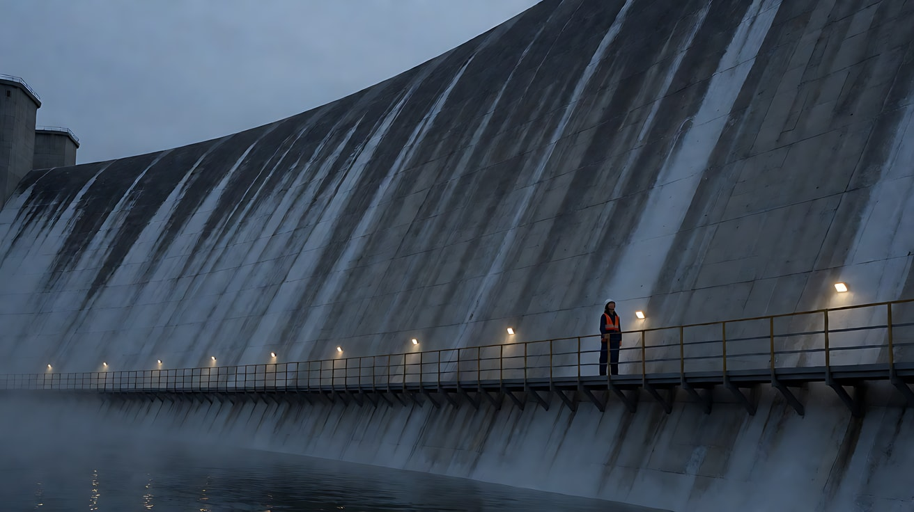

**【图生视频 · Seedance】**

```
【素材分工】@图片1 为首帧，锁定人物服装、坝体结构与走道位置。
【画风】风格化写实三维CG质感，大画幅胶片质感，细腻颗粒，冷色克制。
女工程师站在坝脚走道上，仰头看着坝体，然后转身沿走道向画右快步走去。坝体上方的泄洪口开始喷出水雾，雾气缓慢沿坝面向下弥漫。镜头固定在河岸低处，不移动，人物始终很小。走道上的工作灯一盏盏在雾里晕开。结尾停在她走到画右、身影被雾气部分遮住的画面。
【声音】低沉持续的水流轰鸣，钢走道上急促的脚步回声，一段极低的弦乐长音缓慢升起。
【约束】保持人物服装不变；人物在画面中始终很小；不切镜头；不要字幕、水印、Logo。
时长：8秒
```

**参数**：时长 8 秒 ｜ 画幅 16:9

**【检查点】**
- 人物是否只占画面很小比例，坝体压倒性
- 质感是否细腻、有颗粒，而不是塑料感
- 水雾是否沿坝面有方向地弥漫

**【常见问题与修复】**
| 现象 | 修复 |
|---|---|
| 人物太大 | 写"人物只占画面高度的二十分之一" |
| 坝体像模型 | 写"混凝土表面有水渍、裂纹和苔藓，细节极其清晰" |
| 雾太多遮住一切 | 写"薄雾，只在坝体下半部" |

---

### 练习2：载具固定机位——船头上的船夫（难度 ★★）

**目标**：用定妆图 + 场景图，把摄影机"焊"在快艇船头，面向船夫，船体颠簸、水花打在镜头上，体会物理真实。

**【生图 · Nano Banana】**

图1 角色定妆：

```
Character turnaround sheet of an original boatman in his fifties: a weathered face, a short grey beard,
a bright yellow fisherman's raincoat with the hood down, dark rubber boots, fingerless wool gloves.
Front view, three-quarter view, side view and back view, full body, plain light-grey background, even soft studio light.
Stylized semi-realistic 3D CG rendering, feature-film animation quality. Aspect ratio 16:9.
```

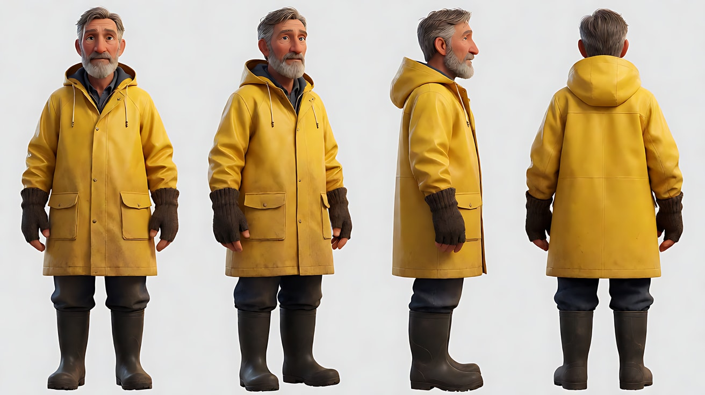

图2 场景：

```
An empty old dented tin motorboat on a wide swollen brown river at night in heavy rain, an outboard motor at the stern,
a small battery lamp hanging from a pole, choppy waves, dark riverbanks with flooded trees, no people.
Camera rigidly mounted on the bow facing back toward the stern, 24mm lens, deep focus,
large-format film look, subtle film grain. Cold blue night light, the warm battery lamp swinging.
Stylized semi-realistic 3D CG rendering, feature-film animation quality. Aspect ratio 16:9.
```

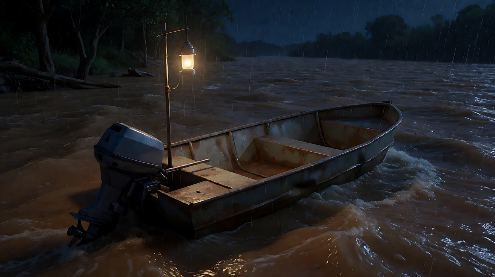

**【多图生视频 · Seedance】**

```
【素材分工】@图片1 锁定船夫的身份与服装；@图片2 仅参考快艇结构、机位方向与河面环境。
【画风】风格化写实三维CG质感，大画幅胶片质感，冷色夜光。
摄影机牢牢固定在快艇船头，面向船尾，船夫坐在船尾握着舷外机的舵柄，雨水打在黄色雨衣上。快艇随着浪剧烈上下颠簸，镜头与船体一起颠簸，整个画面跟着船起伏。一道浪打上船头，真实的水花溅在镜头上，又被雨冲开。船夫眯着眼盯着前方，用力把舵柄往左压，船身倾斜。挂灯随颠簸来回摆动，暖光在他脸上忽明忽暗。结尾停在他稳住舵柄、直视前方的画面。
【声音】舷外机持续的嘶吼，浪拍打铁皮船身的重击声，雨声，一段不断上升的弦乐音阶。
【约束】保持人物脸型、发型、服装不变；机位始终固定在船头，不脱离船体；不切镜头；不要字幕、水印、Logo。
时长：8秒
```

**参数**：时长 8 秒 ｜ 画幅 16:9

**【检查点】**
- 镜头是否与船一起颠簸（而不是稳定漂浮）
- 水花打在镜头上是否有真实的反馈
- 挂灯摆动是否让光在脸上变化

**【常见问题与修复】**
| 现象 | 修复 |
|---|---|
| 镜头像无人机在飞 | 写"摄影机固定在船头，与船体一起颠簸" |
| 水花遮住全部画面 | 写"一次水花溅上镜头，随即被雨冲开" |
| 船夫离开座位 | 写"他始终坐在船尾，握着舵柄" |

---

### 练习3：从细节到巨构——闸门开启（难度 ★★★，首尾帧）

**目标**：首帧是女工程师握住闸门手轮的手部特写，尾帧是巨大坝体泄洪口全开的大远景。用一次匀速后拉完成尺度揭示。

**【生图 · Nano Banana】**

图1 角色定妆：

```
Character turnaround sheet of an original woman engineer in her forties: short black hair, a dark-blue work uniform,
an orange reflective vest, a white hard hat, work gloves, a radio clipped to her chest.
Front view, three-quarter view, side view and back view, full body, plain light-grey background, even soft studio light.
Stylized semi-realistic 3D CG rendering, feature-film animation quality. Aspect ratio 16:9.
```

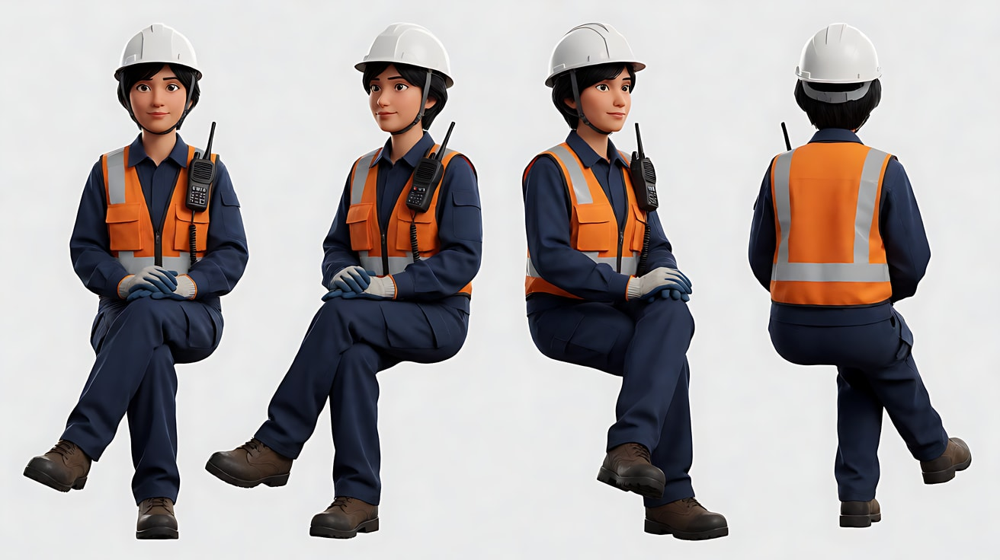

图2 首帧：

```
Using the character from image 1: an extreme close-up of her gloved hands gripping a large red iron hand wheel
on a steel valve housing at the top of a dam, rain droplets on the wheel, her orange vest at the edge of the frame.
85mm lens, shallow depth of field, large-format film look, fine grain. Cold blue night light, a warm work light from above.
Keep the outfit exactly as in image 1. Stylized semi-realistic 3D CG rendering, feature-film animation quality. Aspect ratio 16:9.
```

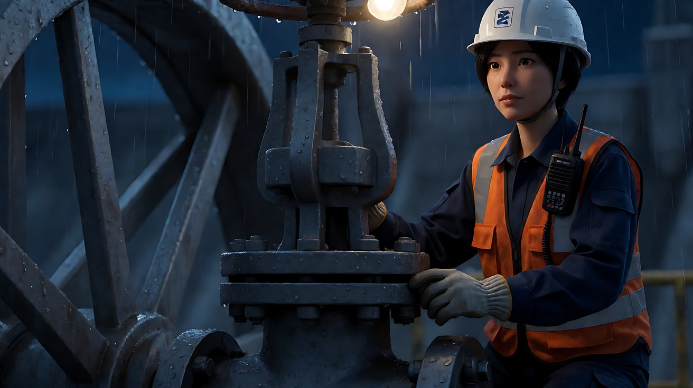

图3 尾帧：

```
An extreme wide shot of the massive curved concrete dam at night, three huge spillway gates fully open,
white water thundering down the dam face in thick curtains, mist rising into the beams of work lights,
a tiny figure in an orange vest standing at the valve station on top of the dam. Deep focus,
large-format film look, fine grain, cold blue palette with warm work lights.
Stylized semi-realistic 3D CG rendering, feature-film animation quality. Aspect ratio 16:9.
```

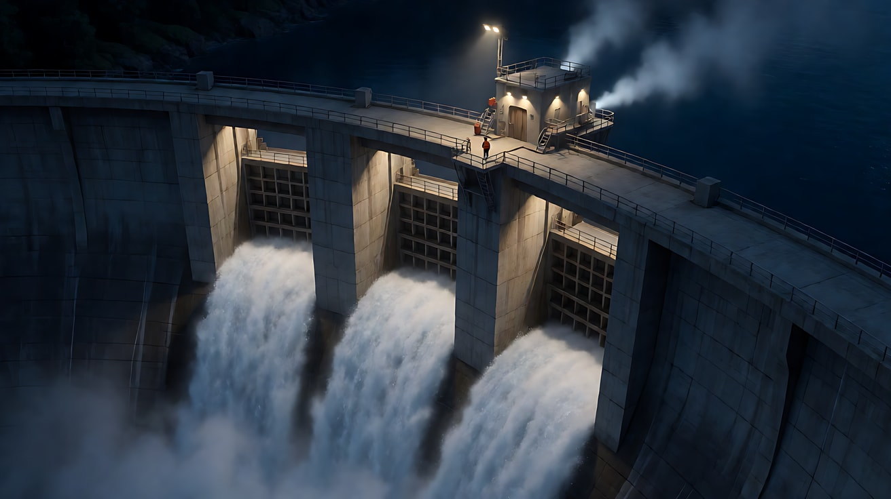

**【首尾帧生视频 · Seedance】**

```
【素材分工】@图片2 为首帧；@图片3 为尾帧，是最终画面目标；@图片1 锁定人物服装。只生成两帧之间的连续动作与后拉运动。
【画风】风格化写实三维CG质感，大画幅胶片质感，冷色夜景与暖色工作灯。
戴手套的双手用力转动红色手轮，一圈，再一圈。镜头开始匀速向后、向上拉开：先露出她的上半身和安全帽，再露出坝顶的阀门站，再露出整个坝顶；坝体下方三道巨大的闸门依次打开，白色水幕轰然倾泻而下，水雾升进工作灯的光束里。她在画面中变成一个小小的橙色身影。
【声音】手轮金属齿的咔哒声，随后是低频逐渐压过一切的水流轰鸣，弦乐音阶持续上升。
【约束】保持人物服装不变；后拉是唯一的主运镜，速度均匀；中间不跳切；不要字幕、水印、Logo。
时长：10秒
```

**参数**：时长 10 秒 ｜ 画幅 16:9

**【检查点】**
- 后拉是否匀速、连续
- 尺度变化是否从"一只手"到"整座坝"
- 闸门是否依次打开，水的重量感是否真实

**【常见问题与修复】**
| 现象 | 修复 |
|---|---|
| 后拉中途跳切 | 写"一个连续的后拉镜头，不切镜头" |
| 水像烟雾没有重量 | 写"厚重的白色水幕垂直砸下，底部炸开大量水雾" |
| 手轮变形 | 首帧只露出手轮的一段，写"手轮只转动两圈" |

---

### 练习4：三线交叉剪辑——一夜、一小时、十分钟（难度 ★★★★，多镜头）

**目标**：一个片段里放三条线索，每条线占一个镜头，配乐与嘀嗒声把它们拧成一股。

**【生图 · Nano Banana】**

图1 角色定妆：沿用练习3的图1（女工程师）。

图2 角色定妆：沿用练习2的图1（船夫）。

图3 角色定妆（女孩）：

```
Character turnaround sheet of an original ten-year-old girl: shoulder-length black hair stuck with rain,
a bright red raincoat with the hood up, blue rubber boots, holding a large yellow flashlight with both hands.
Front view, three-quarter view, side view and back view, full body, plain light-grey background, even soft studio light.
Stylized semi-realistic 3D CG rendering, feature-film animation quality. Aspect ratio 16:9.
```

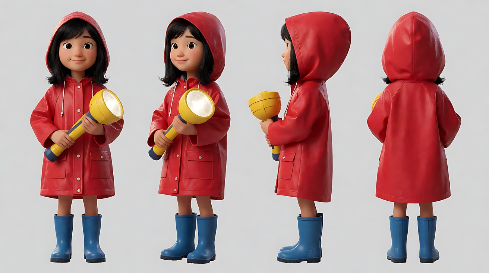

图4 场景（女孩所在的屋顶）：

```
Empty tiled rooftop of a small village house at night surrounded by floodwater, rain pouring, a TV antenna,
dark flooded streets below, a faint glow of distant work lights on the horizon upstream, no people.
Wide shot, eye level, 35mm lens, large-format film look. Cold blue night light.
Stylized semi-realistic 3D CG rendering, feature-film animation quality. Aspect ratio 16:9.
```

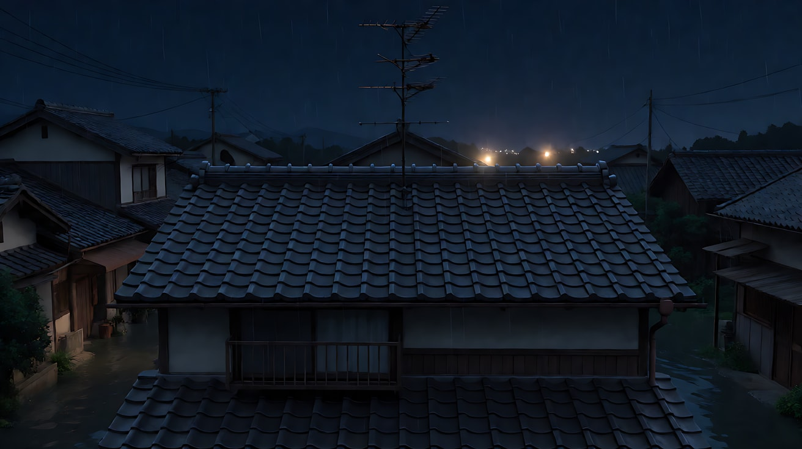

**【多图生视频 · Seedance】**

```
【素材分工】@图片1 锁定女工程师身份与服装，只出现在镜头1；@图片2 锁定船夫身份与服装，只出现在镜头2；@图片3 锁定女孩身份与服装，只出现在镜头3；@图片4 仅参考屋顶与洪水环境。
【画风】风格化写实三维CG质感，大画幅胶片质感，冷色夜景，暖色点光源。
镜头1：坝顶控制室的中近景，女工程师盯着一排闪烁的水位指示灯，墙上的圆钟指针跳了一格，她按住胸前的对讲机说："还有十分钟，下游得清空。"窗外是泄洪的白色水雾。
镜头2：镜头切至另一处，下游河道，摄影机固定在快艇船头面向船夫，船随浪剧烈颠簸，他把舵柄猛地压向一侧，快艇在湍流中急转，水花打上镜头。
镜头3：镜头切至另一处，村庄屋顶，女孩蹲在屋脊上，雨水打在红色雨衣上，她双手举起黄色手电，向河道方向一下一下地打开、关上，光束刺进雨幕。停在光束指向远方的画面。
【锁定】光线：三处都是冷蓝夜色加一个暖色点光源（控制室指示灯、船上挂灯、女孩的手电）；每个镜头只出现一个人物；三人分属三个不同地点。
【声音】一段持续上升、永不落下的弦乐音阶贯穿三镜，钟表嘀嗒声越来越快；镜头2加入引擎嘶吼，镜头3加入手电开关的咔哒声。
【约束】保持三人脸型、发型、服装不变；三处空间不互相混入；不要字幕、水印、Logo。
时长：12秒
```

**参数**：时长 12 秒 ｜ 画幅 16:9 ｜ 负载：3 个镜头、三个地点、一句对白，属于"有挑战"档

**【检查点】**
- 每个镜头是否只有一条线索、一个人物
- 三处空间的光是否统一为"冷蓝 + 一个暖点"
- 声音是否持续上升，把三镜连成一股

**【常见问题与修复】**
| 现象 | 修复 |
|---|---|
| 人物串到别的镜头 | 在【素材分工】写清每张定妆图只出现在哪个镜头 |
| 三镜像同一地点 | 每块开头写"镜头切至另一处"，并写清地点 |
| 女孩的手电光太弱 | 写"一道明亮的光束刺进雨幕" |
| 想要更长的交叉剪辑 | 每条线单独生成 2–3 段，在剪辑软件中交叉，越往后每段越短 |

---

### 练习5：原创三镜头场景——灯塔重新亮起（难度 ★★★★★）

**目标**：用本课技法拍一个原创场景。意图：让观众感到"远处的船"与"灯塔上的人"在同一刻被连在一起。镜头1实景大尺度（风暴中的灯塔与悬崖），镜头2交叉到海上的载具固定机位，镜头3回到灯室，手拉下电源拉杆，巨大透镜开始旋转，光束扫过海面——两条线在光里交汇。

**【生图 · Nano Banana】**

图1 角色定妆：

```
Character turnaround sheet of two original characters:
a lighthouse keeper in his sixties with a white beard, a thick navy wool sweater, an oilskin coat, a knitted cap;
a young fishing-boat captain in her thirties with tied-back brown hair, a dark-green waterproof jacket, a life vest.
Front view, three-quarter view and side view of each, full body, plain light-grey background, even soft studio light.
Stylized semi-realistic 3D CG rendering, feature-film animation quality. Aspect ratio 16:9.
```

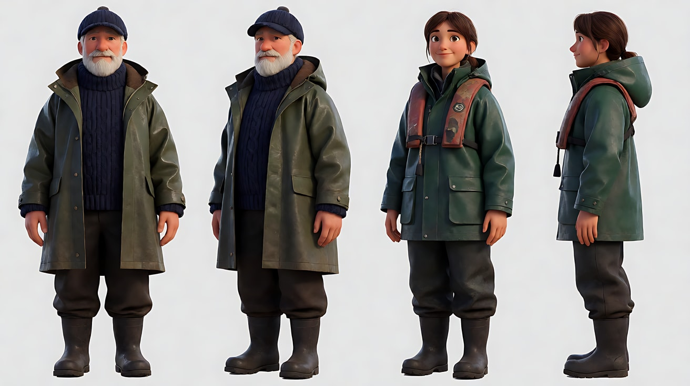

图2 镜头1关键帧：

```
An extreme wide shot at night in a storm of a tall dark stone lighthouse on the edge of a sheer black cliff,
enormous waves exploding white against the rocks below, the lamp at the top unlit,
a tiny figure in an oilskin coat climbing the outdoor iron stairs near the top, only one-thirtieth of the frame height.
Camera low on a distant rock, 50mm lens, deep focus, large-format film look, extremely fine detail, subtle grain.
Lighting: cold blue storm light, occasional pale lightning in the clouds.
Stylized semi-realistic 3D CG rendering, feature-film animation quality. Aspect ratio 16:9.
```

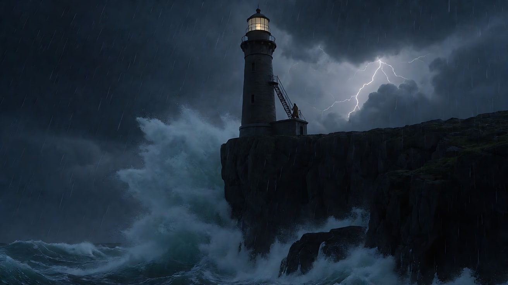

图3 镜头3关键帧：

```
Using the lighthouse keeper from image 1: a medium close-up inside the lamp room at the top of the lighthouse,
the keeper's hand pulling down a large brass lever, behind him a huge cylindrical ribbed glass lens assembly beginning to glow,
rain streaming down the surrounding windows. 35mm lens, shallow depth of field, large-format film look.
Lighting: the lens's warm white glow rising from behind as a strong backlight, cold blue storm light from the windows.
Keep the face and outfit exactly as in image 1.
Stylized semi-realistic 3D CG rendering, feature-film animation quality. Aspect ratio 16:9.
```

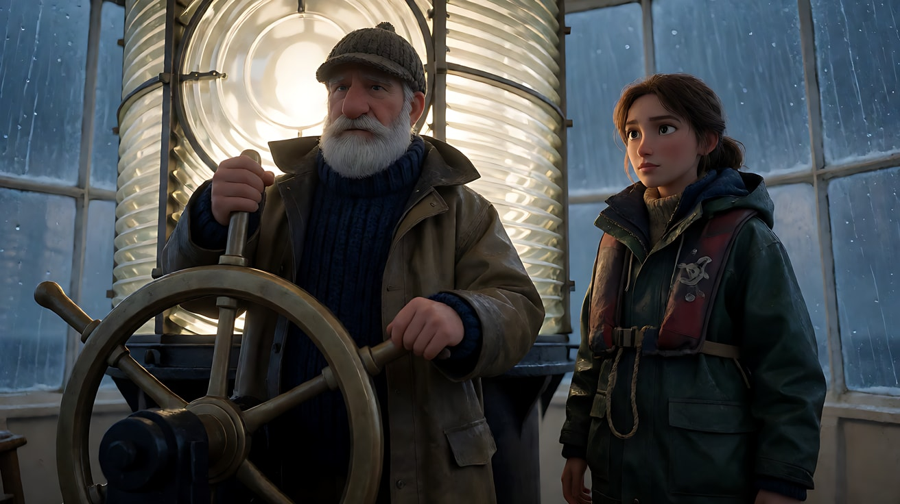

**【多图生视频 · Seedance】**

```
【素材分工】@图片1 锁定守塔人与船长两人的身份与服装；@图片2 为镜头1首帧；@图片3 仅作为镜头3的构图与光线参考，不作为首帧。
【画风】风格化写实三维CG质感，大画幅胶片质感，细腻颗粒，冷蓝风暴色调。
镜头1：低机位大远景，风暴之夜，黑色悬崖上的石砌灯塔顶端没有光，巨浪在下方礁石上炸成白沫。守塔人小小的身影顶着风沿外侧铁梯爬向灯室，只占画面高度的三十分之一。镜头固定。风浪的轰鸣与持续上升的弦乐。
镜头2：镜头切至海上，摄影机固定在渔船驾驶舱内、面向船长，整个舱体随巨浪剧烈倾斜颠簸，雨水与浪花砸在舱窗上。她双手把住舵轮，盯着漆黑一片的前方，嘴唇紧抿。驾驶舱里一只挂钟的秒针嘀嗒作响，越来越快。
镜头3：镜头切至灯室中近景，守塔人用双手把黄铜电源拉杆拉下，"咔"的一声。他身后巨大的玻璃透镜开始发亮、开始旋转，暖白色光从他背后升起，把他变成半剪影，光束扫过雨水淋漓的窗户射向海面。停在光束扫过窗外的一刻。弦乐在电源拉杆声后达到顶点，随即只剩透镜转动的低沉嗡鸣。
【锁定】光线：冷蓝风暴光为基调，镜头3新增透镜的暖白光作为唯一暖源；守塔人穿藏青毛衣与油布外套；船长穿深绿防水夹克与救生衣；灯塔在悬崖上，渔船在海上。
【声音】弦乐音阶从镜头1开始持续上升，镜头2叠加越来越快的嘀嗒声，镜头3电源拉杆声后音乐冲顶再骤然退去。
【约束】保持两人脸型、发型、服装不变；不出现沉船、落水等事故画面；不要字幕、水印、Logo。
时长：13秒
```

**参数**：时长 13 秒 ｜ 画幅 16:9 ｜ 负载：3 个镜头、两条线交叉、一个关键动作，属于"有挑战"档

**【检查点】**
- 镜头1是否用比例建立了尺度
- 镜头2是否是固定在舱体上的机位、随浪颠簸
- 镜头3的光是否有来源（透镜），并成为两条线的交汇
- 通读提示词，没有任何人名、片名、品牌名与触发词

**【常见问题与修复】**
| 现象 | 修复 |
|---|---|
| 镜头1灯塔已经亮着 | 写"灯塔顶端没有光，一片漆黑" |
| 镜头2舱体稳定不动 | 写"整个舱体随巨浪剧烈倾斜，镜头与舱体一起晃" |
| 镜头3透镜结构混乱 | 写"一组巨大的圆柱形玻璃透镜"，减少细节描述 |
| 声音没有上升感 | 写"弦乐音阶持续上升、永不落下" |
