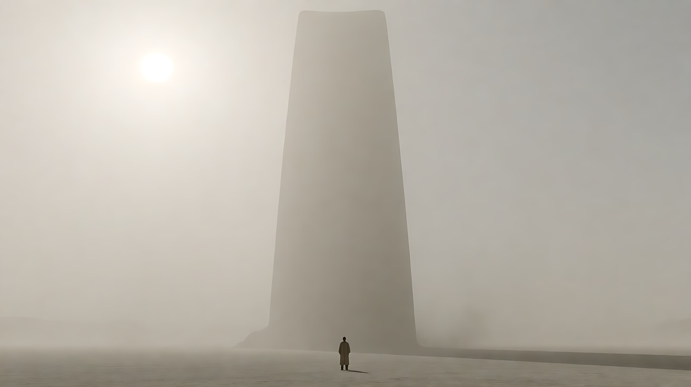
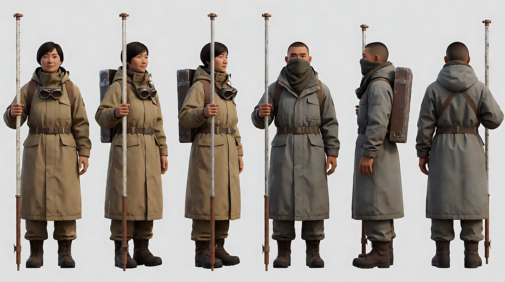
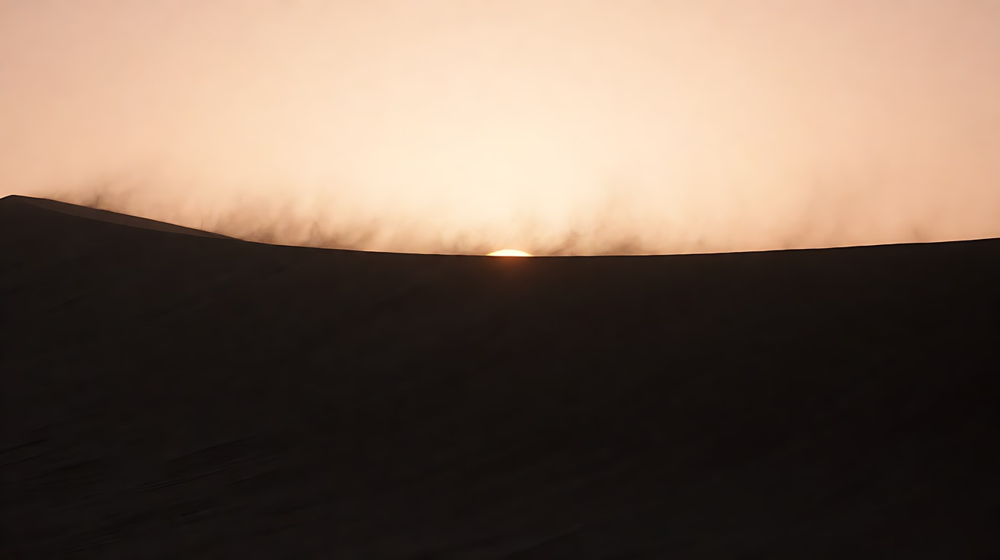
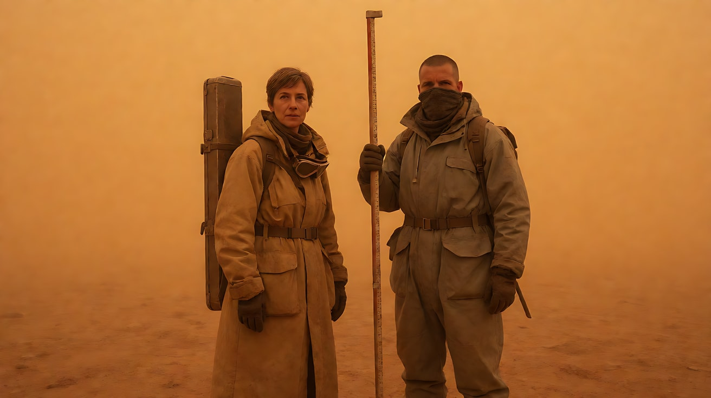
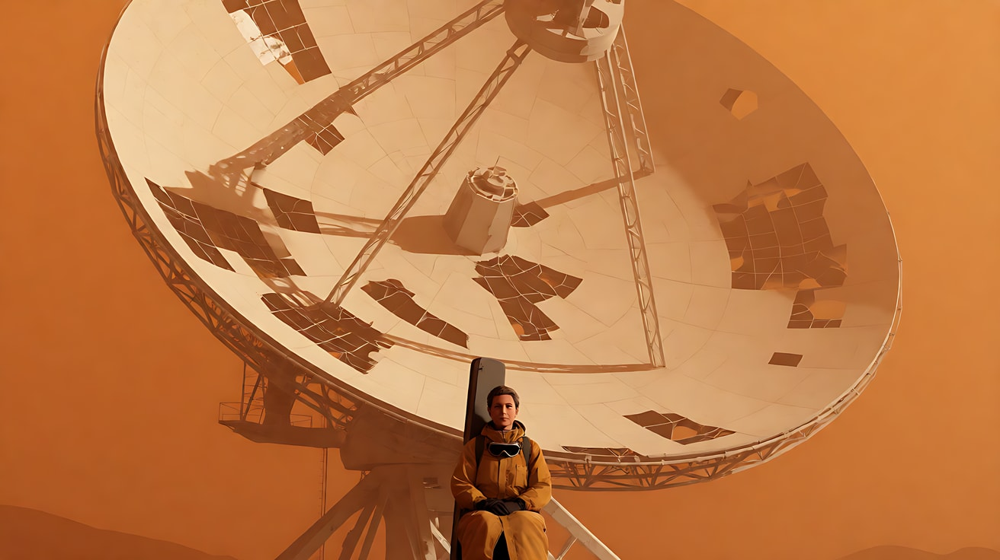
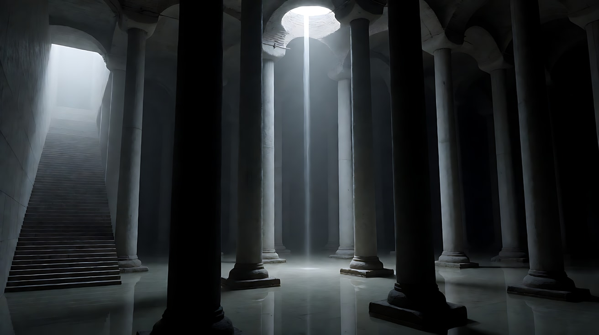
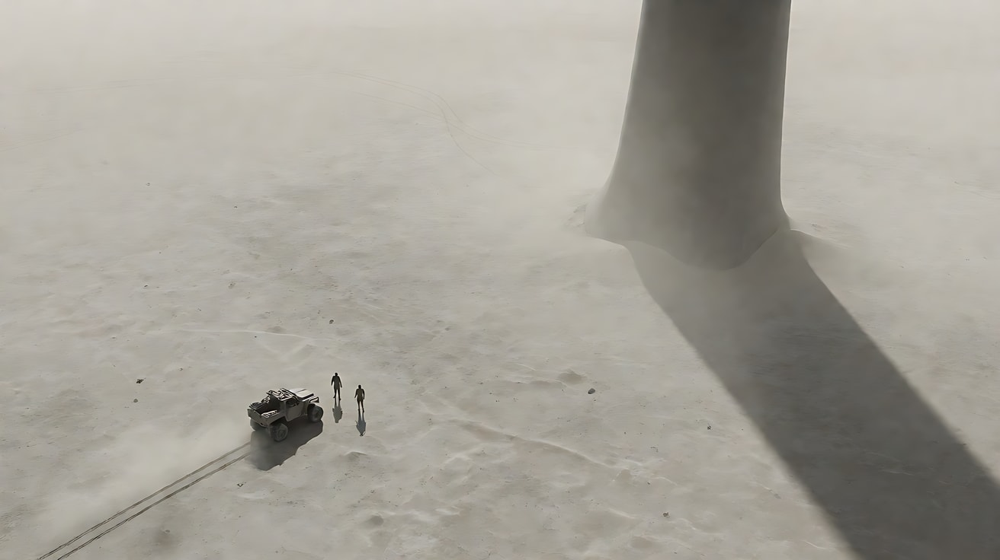
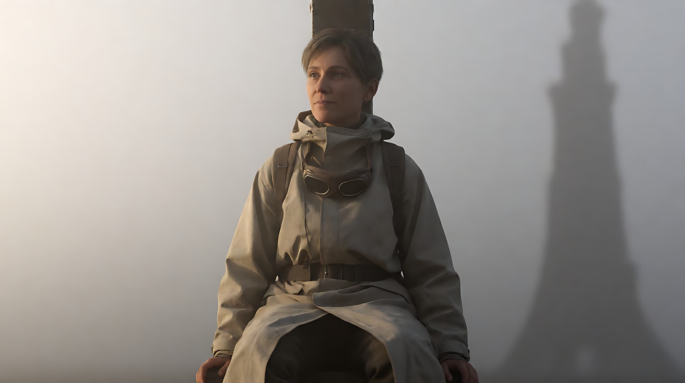

# L07-10 巨物、剪影与沉默 · 提示词

> 本组练习：用极简巨物与渺小人物的比例、逆光剪影、雾与近乎单色的色板、极缓慢的运镜、与巨物同步的低频声音，拍一个原创的"抵达未知"故事。提示词只写技术，不写任何人名与片名。｜ 配套教学：[L07-10 教学文件](../教学/L07-10-维伦纽瓦.md) ｜ 规范：[写作规范](../../模板/写作规范.md)
>
> 画风默认使用开关 A（风格化写实 CG）。大远景与剪影镜头不露正脸，可以尝试开关 B（写实摄影）。如改用 2D 动画，删掉所有焦段、光圈、景深词。

**本组技法开关（不含人名，可直接复用）**

```
极简巨物：形状简单（光滑的黑色巨块、粗野主义混凝土方体、巨大的圆盘），细节越少越神秘。
尺度比例：人物只是画面底部的一个小点，巨物占据画面大部分。
剪影：逆光，人物只剩黑色轮廓，没有面部细节，等距排成一线。
雾与单色：近乎单色的色板（雾灰、沙黄、灰白），雾或尘吞掉背景。
极慢运镜：缓慢推近或缓慢航拍，人物几乎不动。
低频：一个深沉的低频轰鸣，在巨物出现时响起，身体能感到震动。
```

**本组共用的原创故事：荒原上的旧信号塔**

- 人物：两名勘测员。
  - 领队：四十岁女性，短发，沙色防风长外套，护目镜挂在脖子上，背着金属仪器箱。
  - 队员：三十岁男性，平头，灰色防风服，围巾遮住口鼻，手持一根测量杆。
- 地点：沙尘弥漫的荒原，矗立着一座早已停用、高耸入云的黑色信号塔，表面光滑没有窗户。

---

### 练习1：巨物与渺小人类（难度 ★）

**目标**：用单张关键帧建立压倒性的比例：巨物占满画面，人物是底部一个小点；雾吞掉一切细节。

**【生图 · Nano Banana】**

图1 关键帧：

```
An extreme wide shot of a vast flat wasteland in thick pale dust haze. At the center rises a colossal smooth black tower,
a simple tall slab with no windows and no details, its top disappearing into the haze, occupying most of the frame height.
At the bottom of the frame, a single tiny human figure in a sand-colored long coat stands facing the tower,
only a small dot, casting a faint shadow. Camera low and far away, 35mm lens, deep focus.
Lighting: a pale diffused sun behind the haze at upper left, flat soft light, almost no contrast on the tower.
Near-monochrome palette of fog grey and pale sand. Large negative space.
Stylized semi-realistic 3D CG rendering, feature-film animation quality. Aspect ratio 16:9.
```

中文释义：沙尘雾中的荒原大远景；正中一座光滑无窗的黑色巨塔，塔顶消失在雾里；画面底部一个穿沙色长外套的小人影；雾后的苍白太阳；雾灰与沙黄的近单色。



**【图生视频 · Seedance】**

```
【素材分工】@图片1 为首帧，锁定巨塔形状、人物服装轮廓与荒原环境。
【画风】风格化写实三维CG质感，近乎单色的雾灰与沙黄。
人物站在巨塔脚下，几乎不动，只是缓慢地抬起头，仰望塔顶。沙尘雾从画右向画左缓慢流过，塔的上半部分在雾中时隐时现。镜头以极缓慢的推近向前移动，结束时画面只比开始近一点，人物仍然只是一个小点。结尾停在人物仰头、塔顶没入雾中的画面。
【声音】无配乐；风沙的低语；镜头推近到一半时，一个深沉的低频轰鸣从画外缓缓响起，像从塔的内部传来，持续到结尾。
【约束】保持巨塔形状简单、无窗无细节；人物始终很小；不切镜头；不要字幕、水印、Logo。
时长：10秒
```

**参数**：时长 10 秒 ｜ 画幅 16:9

**【检查点】**
- 巨物是否极简、没有长出多余的科幻细节
- 人物是否始终是一个小点
- 低频声音是否与巨物"绑定"出现

**【常见问题与修复】**
| 现象 | 修复 |
|---|---|
| 塔上长出灯光和管线 | 写"表面光滑，无窗、无灯、无任何细节" |
| 推近太多 | 写"结束时只比开始近一点" |
| 色彩过于丰富 | 写"近乎单色，只有雾灰与沙黄" |

---

### 练习2：剪影行进——沙脊上的两个人（难度 ★★）

**目标**：用定妆图 + 场景图，把两名勘测员拍成逆光剪影，沿沙脊缓慢行走，没有面孔，只有轮廓。

**【生图 · Nano Banana】**

图1 角色定妆：

```
Character turnaround sheet of two original surveyors:
a woman in her forties with short hair, a long sand-colored windproof coat, goggles hanging at her neck, a metal instrument case on her back;
a man in his thirties with a buzz cut, a grey windproof suit, a scarf covering his mouth and nose, holding a tall measuring pole.
Front view, three-quarter view, side view and back view of each, full body, plain light-grey background, even soft studio light.
Stylized semi-realistic 3D CG rendering, feature-film animation quality. Aspect ratio 16:9.
```



图2 场景：

```
Empty long curved sand dune ridge at dusk, the sky a pale washed-out orange glowing behind the ridge, the low sun just below the crest,
the dune below the ridge falling into pure dark shadow, fine sand blowing off the crest like smoke, no people.
Wide shot from below the ridge, 85mm lens, compressed perspective. Near-monochrome palette of pale orange and black.
Stylized semi-realistic 3D CG rendering, feature-film animation quality. Aspect ratio 16:9.
```



**【多图生视频 · Seedance】**

```
【素材分工】@图片1 仅参考两人的服装轮廓与随身物品（仪器箱、测量杆），不显示面部；@图片2 仅参考沙脊形状、逆光天空与色调。
【画风】风格化写实三维CG质感，逆光剪影，近乎单色的淡橙与纯黑。
两名勘测员沿沙脊从画左向画右缓慢行走，一前一后，保持等距。他们完全是黑色剪影：只能看出领队背上的仪器箱方形轮廓、队员手中测量杆的细长竖线，长外套下摆被风吹起。沙脊顶上的细沙被风吹成薄烟。镜头以长焦固定，不移动。结尾停在两人走到画面中央、停步并肩站立的剪影。
【声音】无配乐；风声，脚步陷进沙里的闷响；远处一声极低的轰鸣，像从地平线以外传来。
【约束】两人始终是纯黑剪影，没有任何面部细节；行走方向始终从左到右；不切镜头；不要字幕、水印、Logo。
时长：10秒
```

**参数**：时长 10 秒 ｜ 画幅 16:9

**【检查点】**
- 是否是纯剪影，没有面孔细节
- 两人轮廓是否靠道具区分（方形仪器箱 / 细长测量杆）
- 节奏是否慢、稳

**【常见问题与修复】**
| 现象 | 修复 |
|---|---|
| 人物被补光照亮 | 写"人物完全背光，只有纯黑轮廓" |
| 两人走得太快 | 写"缓慢行走，每一步都陷进沙里" |
| 沙脊下方有细节 | 写"沙脊以下全部沉入纯黑阴影" |

---

### 练习3：巨物从雾中浮现（难度 ★★★，首尾帧）

**目标**：首帧只有浓雾和一个人；尾帧雾散开一部分，一座巨大的废弃圆盘天线浮现出来。模型生成中间的"揭示"。

**【生图 · Nano Banana】**

图1 角色定妆：沿用练习2的图1（只用领队）。

图2 首帧：

```
Using the woman from image 1: a wide shot of her from behind, standing small at the bottom center of the frame
in a wall of thick sepia-orange dust haze, nothing visible beyond her except the glowing haze, the ground fading out after a few meters.
Camera at low eye level behind her, 35mm lens. Flat diffused orange light. Near-monochrome sepia-orange palette.
Keep the outfit exactly as in image 1. Stylized semi-realistic 3D CG rendering, feature-film animation quality. Aspect ratio 16:9.
```



图3 尾帧：

```
Using the woman from image 1 and the same framing as image 2: the haze has partly thinned, revealing
a colossal derelict radio telescope dish towering in front of her, its huge curved white surface tilted toward the sky,
filling most of the frame, a few broken panels, the woman still a tiny figure at the bottom center.
Flat diffused orange light, the dish fading into haze at its edges. Near-monochrome sepia-orange palette.
Keep the outfit exactly as in image 1. Stylized semi-realistic 3D CG rendering, feature-film animation quality. Aspect ratio 16:9.
```



**【首尾帧生视频 · Seedance】**

```
【素材分工】@图片2 为首帧；@图片3 为尾帧，是最终画面目标；@图片1 锁定领队的服装。只生成两帧之间的连续变化。
【画风】风格化写实三维CG质感，近乎单色的棕橙色雾霾。
领队背对镜头站在浓雾中，一动不动。雾从画面中央缓慢向两侧退散，先是一条巨大的弧形边缘从雾里显现，接着是整个白色圆盘的轮廓，越来越清楚，高高悬在她头顶。她慢慢摘下挂在脖子上的护目镜，握在手里。镜头固定不动。
【声音】无配乐；风声逐渐减弱；圆盘显现时，一个深沉的低频轰鸣从画面深处升起，伴着金属结构在风中发出的悠长吱呀声。
【约束】保持人物服装不变；人物始终在画面底部中央、很小；巨物形状简单；中间不跳切；不要字幕、水印、Logo。
时长：10秒
```

**参数**：时长 10 秒 ｜ 画幅 16:9

**【检查点】**
- 巨物是否"从雾中浮现"，而不是突然出现
- 人物与巨物的比例是否压倒性
- 低频是否在巨物显现时升起

**【常见问题与修复】**
| 现象 | 修复 |
|---|---|
| 巨物一下子全部出现 | 写"先显现边缘，再显现整体，缓慢" |
| 人物转身 | 写"始终背对镜头，只有摘护目镜的手部动作" |
| 雾全部散尽 | 写"雾只散开一部分，巨物边缘仍融在雾里" |

---

### 练习4：慢节奏三镜——走下蓄水穹顶（难度 ★★★★，多镜头）

**目标**：三个镜头都慢，每个镜头只有一个动作，用"巨物空间 → 剪影 → 低角度渺小"的递进制造敬畏。

**【生图 · Nano Banana】**

图1 角色定妆：沿用练习2的图1。

图2 场景：

```
Empty colossal underground water cistern, a cathedral-like space with rows of massive plain concrete columns
receding into darkness, a shallow still layer of water on the floor reflecting the columns,
a single narrow shaft of pale daylight falling vertically from an opening in the ceiling far above,
an endless straight concrete staircase descending from the upper left into the space, light mist, no people.
Extreme wide shot, 24mm lens, deep focus. Near-monochrome palette of cold grey and black.
Stylized semi-realistic 3D CG rendering, feature-film animation quality. Aspect ratio 16:9.
```



**【多图生视频 · Seedance】**

```
【素材分工】@图片1 锁定两名勘测员的服装与随身物品；@图片2 仅参考蓄水穹顶的空间、柱列、光柱与水面。
【画风】风格化写实三维CG质感，近乎单色的冷灰与黑。
镜头1：固定大远景，巨大的地下蓄水穹顶，两名勘测员小小的身影沿着画左上方笔直的混凝土长阶梯缓缓往下走，像两个小点。一束苍白的天光从穹顶开口垂直落下，照在水面中央。脚步声在空间里被拉成长长的回响。
镜头2：镜头切至水面高度的中景，两人站在光柱背后，被逆光勾成两道黑色剪影，领队背上的方形仪器箱与队员手中的测量杆在光柱中清楚可辨。领队抬起一只手，示意停下。水面倒映着两道剪影。滴水声。
镜头3：镜头切至低角度大远景，两人站在水中，头顶是一排排巨大的混凝土柱，向黑暗深处延伸，他们在画面底部极小。一阵深沉的低频轰鸣从穹顶深处传来，水面泛起同心的细纹，柱顶簌簌落下细尘。两人一动不动。停在水面细纹扩散的画面。
【锁定】光线：唯一光源是穹顶开口垂直落下的苍白光柱，其余为冷灰与黑；两人始终穿定妆中的服装，领队背仪器箱，队员拿测量杆；阶梯在画左上方。
【声音】无配乐；回响的脚步、滴水、低频轰鸣，三个镜头各一种声音，最后的低频要让人"感到"震动。
【约束】两人在镜头1和镜头3中始终很小，镜头2为剪影不露面部；穹顶结构简单，不出现机械或文字；不要字幕、水印、Logo。
时长：13秒
```

**参数**：时长 13 秒 ｜ 画幅 16:9 ｜ 负载：3 个慢镜头、无对白，属于"稳妥"档

**【检查点】**
- 三个镜头是否都慢，每个镜头只有一个动作
- 镜头2剪影是否纯黑、靠道具辨认人物
- 低频是否带来可见的物理反馈（水纹、落尘）

**【常见问题与修复】**
| 现象 | 修复 |
|---|---|
| 镜头1人物太大 | 写"两人只是阶梯上的两个小点" |
| 镜头3水面剧烈晃动 | 写"只有同心的细纹，缓慢扩散" |
| 光柱变成多束光 | 写"只有一束光，从穹顶唯一的开口垂直落下" |

---

### 练习5：原创三镜头场景——信号塔醒来（难度 ★★★★★）

**目标**：用本课技法拍一个原创场景。意图：让观众感到一个沉睡多年的巨物"注意到"了这两个人。镜头1航拍大远景交代尺度，镜头2沙脊上的剪影停步，镜头3领队的近景——低频响起，远处巨塔的顶端第一次亮起一道光。

**【生图 · Nano Banana】**

图1 角色定妆：沿用练习2的图1。

图2 镜头1关键帧：

```
A high aerial extreme wide shot looking down at a vast wasteland in pale dust haze, a colossal smooth black tower rising at frame right,
its top lost in the haze, its long faint shadow stretching across the sand; at the lower left, a small dusty all-terrain vehicle
parked next to two tiny human figures, leaving a thin line of tire tracks behind it.
Aerial view, 35mm lens, deep focus. Flat diffused light from a pale sun in the haze.
Near-monochrome palette of fog grey and pale sand.
Stylized semi-realistic 3D CG rendering, feature-film animation quality. Aspect ratio 16:9.
```



图3 镜头3关键帧：

```
Using the woman from image 1: a medium close-up of her in profile on the left third of the frame, goggles pushed up on her forehead,
fine dust on her cheek, looking toward frame right; out of focus in the far background at frame right,
the dark silhouette of the colossal tower in the haze. 85mm lens, shallow depth of field.
Lighting: soft diffused haze light from frame left, the right side of her face in soft shadow.
Near-monochrome palette of fog grey and pale sand. Keep the face, hairstyle and outfit exactly as in image 1.
Stylized semi-realistic 3D CG rendering, feature-film animation quality. Aspect ratio 16:9.
```



**【多图生视频 · Seedance】**

```
【素材分工】@图片1 锁定两名勘测员的身份、服装与随身物品；@图片2 为镜头1首帧；@图片3 仅作为镜头3的构图与光线参考，不作为首帧。
【画风】风格化写实三维CG质感，近乎单色的雾灰与沙黄。
镜头1：高空航拍大远景，荒原被苍白沙尘笼罩，画右矗立着一座光滑的黑色巨塔，塔顶没入雾中，长长的淡影横过沙地。画左下方，一辆小小的越野车停着，两个小人影站在车旁。镜头以极缓慢的速度向巨塔方向平移。只有风声。
镜头2：镜头切至沙脊下方的长焦中景，两人沿沙脊向画右走去，完全是逆光的黑色剪影，仪器箱和测量杆的轮廓清楚。领队突然停步，队员也随之停下，两道剪影并肩站在沙脊上，一动不动。风把沙脊顶的细沙吹成薄烟。
镜头3：镜头切至领队的中近景侧脸，她在画面左三分之一处，护目镜推在额头上，脸颊上有细沙，望向画右。背景中虚焦的巨塔剪影立在雾里。一个深沉的低频轰鸣从远处升起，她脸颊上的细沙随震动轻轻滑落；远处巨塔的顶端第一次亮起一道白色的细光。她的瞳孔微微收缩，没有眨眼。停在她望着那道光的侧脸上。
【锁定】光线：雾后苍白的漫射光从画左来，近乎单色；巨塔始终在画右；两人始终穿定妆中的服装；镜头2为纯剪影不露面部。
【声音】无配乐；镜头1、2只有风声与沙声，镜头3低频轰鸣升起，持续到结尾，几乎盖过风声。
【约束】保持领队脸型、发型、服装不变；巨塔形状简单、无窗无细节，只有顶端一道细光；不要字幕、水印、Logo。
时长：13秒
```

**参数**：时长 13 秒 ｜ 画幅 16:9 ｜ 负载：3 个慢镜头、无对白、一次光变化，属于"稳妥"档

**【检查点】**
- 镜头1是否用航拍建立了"小车小人 vs 巨塔"的尺度
- 镜头2是否是纯剪影，停步是否是这一镜唯一的动作
- 镜头3的低频是否有物理反馈（细沙滑落），巨塔的光是否成为唯一的"事件"
- 通读提示词，没有任何人名、片名

**【常见问题与修复】**
| 现象 | 修复 |
|---|---|
| 巨塔亮起大量灯光 | 写"只有塔顶一道白色细光" |
| 镜头3人物表情夸张 | 写"面部几乎不动，只有瞳孔微缩" |
| 镜头1航拍速度过快 | 写"极缓慢的平移，几乎察觉不到" |
| 色彩跑出单色 | 每个镜头块都提一次"雾灰与沙黄" |
