# L07-11 精准锁定与冷调低调 · 提示词

> 本组练习：锁定机位、与人物同速的隐形运镜、黄绿冷调与有层次的低调暗部、强迫症式对称构图。｜ 配套教学：[L07-11 教学文件](../教学/L07-11-大卫芬奇.md) ｜ 规范：[写作规范](../../模板/写作规范.md)
>
> 画风默认使用开关 A（风格化写实 CG）。如改用 2D 动画，删掉所有焦段、光圈、景深词。
>
> 本课风格指纹（只写技术，不写人名）：中近景为主 ｜ 50mm 中等景深 ｜ 居中对称、水平线绝对水平 ｜ 顶光与实用光、黄绿冷青、暗部大但有细节 ｜ 锁定或与人物同速的极平稳移动 ｜ 精准短促的插入镜头。

---

### 练习1：锁定机位的深夜办公桌（难度 ★）

**目标**：只用一个锁定机位和一个小动作，体会"画面越静、越整齐，观众越不安"。意图：让观众感到她刚发现了一个不该存在的数字。

**【生图 · Nano Banana】**

图1 关键帧：

```
A symmetrical medium shot of an original woman in her late thirties, short dark bob haircut, grey turtleneck,
sitting perfectly centered at a long steel desk in an empty open-plan office at night, a stack of paper files squared neatly in front of her.
Two identical dark filing cabinets frame her on the left and right edges of the frame, the desk edge is perfectly horizontal.
Camera at seated eye level, straight-on, 50mm lens, moderate depth of field so the rows of empty desks behind her stay readable but soft.
Lighting: a single bank of overhead fluorescent tubes directly above her as the only key light, slightly yellow-green color temperature,
the rest of the office falls into deep shadow with visible detail, a faint cool cyan glow from a monitor on her face. Low saturation, skin tones muted.
Stylized semi-realistic 3D CG rendering, feature-film animation quality. Aspect ratio 2.39:1.
```

中文释义：对称中景，女人居中坐在长钢桌前，两侧一模一样的文件柜夹住画面，桌沿绝对水平；坐姿视线高度正面机位、50mm、中等景深；头顶荧光灯为唯一主光，偏黄绿；其余区域深暗但有细节；显示器冷青光照脸；低饱和。

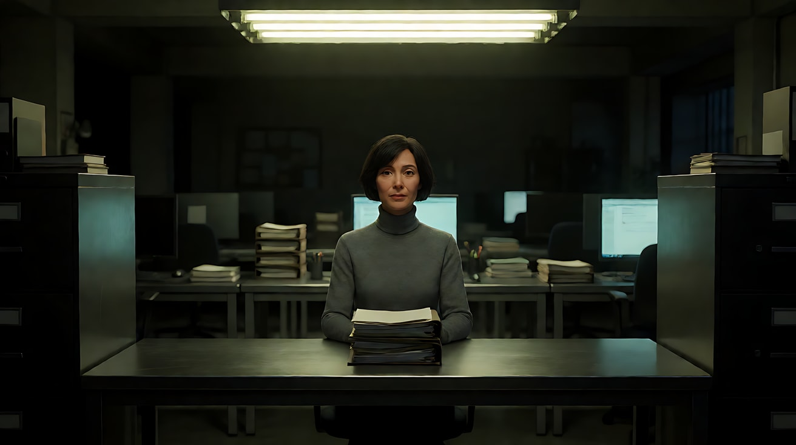

**【图生视频 · Seedance】**

```
【素材分工】@图片1 为首帧，锁定人物身份、服装、办公室布局与对称构图。
【画风】风格化写实三维CG质感，低饱和，偏黄绿冷调。
她用一根手指沿着文件上的一行数字慢慢往右移，在某一处停住。手指没有离开纸面，她的眼睛从文件抬起，看向画面正前方，停住不动。镜头完全锁定，不推、不摇、不晃，对称构图保持不变。头顶荧光灯轻微闪烁一次，随即恢复稳定，暗部始终保留细节。结尾停在她抬眼直视前方、手指仍按在纸上的画面。
【声音】无配乐，荧光灯低沉的电流嗡声，纸张轻微摩擦声，远处空调出风的持续低鸣。
【约束】保持人物脸型、发型、服装不变；镜头绝对静止；不要字幕、水印、Logo；纸面不出现可读文字。
时长：6秒
```

**参数**：时长 6 秒 ｜ 画幅 2.39:1（平台无此选项时选 16:9）

**【检查点】**
- 镜头是否完全不动，文件柜是否始终对称
- 暗部是否"深但有细节"，而不是死黑
- "手指停住 → 抬眼"这两个动作是否干净

**【常见问题与修复】**
| 现象 | 修复 |
|---|---|
| 镜头出现缓慢推进 | 加"镜头绝对静止，构图不变"，删掉所有带"推""靠近"的词 |
| 画面整体发绿像滤镜 | 改成"荧光灯偏黄绿色温，肤色低饱和但仍是肤色" |
| 暗部变成纯黑 | 加"暗部细节可见，桌腿与椅背轮廓清晰" |
| 她做了多余的表情 | 写"面部几乎不动，只有视线抬起" |

---

### 练习2：同速跟移的走廊（难度 ★★）

**目标**：练"隐形运镜"——镜头与人物同速移动，人物在画面中的位置始终不变。意图：让观众感到他每一步都被计算过。

**【生图 · Nano Banana】**

图1 角色定妆：

```
Character turnaround sheet of an original man in his forties: neatly combed short grey-brown hair, thin wire-rimmed glasses,
a charcoal suit with a slightly loosened dark tie, a slim leather document folder under his arm.
Front view, three-quarter view, side view and back view, full body, eye-level camera, 50mm lens, deep focus,
plain light-grey background, even soft studio light from the front. Stylized semi-realistic 3D CG rendering, feature-film animation quality. Aspect ratio 16:9.
```

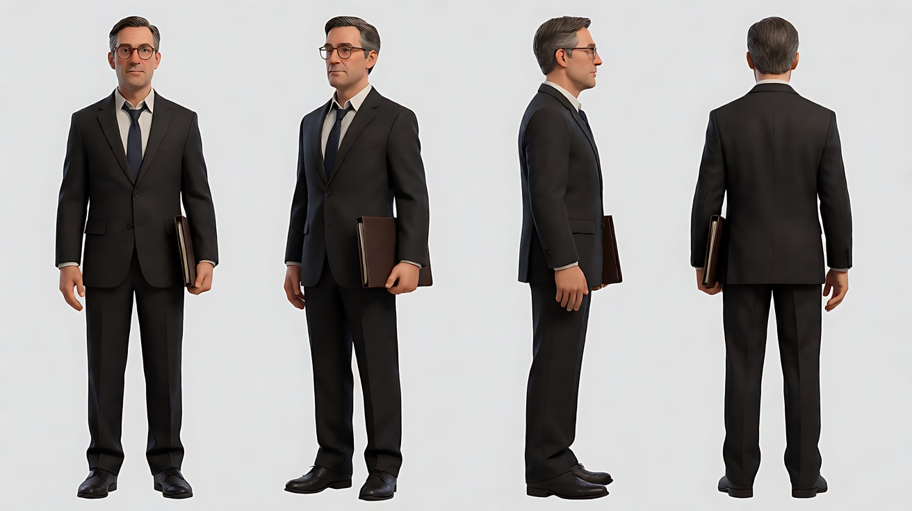

图2 场景：

```
Empty long corridor of an old government records building at night, identical frosted-glass office doors evenly spaced on both walls,
a row of overhead fluorescent fixtures every few meters, some flickering, polished linoleum floor reflecting the lights, no people.
Wide shot from the center of the corridor, eye level, 35mm lens, deep focus, one-point perspective with the vanishing point dead center.
Lighting: yellow-green fluorescent overhead, the far end of the corridor falling into deep shadow. Low saturation.
Stylized semi-realistic 3D CG rendering, feature-film animation quality. Aspect ratio 16:9.
```

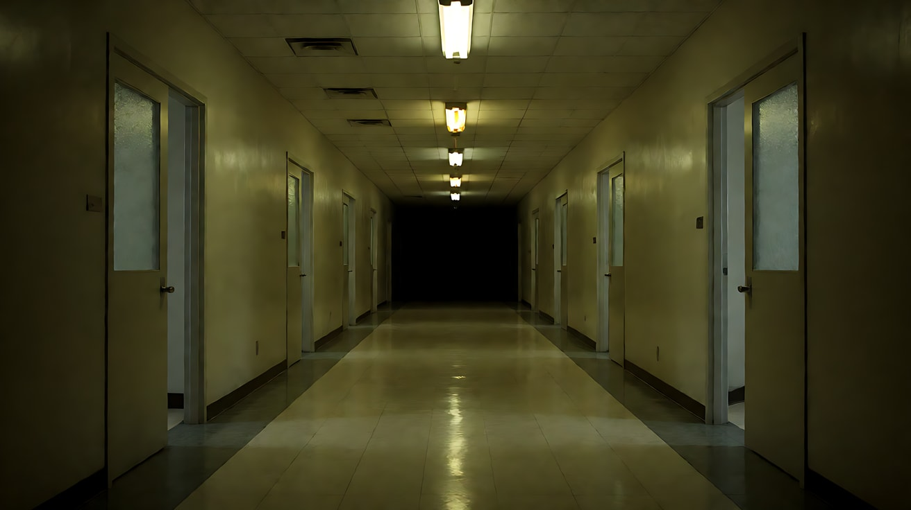

**【多图生视频 · Seedance】**

```
【素材分工】@图片1 锁定人物身份、服装与文件夹，不参考其灰色背景；@图片2 仅参考走廊布局、灯具间距与光线色温，不作为首帧。
【画风】风格化写实三维CG质感，低饱和，偏黄绿冷调。
男人从走廊中段沿中线向画面纵深方向走去，背对镜头，步速均匀，文件夹夹在腋下。镜头在他身后与他完全同速向前移动，他在画面中的大小和位置始终不变，两侧玻璃门有节奏地从画面两边滑过。头顶荧光灯一盏接一盏从他头上经过，他的肩膀被灯光依次照亮又落入暗部。他在一扇门前停下，镜头同时停住，没有惯性。结尾停在他停步、侧脸微转向那扇门的背影上。
【声音】无配乐，皮鞋踩在油毡地面上的均匀脚步声，荧光灯电流声随着灯具经过时略起略落，停步后走廊安静下来。
【约束】保持人物脸型、发型、服装不变；运动极平稳，无晃动、无呼吸感、无变速；不要字幕、水印、Logo；门上不出现可读文字。
时长：8秒
```

**参数**：时长 8 秒 ｜ 画幅 16:9

**【检查点】**
- 人物在画面中的位置和大小是否从头到尾不变
- 停步时镜头是否"同时停"，没有冲过去或拖后
- 灯光是否一盏一盏扫过肩膀

**【常见问题与修复】**
| 现象 | 修复 |
|---|---|
| 镜头比人快，追上去拍到侧脸 | 写"镜头与人物保持固定距离，始终在他正后方" |
| 有手持晃动感 | 加"像在轨道上移动，绝对平稳" |
| 人物停下后镜头继续前推 | 写"他停步的同一瞬间镜头停住" |
| 走廊变成弯的 | 加"走廊笔直，一点透视，消失点在画面正中" |

---

### 练习3：精确推进到插入镜头（难度 ★★★，首尾帧）

**目标**：用首尾帧把一次匀速推进锁死，从对称中景推到他手里的文件夹。意图：让观众感到他手里的东西比他的脸更重要。

**【生图 · Nano Banana】**

图1 角色定妆：沿用练习2 图1。

图2 首帧：

```
Using the character from image 1: a symmetrical medium shot of him sitting at the exact center of a long empty conference table at night,
the leather document folder closed in front of him, both hands resting flat on either side of it.
Two identical tall windows behind him with closed blinds, the table edge perfectly horizontal.
Camera straight-on at seated eye level, 50mm lens, moderate depth of field.
Lighting: a single rectangular overhead fixture directly above the table as the key light, yellow-green tint, top light leaving his eyes slightly shadowed,
the room edges in deep shadow with visible detail. Low saturation.
Keep the face, hairstyle and outfit exactly as in image 1. Stylized semi-realistic 3D CG rendering, feature-film animation quality. Aspect ratio 16:9.
```

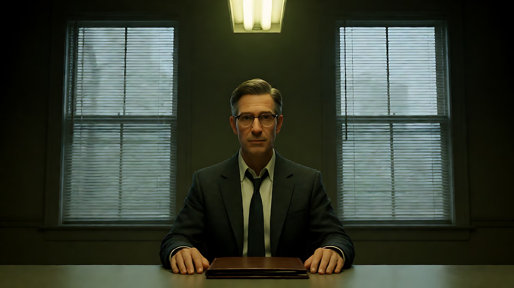

图3 尾帧：

```
Using the character and the exact same table, lighting and color as image 2:
a top-down-tilted close-up insert of the opened leather folder on the table, a single photograph inside lying face-down,
his right index finger resting on its corner. The folder is perfectly centered and squared to the frame.
Camera above the table, 50mm lens, shallow depth of field, the table surface falling off into shadow at the frame edges.
Keep the hand, sleeve and outfit exactly as in image 1. Stylized semi-realistic 3D CG rendering, feature-film animation quality. Aspect ratio 16:9.
```

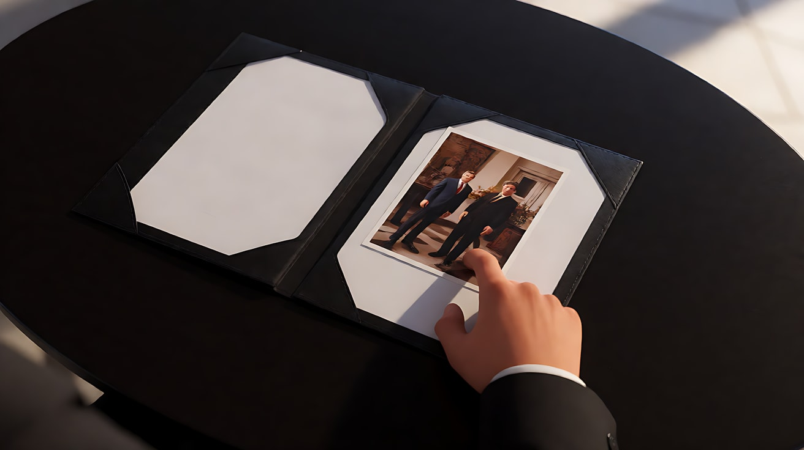

**【首尾帧生视频 · Seedance】**

```
【素材分工】@图片2 为首帧，确定对称中景构图与光线；@图片3 为尾帧，是最终画面目标；@图片1 仅锁定人物身份与服装，不参考其背景。只生成两帧之间的连续动作。
【画风】风格化写实三维CG质感，低饱和，偏黄绿冷调。
他用双手打开文件夹，动作缓慢、对称，然后右手食指按住里面那张背面朝上的照片的一角。镜头从对称中景开始，以恒定速度向前推进并逐渐向下俯，推进过程中文件夹始终保持在画面正中，最终停在文件夹与他手指的插入特写上。顶光位置不变，暗部始终保留细节。
【声音】无配乐，文件夹皮面翻开的轻响，空调低鸣，他的一声很轻的呼气。
【约束】保持人物服装与手部形态不变；推进匀速，不加速不减速，无晃动；照片始终背面朝上，不出现图像或文字；不要字幕、水印、Logo。
时长：7秒
```

**参数**：时长 7 秒 ｜ 画幅 16:9

**【检查点】**
- 推进是否匀速、文件夹是否始终居中
- 尾帧是否到达"俯视插入特写"
- 手指是否没有变形

**【常见问题与修复】**
| 现象 | 修复 |
|---|---|
| 推进中途变成切镜 | 加"一镜到底，连续推进，不切镜头" |
| 照片被翻过来 | 写"照片始终背面朝上，他没有翻动它" |
| 手指数量异常 | 把动作简化为"打开文件夹、按住一角"，删掉其他手部动作 |

---

### 练习4：锁定正反打的对峙（难度 ★★★★，多镜头）

**目标**：用严格对称、景别一致的正反打，加一个精准插入镜头，让剪辑本身成为对话的节奏。意图：让观众感到两人在用沉默较量。

**【生图 · Nano Banana】**

图1 角色定妆：沿用练习2 图1（男人）。

图2 角色定妆（第二位原创角色）：

```
Character turnaround sheet of an original woman in her fifties: silver hair pulled into a tight low bun, sharp straight eyebrows,
a navy high-collar blazer, a small black notebook in her hand.
Front view, three-quarter view, side view and back view, full body, eye-level camera, 50mm lens, deep focus,
plain light-grey background, even soft studio light from the front. Stylized semi-realistic 3D CG rendering, feature-film animation quality. Aspect ratio 16:9.
```

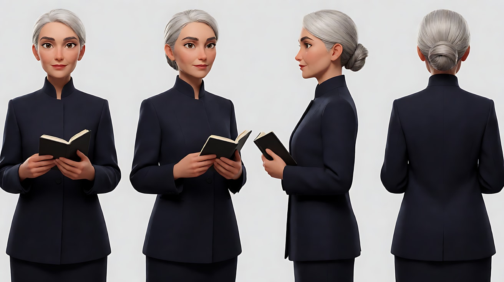

图3 场景：

```
Empty small windowless interview room at night, a plain square metal table in the exact center with two chairs facing each other,
one rectangular overhead fixture above the table, bare grey-green walls, a closed door on the back wall, no people.
Wide shot from one end of the table, eye level, 35mm lens, deep focus, perfectly symmetrical one-point perspective.
Lighting: hard yellow-green top light from the fixture, walls falling into deep shadow with visible texture. Low saturation.
Stylized semi-realistic 3D CG rendering, feature-film animation quality. Aspect ratio 16:9.
```

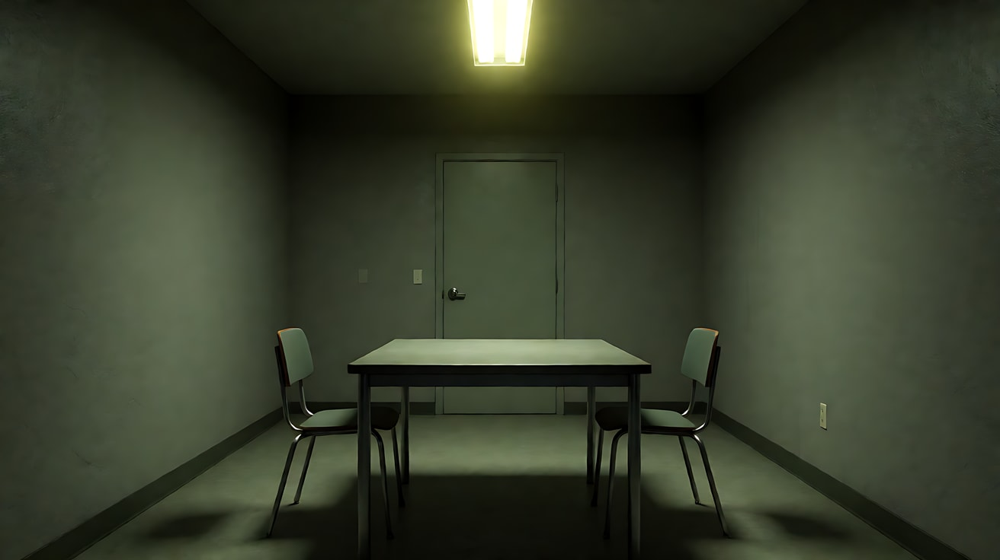

**【多图生视频 · Seedance】**

```
【素材分工】@图片1 锁定男人的身份与服装，不参考其背景；@图片2 锁定女人的身份、服装与黑色笔记本，不参考其背景；@图片3 仅参考房间布局与顶光，不作为首帧。
【画风】风格化写实三维CG质感，低饱和，偏黄绿冷调。
镜头1：固定机位，越过女人的肩膀拍男人的单人中近景，男人位于画面正中，背后的门在他头部正上方，顶光让他的眼窝略陷在阴影里。他双手交叠放在桌上，一动不动，只是眨了一下眼。空调低鸣。
镜头2：镜头切至反打，越过男人的肩膀拍女人的单人中近景，景别、高度与镜头1完全一致，女人位于画面正中。她把黑色笔记本轻轻放在桌面上，用手指把它推到桌子中线，停住。笔记本落在金属桌面的一声轻响。
镜头3：镜头切至俯视插入特写，笔记本静静躺在桌面正中，两人的手分别从画面左右边缘入画，停在笔记本两侧，谁都没有去碰它。镜头锁定不动。安静，只剩空调声。
【锁定】光线：唯一主光为桌子正上方的黄绿色顶光，墙面在暗部；男人：灰棕短发、金属细框眼镜、炭灰西装，始终坐在画左一侧面朝右；女人：银发低髻、藏青高领西装，始终坐在画右一侧面朝左；机位始终在两人连线的同一侧；三个镜头均为锁定机位。
【声音】无配乐，空调持续低鸣，笔记本放下的一声轻响，两人几乎听不见的呼吸声。
【约束】保持两人脸型、发型、服装不变；镜头不晃动；笔记本不打开，不出现文字；不要字幕、水印、Logo。
时长：12秒
```

**参数**：时长 12 秒 ｜ 画幅 16:9 ｜ 负载：3 个镜头、无对白，属于"稳妥"档

**【检查点】**
- 镜头1与镜头2的景别、机位高度是否一致（正反打对称）
- 插入镜头是否俯视、居中、两只手位置对称
- 两人是否始终在轴线两侧不跳轴

**【常见问题与修复】**
| 现象 | 修复 |
|---|---|
| 镜头2跳轴，女人也面朝右 | 在【锁定】里重复朝向，并写"镜头2的机位在镜头1机位的对面同一侧" |
| 插入镜头里手伸去拿本子 | 写"两只手停在笔记本两侧，指尖与笔记本保持一拳距离" |
| 三个镜头连成一个摇镜 | 每个镜头块开头写"镜头切至"，并强调三个机位都锁定 |

---

### 练习5：原创 3 镜头场景《档案柜第七层》（难度 ★★★★★）

**目标**：综合运用本课全部六维指纹，拍一个原创场景。故事：深夜，一位年轻档案员发现某份档案被人替换过。意图：让观众感到"她不是唯一一个今晚来过这里的人"。

**分镜表**

| 镜头 | 景别 / 机位 | 运镜 | 光 | 叙事功能 |
|---|---|---|---|---|
| 1 | 对称大全景，一点透视 | 锁定 | 头顶荧光灯一排排亮着 | 建立秩序 |
| 2 | 侧面中景 | 与人物同速横移 | 灯光依次扫过 | 她在寻找 |
| 3 | 中近景 → 插入 | 锁定 | 手电冷光 + 顶光 | 发现异常 |

**【生图 · Nano Banana】**

图1 角色定妆：

```
Character turnaround sheet of an original young woman in her mid-twenties: straight black hair in a low ponytail, a pale grey cardigan over a white collared shirt,
dark slacks, a lanyard badge with no text, a small cool-white flashlight in her hand.
Front view, three-quarter view, side view and back view, full body, eye-level camera, 50mm lens, deep focus,
plain light-grey background, even soft studio light from the front. Stylized semi-realistic 3D CG rendering, feature-film animation quality. Aspect ratio 16:9.
```

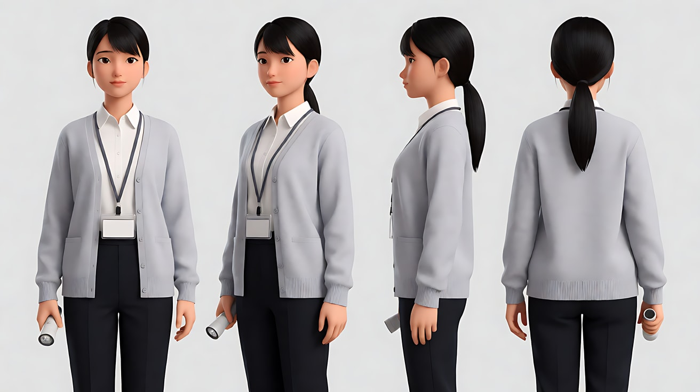

图2 场景：

```
Empty basement archive at night, long parallel rows of identical tall grey metal shelving units filled with uniform beige file boxes,
a narrow central aisle, rows of overhead fluorescent fixtures, concrete floor, no people.
Wide shot down the central aisle, eye level, 28mm lens, deep focus, perfectly symmetrical one-point perspective.
Lighting: yellow-green fluorescent overhead, the far end of the aisle in deep shadow with visible shelf edges. Low saturation.
Stylized semi-realistic 3D CG rendering, feature-film animation quality. Aspect ratio 16:9.
```

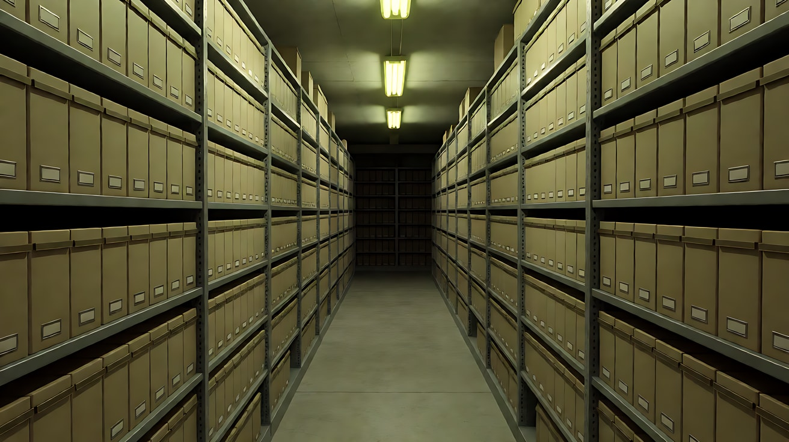

图3 镜头1关键帧：

```
Using the character from image 1 and the archive from image 2:
a perfectly symmetrical extreme wide shot down the central aisle, the young woman standing small at the exact center of the frame,
facing away from camera, shelving units rising on both sides and converging to the vanishing point behind her.
Camera at eye level, 28mm lens, deep focus. Lighting: yellow-green fluorescent overhead in evenly spaced pools of light, deep shadow between them with visible detail.
Keep the face, hairstyle and outfit exactly as in image 1. Stylized semi-realistic 3D CG rendering, feature-film animation quality. Aspect ratio 16:9.
```

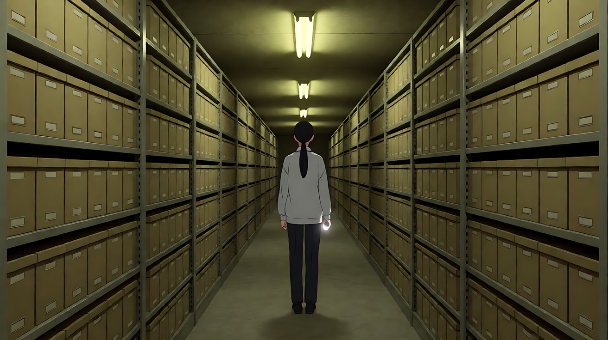

图4 镜头3关键帧：

```
Using the character from image 1 and the archive from image 2:
a medium close-up of the young woman in profile facing frame right, standing at a shelf, holding one beige file box half pulled out,
her flashlight beam lighting the inside of the box, her eyes fixed on it. She is placed on the left third, the shelf filling the right side.
Camera at eye level, 50mm lens, moderate depth of field, the aisle behind her soft but readable.
Lighting: cool-white flashlight beam bouncing up onto her face from below the frame, yellow-green fluorescent top light, deep shadow behind.
Keep the face, hairstyle and outfit exactly as in image 1. Stylized semi-realistic 3D CG rendering, feature-film animation quality. Aspect ratio 16:9.
```

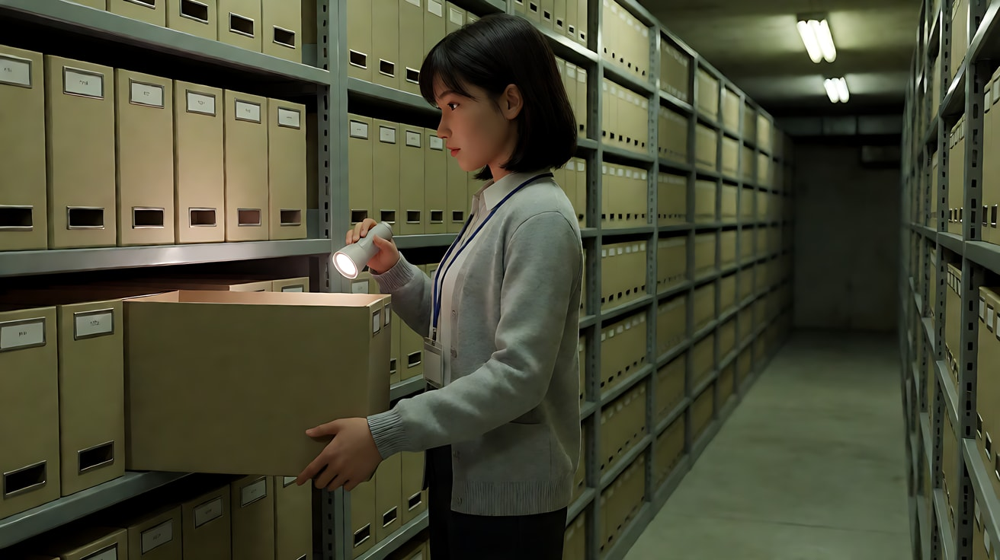

**【多图生视频 · Seedance】**

```
【素材分工】@图片1 锁定人物身份、服装、工牌与手电筒，不参考其背景；@图片2 仅参考档案室布局、货架形态与灯光色温，不复制其空镜构图；@图片3 为镜头1首帧，确定对称大全景构图；@图片4 仅作为镜头3的构图与光线参考，不作为首帧。
【画风】风格化写实三维CG质感，低饱和，偏黄绿冷调。
镜头1：固定大全景，一点透视，她站在中央过道正中，背对镜头，两侧货架对称地向纵深汇聚。她抬头看了一眼货架顶端，然后向右转身走进一排货架之间。镜头绝对静止。荧光灯电流嗡声，远处通风管道的低鸣。
镜头2：镜头切至侧面中景，她在两排货架之间从画左向画右行走，手电筒照着货架上的标签位置。镜头与她完全同速横向平移，她始终保持在画面左三分之一处，货架立柱有节奏地从前景滑过。她在一个位置停下，镜头同时停住。脚步声、货架金属的轻微回响。
镜头3：镜头切至中近景，她面朝画右，把一个档案盒抽出一半，手电冷光照进盒内，反光照亮她的下半张脸。她的手停在盒沿上，视线停住，然后极慢地转头看向画面深处的过道。镜头锁定不动。所有声音变轻，只剩荧光灯嗡声，远处传来一声货架门轻轻合上的金属声。
【锁定】光线：头顶黄绿色荧光灯为环境主光，手电筒冷白光为她手中唯一的移动光源，暗部始终保留细节；人物：黑色低马尾、浅灰开衫、白衬衫，手持手电筒；镜头2和镜头3她都面朝画右；三个镜头都没有手持晃动。
【声音】无配乐，荧光灯嗡声贯穿始终，脚步声在镜头3消失，最后一声远处的金属轻响。
【约束】保持人物脸型、发型、服装不变；不出现第二个人；档案盒与标签不出现可读文字；运动极平稳；不要字幕、水印、Logo。
时长：13秒
```

**参数**：时长 13 秒 ｜ 画幅 16:9 ｜ 负载：3 个镜头、1 个同速横移，属于"稳妥"偏上

**【检查点】**
- 六维是否都落地：中近景为主 / 中等景深 / 对称一点透视 / 黄绿顶光 + 有细节的暗部 / 锁定与同速横移 / 精准切点
- 镜头2的横移是否让她在画面中位置不变
- 镜头3的结尾是否是"转头看过道"这个可见动作，而不是出现第二个人

**【常见问题与修复】**
| 现象 | 修复 |
|---|---|
| 镜头3出现了一个黑影 | 删掉暗示人物的描述，只保留"远处一声金属轻响"，并在约束里写"不出现第二个人" |
| 镜头2变成跟在背后 | 写"镜头在她侧面，与货架平行横移" |
| 手电光太亮把画面打成高调 | 写"手电光只照亮盒内与她的下半张脸，其余保持低调" |
| 三个镜头色调不一致 | 在【锁定】里写明色温倾向，并在【画风】里保持同一句 |
