# L07-12 仰望凝视与单镜头调度 · 提示词

> 本组练习：仰望凝视的反应镜头、先反应后揭示、一镜多调度、雾中逆光光束、孩子高度的机位。｜ 配套教学：[L07-12 教学文件](../教学/L07-12-斯皮尔伯格.md) ｜ 规范：[写作规范](../../模板/写作规范.md)
>
> 画风默认使用开关 A（风格化写实 CG）。如改用 2D 动画，删掉所有焦段、光圈、景深词。
>
> 本课风格指纹（只写技术，不写人名）：反应近景 + 揭示大全景 ｜ 广角深焦 ｜ 前景人物 + 背景奇观的纵深构图 ｜ 逆光、雾中光束、光从奇观方向照到脸上 ｜ 缓慢推近、单镜头走位调度 ｜ 先反应后揭示。

---

### 练习1：仰望凝视的反应镜头（难度 ★）

**目标**：只拍一张脸，不拍她看到的东西，让光和视线告诉观众"画外有奇观"。意图：让观众感到她第一次看见了不可能的事。

**【生图 · Nano Banana】**

图1 关键帧：

```
A close-up of an original eleven-year-old girl with curly auburn hair tied in two loose bunches, freckles, a yellow raincoat,
standing in a dark wheat field at night, her head tilted up, eyes wide open, lips slightly parted, looking at something above and beyond frame right.
She is placed slightly left of center, leaving looking room toward the upper right.
Camera at a low angle from her chest height looking slightly up, 40mm lens, shallow depth of field, the night sky behind her soft and dark blue.
Lighting: a warm golden-white glow falling on her face from above frame right as the key light, as if from a huge light source in the sky,
a faint cool blue moonlight rim on her hair from behind. Fine dust floating in the warm light.
Stylized semi-realistic 3D CG rendering, feature-film animation quality. Aspect ratio 16:9.
```

中文释义：近景，原创女孩，仰头、睁大眼睛、嘴唇微张，望向画外右上方；构图偏左，右上留视线空间；胸口高度略仰拍、40mm、浅景深；暖金白光从画外右上方照亮她的脸（证明有奇观存在），冷蓝月光勾头发轮廓；光里有浮尘。

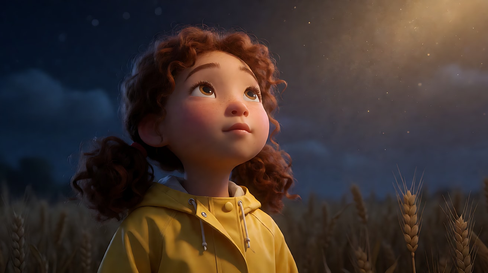

**【图生视频 · Seedance】**

```
【素材分工】@图片1 为首帧，锁定人物身份、雨衣、构图与光线方向。
【画风】风格化写实三维CG质感，电影级布光。
女孩仰望画外右上方，慢慢松开攥着雨衣衣角的手，嘴唇微张，屏住呼吸，眼睛一眨不眨。来自画外右上方的暖金色光逐渐变亮，从她的下巴爬到额头，光里的浮尘缓慢飘动，风把她的发丝轻轻吹起。镜头从近景极缓慢地向她的脸推近，始终不揭示她看到的东西。结尾停在她被暖光照满的脸上。
【声音】低沉的风声穿过麦田，远处传来一声悠长而低沉的共鸣音，越来越近，无对白，配乐只有一层极轻的弦乐长音。
【约束】保持人物脸型、发型、服装不变；画面中不出现她所看到的物体；不要字幕、水印、Logo。
时长：6秒
```

**参数**：时长 6 秒 ｜ 画幅 16:9

**【检查点】**
- 画面里是否没有出现奇观本身
- 脸上的暖光是否来自画外右上方并逐渐变亮
- 推近是否缓慢、持续

**【常见问题与修复】**
| 现象 | 修复 |
|---|---|
| 模型画出了天上的飞行物 | 约束写"画面中不出现她看到的物体，只有她的脸和背后的夜空" |
| 表情过度夸张、张大嘴 | 改成"嘴唇微张，表情安静，只有眼睛睁大" |
| 光从正面打成平光 | 写"光只从画外右上方来，脸的左侧保持在暗部" |

---

### 练习2：雾中逆光与孩子的高度（难度 ★★）

**目标**：机位放在孩子眼睛的高度，大人只露出腰部以下；手电光束从背后穿过雾，形成逆光剪影。意图：让观众站在孩子这一边，感到大人们在逼近。

**【生图 · Nano Banana】**

图1 角色定妆：

```
Character turnaround sheet of an original ten-year-old boy: short messy dark hair, a red hooded sweatshirt, worn jeans, muddy sneakers,
a small brass compass hanging on a cord around his neck.
Front view, three-quarter view, side view and back view, full body, eye-level camera, 50mm lens, deep focus,
plain light-grey background, even soft studio light from the front. Stylized semi-realistic 3D CG rendering, feature-film animation quality. Aspect ratio 16:9.
```

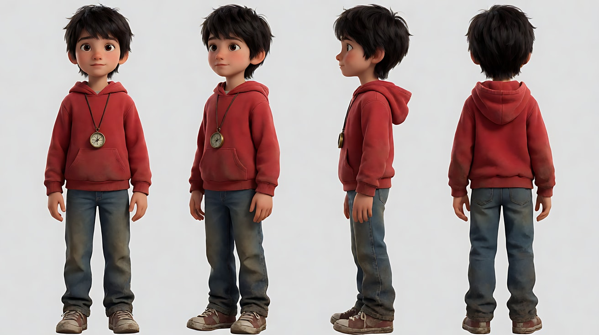

图2 场景：

```
Empty pine forest at night, dense low fog hanging between tall straight trunks, a fallen log in the foreground covered with moss,
a faint path winding into the depth, no people.
Wide shot, camera placed low at about one meter above the ground, 24mm lens, deep focus.
Lighting: cold blue moonlight from behind the trees, the fog glowing softly, foreground in deep shadow.
Stylized semi-realistic 3D CG rendering, feature-film animation quality. Aspect ratio 16:9.
```

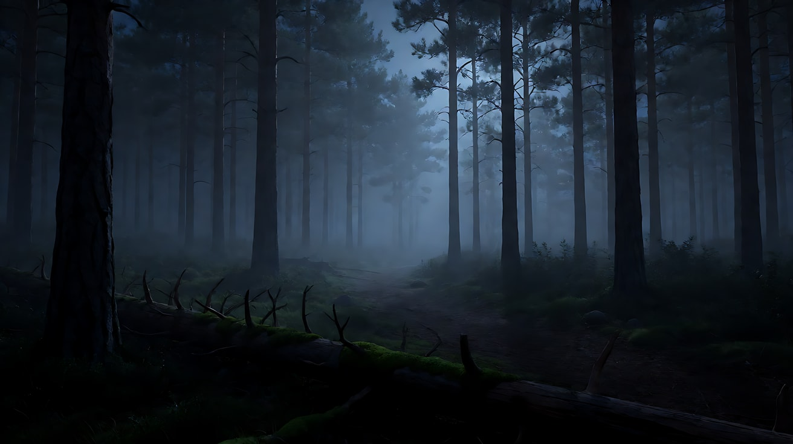

**【多图生视频 · Seedance】**

```
【素材分工】@图片1 锁定男孩的身份、红色卫衣与指南针，不参考其背景；@图片2 仅参考森林布局、雾的浓度与月光方向，不作为首帧。
【画风】风格化写实三维CG质感，电影级布光。
男孩蹲在前景的倒木后面，只露出上半身，侧脸朝向画右，双手扶着倒木，呼吸急促。镜头固定在离地约一米的孩子眼睛高度。画面深处的雾里，四五道手电光束从树后出现，光束在雾中清晰可见，从远处向镜头方向缓慢扫动，持手电的大人只露出腰部以下的轮廓和晃动的手电，看不到他们的脸。一道光束扫过男孩头顶上方的树干，他压低身子，屏住呼吸。结尾停在他蹲低、光束从他头顶掠过的剪影上。
【声音】无配乐，远处踩断树枝的声音，此起彼伏的低声呼喊听不清内容，男孩压抑的呼吸声，风吹松针的沙沙声。
【约束】保持男孩脸型、发型、服装不变；大人们不露出脸，只有腰部以下和手电；镜头不移动；不要字幕、水印、Logo。
时长：8秒
```

**参数**：时长 8 秒 ｜ 画幅 16:9

**【检查点】**
- 机位是否保持在孩子高度，大人是否只露出腰以下
- 光束是否在雾里成形，并从背后指向镜头方向（逆光）
- 男孩是否清楚地做了"压低身子"这一个动作

**【常见问题与修复】**
| 现象 | 修复 |
|---|---|
| 大人的脸出现在画面里 | 写"持手电的人只露出腰部以下，上半身在画面上沿之外" |
| 没有光束，只有光点 | 加"雾很浓，每一道手电光在雾中形成清晰的光柱" |
| 男孩被光束直接照亮 | 写"光束只掠过他头顶上方，他始终在暗部成为剪影" |

---

### 练习3：一镜多调度（难度 ★★★，首尾帧）

**目标**：不切镜头，靠人物走位和摄影机后退，在一个镜头里从大全景变成"前景近景 + 背景人物"的双层构图。意图：让观众感到妈妈已经知道了，但还没说出口。

**【生图 · Nano Banana】**

图1 角色定妆：沿用练习2 图1（男孩）。

图2 角色定妆（第二位原创角色）：

```
Character turnaround sheet of an original woman in her late thirties: shoulder-length wavy brown hair, a faded denim shirt with rolled sleeves,
a dish towel over one shoulder, slippers.
Front view, three-quarter view, side view and back view, full body, eye-level camera, 50mm lens, deep focus,
plain light-grey background, even soft studio light from the front. Stylized semi-realistic 3D CG rendering, feature-film animation quality. Aspect ratio 16:9.
```

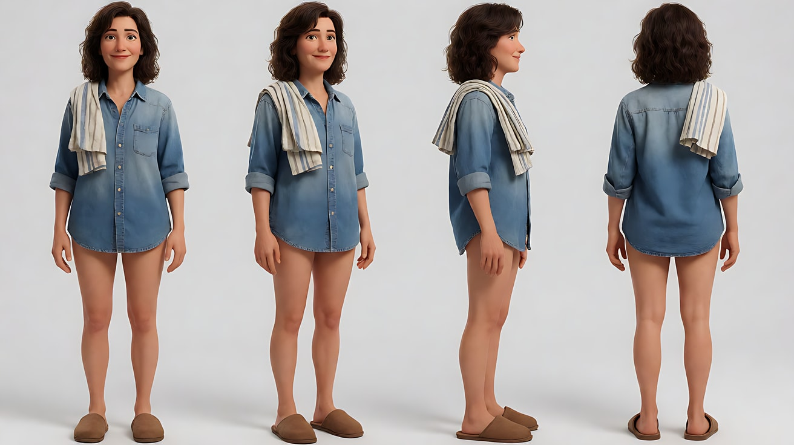

图3 首帧：

```
Using the characters from image 1 and image 2: a deep-focus wide shot of a cluttered family kitchen in the early evening.
The mother stands at the sink in the background on the right, back half-turned, drying a plate.
The boy has just come through the back door in the far left background, his sneakers muddy, holding the screen door.
Camera at the boy's eye level, about one meter high, 28mm lens, deep focus so both are sharp.
Lighting: strong warm sunset light pouring through the back door behind the boy, creating a backlit silhouette edge and a visible beam of dust,
a warm practical lamp above the sink. Keep the faces, hairstyles and outfits exactly as in image 1 and image 2.
Stylized semi-realistic 3D CG rendering, feature-film animation quality. Aspect ratio 16:9.
```

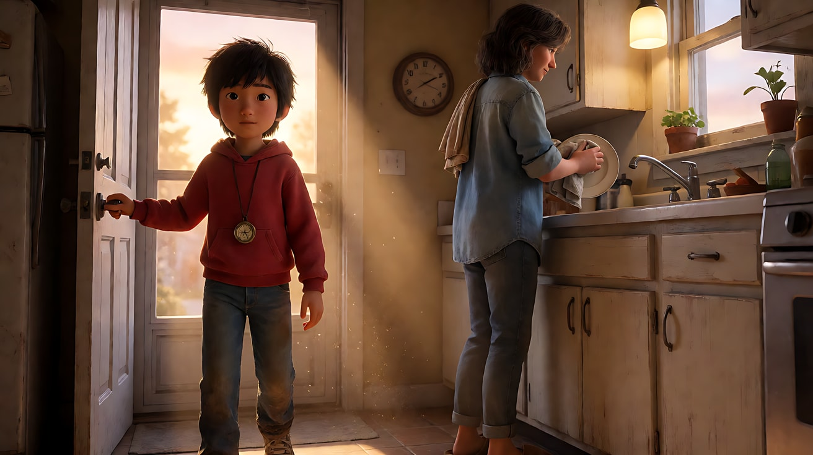

图4 尾帧：

```
Using the characters from image 1 and image 2 and the same kitchen and lighting as image 3:
the boy now stands in the left foreground in a medium close-up, facing camera, eyes lowered, the compass held tightly in his hand;
behind him in the background on the right, the mother has stopped drying the plate and is looking at the back of his head.
Camera at the boy's eye level, 28mm lens, deep focus, both characters sharp.
Keep the faces, hairstyles and outfits exactly as in image 1 and image 2.
Stylized semi-realistic 3D CG rendering, feature-film animation quality. Aspect ratio 16:9.
```

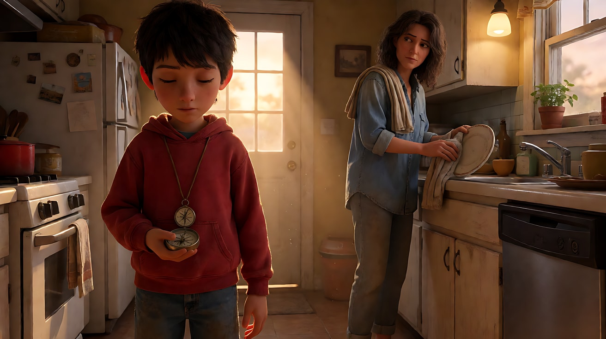

**【首尾帧生视频 · Seedance】**

```
【素材分工】@图片3 为首帧，确定厨房布局、逆光与大全景构图；@图片4 为尾帧，是最终画面目标；@图片1 仅锁定男孩身份与服装；@图片2 仅锁定母亲身份与服装。只生成两帧之间的连续动作。
【画风】风格化写实三维CG质感，电影级布光。
男孩放开纱门，从画面深处沿着画左一侧向镜头走来，脚步放轻，手里攥着指南针。镜头随着他的接近匀速后退并略微右摇，让母亲始终保留在背景右侧，画面从大全景变为男孩的中近景与背景母亲的双层构图，一镜到底不切镜头。母亲在背景里继续擦盘子，在男孩经过她身后时动作慢下来，最后停住，转头看向男孩的后脑勺。门口的落日逆光在男孩身后留下尘埃光束。
【声音】无配乐，纱门弹回的吱呀与轻碰声，水龙头的细流声，盘子与毛巾的摩擦声停下，屋外远处一声狗叫。
【约束】保持两人脸型、发型、服装不变；一镜到底，不切镜头；母亲只做擦盘子、停手、转头这些小动作；不要字幕、水印、Logo。
时长：9秒
```

**参数**：时长 9 秒 ｜ 画幅 16:9

**【检查点】**
- 是否真的没有切镜头，景别是在镜头内变化的
- 尾帧是否形成"前景男孩、背景母亲"两层，两人都清晰
- 母亲是否只做小动作，没有抢主动作

**【常见问题与修复】**
| 现象 | 修复 |
|---|---|
| 中途切成了近景 | 加"一镜到底，镜头连续后退，不切镜头" |
| 母亲也向前走 | 写"母亲始终站在水槽前，不离开原位" |
| 背景母亲虚掉 | 写"深焦，前景男孩与背景母亲同时清晰" |
| 镜头后退时晃动 | 写"镜头像在轨道上平稳后退" |

---

### 练习4：先反应，后揭示（难度 ★★★★，多镜头）

**目标**：用三个镜头完成"脸 → 奇观 → 脸"的结构，揭示镜头里人物极小。意图：让观众感到这对父女找到了传说中的东西。

**【生图 · Nano Banana】**

图1 角色定妆（两位原创角色）：

```
Character turnaround sheet of two original characters: a father in his forties with a short beard, a weathered olive field jacket and a canvas backpack;
his nine-year-old daughter with a short black bob, a bright orange windbreaker and rubber boots.
Front view, three-quarter view and side view of each, full body, eye-level camera, 50mm lens, deep focus,
plain light-grey background, even soft studio light from the front. Stylized semi-realistic 3D CG rendering, feature-film animation quality. Aspect ratio 16:9.
```

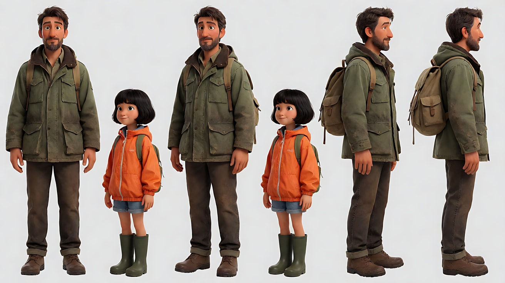

图2 揭示场景：

```
A vast hidden valley at sunrise seen from a rocky ridge: an enormous ancient tree, taller than a skyscraper, stands alone in the middle of the valley,
its canopy glowing with thousands of small pale-blue bioluminescent blossoms, mist pooled around its roots, a river winding past it, no people.
Extreme wide shot from the ridge, slightly elevated, 24mm lens, deep focus.
Lighting: low warm sunrise from behind the tree, backlighting the mist and the canopy, long god rays through the mist.
Stylized semi-realistic 3D CG rendering, feature-film animation quality. Aspect ratio 16:9.
```

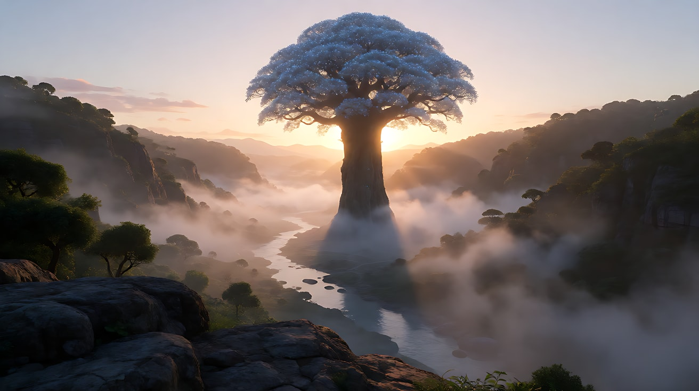

图3 镜头1关键帧：

```
Using the characters from image 1: a medium close-up two-shot of the father and daughter at the top of a rocky ridge at sunrise,
both looking up and out toward frame left beyond the camera, eyes wide, the daughter's mouth slightly open, the father slowly lowering his binoculars.
Camera at a slight low angle, 50mm lens, shallow depth of field, the sky behind them soft.
Lighting: warm sunrise light hitting their faces from frame left as the key, coming from the direction they are looking.
Keep the faces, hairstyles and outfits exactly as in image 1. Stylized semi-realistic 3D CG rendering, feature-film animation quality. Aspect ratio 16:9.
```

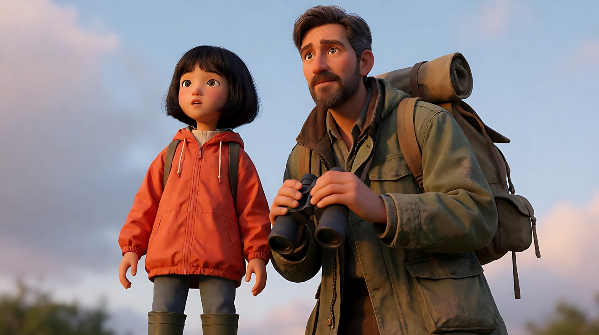

**【多图生视频 · Seedance】**

```
【素材分工】@图片1 锁定父女两人的身份与服装，不参考其背景；@图片2 仅作为镜头2的构图与光线参考，不复制为首帧；@图片3 为镜头1首帧。
【画风】风格化写实三维CG质感，电影级布光。
镜头1：微仰拍父女中近景双人镜头，父亲慢慢放下望远镜，女儿睁大眼睛，嘴唇微张，两人都望向画外左侧。画外的暖色朝阳照亮他们的脸，镜头极缓慢地推近。风声，远处鸟群的鸣叫。
镜头2：镜头切至大全景，从父女身后越过他们的肩膀拍向山谷，两人在画面底部只是两个小小的剪影，巨大的古树占满画面中央，树冠上无数淡蓝色发光花朵在晨雾中闪烁，朝阳从树后逆光照出穿透雾气的光束。镜头缓慢向上升起。配乐的弦乐长音逐渐展开。
镜头3：镜头切至女儿的近景，正面，暖光与淡蓝光同时映在她的脸上，她伸手拉住父亲的袖子，没有回头看他，眼睛一直望着前方。镜头固定。风声里只剩她轻轻的一声吸气。
【锁定】光线：朝阳始终在古树后方、父女的前方（画左方向），照亮他们的脸；父亲：短胡须、橄榄色外套、帆布背包，始终在画右；女儿：黑色短发、橙色风衣，始终在画左；镜头2从他们身后拍，方向与镜头1的视线一致。
【声音】风声贯穿，远处鸟鸣，镜头2配乐进入，镜头3配乐减弱只剩一声吸气，无对白。
【约束】保持两人脸型、发型、服装不变；镜头1不出现古树；不要字幕、水印、Logo。
时长：12秒
```

**参数**：时长 12 秒 ｜ 画幅 16:9 ｜ 负载：3 个镜头、1 个拉袖子动作，属于"稳妥"档

**【检查点】**
- 镜头1是否只给脸、不给古树
- 镜头2里人物是否足够小，古树是否压倒性地大
- 三个镜头的光方向是否一致

**【常见问题与修复】**
| 现象 | 修复 |
|---|---|
| 镜头1背景里已经出现古树 | 镜头1写"背景只有天空"，约束里重复 |
| 镜头2父女站位左右颠倒 | 【锁定】写明"从背后拍时父亲仍在画右，女儿在画左" |
| 镜头3女儿转头看父亲 | 写"她没有回头，眼睛一直望着前方" |

---

### 练习5：原创 3 镜头场景《谷仓里的光》（难度 ★★★★★）

**目标**：综合孩子高度机位、逆光光束、一镜多调度与仰望凝视，拍一个原创场景。故事：停电的雨夜，男孩躲进谷仓，发现一只走失的白色小鹿。意图：让观众感到他决定保护这个秘密。

**分镜表**

| 镜头 | 景别 / 机位 | 运镜 | 光 | 叙事功能 |
|---|---|---|---|---|
| 1 | 孩子高度全景，大人只露腰以下 | 固定 | 车灯从门缝射入 | 外面的威胁 |
| 2 | 全景 → 近景（单镜头调度） | 男孩爬近，镜头后退 | 木板缝光束 | 他在靠近 |
| 3 | 仰拍近景 | 缓慢推近 | 暖光照脸 | 仰望与决定 |

**【生图 · Nano Banana】**

图1 角色定妆：沿用练习2 图1（男孩）。

图2 场景：

```
Empty old wooden barn at night during a power outage, rain outside, hay bales stacked on the left, a wooden ladder to a hayloft,
thin gaps between the vertical wall planks, a large double door slightly ajar on the right, an old oil lantern hanging from a beam, unlit, no people.
Wide shot at about one meter above the floor, 24mm lens, deep focus.
Lighting: harsh white car headlights from outside shining through the plank gaps and the door gap, cutting sharp parallel beams through dusty air,
everything else in deep blue darkness. Stylized semi-realistic 3D CG rendering, feature-film animation quality. Aspect ratio 16:9.
```

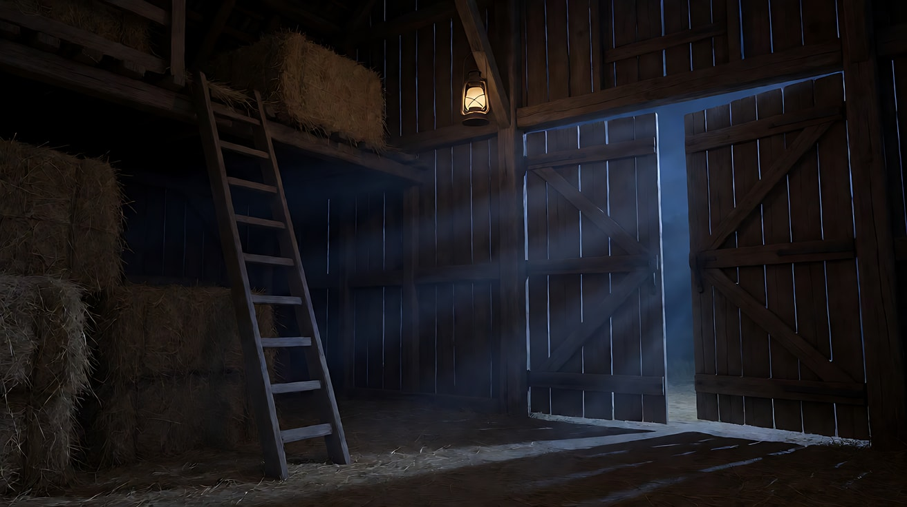

图3 镜头3关键帧：

```
Using the character from image 1 and the barn from image 2:
a low-angle close-up of the boy kneeling in the hay, looking up toward frame right with wide eyes and parted lips,
a soft warm glow on his face from the lantern he has just lit beside him, a thin white beam from the plank gaps crossing behind his head.
Camera low at his chest height looking slightly up, 40mm lens, shallow depth of field, the hayloft beams soft above him.
Keep the face, hairstyle and outfit exactly as in image 1. Stylized semi-realistic 3D CG rendering, feature-film animation quality. Aspect ratio 16:9.
```

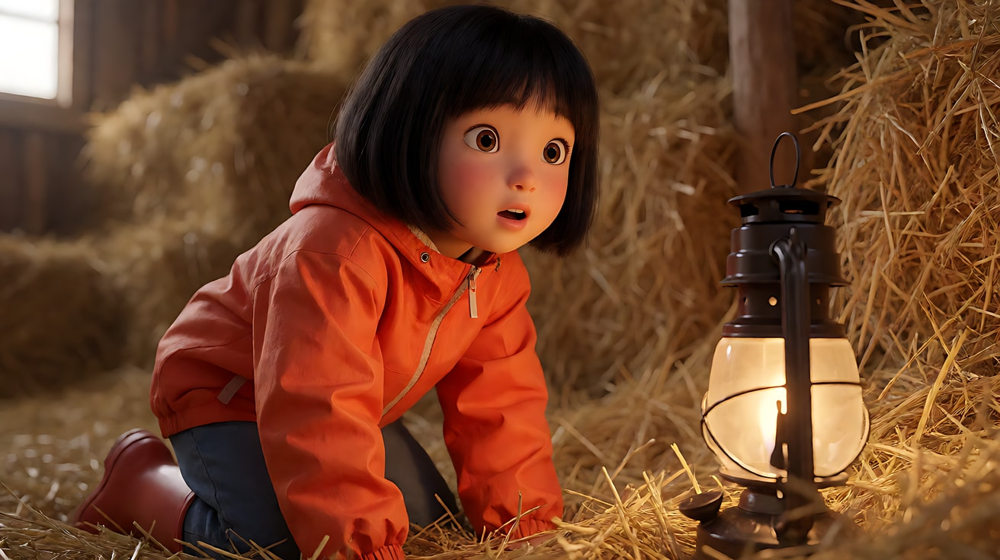

**【多图生视频 · Seedance】**

```
【素材分工】@图片1 锁定男孩身份、红色卫衣与指南针，不参考其背景；@图片2 仅参考谷仓布局、木板缝光束与色调，不作为首帧；@图片3 仅作为镜头3的构图与光线参考。
【画风】风格化写实三维CG质感，电影级布光。
镜头1：固定机位在离地约一米的高度，从谷仓内拍向半开的大门。门外雨中，两个大人的身影只露出腰部以下，穿着雨靴，手电与车灯的白光从门缝和木板缝射入，在扬起的灰尘里形成锋利的平行光束。他们在门口停了一下，又走开了。雨声，车辆发动机低沉的怠速声，模糊不清的大人说话声。
镜头2：镜头切至谷仓深处的全景，男孩从草垛后爬出来，跪着向镜头方向慢慢爬近，穿过一道道木板缝光束，光束依次扫过他的肩膀。镜头随他的接近平稳后退，从全景变为他的中近景，一镜到底不切镜头。他在一盏旧油灯旁停下，划亮火柴点燃油灯。雨打屋顶声，火柴划燃的一声。
镜头3：镜头切至仰拍近景，男孩跪在干草上，油灯暖光照亮他的脸，他抬头望向画外右上方的干草阁楼，眼睛睁大，嘴唇微张，然后慢慢把一根手指放到嘴唇前，像在对画外的什么说"嘘"。镜头极缓慢地推近他的脸。雨声变远，只剩油灯火苗的轻响和一声很轻的、像小动物的鼻息。
【锁定】光线：门外车灯的冷白光束从画右进入，油灯暖光只出现在镜头2结尾和镜头3；男孩：黑色乱发、红色卫衣、牛仔裤、胸前指南针；机位在镜头1和镜头2都保持在孩子眼睛高度。
【声音】雨声贯穿；镜头1有发动机与模糊人声；镜头2有火柴声；镜头3声音变稀，只剩火苗声与一声轻柔鼻息，无对白，无配乐。
【约束】保持男孩脸型、发型、服装不变；镜头1大人不露出脸；画面中不直接出现小鹿，只用声音暗示；不要字幕、水印、Logo。
时长：14秒
```

**参数**：时长 14 秒 ｜ 画幅 16:9 ｜ 负载：3 个镜头含 1 个单镜头调度与点灯动作，属于"有挑战"档；失败时把镜头1单独生成

**【检查点】**
- 六维是否都落地：反应近景 / 广角深焦 / 孩子高度与纵深 / 逆光光束 + 暖光照脸 / 后退调度与缓慢推近 / 先反应不揭示
- 镜头2是否在一个镜头内从全景变为中近景
- 镜头3的"嘘"是否清楚，小鹿是否没有被画出来

**【常见问题与修复】**
| 现象 | 修复 |
|---|---|
| 镜头3画出了小鹿 | 约束重复"不出现动物"，正文只写"望向画外右上方" |
| 镜头2爬行时肢体变形 | 把"爬"改成"弯着腰快步走近"，减少四肢接触地面 |
| 火柴和油灯难以生成 | 改成"他打开一只小手电，暖色光" |
| 镜头1大人进入谷仓 | 写"大人始终站在门外，没有进门" |
