# L07-13 沉浸式长镜头与环绕调度 · 提示词

> 本组练习：广角近距离跟随、自然光、背景同时发生的事件、有动机的环绕调度、用前景遮挡隐藏切点。｜ 配套教学：[L07-13 教学文件](../教学/L07-13-阿方索卡隆.md) ｜ 规范：[写作规范](../../模板/写作规范.md)
>
> 画风默认使用开关 A（风格化写实 CG）。如改用 2D 动画，删掉所有焦段、光圈、景深词。
>
> 本课风格指纹（只写技术，不写人名）：同一镜头内景别滑动 ｜ 21mm 广角贴近、深焦 ｜ 人物嵌在环境里、背景有事件 ｜ 阴天漫射自然光、低饱和灰冷 ｜ 长镜头跟随与有动机的环绕 ｜ 极少剪辑、切点藏在遮挡后。

---

### 练习1：广角贴近的跟随（难度 ★）

**目标**：用广角镜头贴近人物，跟着她走，让背景里的城市同时在发生事情。意图：让观众感到自己就走在她身边。

**【生图 · Nano Banana】**

图1 关键帧：

```
A close over-the-shoulder medium shot of an original woman in her early thirties, short black hair under a knitted grey beanie,
a worn olive parka, a cloth shopping bag on her shoulder, walking along a crowded street market on an overcast morning.
Her face in three-quarter profile occupies the right third of the frame, very close to the lens; the market stretches deep behind her on the left:
vendors under faded tarps, a group of workers on a ladder repairing a tangle of overhead power lines, pigeons on a roof edge.
Camera handheld at her shoulder height, less than one meter from her face, 21mm wide-angle lens, deep focus so the background workers are sharp.
Lighting: soft diffused overcast daylight from above, no artificial fill, muted grey-green palette, low saturation.
Stylized semi-realistic 3D CG rendering, feature-film animation quality. Aspect ratio 16:9.
```

中文释义：近距离过肩中景，女人三分之四侧脸占画右三分之一、离镜头很近；左侧纵深是菜市场，背景里有工人在梯子上修电线；肩高、离脸不到一米、21mm 广角、深焦；阴天漫射自然光，无补光，低饱和灰绿。

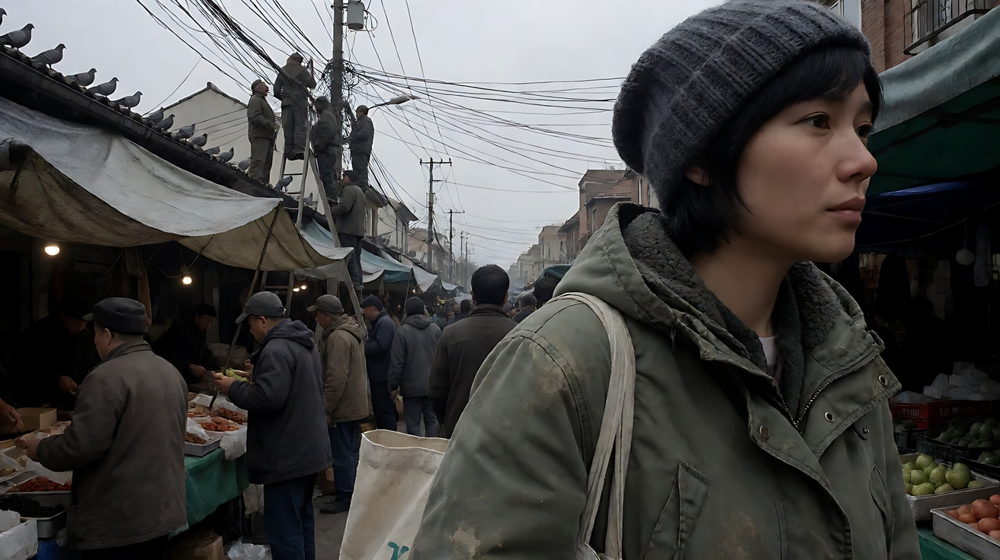

**【图生视频 · Seedance】**

```
【素材分工】@图片1 为首帧，锁定人物身份、服装、市场环境与广角近距离构图。
【画风】风格化写实三维CG质感，低饱和灰冷自然光。
她沿着市场通道往前走，脚步不快，目光扫过两侧的摊位。镜头在她肩旁以同样的速度跟随，始终离她的脸不到一米，广角让她的侧脸在画面右侧显得很近，左侧背景的市场不断向后流动。背景里梯子上的工人把一段电线拉直，一群鸽子从屋檐上同时飞起。她听到鸽子扑翅的声音，侧头看了一眼，然后继续往前走。结尾停在她继续前行的侧脸与背景里落定的鸽群上。
【声音】无配乐，摊贩的吆喝声听不清内容，塑料雨布被风吹动的声音，鸽群扑翅声，她的脚步声和购物袋的摩擦声。
【约束】保持人物脸型、发型、服装不变；一镜到底，不切镜头；阴天自然光，不出现阳光直射；不要字幕、水印、Logo、招牌文字。
时长：8秒
```

**参数**：时长 8 秒 ｜ 画幅 16:9

**【检查点】**
- 是否能感到广角的近距离（她的脸大，背景纵深明显）
- 背景事件（修电线、鸽群）是否清楚可见
- 她侧头看鸽子是否有声音动机

**【常见问题与修复】**
| 现象 | 修复 |
|---|---|
| 背景被虚化看不清 | 写"深焦，背景工人与鸽群同样清晰" |
| 镜头离她越来越远 | 写"镜头始终离她的脸不到一米" |
| 光变成晴天暖光 | 写"阴天，天空灰白，没有影子" |
| 晃动过大像抖动 | 写"轻微漂浮，像跟着她呼吸，不剧烈抖动" |

---

### 练习2：车内的环绕调度（难度 ★★）

**目标**：在一辆小车里，镜头在前后座之间缓慢转向，每次转向都有人开口或回头作为动机。意图：让观众感到自己是这辆车里的第四位乘客。

**【生图 · Nano Banana】**

图1 角色定妆（三位原创角色）：

```
Character turnaround sheet of three original characters: a man in his forties with a stubbled jaw and a brown corduroy jacket (the driver);
a woman in her late thirties with curly dark hair tied back and a mustard-yellow scarf (front passenger);
a seventeen-year-old girl with straight shoulder-length hair, a navy hoodie and wired earphones around her neck (back seat).
Front view, three-quarter view and side view of each, full body, eye-level camera, 50mm lens, deep focus,
plain light-grey background, even soft studio light from the front. Stylized semi-realistic 3D CG rendering, feature-film animation quality. Aspect ratio 16:9.
```

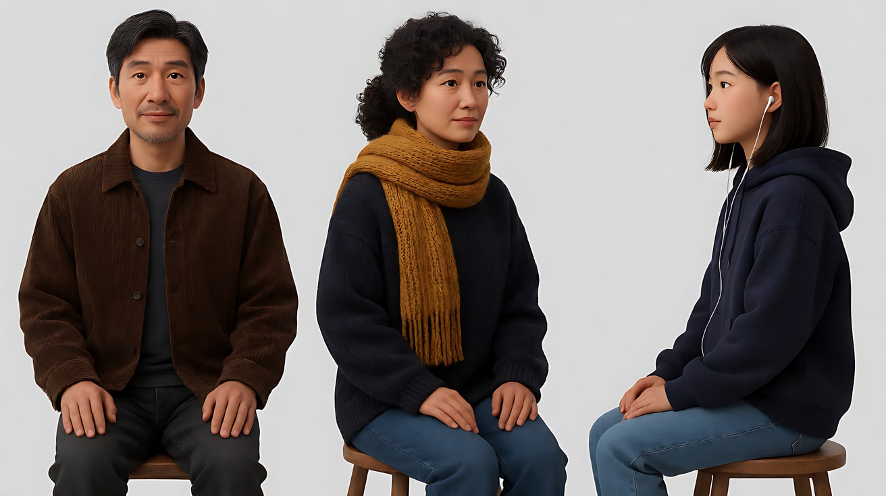

图2 场景：

```
Interior of an old small hatchback car with no people, worn fabric seats, a cracked dashboard, a paper map tucked in the sun visor,
seen from the center of the back seat looking forward through the windshield at a straight country road crossing open farmland on an overcast afternoon.
Medium-wide shot, 18mm wide-angle lens, deep focus so the road outside is sharp.
Lighting: soft grey overcast daylight through all windows, no artificial light inside the car, muted colors.
Stylized semi-realistic 3D CG rendering, feature-film animation quality. Aspect ratio 16:9.
```

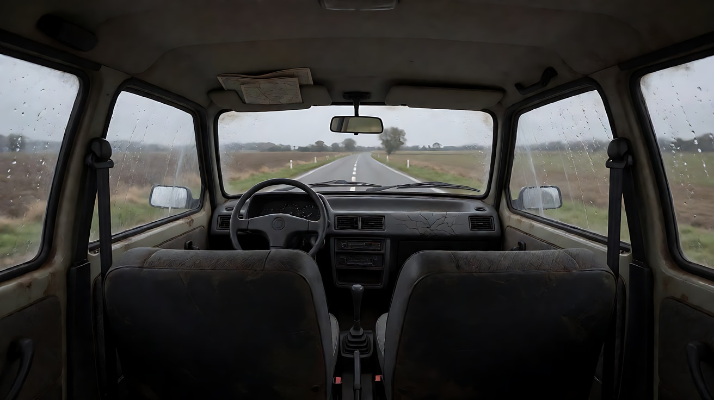

**【多图生视频 · Seedance】**

```
【素材分工】@图片1 锁定三人的身份与服装，不参考其背景；@图片2 仅参考车内结构、窗外道路与阴天光线，不作为首帧。
【画风】风格化写实三维CG质感，低饱和灰冷自然光。
镜头在车厢中央，起于前方，拍司机和副驾两人的中景，司机双手握方向盘看着前方，副驾的女人把头靠在车窗上。后座女孩开口说了一句话，镜头因此缓慢向后转向，转过约半圈，停在女孩的近景上，她摘下一边耳机，望向窗外。窗外田野里，一群白色的马正沿着道路方向奔跑，和汽车并行。镜头顺着她的视线继续转向侧窗，马群在窗外清晰可见。一镜到底不切镜头，广角离每个人都很近。结尾停在侧窗外与汽车并行的马群上。
【声音】无配乐，发动机的持续低鸣，轮胎碾过路面的沙沙声。女孩摘下耳机，轻声说："你们看外面。"窗外隐约传来马蹄声。
【约束】保持三人脸型、发型、服装不变；镜头转向缓慢，不超过半圈后再转向侧窗；司机始终看着前方开车；不要字幕、水印、Logo。
时长：10秒
```

**参数**：时长 10 秒 ｜ 画幅 16:9

**【检查点】**
- 镜头转向是否由"女孩开口"触发
- 一镜到底，三人与窗外马群是否在同一个连续运动里出现
- 司机是否始终在开车（只做小动作）

**【常见问题与修复】**
| 现象 | 修复 |
|---|---|
| 镜头穿出车外 | 写"镜头始终在车厢内部" |
| 镜头旋转过快令人晕眩 | 写"缓慢转向，像一个人慢慢回头" |
| 司机也回头看 | 写"司机始终目视前方，只微微侧耳" |
| 马群变成别的动物或消失 | 在约束里写"窗外始终有一群白马并行" |

---

### 练习3：沿岸横移，走进水里（难度 ★★★，首尾帧）

**目标**：镜头与人物平行横移，不切近景，让观众"只能看着"。意图：让观众感到她每往前一步都更危险，但她没有停。

**【生图 · Nano Banana】**

图1 角色定妆：

```
Character turnaround sheet of an original woman in her late twenties: long black braid, a plain light-blue cotton dress with an apron,
bare feet, a small wooden hair clip.
Front view, three-quarter view, side view and back view, full body, eye-level camera, 50mm lens, deep focus,
plain light-grey background, even soft studio light from the front. Stylized semi-realistic 3D CG rendering, feature-film animation quality. Aspect ratio 16:9.
```

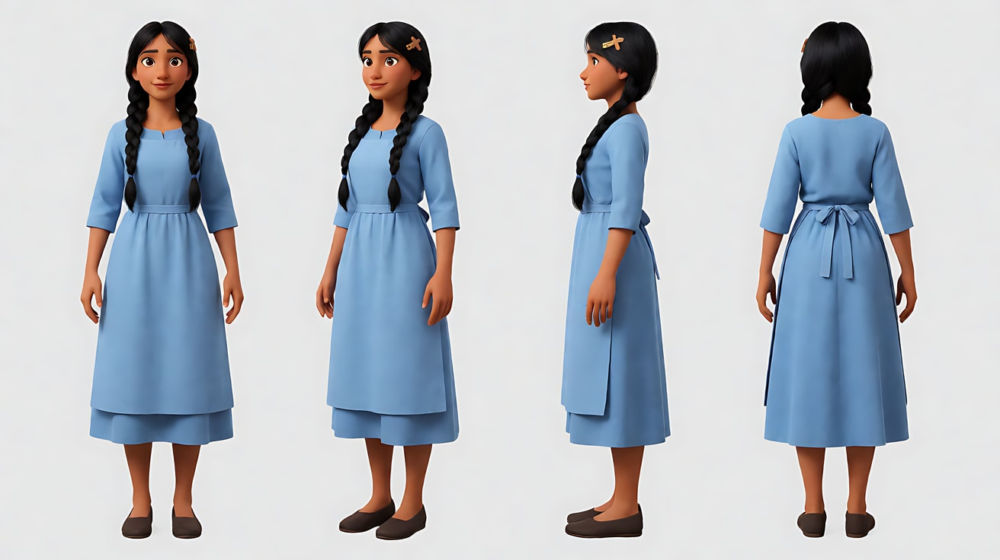

图2 首帧：

```
Using the character from image 1: a wide side-on shot of a broad shallow river after heavy rain, overcast afternoon.
She stands at the left side of the frame on the muddy bank, ankle-deep in brown water, facing frame right,
and far in the right background a small boy in a red shirt sits on a rock in the middle of the current.
Camera at her waist height on the bank, parallel to her, 24mm lens, deep focus, the boy small but sharp.
Lighting: flat soft overcast daylight, grey sky reflected in the water, low saturation.
Keep the face, hairstyle and outfit exactly as in image 1. Stylized semi-realistic 3D CG rendering, feature-film animation quality. Aspect ratio 16:9.
```

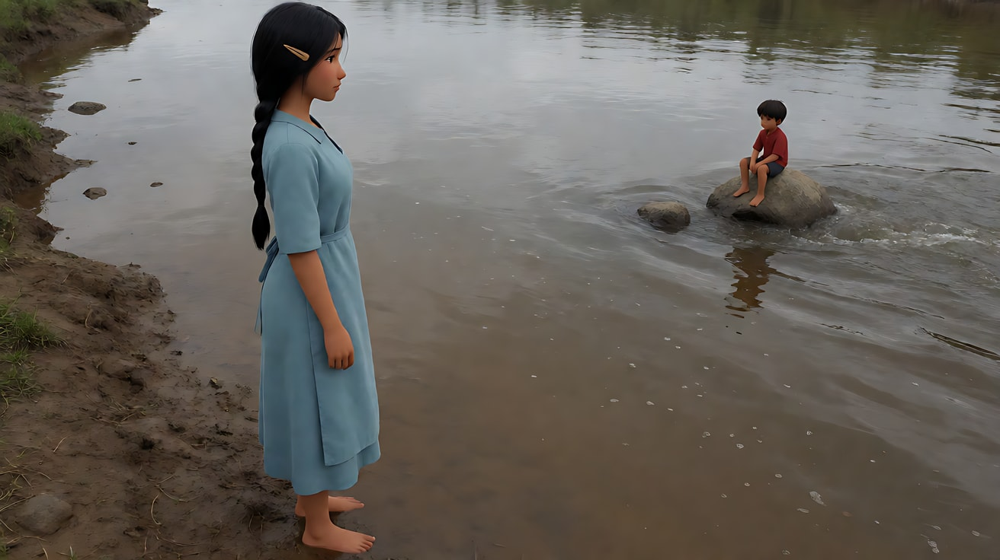

图3 尾帧：

```
Using the character from image 1 and the same river and lighting as image 2:
a wide side-on shot, she is now waist-deep in the current in the center of the frame, her arm stretched out,
holding the hand of the small boy on the rock, both of them leaning against the flow.
Camera at the same height and distance, parallel to her, 24mm lens, deep focus.
Keep the face, hairstyle and outfit exactly as in image 1. Stylized semi-realistic 3D CG rendering, feature-film animation quality. Aspect ratio 16:9.
```

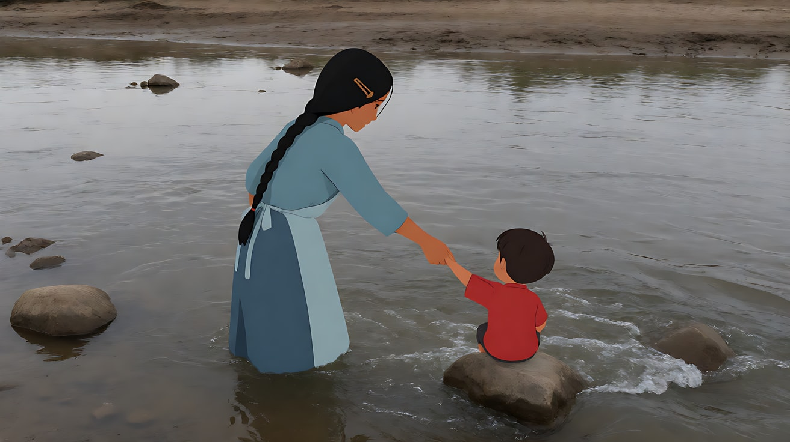

**【首尾帧生视频 · Seedance】**

```
【素材分工】@图片2 为首帧，确定河岸、侧面横移的机位距离与阴天光；@图片3 为尾帧，是最终画面目标；@图片1 仅锁定女人的身份与服装，不参考其背景。只生成两帧之间的连续动作。
【画风】风格化写实三维CG质感，低饱和灰冷自然光。
她向河中央一步一步走去，水从脚踝涨到膝盖，再涨到腰部，她用双臂保持平衡，裙摆在水流里被拉向画左。镜头始终在她侧面，与她保持相同的距离平行横移，不推近、不切近景。石头上的男孩看到她，向她伸出手。她顶着水流抓住男孩的手，两人身体同时向水流反方向倾斜。一镜到底。
【声音】无配乐，湍急的流水声贯穿，她涉水时水被推开的哗哗声，男孩一声短促的呼喊，没有清楚的台词。
【约束】保持人物脸型、发型、服装不变；镜头距离不变，不出现面部特写；一镜到底不切镜头；不要字幕、水印、Logo。
时长：10秒
```

**参数**：时长 10 秒 ｜ 画幅 16:9

**【检查点】**
- 镜头是否始终保持侧面同距离横移
- 水位是否一步步上涨（她在变危险）
- 尾帧两人是否手拉手且身体同向倾斜

**【常见问题与修复】**
| 现象 | 修复 |
|---|---|
| 镜头推到她脸上 | 写"镜头距离始终不变，不推近，看不清她的表情细节" |
| 她游了起来 | 写"她始终站立在水中，一步一步走" |
| 男孩跳进水里 | 写"男孩始终坐在石头上，只伸出手" |

---

### 练习4：用前景遮挡隐藏切点（难度 ★★★★，多镜头）

**目标**：两个镜头之间的切点藏在前景完全遮挡的一瞬，让观众感觉是一个长镜头。意图：让观众感到他穿过整条街时一刻都没被放过。

**【生图 · Nano Banana】**

图1 角色定妆：

```
Character turnaround sheet of an original man in his mid-twenties: shaved head, a faded red work jacket with reflective stripes,
a black backpack, a folded paper envelope in his hand.
Front view, three-quarter view, side view and back view, full body, eye-level camera, 50mm lens, deep focus,
plain light-grey background, even soft studio light from the front. Stylized semi-realistic 3D CG rendering, feature-film animation quality. Aspect ratio 16:9.
```

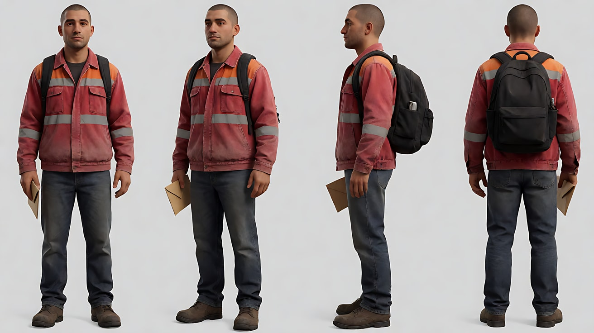

图2 场景：

```
Empty wide street in a grey industrial district on an overcast late afternoon, a bus stop on the near sidewalk,
a large articulated bus parked along the curb, a long concrete wall with faded posters without text on the far side,
a narrow alley opening, puddles on the asphalt, no people.
Wide shot at eye level, 21mm lens, deep focus. Lighting: soft diffused overcast daylight, no direct sun, muted grey palette.
Stylized semi-realistic 3D CG rendering, feature-film animation quality. Aspect ratio 16:9.
```

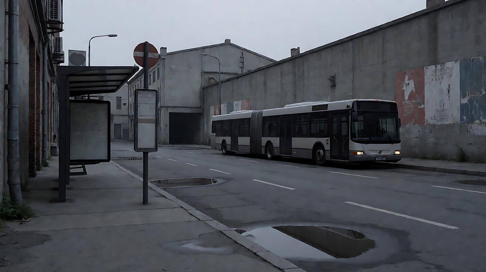

图3 镜头1关键帧：

```
Using the character from image 1 and the street from image 2:
a close following shot from behind his left shoulder as he walks along the sidewalk toward the parked bus,
his shoulder and the back of his head large on the right of the frame, the street deep in the background, a few passersby at the bus stop.
Camera handheld at shoulder height, less than one meter behind him, 21mm lens, deep focus.
Lighting: soft overcast daylight, muted grey palette.
Keep the face, hairstyle and outfit exactly as in image 1. Stylized semi-realistic 3D CG rendering, feature-film animation quality. Aspect ratio 16:9.
```

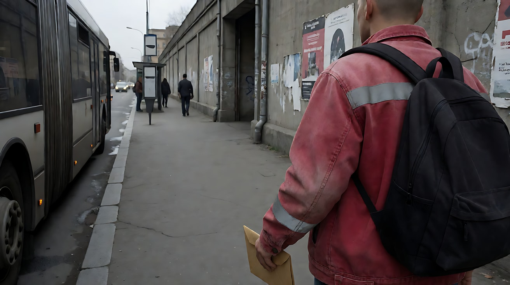

**【多图生视频 · Seedance】**

```
【素材分工】@图片1 锁定人物身份、红色工装外套与信封，不参考其背景；@图片2 仅参考街道布局、公交车与阴天光线，不作为首帧；@图片3 为镜头1首帧。
【画风】风格化写实三维CG质感，低饱和灰冷自然光。
镜头1：广角贴近，从他左肩后方跟随，他沿人行道快步走向停靠的公交车，手里攥着信封。背景里公交站有几个人在等车，一个老人在扫地上的积水。他从公交车尾部绕过去，镜头跟着向公交车车身靠近，车身的灰色铁皮逐渐占满整个画面。脚步声、公交车发动机怠速声。
镜头2：画面被公交车车身完全遮挡后，镜头切至公交车另一侧，镜头从车身边缘滑出，他已经穿过马路，背对镜头走向对面那条窄巷。镜头继续以同样的速度、同样的肩后距离跟随他走进巷口，巷子里光线更暗。他在巷口停下，回头看了一眼来路。远处公交车开走的声音，巷子里滴水声。
【锁定】光线：全程阴天漫射光，镜头2进入巷口后更暗；人物：光头、褪色红色工装外套、黑色背包，手里一直拿着信封；两个镜头的跟随距离、高度、速度完全一致，镜头始终在他左后方。
【声音】无配乐，脚步声贯穿两个镜头不间断，公交车发动机声从近到远，最后是巷子里的滴水声。
【约束】保持人物脸型、发型、服装不变；切点只发生在公交车车身完全遮挡画面的那一刻；不要字幕、水印、Logo、车身文字。
时长：12秒
```

**参数**：时长 12 秒 ｜ 画幅 16:9 ｜ 负载：2 个镜头、1 个隐藏切点，属于"稳妥"档

**【检查点】**
- 切点是否发生在车身占满画面的瞬间
- 两个镜头的跟随距离与高度是否一致，看起来像一个镜头
- 脚步声是否连续不断

**【常见问题与修复】**
| 现象 | 修复 |
|---|---|
| 切点明显跳了一下 | 两个镜头的【锁定】再写一遍距离、高度、速度；镜头2开头写"从车身边缘滑出" |
| 镜头2他的位置跳得太远 | 改成"他刚绕过车头，正准备过马路" |
| 镜头1没有贴近车身 | 写"镜头跟随他贴近车身，铁皮占满整个画面" |

---

### 练习5：原创 3 镜头场景《停电的集市》（难度 ★★★★★）

**目标**：综合广角贴近、背景事件、自然光、环绕调度、平行横移，拍一个原创场景。故事：城市大面积停电的黄昏，一位母亲在拥挤的集市里寻找走失的儿子。意图：让观众感到世界在她身边继续运转，而她只想找到一个人。

**分镜表**

| 镜头 | 景别 / 机位 | 运镜 | 光 | 背景事件 |
|---|---|---|---|---|
| 1 | 广角贴近的过肩中景 | 跟随 | 阴天黄昏自然光 | 工人在抢修电线，人群拥挤 |
| 2 | 中近景 → 环绕半圈 | 有动机的环绕 | 天光 + 摊贩点起的应急灯 | 摊贩收摊 |
| 3 | 侧面全景 | 平行横移 | 最后的天光 | 人群在她身后散开 |

**【生图 · Nano Banana】**

图1 角色定妆：沿用练习1 的人物风格，重新生成定妆图：

```
Character turnaround sheet of an original woman in her early thirties: short black hair under a knitted grey beanie, a worn olive parka,
a cloth shopping bag on her shoulder, a child's small blue knitted hat clutched in her hand.
Front view, three-quarter view, side view and back view, full body, eye-level camera, 50mm lens, deep focus,
plain light-grey background, even soft studio light from the front. Stylized semi-realistic 3D CG rendering, feature-film animation quality. Aspect ratio 16:9.
```

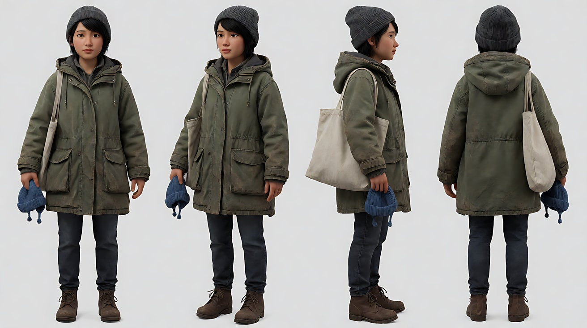

图2 场景：

```
A crowded open-air city market at dusk during a citywide power outage, rows of stalls under faded tarps, all the shop signs and street lights dark,
a few vendors lighting small battery lanterns, workers on a ladder at a utility pole in the middle distance, a wide pedestrian crossing at the far end, no main characters.
Wide shot at eye level, 21mm lens, deep focus. Lighting: the last cool blue-grey dusk skylight from above, a few small warm lanterns, muted palette.
Stylized semi-realistic 3D CG rendering, feature-film animation quality. Aspect ratio 16:9.
```

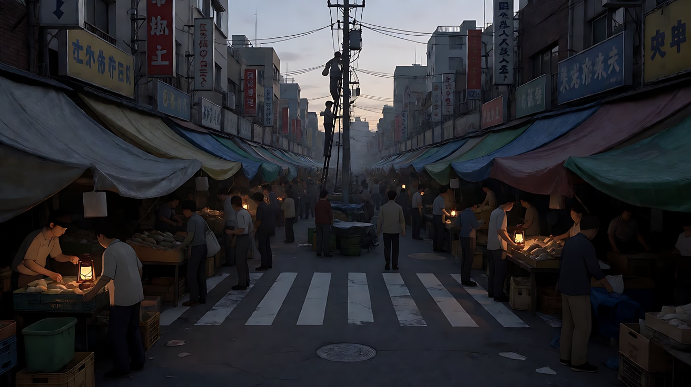

图3 镜头1关键帧：

```
Using the character from image 1 and the market from image 2:
a close over-the-shoulder medium shot behind her right shoulder as she pushes through the crowd, the small blue hat in her raised hand,
her face in profile on the left third, close to the lens; behind her in deep focus the workers on the utility pole ladder and the dark stalls.
Camera handheld at shoulder height, less than one meter from her, 21mm lens, deep focus.
Lighting: cool blue-grey dusk skylight, a single warm lantern on a stall at frame right.
Keep the face, hairstyle and outfit exactly as in image 1. Stylized semi-realistic 3D CG rendering, feature-film animation quality. Aspect ratio 16:9.
```

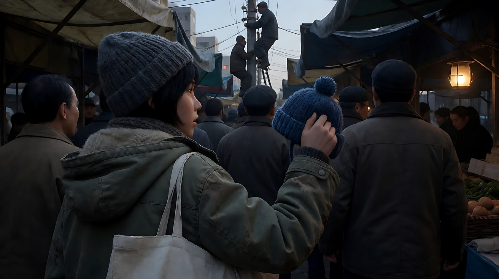

**【多图生视频 · Seedance】**

```
【素材分工】@图片1 锁定人物身份、服装与蓝色小帽，不参考其背景；@图片2 仅参考集市布局、停电状态与黄昏光线，不作为首帧；@图片3 为镜头1首帧。
【画风】风格化写实三维CG质感，低饱和灰冷自然光。
镜头1：广角贴近，从她右肩后方跟随，她举着那顶蓝色小帽在人群中往前挤，侧脸在画左，离镜头很近。背景里，工人在电线杆的梯子上抢修线路，人群在昏暗的摊位间穿行。她不停左右张望。人群嘈杂声、远处发电机的轰鸣。
镜头2：镜头切至她停在一个摊位前的中近景，摊贩正把一盏小电池灯挂起来，暖光照亮她半边脸。她把小帽举给摊贩看。背后传来一声孩子的呼喊，镜头因此围绕她缓慢环绕半圈，转到她身后，越过她的肩膀看向声音的方向——人群深处的斑马线。环绕过程不切镜头，广角离她很近。孩子模糊的一声呼喊，电池灯开关的轻响。
镜头3：镜头切至侧面全景，她沿着集市边缘向画右的斑马线快步走去，镜头与她保持相同距离平行横移。她身后的人群开始散去，摊贩们收起雨布。天光越来越暗，她跑了起来，蓝色小帽始终握在手里。结尾停在她跑向斑马线的侧影上，远处斑马线上一个很小的身影站着不动。脚步声变急，人群声渐远。
【锁定】光线：全程停电，天光为冷蓝灰，唯一暖光是摊贩的电池灯，只出现在镜头2；人物：灰色毛线帽、橄榄色派克大衣、布袋，手里始终拿着蓝色小帽；镜头3她向画右移动。
【声音】无配乐，人群嘈杂与发电机声从密到疏，镜头2有一声孩子呼喊，镜头3只剩她的脚步声和远处的风声。
【约束】保持人物脸型、发型、服装不变；不出现可读招牌文字；斑马线上的身影保持很小、不出现面部细节；不要字幕、水印、Logo。
时长：15秒
```

**参数**：时长 15 秒 ｜ 画幅 16:9 ｜ 负载：3 个镜头含 1 个环绕与 1 个横移，属于"有挑战"档；失败时把镜头3拆成第二次生成，用镜头2的尾帧接续

**【检查点】**
- 六维是否都落地：镜头内景别滑动 / 广角贴近深焦 / 背景事件 / 阴天黄昏自然光 + 唯一暖色电池灯 / 跟随、环绕、横移各一 / 剪辑极少且每次都有动机
- 镜头2的环绕是否由孩子呼喊触发
- 背景事件是否始终可见（修电线、收摊）

**【常见问题与修复】**
| 现象 | 修复 |
|---|---|
| 镜头2环绕超过半圈 | 写"环绕约半圈后停在她身后" |
| 镜头3斑马线的身影变成清晰的孩子正脸 | 写"远处的小身影只有轮廓，背光" |
| 整体光太亮、像白天 | 写"天色接近入夜，所有招牌和路灯都是暗的" |
| 背景人群静止 | 写"背景人群持续自然走动，摊贩在收拾东西" |
