# L07-14 魔幻时刻逆光与漂浮镜头 · 提示词

> 本组练习：日落前低角度逆光、低位漂浮运镜、广角仰拍、手与自然的局部、耳语式旁白、跳跃剪辑。｜ 配套教学：[L07-14 教学文件](../教学/L07-14-泰伦斯马力克.md) ｜ 规范：[写作规范](../../模板/写作规范.md)
>
> 画风默认使用开关 A（风格化写实 CG）。如改用 2D 动画，删掉所有焦段、光圈、景深词。
>
> 本课风格指纹（只写技术，不写人名）：中景、全景与手部局部 ｜ 18mm 广角贴近、深焦 ｜ 低机位仰拍、太阳入画、人物偏边缘 ｜ 日落前暖金逆光与淡蓝天空 ｜ 轻柔漂浮跟随与上升 ｜ 跳过中间动作的碎片剪辑 + 耳语旁白。

---

### 练习1：逆光草地中的漂浮跟随（难度 ★）

**目标**：用日落前的逆光和一个轻柔的低位漂浮跟随，让一个普通的行走变成"记忆"。意图：让观众感到这是她最后一次走过这片草地。

**【生图 · Nano Banana】**

图1 关键帧：

```
A medium shot from behind and slightly below of an original young woman in her twenties with long loose light-brown hair,
a simple faded white cotton dress, walking barefoot through waist-high golden grass on a gentle hill just before sunset,
her right hand trailing across the tops of the grass. She is placed on the left third of the frame, cut at the hips by the grass.
Camera low at her waist height, close behind her, tilted slightly up, 18mm wide-angle lens, deep focus, the sky filling the upper half of the frame.
Lighting: the low sun directly ahead of her in the upper right of the frame, warm golden backlight making her hair edges and the grass tips glow,
soft lens flare, pale blue sky above, long shadows falling toward the camera.
Stylized semi-realistic 3D CG rendering, feature-film animation quality. Aspect ratio 2.39:1.
```

中文释义：从身后略低处拍的中景，她赤脚走在齐腰的金色草丛里，右手拂过草尖；人物在画左三分之一，被草丛裁到臀部；腰高贴近、略仰、18mm、深焦、天空占上半部；太阳在画面右上角正对她，暖金逆光勾亮发丝和草尖，轻微光晕，影子朝镜头延伸。

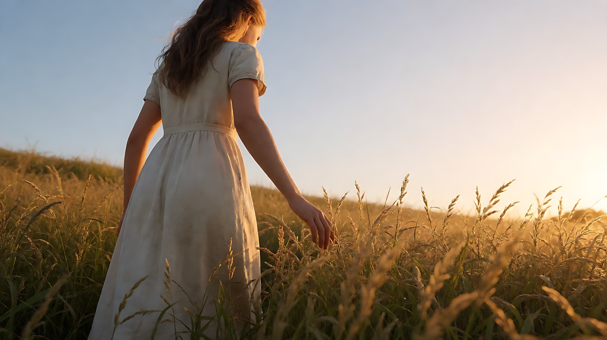

**【图生视频 · Seedance】**

```
【素材分工】@图片1 为首帧，锁定人物身份、白裙、草坡环境与逆光方向。
【画风】风格化写实三维CG质感，自然光。
她赤脚在草丛中向坡顶慢慢走去，右手指尖一路拂过草穗的顶端，草穗在她手下弯折又弹起。风从画左向画右吹过，整片草浪起伏，她的发丝在逆光里飘起发亮。镜头在她身后低位轻柔地漂浮跟随，没有颠簸，逐渐从她身后绕到她的右侧，太阳始终在画面右上方，光晕轻轻闪过。结尾停在她侧后方的剪影与远处低垂的太阳上。
【声音】风吹草浪的沙沙声，远处几声鸟鸣，她赤脚踩草的轻响。画外音（女声，耳语，语速很慢）："你也在看着这片光吗？"配乐只有一段很轻的钢琴单音。
【约束】保持人物脸型、发型、服装不变；不出现面部正面特写；太阳位置不变；不要字幕、水印、Logo。
时长：8秒
```

**参数**：时长 8 秒 ｜ 画幅 2.39:1（平台无此选项时选 16:9）

**【检查点】**
- 逆光是否从她前方照来，发丝和草尖是否发亮
- 镜头是否低、轻、无颠簸，并完成"身后 → 右侧"的漂浮
- 旁白是否短，是一个问题

**【常见问题与修复】**
| 现象 | 修复 |
|---|---|
| 太阳跑到身后变成顺光 | 写"太阳始终在她前方的画面右上方" |
| 镜头上下颠簸 | 写"像在空中滑行一样平稳" |
| 她转身对镜头 | 写"她始终背对或侧对镜头" |
| 画面过曝发白 | 写"天空保持淡蓝，太阳边缘清晰，人物轮廓有层次" |

---

### 练习2：广角仰拍的树下（难度 ★★）

**目标**：机位放到孩子的高度并向上仰，树冠、阳光与大人一同进入画面。意图：让观众感到孩子眼中的母亲像天空一样大。

**【生图 · Nano Banana】**

图1 角色定妆（两位原创角色）：

```
Character turnaround sheet of two original characters: a mother in her early thirties with auburn hair in a loose low bun, a pale green 1950s-style cotton dress;
her six-year-old son with a short sandy crew cut, a striped short-sleeve shirt, shorts and bare feet.
Front view, three-quarter view and side view of each, full body, eye-level camera, 50mm lens, deep focus,
plain light-grey background, even soft studio light from the front. Stylized semi-realistic 3D CG rendering, feature-film animation quality. Aspect ratio 16:9.
```

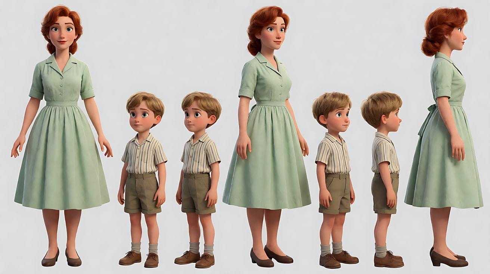

图2 场景：

```
Empty small-town backyard in late afternoon, a huge old oak tree with spreading branches, a rope swing hanging from one branch,
a white wooden house in the background with a screen door, freshly cut grass, a line of white sheets drying in the wind, no people.
Low-angle wide shot from near the ground looking up at the oak canopy, 16mm wide-angle lens, deep focus.
Lighting: low warm sun shining through the leaves from behind the tree, scattered light flickering through the canopy, soft lens flare, pale blue sky.
Stylized semi-realistic 3D CG rendering, feature-film animation quality. Aspect ratio 16:9.
```

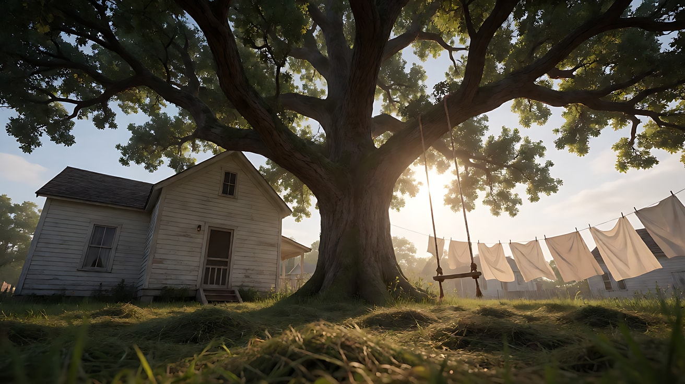

**【多图生视频 · Seedance】**

```
【素材分工】@图片1 锁定母亲与男孩的身份与服装，不参考其背景；@图片2 仅参考后院、橡树、晾晒的床单与逆光方向，不作为首帧。
【画风】风格化写实三维CG质感，自然光。
男孩赤脚站在草坪上，仰头看着站在橡树下的母亲。镜头在男孩身旁贴近地面，以广角向上仰拍母亲：她的身影高高地立在画面中央，身后是巨大的树冠和穿过树叶的阳光。母亲伸出手，指尖碰到一缕穿过树叶的光，光斑在她手背上晃动。镜头从男孩肩旁轻柔地向上漂浮升起，越过母亲的肩膀，最后望向树冠与太阳。晾晒的白床单在风中鼓起。结尾停在逆光的树冠与闪烁的光斑上。
【声音】树叶沙沙声，床单被风鼓起的啪啪声，远处纱门轻轻合上。画外音（男孩声，耳语）："妈妈，你在哪里？"无对白。
【约束】保持两人脸型、发型、服装不变；镜头只做一次向上漂浮；不要字幕、水印、Logo。
时长：8秒
```

**参数**：时长 8 秒 ｜ 画幅 16:9

**【检查点】**
- 母亲是否在仰拍下显得高大，天空和树冠是否占据画面上半部
- "手碰光斑"这个动作是否清楚
- 上升漂浮是否平滑并最终望向太阳

**【常见问题与修复】**
| 现象 | 修复 |
|---|---|
| 仰拍角度不够 | 写"镜头离地约半米，强烈向上仰拍" |
| 光斑消失 | 写"阳光透过树叶在她手背和裙子上留下晃动的光斑" |
| 男孩说出了旁白（嘴动） | 写"男孩没有开口，旁白是画外音" |

---

### 练习3：从溪水到天空（难度 ★★★，首尾帧）

**目标**：用首尾帧把"低头看水 → 仰望天空"连成一个漂浮上升的长动作。意图：让观众感到他在溪水里想起了某个人。

**【生图 · Nano Banana】**

图1 角色定妆：

```
Character turnaround sheet of an original man in his late thirties: short dark hair with a few grey strands, a rolled-sleeve plain grey linen shirt,
dark trousers rolled up to the knees, barefoot.
Front view, three-quarter view, side view and back view, full body, eye-level camera, 50mm lens, deep focus,
plain light-grey background, even soft studio light from the front. Stylized semi-realistic 3D CG rendering, feature-film animation quality. Aspect ratio 16:9.
```

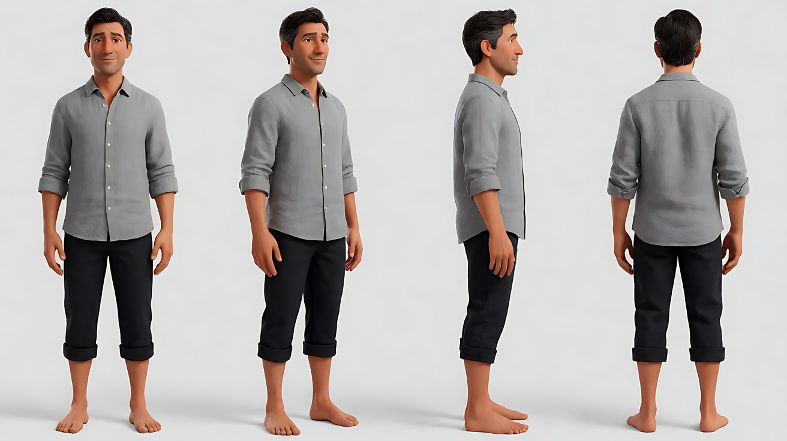

图2 首帧：

```
Using the character from image 1: a close-up of his hands cupped in a clear shallow forest stream at golden hour, water spilling through his fingers,
his rolled sleeves and knees visible at the top edge of the frame, pebbles on the streambed.
Camera low just above the water surface, 18mm wide-angle lens, deep focus.
Lighting: low warm sunlight from behind him reflecting on the water as glittering highlights, soft green shade from the trees.
Keep the hands, sleeves and outfit exactly as in image 1. Stylized semi-realistic 3D CG rendering, feature-film animation quality. Aspect ratio 16:9.
```

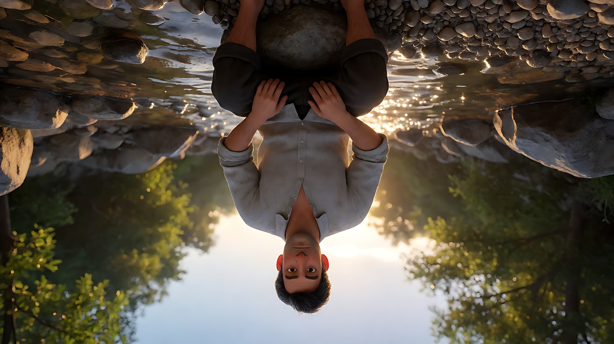

图3 尾帧：

```
Using the character from image 1 and the same stream and light as image 2:
a low-angle wide shot looking up past his silhouette as he stands in the stream with his head tilted back,
tall birch trees converging toward the sky, the low sun flaring through the leaves in the upper left, his figure on the right edge of the frame, cut at the waist.
Camera low near the water, tilted steeply up, 18mm lens, deep focus.
Keep the face, hairstyle and outfit exactly as in image 1. Stylized semi-realistic 3D CG rendering, feature-film animation quality. Aspect ratio 16:9.
```

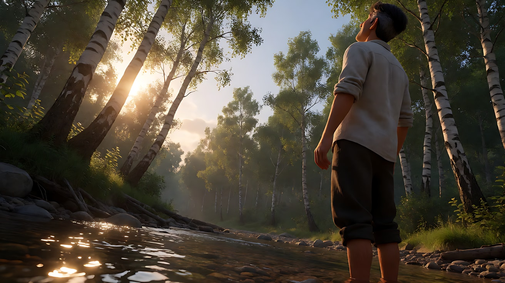

**【首尾帧生视频 · Seedance】**

```
【素材分工】@图片2 为首帧，确定手与溪水的局部构图和光线；@图片3 为尾帧，是最终画面目标；@图片1 仅锁定人物身份与服装，不参考其背景。只生成两帧之间的连续动作。
【画风】风格化写实三维CG质感，自然光。
他捧起的溪水从指缝间流走，他慢慢张开手让水全部落下，然后站直身体，仰起头。镜头从水面低位开始，随着他站起而轻柔地向后漂浮、向上仰起，经过他湿透的手和衬衫，最终仰望白桦林与透过树叶的低角度太阳，他的身影留在画面右侧边缘。一镜到底，运动平滑。
【声音】溪水流过石头的声音，水从指缝滴落的声响，风吹白桦叶。画外音（男声，耳语）："你说过，光会记得我们。"配乐为一段持续的低音弦乐。
【约束】保持人物脸型、发型、服装不变；一镜到底，不切镜头；不出现面部特写；不要字幕、水印、Logo。
时长：9秒
```

**参数**：时长 9 秒 ｜ 画幅 16:9

**【检查点】**
- 镜头是否从"手与水"连续过渡到"仰望树冠"
- 太阳是否在尾帧中入画并有光晕
- 运动是否轻柔、无颠簸

**【常见问题与修复】**
| 现象 | 修复 |
|---|---|
| 中途切镜头 | 写"一镜到底，镜头连续上仰" |
| 他的手变形 | 首帧动作只保留"张开手让水落下" |
| 尾帧变成正脸仰拍 | 写"他的身影只在画面右侧边缘，主要是树冠和天空" |

---

### 练习4：跳跃剪辑 + 连续旁白（难度 ★★★★，多镜头）

**目标**：把一个连续的黄昏拆成三个跳过中间动作的碎片，用一条连续的耳语旁白把它们缝起来。意图：让观众感到这是一段被反复回想的记忆。

**【生图 · Nano Banana】**

图1 角色定妆（两位原创角色）：

```
Character turnaround sheet of two original characters in their late twenties: a woman with a short dark pixie cut, a loose rust-orange knit sweater and a long cream skirt;
a man with wavy shoulder-length brown hair, a faded denim jacket over a white T-shirt.
Front view, three-quarter view and side view of each, full body, eye-level camera, 50mm lens, deep focus,
plain light-grey background, even soft studio light from the front. Stylized semi-realistic 3D CG rendering, feature-film animation quality. Aspect ratio 16:9.
```

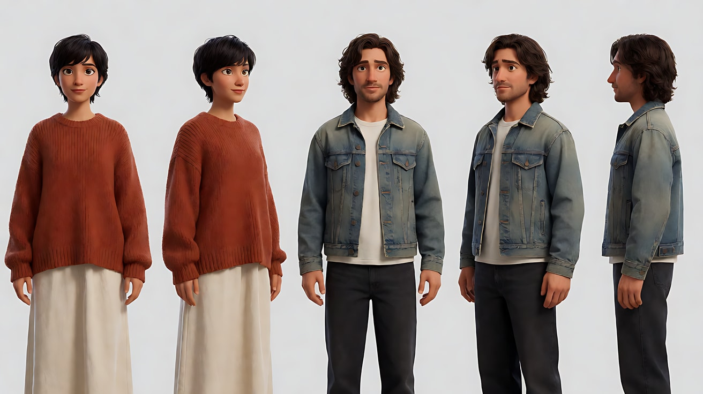

图2 场景：

```
An empty wide wheat field at the edge of a small farm just before sunset, a lone wooden windmill water pump, a dirt track, a low wooden fence,
the wheat golden and swaying, no people.
Wide shot from a low angle near the wheat, 18mm wide-angle lens, deep focus.
Lighting: very low warm sun near the horizon behind the windmill, strong backlight, soft lens flare, pale blue sky with thin clouds.
Stylized semi-realistic 3D CG rendering, feature-film animation quality. Aspect ratio 16:9.
```

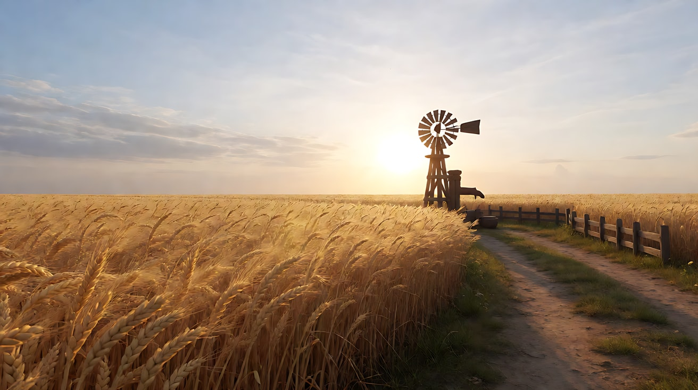

图3 镜头1关键帧：

```
Using the characters from image 1 and the field from image 2:
a low-angle medium shot of the woman running ahead through the wheat, laughing, looking back over her shoulder,
the man following a few steps behind, both backlit, the low sun flaring between them.
Camera low, close behind the man's shoulder, 18mm lens, deep focus. Lighting: warm golden backlight from the sun ahead, rim light on hair.
Keep the faces, hairstyles and outfits exactly as in image 1. Stylized semi-realistic 3D CG rendering, feature-film animation quality. Aspect ratio 16:9.
```

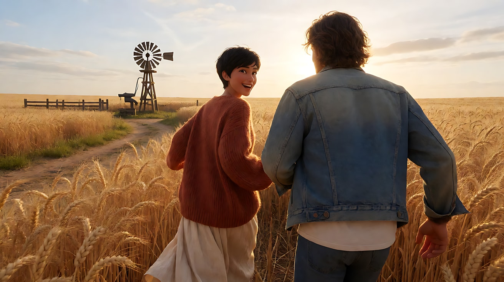

**【多图生视频 · Seedance】**

```
【素材分工】@图片1 锁定两人的身份与服装，不参考其背景；@图片2 仅参考麦田、风车与逆光方向，不作为首帧；@图片3 为镜头1首帧。
【画风】风格化写实三维CG质感，自然光。
镜头1：镜头在男人肩后低位漂浮跟随，女人在前方的麦田里奔跑，回头笑着看他，太阳在两人之间闪出光晕。他伸手想拉她，没有拉到。麦穗被身体扫过的沙沙声，远处鸟鸣。
镜头2：镜头切至同一片麦田稍晚的时刻，两人已经站在风车下，女人背靠木桩，男人站在她面前，两人都没有说话。镜头从低处轻柔地绕到两人侧面，逆光让两人只剩金色的轮廓。风车叶片缓慢转动的吱呀声。
镜头3：镜头切至局部，一只手的指尖从麦穗顶端轻轻拂过，向画右移出画面，只剩麦穗在风中摇晃，逆光里浮尘飞舞。镜头低位缓慢向上漂浮，望向即将落下的太阳。风声。
【锁定】光线：全程日落前低角度暖金逆光，太阳在画面深处，方向不变；女人：黑色短发、铁锈橙毛衣、奶油色长裙；男人：棕色及肩卷发、旧牛仔外套；三个镜头时间依次推后，光越来越低越来越暖。
【声音】画外音（女声，耳语，贯穿三个镜头，语速很慢）："那天的风……是从哪里来的？……你还记得吗？"环境声为风与麦穗，配乐为一段持续的低声合唱长音，无对白。
【约束】保持两人脸型、发型、服装不变；不出现面部正面特写；旁白是画外音，画面中人物不开口；不要字幕、水印、Logo。
时长：12秒
```

**参数**：时长 12 秒 ｜ 画幅 16:9 ｜ 负载：3 个镜头、无对白，属于"稳妥"档

**【检查点】**
- 镜头之间是否"跳过了中间动作"（从奔跑直接跳到站在风车下）
- 旁白是否连续覆盖三个镜头，不随切镜断开
- 光是否越来越低、越来越暖

**【常见问题与修复】**
| 现象 | 修复 |
|---|---|
| 镜头2补出了"走到风车"的过程 | 写"镜头切至稍晚的时刻，两人已经站在风车下" |
| 人物嘴型跟着旁白动 | 约束写"画面中人物不开口" |
| 三个镜头光线方向不同 | 【锁定】强调"太阳始终在画面深处" |

---

### 练习5：原创 3 镜头场景《外婆的麦田》（难度 ★★★★★）

**目标**：综合魔幻时刻逆光、漂浮运镜、广角仰拍、自然局部、跳跃剪辑与耳语旁白，拍一个原创场景。故事：外婆去世后的第一个秋天，一个年轻人回到她的农场，独自走过那片麦田。意图：让观众感到"她不在了，但光还在"。

**分镜表**

| 镜头 | 景别 / 机位 | 运镜 | 光 | 碎片 |
|---|---|---|---|---|
| 1 | 中景，低机位身后 | 漂浮跟随 | 日落前逆光 | 他走进麦田 |
| 2 | 局部（跳跃） | 低位缓慢环绕 | 逆光透过 | 他的手与外婆的旧草帽 |
| 3 | 广角仰拍全景（跳跃） | 向上漂浮 | 太阳入画 | 他站在坡顶，风车转动 |

**【生图 · Nano Banana】**

图1 角色定妆：

```
Character turnaround sheet of an original young man in his early twenties: messy black hair, a loose oatmeal-colored knit cardigan over a white shirt,
dark trousers, worn canvas shoes, holding an old woven straw hat with a faded blue ribbon.
Front view, three-quarter view, side view and back view, full body, eye-level camera, 50mm lens, deep focus,
plain light-grey background, even soft studio light from the front. Stylized semi-realistic 3D CG rendering, feature-film animation quality. Aspect ratio 16:9.
```

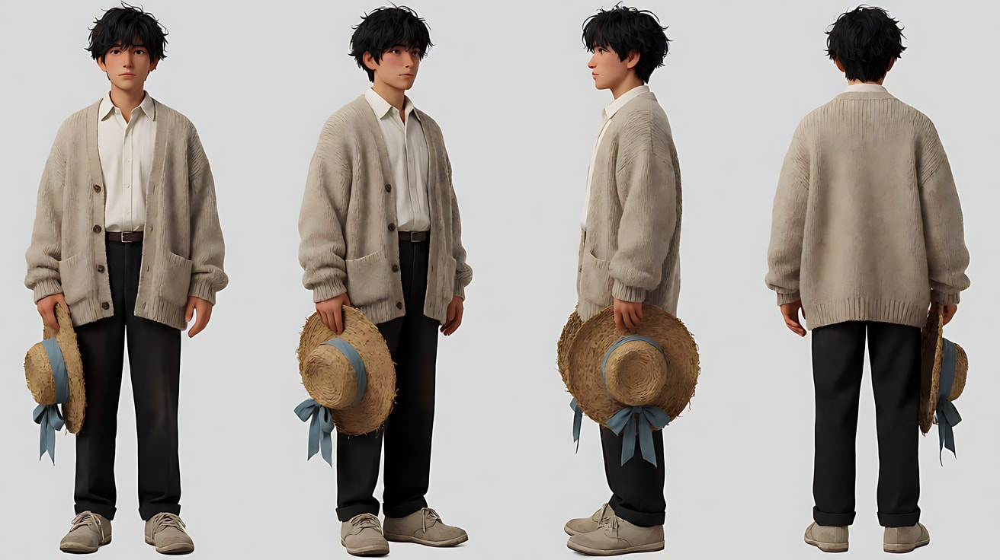

图2 场景：沿用练习4 图2（日落前的麦田与风车）。

图3 镜头1关键帧：

```
Using the character from image 1 and the field from image 2:
a low-angle medium shot from close behind him as he walks into the waist-high wheat toward the windmill, the straw hat held in his left hand at his side,
he is placed on the right third, the wheat and the low sun on the left, the sky filling the upper half.
Camera low at waist height, close behind him, 18mm lens, deep focus.
Lighting: very low warm sun ahead of him, golden rim on his hair and shoulders, soft lens flare.
Keep the face, hairstyle and outfit exactly as in image 1. Stylized semi-realistic 3D CG rendering, feature-film animation quality. Aspect ratio 16:9.
```

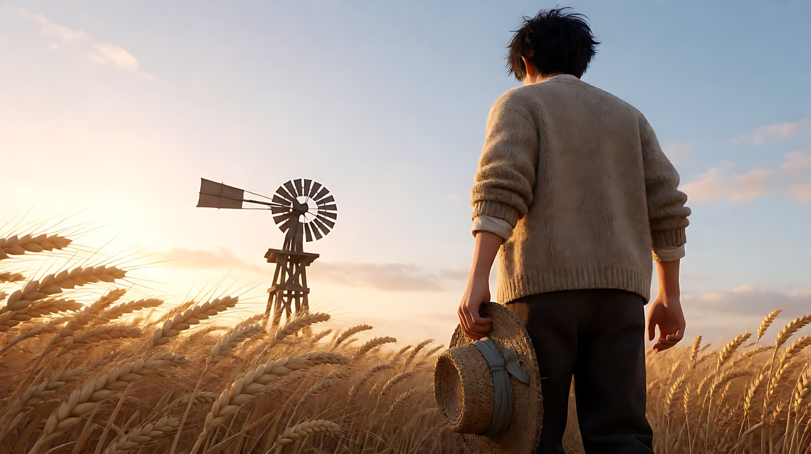

图4 镜头3关键帧：

```
Using the character from image 1 and the field from image 2:
an extreme low-angle wide shot looking up the slope, his small silhouette standing at the top of the hill next to the turning windmill,
the straw hat now on his head, the low sun flaring just beside him, wheat in the soft foreground, the vast pale-blue sky filling most of the frame.
Camera on the ground, tilted up, 16mm lens, deep focus.
Keep the outfit and the straw hat exactly as in image 1. Stylized semi-realistic 3D CG rendering, feature-film animation quality. Aspect ratio 16:9.
```

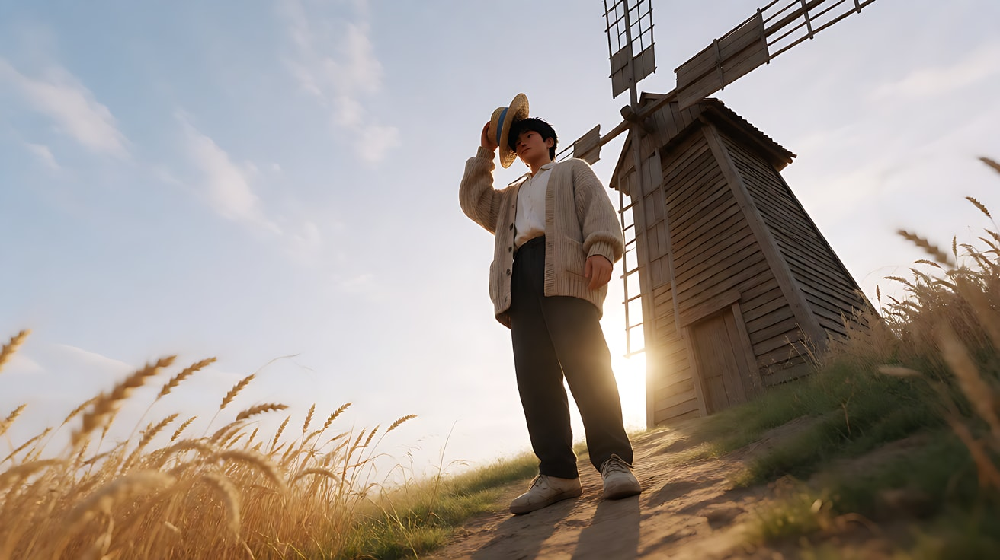

**【多图生视频 · Seedance】**

```
【素材分工】@图片1 锁定人物身份、开衫与旧草帽，不参考其背景；@图片2 仅参考麦田、风车与逆光方向，不作为首帧；@图片3 为镜头1首帧；@图片4 仅作为镜头3的构图与光线参考。
【画风】风格化写实三维CG质感，自然光。
镜头1：镜头在他身后低位轻柔漂浮跟随，他手里拿着旧草帽，走进齐腰的麦田，麦穗扫过他的手背。逆光从前方照来，他的肩膀和发梢被勾成金色。他停下一步，又继续往前。麦穗沙沙声，脚踩干土的轻响。
镜头2：镜头切至局部，他的手把草帽举到逆光里，阳光从草帽编织的缝隙中透过来，在他的手背上留下细碎的光点，褪色的蓝丝带在风里飘动。镜头低位缓慢环绕草帽小半圈。风声变近，丝带拍打的轻响。
镜头3：镜头切至稍晚的时刻，广角极低机位仰拍，他已经站在坡顶的风车旁，草帽戴在头上，身影很小，太阳就在他身旁入画，光晕闪过。镜头从麦穗间向上轻柔漂浮，天空越来越多。风车叶片缓慢转动的吱呀声。
【锁定】光线：全程日落前低角度暖金逆光，太阳在他前方，随镜头推进越来越低；人物：黑色乱发、燕麦色开衫、白衬衫，草帽带褪色蓝丝带；不出现第二个人。
【声音】画外音（老年女声，耳语，贯穿三个镜头）："风来的时候……就是我来看你了。"环境声为风、麦穗与风车，配乐为一段很轻的钢琴，最后一个音停在镜头3结尾，无对白。
【约束】保持人物脸型、发型、服装与草帽不变；不出现面部正面特写；旁白为画外音，人物不开口；不要字幕、水印、Logo。
时长：13秒
```

**参数**：时长 13 秒 ｜ 画幅 16:9 ｜ 负载：3 个镜头、无对白，属于"稳妥"偏上

**【检查点】**
- 六维是否都落地：中景 + 局部 + 全景 / 广角贴近深焦 / 低机位仰拍太阳入画 / 魔幻时刻逆光 / 漂浮跟随、环绕、上升各一 / 跳跃剪辑 + 耳语旁白
- 镜头2到镜头3是否"跳过"了走上坡顶的过程
- 草帽是否从"拿在手里"变为"戴在头上"，作为时间流逝的证据

**【常见问题与修复】**
| 现象 | 修复 |
|---|---|
| 镜头3出现了老人 | 约束写"不出现第二个人"，旁白写明是画外音 |
| 草帽在镜头3消失 | 【锁定】与镜头3都写"草帽戴在头上" |
| 草帽缝隙的光点不明显 | 写"阳光从草帽编织缝隙透过，光点清晰" |
| 跳跃感不足像连续动作 | 镜头3开头保留"镜头切至稍晚的时刻" |
