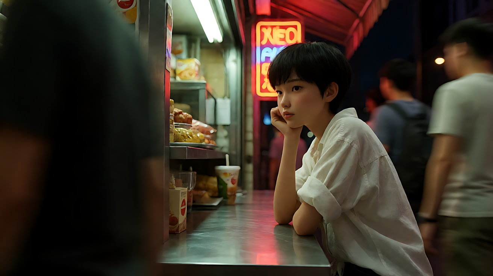
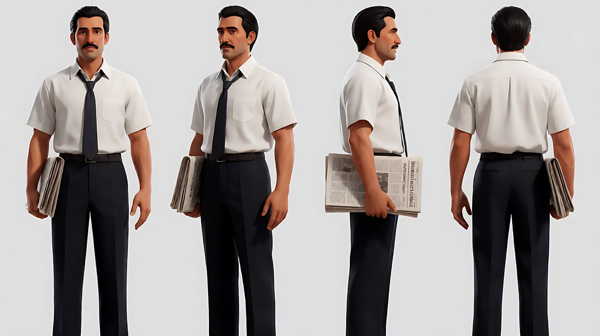
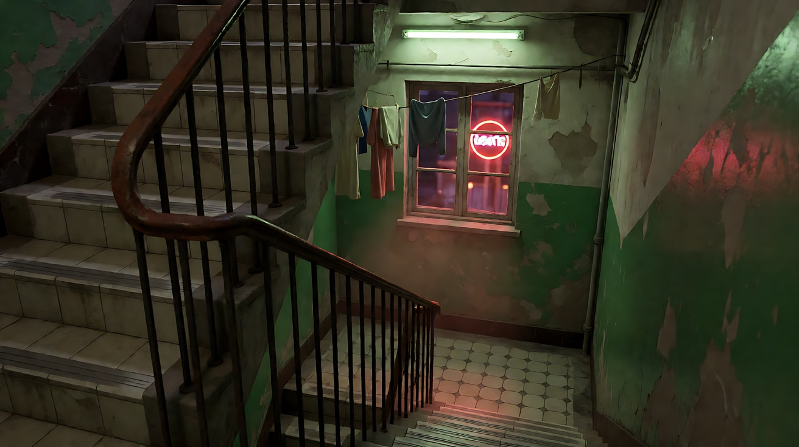
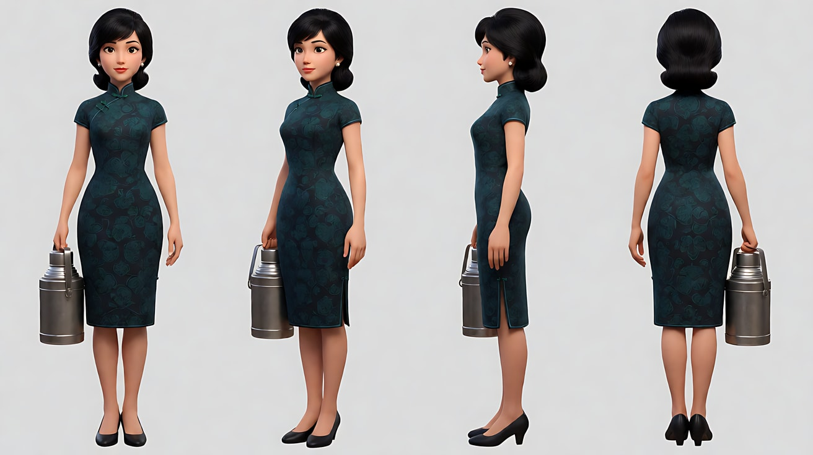
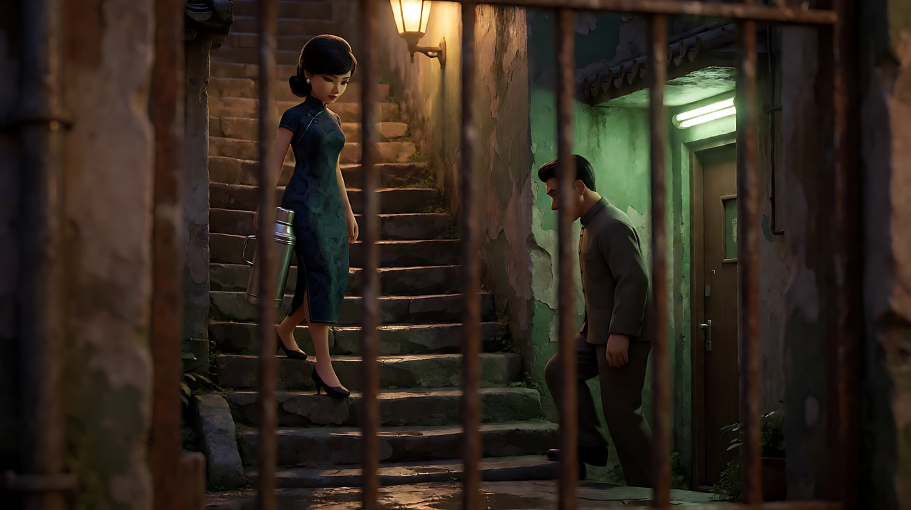
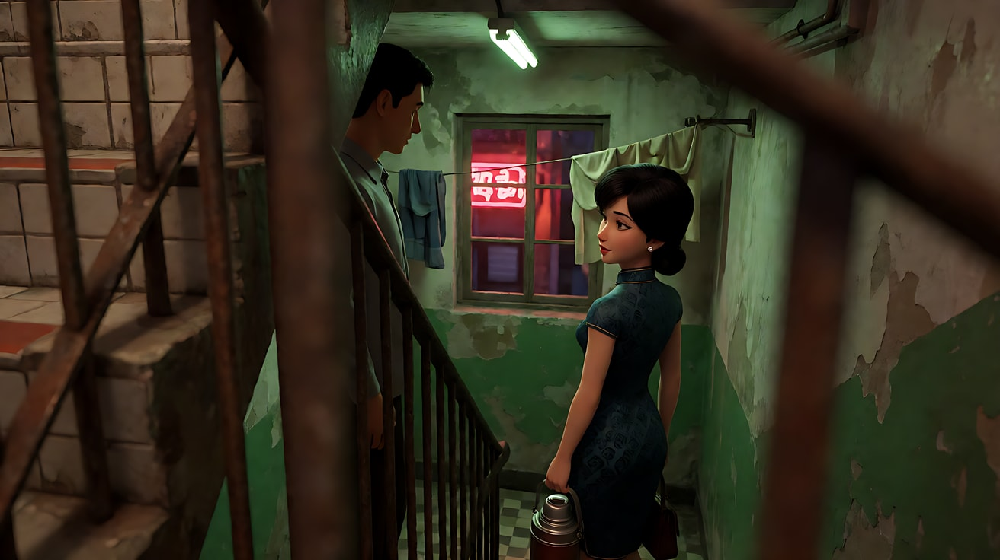
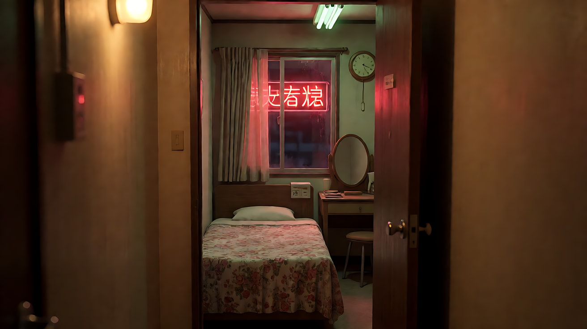
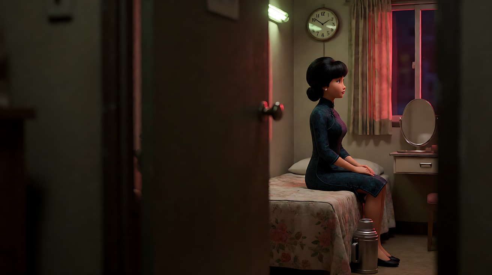
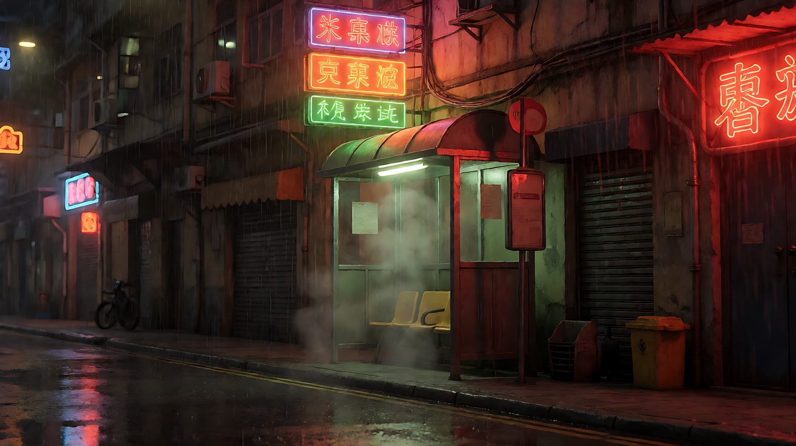
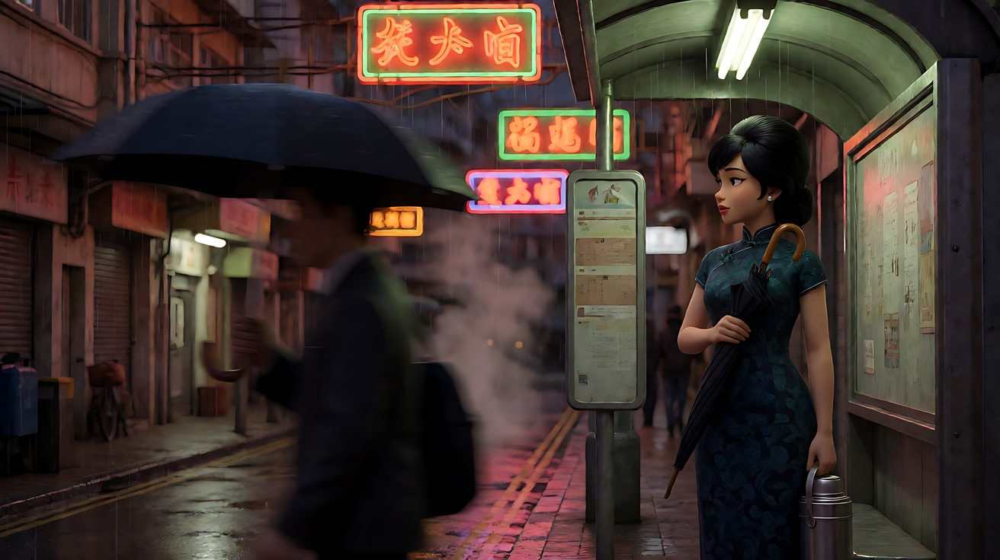

# L07-15 低帧率拖影、霓虹与前景遮挡 · 提示词

> 本组练习：低帧率拖影、升格慢动作、霓虹与荧光灯混合色温、手持、前景遮挡、狭窄空间、内心独白。｜ 配套教学：[L07-15 教学文件](../教学/L07-15-王家卫.md) ｜ 规范：[写作规范](../../模板/写作规范.md)
>
> 画风默认使用开关 A（风格化写实 CG）。如改用 2D 动画，删掉所有焦段、光圈、景深词。
>
> 本课风格指纹（只写技术，不写人名）：中近景与局部 ｜ 长焦压缩浅景深 或 超广角贴脸 ｜ 大面积前景遮挡、人物偏边、窄空间 ｜ 红色霓虹 + 绿色荧光灯混合色温 ｜ 手持 / 升格慢动作 / 低帧率拖影 ｜ 内心独白画外音、重复配乐。

---

### 练习1：人群拖影中静止的人（难度 ★）

**目标**：一个人几乎静止，周围的人群被拉成流动的光带。意图：让观众感到全城都在赶路，只有她停在原地等一个人。

**【生图 · Nano Banana】**

图1 关键帧：

```
A medium close-up of an original young woman in her early twenties with a short boyish black haircut, a loose white shirt with rolled sleeves,
leaning on the counter of a tiny late-night snack bar, chin resting on her hand, looking steadily toward frame left.
She is placed on the right third of the frame; in the foreground and background, blurred passersby stream past as long smeared motion trails.
Camera at eye level across the counter, 40mm lens, shallow depth of field, slight handheld tilt.
Lighting: a harsh green-tinted fluorescent tube above the counter as the top light, red and orange neon from the street sign behind her as a rim light,
the two color temperatures mixing on her cheek. Humid night air, wet reflections on the steel counter.
Stylized semi-realistic 3D CG rendering, feature-film animation quality. Aspect ratio 16:9.
```

中文释义：中近景，短发女孩靠在小吃店柜台上托着下巴望向画左；人物在画右三分之一；前后景的路人被拉成拖影；隔着柜台平视、40mm、浅景深、轻微手持倾斜；头顶绿色荧光灯 + 身后红橙霓虹轮廓光，两种色温混在脸颊上；潮湿夜晚、钢台面反光。



**【图生视频 · Seedance】**

```
【素材分工】@图片1 为首帧，锁定人物身份、服装、柜台环境与混合色温。
【画风】风格化写实三维CG质感，低帧率拖影效果，画面带轻微顿挫感。
女孩托着下巴几乎一动不动，只是慢慢眨了一下眼，手指在脸颊上轻敲两下，目光始终望着画左。她身前身后的路人高速流过，被拉成红、绿、白的模糊光带，速度远快于她。镜头手持，几乎不动，只有轻微的呼吸感晃动。结尾停在她仍望着画左的侧脸与流动的人群光带上。
【声音】嘈杂的夜街人声被压成一片模糊的嗡鸣，炒锅的铁铲声，一首老式流行歌曲从小收音机里隐约传来。画外音（女声，平静的独白）："那天晚上，他没有来。我又多等了二十分钟。"
【约束】保持人物脸型、发型、服装不变；她本人清晰，只有周围人群拖影；不要字幕、水印、Logo、招牌文字。
时长：7秒
```

**参数**：时长 7 秒 ｜ 画幅 16:9

**【检查点】**
- 是否"她清晰、人群模糊"
- 两种色温（绿顶光、红霓虹）是否同时在她脸上
- 独白是否平静而具体（时间、数字）

**【常见问题与修复】**
| 现象 | 修复 |
|---|---|
| 她也被拖影糊掉 | 写"她几乎静止，轮廓清晰，只有路人拖影" |
| 人群只是正常虚化，没有拖影 | 写"路人被拉成长长的流动光带，像慢门拍摄" |
| 色调统一成一种颜色 | 写清两个光源各自的方向和颜色 |
| 出现招牌文字 | 约束里写"招牌只是发光色块，没有文字" |

---

### 练习2：霓虹窄楼梯的手持（难度 ★★）

**目标**：在狭窄的旧楼梯间里，用手持跟拍和混合色温制造"潮湿、拥挤、无处可去"。意图：让观众感到他每晚都这样一个人上楼。

**【生图 · Nano Banana】**

图1 角色定妆：

```
Character turnaround sheet of an original man in his early thirties: slicked-back black hair, a thin moustache,
a white short-sleeve shirt with a loosened dark tie, dark trousers, a folded newspaper under his arm.
Front view, three-quarter view, side view and back view, full body, eye-level camera, 50mm lens, deep focus,
plain light-grey background, even soft studio light from the front. Stylized semi-realistic 3D CG rendering, feature-film animation quality. Aspect ratio 16:9.
```



图2 场景：

```
Empty narrow stairwell of an old 1960s apartment block at night, steep tiled steps, a peeling green painted wall,
a rusted iron handrail, a small window on the landing with red neon light spilling in from a street sign outside,
a single bare green fluorescent tube on the ceiling, laundry hanging on a wire across the landing, no people.
Medium shot looking up the stairs from the lower landing, 28mm lens, moderate depth of field.
Lighting: red neon from the landing window, green fluorescent from above, humid haze. Stylized semi-realistic 3D CG rendering, feature-film animation quality. Aspect ratio 16:9.
```



**【多图生视频 · Seedance】**

```
【素材分工】@图片1 锁定人物身份、服装与报纸，不参考其背景；@图片2 仅参考楼梯间布局、窗口霓虹与荧光灯色温，不作为首帧。
【画风】风格化写实三维CG质感，霓虹与荧光灯混合色温。
男人一步一步走上狭窄的楼梯，一只手扶着生锈的铁扶手，报纸夹在腋下。镜头手持跟在他身后下方几级台阶处，随他的脚步轻微晃动。他经过楼梯平台的窗口时，窗外的红色霓虹照亮他半边身体，另一半被头顶的绿色荧光灯染成冷绿，挂在铁丝上的衣服从他头顶擦过。他在平台上停下，抬手松了松领带，没有回头，继续往上走。结尾停在他走出画面上沿、只剩晃动的衣服和红绿交错的光上。
【声音】皮鞋踩瓷砖台阶的回声，荧光灯电流的嗡声，窗外霓虹灯管的滋滋声，楼上隐约传来别人家的收音机声。画外音（男声，平静低沉的独白）："这栋楼一共七层，我住第五层。从来没有人和我一起上过楼。"
【约束】保持人物脸型、发型、服装不变；手持晃动轻微，不剧烈；不要字幕、水印、Logo、招牌文字。
时长：9秒
```

**参数**：时长 9 秒 ｜ 画幅 16:9

**【检查点】**
- 红绿两种色温是否在他经过窗口时同时落在身上
- 手持晃动是否跟着脚步节奏
- 结尾是否是"人走出画面，只剩空间与光"

**【常见问题与修复】**
| 现象 | 修复 |
|---|---|
| 楼梯变宽敞 | 写"楼梯只容一人通过，墙壁几乎贴着他的肩膀" |
| 霓虹变成整个画面通红 | 写"红光只从平台窗口照入，范围有限" |
| 他回头看镜头 | 写"他始终背对镜头" |

---

### 练习3：窄巷擦肩的升格慢动作（难度 ★★★，首尾帧）

**目标**：用首尾帧锁定一次擦肩：她走下台阶，他走上来，两人在窄处交错。用升格慢动作把这一秒拉长，用前景铁栏隔开观众。意图：让观众感到两个人都想停下来，但都没有。

**【生图 · Nano Banana】**

图1 角色定妆：

```
Character turnaround sheet of an original woman in her early thirties: black hair styled in a neat 1960s low bouffant,
a fitted high-collar dark teal patterned cheongsam-style dress, small pearl earrings, carrying a metal thermos food container.
Front view, three-quarter view, side view and back view, full body, eye-level camera, 50mm lens, deep focus,
plain light-grey background, even soft studio light from the front. Stylized semi-realistic 3D CG rendering, feature-film animation quality. Aspect ratio 16:9.
```



图2 角色定妆：沿用练习2 图1（男人）。

图3 首帧：

```
Using the characters from image 1 and image 2: a medium shot through the bars of a rusted iron railing in the foreground,
a narrow stone staircase in an old alley at night, the woman at the top of the steps on the left beginning to walk down with the thermos,
the man at the bottom of the steps on the right beginning to walk up, both looking down at the steps, not at each other.
The iron bars occupy the foreground, soft and out of focus, the two figures in the gaps between them.
Camera fixed at mid-stair height, 85mm telephoto lens, compressed perspective, shallow depth of field.
Lighting: a single warm tungsten street lamp at the top of the stairs, a green fluorescent glow from a doorway at the bottom, wet stone reflecting both.
Keep the faces, hairstyles and outfits exactly as in image 1 and image 2. Stylized semi-realistic 3D CG rendering, feature-film animation quality. Aspect ratio 16:9.
```



图4 尾帧：

```
Using the characters from image 1 and image 2 and the same railing, staircase, lens and lighting as image 3:
the two have just passed each other in the middle of the stairs; the woman is now lower on the right with her back half-turned,
her head slightly tilted back toward him; the man is higher on the left, also pausing, his face in shadow.
The iron bars still in the soft foreground. Keep the faces, hairstyles and outfits exactly as in image 1 and image 2.
Stylized semi-realistic 3D CG rendering, feature-film animation quality. Aspect ratio 16:9.
```



**【首尾帧生视频 · Seedance】**

```
【素材分工】@图片3 为首帧，确定前景铁栏、长焦压缩构图与暖钨丝灯、绿荧光的混合光；@图片4 为尾帧，是最终画面目标；@图片1 仅锁定女人的身份与服装；@图片2 仅锁定男人的身份与服装。只生成两帧之间的连续动作。
【画风】风格化写实三维CG质感，升格慢动作。
升格慢动作。女人提着保温壶一级一级走下台阶，裙摆缓慢摆动；男人从下方一级一级走上来。两人在台阶最窄处交错，肩膀几乎相碰，都低着眼没有看对方。交错之后，她的脚步慢了半拍，头微微向后偏；他也在上方停住一瞬。镜头固定在前景铁栏后，不移动。
【声音】一段缓慢的大提琴与弦乐三拍子主题从头到尾持续，盖过环境声，只隐约听到湿石阶上的鞋跟声和远处的雨檐滴水。无对白。
【约束】保持两人脸型、发型、服装不变；全程慢动作，速度统一；镜头固定；两人不接触、不交谈；不要字幕、水印、Logo。
时长：8秒
```

**参数**：时长 8 秒 ｜ 画幅 16:9

**【检查点】**
- 慢动作是否全程统一
- 前景铁栏是否始终虚化挡在前面
- "脚步慢半拍、头微偏"这个克制的反应是否可见

**【常见问题与修复】**
| 现象 | 修复 |
|---|---|
| 两人停下来说话 | 约束写"两人不交谈、不对视" |
| 慢动作时快时慢 | 写"全程统一的慢动作速度" |
| 铁栏消失 | 写"前景始终有虚化的铁栏杆，占画面约三分之一" |
| 保温壶变形 | 写"保温壶形状始终不变，她一直提在右手" |

---

### 练习4：同一个小房间的三种遮挡（难度 ★★★★，多镜头）

**目标**：在一个狭小的旅馆房间里用三个镜头换三种前景遮挡：门缝、镜子、超广角贴脸。意图：让观众感到她在这里等了很久，并且决定不再等。

**【生图 · Nano Banana】**

图1 角色定妆：沿用练习3 图1（女人）。

图2 场景：

```
Empty tiny cheap hotel room at night, a narrow single bed with a faded floral bedspread, a small round mirror on a dressing table,
a wall clock, a window with half-drawn curtains and a red neon sign glowing outside, a bare green-tinted fluorescent bulb near the ceiling,
the door half-open to a dim corridor, no people.
Medium shot from the corridor through the half-open door, 50mm lens, moderate depth of field.
Lighting: red neon from the window, green fluorescent from above, warm tungsten corridor light. Stylized semi-realistic 3D CG rendering, feature-film animation quality. Aspect ratio 16:9.
```



图3 镜头1关键帧：

```
Using the character from image 1 and the room from image 2:
a medium shot through the narrow gap of the half-open door, the door edge and frame filling the left half of the frame, dark and out of focus,
the woman sitting on the edge of the bed in the right gap, her back straight, the thermos on the floor beside her, looking at the wall clock.
Camera in the corridor, 85mm lens, shallow depth of field. Lighting: red neon from the window on her face, green fluorescent from above.
Keep the face, hairstyle and outfit exactly as in image 1. Stylized semi-realistic 3D CG rendering, feature-film animation quality. Aspect ratio 16:9.
```



**【多图生视频 · Seedance】**

```
【素材分工】@图片1 锁定女人的身份、发型与服装，不参考其背景；@图片2 仅参考房间布局、窗外霓虹与灯光色温，不作为首帧；@图片3 为镜头1首帧。
【画风】风格化写实三维CG质感，霓虹与荧光灯混合色温。
镜头1：透过半掩的门缝拍摄，门板在前景占画面左侧一半并虚化，她坐在床沿，背挺得很直，抬眼看墙上的挂钟。镜头固定。挂钟的滴答声，窗外霓虹灯管的滋滋声。
镜头2：镜头切至梳妆台的圆镜，只在镜子里看到她的中近景倒影，她把一只珍珠耳环摘下，放在台面上，镜框外是虚化的墙。镜头固定，略微倾斜。耳环落在玻璃台面上的一声轻响。
镜头3：镜头切至超广角贴近她脸部的近景，手持，她站起身，拎起保温壶，侧脸占满画面右侧，背后的小房间被拉得很远。她走向门口，镜头随她轻微晃动，红绿霓虹在她脸上交替闪过。门被拉开的吱呀声。
【锁定】光线：窗外红色霓虹从画左照入，房间顶上绿色荧光灯，走廊是暖钨丝灯；人物：60 年代低蓬发髻、深青色高领花纹连衣裙、珍珠耳环（镜头2起只剩一只）；房间始终狭小。
【声音】画外音（女声，平静的独白，覆盖镜头1到镜头3）："这个钟走快了七分钟。我等的人，也许早就来过了。"挂钟滴答声贯穿，配乐为一段缓慢的弦乐，在镜头3开门声时停止。
【约束】保持人物脸型、发型、服装不变；画面中只有她一个人；不要字幕、水印、Logo、招牌文字。
时长：13秒
```

**参数**：时长 13 秒 ｜ 画幅 16:9 ｜ 负载：3 个镜头、1 个摘耳环 + 1 个起身，属于"稳妥"偏上

**【检查点】**
- 三个镜头是否分别用了门缝遮挡、镜中倒影、超广角贴脸
- 镜头3是否切换为手持，而前两个镜头固定
- 耳环数量的变化是否连贯

**【常见问题与修复】**
| 现象 | 修复 |
|---|---|
| 镜头2镜子里出现了别人 | 约束写"镜中只有她一个人的倒影" |
| 镜头3超广角变形过度到脸部扭曲 | 改为"广角近景"，降低一档 |
| 三个镜头色温不一致 | 【锁定】写明三个光源的位置与颜色 |

---

### 练习5：原创 3 镜头场景《末班小巴》（难度 ★★★★★）

**目标**：综合低帧率拖影、升格慢动作、混合色温、前景遮挡、狭窄空间与独白，拍一个原创场景。故事：雨夜，一个女人在末班小巴站等着，要把一把伞还给一个只见过一面的男人。意图：让观众感到"他们又一次错过了"。

**分镜表**

| 镜头 | 景别 / 机位 | 时间处理 | 光 | 遮挡 |
|---|---|---|---|---|
| 1 | 中近景，长焦 | 低帧率拖影 | 红霓虹 + 站牌荧光 | 前景流过的人群 |
| 2 | 局部特写 | 升格慢动作 | 车窗反光 | 雨水玻璃 |
| 3 | 超广角近景 → 背影 | 手持 | 小巴尾灯红光 | 无，人物贴脸 |

**【生图 · Nano Banana】**

图1 角色定妆：沿用练习3 图1（女人）。黑色长柄伞写在镜头1关键帧里，由关键帧锁定外观。

图2 角色定妆：沿用练习2 图1（男人）。

图3 场景：

```
Empty minibus stop on a narrow rainy street at night in an old dense city, a small shelter with a green-tinted fluorescent tube,
stacked red, orange and green neon signs on the buildings above (glowing shapes only, no letters), wet asphalt reflecting all colors,
steam rising from a drain, no people.
Medium-wide shot at eye level, 85mm telephoto lens, compressed perspective, shallow depth of field.
Lighting: red and orange neon from above frame right, green fluorescent inside the shelter, rain streaks catching the light.
Stylized semi-realistic 3D CG rendering, feature-film animation quality. Aspect ratio 16:9.
```



图4 镜头1关键帧：

```
Using the character from image 1 and the street from image 3:
a medium close-up of the woman standing still under the shelter holding the folded black umbrella against her chest, looking toward frame left down the street,
she is placed on the right third; blurred passersby with umbrellas stream across the foreground as long smeared color trails.
Camera at eye level across the street, 85mm lens, compressed perspective, shallow depth of field.
Lighting: green fluorescent from the shelter above her, red neon rim from behind. Keep the face, hairstyle and outfit exactly as in image 1.
Stylized semi-realistic 3D CG rendering, feature-film animation quality. Aspect ratio 16:9.
```



**【多图生视频 · Seedance】**

```
【素材分工】@图片1 锁定女人的身份、发型与服装，不参考其背景；@图片2 锁定男人的身份与服装，不参考其背景；@图片3 仅参考小巴站、霓虹与湿地面的光线，不作为首帧；@图片4 为镜头1首帧。
【画风】风格化写实三维CG质感，霓虹与荧光灯混合色温。
镜头1：低帧率拖影效果。长焦隔着街拍她的中近景，她站在候车亭下几乎不动，把那把黑伞抱在胸前，望向画左的街道尽头。前景撑伞的路人高速流过，被拉成红、绿、橙的模糊光带。她清晰，人群模糊。雨声与车流声混成一片。
镜头2：镜头切至局部特写，升格慢动作，一辆小巴从画面左侧缓慢驶过，透过布满雨水的车窗玻璃，可以看到车厢里男人的侧脸一闪而过，他望着窗外另一个方向，霓虹的反光在玻璃上流动。雨滴在玻璃上缓慢滑落。只剩一段缓慢的弦乐。
镜头3：镜头切至手持超广角近景，她的侧脸占满画面右侧，她转过头，看见小巴的红色尾灯正在远去。她向前走了两步，停下，低头看了一眼怀里的伞，没有撑开。镜头绕到她身后，停在她的背影和越来越小的红色尾灯上，雨落在她肩上。
【锁定】光线：候车亭绿色荧光灯在上方，红橙霓虹在画右上方，小巴尾灯为红色；女人：低蓬发髻、深青色高领花纹连衣裙、抱着黑色长柄伞；男人只在镜头2的车窗里出现一次，不下车；三个镜头的时间处理分别为拖影、慢动作、手持正常速度。
【声音】雨声贯穿；镜头1为车流与人声的模糊嗡鸣；镜头2只剩缓慢弦乐；镜头3弦乐延续，小巴引擎声远去。画外音（女声，平静的独白，覆盖镜头3）："那天晚上，雨下了四十七分钟。伞，我到现在还没还。"
【约束】保持两人脸型、发型、服装不变；两人没有对视、没有交谈；车身与招牌不出现文字；不要字幕、水印、Logo。
时长：14秒
```

**参数**：时长 14 秒 ｜ 画幅 16:9 ｜ 负载：3 个镜头、3 种时间处理，属于"有挑战"档；失败时把镜头2单独生成再剪接

**【检查点】**
- 六维是否都落地：中近景与局部 / 长焦压缩与超广角贴脸 / 人群与雨窗的前景遮挡 / 红绿混合色温 / 拖影、慢动作、手持各一 / 独白与重复弦乐
- 三个镜头的"时间"是否明显不同
- 是否保持了"错过"：男人没有看见她

**【常见问题与修复】**
| 现象 | 修复 |
|---|---|
| 镜头2男人看向她 | 写"他望着窗外另一个方向，没有看见她" |
| 镜头1拖影效果没出现 | 单独生成镜头1，并在【画风】里只写"低帧率拖影效果" |
| 镜头3她撑开了伞 | 写"她没有撑开伞，伞始终合着抱在怀里" |
| 霓虹出现乱码文字 | 场景图提示词与约束都写"只有发光色块，没有文字" |
