# L07-16 大色块、对称群像与仪式感 · 提示词

> 本组练习：大面积高饱和单色、颜色变化即剧情转折、正面对称群像、重复的仪式动作、高俯大场面调度。｜ 配套教学：[L07-16 教学文件](../教学/L07-16-张艺谋.md) ｜ 规范：[写作规范](../../模板/写作规范.md)
>
> 画风默认使用开关 A（风格化写实 CG）。如改用 2D 动画，删掉所有焦段、光圈、景深词。
>
> 本课风格指纹（只写技术，不写人名）：大远景色块与正面近景两极 ｜ 长焦压缩成色块 / 高俯广角成图案 ｜ 严格正面中心对称、几何队列 ｜ 一场一个高饱和主色 + 一个异色主角 ｜ 固定与缓慢升降 ｜ 仪式动作的重复。

---

### 练习1：黄色大地上的一点红（难度 ★）

**目标**：用面积思考画面——明黄占满，只留一个红点给主角。意图：让观众感到她要独自穿过整片土地去嫁人。

**【生图 · Nano Banana】**

图1 关键帧：

```
An extreme wide shot of an endless field of blooming bright yellow rapeseed flowers rolling over gentle hills under a pale overcast sky,
a single original young woman in a vivid vermilion-red long traditional wedding robe and red veil walking along a narrow earth path that cuts diagonally through the field.
The yellow fills about eighty percent of the frame, the low horizon is perfectly horizontal near the top, she is a small red figure at the lower center.
Camera on a high hill, slightly elevated, 135mm telephoto lens, compressed perspective flattening the hills into layered bands of yellow, deep focus.
Lighting: soft bright overcast daylight from above, no harsh shadows, highly saturated yellow and red.
Stylized semi-realistic 3D CG rendering, feature-film animation quality. Aspect ratio 2.39:1.
```

中文释义：大远景，无边的明黄油菜花田，一位穿朱红嫁衣、盖红盖头的女子沿斜穿花田的小土路走；黄色占画面八成，地平线压在画面上部且完全水平，她是画面下方中间的一小点红；高处略俯、135mm 长焦把山丘压成一层层黄色色带；阴天柔和亮光；高饱和红黄。

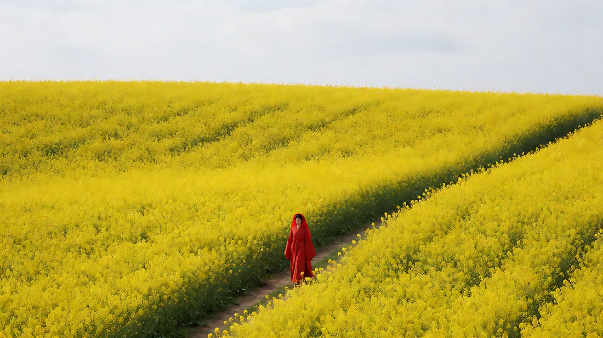

**【图生视频 · Seedance】**

```
【素材分工】@图片1 为首帧，锁定色块比例、人物服装与花田构图。
【画风】风格化写实三维CG质感，高饱和色彩。
红衣女子沿着土路一步一步向画面深处走去，步子平稳，没有回头。风从画右吹来，整片油菜花海同时向画左起伏，像金黄色的波浪，她的红色衣摆和盖头的流苏被风扬起。镜头固定不动，色块构图保持不变。结尾停在她成为黄色海洋中更小的一点红上。
【声音】风吹花田的沙沙声连成一片，远处隐约传来一声唢呐长音，随后只剩风声，无对白。
【约束】保持人物服装颜色与形状不变；不出现第二个人；镜头固定；不要字幕、水印、Logo。
时长：7秒
```

**参数**：时长 7 秒 ｜ 画幅 2.39:1（平台无此选项时选 16:9）

**【检查点】**
- 黄色是否占大面积，红点是否是唯一的异色
- 花田是否整体同步起伏
- 人物是否越走越小

**【常见问题与修复】**
| 现象 | 修复 |
|---|---|
| 人物太大，色块感消失 | 写"人物只占画面面积的百分之一" |
| 颜色发灰 | 写"高饱和明黄与朱红，阴天柔光但颜色鲜艳" |
| 镜头跟着人物推进 | 写"镜头固定，构图不变" |

---

### 练习2：对称庭院与点灯仪式（难度 ★★）

**目标**：正面中心对称 + 整齐的群体同步动作 + 一个异色主角。意图：让观众感到这座院子里的每一个夜晚都一模一样。

**【生图 · Nano Banana】**

图1 角色定妆：

```
Character turnaround sheet of an original young woman in her early twenties: black hair parted in the middle and tied in a low bun,
a plain pale white high-collar long jacket and skirt in a 1920s style, no jewelry, a calm expressionless face.
Front view, three-quarter view, side view and back view, full body, eye-level camera, 50mm lens, deep focus,
plain light-grey background, even soft studio light from the front. Stylized semi-realistic 3D CG rendering, feature-film animation quality. Aspect ratio 16:9.
```

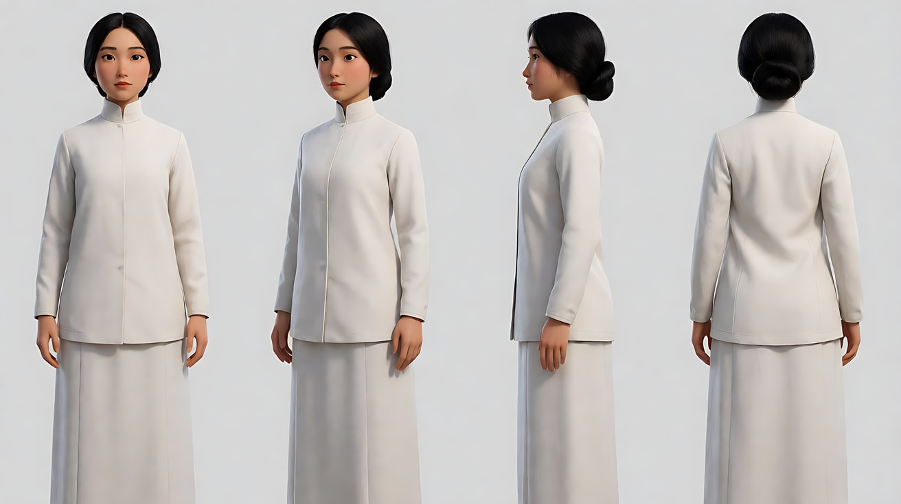

图2 场景：

```
An empty traditional northern Chinese grey-brick courtyard at dusk seen perfectly frontally along its central axis,
a main hall with a wide roof at the back center, identical side wings on the left and right, a stone-paved path running from the camera to the hall steps,
rows of unlit large red silk lanterns hanging under the eaves on both sides, no people.
Wide shot, eye level, centered on the axis, 35mm lens, deep focus, the roof line perfectly horizontal.
Lighting: cool blue-grey dusk sky, the grey bricks muted, ready for the warm red lantern light. Stylized semi-realistic 3D CG rendering, feature-film animation quality. Aspect ratio 16:9.
```

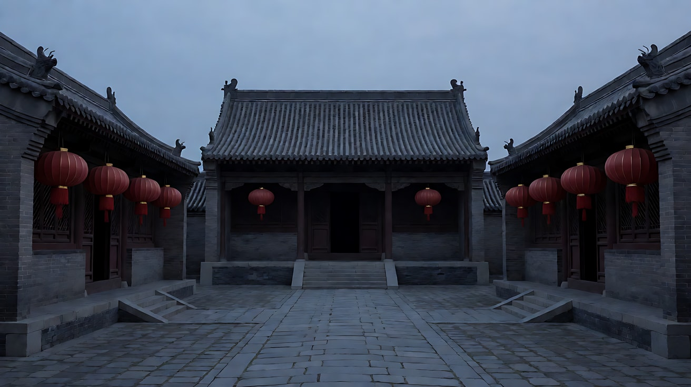

**【多图生视频 · Seedance】**

```
【素材分工】@图片1 锁定白衣女子的身份与服装，不参考其背景；@图片2 仅参考庭院的对称布局、屋檐与灯笼位置，不作为首帧。
【画风】风格化写实三维CG质感，高饱和色彩。
正面中心对称构图，庭院中轴线居中。十二名穿深红色衣服的仆人分成左右两列，每列六人，间距相等，面朝中轴站立。白衣女子独自站在中轴线上，面朝镜头，双手交叠放在身前，面无表情。仆人们同时举起长竿，同时点亮屋檐下的红灯笼，左右两侧的灯笼一盏接一盏、对称地亮起来，红光从屋檐向院子铺开，染红灰色的砖墙。镜头固定不动。结尾停在灯笼全部亮起、女子的白衣被映成淡红的画面上。
【声音】无配乐，长竿碰到灯笼的轻响有节奏地重复，脚步整齐地落地，最后一盏灯亮起时远处传来一声铜锣。
【约束】保持女子脸型、发型、服装不变；左右两列仆人动作完全同步对称；女子不移动；不要字幕、水印、Logo。
时长：9秒
```

**参数**：时长 9 秒 ｜ 画幅 16:9

**【检查点】**
- 左右两列是否对称，点灯是否同步
- 白衣女子是否是唯一的异色，并在红光中被"染红"
- 镜头是否固定、中轴居中

**【常见问题与修复】**
| 现象 | 修复 |
|---|---|
| 仆人动作不同步 | 写"所有人同时举竿、同时点灯，像同一个动作的镜像" |
| 对称被破坏 | 写"中轴线贯穿画面正中，左右完全镜像" |
| 女子也去点灯 | 写"女子始终站在中轴线上不动，只有眼睛缓慢抬起" |
| 灯笼光太弱 | 写"灯笼的红光照亮整面砖墙和地面" |

---

### 练习3：金黄变深红（难度 ★★★，首尾帧）

**目标**：用首尾帧把"环境颜色的变化"锁定为剧情转折。意图：让观众感到她松开手的那一刻，一段感情结束了。

**【生图 · Nano Banana】**

图1 角色定妆：

```
Character turnaround sheet of an original woman in her late twenties: long straight black hair loose to the waist,
a flowing pure white silk long robe with wide sleeves, barefoot, a folded paper letter in her hand.
Front view, three-quarter view, side view and back view, full body, eye-level camera, 50mm lens, deep focus,
plain light-grey background, even soft studio light from the front. Stylized semi-realistic 3D CG rendering, feature-film animation quality. Aspect ratio 16:9.
```

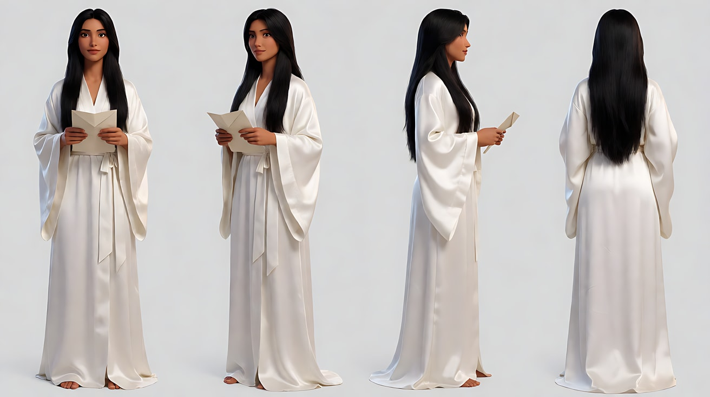

图2 首帧：

```
Using the character from image 1: a frontal symmetrical full shot of her standing at the exact center of a dense ginkgo forest in autumn,
every tree and the ground covered in bright golden-yellow leaves, the trunks lined up symmetrically on both sides,
she holds the folded letter against her chest with both hands, golden leaves drifting in the air.
Camera at eye level, centered, 85mm lens, compressed perspective, moderate depth of field.
Lighting: warm low afternoon sun from behind the forest, backlighting the falling leaves, saturated gold.
Keep the face, hairstyle and outfit exactly as in image 1. Stylized semi-realistic 3D CG rendering, feature-film animation quality. Aspect ratio 16:9.
```

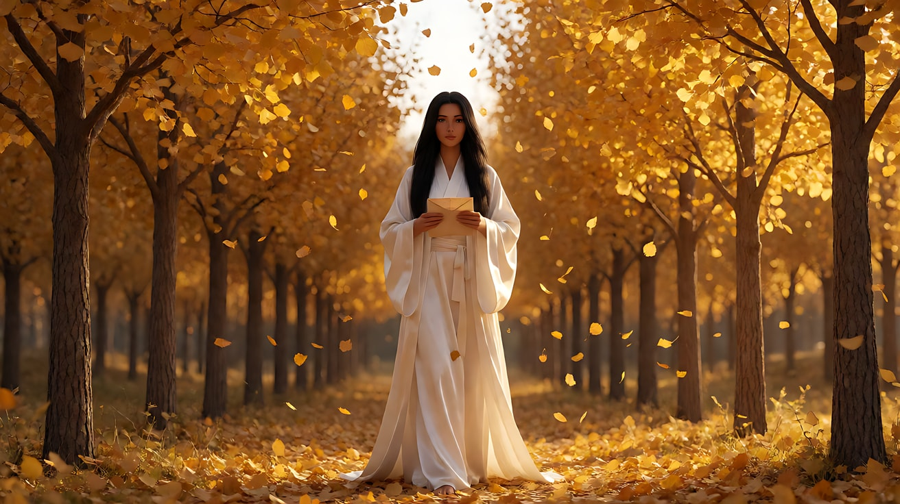

图3 尾帧：

```
Using the character from image 1 and the exact same forest, framing and lens as image 2:
now every leaf on the trees and on the ground has turned a deep saturated crimson red, the air full of falling red leaves,
she stands at the center with her empty hands lowered at her sides, the letter gone, her white robe now the only pale element in the frame.
Lighting: the same low sun from behind, now cooler and dimmer, the red deep and dark.
Keep the face, hairstyle and outfit exactly as in image 1. Stylized semi-realistic 3D CG rendering, feature-film animation quality. Aspect ratio 16:9.
```

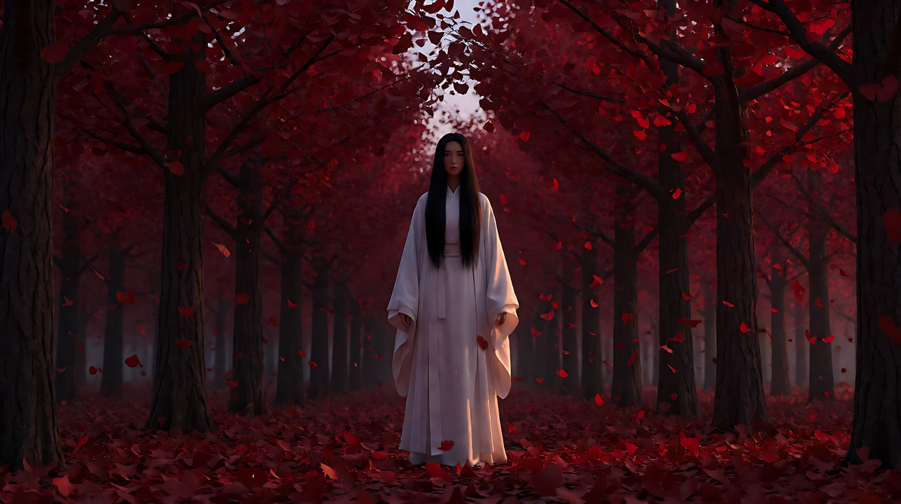

**【首尾帧生视频 · Seedance】**

```
【素材分工】@图片2 为首帧，确定对称构图与金黄色块；@图片3 为尾帧，是最终画面目标；@图片1 仅锁定人物身份与服装，不参考其背景。只生成两帧之间的连续动作。
【画风】风格化写实三维CG质感，高饱和色彩，慢动作。
慢动作。她把信从胸前慢慢拿开，双手松开，信被风卷走，飞出画面右侧。一阵风从她身后吹来，满树满地的落叶同时扬起，在空中旋转，飘落时颜色从金黄逐渐变成深红，从画面中心向四周扩散。她的白色长袖与长发被风扬起，然后缓缓落下，双手垂在身侧。镜头固定，对称构图不变。
【声音】风声由弱到强再到静，成千上万片叶子翻动的沙沙声，一段古筝的单音拨弦在叶子变红时响起，余音很长，无对白。
【约束】保持人物脸型、发型、服装颜色不变，白衣始终是白色；镜头固定；不要字幕、水印、Logo。
时长：9秒
```

**参数**：时长 9 秒 ｜ 画幅 16:9

**【检查点】**
- 颜色变化是否从中心向外扩散，而不是突然切换
- 白衣是否始终是唯一的浅色
- 慢动作是否统一

**【常见问题与修复】**
| 现象 | 修复 |
|---|---|
| 白衣也被染红 | 约束写"白衣始终保持纯白" |
| 颜色瞬间切换 | 写"颜色在落叶飘落中逐渐变化" |
| 信飞向镜头遮挡画面 | 写"信飞向画面右侧边缘，不经过镜头前" |

---

### 练习4：鼓阵——从一到万（难度 ★★★★，多镜头）

**目标**：用三个镜头完成"个人 → 群体 → 图案"的大场面调度，群体动作整齐划一。意图：让观众感到一个人的鼓声唤醒了整座城。

**【生图 · Nano Banana】**

图1 角色定妆：

```
Character turnaround sheet of an original man in his fifties: a shaved head, a short grey beard, a sleeveless dark crimson tunic with a wide black sash,
black wide trousers, two thick wooden drumsticks.
Front view, three-quarter view, side view and back view, full body, eye-level camera, 50mm lens, deep focus,
plain light-grey background, even soft studio light from the front. Stylized semi-realistic 3D CG rendering, feature-film animation quality. Aspect ratio 16:9.
```

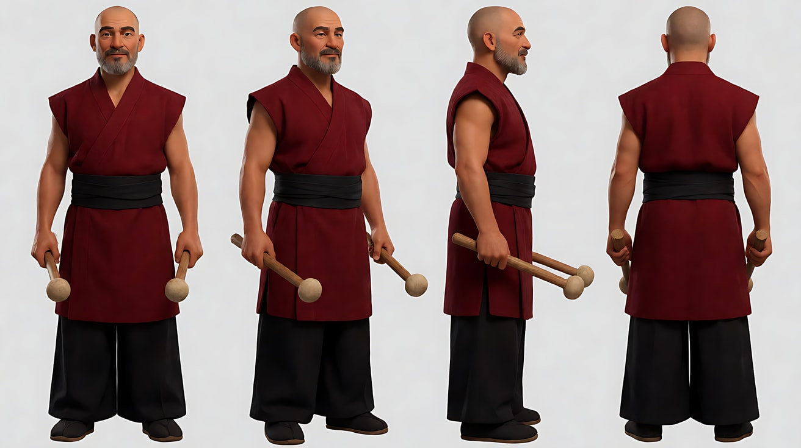

图2 场景：

```
A vast empty stone-paved square in front of a huge ancient city gate tower at dawn, hundreds of large red barrel drums arranged in a perfect square grid
on the stones, the gate tower centered at the back, no people.
Extreme high-angle overhead wide shot looking straight down, 24mm lens, deep focus, the grid perfectly aligned to the frame.
Lighting: cool blue dawn light with the first warm sunlight touching the top of the gate tower. Stylized semi-realistic 3D CG rendering, feature-film animation quality. Aspect ratio 16:9.
```

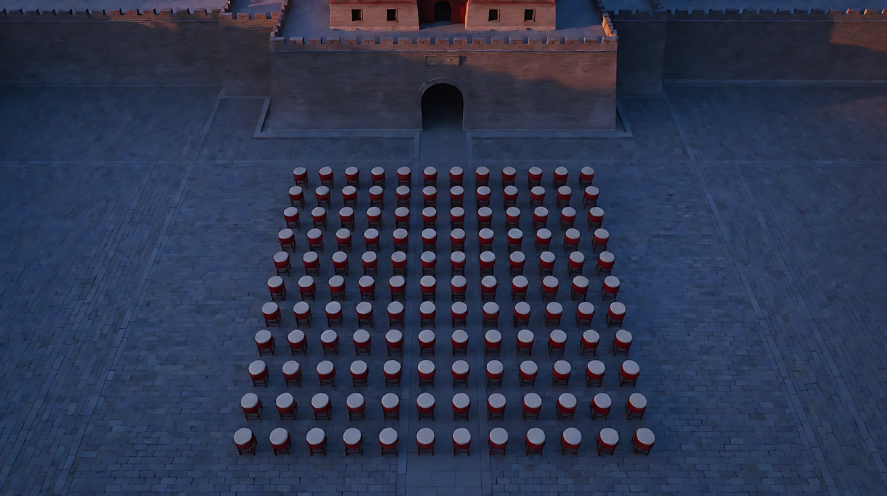

图3 镜头1关键帧：

```
Using the character from image 1 and the square from image 2:
a frontal medium close-up of the old drummer standing behind a large red drum, both drumsticks raised above his head, eyes closed, calm face,
the gate tower blurred behind him, perfectly centered in the frame.
Camera at eye level, 85mm lens, shallow depth of field. Lighting: the first warm sunlight from frame left on his face, cool blue dawn on the background.
Keep the face, hairstyle and outfit exactly as in image 1. Stylized semi-realistic 3D CG rendering, feature-film animation quality. Aspect ratio 16:9.
```

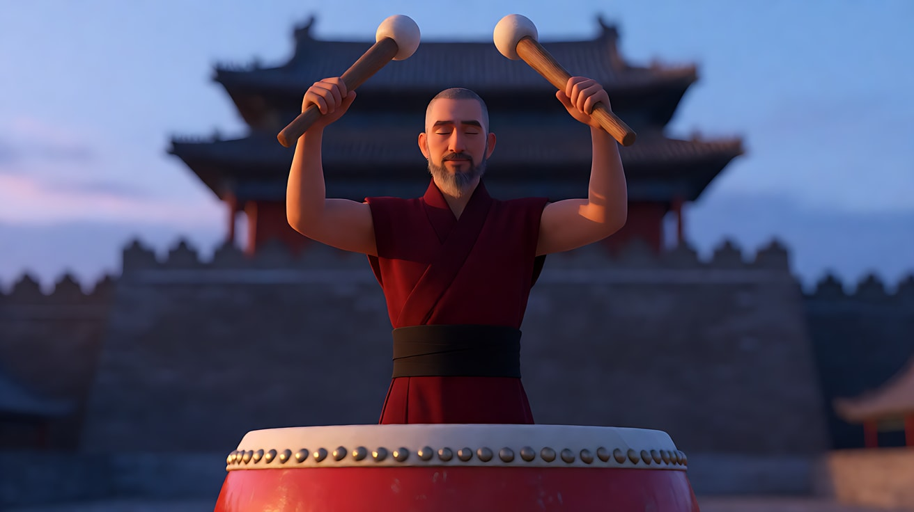

**【多图生视频 · Seedance】**

```
【素材分工】@图片1 锁定老鼓手的身份、服装与鼓槌，不参考其背景；@图片2 仅作为镜头3的俯视构图与鼓阵布局参考，不复制为首帧；@图片3 为镜头1首帧。
【画风】风格化写实三维CG质感，高饱和色彩。
镜头1：正面中心对称近景，老鼓手双目紧闭，双臂高举鼓槌，停顿一拍后重重落下，击出第一声鼓。镜头固定。第一声鼓的低沉轰鸣，回声在广场上荡开。
镜头2：镜头切至长焦压缩的正面全景，老鼓手身后几百名穿深红色上衣的鼓手站在一排排红鼓后，被长焦压成一整片红色。所有人同时举起鼓槌，同时落下，击出第二声鼓，动作完全一致。镜头固定。几百面鼓同时一声巨响。
镜头3：镜头切至高俯大远景，从城楼正上方垂直俯视，红鼓排成完美的方阵，老鼓手在方阵正中的位置。所有人整齐地第三次击鼓，红色方阵随鼓声同时颤动，第一缕阳光从画左照亮城楼和方阵的边缘。镜头缓慢升高。鼓声与回声。
【锁定】光线：黎明冷蓝天光，第一缕暖色阳光从画左进入；老鼓手：光头、灰色短须、深红无袖上衣、黑色宽腰带，始终在中轴线上；所有鼓手服装统一为深红色，鼓为红色；击鼓动作全体同步。
【声音】无配乐，只有三声鼓：第一声单鼓，第二声与第三声是几百面鼓同时击打，每声之间有长长的回声和寂静。
【约束】保持老鼓手脸型与服装不变；所有群体动作完全同步，不出现个别人动作不一；不要字幕、水印、Logo。
时长：12秒
```

**参数**：时长 12 秒 ｜ 画幅 16:9 ｜ 负载：3 个镜头、3 次击鼓，属于"稳妥"档

**【检查点】**
- 景别是否按"近景 → 长焦全景 → 高俯大远景"扩大
- 群体击鼓是否完全同步
- 每个镜头是否只有一次击鼓（仪式的重复）

**【常见问题与修复】**
| 现象 | 修复 |
|---|---|
| 鼓手们动作杂乱 | 写"所有人像镜像一样同时举起、同时落下" |
| 镜头3方阵变形 | 写"方阵行列笔直，与画面边缘平行" |
| 击鼓次数过多 | 每个镜头写"只击一次" |

---

### 练习5：原创 3 镜头场景《传灯》（难度 ★★★★★）

**目标**：综合大色块、色彩象征、对称群像、仪式动作、高俯调度，拍一个原创场景。故事：小镇元宵前夜，年迈的灯匠把亲手做的最后一盏灯交给唯一的徒弟。意图：让观众感到一门手艺在这一刻换了主人。

**分镜表**

| 镜头 | 景别 / 机位 | 运镜 | 主色 | 仪式 |
|---|---|---|---|---|
| 1 | 正面对称全景 | 固定 | 金黄灯墙 + 徒弟穿白 | 众人同时提灯 |
| 2 | 正面近景双人 | 固定 | 唯一一盏红灯 | 交灯 |
| 3 | 高俯大远景 | 缓慢升起 | 满街金黄中一点红 | 队伍出发 |

**【生图 · Nano Banana】**

图1 角色定妆（两位原创角色）：

```
Character turnaround sheet of two original characters: an old lantern maker in his seventies with a thin white beard,
a dark indigo cotton jacket with cloth buttons and a black skullcap; his apprentice, a young woman in her early twenties with a single long braid,
a plain white cotton jacket and black trousers.
Front view, three-quarter view and side view of each, full body, eye-level camera, 50mm lens, deep focus,
plain light-grey background, even soft studio light from the front. Stylized semi-realistic 3D CG rendering, feature-film animation quality. Aspect ratio 16:9.
```

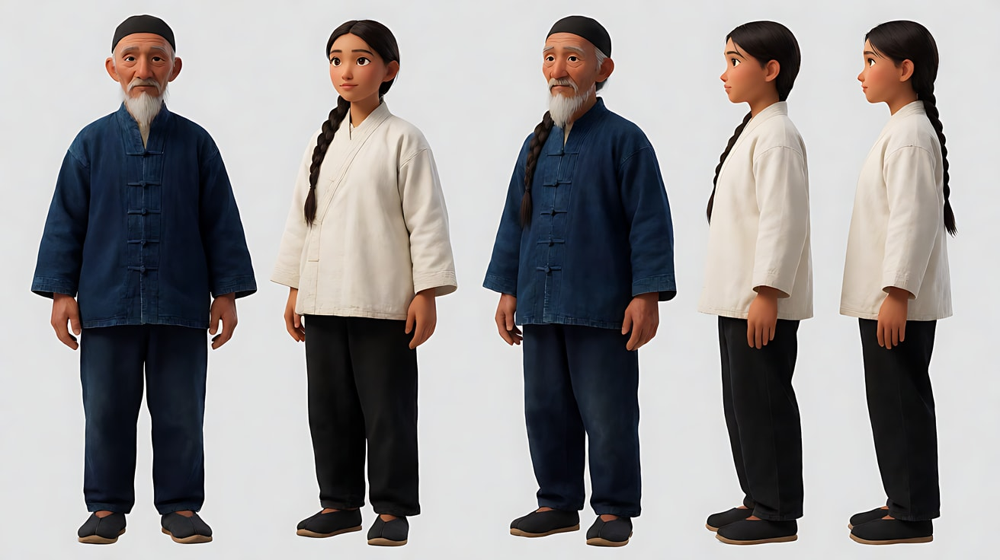

图2 场景：

```
An old lantern workshop courtyard at night seen perfectly frontally along its central axis: the entire back wall and both side walls covered from floor to eaves
with hundreds of glowing round golden-yellow paper lanterns arranged in a precise grid, a wooden workbench at the center, a stone path leading to the camera, no people.
Wide shot, eye level, centered, 35mm lens, deep focus, all lines perfectly horizontal and vertical.
Lighting: the warm golden glow of the lantern wall as the only light, saturated gold and amber, deep night sky above.
Stylized semi-realistic 3D CG rendering, feature-film animation quality. Aspect ratio 16:9.
```

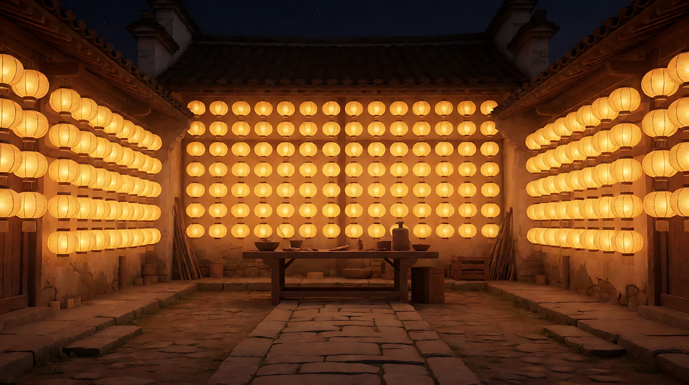

图3 镜头2关键帧：

```
Using the characters from image 1 and the courtyard from image 2:
a frontal symmetrical medium close-up two-shot, the old lantern maker on the left and the apprentice on the right facing each other in profile,
between them at the exact center of the frame he holds out a single round lantern of deep vermilion red, the only red object in the frame,
its red light falling on both their faces; the golden lantern wall blurred behind them.
Camera at eye level, centered, 85mm lens, shallow depth of field.
Keep the faces, hairstyles and outfits exactly as in image 1. Stylized semi-realistic 3D CG rendering, feature-film animation quality. Aspect ratio 16:9.
```

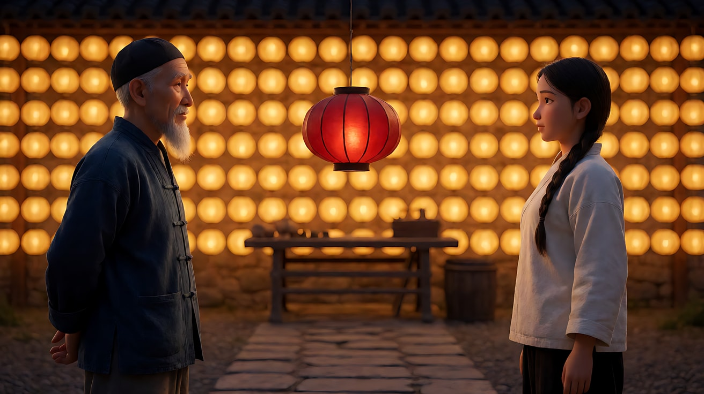

**【多图生视频 · Seedance】**

```
【素材分工】@图片1 锁定灯匠与徒弟的身份与服装，不参考其背景；@图片2 仅参考庭院对称布局与金黄灯墙，不作为首帧；@图片3 仅作为镜头2的构图与红灯外观参考。
【画风】风格化写实三维CG质感，高饱和色彩。
镜头1：正面中心对称全景，金黄的灯墙占满背景。十六名穿深靛蓝衣服的工匠分左右两列站在石径两侧，每列八人，徒弟穿白衣独自站在中轴线上，面朝镜头。所有工匠同时弯腰，同时从地上提起一盏金黄灯笼，同时直起身。徒弟不动。镜头固定。衣料摩擦声整齐地响起又停下。
镜头2：镜头切至正面对称近景双人，灯匠在画左，徒弟在画右，两人侧身相对。灯匠双手把一盏深红色的灯递到画面正中，红光映在两人脸上，他停了一拍才松手。徒弟双手接过，低头，没有说话。镜头固定。灯笼竹骨轻轻的吱呀声。
镜头3：镜头切至高俯大远景，从庭院正上方俯视，镜头缓慢升起越过屋檐。工匠们提着金黄灯笼排成两列走出院门，汇入小镇街道上同样金黄的灯笼长河，徒弟手中唯一的一盏红灯走在队伍最前面，成为整条金色长河最前端的一个红点。远处传来一声铜锣，随后是渐起的锣鼓声。
【锁定】光线：灯墙与灯笼的金黄暖光是唯一光源；红灯是全片唯一的红色，只在镜头2出现后由徒弟持有；灯匠：白须、深靛蓝棉袄、黑色瓜皮帽；徒弟：单条长辫、白色棉布上衣；对称中轴始终居中。
【声音】镜头1与镜头2无配乐，只有整齐的衣料声与竹骨声；镜头3一声铜锣后锣鼓声渐起，无对白。
【约束】保持两人脸型、发型、服装不变；工匠动作完全同步对称；除那一盏灯外画面不出现其他红色；不要字幕、水印、Logo。
时长：14秒
```

**参数**：时长 14 秒 ｜ 画幅 16:9 ｜ 负载：3 个镜头、1 个群体同步动作 + 1 个交灯动作 + 1 个升起，属于"有挑战"档

**【检查点】**
- 六维是否都落地：全景、近景、大远景三级 / 长焦近景与高俯广角 / 正面对称中轴 / 金黄主色 + 唯一红色与白衣异色 / 固定与缓慢升起 / 仪式动作同步重复
- 红灯是否是全片唯一的红色，并在镜头3成为"一点红"
- 镜头2交灯时是否有"停一拍才松手"

**【常见问题与修复】**
| 现象 | 修复 |
|---|---|
| 灯墙里出现红色灯笼 | 场景与约束都写"所有灯笼都是金黄色" |
| 镜头3看不出红点 | 写"红灯在队伍最前端，在俯视画面中清晰可辨" |
| 镜头1徒弟也弯腰提灯 | 写"徒弟始终站在中轴线上不动" |
| 工匠人数忽多忽少 | 写明"左右各八人，共十六人" |
