# L07-17 远观固定长镜头与留白 · 提示词

> 本组练习：机位退后的远观固定长镜头、门框与纱帘遮挡、窗光与油灯等自然光、不推近不强调、人物出画后的留白、空镜过渡。｜ 配套教学：[L07-17 教学文件](../教学/L07-17-侯孝贤.md) ｜ 规范：[写作规范](../../模板/写作规范.md)
>
> 画风默认使用开关 A（风格化写实 CG）。如改用 2D 动画，删掉所有焦段、光圈、景深词。
>
> 本课风格指纹（只写技术，不写人名）：全景与中远景 ｜ 机位远离、中长焦、景深足以读清环境 ｜ 多层门框与纱帘遮挡 ｜ 窗光、油灯、烛光，低反差 ｜ 固定或极缓慢横摇，不推近 ｜ 一场一镜、省略、留白、空镜。
>
> 本课的关键约束：Seedance 默认会"给主角推近"，所以每一条都要写"镜头固定，不推近，不切特写"。

---

### 练习1：隔着两道门的晚饭（难度 ★）

**目标**：机位退到隔壁房间，透过门框远远看一家人吃饭，只有一个人做主动作。意图：让观众感到这是一个普通的晚上，而爷爷的位置今天空着。

**【生图 · Nano Banana】**

图1 关键帧：

```
A wide shot through two consecutive wooden door frames into the dining room of an old Japanese-style wooden house in a small town, early evening.
The near door frame forms dark vertical bars on the left and right edges of the frame; through the second door frame, an original family of four
sits around a low round wooden table: a mother in a faded blue blouse, a father in a white undershirt, a teenage girl and a younger boy;
one cushion at the head of the table is empty. The figures occupy only the middle third of the frame height.
Camera fixed in the adjoining room at seated height, 50mm lens, moderate depth of field so the whole room is readable.
Lighting: a single warm incandescent bulb hanging above the table as the main source, soft cool evening light from a paper window at the back,
low contrast, muted warm colors, the near room in shadow.
Stylized semi-realistic 3D CG rendering, feature-film animation quality. Aspect ratio 1.66:1.
```

中文释义：透过两道木门框的全景，看进老日式木屋的饭厅；近处门框在画面左右两侧形成暗色竖条；一家四口围着矮圆桌吃饭，主位的坐垫空着；人物只占画面中间三分之一高度；机位在隔壁房间坐高、50mm、中等景深；桌上一盏暖色灯泡为主光，后方纸窗透进冷色暮光；低反差，近处房间在暗部。

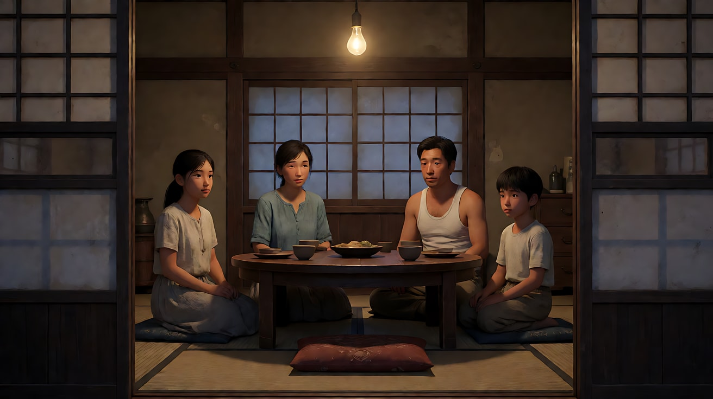

**【图生视频 · Seedance】**

```
【素材分工】@图片1 为首帧，锁定一家人的身份与服装、两道门框的遮挡构图与灯光。
【画风】风格化写实三维CG质感，自然光，低反差。
一家人安静地吃饭。母亲站起来，盛了一碗饭，放在那个空着的坐垫前，又放上一双筷子，然后坐回自己的位置。父亲低头吃饭，女孩夹菜，男孩扒饭，都没有停下，也没有人看那碗饭。镜头固定，不推近，不切特写。头顶灯泡的光稳定，后窗的暮色慢慢暗下去。结尾停在一家人继续吃饭、空位前那碗饭冒着热气的远景上。
【声音】无配乐，碗筷碰撞声，远处屋外的蝉声，隔壁人家收音机里模糊的戏曲声。母亲低声说了一句："吃饭吧。"
【约束】保持四人脸型、发型、服装不变；镜头固定，不推近，不切特写；只有母亲做主动作，其余人只做吃饭的小动作；不要字幕、水印、Logo。
时长：10秒
```

**参数**：时长 10 秒 ｜ 画幅 1.66:1（平台无此选项时选 4:3 或 16:9）

**【检查点】**
- 镜头是否完全不推近
- 是否只有母亲在做主动作，其他人保持日常小动作
- 那碗饭（缺席）是否被看见，但没有被强调

**【常见问题与修复】**
| 现象 | 修复 |
|---|---|
| 镜头推进到饭桌 | 加"机位始终在隔壁房间，门框始终在画面两侧" |
| 一家人全都看向空位 | 写"没有人看那碗饭，继续吃饭" |
| 人物冻结不动 | 给每人一个小动作：夹菜、扒饭、喝汤 |
| 出现戏剧化表情 | 写"表情平淡，像平常的晚上" |

---

### 练习2：窗边写字的女孩（难度 ★★）

**目标**：用午后窗光和门框，拍一个"什么都没发生"的日常时刻，背景有人经过。意图：让观众感到时间在这个房间里流得很慢。

**【生图 · Nano Banana】**

图1 角色定妆：

```
Character turnaround sheet of an original fourteen-year-old girl: straight black hair cut just below the ears with a side clip,
a white short-sleeve school blouse with a navy pleated skirt, white socks, a pencil in her hand.
Front view, three-quarter view, side view and back view, full body, eye-level camera, 50mm lens, deep focus,
plain light-grey background, even soft studio light from the front. Stylized semi-realistic 3D CG rendering, feature-film animation quality. Aspect ratio 16:9.
```

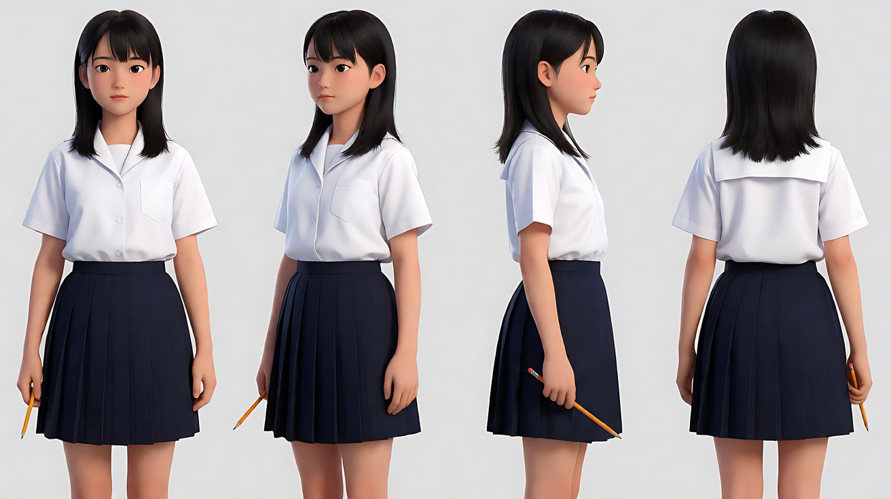

图2 场景：

```
An empty tatami room in an old Japanese-style wooden house on a humid summer afternoon, a low wooden desk under a large open window on the right wall,
thin white cotton curtains, an old electric fan on the floor, a corridor visible through a sliding door on the left leading to the kitchen, no people.
Wide shot from the corridor outside the room, eye level when seated, 50mm lens, moderate depth of field.
Lighting: soft warm afternoon window light from the right as the only source, leaf shadows from a tree outside moving on the tatami, low contrast.
Stylized semi-realistic 3D CG rendering, feature-film animation quality. Aspect ratio 16:9.
```

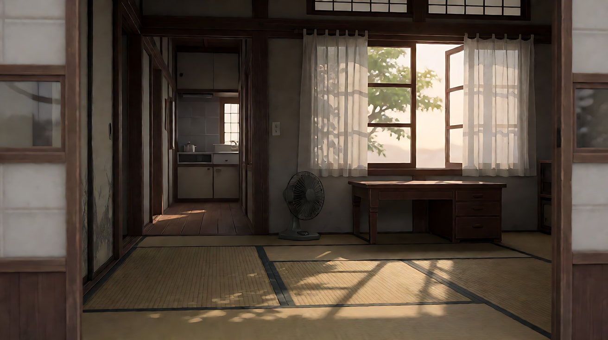

**【多图生视频 · Seedance】**

```
【素材分工】@图片1 锁定女孩的身份、校服与发夹，不参考其背景；@图片2 仅参考和室布局、窗光方向与门框位置，不作为首帧。
【画风】风格化写实三维CG质感，自然光，低反差。
镜头固定在走廊外，透过拉门的门框远远拍着和室。女孩坐在窗边的矮桌前写作业，身体微微前倾，偶尔停下笔，看一眼窗外。窗外树影在榻榻米上缓慢晃动，白色窗帘被风轻轻鼓起又落下，地上的旧电扇左右摆头。画面左侧深处的走廊里，母亲端着一盆洗好的衣服从左到右慢慢走过，没有停下，也没有和女孩说话。镜头固定，不推近，不切特写。结尾停在女孩又低下头写字、窗帘落下的画面上。
【声音】无配乐，蝉声持续不断，电扇的嗡嗡声与摆头时的咔嗒声，铅笔在纸上的沙沙声，母亲木屐在走廊上的轻响。
【约束】保持女孩脸型、发型、服装不变；镜头固定，不推近；母亲只是经过；不要字幕、水印、Logo，纸上不出现可读文字。
时长：10秒
```

**参数**：时长 10 秒 ｜ 画幅 16:9

**【检查点】**
- 女孩是否在画面里只占一部分，门框是否保留
- 背景母亲经过是否自然、不抢戏
- 窗光、树影、窗帘是否在缓慢变化

**【常见问题与修复】**
| 现象 | 修复 |
|---|---|
| 母亲走进和室和女孩说话 | 写"母亲只在走廊深处经过，不进和室" |
| 女孩抬头看镜头 | 写"她始终没有看向镜头" |
| 光线太亮像摄影棚 | 写"只有窗光，房间靠走廊一侧偏暗" |

---

### 练习3：极缓慢横摇与留白（难度 ★★★，首尾帧）

**目标**：镜头极缓慢地横摇跟着人物从一个房间到另一个房间，然后人物出画，镜头停在空空的门口。意图：让观众感到父亲把话咽了回去。

**【生图 · Nano Banana】**

图1 角色定妆：

```
Character turnaround sheet of an original man in his fifties: short greying hair, a lean face, a plain white undershirt and loose grey trousers,
wooden sandals, a paper fan in his hand.
Front view, three-quarter view, side view and back view, full body, eye-level camera, 50mm lens, deep focus,
plain light-grey background, even soft studio light from the front. Stylized semi-realistic 3D CG rendering, feature-film animation quality. Aspect ratio 16:9.
```

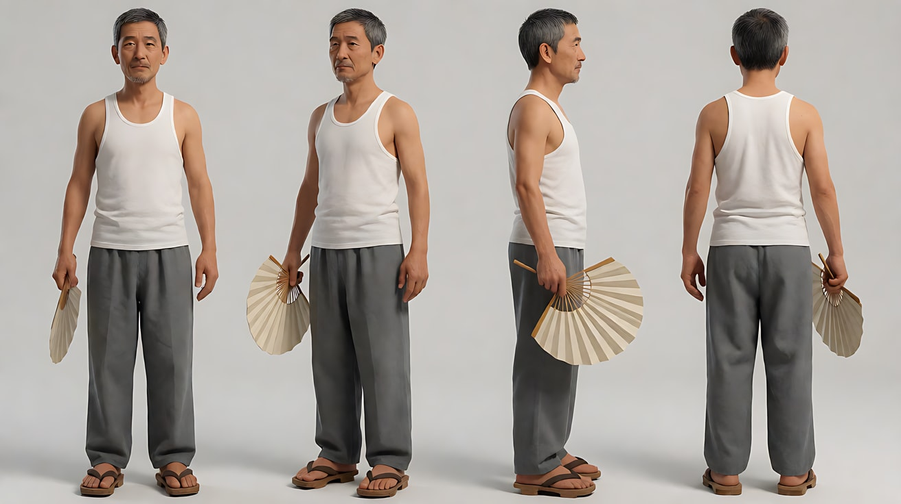

图2 首帧：

```
Using the character from image 1: a wide shot of the inside of an old wooden house at dusk, seen from a fixed position in a dim front room.
On the left of the frame, through a door frame, he stands in the kitchen by the stove, fanning himself slowly, his face turned toward the right.
On the right of the frame, a second door frame opens onto an empty back veranda with a hanging bamboo blind and the garden beyond.
Camera fixed, 40mm lens, moderate depth of field. Lighting: a dim warm bulb in the kitchen, soft blue dusk light from the veranda, low contrast.
Keep the face, hairstyle and outfit exactly as in image 1. Stylized semi-realistic 3D CG rendering, feature-film animation quality. Aspect ratio 16:9.
```

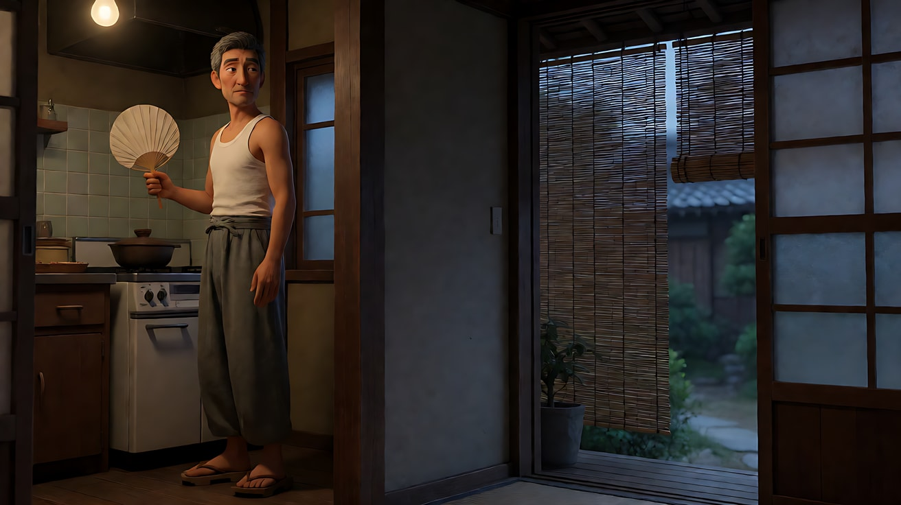

图3 尾帧：

```
The same house and lighting as image 2, the camera now panned slightly to the right so the second door frame and the empty back veranda are centered:
nobody in the frame, the bamboo blind swaying slightly, the paper fan left lying on the wooden floor of the veranda,
blue dusk light, the garden trees dark beyond. Camera at the same position and height, 40mm lens, moderate depth of field.
Stylized semi-realistic 3D CG rendering, feature-film animation quality. Aspect ratio 16:9.
```

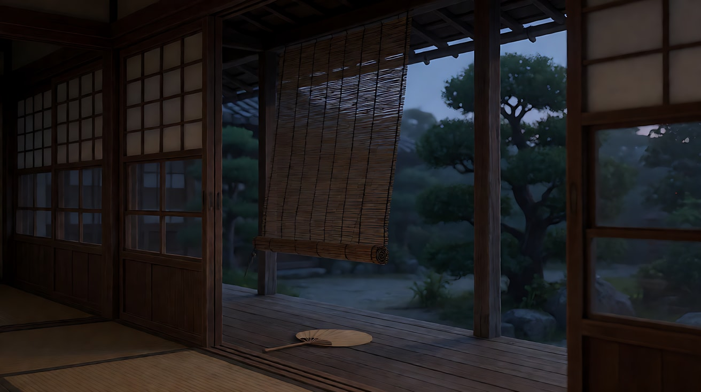

**【首尾帧生视频 · Seedance】**

```
【素材分工】@图片2 为首帧，确定房屋格局、两道门框与灯光；@图片3 为尾帧，是最终画面目标；@图片1 仅锁定人物身份与服装，不参考其背景。只生成两帧之间的连续动作。
【画风】风格化写实三维CG质感，自然光，低反差。
父亲在厨房里扇着扇子，停下来，像是要说什么，嘴唇动了一下，又合上。他走出厨房，穿过昏暗的房间，走向右边的后廊。镜头在原位极缓慢地向右横摇，跟着他，不推近，不移动机位。他走到后廊，把扇子放在地板上，走下台阶，从画面右侧出画。镜头停住，继续停留在空空的后廊上，竹帘在晚风里轻轻晃动。一镜到底。
【声音】无配乐，扇子扇动的轻响，木屐踩木地板的声音，他走下台阶后脚步声远去，最后只剩虫鸣和竹帘轻碰的声响。
【约束】保持人物脸型、发型、服装不变；镜头只横摇，不推近，不移动位置；他出画后不再回来；不要字幕、水印、Logo。
时长：12秒
```

**参数**：时长 12 秒 ｜ 画幅 16:9

**【检查点】**
- 横摇是否极缓慢、机位不移动
- 他出画后镜头是否继续停留（留白）
- "嘴唇动了一下又合上"是否可见但不夸张

**【常见问题与修复】**
| 现象 | 修复 |
|---|---|
| 镜头跟着他走出房间 | 写"镜头机位不动，只在原地向右横摇" |
| 他出画后又回来 | 写"他出画后，画面中不再出现任何人" |
| 扇子没留下 | 尾帧图里画好扇子，并写"把扇子放在后廊地板上" |

---

### 练习4：空镜、月台、远去（难度 ★★★★，多镜头）

**目标**：用三个固定长镜头（空镜 → 远观 → 留白）讲一次送别，不给任何特写。意图：让观众感到外公没有说出口的不舍。

**【生图 · Nano Banana】**

图1 角色定妆（两位原创角色）：

```
Character turnaround sheet of two original characters: a grandfather in his seventies with a thin frame, short white hair,
a faded khaki work shirt and dark trousers, rubber boots; his ten-year-old grandson with a bowl haircut, a white T-shirt, shorts, a small canvas backpack.
Front view, three-quarter view and side view of each, full body, eye-level camera, 50mm lens, deep focus,
plain light-grey background, even soft studio light from the front. Stylized semi-realistic 3D CG rendering, feature-film animation quality. Aspect ratio 16:9.
```

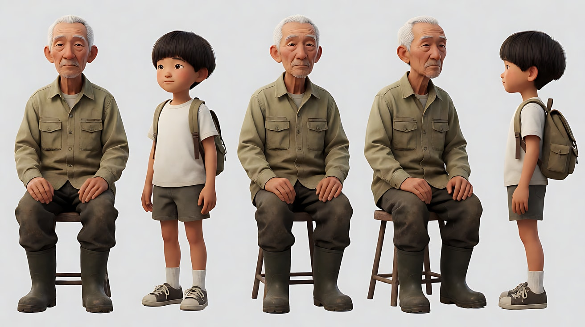

图2 场景：

```
A tiny rural train station platform in a green mountain valley on an overcast morning, a single track curving into a tunnel in the hillside,
a small wooden waiting shelter, terraced tea fields on the slopes, low clouds drifting over the mountains, no people.
Extreme wide shot from a hillside across the valley, 85mm lens, compressed perspective, deep focus.
Lighting: soft grey overcast daylight, mist on the mountains, muted greens. Stylized semi-realistic 3D CG rendering, feature-film animation quality. Aspect ratio 16:9.
```

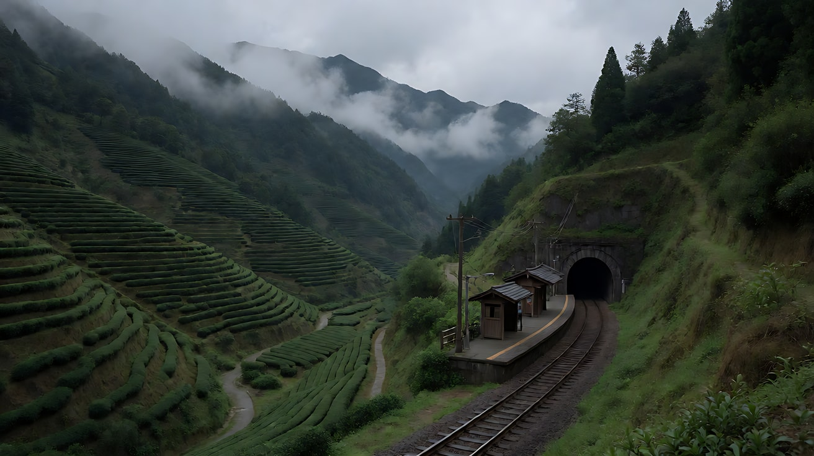

图3 镜头2关键帧：

```
Using the characters from image 1 and the station from image 2:
a wide shot of the small platform seen from the far end, the grandfather and the grandson sitting side by side on the wooden bench in the waiting shelter,
small in the frame, a wooden post of the shelter in the foreground on the left; the grandfather peeling an orange, the boy swinging his legs.
Camera fixed at standing eye level, 50mm lens, moderate depth of field. Lighting: soft overcast daylight, muted colors.
Keep the faces, hairstyles and outfits exactly as in image 1. Stylized semi-realistic 3D CG rendering, feature-film animation quality. Aspect ratio 16:9.
```

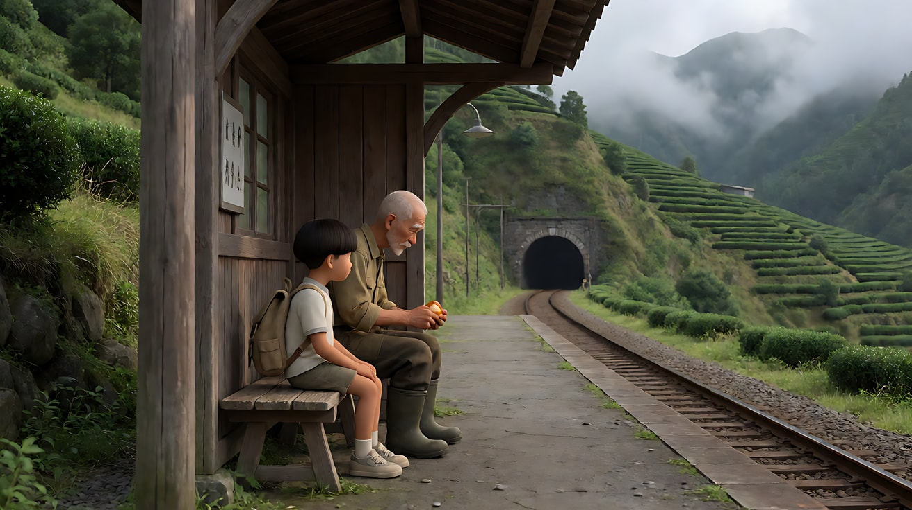

**【多图生视频 · Seedance】**

```
【素材分工】@图片1 锁定外公与孙子的身份与服装，不参考其背景；@图片2 仅作为镜头1空镜与镜头3的构图参考，不作为首帧；@图片3 仅作为镜头2的构图与站位参考，不作为首帧。
【画风】风格化写实三维CG质感，自然光，低反差。
镜头1：固定空镜，大远景，从对面山坡远望山谷里的小车站，低云缓慢地从山脊上流过，茶园层层叠叠，没有人。镜头不动。风声，远处山鸟的叫声。
镜头2：镜头切至月台远端的全景，候车亭的木柱在前景左侧遮挡，外公和孙子并排坐在长凳上，在画面里很小。外公低头剥橘子，把剥好的橘子递给孙子，自己继续剥下一个。孙子接过来，晃着腿。远处传来火车的汽笛声，外公剥橘子的手停了一下，又继续剥。镜头固定，不推近，不切特写。汽笛声由远及近。
镜头3：镜头切至与镜头1相同的对面山坡远景，火车从画面左侧驶入车站，停下，又开动，驶向山腰的隧道口，车尾消失在隧道里。月台上剩下一个很小的人影，一动不动地站着。镜头固定，火车消失后继续停留。火车声渐渐被隧道吞没，只剩风声。
【锁定】光线：全程阴天柔和漫射光，山间有雾；外公：白色短发、褪色卡其工作衫、胶靴；孙子：锅盖头、白T恤、帆布小背包；所有镜头固定机位，不推近。
【声音】无配乐，风声贯穿；镜头2有剥橘子的轻响和汽笛；镜头3火车声由近及远，最后只剩风声。两人之间没有对白。
【约束】保持两人脸型、发型、服装不变；不出现任何特写；镜头3月台上的人影保持很小；不要字幕、水印、Logo、站牌文字。
时长：14秒
```

**参数**：时长 14 秒 ｜ 画幅 16:9 ｜ 负载：3 个镜头、1 个递橘子的动作，属于"稳妥"偏上

**【检查点】**
- 是否完全没有特写、没有推近
- 镜头2"剥橘子的手停了一下"是否可见
- 镜头3火车消失后镜头是否继续停留

**【常见问题与修复】**
| 现象 | 修复 |
|---|---|
| 镜头2自动推近到两人 | 写"机位在月台远端，两人在画面里始终很小" |
| 镜头3月台人影变成两人 | 写"月台上只剩一个人影" |
| 火车出现文字或标志 | 约束写"车身没有文字和标志" |

---

### 练习5：原创 3 镜头场景《台风前夜》（难度 ★★★★★）

**目标**：综合远观、多层遮挡、油灯光、日常小动作、省略与留白，拍一个原创场景。故事：台风来临前的夜晚，老屋停电，一家人在油灯下吃最后一顿团圆饭，第二天大女儿就要去城里工作。意图：让观众感到"这顿饭和平常一样，但所有人都知道不一样了"。

**分镜表**

| 镜头 | 景别 / 机位 | 运镜 | 光 | 功能 |
|---|---|---|---|---|
| 1 | 空镜大远景 | 固定 | 暗云、风中的树 | 台风将至 |
| 2 | 隔着门框与纱帘的全景 | 固定 | 唯一一盏油灯 | 一顿平常的饭 |
| 3 | 同一机位，人走后 | 固定 | 油灯将熄 | 留白 |

**【生图 · Nano Banana】**

图1 角色定妆（三位原创角色）：

```
Character turnaround sheet of three original characters: a mother in her fifties with hair in a low bun, a faded floral cotton blouse;
a father in his late fifties, thin, short grey hair, a white undershirt; their twenty-year-old daughter with a long single braid,
a light blue short-sleeve shirt and a dark skirt.
Front view, three-quarter view and side view of each, full body, eye-level camera, 50mm lens, deep focus,
plain light-grey background, even soft studio light from the front. Stylized semi-realistic 3D CG rendering, feature-film animation quality. Aspect ratio 16:9.
```

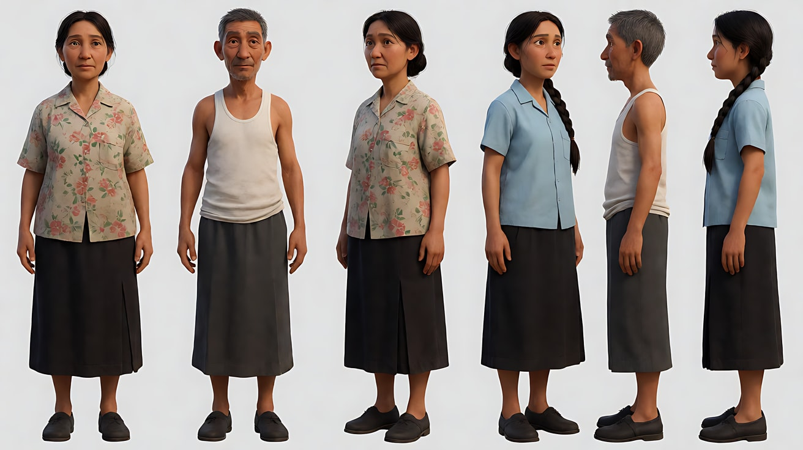

图2 场景：

```
The interior of an old single-storey brick-and-wood farmhouse at night during a power outage before a typhoon:
a main room with a square wooden table, a single glass oil lamp on the table as the only light, a thin white gauze curtain hanging in a doorway in the middle ground,
wooden shutters on the back wall rattling, the near room dark, no people.
Wide shot from the dark front room through a door frame and the gauze curtain, eye level when seated, 50mm lens, moderate depth of field.
Lighting: warm flickering oil lamp light only, everything beyond its reach falling into deep soft darkness, low contrast.
Stylized semi-realistic 3D CG rendering, feature-film animation quality. Aspect ratio 16:9.
```

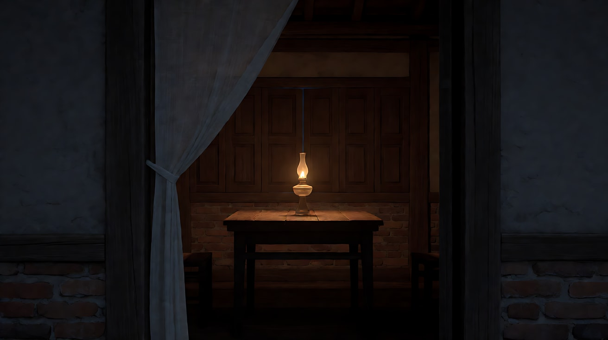

图3 镜头2关键帧：

```
Using the characters from image 1 and the farmhouse from image 2:
a wide shot through the dark door frame and the half-transparent gauze curtain, the family of three sits around the square table eating under the oil lamp,
the father on the left, the mother at the back, the daughter on the right, a packed cloth suitcase standing by the wall behind her.
They occupy the central third of the frame, softened by the gauze which moves slightly in the wind.
Camera fixed, 50mm lens, moderate depth of field. Lighting: warm oil lamp as the only source.
Keep the faces, hairstyles and outfits exactly as in image 1. Stylized semi-realistic 3D CG rendering, feature-film animation quality. Aspect ratio 16:9.
```

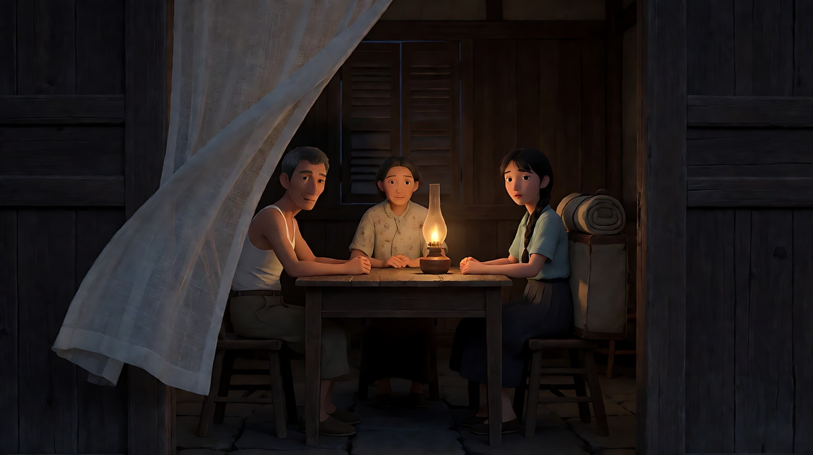

**【多图生视频 · Seedance】**

```
【素材分工】@图片1 锁定一家三口的身份与服装，不参考其背景；@图片2 仅参考老屋布局、纱帘与油灯光，不作为首帧；@图片3 仅作为镜头2与镜头3的构图参考，不作为首帧。
【画风】风格化写实三维CG质感，自然光，低反差。
镜头1：固定空镜大远景，夜色中的村庄，老屋只有一扇窗透出微弱的暖光，屋旁的竹林和大树在越来越强的风里一阵阵弯下腰，天上的暗云快速移动。镜头不动。呼啸的风声，竹林的哗哗声。
镜头2：镜头切至隔着门框与纱帘的全景，油灯下一家三口围坐吃饭，纱帘在风里轻轻飘动，人物时隐时现。母亲把一块鱼夹到女儿碗里，女儿低头吃，父亲默默喝汤。母亲又夹了一块，女儿把碗往前推了一点，摇摇头。母亲停了一下，把那块鱼放回盘子里。镜头固定，不推近，不切特写。窗板被风吹得咔咔作响，碗筷声。母亲低声说："明天早点起。"
镜头3：镜头切至稍晚，与镜头2同一机位，饭桌已经收好，人都离开了，只剩桌上那盏油灯，火苗在风里摇晃，越来越小，墙边的布箱子还在原地。纱帘在前景缓慢飘动。镜头固定，继续停留。风声，远处一扇门轻轻关上。
【锁定】光线：屋内唯一光源是桌上的油灯；母亲：低发髻、褪色碎花衬衫；父亲：灰色短发、白背心；女儿：单条长辫、浅蓝短袖衬衫；布箱子始终靠在女儿身后的墙边；所有镜头固定，不推近。
【声音】无配乐，风声贯穿并越来越强；镜头2有碗筷声与一句低声家常话；镜头3只剩风、火苗和远处的关门声。
【约束】保持三人脸型、发型、服装不变；不出现任何特写；镜头3画面里没有人；不要字幕、水印、Logo。
时长：15秒
```

**参数**：时长 15 秒 ｜ 画幅 16:9 ｜ 负载：3 个镜头、1 个夹菜往返动作、1 句对白，属于"有挑战"档；失败时把镜头1空镜单独生成

**【检查点】**
- 六维是否都落地：大远景、全景 / 机位远、中等景深 / 门框与纱帘遮挡 / 唯一油灯光 / 全部固定不推近 / 省略（跳过收拾）+ 留白（空桌与油灯）
- 镜头2"把鱼放回盘子"这个克制的动作是否清楚
- 镜头3画面里是否没有人，镜头是否停留

**【常见问题与修复】**
| 现象 | 修复 |
|---|---|
| 镜头2模型推近到母亲 | 加"机位在前屋暗处，纱帘始终在前景" |
| 纱帘遮挡过多看不清人 | 写"纱帘半透明，只轻微柔化人物" |
| 镜头3油灯熄灭画面全黑 | 写"火苗变小但没有熄灭" |
| 女儿哭泣或情绪外露 | 写"她表情平静，只是摇了摇头" |
