# L07-18 垂直空间、分割线与天气叙事 · 提示词

> 本组练习：把权力拍成高度（楼梯、半地下窗、坡道）、画面分割线、精确的垂直运镜、用一个声音完成类型转折、让天气参与叙事。｜ 配套教学：[L07-18 教学文件](../教学/L07-18-奉俊昊.md) ｜ 规范：[写作规范](../../模板/写作规范.md)
>
> 画风默认使用开关 A（风格化写实 CG）。如改用 2D 动画，删掉所有焦段、光圈、景深词。
>
> 本课风格指纹（只写技术，不写人名）：能同时容纳上与下的中全景 + 精准插入 ｜ 2.39:1 宽银幕、广角深焦 ｜ 垂直分层与竖直分割线 ｜ 上层阳光大窗、下层荧光灯低窗 ｜ 精确的垂直下降与上升 ｜ 声音触发的类型急转。

---

### 练习1：街面高度的窗（难度 ★）

**目标**：只用一个画面讲清"这家人住在城市的下面"。意图：让观众感到雨对他们来说不是风景。

**【生图 · Nano Banana】**

图1 关键帧：

```
A wide shot inside a cramped semi-basement apartment on an overcast afternoon. A narrow horizontal window runs along the top of the frame,
its sill level with the street outside: through it we see only the lower legs and shoes of passersby, the wheels of a passing scooter, a puddle.
Below the window, an original family of three is squeezed into the low room: a father in his fifties in a faded polo shirt sitting on the floor folding pizza boxes,
a mother in her fifties with permed short hair ironing on a low board, a twenty-year-old son with glasses holding his phone up toward the window searching for signal.
Clutter, hanging laundry, a small toilet raised on a platform in the corner. Camera at seated height from the opposite wall, 24mm lens, deep focus.
Lighting: dull grey daylight from the street-level window as the only daylight, a greenish fluorescent tube on the low ceiling, low contrast, muted green-grey palette.
Stylized semi-realistic 3D CG rendering, feature-film animation quality. Aspect ratio 2.39:1.
```

中文释义：半地下室全景，窄长的窗在画面上沿，窗台与街面齐平，窗外只看到行人的小腿和鞋、电瓶车轮、水洼；窗下一家三口挤在低矮的房间里：父亲叠披萨盒、母亲熨衣服、儿子举着手机找信号；墙角高台上的马桶；坐高、24mm、深焦；街面窗的灰光 + 低天花板的偏绿荧光灯；绿灰低饱和。

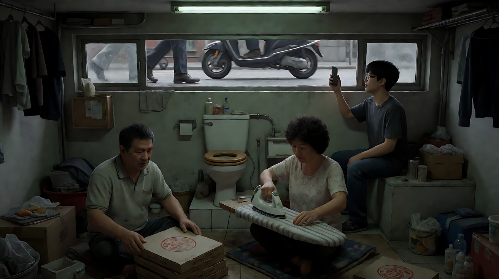

**【图生视频 · Seedance】**

```
【素材分工】@图片1 为首帧，锁定一家三口的身份与服装、半地下室布局与街面窗的高度。
【画风】风格化写实三维CG质感，宽银幕，偏绿灰低饱和。
窗外开始下雨，雨点打在街面的水洼上，溅起的水花从窗缝里溅进来，落在窗台上。行人的腿加快了脚步，一双皮鞋踩进水洼，泥水溅到玻璃上。屋里儿子仍然举着手机找信号，母亲继续熨衣服。父亲停下手里的披萨盒，抬头看了一眼窗户，站起身，把窗台上的一卷卫生纸挪到高处的架子上，又坐回去继续叠盒子。镜头固定。结尾停在一家人仍然各做各事、窗外雨越下越大的画面上。
【声音】雨声由疏到密，街上行人匆忙的脚步声，熨斗喷气的嘶声，纸盒折叠声。儿子自言自语："又没信号了。"无配乐。
【约束】保持三人脸型、发型、服装不变；窗外只出现行人的腿和鞋，不出现完整的人；镜头固定；不要字幕、水印、Logo。
时长：9秒
```

**参数**：时长 9 秒 ｜ 画幅 2.39:1（平台无此选项时选 16:9）

**【检查点】**
- 窗户是否在画面上沿、与街面齐平
- 窗外是否只看到腿和鞋
- 父亲的动作（挪卫生纸）是否把"雨会淹进来"说清楚

**【常见问题与修复】**
| 现象 | 修复 |
|---|---|
| 窗户变成普通高度 | 写"窗台与外面街道路面齐平，窗户贴着天花板" |
| 房间宽敞明亮 | 写"房间低矮拥挤，天花板很低" |
| 窗外出现完整的人 | 写"窗外只能看到膝盖以下" |

---

### 练习2：楼梯上下与分割线（难度 ★★）

**目标**：在一栋明亮的大宅里，用楼梯的高低和一道墙角分割线，把女主人和管家放进两个世界。意图：让观众感到她们之间隔着整整一层楼。

**【生图 · Nano Banana】**

图1 角色定妆（两位原创角色）：

```
Character turnaround sheet of two original characters: a lady of the house in her early forties with sleek shoulder-length hair,
a cream silk blouse and wide white trousers, bare feet; a housekeeper in her late fifties with short practical grey hair,
a plain navy work dress with a white apron, rubber house slippers, holding a folded towel.
Front view, three-quarter view and side view of each, full body, eye-level camera, 50mm lens, deep focus,
plain light-grey background, even soft studio light from the front. Stylized semi-realistic 3D CG rendering, feature-film animation quality. Aspect ratio 16:9.
```

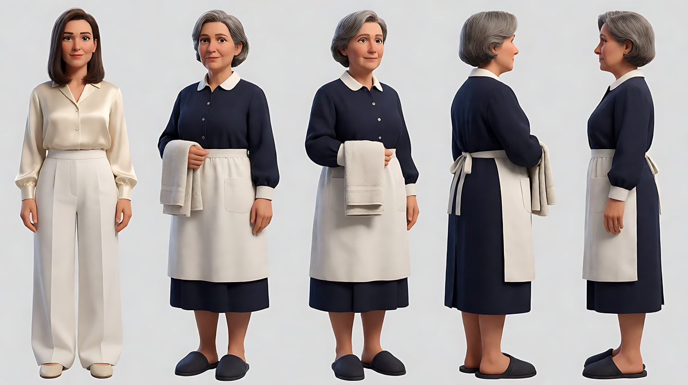

图2 场景：

```
An empty modern minimalist hillside mansion interior, a huge double-height living room with a full-height glass wall onto a sunlit green lawn,
a floating concrete staircase rising along the right wall to an upper landing, and beside it a vertical wall corner that separates the bright living room
from a narrow dim doorway leading down to a service corridor on the right edge, no people.
Wide shot at standing eye level, 28mm lens, deep focus, perfectly horizontal and vertical lines.
Lighting: abundant warm natural sunlight through the glass wall flooding the living room, the service doorway in cool shadow.
Stylized semi-realistic 3D CG rendering, feature-film animation quality. Aspect ratio 2.39:1.
```

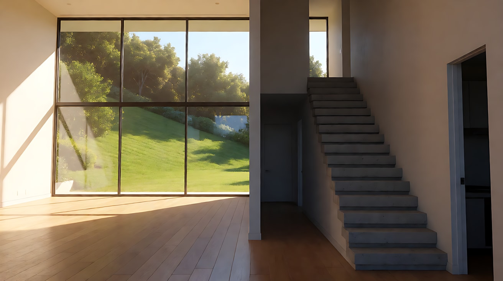

**【多图生视频 · Seedance】**

```
【素材分工】@图片1 锁定两位人物的身份与服装，不参考其背景；@图片2 仅参考豪宅的楼梯、玻璃墙、墙角分割线与光线，不作为首帧。
【画风】风格化写实三维CG质感，宽银幕，暖阳与冷阴影对比。
宽银幕中全景，画面中央一道竖直的墙角线把画面分成两半：左侧是阳光照满的客厅和悬空楼梯，右侧是通往佣人走廊的昏暗门洞。女主人站在楼梯最上方的平台上，阳光照着她的白衣，她低头看着下方，抬手指了指楼梯扶手上的一处。管家站在右侧阴影里的门洞口，比楼梯最下一级还低一个台阶，双手捧着毛巾，仰头看向上方，点了点头，然后走出阴影，踏上楼梯第一级，用毛巾擦扶手。镜头缓慢地垂直下降，从女主人的高度降到管家的高度，终点停在管家擦扶手的手和楼梯最下面几级台阶上，女主人的身影留在画面上方的阳光里。
【声音】无配乐，室内空旷的回声，玻璃外草坪洒水器的嘶嘶声，毛巾擦拭的轻响。女主人语气轻快地说："这里，还有一点。"管家低声应道："好的。"
【约束】保持两人脸型、发型、服装不变；女主人始终在楼梯上方不下楼；镜头只做一次垂直下降；不要字幕、水印、Logo。
时长：10秒
```

**参数**：时长 10 秒 ｜ 画幅 2.39:1

**【检查点】**
- 分割线是否清晰，两人是否在两个"世界"
- 高低差是否明显（她在最上，管家在最下还低一级）
- 镜头是否只做了一次精确的垂直下降

**【常见问题与修复】**
| 现象 | 修复 |
|---|---|
| 女主人走下楼梯 | 写"她始终站在上方平台，不移动位置" |
| 分割线消失 | 写"墙角线是画面正中一条清晰的竖线" |
| 镜头下降时晃动 | 写"像升降臂一样平稳垂直下降" |

---

### 练习3：暴雨中的下坡（难度 ★★★，首尾帧）

**目标**：用首尾帧把"从坡顶走到坡底"锁定为一次长长的垂直下降，雨水和人一起往下流。意图：让观众感到他每走一步都离家更近，也离灾难更近。

**【生图 · Nano Banana】**

图1 角色定妆：

```
Character turnaround sheet of an original man in his early fifties: a weathered face, short cropped hair with grey sides,
a cheap grey windbreaker over a faded polo shirt, worn slacks, cheap sneakers, a clear plastic convenience-store umbrella.
Front view, three-quarter view, side view and back view, full body, eye-level camera, 50mm lens, deep focus,
plain light-grey background, even soft studio light from the front. Stylized semi-realistic 3D CG rendering, feature-film animation quality. Aspect ratio 16:9.
```

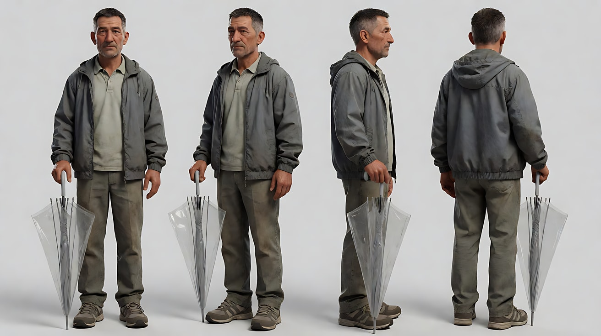

图2 首帧：

```
Using the character from image 1: a high-angle wide shot at the top of a very long, steep, narrow outdoor concrete staircase descending through
a dense old hillside neighborhood at night in heavy rain. He stands small at the top step, seen from above and behind, holding the clear umbrella,
the stairs dropping away in front of him into the dark, rainwater already streaming down the steps.
Camera high above the top of the stairs, 24mm lens, deep focus. Lighting: a single cold street lamp at the top, the bottom of the stairs dark,
rain streaks catching the lamp light. Keep the face, hairstyle and outfit exactly as in image 1.
Stylized semi-realistic 3D CG rendering, feature-film animation quality. Aspect ratio 2.39:1.
```

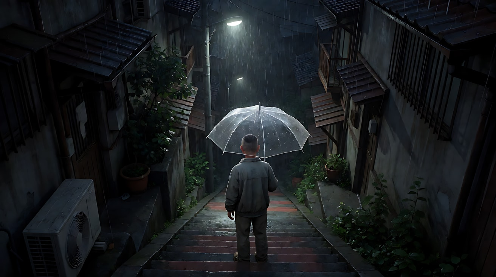

图3 尾帧：

```
Using the character from image 1: a low wide shot at the bottom of the same staircase, a narrow low-lying street flooded with knee-deep brown water,
he stands in the water at the bottom step, his umbrella collapsed in his hand, looking down the flooded street toward a row of half-submerged semi-basement windows.
Camera low near the water surface, 24mm lens, deep focus. Lighting: a flickering greenish shop light, cold rain, deep shadows.
Keep the face, hairstyle and outfit exactly as in image 1. Stylized semi-realistic 3D CG rendering, feature-film animation quality. Aspect ratio 2.39:1.
```

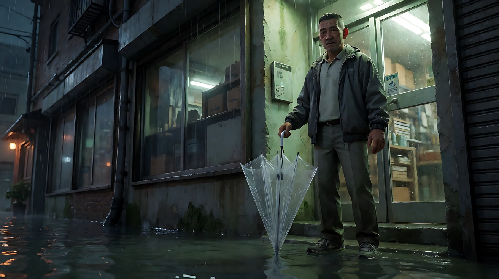

**【首尾帧生视频 · Seedance】**

```
【素材分工】@图片2 为首帧，确定坡顶的高位构图与雨夜光线；@图片3 为尾帧，是最终画面目标；@图片1 仅锁定人物身份与服装，不参考其背景。只生成两帧之间的连续动作。
【画风】风格化写实三维CG质感，宽银幕，冷色雨夜。
他撑着透明雨伞，一级一级走下长长的陡峭楼梯，雨水在台阶上汇成小瀑布，跟着他一起往下流。镜头从坡顶的高位开始，随他向下，持续缓慢地垂直下降，楼梯两旁的老房子一层层从画面两侧升上去。走到一半，一阵风把他的伞吹翻，他把伞收起来，继续往下走，全身被雨淋湿。镜头一路降到接近水面的低位，他踩进齐膝深的积水里，停在最后一级台阶上，望向被淹的街道。一镜到底。
【声音】暴雨声贯穿，雨水冲下台阶的哗哗声越来越响，伞被风吹翻的啪的一声，最后是积水被他踩开的声音和远处一扇铁门被水冲撞的哐当声，无配乐。
【约束】保持人物脸型、发型、服装不变；一镜到底，镜头只做持续的垂直下降；不要字幕、水印、Logo、招牌文字。
时长：10秒
```

**参数**：时长 10 秒 ｜ 画幅 2.39:1

**【检查点】**
- 镜头是否从高位持续下降到水面高度
- 雨水是否一直"往下流"，和人同方向
- 尾帧是否到达积水的街道

**【常见问题与修复】**
| 现象 | 修复 |
|---|---|
| 镜头在中途切镜 | 写"一镜到底，连续下降" |
| 楼梯变短 | 写"楼梯很长，至少有上百级台阶" |
| 积水看起来像河流风景 | 写"窄街被淹，能看到一排半淹在水里的地下室窗户" |

---

### 练习4：门铃响起的一刻（难度 ★★★★，多镜头）

**目标**：同一场戏里从喜剧急转为惊悚，转折由一个声音触发，镜头里有分割线和高低差。意图：让观众"笑着笑着就笑不出来了"。

**【生图 · Nano Banana】**

图1 角色定妆：为练习1 中的一家三口单独生成定妆图：

```
Character turnaround sheet of three original characters: a father in his fifties in a faded green polo shirt, a mother in her fifties with permed short hair
and a floral apron, a twenty-year-old son with round glasses and a grey hoodie.
Front view, three-quarter view and side view of each, full body, eye-level camera, 50mm lens, deep focus,
plain light-grey background, even soft studio light from the front. Stylized semi-realistic 3D CG rendering, feature-film animation quality. Aspect ratio 16:9.
```

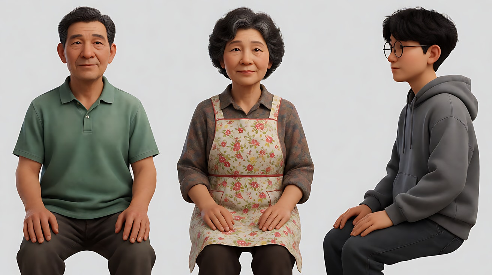

图2 场景：沿用练习2 图2（豪宅客厅）。

图3 镜头1关键帧：

```
Using the characters from image 1 and the mansion from image 2 at night:
a wide shot of the family of three sprawled comfortably on the huge white sofa in the mansion living room, laughing,
the father with his feet on the coffee table, the mother holding a glass of juice, the son pointing at something off-screen,
the glass wall behind them showing heavy rain on the dark lawn.
Camera at seated eye level, 28mm lens, deep focus. Lighting: warm pendant lights inside, cold blue rain outside.
Keep the faces, hairstyles and outfits exactly as in image 1. Stylized semi-realistic 3D CG rendering, feature-film animation quality. Aspect ratio 2.39:1.
```

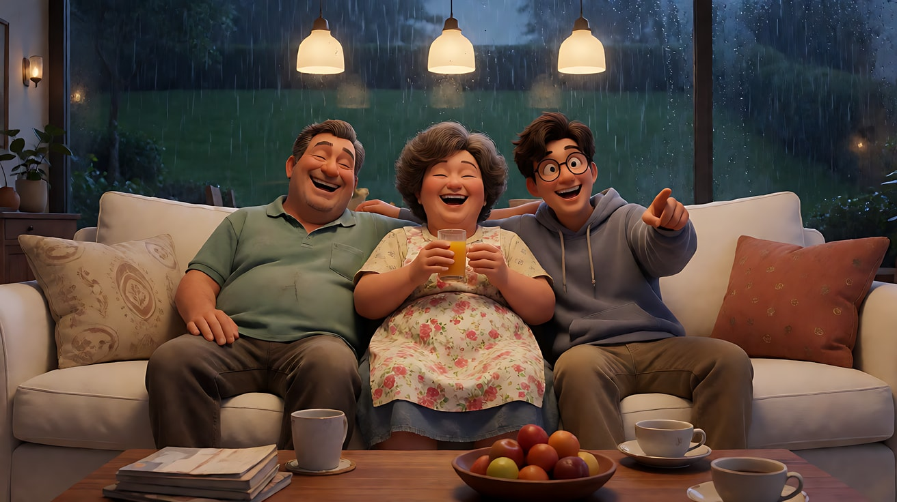

**【多图生视频 · Seedance】**

```
【素材分工】@图片1 锁定一家三口的身份与服装，不参考其背景；@图片2 仅参考豪宅客厅、玻璃墙、楼梯与墙角布局，不作为首帧；@图片3 为镜头1首帧。
【画风】风格化写实三维CG质感，宽银幕，室内暖光与室外冷雨。
镜头1：固定宽银幕全景，一家三口懒散地躺在豪宅巨大的白色沙发上大笑，父亲把脚搭在茶几上，母亲举着果汁杯，儿子指着画外比划。玻璃墙外，暴雨打在漆黑的草坪上。镜头固定。三人的笑声，雨声。门铃突然响了一声，三人的笑声同时停住，身体僵在原地。
镜头2：镜头切至墙上的门禁对讲屏幕插入特写，屏幕上是雨夜的大门外，一个打着伞、看不清脸的身影站在门前，抬手又按了一下门铃。镜头固定。第二声门铃，雨声在对讲机里沙沙作响。
镜头3：镜头切至宽银幕中全景，画面中央的墙角线把画面切成两半：左侧是灯火通明的客厅，三人一动不动地坐在沙发上，同时转头看向画右；右侧是通往佣人走廊的昏暗门洞，一道向下的台阶隐没在黑暗中。镜头缓慢垂直下降，降到通往下方的台阶高度，停住。屋里一片寂静，只有冰箱的嗡声和雨声。
【锁定】光线：客厅暖色吊灯，玻璃墙外冷蓝雨夜，门洞内昏暗；父亲：褪色绿色翻领短袖衫；母亲：短烫发、碎花围裙；儿子：圆框眼镜、灰色卫衣；三人始终坐在沙发上的同一位置。
【声音】无配乐。镜头1笑声被一声门铃截断；镜头2第二声门铃与对讲机的雨声；镜头3寂静，只剩冰箱嗡声与雨声。
【约束】保持三人脸型、发型、服装不变；对讲屏幕上的身影看不清脸；不出现任何伤害情节；不要字幕、水印、Logo。
时长：12秒
```

**参数**：时长 12 秒 ｜ 画幅 2.39:1 ｜ 负载：3 个镜头、1 个声音转折，属于"稳妥"档

**【检查点】**
- 镜头1是否先建立"喜剧"（懒散、笑声），再被门铃截断
- 三人是否"同时停住"
- 镜头3的分割线与垂直下降是否把威胁指向"下面"

**【常见问题与修复】**
| 现象 | 修复 |
|---|---|
| 门铃响后三人跳起来跑 | 写"三人同时停住，僵在原地，不起身" |
| 对讲屏幕出现清晰人脸 | 写"身影在雨伞下，看不清脸" |
| 镜头3下降方向错误 | 写"镜头向下降，停在通往下方的台阶高度" |

---

### 练习5：原创 3 镜头场景《停电的三十层》（难度 ★★★★★）

**目标**：综合垂直空间、分割线、精确垂直运镜、天气叙事与类型混合，拍一个原创场景。故事：夏夜暴雨，一栋高层公寓整栋停电。住在地下设备层值班室的老保安，在消防楼梯里遇见了从顶层一路走下来的住户小男孩。意图：让观众感到同一场暴雨，对他们两人来说是两件事——但在楼梯中间，他们短暂地平等了一下。

**分镜表**

| 镜头 | 景别 / 机位 | 运镜 | 光 / 天气 | 功能 |
|---|---|---|---|---|
| 1 | 大楼外墙大远景 | 沿外墙垂直下降 | 顶层烛光、底层漆黑，暴雨 | 上与下 |
| 2 | 楼梯井中全景 | 固定，上下对位 | 两束手电光，一上一下 | 相遇 |
| 3 | 楼梯中段双人 | 缓慢垂直上升 | 雨水从上方渗下 | 短暂平等，然后各自回去 |

**【生图 · Nano Banana】**

图1 角色定妆（两位原创角色）：

```
Character turnaround sheet of two original characters: an old security guard in his sixties with a lean weathered face, short grey hair,
a faded navy security uniform with no logos or text, a heavy hand-crank flashlight; a nine-year-old boy with a neat side-parted haircut,
crisp white pajamas with thin blue stripes, expensive soft slippers, a small battery lantern in his hand.
Front view, three-quarter view and side view of each, full body, eye-level camera, 50mm lens, deep focus,
plain light-grey background, even soft studio light from the front. Stylized semi-realistic 3D CG rendering, feature-film animation quality. Aspect ratio 16:9.
```

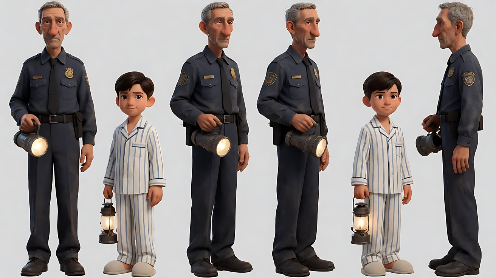

图2 场景：

```
The empty emergency stairwell of a thirty-storey residential tower during a blackout on a stormy summer night, seen from a landing looking up and down the
square stairwell shaft: flights of concrete stairs zigzagging upward into the dark and downward into deeper dark, a metal handrail spiralling,
a small high window streaming with rain, a faint green emergency exit glow without text, no people.
Wide shot from a middle landing, 21mm lens, deep focus. Lighting: almost no light, a dim green emergency glow, rain-blue light from the small window.
Stylized semi-realistic 3D CG rendering, feature-film animation quality. Aspect ratio 2.39:1.
```

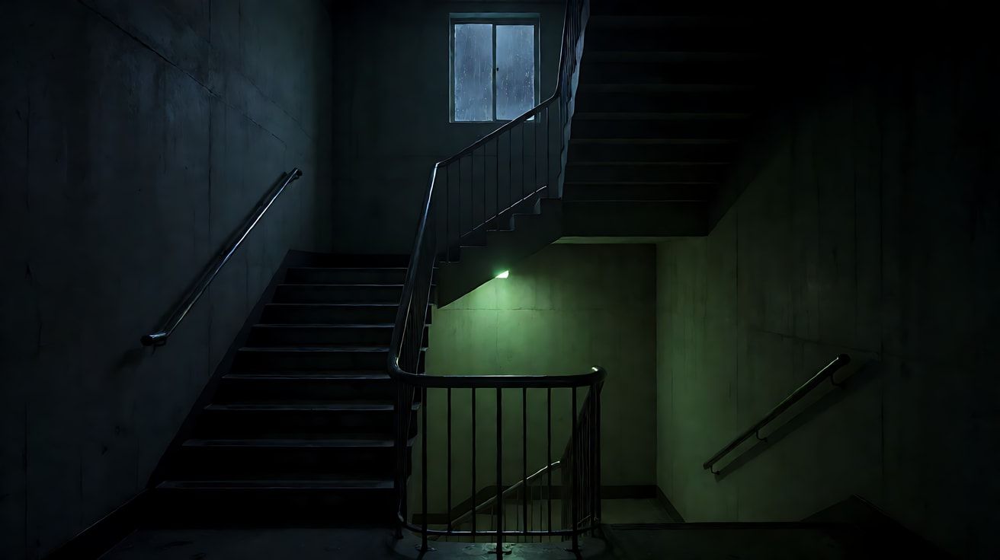

图3 镜头2关键帧：

```
Using the characters from image 1 and the stairwell from image 2:
a wide shot along the stairwell, the boy standing several flights above on the upper left of the frame holding his small warm battery lantern,
looking down over the handrail; the old guard on the lower right of the frame on a landing far below, his flashlight beam pointing up toward the boy.
The diagonal handrail and a concrete wall edge divide the frame between them.
Camera fixed on a middle landing, 21mm lens, deep focus so both are sharp. Lighting: the warm lantern above, the cold white flashlight beam below, rain-blue window light.
Keep the faces, hairstyles and outfits exactly as in image 1. Stylized semi-realistic 3D CG rendering, feature-film animation quality. Aspect ratio 2.39:1.
```

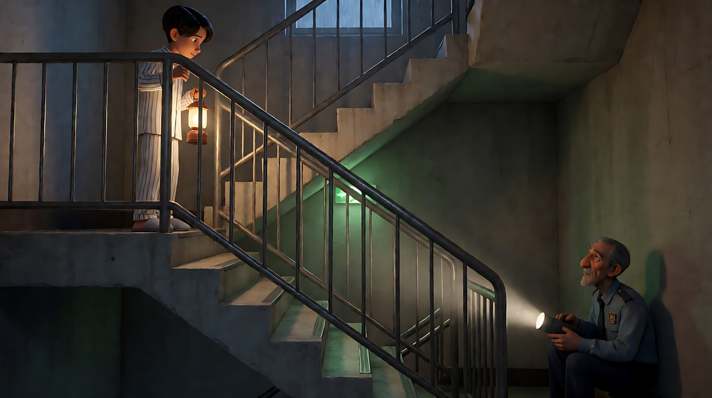

**【多图生视频 · Seedance】**

```
【素材分工】@图片1 锁定老保安与男孩的身份与服装，不参考其背景；@图片2 仅参考楼梯井结构与停电光线，不作为首帧；@图片3 仅作为镜头2的构图与站位参考，不作为首帧。
【画风】风格化写实三维CG质感，宽银幕，冷色雨夜。
镜头1：暴雨夜的大远景，三十层公寓大楼整栋停电，只有顶层的大落地窗里亮着几点温暖的烛光。镜头沿着大楼外墙从顶层缓慢垂直下降，一层层漆黑的窗户从画面上方升走，雨水沿外墙往下淌，镜头一直降到地面以下的一扇小小的通风窗，窗里有一束冷白的手电光在晃动。暴雨声，风声，越往下越安静。
镜头2：镜头切至楼梯井内的宽银幕全景，固定机位。男孩站在几层楼之上的画面左上方，举着暖黄色的小电池灯，从扶手边往下看；老保安站在远远的画面右下方的平台上，手电光向上照向男孩。斜向的扶手与墙角把画面分成两半。两人都愣住了。男孩先开口："叔叔，电梯不动了。"老保安停了一下，回答："嗯。我上来接你。"
镜头3：镜头切至楼梯中段的平台，双人中全景，老保安已经走上来，在比男孩低一级的台阶上坐下，男孩也在上一级坐下。男孩从睡衣口袋里掏出一根有点化了的冰棍，掰成两半，把一半递给老保安。老保安接过来，两人并排吃冰棍。头顶的台阶上，雨水开始一级一级地渗下来，流过男孩的拖鞋边，流向老保安的脚下。老保安看着那道水，没有说话，把男孩的脚轻轻往上挪了一级。镜头缓慢垂直上升，越过两人头顶，望向楼梯井上方无尽的黑暗。雨声，冰棍掰断的脆响，水滴落台阶的声音。
【锁定】光线：全楼停电，男孩的电池灯为暖黄，老保安的手电为冷白，楼梯井内有微弱绿色应急光；老保安：灰色短发、褪色藏青色制服无标志；男孩：侧分短发、蓝细条纹白睡衣、软拖鞋；镜头2中男孩始终在上，老保安始终在下；镜头3老保安仍比男孩低一级台阶。
【声音】无配乐。暴雨声贯穿；镜头1越往下越安静；镜头2有两句对白；镜头3有冰棍掰断声与水滴声，最后只剩雨声。
【约束】保持两人脸型、发型、服装不变；制服与楼梯井不出现文字和标志；不出现任何伤害情节；不要字幕、水印、Logo。
时长：15秒
```

**参数**：时长 15 秒 ｜ 画幅 2.39:1 ｜ 负载：3 个镜头、2 句对白、1 个分冰棍动作，属于"有挑战"档；失败时把镜头1单独生成，再用镜头1的尾帧接续镜头2与镜头3

**【检查点】**
- 六维是否都落地：大远景、中全景与插入动作 / 宽银幕广角深焦 / 上下对位与扶手分割线 / 顶层烛光与地下手电 + 雨水下渗 / 外墙下降与楼梯上升 / 冷暖与喜剧温情的混合
- 镜头2两人是否"一上一下"、被分割线隔开
- 镜头3雨水是否流向老保安，老保安"挪脚"的动作是否可见

**【常见问题与修复】**
| 现象 | 修复 |
|---|---|
| 镜头1下降不连续 | 单独生成镜头1，写"一镜到底沿外墙下降" |
| 镜头3两人坐在同一级 | 写"老保安坐在比男孩低一级的台阶上" |
| 冰棍变形或数量不对 | 简化为"他把一块饼干掰成两半" |
| 雨水变成洪水 | 写"只是细细的一股水沿台阶渗下" |
